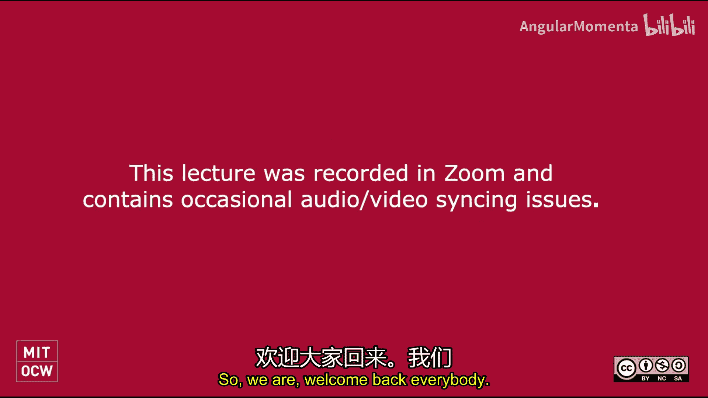
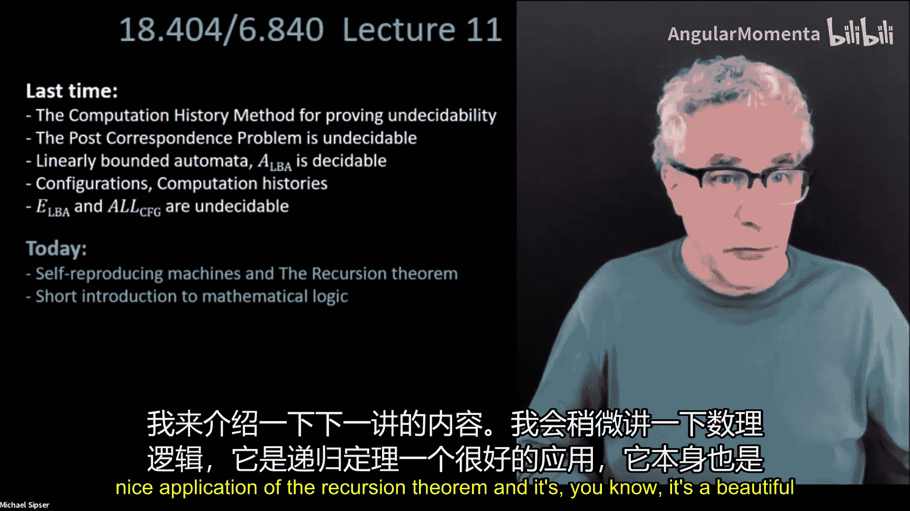
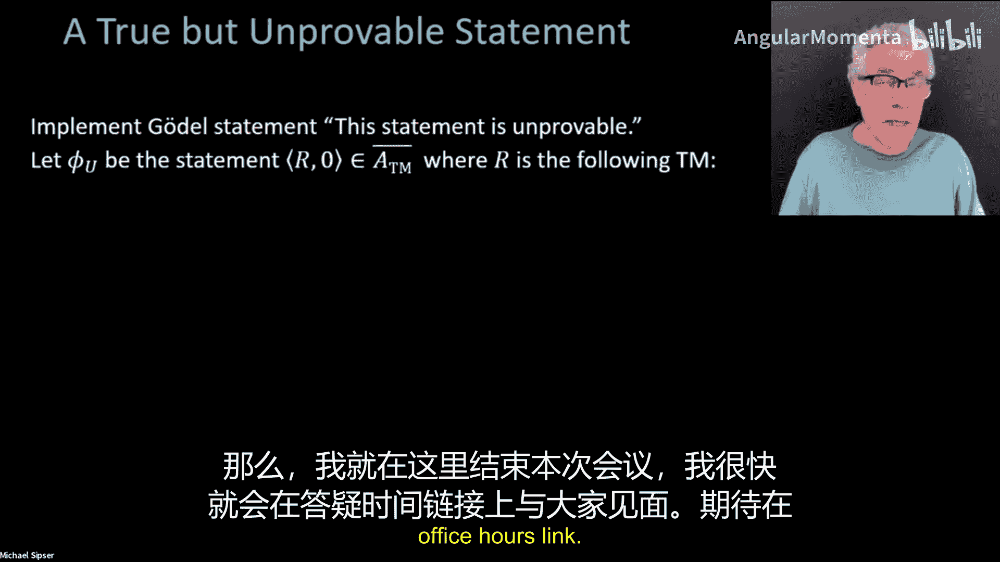
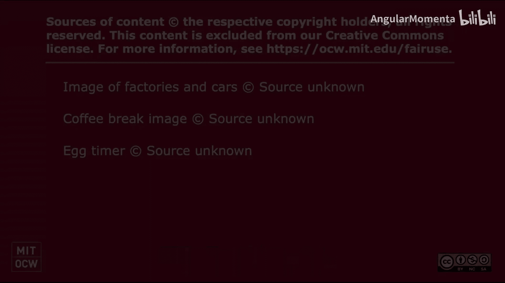

# 【麻省理工】计算理论  ｜  MIT 18.404J Theory of Computation, Fall 2020 p11 11. 递归定理和逻辑 -BV1pt7GzeEjb_p11-

So we are welcome back everybody。And we are。m going to continue our discussion of computability theory。

 touring machines。And how to prove things undecidable， which is what we've been doing。

 so we talked about this more advanced method of provingrov things undecidable last lecture called the Comp history method。

 which comes up in all sorts of proofs of undecidability and usually more complex ones。Such as。

 for example， the proof of Hilbert's 10th problem。That I mentioned whether you want to if you want to test whether a polynomial has a solution in integers。

 it's a reduction from ATM just like we've been doing all along。

 those are all of those proofs are're pretty much reduction from something undecidable and it reduction from you know from ATM is as good a starting point as any。

 and and you uses the computation history method， so what you end up doing is given a Tring machine and an input。

 you construct a polynomial。That has several variables。And where the。In order to get an integer root。

 an integer solution of that polynomial， one of the variables is going to have to be assigned to some kind of encoding of a computation history of the Turing machine that of M on W it' going to be one of those variables is going to be a computation history。

 an integer which represents the computation history for M onW and the other variables are there to help you kind of decode that so that the polynomial can actually check。

😡，And make it solution， it becomes a solution if that actually is a legitimate computation history of M1W so it really uses the very same method that we've been using all along。

 but it's it's just it's pretty hairy to construct that polynomial and do the check。

In the way that you need to do so for the post correspondence problem。

 which we introduced last time it's doing the check is relatively simple， you know that the。

The match is the is the computation history and you know following the rules of the match is fairly simple to construct that。

Post correspondence problem instance， we talked about linearly down their autometer。You know， we。

 of course we define configurations and computation histories along the way and proof there a certain problem。

 other problems are undecidable as well using the same method。Okay。

So today we're going to shift gears， we're going to in our last lecture on the computability section of the course。

 we're going to talk about something called the recursion there， which basically。

Gives Turing machines the ability to refer to themselves。

 Turing machines in any program to do self- referenceence so that you can actually get at the code of the Turing machine or the code of the program that you're writing。

 even if that's not a built in primitive of the programming language or the operating system that you're working with。

 it still gives you that access。And also we're going to if we have time at the end。

 I'm going to talk a little bit about mathematical logic， which is sort of a nice application。

Of the recursion theorem。 and it's， you know it's a beautiful subject on its own and it's something that I can give a brief introduction to。

 Okay， so today's topic。😊。

Is。About。Self reference， self reproducing machines。

 and the broader topic called the recursion Theorem。

So let me introduce it with what I would call the self reproduction paradox。And that is。

Suppose you have a factory。Like a Tesla factory， a car manufacturing factory。See's a picture。

Of that factory and it's producing cars。All right。So we have a factory that makes cars。And。

What can we say about the relative complexity of the cars？😡，Compared with the factory。

 in some informal sense。嗯。So I would argue that you would be reasonable to say that。😡。

The complexity of the factory is going to have to be greater。T the complexity of the cars。

That it makes。Because not only does the factory have to know how to make the cars。

 so it has to have all the instructions and whatever things that go into a car。

 it has to be included in the， you know at least some kind of has been in some sense represented in the factory。

😡，But the factory also has to have other stuff。you know the robots and and the other manufacturing items tools and so on for making the cars。

 so the factory has to have all the complexity of a car incorporated plus other things as well and on that for that reason one could imagine that the factory complexity is more than the car's complexity。

But now suppose you want to have a factory。That makes factories。Sort of imagine here's the picture。嗯。

So or in general， a machine that makes copies of itself。😡，Well。

 that seems at first glance to be impossible。Because。

Not only does the factory obviously have to have all of the instructions for what a factory is like。

 but it needs to have all of the extra things that it would need to do the manufacturing。😡。

And so for that reason， it seems like a， it's not possible。To have a machine make copies of itself。

I mean， you would run into the very same problem if I ask you to produce。😡。

A program what in your favorite language that prints out itself an exact copy of the same code。

 I mean you can always write a program which is going to print out some string， you know。

 like hello world。That's easy because you just put hello world into。You know。

 some kind of a variable or some sort of you know， a table into the program and say print that table。

But if you want to make a print if you want the program to print out a copy of itself。

You can't take the whole program and stick that into a table because you know the program is going to have to be bigger than the table。

 you know， and so you're going to end up with some something impossible happening because the program。

 an entire copy of the program can't fit inside the program you just get you know the program inside itself inside itself inside itself forever。

 and so you end up with like an infinite program that way。So。If， you know。

 you just kind of naively approach the problem for how to make a program。

 which is going to print out a copy of itself。😡，It's not so easy to do， but hopefully。

After today's lecture， youll see that it is possible and in fact， how to do it。😡。

And not only that is an idol。A bit of curiosity， but there are actually applications for why you might want to do that mainly within mathematics and in computer science theory。

 but there's even a kind of a real world application and if you will in a way too。

 so we'll get to that at the end。嗯。So it seems， as I'm saying。

 impossible to have a self reproducing machine， but we know that in the world。

 there are things that make copies of themselves。Living things。So it seems like a paradox。

 no cells can make copies exactly of themselves all living things can make copies of themselves。

 so how do they manage to get around this paradox。Well， in fact。

There is no paradox because it is possible to make a machine that self reproduces that makes copies of itself。

 and this has been known you know for many years， probably it goes back to Vanon Neyan who wrote a famous paper on self reproducing machines。

Okay， so self reproducing machines are， in fact， possible。嗯。

So let me give you an example of how you would make a self reproducing Turing machine。

What do we mean to that？I going to I mean a machine， I'm going to call itself。Which。

Ignores its input， so when on any input you turn it on。

 machine grinds around for a while and holds with a description of itself on the tape。

With a description of self its own code sitting on the tape。

 So very much like producing a program which would。Print out its own code。

That's really what we're doing。Um。So for that， we're going to first need a little lemma。

 which is a very simple lemma， but it looks worse than it is。

So let me just read it out to you and then I'll explain what it's saying because what it's saying is extremely simple。

So there's a computable function I'll call it Q that maps strings to strings。😡。

Which will take any string W。😡，And produce from W a Tring machine， which will print W。Okay。

 that's all it does so as you know if I give you a string W， you could produce a Tring machine。

 which would have W represented in the states and transitions of the machine so that if you turn the machine on。

 the machine will output W。I mean， I want you to give me a touring machine that prints the string 1101 on the tape。

 you can do that， I hope。😡，Um， and I'm saying and no matter what that string was。

 instead of1100 or one， you know， whatever， it's， you know， 20 zeros and then five ones。

You could do that， too。And in fact， there's a simple procedure that takes a string and maps that onto a turing machine。

 which prints out that string。So that's that's a。Computable function。

 which basically takes a string and converts it to something that evaluates to that string。😡，Okay。

 and I'm calling it Q， I don't know if this is helpful to you or not。

 it's kind of like it converts the string W to W in quotes， so Q stands for quotes。In a way。Okay。

 so if that's helpful， Nathan。嗯。Then good， but anyway。

 piece of w is a Tring machine when you turn it on。It just prints out WN holds。Okay。

 and I can find piece of W from W。嗯。Straight forward proof。Okay。

 so now I'm going to tell you no assuming that we have that computable function queue。嗯。

I'm going to tell you how to make this machine self。😡，And it's not complicated。诶。

The Tring machine a self is going to have two parts I'll call A and B。

 here is a schematic for the machine， so here's self it's in two parts A and B。

And what I mean by A and B， it's like two subines， self is going to start out running A。

 and then when a is finished it's going to pass control to B and then B is going to finish the job and when it's done you're going to have the description self sitting here on the tape。

All right。So what's left is to give you the code for A and for B。😡，Okay。

So A is going to be something super simple。😡，A is going to be that machine。

Which prints out B prints out a description of B。The one that I described up here。So remember P。

So W is the machine which prints out W。And piece of the description of B is simply going to machine that has this string piece of B stored in its states and transitions。

 you turn on that machine and it prints out B， and then it's done。😡。

So this is a very simple image a is very simple， so here just to。😡，Here， piece of B。Is a part of a？

And when it's done。B appears on the tape， so that's at the point when A has finished its work。😡。

Now it's going to pay us control to be。So we're not obviously done yet because what we want is A and B both to be on the tape。

 not just B， because self is a combination of A and B together。😡，嗯。So I have to tell you how be。

Works to finish the job。So you might think。As a first。You know。

 given what we did for getting B on the tape， that will get A on the tape in the same way by putting a copy of A inside B。

😡，So a copy of B is inside A and a copy of A is inside B。😡，And you know， at some conceptual level。

 that seems like that might do the job， but it's really not that is not a solution。

Because the fact that I can put B inside A kind of forbids me from also putting A inside B because that's going to be the same kind of circular reasoning of just putting a machine inside itself。

 you just can't do that because you're going to end up with an infinitely big machine that way。😡。

You know， in fact， if I'm putting B inside A。Co of B in terms of its description inside a。

 a is really going to be much bigger than B because it has all of B with inside it plus other stuff。

 you know， all the states and transitions for printing that B out。

So I can't have the A B much bigger than B and then B also much bigger than a so something this is this is no good。

😡，We're going to have to do something else。So how is B now going to get a hold of A？Um。And the。

The trick for doing that。Without having a copy of a inside B。

 going which doesn't work it's not going to be a good solution instead of the way that B is going to get a。

 it's going to figure out what a， it's going to figure out what a is。😡。

And how is it going to figure out what A is？Because if you remember。嗯。B can now can look at the tape。

 it sees some string there， which happens to be a description of itself， but it doesn't care。

 it sees some string on the tape。😡，A is the machine that prints out that string。

A is Q of this string。So B is simply going to compute Q of whatever it sees on the tape。😡，That is a。

Okay so it's I don't know if you can read this kind of small here。

 it's going to compute a from B sitting on the tape， so here is the instructions for B。

 it's going to compute Q of the tape contents which happens to be the description of B。

 but that's irrelevant to B B just sees some string on the tape it computes Q of that and that is the that is a because a is the machine which prints out that string。

😡，Then it's going to combine A with B。😡，Doing whatever， you know。

 slight interfacing that needs to happen， I'm not going to get into those details。

To convert those two pieces into one machine。Which is the machine self。

And then it's going to print out with self on the tape， as I'm going to indicate over here。ok。😊，So。

 that's how。A tuuring machine。Can print out a copy of its own description。And leave it on the tape。

So。😊，And what's nice about this is nothing specific of auring machines， this is a general procedure。

😡，UThat allows any programming language to print out a copy of its own code。

 you can even carry this out in English。😡，As I'm going to do in the next lot。嗯。Okay。

 so here's a good question there are many possible touring machines that can print out B。

That's right how do I know how do we get the particular one what I have't mind that' that's a little bit of a subtle question but it's a good question。

I have in mind the particular Tring machine that prints out B， which is the one that Q produces。😡。

Remember， so you have to refer back to this lemma。This lelemma produces a particular machine that prints out B from B。

😡，And that's the one that I'm going to use for A， and that's the one that B is going to be able to obtain by running the Q algorithm。

😡，To figure out what a is so you have to make sure you're being consistent and that's a little bit of a detail。

 but but it's a good question。😡，And why doesn't this create a circular argument too well there is no so that was another question I'm seeing here the on the tape well there there's no longer anything see B does not have to have a stored within it it figures out a。

😡，So in a sense， you're going to write the code for B first。😡，B is just a simple program here it is。

 there's nothing circular about it it says B is a simple the code for B is take a look at the tape。

 compute Q of that。😡，Combine the result with whatever was sitting on the tape frame before and print it up。

😡，I mean， that's a piece of code， which you can just write this will become more clear hopefully in our next slide where we talk about the English implementation。

😡，But just I'd want to rush to that。So， you know， you can figure out B without even knowing what A is。

 B stands alone。😡，But then you know， because these are just a piece of code that runs Q based on what what it sees on the tape a。

😡，Now， you need to know what B is in order to obtain A。😡。

Because a has the code for B embedded within a as a string。😡，So first you produce B。

 then you can figure out， then you can obtain a， there's nothing circular in this argument。

 I don't know if that's helpful to you， but know you may need to mull it over or maybe it'll be helpful from the next slide。

 so let's go there now。Okay， so as I'm saying， you can implement it in any language， in particular。

 you can implement it in English。Okay， so let's just shift gears。

 let's talk about writing down English instructions。😡，And then I'll show。

 you know what happens if you carry out those instructions's。Start simple。

 how about the sentenceo right，Ho world？So， you know。

 an obedient person reading those instructions would then。Right， hoo world。

On their paper or wherever。嗯。Okay。Fine， you get the hopefully you get you get the idea so now what I'd like here is an here is。

😊，Another sentence。😡，Another instruction， write this sentence。And the the reader。

 the obedient reader would then。Okay， write the sense。This is the kind of thing I'm looking for。

Here is a sentence which instructs the reader to make an exact copy。😡，But I don't like this one。

Even though it does， in a sense what I'm looking for。Because。It kind of cheats。When it has this。

 this refers to the entire sentence itself。It's using kind of implicitly here。

A construct which a Tring machine does not have。The Turing machine does not have a way of accessing its own code。

😡，And in fact， really what the point of this whole theorem that we're going to present is that you don't need to have this self reference as a primitive。

You can get that effectively using the procedure that I'm describing。

 which will give you the same effect so you don't need it as a primitive。

 you can design some software basically， which will give you the same effect。嗯。

So let me show ahead to do that in English。So let's look at a slightly moreops so cheating。

 so tuuring machines don't have the self reference periitive。So let's look at another sense here。

Write the following twice the second time in quotes。And then hello work。

So what do we get if we follow that instruction？嗯。Well。

 you get hello world and then hello world again now in quotes。给。hopefully not too bad。

But now I'm one step away for doing the implementation of the self reproducing algorithm in English。

Write the following twice the second time in quotes。And then in quotes the same text。

Now following those instructions， you get。Well。Write the following twice the second time in quotes。

 so that comes out here and the second time you put it in quotes。Just like you did with the Ho world。

But that's exactly what here。The output is exactly what the input was。And there's， you know。

 even though there is a part of the sentence here， which refers to a different part。

So here the first part is referring to the second part。

Never do I have to have the sentence referring to its entirety you know。

 there's no part of the sentence here that's pointing at the entire sentence。😡。

And so this here manages to get the effect that I'm looking for where the output is equal to the code。

 but doesn't have avoids having the self reference is one thing is referring to something else。

 but not referring back to itself。Okay， so let me just see here。

So here is sort of'm sort of I'm going to have a check in on this in a minute。

 so I'm going to try to contrast what's happening here with what's happening in that Tring machine self that I had from the previous slide。

Okay， so Mon mull is over and I'm going to give you a check in to see this is a little bit of a challenging check in。

 but let's see if you can figure your way your way through it。Okay。

 and basically it says so that really what we're doing here is called the recursion theorem as you'll see we'll actually present the recursion theorem formally on the next slide。

 but here in both of these cases we kind of have a template part and an action part both in both cases we have there are two parts to the instructions。

The template and the action。Okay， so I'm going to leave it to you to try to imagine which of those which is which in each of these two examples。

 and then I'm going to ask you to pick。😡，In the Tring machine， which is the action。

 which is the template？And in the sense， which is the action and which is the template。

 the action is the part that where there's some interesting sort of stuff instructional stuff happening that you have to carry out。

 the template is really basically just text。Or just just a string。Okay， so let me pull up that poll。

See what you think。Because I'm asking you now to indicate where is the action part in both of those cases。

What is the upper phrase and lower phrase I mean of the sentence here。

 so write the following twice this is the upper phrase and the part in quotations is the lower phrase。

 sorry。Okay， almost done here。5 seconds。A fewew of you have not answered yet， answer it。Yeah。

One second to go， okay， here we go and ending polling。So the majority here is correct。You know， in。

 I would say in the English sentence here， the action part is the first part。

 that's where you're actually have being directed to do something the second half of the sentence。

 the lower part of the sentence is just a template。Written， you know this is just some string here。

 there's no action really being directed， it happens to be the same as the top。

 but this could have been just hellello world， this could have been anything。😡。

And then the upper part acts on that， so the upper part is the action part。

 so it's the upper phrase that's the relevant part now in deter turing machine。It's kind of the。

 in a sense， it's the other way around。The first part is really just the template the second part B is is where you're doing some actually work on the template you're taking that that basically text which could be anything a could be anything and your're。

Fig looking at that template and reconstructing what a was from from that string that appears on the tape so B is actually one the one that's doing the work so it's B and the upper phrase it's part C is correct。

Okay， so let us continue then。呃。Oh， I want to mention here problem six on the PSet。So， you know。

 your job really is to implement this in， you know。

 if you have a programming language and you that you like you can you you can it could be。

Python or whatever your favorite Java whatever you like you can implement this if you don't there any programming languages。

 then just make up some sort of pseudo programming language and implement it there let me point out that。

Getting the quoting， right？😡，啊。It is a bit of a pain because you have to kind of escape the quotes and so on I'm not going to be fussy about that so you can still get full credit even if you don't get the quoting part quite correct do your best。

I think it's an interesting problem to try to solve and if you you know if you struggle with it for a while。

 you know you know it's slippery it's a kind of thing you have to you know。

You can easily spend a couple of hours on this problem because it's a bit tricky to manage to make a program which prints itself out。

 which is what the task of problem six is on the PSet。

 but don't fuss about too much on the quoting if that's the only thing that's hanging you up。

 try to get the main structure of it， which is fairly simple actually and if you can't get the quoting part to work。

 you know I'll ask the graders not to penalize you for that part。Um。Okay。

Let's let's then look at the sort of the more formal version of what we've just done and really kind of also taking it to the next level because being able to print out a copy for yourself is。

It's kind of a curiosity in a way， but you know the recursion theorem says not only can you make a machine which prints out a copy of itself。

 but you' going to actually make a machine which can obtain a copy of itself and then do some computation on that copy of itself on its own description。

 which actually turns out to be a useful thing to do。Once you have access to your own description。

 as you'll see from some examples， then you can do some perhaps some interesting things with that。

Okay， so basically what the recursion theme is a kind of a compiler。

It allows you to have a new primitive when you're writing Turing machines。

 which is compute your own description。😡，And the recursion theorem will implement that for you。Okay。

So the technical form of the recursion theorem is going to look a little bit。Counterintuitive。

 perhaps， let me put it out there。If if you struggle with a little bit with the slide don't sweat it the main thing to remember and we'll see from examples is that you can compute your own description in a Turing machine and that's going to be allowed as code Okay so what the way we're going to do this is。

😡，啊。What the recursion theorem does for you is it says。You can write a piece of code。Here。

 let's call a piece of Turing machine code algorithm algorithm code called T。

And T is going to get transformed into a new machine， R。😡，And R is going to get provided。😡。

A copy of the program itself， which is just a description of R for free。😡。

But otherwise it's going to act exactly like T， so r is going to act exactly like T。

 except r is going to have provided a copy of R。😡，And that's what the theorem shows you how to implement。

So let me just see， so for any machine T， there is a machine R。Whi for any W。

 which is going to be input to the input for R， R on W operates the same as T on the input with W where it's given R。

😡，So R is going to be getting access to R without it's going to befiiguring。😡。

Obtaining R by calculating it。Maybe it'll be clear from the proof I always struggled with how to explain this clearly。

So now the proof of this is going to be very much like the proof from two slides back。

 except there's going to be three parts。Thiss the Part T that you're going to provide。😡。

And the T is going to be the Tring machine code that says， get your own description。

And you don't have to worry about how that happens。The compiler is going to add on the A and B parts。

 which is going to get the whole description of the whole thing。

 which is R and feed it into T as if T you know， T had it as an input。😡。

So T is going to be allowed to get its own description now and operate on now it does its thing。

 you know， on the input w。😡，So the way it's going to work， so t is given。😊，诶。A is going to be。

 as before the description of B now with T， so when a is done。

 it's going to produce BT sitting on the tape next to the W。😡，Um。

B is going to now figure out what a was from the Bt sitting on the tape。😡，Okay。

 and then it's going to combine that to get AbBT， which is R。And after that。

 it passes control to T with。With W and now R sitting on the tape and now t is going to have its own description。

 but don't forget now t has been modified to be R so it's not that t is going to get t on the tape its for this to make sense this is going to be now the new machine R and R is getting appears on the tape and now the code that you provide a t is get is now going to get to operate on that。

😡，ok。If you didn't get that'm not I'm not worried， the main thing is that you can use compute your own description when you're describing Turing machines。

 that's what this thing is telling you。And I think it'll be， oh， there's a check in here。嗯。Yeah。

 so I don't know let's let's do this one kind of quickly here can we use the recursion theorem to design a machine tea。

Which instead of producing its own description。recognizes accepts only its own description as an input。

So the language of this machine is going to be simply the one string， the description of T。

So can we make it a machine tea which does this， you know and now I'm looking at this check and this T here is confusing with that T。

 it's not the same T。That's bad， I should call it M。

Design a machinech M where L of M is the description of M。诶。

And can we use the recursion theorem to do that？You knowWhat I would ask you to do is think about it in this context。

😡，You can use compute your own description when you're writing the code for this machine。

If you could do that， could you make a machine which just accepts strings。

 which happened to be their own description？This is supposed to be easy。

 but I think it ended up being a little bit more complicated than I wanted。嗯。Okay， launch polling。

Make your best guess。I think you all kind of kind of see what I was kind of leading you leading you the leading you along the path here yes so I think you're pretty much all are getting it maybe a few of you are。

嗯。Unsure， but anyway。Let's just wrap this one up quickly so that we can move on I think you're pretty much so five seconds。

I'm going to end it。So the correct answer is yes as I was hinting at so let's I think maybe this example would have been better after the next example and then we're going to have a break。

So here is a new proof that ATM is undecidable。😡，But now using the recursion there。

And this is going to give you a nice example of how we use the recursion theorem in action。Okay。

 so remember， we spent， you know， half a lecture or more with a proof bydiaagonalization as our first example of an undecidable problem ATM。

 we know subsequently showed other things undecidable by reduction， but for the very first example。

 we used that diagonalization。Now I want to give you a new proof。Okay，'s approved by contradiction。

 assume we have a tuuring machine that decides H that decides ATM。

 it starts the same way that diagonalization proof went。But now I'm going to make a machine called R。

😡，So going to be this is different from the earlier proof。R says on inputput W。

I get my own description， use the recursion theorem as the way these things always start。

Now I'm going to use H。😡，Now that I know my own description。I'm going to feed。I can ask H。

I can feed RW W was the input here， I can feed RW into H。😡，To determine whether R accepts W。

 that's what H does， H will tell solving ATM。😡，H will tell this machine whether R accepts W。

R is the machine we're writing， however， is the machine that is the machine we're that's currently running。

So age。R now uses H。😡，And it knows what it's supposed to do， H is going to say， well。

 you're going to accept W or you're not going to accept W。😡。

That's what H is assumed to be able to do。😡，But then what is R going to do after that？

R is going to do the opposite of what H says it's going to do。So if r H says r accepts w。

 then r is going to reject w。😡，Um， if H says r doesn't accept w， you know。

 it rejects it by looping or holding doesn't matter， H just says it rejects。Then our it's。Just。

 you know， it's just going to accept。So whatever H says， r is going to show that H is wrong。

 so that's a contradiction。😡，It says that H cannot be decidinging ATM。

So you know if you step back and think about what this is here that's that whole diagonalization proof you know in one lawn basically we've done that proof in a different way。

 though there is some similarity here I don't want to say this we've totally reinvented things and done it totally differently but it's kind of in some ways sort of gets at the essence that the diagonalization in a certain sense but anyway gives you kind of a new very short proof that ATM is undecidable so I think that's kind of a cool thing so why don't we。

呃。Take our little coffee break here and you can feel free to ask questions during the break I will start my timer going。

And this we'll be back continuing lecture in five minutes。Okay， so questions。

 so we're getting some questions on when I said we don't have to worry about the quotes when we're making the。

Solving problem six on the PSet， somebody says， can we just say print？ABC。

 instead of print quote ABC and it'll print ABC， yes。

 you can don't worry about the quotes if you know。I think it's kind of you'll see a challenge if you want to try to make get the quotes to work。

 but it's also kind of a pain so yeah you can just kind of ignore the quotes and i'll ask the graders to mark to mark that full Mar there so don't that that's any reasonable interpretation will as long as you get the rest of the concept right will be fine let's see。

Somebody is asking in the recursion theorem， why doesn't T get the description of T instead of the description of R？

😡，Because。We're producing the machine that's running is R。Back in the previous slide， two slides ago。

So if R got t it would not be getting its own description beginning the description of some other machine。

 so you need to think about what we actually need to have happen here in the proof of the recursion theorem。

 but it needs to have R not t。😡，Let's just see if I can， why does R do the opposite of what H says？嗯。

呃。嗯。Why does R do the opposite of which is well first of all'm i'm the one who gets to design r so here's the co arc you know we're assuming we have h i'm going to design r to do anything I want to satisfy the proof and r here is designed to do the the。

The opposite of age so I'm asking are I'm programming are to find out what it's what H predicts it will do and then do the opposite。

 You know， you know， I maybe the situation is sort of like this。 suppose somebody says。You know。

 I have a crystal ball。Wwhich is going to be like the role of H and you said say really that's kind of cool I don't believe you but it still sounds interesting and the person says yeah I can see the future you know I know what you're going to do in five minutes in fact I can see that in five minutes you're going to say hello。

And you can say， well， you know， well， I'm you can think to yourself， well， this person is nuts。

 I'm not going to do that， I'm just not going to say hello。And then。

 you know the genie there with the crystal ball， you know。

 waits five minutes and you don't say hello and then you've proven that the crystal ball doesn't work。

 it's very similar。嗯。Okay。Okay， I'm not going to explain how we can do the combining itself that's just it's you know I just want to explain at a high level that's just going to be messy so because I said were somehow going to combine in self。

Let me leave that at a conceptual level。Okay， how does this idea work for tuuring machines？

I don't really understand that question， how does this work idea work for tuuring machines are decidable。

 you'll have to resend that because I don't understand the question。嗯。Can explain。

 use your own description。So when you write code that says， get your own description。

After that code executes。The Turing machine has。Appears on the tape like magic。😡。

The description of its own code。You know say sitting next to the input to the machine because the machine may have an is separate input from that。

 so the machine just magically gets its own code and the the proof of the recursion theorem implements that。

So it's not magic after all。嗯。呃。I still don't understand the question。嗯。So for problem six。

 is it enough to attach code if you're yeah， you can attach code for problem set six。

 problem six and that's that's good enough and or if you can explain it it's also good like usual。

Do we worry about tabs and new lines， no？嗯。Okay， we're going to have to defer the rest of the question don't forget we have zillion questions here。

 which I didn't get to。Okay， last one here， why does programming artist do the opposite of H。

 is that a contradiction？Well， H is predicting that R accepts， but R doesn't accept， so H is wrong。😡。

We're a little short on time， let me skip this one。

You can look at this on your own I mean this is proving sort of the cool fact that if you have a。

 I'll just say to high level， if you have a a program transformation。

So if I have some method of transforming one program to another program， but it's done by algorithm。

 so an algorithmic way that transforms one program to another program。

 there's always going to be some program whose behavior is unchanged by the transformation。😡。

That's called the fixed point theorem so there's some program whose behavior doesn't change no matter how you try to transform programs easy proof using the recursion theorem you know you can look at the slide offline separately you know if you like to see how that goes it's pretty simple。

Here's another exercise of the recursion theorem。So if I have a。呃。呃。Let's say。

ATuring machine is minimal。If its description is the shortest among all touring machines which behave the way it does。

 which are equivalent to it。😡，嗯。You know， you know？When I was an undergraduate， we had to。

 you know I took a programming class and some of us sort of enjoyed writing short programs to carry out the exercises。

嗯。You know probably these days that's forbidden because it just encourages bad programming style。

 but anyway and。So。You know you kind of one if you found the shortest solution for a given programming exercise。

 you know a little heap sort I remember it was one of the ones that we had to do so。诶。You know。

 this is sort of similar， you know， you might imagine if people try to find the shortest possible universal Turing machine。

😡，So shortest in our senses in terms of whatever encoding method we have in mind。

 a machine is minimal if there is no shorter program which does exactly which is equivalent our using our encoding system。

 whatever it is okay， so anything M is minimal if anything that has a shorter description has a different language。

😡，嗯。Okay， so let's look at the collection of all。Descriptions of minimal touring machines。

And then I'm going to prove that that language is unrecognizable。

I'm going to do it using the recursion theorem it's kind of a cool exercise and you can actually use it to prove something more powerful。

 but let's focus on this theorem for now。So assume we have and it's also a little nice exercise about enumerators I don't know how comfortable you ever got with enumerators。

 but let's i'm trying to prove this language here is not recognizable and so remember enumerators you can enumerate exactly all the recognizable languages so I'm going to assume I have an enumerator for this language which press prints out all of the。

Minimal touring machines， so I havet some enummerator it's a program that prints out。😡。

The descriptions of all of the minimal。😡，The shortest possible touring machines。

And now I'm going to get a contradiction。So。We're going to take build this tuuring machine R。

 which gets it some description。😡，And then it's going to start the enumerator。嗯。

Until so the it's looking at the strings this enumerator produces。

 so this enumerator is producing these minimal touring machines， one after the next chunk chunk。

 chunk chunk chunk， all these minimal touring machines are coming out and you keep looking at those until you find one of them which is bigger than yourself。

😡，And how do you know how big you are yourself from the description you're given by the recursion there？

So you keep up printing out these Tring machines until you find one that's bigger than yourself。

And then what do you do with that， you simulate that。So now so what well， the point is。

 is that you're going to be smaller。Then that machine that you're simulating because you waited to find a machine that the enumerator produced。

 which is bigger than you。😡，So you're going to be simulating that machine that's bigger than you。😡。

And so you're going to be doing exactly what that machine does on every input because you're always going to be simulating that same machine on every input。

😡，And so you're going to be equivalent to that bigger machine。😡。

But that bigger machine is supposed to be minimal because E is producing it。😡。

But here you are exhibiting a machine that's smaller than that that's allegedly minimal machine couldn't be minimal。

 that's the contradiction。😡，So。The language of R， this machine I just produced equals the language of B。

 because R ends up simulating B。😡，But R is smaller than B because。

A waited until it found a bigger machine that's bigger than it， so B couldn't be minimal。

But B was one of the machines that the enumerator produced， that's a contradiction。

So let me do a check in on this， I expect this is going to cause some of you heartburn。

 but let's do the best you can。嗯。呃。Suppose I have this collection of minimal touring machines and I take some infinite subset of that。

😡，So now I'm not demanding that I have all of the minimal touring machines。

 I just have infinitely many minimal touring machines。😡，Is it possible that subset， whatever it is？😡。

Could be touring recognizable。Now， think about that。Now。

 you can have languages which are not touring recognizable that have infinite touring recognizable subsets。

😡，Could that be for this language？嗯。And maybe I'll give you。It will be helpful to you to understand。

And perhaps apply。The methodology that I gave you in this proof here。

And that might be helpful to you。But I can see。You know， this is not this one is a bit of a struggle。

Okay， let's end it。Okay。Two seconds， just pick something。All right。

 so the majority has the correct answer here。嗯。So in fact。This proof。呃。Would still work。

If the enumerator was enumerating an infinite subset。Of minimal touring machines。

Because all you need is to wait until one that's bigger than you appears and that's you know。

 all that R needs to do is wait until one that's bigger than R appears。

 which will certainly happen eventually if the subset is infinite。😡。

And then R that simulates that bigger machine and acts the same way。

Thereby proving it could not be minimal。😡，Um， so exactly the same proof shows that the answer here was no。

And as a kind of a curiosity， it's not necessarily that easy to construct languages。

 which not only are they not recognizable， but they have no recognizable subsets， infinite subsets。

 obviously a finite subset is going to be recognizable because it would be decable as well。Okay。

 so let's anyway， let's move on。Some other applications。So first。A real world application。嗯。

Somebody is asking for an example。Of a language。Of a recognizable subset of a non recognizable language。

 so starting out with something which is not recognizable and。嗯。呃。Can we come up with a quick？

So here's。I don't know if this will help you， so the question is can I give an example of a non recognizable language that has a recognizable subset？

So I didn't prepare this， but let me see if this helps you。YouSo let's take ATM compliment。

 we already showed that ATM complement is not recognizable。Right so these are the sets of pairs。

 M and W， where M does not accept W。Okay。嗯。呃。So if I focus only on those Ms。😡。

Which are finite automata。Which were a subclass of touring machines。

Then I can get the answer for those Ms。So for the infinitely many cases。

 where the Tring machine never writes on its tape。I can， it even becomes decidable。Okay。

 so I don't know if that's helpful， but you can definitely find。

Cases where there are undecidable languages that have decable subsets。

 unrecognizable languages that have recognizable infinite subsets。

 but there's one example where it's not true in the previous slide。嗯。Okay。

 a lot of questions coming up here。嗯。Yes。I'm seeing some other proposals here if you take ATM complement and you union it with just any old strings of ones just one star assuming that one star just strings of ones are never going to code for a Tring machine that's still going to be unrecognizable but then you can just throw away all of those those just strings of ones and you're going to get an infinite subset oh wait a minute。

Still unrecognizable， that's no good。Oh， no， yeah。Do away the wrong stuff。

 you throw away the descriptions of the Tring machines and you just have the one star strings left。

And so that becomes decidable， even regular。Anyway， I think I'm not sure I'm helping you。

 Let's move on to other applications。 So this is kind of a curious application that actually is a real world where machine might want to get a copy of itself and then do something perhaps even。

😊，Nfarious。With that with a copy of its own code， and that would be a computer virus。

Computer viruses you know make copies of themselves and then propagate them through the internet or whatever media you have to infect other computers and you know I'm sure you all know how you know computer viruses well I mean they need to get copies of themselves。

In order to do that to do the infection。How do they do that？嗯。

Many of them operate in a way where you either in a language or in a system where they can make reference to their own code either by looking at the the。

The machine code or whatever direct direct access to their own code。

 there are languages which allow and systems which allow for that。

 but I'm not an expert on computer viruses I would be shocked if there' are not some other viruses that get access to their own code by using something you know in the same using basically the method of the recursion there you know I haven't done a systematic study。

 but i'm sure if you can access to your own code directly using some operating system mechanism some primitive the only other way is basically doing the method we just described。

嗯。Okay， so another application is in a branch of mathematics called mathematicalthe logic。Um。

 where I imagine that many of you have heard of the work of Grdel from the early part of the 20th century where they show thatum you can come up。

 it's possible to demonstrate，That there are true mathematical statements。

 but which cannot be proven to be true。so proof， there there might be something like maybe even。

 you know， questions of interest to us， you know， like the P versus NPp question。

 which we will some at some point look at in a few weeks， actually， yeah。

 maybe two two weeks from now， there many unsolved mathematical problems and you know people wonder。

Maybe there's just no way to prove them one way or the other。So。In the 1930s， when Ger did his work。

 he shocked the mathematical community by showing that there are truth that proof it does not work for everything。

 there may be things that are true that you cannot prove， you know in Hilbert in particular。

 you know from Hilbert's1 problem he was dismayed by this result because he believed that you know he had earlier believed that anything that was true you could prove。

😡，So anyway， let let's just see how I'm going to sketch how we actually go about doing that because we now have a kind of enough technique to at least give you an idea of how do you demonstrate that there are true but unprovable statements and actually even exhibit one。

Okay， mathematical logic is the mathematical study of mathematics itself。

Girtel's first incompleteness theorem， as we described。

 is that in any reasonable formal system of mathematical provability。

 there are going to be some true statements that are not provable。😡。

And in order to sort of get the sketch of the proof。

 I shouldn't say proof here we're going to proof sketch we're going to basically use two properties of formal proof systems one is that。

Kind of the。Kind of obvious property that you would expect old provability systems to have is that you can only prove true things。

So if something is being proven， it's going to be true， you can prove you can't prove anything false。

😡，If you can prove false things， your system app proability is bad。嗯。And the other thing is that。

Proofs are checkable by machine。😡，So if you write down your do your system in a formal way and you have this formal notion of proofs。

 which underlies all mathematical reasoning， by the way。

 this is completely well accepted both of these properties are accepted by mathematicians that in principle you can convert any mathematical proof into a form that you can check it by computer。

 it might become much longer， but in principle you can put the proof into a form where a computer could check the proof and the way we're going to use frame that you know in the way we've been just talking about things is that the language of all pairs of proof comma statement being proved。

😡，So where the pie is a proof of the statement and fee。That's a decable thing。

 so you can check by machine whether pi is a valid proof of fee。😡，your proof checker can say yes。

 it's valid， no， not valid， and that's something you can do by algorithm。Okay。

 so those are the two assumptions that we're going to make about our system of proofs and that's all we're going to need。

Now the first conclusion， which is， I think， you know。

 a good sort of little bit exercise on on the kind of thinking we've been doing in this course。诶。

Number two， checkability implies that the set of provable statements。😡，Is recognizable。😡，Why。😡。

Suppose I give you a statement that has a proof a provable statement。😡。

I'm not saying a true statement necessarily， that's going to be you know。

 perhaps a larger class of statements， but the statements that do have proofs。😡。

That's a recognizable language。嗯。Because， you know， if I give you a statement。

 your recognizer is going to take that statement and start looking through all possible proofs。😡。

It's going to look at string after string as a candidate proof， one after the next， some strings。

 of course most strings are going to be junk， but every once in a while a proof is going to come out it's going to be a valid a string which is a valid proof of something and then you're going to check oh。

 let me just see if that's a valid proof and if it does prove the statement I have in mind and if it is then accept that statement。

😡，And to go through statement by， you know， the input is a mathematical statement and that's going to be accepted if a machine by looking through all possible proofs finds one。

 and then it accepts that statement。😡，So the collection of all statements that have a proof。

 that's recognizable。😡，So similarly。If。You can if you take statements of the form。

 M and W is in the complement of ATM， so M doesn't accept W。😡。

If you take all statements of that form where doesn't accept so M doesn't accept W or MW is in the complement of ATM。

😡，嗯。Some of those statements may have proofs。😡，In your system， some of them may not have purse。

If all of them had proofs。If you can prove every statement of this form when it happens to be true。😡。

Obviously， you can't prove the ones that are not true。

 but if you can prove all the true ver statements of this kind。

Then ATM compliment would be touring recognizable。😡，Because you can go through。

 you can just you know， for the same reason as above， but we know that that's false。

So there must be some statement of this kind。😡，Which is true。

 but does not have a proof because otherwise ATM compliment would be recognizable。😡，Um。Okay。

 so we've actually done the first half of。Of Grdel's incompleteness theorem， the second half。

 which we're going to unfortunately not have time to finish， but let me just give you the outline。

 is that we can use the recursion theorem to give it specific what we showed here is that there is some statement of this form which is unprorovvable。

 which is true but unprorovable， doesn't exhibit a particular one。

Now the recursion theorem allows you to give a particular one。😡，And the one。

 it basically implements Gdel's the so called Grdle statement or girdle sentence that says this statement is unprovable。

And you can formalize that。Precisely。And then that statement becomes true but unprovvable。

Let's just say why that is， because if the statement were false。😡，Suppose the statement were false。

Then， well， then it would be provable because truth the truth says it's not provable。

 but if the statement were provable， then it had to be true。Which would mean it would be unprovable。

So the only viable outcome here is that the statement is unpvable and which it's therefore that it's true。

 that it's unprovvable， so that this is a true statement， but then it has no proof。And。

Let me not go through it because again， we unfortunately ran short on time。

 but you can implement this using the recursion theorem to make a particular machine R。

Where you cannot prove that R does not accept， say， some string zero。

so you can find a particular R using the recursion theorem where it's impossible to prove that r doesn't accept zero。

 even though by construction， R does not accept zero。

So it's a little bit slippery there because you have to understand what we mean by proof within the formal system versus our external form of reasoning。

Taking us a little bit farfield so for those of you who care。

 I hope this little digression was interesting as I mentioned at the beginning。

 for those of you who don't care， you don't have to worry about it。

 it's not going to be on the midterm or on the final exam you're not going to be responsible for this last you know five minutes or so of the lecture。

 but I thought it's kind of an interesting application of the recursion theorem to a problem outside of computer science in mathematical logic。

Okay， so here's the entire the reasoning here again， I invite you to look at that on the slide。

 you know， that I've posted if you're curious。Um so anyway。

 quick review of today is we went through the self reference and the recursion theorem。

 we gave a few applications。And we did a sketch of Gerrle's first incompleteness theorem in mathematical logic。

Okay， so that's all I'm going to have for you today we're out of time and I will。Take any questions。

So getting back to the mint Turing machine example， somebodys asking。

 how do I know there's a Turing machine that's longer than the machine R that I'm building？Well。

 there are infinitely many machines in MintM or in the infinite subset of mentM。

 so eventually one of them is going to have to be longer than the machine that the machine that I'm constructing because that's a machine of some very specific size。

诶。And so eventually there's going to have to be one that's bigger that shows up。呃。

So this may be a similar question。Now another similar question is about how big is R and does R the size of R in that previous thing here？

I don't know if we want to go through this， but okay， let's quickly look at it。

This machine R has a fixed predetermined size its size does not depend on B I mean it depends on E because it's going to be simulating E。

 but you know E might be a norm producing very， very long strings eventually it will so E is fixed and then。

😡，You know， and then R's size is fixed， so eventually R will find a machine that's bigger than it is。

嗯。Let's， let's look at the。Right so this is a this is a good question I was wondering if I would get questions of this kind this is getting back to the question in logic here at the end。

呃。Yes， because， you know， I said this statement here is unprovable。

But in a sense I proved it because how do I know it's true and'm I gave you an argument for it。

 and so you have to differentiate between the reasoning that we're providing and the formal system that we're reasoning about。

And the formal system that we're reasoning about is not capable of proving this。

 but we're outside that formal system so that we can reason about the formal system。

 I know it's a little bit perverse seeming and mathematical logic is a little tricky because it has to deal with those kinds of issues。

 but you know this is arguing within any particular formal system of provability you know this is going to be true and but you know。

That's kind of an approximation to our own thought process， so it's slippery， I agree。

So a good question here， would Gerdel's theorem still hold informal systems where we don't require that proofs of statements are decable。

 so I'm not saying that the proofs are decable is that you can proofs are checkable so you can test whether a proof is a proof。

If you can't test whether a proof is approved， I don't know if any people have studied that situation。

 so that's a little bit of a trickier case i'm not sure what to say about that。

Can I give an example of two equivalent Turing machines where one has a shorter description than the other？

How do we define the length of the description？Well。啊。

We never really precisely defined our encoding system， but whatever encoding system you want to use。

It's going to have it's going to， you know。Represent tuuring machines as strings。

And those string are going to have a length。And so。

It doesn't really matter which encoding system you're going to use because the statement is't going to be true in any of them。

😡，You know we could go through the exercise of defining a particular encoding system it's going to be pretty tedious to do that。

 but you can just imagine writing down the states the transition function you know ettera。

 etc ce as this big long string and that's going to be our encoding system and then there are going to be some long machines。

 some machines will have long representations and other machines that are short representations and you know there's going to be some machine where you're going to introduce you can introduce a bunch of useless states that are never accessed so you can。

You know， expand， you can kind of add junk to the description of the machine。

 which is not going to do anything， but it's just going to make the description of the machine unnecessarily long compared what with some other description。

 which is going to compute the same thing， but will be much shorter。

So you can certainly find examples of pairs or the machines。

 pairs of machines that do the same thing where one is much longer than the other。😡，嗯。

So I will then close the session here and I will be very shortly on the office hours link and see some of you there。

