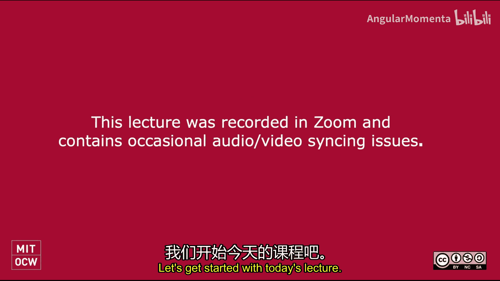
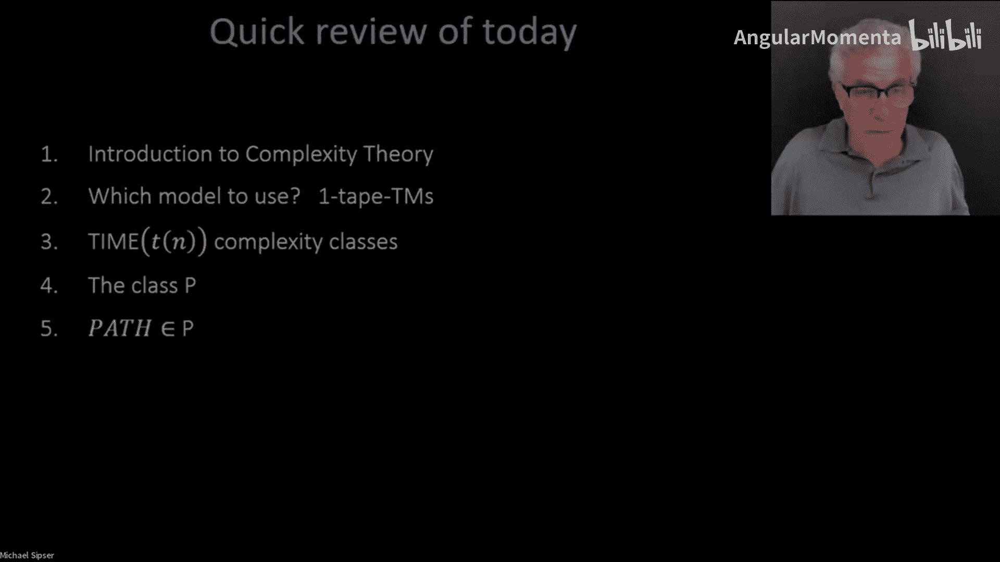
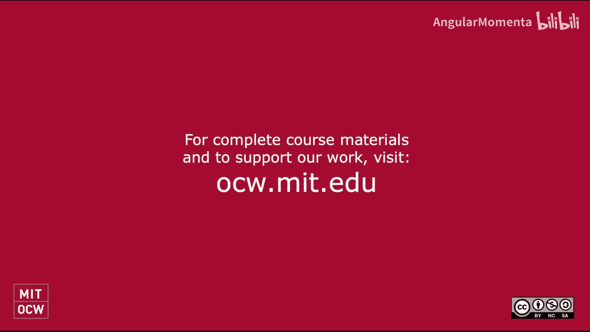

# 【麻省理工】计算理论  ｜  MIT 18.404J Theory of Computation, Fall 2020 p12 12. 时间复杂度 -BV1pt7GzeEjb_p12-

So welcome everybody， welcome back。Let's get started with today's lecture。

We where were we on Tuesday， we covered the main topic was the recursion theorem， which allows。

Programs to self reference。And we saw some applications of that too。

We gave a new proof that ATM is uncidable。We looked at this language of minimal touring machine descriptions。

 and we had a short digression into mathematical logic where we looked at how one shows that there are true but unprorovvable statements in any reasonable formal system。

Okay， so today we're going to shift gears entirely and we're moving into the second half for the course。

Where we are beginning a study of computational complexity theory。

And we'll say a little bit about that during the course of the lecture， of course。

 but you know the main things that we are going to cover in terms of content that you will need is defining the complexity classes and the class P so I we'll prove a few theorems along the way。

 but that's the main objective of today's lecture。Computability theory。

 which was the subject of the first half of the course and which is what the midterm exam is going to cover。

 was a subject that was an active area of mathematical study in the first part of the 20th century really got it really dates back into the late 19th century。

 in fact， where people were trying to figure out how to formalize mathematical reasoning。

But that it really got going in the 1930s with the work of Girdel and Church and Tring who really formalized for the first time what we mean by algorithm。

 and that allowed the study of algorithms to really get started and it had its impact。

 as I mentioned on the actual design， building and thinking about real computers，The main question。

 if you kind of boil that subject down to a single question is， is some language decidable or not？嗯。

In complexity theory， which got started kind of when computability theory more or less wrapped up as a subject。

 largely because they answered many of the questions that they answered pretty much all of the questions that they were asking。

 so there really aren't interesting unsolved questions left in that field and you really need mathematical questions to keep a subject alive。

 unsolved questions， so complexity theory got to start in the 1960s and it continues on as an active area of research to the present day。

 and I guess if you could boil it down it would be is a language decidable with some restriction on the resources such as the amount of time or memory or or some other kinds of resources that you might provide randomness and so on。

 although those are within the area of computational complexity theory。

So let's get ourselves started with an example， here is a language that we've looked at in the past。

 A to the K B to the K。And let's look at it now from the perspective of complexity。

 all of the languages that we're going to be studying in complexity are all going to be decideidable languages。

 so the question of undecidability， undecidability in complexity theory is not really of interest it's all decideidable languages。

 but the question is how decideidable， you know what sort of resources do you need to do the deciding。

嗯。So for this language A， how many steps are needed？Well。

 we're going to spend a little time just kind of setting up the definitions of the subject and kind of motivating them。

 so in this for this language a when I ask how many steps are needed。

 well it's going to depend upon which input you have in mind。You know。

 some inputs might require more steps than others。So the way we're going to set the subject up。

 which is the standard way that people in this field look at it。

 and I think you that applies to you know lots of examples outside as well。

 is that we're going to kind of group all of the inputs of the same length together。

And look at the maximum cost， the maximum number of steps you need to solve any one of those inputs of a given length and we'll do that for each length。

😡，And the way we're going to frame it is in terms of giving a maximum or what's called an upper bound。

😡，On the amount of time that you need to solve all of those inputs of LinkedIn。

That's what's sometimes called worst case complexity， I'm sure many of you have seen this already。

 but just to make sure we're all together on this， you might contrast that。

 for example with what's called average case complexity where instead of looking at the most difficult case among all inputs of length in。

 you take the average of all inputs of length in and then you have to then it's a little bit more complicated because then you need to have a probability distribution on those inputs and so on。

 we're not going to look at it in this course from that perspective we're only going to be looking at what's called worst case complexity。

So let's begin then by taking looking at this in more detail and taking as our starting point。

 the theorem that says that on a one tape Turing machine，Which is deciding this language A。

 A to the K B to the K。You can do this on a one tape tuuring machine， M， we're calling it。

And at most， some constant times n squared steps。For any input of length N。

Where the constant is going to be fixed independent event。Okay， so。呃。This is going to be， you know。嗯。

Having a constant in factor in the complexity is going to come up often and so instead of saying this over and over again。

 we're going to use a notation that M uses order in squared steps。

I'm sure many of you seen that terminology as well。

 but just for the purposes of making sure we're all together on that。

 there is this big O and little O notation，m I'm expecting you to be familiar with that big O is when you apply to functions as it's done。

You save F is big O of G as。For two functions， F and G。

 it's basically if F is less than or equal to G。If you're ignoring constant factors。

And you say F is little O of G if F is strictly less than G， if you're ignoring constant factors。

 that's kind of one sort of informal way of looking at it。

 the precise definition is given up there on this slide and if you haven't seen it before。

 make sure you look at it in the book where it's all carefully described and defined and so that you're comfortable with these notions because it's really we're going to be using this without any further discussion from here on。

Okay。So let's get to the proof then of this theorem that you can do the language A in order n squared steps。

Not super hard if I think if I ask you to come up with an algorithm to solve。

 this would be the algorithm that you would find basically first you would start off by scanning the input W to make sure it's of the right form。

So a run of A's followed by a run of B's of some lengths。And if it's not of that form。

 then you're going to reject right away。The next thing you'll do is then go through a repeat loop in the Turing machine。

And you know， if you imagine here is your machine， here is the inputW。

 you're going to go through that repeating repeatedly。

 of course you can do this in a number of different ways。

 but here's the way I have in mind for you on this slide anyway。We're going to scan the entire tape。

Crossing off one， a single A and a single B。😡，a on a scan。

And then you're going to keep doing that until you've crossed off everything。嗯。

Unless you run out of A's or you run out of B's。In that case， you're going to reject。

If you run out of A' or B's before you run out of the other type。

Then you know that you started out with an unequal number， and so the machine is going to reject。

If you've managed to cross them all off without running out of one before the other。

 then you'll accept set。😡，I know this is kind of obvious。

 but I think it's important to get us all together on this at the beginning。

So here's a little animation of the Turing machine doing that。嗯。

I'm not showing the motion of the head， but you imagine the head scanning back and forth。

 crossing off these A's and B's，1， A and 1 B on each pass until they're all crossed off and then it accepts。

Unless， of course， it runs out of A's or B's before the other type then it rejects， okay。

Now let's do a very quick informal analysis of how much time this is taken。So the very first stage。

 I'm calling each of these things stages of the touring machine to distinguish them from the steps of the touring machine。

 which the individual transition function moves。So this is the entire stage of the machine。

 the very first stage takes order end steps。Because you have to make a scan across the input。

And then you know i'm not giving all the full detail of course you're going to scan and then you're going to return the head back to its starting position'm not that's just going to be an extra factor then extra an extra an extra n so that's where we're talking about being order end steps for the very first stage and then as you do through go through the repeat loop each time you go through the repeat loop you're going to cross off1 A and 1 B so that's going to mean you're going to have to do this roughly order you're going to have to do this order n times in order to cross off all the A's and Bs。

So there's going to be order and iterations of this repeat loop。

Each one of them is going to again require a scan， so that's order end steps for each one of the iterations。

😡，So adding that all up。嗯m。The very top row gives us the order n。

 and then we have the order n iterations times order n steps is order n squared steps。

And so the sum of these two is order n squared steps due to the nature of arithmetic when you have the big O notation。

 the dominant term overrides all of the others。Um。So that's in a nutshell how we well this is our very first example of analyzing the Turing machine algorithm for a language okay。

 so let me ask you now whether there is some other Turing machine。

 some other one tape Tring machine which can do better。

Then this touring machine does in terms of how much time it takes。So one idea that you might have。

Instead of crossing off a single A or in a single B。

 maybe you can cross off two A's and two B's or 10 A's and 10 B's。

 well that'll cut down the running time by a factor of 10。But from the standpoint of this theorem。

 it's still going to be an order n squared algorithm。

 and so that really doesn't change the amount of time used from the perspective of from our perspective where we're going to be ignoring the constant factors on the running time。

😡，So I ask you here， can you do better than just improving things by a constant factor？😡，There we go。

Okay。So here's a check in on this problem， on the problem a。

 solving deciding a on a one tape tuuring machine， can we do better？Then。Order n squared。

 as I just described in that theorem and that algorithm for that theorem。

 or you know can you get it down to N log n or maybe you can get it down to order n。

What do you think？Obviously， you know we're。just getting started， but just make your best guess。

And let me just post that for you as a poll。What's most important to me is that you understand。

The terminology that we're using and the way we're talking about it。

 because that's going to be setting setting us up for the definitions that werere going to come a little bit later in the lecture。

Okay， so I'm going to close the poll。We're kind of all over the place on it， but that's good。

Since we haven't really covered this material material yet。

 in fact B is the correct answer we can improve this algorithm down to order n log n but not all the way down to order n so let me let me show you how to how you do it in order n log n on the next slide。

And。So here is a one tape Turing machine that can decide a by using only order and log n steps instead of order n squared steps。

 so this is a significant improvement。So I'm just I'll describe the Turing machine here again is the picture of the machine on an input and the very first thing I need to say is that we're going to scan to make sure the input is of the right form。

And now we're going to again， it's going to be making repeated passes over the input。

What we're going to do a little differently now。Instead of crossing off a single A and a single B or some fixed number of A's and a fixed number of Bs。

 we're going to cross off every other A。And every other be。In that way。

 we're going to essentially cut the number of A's and B's in half。

And that's why the number of iterations is only going to be a log instead of linear。Okay。

 so we're going to cross off every other A and every other B。U。And at the same time。

 we're going to keep track。Of the parody， the even odd parody of the number of A's that we've seen and the parody of the number of B's that we've seen that have not yet been crossed off。

And we're going to compare those parodies to make sure that they agree。If they ever disagree。

 we know we started off with different numbers of A's and B's。😡，嗯。

And I'll illustrate this in a second just to make sure where we understand this algorithm。Okay， so。

I'm going to write down as a little table of the parodies that we've seen。

 and I'm going to illustrate the algorithm with a little animation。Okay， so again。

 we're now going to scan across crossing off every other A。And then every other B。

 but now but before we get to the be'es， we observe as we cross these off that we had six A's now I'm not saying we count them。

 we just keep track of the even odd parity that can be done in the finite control of the machine counting them would be more complicated but but just keeping track of the parodity is not is something that the finite automaton could do。

So the parody in this case， because they were six， is going to be even。Now we course off the bees。

Same even parity Now we're going to return the head back to the beginning I'm obviously not showing the head moving here。

 We return the head back to the big beginning and now we scan across again。

 crossing off every other remaining a and counting the parodity of the remaining as。😡，So here now。

It's going to be this one and this one are going to get crossed off。And there were three A's。

 so that was odd parityy and the same for the B's。Three bees， odd parody。

 and now we return our head back to the beginning。Of course。

 again of every other A and every other B every A。So there was odd parity， there was just one。

 of course you go off the B， odd parity because it's just one， they all agree。

 so the machine is going to accept。Because everything is now crossed off。

And the parodies agreed along the way。Let me just say for a second， you。

 obviously if you ever get disagreement on the parodies。

 then you know that the two the number of A's and number of B's had to disagree。Um。

 but how do we know that if the parodies always agree that we actually did start out with the same number of A's as B's？

And that you could see that in a number of different ways， but perhaps you know。

 a way to see it is there is actually if you look at these parodies here。

 the sequence of parodies actually in reverse， so if you let's say odd odd even。

And you look at the binary representation of the number of A's， which is six。

 so the binary representation would be 110。😡，The fact that you get odd。

 odd even and 110 is not a coincidence， in fact， the sequence of parodies in reverse that you get。

Is exactly the same as the binary representation， you'd have to you know confirm that with a little proof。

 it's not hard， but that once you've confirmed that。

 you can see that if the sequence of parodies agree。

 then the numbers had to be the same because the binary representations agreed。Okay。

 so now getting to the analysis here， again， order and steps to do the check。Log in iterations。

Each scan takes order end steps。So the total running time here is going to be order and login。

Of course， it's going to be the log n times n， that's where the log n log n comes from。

Now questions you might ask could I do even better than that。

 can I beat and log in by more than any constant factor， so can I do little O？😡，Of then loggan。

And the answer is no， this is the best possible。A one tape Turing machine for this language。

 so a one tape Turing machine cannot decide a by using little O。Of N log in steps。

We're not going to prove that I'm not going to ask you to be responsible for the proof， but in fact。

 what you can show is that any language that you can do on a onetape Tring machine in little O of n log n steps turns out to be regular。

😡，Okay so you can prove a rather strong theme here， not super difficult to approve。

 but I don't want to spend a lot of time on proving bounds for tuuring machines because you know really the whole purpose of setting this up using Turing machines is to talk about algorithms in general algorithms in general。

 I'm not going to be focusing on the nitty gritty of tuuring machines。Okay， so what is my。诶。诶。Okay。

 yeah， so I wanted to just stop and make sure that we were we are together here。

A brief pause and feel free to send me any questions。嗯。Okay， this is a good question。

 if we can keep track of parodies， why can't we just keep track of the number of A's or B's？Well。

 you could keep track of the parody in the finite memory and so you can do that with effectively no work。

But the finding memory is not enough for doing an account up to some arbitrarily large number。

Now you could store the counter on the tape。😡，But that's going to cost you time to maintain that counter。

😡，And so。That's not going to be so simple as keeping track of the parity in the finite memory。嗯。Okay。

Somebody's asking if A star B star is regular， yes， A star B star is regular， so what？

But A to the K b to the K， which is our language is not regular right so that's the language we're looking at。

😊，诶。Okay， so。Geting questions about what happens with multiple tapes。

 we'll talk about that in a second。Yes， we could do an order end steps on a regular computer sure。

 but you know。Right to this slide anyway， we're looking at one tape tuuring machines。Okay。

 getting questions about Big O and little O。嗯。For something to be little O means it's less than any constant factor times the function。

So you have to look at the definition in the book， I think almost enough people in the class probably know this and have seen this already。

 I don't want to spend everybody's time on it， but please review it in the book。

 somebody's asking if you need to store the parodity on the tape， no。

 you can just store it in the finite memory。嗯。诶。I mean。

 storing the finite memory seems to be the simplest thing。Okay。

 when we move on please feel free to ask questions to the TAs as well we have two Ts at least here attending with me so。

Good。嗯。Right。All right so。We cannot do better than a one tapeuring machine on a one tape tuuring machine than order and log in and that's something we can prove though we're not going to do it here however。

 if you change the model， for example use a two tape tuuring machine then yes as a lot of you are suggesting in the chat。

 you can do better than that。So。If we now have a two tape tuuring machine or a multita tuuring machine。

 you can do it in order end steps。And that's actually the point I'm really trying to make here so if you have here your two tape curring machine then。

Two tips。Same language。Now what we're going to do is copy the A's to the second tape that we can do on a single pass。

😡，And then once the A's have been copied to the second tape。

 we can continue on reading the B's and match them off with the A's that appear on the second tape。

 so in order end steps you can do the comparison instead of order n log n steps。嗯。And of course。

 if they match， you're going to accept otherwise reject。

So let's just see here's a little animation demonstrating that， of course it's very simple。

So here is here that if you could see that it came maybe a little too fast here。

 lets just show it again， here is the heads moving across and the A's coming down to the bottom。

And now the upper head is going to continue on reading the B's。

 the lower head is going to go back to the beginning on the A's。

And matching off the B's with the A's， and that's how we can verify or check that they are the same number。

嗯。Okay， and so now in this case， they were the same numbers so the machine would accept if they were the different number。

 the machine would not accept。And the analysis is very simple。

Each stage here is going to take a linear number of steps。

 order end steps because it just consists of a single scan， there are no loops in this machine。No。

 no， no， no repeat loops。Okay， so。Question on this。嗯。All right。Why don't we move on then？Now。

 observe。And the point I'm really trying to make is that。呃。On a one tape Turing machine。

 you can do it in n log N， but not any better， but on a two tape tuuring machine。

 you can do it in order N。So there is a difference。In how much time you need to spend。

 how many steps you need to spend， depending upon the model。

And that's significant for us so the number of steps depends on the model montape tuuring machine was order n log n multita was order n like we call them model dependence。

If you contrast that with a situationities in the computability section of the course。

We had model independence， the choice of the model didn't matter。

And that was nice for us because the theory of decidability didn't depend upon whether you had a one tape turing machine or a multitape tuuring machine。

 it was all the same set of decidable and recognizable languages。😡。

So we didn't have to worry about which model we're actually going to work with。

 we could work with any model， even just an informal model of algorithm was would be good enough because we're going to end up with the same notion in the end。

Now that's。Goes away。In complexity theory， now we have a difference depending upon the model。

And from a mathematical standpoint， that's a little less nice。Because。You know。

 which model do you work with if you want to understand the complexity of some problem？

You know that you have at hand now you have to make a choice you're going to work with a tuuring machine how many tapes or you're going to look at some other model and you're going to get different results。

 so it's somewhat less natural from a mathematical standpoint just to talk about the complexity of some problem。

But we're going to kind of。Bring back something close enough to model independence by observing that even though we don't have model independence as we did in computability theory。

 we can limit how much dependence there is。😡，So the amount of dependence is going to be low。

 as we will see， provided you stick with a reasonable class of deterministic models。😡。

So the dependence， though what does exist， is not going to be that much。

 it's going to be polynomial dependence and we'll say exactly what that means in a second。

And from our standpoint， that's going to be a small difference。

 a negligible difference that we're going to ignore。嗯。

So we're going to focus on questions that do not depend on the model choice among these reasonable deterministic models。

😡，Now you may say， well， that's not interesting from a practical standpoint because polynomial differences say the difference between n squared and n cubed certainly make a difference in practice。

 but it really depends。On the the。You know what kinds of questions you're focusing in on so if you want to look at something that's very a very precise distinction。

 say between you know n squared and N cubed then you might want to focus in on which model you're going to be working with and that's going to be more the domain of an algorithms class from our standpoint we're going to be looking at other still important questions but there are questions that don't depend upon exactly which polynomial you're going to have we're going to be looking more at distinctions between polynomial and exponential and still there are important practical questions that arise in that somewhat different setting。

Okay。So with that in mind， we're going to continue to use the one tape Turing machine as our basic model of complexity since the model among the reasonable deterministic models in the end is not going to matter from the perspective of the kinds of questions we're going to be asking。

😡，嗯。Okay。So with that， so we are going to continue。 Then it's important to remember that from。

Going forward， we're going to stick with the one tape touring machine model maybe that's something you would have expected us to do anyway。

 but I'm trying to justify that， you know through this little discussion that we had so far thus far。

😡，So now we're going to start defining things with the one tape model in mind so so first of all。

 if you have a turing machine， we're going to say it runs in a certain amount of time。

So if t is some sort of time bound function like n squared or n log n。

 we'll say the machine runs in that amount of time like n squared or n log n。

If that machine M always holds within that number of steps on all inputs of length end。😡。

So it always holds within T event N steps on inputs of length N。

 then we'll say that the machine runs in T of N time。So in other words。

 if the machine runs in n squared time。Then the machine， when you give it an input of length 10。

 it's got to be guaranteed to hold within 100 steps。😡，10 squared。

 100 steps on every input of length 10。That's what it means for the machine to be running in that much time and it has to do that for every end for every input length。

And with that， we're going to come to the following definition， which is。

Highlighted in color because its going to be we're going to be using this definition throughout the semester。

 so it's important to understand it。呃。This is the definition of what's called the time complexity classes。

And what I'm going to do is take some bound t of n and again。

 think of t of n like a bound like n squared。😡，So if you have time T of n or like time n squared。

That's going to be the collection of all languages that you can decide within time n square or within time T event。

😡，So in other words， it's a collection of all languages B。

 such that there's some one tape turing machine here we're focusing again on the one tape turing machine。

 there is some deterministic one tape turing machine。😡，That decide be。

And that machine runs in that amount of time。So this is a collection of languages。

The time complexity class is a set of languages， I'm going to draw it now as a diagram。

So if you take the language， again that we've been using as our standard example。

 A to the K B to the K。That's in time and log n as we observed from slides two slides back。

 go three slides back。So on a one tape Tring machine， you can do this language A in time N log N。

So it's in the time complexity class and log n， this region here captures all of the languages。😡。

That you can do in order and log in time。For example。That also includes all of the regular languages。

😡，Why is that？Well， any regular language。Can be done on a one taped Turing machine in time order n。

Because the touring machine only just needs to scan across， doesn't even need to right。

 just need to scan across from left to right on the tape， and in end steps it has the answer。😡。

So all of the regular languages are actually in time N， certainly a subset of time N log N。😡。

And these all form a kind of a hierarchy， so if you increase the bound。

 you can imagine that the class of languages grows as you allow the machine to have more and more steps to do its computing。

So these are all the languages that you can do in n squared order n squared time on a one tape tuuring machine。

In cube time on a one tape touring machine and so on。

Two exponential time two to the end time on a one tape of to machine。

 these are all collections of languages。Getting larger and larger as we increase the amount。诶。诶。

So someone is asking kind of。Okay， let's see， let me get to some of these questions here。

 I'll try to get to them in order。呃。Okay。So somebody says if you have a good question。

 if you have a regular computer， so an ordinary sort of random access computer。

 so we'll talk about that in a second， can do it in order N can you do it on a multitape during machine also in order end time actually I don't know the answertether off hand。

 I suspect the answer is no。That。Ordinary computers have a random access capability that tuuring machines do not and so that there are going to be some examples of problems that you can do with a random with a regular computer that you cannot do with a multita Turing machine in order end time I'd have to double check that though so we can and so also question what we believe is true in what we can prove to be true as we'll see there are a lot of things that we believe to be true in this subject that we don't know how to prove。

Some's asking kind of an interesting sort of more advanced question is there's some function F。

 some function T where it's so big that so that time T of n gives you all of the decidable problems。

It would be a very big tea， but the answer actually to that question is yes。

 but that's a little bit exotic so let's not spend a lot of time on that right here。

 but happy to talk about that offline。嗯。It's a good question here， somebody's asking me。

 does it mean that there are no languages between order n and order N log N。

 because I pointed out that anything below n log N is going to be regular。

And so as soon as you get below N log N， you can do an order in and yes。

 there is what's called a gap。Between order N and order n log n on a one tape touring machine is you don't get anything new from order n until you jump up。

 so from order N to order n log log n。Nothing new shows up so we'll talk about those kinds of things a little bit down the road when we look at actually the relationship among these various classes and what we call a hierarchy theorem。

 which shows you know how much bigger do you have to make the bound in order to be sure you'll get something new？

呃。嗯。All right。Okay， somebody's asking， is there a model which has the same time complexity as a normal computer？

Well， I mean， there's the random access model， which is supposed to capture a normal computer。Okay。

 so let me let me。These are all great questions， kind of more riffing off of this into more advanced directions。

嗯。Let's move on。Here's another check。Suppose we take this is a little bit of it。

Check to see well how comfortable you are with the notions we've just presented and whether you can think about some of the arguments that we've made and apply them into a new language。

So take the language， Ww reverse。嗯。You know， strings followed by their。

This followed by themselves backwards， this language be the even length palindromes， if you will。

 what's the smallest。Bound that you need to be able to solve。呃。That language B。And I'll pose it as a。

嗯。Poose that as a question for you。So which time complexity class？Is。U。That language be in。

Is it time order n， order n log n and squared， so on， what do you think？

So we're about to come to the coffee break， so why don't we。呃。

I'll answer any questions that come up I think we're got everybody answered so i'm going to end the polling okay make sure you're in if you want to be in。

So the correct answer is， in fact， order n squared。It would be hard you。

Resonable guess here would be order n log n I mean you can come up with the same procedure that as the one we showed at the beginning the order n squared procedure for a to the K b to the K works for ww reverse as well you can just cross off sweep back and forth crossing off。

嗯。A symbol from W and going across to the other side。

 crossing off a symbol from W reverse and that procedure will give you an n squared and an order n squared algorithm。

诶。You might imagine you can improve it to order N log in， but you。

 you can prove that order n squared is the best possible。

I'm a little unhappy that a lot of you came up with order n frankly。

 because I already told you that order n is these are just regular languages。

 anything that you can do in less than little O of n log n is going to be regular and we know that this language is not regular so this is this was not a good answer you know so。

Please pay attention。And okay。So let us stop sharing， I will turn now to the our。

Our break for five minutes and I'm happy to you know try to take questions along the way as we we're waiting for the time to to end so let's just see on。

Put this up here。Okay。Let me try to take some of your questions。嗯。

So someone has asked me about quantum computers as reasonable models of。

You know you may say a quantum computer is a reasonable model of computation and that's fine。

 I would not say it's a reasonable model of deterministic computation。At least from our standpoint。

 let's not quibble about the words， I'm not including quantum computers in the collection of machines that I have in mind right now when I'm talking about the reasonable models of determinants computation that we're going to be discussing。

嗯。呃。我事。Okay， a bunch of people apparently are asking the TAs why all regular languages can be done in order N。

诶。So if you think about a DFA。Um， which you know。Processes。An input of length in。

Within steps and a DfaA is。goinging to be a type of tuuring machine that never writes on its tape。

So if a DFA can do it in N steps， a touring machine can do it in NT and so therefore every regular language can be done in order end steps on a touring machine not sure where the confusion is so please message me if you're not still not getting it。

Okay， somebody saying， why are we using one tape tuuring machines instead of random access。

 wouldn't it be better to use the random access machines？

if you were using if you're trying to do algorithms， yes， that's a more reasonable model。

 we're trying to prove things about the computation and from that standpoint we want to use as simple as model as possible。

 trying to prove things using random access computers as possible be very messy。

So that's why we don't use random access machines to prove the kinds of things we're going to be proving about computation you know that are really the meat and potatoes of this course so I mean there。

Compelling reasons why you would want to use a simple model like a Turing machine。

 but not a powerful model like a random access computer。So somebody's asking me， does the class？

Time order N log log n have any elements。 Yes， it has all the regular languages。

 but nothing else order N log log N is only only the regular languages you have to go all the way up to or and log n before you get something non regular。

Somebody's asking me are we going to talk about how the random access model works no？You know。

 there is beyond the scope of this course。Outside of we we're going to be doing。

 we're going to talk about touring machines。Not because we care so much about Turing machines。

 but I'm trying to prove things about computation and the Turing machines are a convenient vehicle for doing that。

Okay our candle has burned out why don't we return then to the next slide so everybody come back so this answers one of the questions I got on the chat is what's what actually is the dependency between multi tapeuring machines and one tape touring machines can we bound that in general Yes we can。

We're going to show that converting a multita tuuring machine to a one tape Turing machine can at most blow up the amount of time that's necessary by a squaring。

No， I know just a lot， but it still allows you， but you know it's still small compared with an exponential increase。

 and we're going to be focusing in this course on things like the difference between polynomial and exponential。

 not between the difference， not between the difference of not between not the difference between n squared and n cube。

 that's going to be less， less of an issue from us。Okay。嗯。

So the way I'm showing this theorem is that if you have a multitaped Turing machine that can do a language in a certain amount of time。

 then it's in the time complexity class of that time bound squared。

And the way I'm just saying that is because this is the bound that's utilizing the one tape model。

 so another way of saying that is converting multita to one tape。😡。

Squares the amount of time you need at most。Um， so the way we're going to prove that is simply by going back and remembering the conversion that we already presented from multita to one tape。

And observe that if we analyze that conversion， it just ends up squaring the amount of time that the multita used。

Okay， so why is that？So if you remember， let's just make sure we're all together on this。

 the way the single tape machine S simulates the multita touring machine M。

Is that it takes the contents of each of M's tapes。You know。

 up to the place where there's infinitely many blanks， obviously you don't store the infinite part。

 but the active portion of each of M's tapes， you're going to store them consecutively in separate blocks on Es's tape on Es's only tape。

And now every time M makes one move， S has to scan its entire tape to see what's under each of the heads and to do all the updating。

So to simulate one step of M's computation， S is going to use order T of n steps。

Where T of N is the total running time that M is going to use so why does T of N steps coming up here well that's because you have to measure how S is going to make a scan。

 of course its tape。😡，How big can its tape？B。Well， M， if it's trying to use as much tape as possible。

😡，Can use it most。😡，T of N。Tappe on each of T of n cells on each of its tapes。

 so altogether there's just going to be some constant number of times T of n cells on S's tape。😡。

Do you see that。So each one of these is going to be at most T of n long。

 so this altogether is going to be order T of n long because you know what can M do。

 it could send its head out， say the head on this tape here。

 moving as fast as possible to the right using as much tape as it can。

 but you can only use T of N cells in T of N time。😡，So this is going to be order T of n。

 so one step of M's computation is going to be T of n steps on ss computation。

 but M itself has T of n steps so it's going to be T of n times T of n for the total number of steps that S is going to end up using。

And that's where the squaring comes from。Okay， similar results。

 I'm not going to do lots of simulations of one model by another。

 I think that you'll get the idea and you can if you're interested you can study those on your own。

 but you can convert multidimensional touring machines to one tape touring machines you know tape ordinary linear one dimensionsional machines and the bottom line is that among all of the reasonable models they're all what are called polynomly related。

If each can simulate the other within at most the polynomial overhead。

So if one of the machines can use this T of n time。

 the other machine that's simulating it would use T to the K of n time for some K。

That's what it means for the two machines to be polynomly related。

All reasonable deterministic models are polynomially related。

 so as we've already seen one tape and multita touring machines are polynomially related because converting multita to one tape blows you up by it multi to squareing。

So k equals two in this case。multidimensional touring machines， again， polynomial related。

 the random access machine， which I'm not going to define。

 but it's the machine that you might imagine， you know， you would。

 I'm sure they must define in some form in the algorithms classes， polynomial related。

Cellular autometera， which are just arrays of a finer autometer that can communicate with each other similarly。

Um。You know， all the reasonable deterministic models。

You know again classical models i'm not talking about quantum computing are polynomial polynomially related。

 so we are that kind of justifies our choice in picking one of them as long as we're going to ask questions which don't depend upon the polynomial。

So。嗯。Let's then talk about the class P。嗯。So the classSP， this is an important definition for us。

This is the collection of all languages。That you can do in time into the K for some k on a one take turing machine or as I've written it over here。

 I don't know if this notation is unfamiliar to you。

 but this is like just a big sum but here it's a big union symbol。

 it's union over all values of K of the time class into the K。So， this is。Time N。

 union time n squared， union time N cube， Union time N the fourth。And so on。

And we call these the polynomial time decidable languages。Okay。

 so we're going to be spending you know， a certain amount of effort exploring this classP and other similar classes。

Somebody's asking why is it a union i'm not sure how else you would write it so if somebody hast if you have a proposal for a different way to write it that's fine。

 but this is you know K this is for all K I don't know you know there's if you only had a limit finite number of ks you could just take the biggest one but since it's for all k you need to write it as a union。

Um。Now， I want to argue that the class P is an important class。Have。And。

You know why has it had so much impact on the subject and in terms of applications as well so one thing is that the classP is invariant for all reasonable deterministic models and what do I mean by that。

So we have defined the class P。😡，In terms of these time classes here。

 which in turn are defined in terms of the one take model。

So we have defined P by using one tape touring machines。Now。

 if we had defined P in terms of multita tuuring machines。😡。

We get exactly the same class because one tape and multita tuuring machines are polynomialally related to one another。

 and since we're taking the union over all polynomials。

 that polynomial difference is going to wash out。嗯。Similarly。

 we can define P using any of the other reasonable deterministic models。

 and we get exactly the same class。😡，So in a sense。

 we get back what we the situation that we had in computability theory when。

The class of deciddable languages didn't depend on the choice of model here。

 the class P does not matter depending upon the choice of reasonable deterministic model。😡。

And we also kind of even in the case of computability theory。

 we have to stick with kind of reasonable models that cannot do an infinite amount of work in one step so you know when I'm not going to define what it means to be reasonable and that's in a sense an informal notion。

 but among all of those reasonable models you're going to get the same class P。

The other thing that makes P important is that。P roughly corresponds to the problems that you can solve in some reasonable practical sense。

not exactly， you know， problems that require into the 1 hundred0th time。

 you could argue cannot be solved in any reasonable sense， but know if you think about it。

 for example， from the perspective of cryptography，嗯。

Cryptographic codes that people come up with are typically designed to require or the hope is that they require an exponential amount of effort to crack if someone found even an into the hundredth algorithm to that would crack a code people would feel that the code is not secure even though into the hundred0th is still large so you know it's a rough kind of test but it's still used as a kind of litmus test for practical solvability。

 if you can solve it in polynomial time you basically figured out how to avoid large searches if you can solve problems in polynomial time we'll say more about that later。

But you know， what I want to bring out here is that we have combined here in the classP。

 something that's mathematically nice， mathematically elegant。

 elegant with something that's practically relevant。😡，And when you have a combination of the two。

 then you know you have a winner， then you know how you have a concept that's going to make a difference and that's been true for the ClassP。

 this has been very influential within and without the theory of computation。

So let's look at an example。😊，s let's define a new language we haven't seen before。

 though it's similar to procedures that we've looked at before， the path language。

Which is where I'm going to give you a graph G。Two nodes in the graph， S& T。

Where I'm thinking of G as a directed graph， so directed it means that the connections between the nodes and G are going to be directed and that they have arrows on and。

 they're not just lines， but they have an orientation with an arrow。

so G is a directed graph that has a path from S to T that respects the directions so such a I think I might even have a picture here yeah。

 so imagine here here is your graph if you can see it there are little arrows connecting the the nodes and I want to know is there a path from the node S to the node t。

So that is a picture of a problem， you know an instance of a graph of a path problem。

And I want to find an algorithm for that， and I can show that there is an algorithm that operates in polynomial time。

For this path problem。Okay， and the algorithm， you know。

 any of the standard searching algorithms would work here， but let's just for completeness sake。

 include the Bthford search algorithm that we have explored previously when we talked about finite Atmata。

 so will' mark us。And they'll keep repeating until nothing new is marked and will'll mark all of the nodes that were reachable by a single arrow from a previouslyly marked node。

😡，And then CFT is marked。After you could mark everything you can get to so you're going to mark let's see pictorially。

 I think I have this indicated， yeah， you're going to mark all of the things that are reachable from the start note from the from the node S。

And then see after you can't mark anything new whether the node t is marked and if it is。

 you'll accept if it is not， you reject。Okay， now we can analyze this too。

 and I'm not going to be spending a lot of time analyzing algorithms here。

 but let's just do it kind of this one time again。Were we're doing a bunch of iterations here so we're going to be repeating until nothing new is marked。

 so each time we mark something new we can only do that at most end times at which point we've marked everything so the number of iterations here is going to be at most end。

😡，And now for each time we mark something， we have to look at all of the previously marked nodes。

And see which things they point at to mark them too。

 so this is going to be an inner loop which again has at most n iterations because it's going through all of the previously marked nodes。

😡，And then once we have。That we can scan G to see to mark all of the new。

All of the nodes which we have not yet marked， whether they are connected with a previously marked node by an edge。

And i'm being generous here because I don't really care this can be done and the most end squared steps on a one take turing machine i'm not going to describe the implementation。

 but you know i'll leave it to you as an exercise， but this is。Straightfor。

So the total number of steps here would be n iterations times n iterations times n squared so you're going to be at most end the fourth steps needed。

 so this is a polynomial algorithm and whether I ended up with n to the fourth or end to the fifth or I cube I don't really care because I'm just trying to illustrate that the total is polynomial and that's all I'm going to be typically asking you to do so to show polynomial time。

 what I'd be asking you to do is to show that each stage。Each stage of this algorithm。

Should be clearly polynomial and that the total number stages， I'm sorry。

 this should say stages here should be polynomial。So each stage is polynomial and after you're doing all the iterations。

 the total number of stages that are executed is polynomial and so therefore altogether together the total running time。

 the total number of steps is going to be polynomial。Okay。

 so that's the way we would write up polynomial algorithms in this class。Um。

So let's see if there's any questions here， I don't want to get too far ahead of people。嗯。呃。

Let's see。Yes， in this theem I'm talking about oneta turing machines because we're defining everything in terms of oneta tuuring machines but now at this point you know we're talking about polynomial time we could you know my analysis is based on one tape tuuring machines。

 but in general you know you could use any reasonable deterministic model on which to carry out your analysis because they're all polynomial equivalent so from the perspective of coming up with showing that a problem is in polynomial time is in P you can use any of the models。

You know that you that you wish that for convenient Okay oh that's a good question what is in thank you for asking that question。

N is always going to be reserved。To indicate the length of the input。

So here n is going to be when we encode GS and T and here also I haven't said this。

 but I'm assuming that the encoding that you're using is also somehow reasonable you know I think we'll talk a little bit about more about that in the next lecture which is going to be after the midterm。

嗯。But you know， you can cause problems if you intentionally try to come up with nasty encodings。

 which will you know represent things unnecessarily with unnecessarily many characters。

 but you know if you try to be reasonable then，Just use any one of those encodings and you'll be fine。

So yeah。So n is the length of the representation of the input。嗯。Whats you。

Someone's trying to dig into the the actual how this is running here， scane to Marle y。

 where X Y is an edge。I'm saying that you can do an n squared steps。呃。嗯。You know。If you have X。

You can mark it in a certain place on the tape。And then as you're going through every other node。

 every other edge， you can go back and compare x with the x of the edge and then see and then find the Y。

I mean it's just going to be too messy to talk about here I mean I leave it this as an exercise to you i'm not going to try to fumble my way through explaining why you can do this in end squared steps。

 but it's it's not hard。呃。You guys are all a bit like hardcore algorithms folks you want to know the algorithms for this i'm not going to do that sorry high level picture here you know so you know if you want。

You know， if you want to look at detailed analyses this is not the right course for you。

 can K equal n， what is k？嗯。嗯。No， if you're talking about this K here， K cannot equal n。

 we're not looking at n to the n。This is， these are all fixed K。It's like n squared and Qd。

 but not into the end is it going to be an exponential bound and so that's not going to be included within this union。

Okay， so near the end of the hour， I'm going to introduce one last language here called Hampath。

And the handpa problem is。I'm going to ask now again for a path from S to T。

 but now a different kind of path， one that goes through every node of G along the way。

so I'm looking for a path that goes that hits every node of G， not just the shortest。

 most direct path， but in a sense， the most indirect path。

 the longest path that goes from S to T that visits everything else along the way。A path。

Of that kind that hits every node of the graph is called the Hamiltonian path。😡。

Because the mathematician Hamilton studied those who made some definitions about that I'm not going to I don't actually know the history there。

 but I just know they're called Hamiltonian pathsum so here's a picture I want to get from ST but I want to sort of pick up everything else along the way。

So as you remember， the path problem itself can be solved in P。And what I'd like to know。

Can the simple modification where I'm asking you to visit everything else along the way is that calledmoin peak？

Okay and I'm going to pose this as a check in for you， but actually before I get to that。

 let me give you an algorithm for handpath that doesn't work to show what's in P because it's exponential。

So。Here's an algorithm。For handpath。嗯。Where let's Mvy the number of nodes in G。嗯。

And what I'm going to do is I'm going to try every can。

 every possible path in G and see if it actually works as a Hamiltonian path。😡，And accept if it is。诶。

And then if all pairs fail， then I'll reject。So I'm going to try every possible rootuting through G。

 if you want to think about it， think of M as every possible permutation of the nodes of G。

 and then you're going to see whether that actually constitutes a path in G that takes you from S to T and goes through all of the nodes。

😡，诶。So this algorithm would work。😡，This would give you a correct algorithm for the handpath problem The problem is the difficulty is that there are so many possible paths that it's going to take you an exponential number of steps to execute this algorithm it's not a polynomial time algorithm because there are many possible paths that you could go through if you're looking at it you know with a very crude bound but you really can't improve that significantly that would be m factorial which is going to be much greater than two to the m paths of length m so the algorithm is going to run for exponential time and not polynomial time So my question for you is I'm going to pose it as a check problem is whether you could actually do this problem in polynomial time。

So I want you to think about that as I'm setting up the question。So take the handpath problem。

Just like the path problem， which I described with that marking algorithm。

 but now you want to hit every node along the way， can you show that problem is solvable and P？

And there's a whole range of possibilities here where either the answer is yes。

 you can see what the polynomial time algorithm is。诶。

To definitely know where you can prove there is no such polynomial time algorithm。

And I'll put this as a check in for you。And see， I'm curious is who would you come up with。

Most people are getting it wrong well I mean wrong， I don't you know。

 I'm not clear what wrong is here。Okay， are we done。Please check something。

I can see a few of you have not answered， but the poll is running out。Okay， time is up。嗯。😊，嗯。So。

In fact。You know as I think many of you know， but not all of you， this is an unsolved problem。

 this is a very famous unsolved problem which is equivalent to the P versus NP problem that we're going to be talking about very soon。

 which among other things would be worth a million dollars if you solve it so for those of you who have answered a or E please talk to me after lecture and maybe we can work on it together。

No， so yeah， I think most people would believe that the answer is no。

 but no one knows how to prove it at this time， so I'm interested in the folks who have come up with what they think are solutions and I should say that there are some folks who believe that there might be other outcomes besides just a simple note。

Which might be proven eventually。So we're going to talk more about this。

 but this is the answer to the question just for your just to make sure you understand is that it's an unsolved problem right now。

 so we don't we don't know definitely yes and definitely no at least according to the state of knowledge。

Of which I'm aware is not not correct answers， but any of the others， well， who knows？

So I think that's the end of what I had to say for today。

 we covered complexity theory as an introduction， looked at different possible models。

 focused on the one tapepe model， introduced based on the one tapepe model， these complexity classes。

 the classP， and we showed an example of this path problem being& P talked also about this handpath problem。

 which we'll talk about more after the midterm。Okay。

 so I'll stick around for a few minutes if you have any further questions otherwise。Okay。

 so let me just take questions here。Somebody's asking me about my personal opinion on P versus NPp。

 my personal opinion on P versus NP is that P is not equal 10p and that we will prove it someday。

When I was a graduate student back in the mid-70s， I thought it would be solved by now。

 and I in fact I made a bet with Lynn Adelman who subsequently ended up becoming the A of the RSA code。

That we would solve it by the year 2000 and I bet what was then a lot of money for me which was an ounce of gold which I didn't end up then which I did end up paying off to L in the year 2000 so I'm not making any more bets but I still believe that it will be solved hopefully I'll get a chance to see the solution I spent a lot of time thinking about it myself。

You know。Obviously， I haven't solved it otherwise。We would know but。You know。

 hopefully somebody will。I'm getting asked a question here that's kind of an interesting question。

 but I don't really know。嗯。I'm sure I understand it what's the largest possible runtime of a deciddable problem？

What is the largest decable runtime so anything that I can describe。Can be there are going to be。嗯。

Algorithms that run for longer。You can。呃，Define。And an algorithm， you can define a runtime。

Which would in a sense， beats all other runtimes。Whi so that any runtime is going to be dominated by that extremely slow runtime。

 but it's not something that one can describe， I can describe it to you by mathematical procedure。

 but it's not going to be something like you know， two to the two to the end。

Somebody's here proposing a solution to the handpath problem。

I presume in polynomial time Why is the following flaw if S goes through all nodes and ends up in T well S we're not you mean you mean I presume you mean starting an S if we end up going through all nodes and end up T the proposal is a little complicated here。

Basically， you want to， if I can try to rephrase it， you want to try to from every possible node。

 you want to try to calculate a path to T and also a path from S to that node and you can do that for all possible nodes。

 but there's no way to really combine them into a single path that visits all。

 you know solving for each node separately is not going to do the trick。

Because you have to somehow combine all that information into a single path。

Just one path that goes from ST and visits all the other nodes along the way， and that is not。

 I don't see how with your proposal， how that's going to actually work。Professor Spitzer， yes。

 a question on the like we we werere kind of talking about earlier。

 but like what we talked about today was defined for the one tape turn machines， correct？Yeah。So。

 and you said like we could apply for the multi multita ones， but our。Like is it？Well。

 I don't know if it's we talked about earlier， but if something is accepted by the one tape turn machine。

 like can it be applied to the multita turn machine and vice versa。

 like are they interchangeable like that？Well， they're interchangeable only in the sense that。

The amount of time that you would need it's a different machine if you have a multitape tuuring machine for some language you can convert it to a one tape tuuring machine using a procedure that we described it earlier in the term and she'll get a different machine it's going to run for a different amount of time by using that procedure the point is is that the amount of time that the one tape tuuring machine is going to run for is not that much worse then the multitape tuuring machines time so if the multitape tuuring machines time was you know。

En cubed。The one tape tuuring machines is going to be the square of that so it's going to be into the sixth okay but it's not going to be it's not going from multita to one tape is not going to convert you from polynomial to exponential's that's the only point I'm trying to make it's going to convert from one polynomial to a somewhat bigger polynomial but it's still going to leave you polynomial。

I don't know if you don't seem I can't see your face no， no， yeah。

 I guess I guess my thing is just that like especially when we were talking about earlier when you were bringing it up。

 it just seemed like you could just turn anything to a multita turn machine and like completely like cut the timeout like if I had like something to end log N like if I did it in a multita turn machine I have it in like like big O and。

Yeah， I mean。Like it just seemed like the multi tape was so much more powerful， but then。I guess。

I guess not with the like with the explanations and like the the models we were talking about today。

Yeah I would not say the multi multita tuuring machines are still pretty limited in their capabilities and they're you know don't forget when you have a multita touring machine you have only a fixed number of tapes I mean you could also define variations of multitape tuuring machines that have increasing number of tapes as the input。

You know under。You know， either under program control。

 it can launch new tapes or it could you know just have more tapes depending upon the size of the input that would also be a possibility。

 that's not the model that we have defined， but you could define a model like that。

But as long as the total amount of work being done by the machine at any step。

 it's going to be a polynomial amount of work， then you can convert it to a one tape tuuring machine with only a polynomial increase in the bound。

You want to be careful of machines， one thing I meant to say but didn't say， you。

 so he would be an unreasonable model。嗯哼。😊，Whi you might think of as a plausible model。

 but it's not going to be a reasonable model from our standpoint and that would be a model。

 for example， that can do full precision， say integer arithmetic。With a unit cost per operation。

 so each operation counts as a costs one。Um， but I'm going to allow you to do， for example， you know。

 addition and multiplication。The thing that's bad about that in terms of。Being unreasonable。Is that。

呃。After K step， each time you do a step， you could double the size of the integer by squaring it。😡。

Yeah after K steps， you could have an integer， which is two to the K long。

And now doing operations there is going to involve an exponential amount of work。

 even in any reasonable sense。You know， in a theoretical sense and also in a practical sense。So。

 you know， a model that operates like that is not going to be able to convert to a one tape touring machine with only a polynomial increase because it's doing an exponential amount of work。

 potentially， you know， within a polynomial number of steps。😡。

So that's within a linear number of steps， within end steps。So that's an example of an。You know。

 of an unreasonable deterministic model， Yeah， thank you， sure。So I'm just curious。

 some idea just occurred to me。I guess like if you had an oracle turn machine。

 basically just so that you could look at a。Ex's wearing machine description and decide whether it's a decider or not。

 then it'd be a little bit interesting to think about what happens if you look at。

if you have a description of a pair of a tuuring machine and an input string。

 then you can look at for all size n。Descriptions of a pair。

 like what's the most steps that it takes？嗯。For such a machine。To converge。

So then you'd have combined Turing machine and input stream descriptions。

Where you could look at what's the longest it takes to comp which， I don't know。

 just a ran of thought that occurred。Yeah so we actually we' got to we will talk about oracle Turing machines later on in the term。

 you know these are machines that have access to sort of free information and that actually turns out to be theres some interesting things you can say about what happens when you're providing a machine with in a sense information for free that。

You know。You might otherwise want to charge it for actually computing that information but let's just say we're going to allow it to get that information without being charged and then how does that affect the complexity of other problems for example and so we will talk about that later but。

tToo much if I think of a digression at this moment to try to define all that。

 but happy to chat with you about it on Piazza if you want to raise a question there。

Sure no no problem somebody's asking me about strategies for solving the p versus NP problem you know we will talk also talk about that a little later in the term as well but。

You know， asking， you know， clearly。You know， it seems beyond the reach of our present techniques to be able to prove that some problems you know really take a long time like that Hamiltonian Pa problem。

 seems like you know， there's nothing really you can do with that significantly better than triangle possibilities as I described in that exponential algorithm。

 you know， on the last slide。But how do you approve that， nobody knows。嗯。Lots of people have tried。

 including yours truly， I mean I've spent a lot of time thinking about it， have succeeded with it。

 but。There is， you know， somebody， I think somebody someday。

 someday somebody will come up with the new idea that's needed to solve it。

 but it's going to clearly take some sort of a breakthrough， some sort of a new idea。

 it's not just going to be a combination of existing ideas。existing methods。

I think we're about 10 minutes past， a few of you are still here。

 I'm going to say goodbye to you folks and shortly I'm going to join my TAs for our weekly TA meeting so see you guys。

 thanks for being here。

