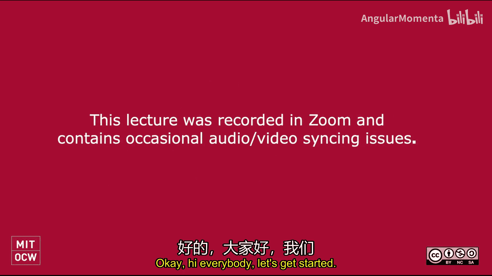
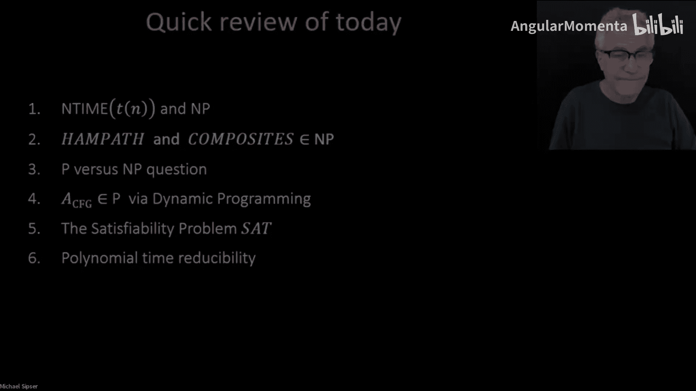
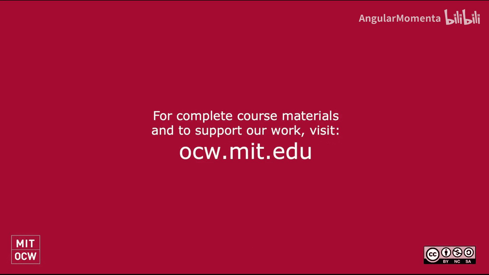

# 【麻省理工】计算理论  ｜  MIT 18.404J Theory of Computation, Fall 2020 p13 14. P和NP，SAT，多项式时间可归约性 -BV1pt7GzeEjb_p13-

ok。Hi everybody， let's get started。So。It's been a while since we came together in a lecture last week we had the holiday。

 we had the midterm so with that。what have we been doing we finished the first half of the course you know about two weeks ago where we talked we were talking about computability theory。

 we have shifted into the second half talking about complexity theory so get your mind back to that we discussed the various different models and ways of measuring complexity on different models at least in terms of the amount of time that's used and in the end we settled on the one tape tuuring machine。

 which is the same model we had been working with in the first half of the course and argued that though there。

The measures of complexity are going to differ somewhat from model to model。

 they're not going to matter different by more than a polynomial amount and so since the kinds of questions we're going to be asking are going to be basically whether problems are polynomial or not。

 it's not going to really matter which model we pick among reasonable deterministic models and so we're going to the one tapepe tuuring machine is a reasonable choice。

Given that we defined time complexity classes， the time T of N classes， we defined the class P。

 which was invariant among all of those different model deterministic models in the sense that it didn't matter which model we choose。

 we were going to end up with the same class P， so that argues for its naturalness。

And we gave an example of this path problem being NP P and we kind of ended that lecture before the midterm with the discussion of this Hamiltonian Pa problem。

 so we're going to come back to that today。So today we're going to look at nondeministic complexity。

 define the classes non deterministic time or end time， talk about the class NP。

 the P versus NP problem， which one of the you know very famous unsolved problems in our field and look at dynamic programming。

 one of the most basic algorithm， polynomial time algorithms and polynomial time reducibility moving toward our discussion of NP completeness。

 which we will begin。Next lecture， so with that let's move into today's content。

 which is well just quick review， we as I mentioned we define the time complexity class。

 this is the time complexity class is a collection of languages。The languages that you can do。

 these are a collection of languages。All of the languages that you can solve in certain amount of a certain time bound within a certain amount of time。

 so the time the time n squared， for example， is all of the languages or all of the problems that you can solve in n squared times we're identifying problems with languages here。

And the class P is the collection of all problems that you can solve or all languages that you can solve in polynomial time。

 so it's the union over all time into the K so and squared and cubed and the fifth power and so on。

 union out of all that， all of those bounds， the associated language languages that's the class P。

And we gave an example of this path problem， we gave an algorithm for path。

And then we introduce this Hamiltonian path problem。So。If you remember， instead of just asking。

 given a graph whether you can get from S to T， now we want to know。

 can I get from ST but visit every other node along the way？😡。

So find a path that goes through everything else and gets from STT。

And I should say it's also it's a simple path， so you're only allowed to go through every node just once。

And now。呃。The question is for this problem is that can we solve that problem in polynomial time the you know can we somehow modify the algorithm for path to give us an algorithm that solves Hamiltonian path in polynomial time of course we could。

Solve Hamiltonian path with an exponential algorithm by trying all possible paths and that will give a correct algorithm。

 but there are exponentially many different paths and trying them all will not give a polynomial time algorithm so the interesting problem is can we solve that without doing that brute force searching through all possible paths。

And that's a problem that no one knows the answer to。Despite lots of effort。

 people have not succeeded in finding an algorithm for that， but on the other hand。

 we don't have any idea how to approve there is no such algorithm。

 I mean it's conceivable that one could prove such a thing， but we just don't know how to do it。

And so。that problem is an unsolved problem and I just want this isn't really a note to myself what's kind of amazing and this is what we're going to be showing over the next few lectures that there are there would be very surprising consequences if you could find a way to solve Hamiltonian path in polynomial time because what that would immediately yield。

Is a polynomial time way of say factoring large numbers or solving a large number of other problems that we don't know how to solve in polynomial time？

So， you know， as we mentioned， you know， factoring is a problem that we only know at Pre Tatael with an exponential algorithm。

 and it doesn't seem to have anything to do with the Hamiltonian Pa problem， seem very different。

But yet， if you can solve Hamiltonian Pa and polynomial time。

 then you can factor numbers in polynomial time and so we'll see how to make that connection that's what we're building toward with the next few lectures。

Okay， so happy to take any comments on comments and questions on that。

 or we'll just move on if you have any questions on our little review。Well。

 send questions along and we can stop at the end of various slides to try to answer them and of course。

 write to the TAs who can take your questions during while I'm lecturing。Okay， so to start this off。

 we're going to have to talk about non deterministic complexity as a variation of deterterministic complexity。

So first of all， when we have a all of our all of our the machines in this part of the course and the languages。

 everything' is going to be decideidable and all the machines are going to be deciders。

 So what do we mean when we have a nondeterministic machine。

 which a decider is a decider and that just simply means that all of the branches。

It's not just the machine holds on every input， but all of the branches hold on every input。😡。

So the nondeterministic machine is non deterterministic it has lots of possible branches。

 they all have to hold all of them on every input， that's what makes a nondeterministic machine a decider and youre can convert a nondeterministic decider into a deterterministic decider。

But the question is how much time would that introduce。

 how much extra time was that going to cost and the only way that people know at the present time for。

That conversion would be to do an exponential increase。

 basically to try all possible branches and that's of course， very slow。So let's first。

 let's understand what we mean by the time used by a nondeministic machine and what we mean by the time used is we're looking at each individual branch individually。

😡，Separly， so a not deterministic machine will say runs in a certain amount of time if all of the branches hold within that amount of time。

So， you know， what we do。We do not mean that the total amount of usage。

 the total amount of effort by adding up all the branches is at most T of N it's just that each branch individually uses at most T of N that's just going to be our definition and it's going to turn out to be the right way to look at this to get something useful。

😡，嗯。So。我呃。If we have。So now we're going to define the analogous complexity class associated to non deterterministic computation。

 which we'll call non deterterministic time， so non deterterministic time T of N is the set of all languages that you can do with a nondeministic machine that runs an order T of n time。

Just think back to the definition we had for deterministic complexity。

 the time class or sometimes people call a D time to emphasize the difference。

 but let's just say we're calling it in this course time versus end time so time T of n is all of the languages that you can do with the oneta Turing machine that's deterministic but this here is a not a deterministic turing machine for not a deterministic time。

So the picture that that is good to have in your head here would be if you think of nondeterminism in terms of a computation tree thinking of all the different branches of the nondeterminism。

 all of those branches have to hold。And they have to hold within the time bound。

So imagine here this is T of N time， all of the branches have to hold within T of N steps for this a non deterministic tuuring machine to be running in T of N time and to be doing a language in the end time T of N class。

Um。And by analogy with what we did before， the class NP is。

collectionction of all languages that you can do non deterministically in polynomial time。Um。

 so it's the union over all of the end time classes where we the bound is polynomial。嗯。Okay。

 so a lot of this should look very familiar， but we've just added a bunch of non deterministics and a bunch of ends。

In place， but the definitions are very similar。And one of the motivations we had for looking at P。

 the class P was that it did not depend on the choice of model as long as the model was deterterministic and reasonable。

 and this is also the class NPP is also going to not depend on the choice of model as long as it's a reasonable nondeterministic。

呃， model。So it's again， a very natural class to look at from a mathematical standpoint。

 and it also captures something interesting， kind of from a practical standpoint。

 which you're going to talk about over the next couple of slides。

 which is that it captures the problems where you can easily verify。

When you're a member of the language。Okay， so we'll talk about that， but you know， if you take。

 for example， the Hamiltonian Pa problem。When you find a member of the language。

 so that is a graph that does have a Hamiltonian path from STT。

You can easily verify that's true by simply exhibiting the path。Not all problems can be solved。

 can be verified in that way。But the problems that are in NP have that special feature that you when you have a member of the language。

 there's a way to verify that you're a member， so we're going to talk about that because that's really the key to understanding NP。

 this notion of verification。😡，Okay， so。Let me go， there was a good question here。

 let me just see if I want to answer that。呃。Yeah， mean。

 this is a little bit of a longer question that I want to fully respond to。

 but you mean the well let's turn to my next slide， which maybe sort of bring that out anyway。

Actually， it's a couple of slides from now， but I'll get to that point。

So let's look at Hamilton and the hand Pa problem and what I'm going to show is the Hamiltonian Pa problem is in NP and I'm going to walk you through this one kind of slowly。

 so the Hamiltonian Pa problem remember we don't know if it's in P。😡，But it is。In NP。

 so it's in one of these， you can solve Hamiltonian path in polynomial time if you're a non deterministic machine。

😡，Why is that well， it's because of the non determinism。Because of the parallelism of nondeminism。

 which allows you to kind of check all of the paths on different branches。😡。

So let me first describe how the algorithm， would how I would write down the algorithm。

 and then we'll kind of try to unpack that and understand how that actually looks in terms of the Turing machine。

The Turing machines computation。So first of all。So taking the Hamiltonian pathth problem， you know。

 you're given an input now， which is a graph and the nodes S&T where I'm trying to figure out is that Hamiltonian path again which visits all the nodes？

😡，Which takes you from Sity。嗯。And we're trying to make now a non deterministic machine。

 which is going to accept all such inputs which have a path。

So the way this not deterministic machine is going to work。

Is it's basically going to use its non determinism？To try all possible paths。😡。

On the different branches。And the way I'll specify that is to say non deterministically。

 we're going to write down。😡，A candidate path。Which is just going to be a sequence of nodes sequence of m nodes where we'll say that's the total number of nodes of the graph remember a Hamiltonian path because it visits every node is going to be a path with exactly m nodes in it。

😡，So I'm going to write down a sequence of nodes as a candidate path。

And I'm not deterministically going to choose every possible sequence。😡，In this way。Um。

If you like to think of the guessing metaphor for nondeminism。

 you can think of the non deterministic machine as guessing the right path。

Wwhich is going to be the Hamiltonian path from STT， but I think from for this discussion。

 it might be more helpful to think about all of the different branches of the nondeminism。

Um because that's perhaps more useful when we're thinking about it in terms of the time。

 I think you'll get used to thinking about it， you should be used to thinking about it in many of the different ways。

 but maybe the computation tree of all branches might be the more helpful one here。

So now after we write down a sequence， a candidate path， sequence of nodes， now I have to check。😡。

That this really is a path。And the way I'm going to do that is to say。

 well now if I have just a sequence of nodes written down。

 what does it mean for it to be a Hamiltonian path for S to T。

 well it better start with S and end with T， first of all。

 and we have to make sure that every step of the way is actually an edge。😡。

So each pair V to V plus one has to be an edge in the graph。😡，Otherwise。

 that sequence of nodes is not going to be a legitimate Hamiltonian path from ST and you it has to be a simple path。

 you can't be repeating nodes。These four conditions together will guarantee。

That we have a Hamiltonian path。 and once we have written down a candidate。Sequence。

 we can just check that that sequence actually works。😡。

There's no at this second stage of the algorithm。Nondeterminism is necessary this is going to be a deterministic phase。

 but the stage one of the algorithm is going to be a non deterterministic phase where it's writing down all possible paths now i'm going to try to unpack that for you so you can actually visualize how the machine is doing this。

And then of course， you know， so you're going to on each branch of the nondeminism。

 you're going to check to see whether the conditions have been satisfied and on that branch。

If the conditions were not satisfied， that branch is going to reject， of course。

 one of the other branches might yet accept， so that's how nondeminism works。😡，Okay。

 so I'd like to visualize this。嗯。呃。I'd like to visualize this as a。The tree。Of。

Of the different branches of the computation。Of M on its input so here is here is our nondeterministic Tring machine which this one and you provided with the input you know GS&T and how does a machine actually working so when I say nondeterministically write down a sequence of m nodes。

You know， know this is getting into a little bit more detail than I would normally think about it because we try to tend to think about things at a higher level。

 but just to get us started， I think it's good to think about this with a bit more detail。😡。

So let's think of the nodes， the M nodes as being numbered， having labels。😡。

Nniit numbered1 through M。And I'm going to think about them being labeled by their binary sequences。

😡，You know， we' going to write down those nodes。 That's how the you know the machine is going to have to operate on those numbers for the nodes。

 We'll think about them as being written in binary And now as the machine is going to be writing down。

 let's say the node V1。So it's non deterministically picking the first node of the sequence。

 What does that actually mean in terms of the。😡，The step by step processing of the touring machine M。

Well， it's going to be guessing via a sequence of non deterministic moves。😡，The bits。That represent。

The number of the node for V1。You know， for example， V1 might be the node number five。😡，In the graph。

Um， course to， you know， non deterministically， the the machine is on different branches。

 picking all different possible can choices for V1。Those are going to be the different branches here。

But you know， one of the branches might be， and what I'm really representing here， these are。

 I probably could have written this down on the slide here in tiny font。

 but these are like the01 choices that's why it's sort of a binary tree here for the writing down the bits。

Of of a V1 so here maybe this could be 101 representing the number five。

 which might be the very first node。That I'm writing down to my sequence。

Some other branch is going to write down node number six。

 some other branches is going to write down node number two because now deterministically we're making all possible choices for V1 that's what I'm trying to show in this little part of the computation。

😡，Of M on this input。So then after it's finished writing down the description of the node for V1。

 its choice for V1， it goes down to make choose what V2 is again non deterministically。

 so there's going to be more branches you know。😡，For each possible choice of V2。And so on。

 node after node， then it's going to finally get to the last node VM is going to write down lots of choices for VM。

😡，And at this point here， we have completed the first stage of the algorithm。

 now there's some huge tree。😡，Of all of the possible choices for the Vs that have shown up at this point。

😡，Okay。😊，And now we're going to move into the second phase。So following this。

 there's going to be here。诶。A bunch of deterministic steps of the machine。

 so no more no more branching， no more branching is needed。

 because here we've written down at this point， we've reached a point in each of these each of those locations where we've chosen one of the candidates。

😡，What are the possible branches or what are the possible paths through the machine？

the possible paths look through the graph i'm sorry。

 so we you know here we're guessing potential paths in the graph and now we're going to check that we actually have picked a path that's a Hamiltonian path from SP。

As the T。Okay， so each one of these branches is now going to end up accepting or rejecting。

 and the whole overall computation is going to accept if at least one of them ended up accepting。

 which means you actually found a Hamiltonian path。Okay。

 so I don't know if that's helpful to you or not， but。That is so we can just， you know。

 if there's any questions on this， let's see。Question on， is there something？呃呃。You know。

Trying to draw a connection here between this and computation histories I mean。

 there is a pattern here that does come up often where you you want to check something you know starts right ends right and that all of the intermediates are right So there is I think there there is。

U。There is some deeper connection here。Probably too hard to explain。

 but that does has something to do with this Hamiltonian path problem。

why we're using binary representation， well we're going to talk about。

 you know we the algorithm would have worked equally well if we used base three or base five or base。

 you know， 20 as a way of writing down our labels for the nodes。But in sense， it doesn't matter。

The alphabet has to be finite so that's that's true I mean that's why。

It's not just in a single step of the Turing machine that you would pick the。The node。

 the the choice for V1， you really have to go through a sequence of steps because。Each of them。

Branches of the machine only has a fixed number of choices。

 so you can't in a single step of the Tring machine pick all the different possibilities for V1 that has to go through a sequence。

嗯。Okay。Now let me do a second example， the problem of composites。

 so the language of all composites of all of the non primes written as binary numbers again。

 so we'll talk about the base and the representation in a second。

 but just imagine you know you know these are all of the numbers that are not prime。

And that language is easily seen to be a member of NP。Here is， again， the algorithm for that。Um。

Given X。We want to accept x if it's not a prime number， so it has some non trivial factor。😡，嗯。

So first， the way the non deterministic machine is going to work is it's going to guess that factor。

 so it's non deterministically it's going to try every possible factor。😡。

What were y is going to be a number between one and x， but not concluding one。

 you know that we have to be an interesting factor， so not co one in the number itself。

 so something strictly in between。😡，And we're going to then after we've non deterministically chosen why。

 then we'm going to test to see if why。😡，Is really a factor？

And so we'll see if it y divides evenly into x。With the remainder of0。

If that branch successfully picked the right why， it's going to accept。😡。

And some other branch what might have picked the wrong why will not。And if。

X is really a composite number， some branch will find the factor。Now the base doesn't matter。

 could have used base 10。Because you can convert one base to another。

 so this is really in terms of our representation of the number。

 but I do want to make one point here that changing we don't want to write the number in unaryary。

You know， just as writing the number k as a sequence of k1s。

 that's not really a base that's just an exponential representation for the number and that changes the game because if you make the input exponentially larger then it's going to change whether the algorithm relative to that exponentially larger input is polynomial or not。

 so an algorithm that might have been exponential，Originally。

 when the numbers written in binary might become polynomial if the number written in uninary。

And I do want to mention as a side note that the composites language or primes for that matter doesn't。

 you know， both are NP。Um， but we won't cover that。

So whereas the Hamiltonian P problem is not known whether it's NP P。

 the primes and composites problem are NP P， so that was known that was actually a very big result in the field solved by folks at one of the Indian Institutes of Technology back about almost 20 years ago now。

嗯。Okay。So let's turn here to trying to get an intuitive feeling for P& NPP， and we'll talk。

 will return now to this notion of NP corresponding to easy verifiability。So。

N P are the languages where you can easily verify membership quickly and I'll try to explain what that means in contrast P are the languages where you can test membership quickly by quickly I mean I'm using polynomial time。

Um， that's going to be basically， you know， for us， that's what quickly means in this course。mSo。

In the case of the Hamiltonian path problem。The way you verify the membership is you give the path。

In the case of the composites， the way you verify the membership is you give the factor。嗯。

In those two cases and in general。When we have a problem that's in NP。

 we think of this verification as having a giving we give it a special name called a certificate or sometimes a short certificate to emphasize the polynomiality of this certificate。

😡，It's like a way of proving that you're a member of the language。In the case of composites。

 the proof is the factor。In the case of Hampath， the proof is the path， the Hamiltonian path。

Contrast that， for example， if you had a prime number。Um， you know。

 proving a number composite is easy because you just exhibit the factor。

 how would you prove that a number is prime？What's what's the short certificate of proving that some number is has no factor that's not so obvious in fact there are ways of doing it which i'm not going to get into in the case of testing of numbers prime but and now it's even so known to be in P so that's even better but。

There's no obvious way approving that a number is prime with a short certificate and so this concept of having being able to verify when you're a member of the language。

 that's key to understanding NP。That's the intuition you need to develop and hopefully take away from today's lecture。

 or at least you know by thinking about it and reading the book and so on。嗯。Yeah。

So if you compare these two classes， P and NPP。P first of all。

 is going to be a subset of NP both in terms of the way we defined it because deterministic machines are a special case of nondeterministic machines。

 but also if you want to think about testing membership if you can test membership easily。

 then you can certainly verify it in terms of the certificate。

 you don't even need the certificate is irrelevant at that point because whatever the certificate is。

 you can still。Test yourself whether the input is in the language or not。呃。The big question。

 as I mentioned， is whether these two classes are the same。So does。

Being able to verify membership quickly， say with one of these certificates。

 allow you to dispense with that certificate， not even need a certificate and just test it for yourself whether you're in the language and do that know in polynomial time。

That's the question。For a problem like Hamiltonian Pa。

Do you need to search for the answer if you're doing it deterministically or can you somehow not need you know？

Avoid that and just come up with the answer directly with a polynomial time solution。

Nobody knows the answer to that and goes back at this point quite a long time it's almost 60 years now that。

That problem has been around 60 years。No， there would be 50 years， no 50 years， almost 50 years。

So the most people believe that P is different from NP， in other words。

 that there are problems in P that are in NP， which are not in P。

 candidate would be the Hamiltonian Pa problem， but it seems to be very hard to prove that。

And part of the reason is I mean， how do you prove that a problem like Hamiltonian PAF does not have a polynomial time algorithm。

 it's very tricky to do that because the class of polynomial time algorithms is a very rich class。

 polynomial time algorithms are very powerful。And to try to prove there's no clever way of solving the Hamiltonian path problems it just seems to be beyond our present day mathematics。

 I believe someday somebody's going to solve it， but so far no has succeed it。😡。

So what I thought we would do is I think I have a check in here， yes。

 and then we'll stop for a break。So let's look at the。The complementary problem。

 hand Pa complimented。嗯。So that's you're in the language now if you don't have a path。

So is that complementary problem in NP？Okay， so for that to be the case。

 we would need to have short certificates of when a graph does not have。A Hamiltonian path。So。

I leave it to you， so there are three choices。嗯。Okay。

I'm going to stop here so make sure you get your participation credit here。

I'm going to end the polling now。Interesting so the majority is wrong， well I don't know wrong。

 we don't know you know。I think the only fair answer to this question is C because we don't know whether or not we can give short certificates for a graph not to have a Hamiltonian path。

If p equaled NPp。Then you can test in polynomial time whether a graph has a Hamiltonian path。😡。

And then the computation itself would be a certificate whether it has a path or whether it doesn't have a path。

 because it would be something that you can check easily。

So since we don't know for sure that p is different from NPp， you know， p could be equal 10 p。

 then it's possible that。We could give a short certificate。

 namely the computation of the polynomial algorithm。So the only really。

ARea answer to this question is that we don't know。So just ponder that。

 I think the thing that you those of you who answered yes， however。

 need to go back and and I't put this here explicitly because I know this is a。

This is a confusion for， well， I can see for quite a few of you。嗯。

When we have non deterministic computation you have a non deterministic machine。

 you can't simply invert the answer and get back a non deterministic machine nondeminism does not work that way if you remember。

😡，You know the complement that AA pushed on automaton。It's not a pushdown automaton。

If you have a non deterministic machine and you invert all of the responses on each of the branches。

 it's not going to be recognizing or deciding the complementary language。Because well。

 I think that this is something you you if you answered yes。

 you need to go back and make sure you understand why yes is is not a is not a reasonable answer to this question。

 because that's not how nondeminism works， so you have a。

A not complete understanding of nondeminism and that's going to be really important for us going forward。

 so I really urge you to figure out and understand why yes not is not a good answer this to this check in。

Okay， so I think we will we can talk about that more over the over the break and so'll we'll return here in。

In five minutes。嗯。Somebody's asking about infinite you know infinite。

Infinite sequences be generated by the machine。I， you know， when we're talking about。You know。

 it especially in the complexity section of the course， all of the computations are going to be。

Bound it in time。 So we're not going to be thinking about sort of infinite runs of the machine that's not going to be relevant for us。

 So let's not think about that。 How does the term machine performed division。

How does a T machine perform to vision？How do you perform division？

The long division is an operation that can run in， you know the long division procedure that you learn in a great school you can implement that on a turing machine。

 so yes， a tuuring machine can definitely perform two long division or a division one integer by another in a polynomial time。

Okay， another question， can we generally say try dividing y by x or do we have to enumerate a string of length y and cross off every no I think that's the same question。

You know？I mean， how would you know， if you have numbers written in binary。

 how would you do the division， you're not going to use long division， you know。

 anything such as the thing that's proposed here by the questioner is going to be an exponential algorithm。

 so don't do it that way。嗯。呃。Why does primes in P composites in P。

 not implied primes in P does imply。If composites are N P， then primes is NP P as well。

 because you can just， you know， when you have a deterministic machine。

You can flip the answer when you have a non deterministic machine and you may not be able to flip the answer。

 so the deterministic machine just having a single branch。

You can make another deterministic machine that runs in the same amount of time that does the complementary language because for deterministic machines。

 just like for deciders in the computability section， you can just invert the answer。

There is an analogy here between。P and decideidability and NP and recognizability it's not an airtight analogy here。

 but there is some relationship there。What are the imp like somebody's asked me the implications of p equal to NP lots of implications too long to aum right now。

 but for example， you would be able to break basically all。Cryptoy that I'm aware of if P equald NPp。

 so we would have a lot of consequences。嗯。So interesting， so composites。

Primalality and compositeness testing is solvable in polynomial time。

 but factoring interestingly enough is not known to be solvable in polynomial time so that I mean so。

We may talk about this a little bit toward the end of the term if we have time but。

The algorithms for testing whether a number is prime or composite in polynomial time do not operate by looking for factors。

 they operate in an entirely different way， basically by showing that a number is prime or composite by looking at certain properties of that number。

 but without testing whether it has testing，😡，But without finding a factor。嗯。诶。Okay。

 another question here about asking the when we talk about encodings。

 do we have to say how we encode numbers values， no。

 we don't have to we usually don't get have to get into spelling out encodings as long as they're reasonable encodings so you don't have to usually we're going to be talking about things at a higher enough level that the specific encodings are not going to matter。

嗯。Okay， let's return to the rest of our lecture。When we talk about。

Sa this P versus NPp problem and how do you show that you know。

 a problem might not be solvable in P like the Hamiltonian Pa problem。嗯。You know。

 many people you know， who are not practitioners in the field you know or know about the P versus know about the P versus NP problems over the years I've got many。

 many。Emails and physical letters from people about that since people you know。

Since I've spent some time thinking， I'm known as having spent some time thinking about it and people claim to solve the problem solve P is NP the P versus NP problem by。

Basically saying， you know。Problems like the Hamiltonian Path。呃。

You know or these or other similar problems， basically there's clearly no way to solve them without searching through a lot of possibilities and then they go through big long analysis showing that there were exponentially many possibilities。

The you know。And a lot of the proofs that claim to solve P versus NP。

 they all look like that you only have to look some somewhere in that paper。

 there's going to be a statement。Along the lines。To solve this problem。

 clearly you have to do it this way。Um， and that's the flow and the reasoning because just like for the factoring problem。

Just like for the compositeist testing problem， you don't necessarily have to solve it use by searching for factors。

 there might be some other way to do it， you might be able to solve the Hamiltonian path。

Problem without searching for Hamiltonian paths it might be some other process that you can use which would give you the answer so the class of polynomial time algorithms is very rich can do many。

 many things and and I wanted to present to you one of the most important polynomial time algorithms in a sense it's kind of you can make a certain argument that this is sort of the the in a sense the most fundamental polynomial time algorithm some people might argue with me on that but and that's a process called dynamic programming。

Which I'm sure some of you have seen already in your algorithms classes and some of you may not have but。

Since you have a homework problem on it， I want to spend a little time describing it to you。

And that's useful for solving this ACFG problem， which you may remember from the first half of the course involving testing if a grammar generates a string。

Okay， so remember this ACFG problem， you're given a grammar， context free grammar。And a string。

 and I want to know， is it in the language of the grammar？Okay。

 so that's going to turn out to be solvable in polynomial time。😡。

But only with a kind of a clever algorithm。呃。Remember， it's decidable。

We decided that by convert by making sure that you are converting the grammar in Chomsky normal form。

 then all the derivations have a certain length， you just try all the possible derivations of that length and you accept if any of those derivations generate W。

Okay。You may remember that from the first half of the course。That immediately gives。

An NP type algorithm for this language。Because basically， you non deterministically。😡。

Instead of trying them most sequentially all of these derivations。

 youd try them in parallel non deterministically， so non deterministically you pick some derivation。

😡，Of that length。And you accept it if it generates the input。This fits。

 this is classically fits our model of。Of NP。You can think of it as guessing the derivation and checking that works or in parallel writing down all possible derivations。

 but this AC ofG problem is。A classically。An NP problem， a problem in NP。

And if you just imagine that so and what's going to be the certificate。

 if you found an input that's in the language that's generated by the grammar。

 the certificate is a derivation。So if you look at it that way you might think well that's the best you can do。

 this is going to be an NP problem in NP and there's not going to be a way of avoiding searching for the derivation but that's not true。

 there is a way of avoiding searching for the derivation you can kind of build up the derivation using dynamic program and so that's what I wanted to kind of describe for you how that works also partly because it's a homework problem and I think dynamic programming is a very important algorithm。

So before we。Describe what dynamic programming is， which is very simple， by the way。

 let's try to work up to it by making an attempt to solve this problem just using ordinary recursion。

Um so how would we solve the ACFG problem， so you give it a grammar。You're given an input。

Let's assume the grammars in Chomsky normal form so that's going to be useful so it's a Chomsky normal form grammar and we want to see how to test if you can generate W and it's going to be recursive algorithm recursive algorithm is going to actually solve something slightly more general。

I'm going to give you the grammar， I'm going to give you the string。

 and I'm also going to allow you to start at some other variable variable besides the start variable。

 so I'm going to give you some variable R and I know I want to know can I generate W starting at R。😡。

Okay， so that's my slightly more general problem， which is going to be useful in the recursion。Okay。

 so the input now to this this algorithm is。The grammar， the input and the starting variable。

 And now how is the algorithm going to work， It's going to try to test can I get to， you know。

 is there some derivation pictured here as the parse tree for W starting at R。😡。

That's what the algorithm is trying to answer。Can I get W from R？The way it's going to do that。

Is it's going to try to divide W into。😡，The two strings。In all possible ways。😡。

Which sounds like it might be exponential， but it isn't。

There's only a polynomial number of ways to divide the string into two substrs。😡，Just order in。

 just depending on way you make that cut。So there's you know some so that's not too bad a polynomial is only n ways of making that division and also I'm going to try every possible rule that comes from R that generates two。

呃。That generates two variables， so these are what's allowed in Chomsky normal form R goes to ST。Okay。

 so I'm going to for each possible way of cutting w into x and x Y and for each possible rule R goes to ST。

 I'm going to see recursively， can I get。😡，From S to x and from T to Y。

So I'm going to use my recursion now， now that I have smaller strings instead of W。

 I can apply my recursion and try to answer it that way。And this algorithm will work。

So if I found a way to cut W into Xy and I found a rule R goes to ST such that S generates x and T generates y。

 then I'm good， I know I can generate W from R。😡，Okay。

 and if there's no way of cutting W up to satisfy that or you know。

 if I can find any way to divide W into X Y and rule our goes to Xt， which makes this work。

If all possible ways fail， then you can't get from R to W。Okay。

And then you can decide the original ACFG problem now by starting from the start variable instead of just sum any old R。

 you plug in the start variable far。😡，Okay， so if this algorithm works。

And it can be used to solve ACfG， but the question is， is a polynomial？And it's not。

Because every time you're doing the recursion， you're essentially adding another factor of n。😡。

Because here， as we pointed out， this is a factor of n。

 but that's happening every time you're doing a recursive level and you can imagine。

I'm just doing a very crude analysis here， depending upon how you divide W up。

 but roughly speaking it's going to get divided in half each time so there's going to be log n levels and so that means you're going to be multiplying n by itself log n times or give you an end to the log n algorithm。

😡，That's not polynomial because polynomials enter the constant。For some fixed constant。

 enter the login is not going to be polynomial， so this is not a polynomial algorithm。So instead。

 you're going to have to do something just a little bit more clever。😡。

It's going to be the same basic idea。But just relying on one little observation。

And the little observation is。That。When。This non polynomial implementation that I just described is actually pretty dumb。

Because it's doing a lot of recomputation of things that it's already solved， why is that？😡，Because。

If you look at the number of possible different subpro here。

 once I fix once I give you G and I give you W。😡，嗯。How many different subpro GS& T are there？Well。

 the number of strings here， all of those strings are going to be substrs of W。

 there's only roughly n squared substrs of W， I'm always going to be generating in a subprom here。

 some substring of W from some starting variable in the grammar。😡。

So because there aren't that many different substrs and not that many different starting variables。

 the total number of possible problems that this algorithm is going to be called on to solve is going to be in total a polynomial number of different subproblems。

 there aren't very many of them it's only something like order and squared。😡。

So if the algorithm is running for exponentially long time。

 it's solving the same sub problemm over and over again。😡，That's dumb。

Why don't you just remember when you solved the sub problemm so you don't solve it again？Doing that。

Enhanced recursion where you remember the problems you've already solved is called dynamic programming I don't know why it has such a confusing name like that。

Actually it's called by several different things， but anyway that's known as dynamic programming it's recursion plus the memory and here is just repeating myself。

There are not very many different substrs， so every time you're going to be in your recursion somewhere you're going to be working with a substring so there's not that many different sub problemss that you can possibly solve and just remember when you solve the sub problemblem。

And not solve it again， so let me just show you that algorithm again here with the little modification。

So first of all。Let me give you this is the same algorithm from the previous slide i'm just repeating it here without all the other stuff so we can just look at it directly right dividing it。

In X and Y for each possible rule。And just and then recur。No。I'm going。

And a little step zero beforehand。Um， which says if I have GW and R。

Let me just check first whether I've already solved that one before。

 so I have to keep track of the ones I've already solved。😡。

That's not too bad because there's only n squared order n squared possible different ones that I could be called on to solve。

😡，So I'm just going to have a little table when I'm going to remember those。

And then every time I get a new one， get I get what to sell， I'll check。

 is it on that table and what's the answer？So I won't have to rerun those。So now the total。

 I'm going to be basically pruning that tree。So that it has only a polynomial number of leaves and so the total size of that tree now is going to be polynomial。

And so that's going to yield a polynomial running time this by the way。

 I only learned this myself I'm sure you guys all know this who have taken this as in the algorithms calls of course。

 has a special name called memorization， not memorization sort of that came from the same root I think。

 but memorization which is somehow remembering the results of a computation so you don't have to repeat it。

嗯。So the total number of callss is going to be most and squared to this algorithm because you're never going to be redoing a work that you've done already so and you know and when you actually have to go through it。

The the running time。You know， so it's it's the total amount of time that you're going to need is going to be polynomial altogether。

So let's hear， I don't remember what my check in is on this。Oh yeah。

 so I mean this is somehow related and feel free to ask questions too while you're thinking about this this check in。

 but the check in says here， we've solved the ACFG problem in polynomial time。

 does that tell us that every context free language itself？Is also solvable in polynomial time。

So just mull that over and please give me an answer to it I hope you do better on this check than you did on the last one but anyway I don't you go ahead and think about that and I can take some questions in the meantime。

Somebody is asking here。Actually， I'm getting several questions on this。

 why isn't it order n cubed or something greater than order n squared because of the variables？

The variables are not don't don't depend on N， you know， when you're given。Well。Actually。

 that's not true。No。You， you， you are right。诶。Because the grammar is part of the input。

So that you might have as many as n different variables in the given grammar。

So you are right there is potentially you know the grammar might be half the size of the input and the input to the grammar w might be half the size of the input so I didn't think about that but you're correct there are potentially of different numbers of variables and different grammars so you have to add an extra factor which would be in most the size of the input because that's as many variables as you could possibly have so it really should be I think order and cubed。

To take that into account as well plus all of the work that needs to happen in terms of dividing things up you know on a one tape turing machine there's going to be some extra work just to carry out some of these individual steps because with a single tape things are sometimes a little awkward I think the total running time is going to be end up being something like end of the fourth or end of the fifth on a one tape turing machine but but that's a good point。

U。🎼So somebody is saying how can we be storing n squared strings in finite time I'm not saying what why finite time we have polynomial time every every stage of this algorithm is allowed to run for polynomially many steps as long as it's clearly polynomial we can just write that down as a single stage。

Noumb part  two should say。不。There's a typo here， so use D， thank you， thats that is a typo。呃。

I'm afraid if I change it on my original slide here， things will break in some horrible way。

Let's just see that I completely wreck my slide。No， that's good。Yeah， thank you， good point。嗯。诶。Oops。

Okay， how's our check in doing？Okay， I think you're just about all done。 Oh。

 that's still spend a lot of time on this and polling。

As you may remember from the first half of the course， so the answer is is a indeed D。

 remember that we showed ACFG in is decable and therefore each context free languagegu itself is decable just because you can then plug you can plug in the specific grammar into the ACFG problem the very same reasoning works here。

So you can for if you have a context free language， it has a grammar。

 you can plug that grammar into the ACFG problem。And then that's polynomial time。

 you're going to get a polynomial time algorithm for that language so good to review that it's the same thing from same argument we used before。

Um okay。Also I don'dt want to spend a lot of time on this there are there's another way of looking at dynamic programming we'll talk about this again in maybe in a lecture probably next lecture just because I know you have a homework problem on it and if you've seen dynamic programming before its going to be easy if you haven't seen it before it's going to be I think probably a little challenging。

But another way of looking at dynamic programming is the socalled bottom up version of dynamic programming and what that would mean is you solve all of the sub problems first before you solve all the smaller sub problems before you solve the larger sub problems let me just you know。

It's here on the slide， I'm not sure I want to talk it through。

 but basically you solve the sub problems here where the strings start with strings of length one and then from that you build up to subpro with the substrs are of length two and then three and so on and each of those only relies on the smaller previously solved subprobles so you can kind of in a systematic way solve all the larger and larger subproble you know for larger and larger substrs。

And that gives a kind of a different perspective on dynamic programming and kind of for different problems。

 sometimes it's better to think about either this sort of top down recursion based process or the sort of the bottom up process that i'm describing here。

 they're really completely equivalent but。You know the version that's described for this particular algorithm which appears in the textbook is actually the bottom up algorithm。

 so you shouldn't be confused if you see something there which looks somewhat different and that's often you see you basically solve all possible subprom filling basically filling out a table let me not say it anymore say anything more about that here since we're running a little short on time but。

There were really two perspectives on dynamic programming。Okay， so moving on from there。

Let's shift gears。Leave context free languages and dynamic programming behind。

And start moving toward understanding。P and NP。And for that。

 we will introduce a new problem called the Saisfiability problem and that's one we're going to spend a lot of time on so important to if you tuned out a little bit during the dynamic programming discussion。

Time to get back on board。So the satisfiability problem is going to be a computational problem that。

We're going to be working on and it has to do with Boolean formula。

So these are like expressions like arithmetical formula like x plus y times Z。

 but instead of using numerical variables， we're going to be using Boolean variables that take on Boolean values true false or sometimes represented by one and zero。

嗯。And the operators that we're going to be using are going to be the and or a negation operations。

And or not。Okay， and I'm going to say such a very such a formula， such a boolean formula。

 we're going to call it satisfi， but we'll do an example in a second。

If that formula evaluates the true。If you assign。Make some assignment of values to its variables。

So just like arithmetical formula will have some value if you plug in values for the variables。

Bulllan formula is going to have some value if you plug in Boolean values for its variables。

 and I want to know is there some way to plug in values which makes the whole thing evaluate the truth？

😡，The formula itself is going to evaluate to some either true or false。

 and I want to evaluate the truth。嗯。So。Here is our example， let's take the formula fee。

 which is x or y。And x complement or not x or not y。So the notation x with a bar over it。

 x complement is just x bar。Not X。It's just the way if you're familiar with the other notation for the knot operation。

ho just inverts ones and zeros we would write it we're going to write it with a bar instead of the negation symbol so I'm assuming that you've all seen boolean algebra。

 Boolean arithmetic before you know where you know the and operation is only true if both inputs are true so these are going to be binary and operations and binary or operations or is going to be true if either input is true and not as true if it's single input is false。

So it just flips the answer。Okay， so here I want to know for this formula for this bullolean formula here。

 is it satisifiable？Is there some way to assign values to the variables？😡。

To make this formula evaluate to true。So for example， let's just try things。

 let's make X and Y both true。So x is true and y is true。So x or y， well that's good， that's true。

But now we have to do an and， so we need both sides to be true。😡。

So now now we have x complement well we we said x is true so x complement is false y complement is false false or false is false so now we have a true and false that's going to be false。

 we did not find a satisfying assignment but maybe there's another one and in fact there is if you make x true and y false then both of these parts will be evaluate the true and then you'll have true and true so we found a satisfying assignment to this formula it is in fact satisfyfiable so if you say x is one and y zero yes this is satisfiable。

Now the problem of testing for a boolean formula， if it is satisfiable is going to be the St language。

 it's a collection of satisfiable boolean formula。😡。

And testing whether you're inAT or not is going to be an important computational problem。

There was an amazing。Theorem。呃。Which really got this whole subject going discovered independently by Steve Cook in North America and La at 11 in the in the former Soviet Union。

 almost exactly at the same time， which made a connection between this。

One problem and all of the problems in NP so by solving this one satisfiability problem。

In polynomial time。there it allows you to solve all of the problems in NP in polynomial time。

So if you could solve this problem set in P， then Hamiltonian Pa is also solvable in P。You know。

You step back and think about that， it's kind of amazing。

And the method that we're going to introduce is called polynomial time Reducibility and let's do a quick check in on this。

 this should be an easy one what don you just think about is SAAT。

 the SA problem that we just described there is that in NP。Three seconds。You're there。Okay。

 ending polling。Yeah， so the。Hopefully you're getting the intuition for NP that。

These are the problems to be an NP means that when you're a member of the language。

 there's a short proof or a short certificate of membership and in this case。

 the short certificate that the formula is satisfiable is the assignment which makes it true。

 also called the satisfying assignment。So yes， this is an NP language， a language that's in NP。

U so there are a lot of things that we don't know in this subject， but this isn't one of them。

 we do know that sad is an NP。So let's talk about our method for showing this remarkable fact that if you can solve pollen if you can solve。

呃。If you can solve SaAT in polynomial time， then all NPP is solvable in polynomial time。

 and it uses this notion of polynomial time reucibility。

 which is just like mapping reucibility that I hope you've all grown to know and love in the first half of the course。

 but now the reduction has to operate in polynomial time。😡。

So it's the same picture that we had before。Mapping A to B， transforming A questions to B questions。

 but then now the transformation has to operate quickly。And we get that。

If a is polynomial time reducible to B and B is polynomial time， then a is also polynomial time。😡。

Same pattern as before， if A is reducible to B and B is easy， then A is easy。

And here is kind of the essence of the idea。OrOr at least the outline， in a sense。

 the idea of this cook and Len theorem that if satisfiability is in P。

 then everything in NP can be done in P。😡，Which is because we will show。

That all problems in NP are polynomial time redducible to that。😡，That's the amazing fact。

 so therefore if you can bring sat down into pe by using this reduction。

 it brings everything else along with it because everything is reducible to sat so we just have to show how to do that。

😡，And there is an analogy that we had in the first half of the course in one of our homework problems。

 if you may remember。We showed that ATM。Has a very special property。

That all touring recognizable languages are mapping reducible to it。I think that was problem。2。

On2 a either in the problem set three or problem set two I think problem set three that every every during recognizable language is polynomial time Reducable to ATM and so。

Very similar picture and there's a lot of analogies here that you can draw between the computability section and the complexity section。

Anyway， with that， I know we're just about out of time。

 so let's a quick review of what we've done here and I will stick around for questions for a while。

Is there a。Okay， that's a good question。 Is there kind of a， you know， a。

Sort of a regular reduction analogy version to mapping Reducibility。 You know， we had that。

 we had the general reduction。For the computability section。

And we had the mapping reduction for the computability section here we're only going to be focusing now on the mapping reduction so polynomial time reduction is。

By assumption going to be a mapping reduction， yes， there is a general。

Polynomial time reduction notion as well。If you you know this is not required。

 but if you are curious about the general reduction and how to precisely formula like that it actually appears in chapter six under Turing Reducibility that's the general notion of Reducibility spelled out in a formal way and this polynomial time touring reucibility as well we're not going to。

Talk about it in this course。嗯。Other questions。Does NP correspond exactly？

To verification in polynomial time， if well， we have to。For me to answer that as a precise question。

 we have to have a precise definition of verification。

 but with the right definition the answer is yes， so you can define a verifier as a polynomial time algorithm that gives a certificate given that takes a certificate and an input to the language and will you know。

Except if if that certificate is a valid certificate for that input。

 this is actually discussed in chapter， I think nine。Of the text， but。呃You。嗯。

No I'm forgetting already， what's where in the book， but yeah， you can think of it。

 you can think of NP in terms of verification as a definition。呃。

Is proving people NP P the same as proving that a poll you know， actually I can even make the。

If you want， you can post public。Comments， too， as well， should have done that in other cases。

If is proving P equal NPp the same as proving that a polynomial time non detertermintic tuuring machine N。

Has a polynomial time deterministic。Yeah， so it doesn't mean that supposed we proved that P equals NPp。

 which is。The minority view， I would say quite the small minority view that there are some people who believe that that is entirely possible and might even be the case。

 but that's a very small small group， but yeah if you proved P equal NP。

 that's the same as saying that every nondeterministic polynomial time Turing machine is going to have a companion deterministic polynomial time tuuring machine which does the same language that's exactly what it means。

Bye bye， everybody。

