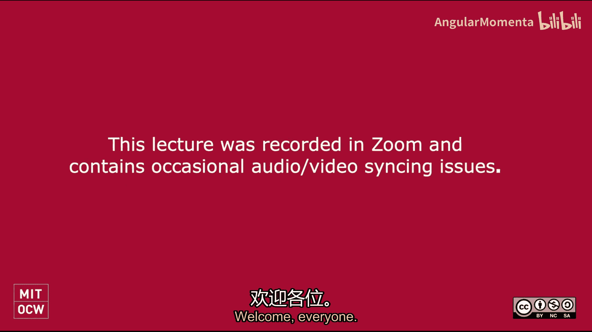
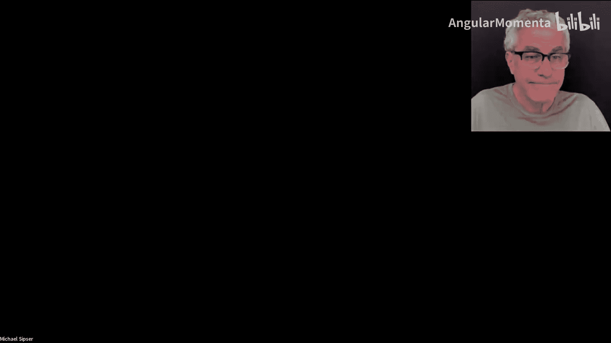

# 【麻省理工】计算理论  ｜  MIT 18.404J Theory of Computation, Fall 2020 p14 15. NP-完全性 -BV1pt7GzeEjb_p14-

Welcome everyone， back to Theory of computation。So we are now at lecture number 15 and。

🎼This is an important lecture， well all of our lectures are important。

 but this is going to introduce one of the major topics that we're going to see going on in various forms through the rest of the semester which is the notion of a complete problem in this case it's going to be an NP complete problem and。

I think some of you have probably heard of that concept already。

 maybe have seen it in some courses or other， but we're going to do that in a rather careful and formal way over the next couple of lectures so we are following up on our previous discussions about complexity。

 time complexity we defined the time and nondeterministic time complexity classes。

 as you may remember， the classes P and NP talked about the P versus NP problem。

Looked at some interesting algorithm for showing problems in P called dynamic programming。

And we started to move toward our discussion of NP completeness with the introduction of polynomial time Reducibility。

 which is related to some of the earlier reducibility notions that we discussed in the computability section。

so。Let's。Quick review。What it means for one problem to be polynomial time reducible to another。

 this follows our pattern of reducibility concepts where if a problem is reducible to another problem and that other problem is solvable then the first problem is solvable so if a problem is reducible to an easy problem。

 that problem becomes easy too。and the kind of reduction that we're going to be looking at here are the mapping reductions。

 but now where the reductions are computable in polynomial time。

And so we had this result we mentioned last time that if a is polynomial time reducible to B and B is in P。

 then a is also in P。So that's going to be critically important for the whole discussion that's coming。

嗯。Our intuition about P& NP， repeating that here， the NP problems are the ones where you can verify membership easily。

As opposed to being able to test membership easily， those are the problems that are NP P。

 the verification typically requires some kind of a certificate that establishes kind of a proof that the input is a member of that language。

嗯。And the big question of the field， which remains an unsolved problem。

 is whether P equals NPp is called the P versus NPp question。And we don't know the answer。

 so whether there are problems that are。In NP， solvable and non-deterministic polynomial time。

 typically these are problems that involved searching， whether they can be solved in polynomial time。

 typically without the searching， and if P were equal to NP。

 then you could always eliminate searching and a P were different from NP。

 then there were cases where you need to search and we don't know the answer to that。诶。

So in the direction of exploring this question and its ramifications。

We introduced this problem called satAT， these are the Boolean formulas which have an assignment that makes them evaluate the tro。

 so we call those satisfiable formulas。And we mentioned。

 but have not yet proven and we will not prove until the next lecture on Tuesday that there is this theorem kind of a very remarkable theorem that says that if you have。

You take the satisfiability problem and if it is solvable quickly。

 then all of the NP problems are solvable quickly so if set is in p then p equals NP so in a sense set is kind of no the。

It's sort of the super。NP problem in the sense that all of the difficulty of any NP problem is embedded within SAAT so if SAAT becomes easy。

 then all of the other NP problems become easy and we'll eventually prove that but right now we're kind of setting up the terminology to allow us to do that。

So anyway， we'll get there。The key ingredient for proving this cookle1 theorem is polynomial time Redducibility。

What we're going to show is that every problem in NP can be polynomial time reduced to set。

So every NP problem can be converted into a SAP problem。And so working toward that。

 because when you think about it， you know there are infinitely many problems in NP and。

Being able to show that all of them。ARucible to set is in a sense kind of you have to prove a kind of a higher level theorem。

 it's not just a single reduction， we're kind of exhibiting a schema of reductions which shows that all of these problems can be reduced to set。

And kind of developing our。You know， our intuition toward that direction。

 we're going to look at some specific polynomial time reductions today and we'll start out with a reduction between。

Two problems we have not yet seen， one of them called threeat and the other one called CLique。

 so on this slide we're going to introduce those two problems。呃。

So remembering again about Boolean formulas。We're going to consider a special class。

A boolean formulas， a restricted form， a boolean formulas called conjunctive normal form。

And so this formula here in particular is in that conjunctionjunct of normal4。So just remember。

 I was explaining some of this to someone else earlier this morning showing some of these slides and it was pointed out that not all of you may be familiar with these the Boolean operations of hand and ore。

 so this is the ore symbol here。This is the an symbol here。You know， they operate， you know。

 hopefully you've seen the just the concept of Boolean andonor。

Or is in a sense a little bit like a union and is like an intersection。

And the symbols here are kind of a little bit similar to the union and intersection。

 you know the intersection， the union and intersection symbols themselves like or the V shaped is a little bit like a pointy union symbol and the upside down v shape is a little bit like a pointy intersection symbol。

 so maybe that's if you haven't seen those seen that connection before maybe it's interesting to observe that but anyway。

 what makes this formula be in conjunctionjunctive normal form。

Well conjunctive normal form formulas are organized in a certain way。

 they have these groups called clauses within the parentheses that are added together。

 that are connected by these and operations and within those groups which are called clauses the elements are ord together。

Those elements are going to be either variables or variables with negation， negated variables。

So just to repeat that。These， well， I'll just just state those variables or negated variables are going to be called literals。

And the oars of a bunch of literals are going to be called clauses。Okay。

 this is just the standard terminology in the field。 Okay。

 so a literal is a variable or inigated variable。And a clause is an ore of literals。

It just a definition。All right， so we have a bunch of these clauses here。

 each of the clauses has an oe of literals in it。Now。

A chomsky Chomsky conjunctive normal form formula。 I guess they are both CNFs。

 but conjunctive normal form formula is one that's written as an end of these clauses。Okay。

 so we take these clauses， which themselves are or's， we and them together。

 we get a formula that's conjunctive normal form conjunctive stands for and I think conjunction is an and。

And then a three Cf。Is a CF where each clause has exactly three literals。So for example。

 this particular formula is a CNF， but it's not a three cF because it has at least two clauses which violate the condition of three literals per clause。

 this one is okay， obviously。This first clause。And the three SAT problem。

So this is the first of the two problems we're going to be talking about。The three sad problem。

Is the satisfiability problem restricted to these three CF formulas？

So this is the collection of three CNF formulas which are satisfiable。

So you can think of it as a kind of a special case of the sad problem where we only care about formulas of this special kind。

This being a special case， you might imagine that this might be an easier problem to solve。

 but in general， it turns out not to be， as we will see。

 this is just as solving this special case is just as as hard as solving the general case for satisfiability。

嗯。Now let's turn to the second of these two languages up in the headline。The cl problem。So for that。

 we' going to turn to graph theory， so we're going to consider graphs。You know。

Points and lines connecting them。And we will say that a cleeique。In a graph。Is a collection of nodes。

 collection of the points that are all pairwise connected by lines。

And a K click is one way you have K search nodes。So。Here we have three clek， four clek and five cl。

And the clique problem is to try to find cliques of a certain specified size。

Embbedded within a given graph。So you'd like to know whether you're going to be given a graph and it targets cleeique sized K。

 and you want to know， is there a subset of the nodes in the graph of size K that are all connected to one another？

😡，That's the cl problem。So obviously the CL problem。

 just as with the satisfiability problem is a decidable problem。

 you can just try every possible subset of k nodes。And see whether it constitutes a clique。

But that's in general going to be an exponential algorithm if you have， you know。

You know K is a large value like it might be half the size of the graph。

 you might be looking for a very large clique， then you have to try many。

 many subsets in order to see whether any one of them is a clique it's also going to be and I hope you get this intuition this is a problem that's in NP the cl problem is an NP problem because you can easily verify that a graph has a K cl just by exhibiting the clique。

Okay， now。So the clique language here is you've given a graph and a K and you want to know does the graph contain a K clique and what we're going to show is that these two problems are connected。

That the three sat problem and the Ceaique problem are related in that you can reduce in polynomial time。

 three sat the cleaique。Okay， so this is， you know。you know。

 just standing back at it back for a minute， you know， that seems kind of surprising。

 there's no real reason。You know obviously anyway， no obvious reason why there should be a connection between threeat and click click they look very different from one another but we do give that we will give that reduction and then that implies that if you can find a way is solving the clique problem quickly that'll give you a way of solving the threeet problem quickly and that's going to be the whole point of this so we're going to show this over the next slide or two this polynomial time reduction and this is something I'm going to walk through it slowly。

But this is one where you it's really important to try to get a sense of how it's working because this is the kind of thing that we're gonna to be doing a lot of。

 And you're going be asked to do it also on the homework and and possibly on the final exam。

 I hate to use that as the motivating force here。 but at least it might be one motivation for some of you that you have to understand how to do this kind of a reduction。

Okay， so， you know， I think at a high level what's going on is we're showing how to recode。

A Boolean formula satisfiability problem into the problem of testing whether a graph has a clickique。

So。Let's see if we have any questions here that are coming up in the chat。呃。嗯。Okay。

 so this is an interesting question here。 Can we always convert。A Boolean formula。

intoto conjunctive normal form， first of all， yes， the answer is you can always convert a booleing formula into an equivalent one in CF。

But in general that might make the formula exponentially larger。

 so just the mere fact that you can convert formulas into conjunctive normal form doesn't mean that solving that you know that solving conjunctive normal form formulas for testing satisfiability of the CNF formulas is going to be as hard as testing the general case。

 because it's just the conversion might be exponential theres something where more a little bit more complicated going on。

Than that。So， let's。嗯。Let me to see here。嘅。If he is a satisifiable formula。

 which is not in CF can be。So a similar。You know， similar questions so the questions that i'm getting are about converting formulas to cF so yeah you can do it but not in polynomial time in general。

 because the resulting formula you get might be much larger。嗯。If。

 if you're looking for an equivalent formula， if you're not looking for an equivalent formula， then。

 you know， of course， then， depending upon what you're looking for。

 you might be able to find something smaller。嗯。this is this is I guess a good basic question why is Cique in NP because isn doesn't verifying that you have a clique require going through all the possible cliques once I you have to understand what verifying means verifying means you can verify something if you're given a certificate。

In the case of a clique， the clique problem， the certificate is the clique。

So once you have the certificate， you can do the verification in polynomial time。

 finding their certificate， of course， might be difficult。

So you only think of NP in the context of having that certificate。

 so in a case for like compositeness the certificate might be the factor you know。Anyway。

 I hope that's you know， there are problems sometimes where what the certificate is is not necessarily obvious。

 but there can be a certificate for showing that the。

That the input is in the language and the ones that we've done so far。

 maybe you can argue that the certificate is sort of an obvious thing。

 but it's not always an obvious thing。Um，Okay。Why don't we move on then so let's see how do we do this polynomial time reduction from threeS to clickique？

Okay， here we go。So I'm just going to give a reduction。ss that's what the definition means。

 I'm going to give a way of converting。Formulas to pairs， a G and a K。

Um where the formula is going to be satisfiable， if and only if the graph has a key click。Okay。

 so let's kind of a little bit do it by example。And in order to do that。

So here's going to be a formula now it's in three cF， that's what I need， you know。

 in order to be doing this reduction， I'm converting three cF formulas into CL problems。嗯。

We have to a little bit understand what it means when we say。

We talk about the satisfiability of a formula like this because it's going to be helpful in doing the reduction you know obviously a satisfiable means that the form you can find an assignment to the variables so you can assess each of these variables a b and c and so on to true or false and you want to make the whole formula evaluate the true but what does that actually mean。

It means that because of the structure of the formula。

That making this formula true corresponds to making each clause true。Because。

The clauses are all and together。 So the only way for the formula to be true is to make each clause true and to make a clause true。

 you have to make at least one of the literals true。So it's another way of thinking about。

Satisfying this formula。a satisfying assignment makes at least one true literal in every clause。

It's really important to think about it that way。Because that's what's going to be。Kind of the basis。

For doing this reduction and all of the reductions。

 it's kind of what makes three set easy to think about in terms of its satisfiability。

If you had sort of a general satisfiability problem and you had a satisfiable formula。

 there's no sort of obvious way of sort of seeing what the satisfying assignment looks like。

 but here we understand what it looks like it has that very special form。

Making one true literal in every clause， at least one true literal in every clause， okay。

So now we're going to do the reduction， so I'm going to take from this formula and you have to understand。

 you know I know for some of you， you know you're going to be you know chafing at why am I going so slowly。

 but I want to make sure that we're all together and understanding what the rules of the game are and what we're trying to do。

嗯。We're trying to convert this formula into a graph and a number。😡，So right now。

 my job is to do this reduction is to exhibit that graph。Okay。

 so I'm going to do that in kind of two steps I'll first I want to tell you what the nodes of the graph are。

 then then I'll tell you what the edges of that graph。Finally， I'll tell you what the number K is。

That's the way this polynomial time reduction is going to work。

And we have to also observe at the very end that the reduction that I'm given giving you this procedure for building this graph can be done in polynomial time。

 but that I think you'll see once I'm done that that's pretty obvious。😡，Okay， so first。

 as I promised the nodes， so the nodes of this graph are going to correspond to the literals of the formula。

 every literal is going to become a node in the graph and it's going to be labeled。

With the name of that literal。 So it's every node is going to be labeled in A a B or C bar and so on。

 So here it goes。Okay， so those are the nodes of the graph G。One for each literal in the formula。かい。

Labeled as promised。Now I have to tell you what the edges look like。The edges are going to be。

 I'm going to tell you what the edges are by first telling you what they are not。

I'm going to first explain to you what the forbidden edges are what edges I'm going to promise not to include。

😡，And then the ones that I will include are going to be all the others。😡，Okay。

 so what are going to be the forbidden edges first of all。

 the the forbiddens edges are going to be of two types。One is the edges between nodes。😡。

That come from literals in the same clause， so I would just call that no edges within a clause。Okay。

 so for example， these three nodes will not be connected to one another and I'm going to indicate that by writing red dashed lines。

 which means there's not an edge there。Okay， those are forbidden from having an edge。Okay。

 so these three have no edge and the same thing for every other triple of three nodes that come from clauses。

Those are no edges there。And there's one other category of edge that I'm forbidding。

And that are edges that go between inconsent labels in the nodes with inconsistent labels。

 so for example， between a and A bar， those are inconsistent。You know。

 nothing's wrong with a going A to D， those are not inconsistent those are just different labels or going from a to a。

 that's okay， but from a to a bar that that's not allowed so that's going to be another forbidden edge。

😡，Or， for example， ada a bar here。From a bar to A， or for example， from this C bar to C。Forbidden。

Okay， so imagine you're going to write down all of those forbidden edges。

And then once you've done that。Those are all of the forbidden edges and then after。Taking those away。

 you're going to be putting in all the other edges possible。 So， for example， as。

 let me just gray those out so if they don't interfere with the picture。Beach from A to A to D。

 there's going to be an edge。Because those are not forbid。You know， A to A。

 not forbidden because they they're in different they are in different clauses and they're not inconsistent they're consistentent with one another so here a whole bunch of other I'm not showing them mold becomes very messy。

 but here all the other edges between nodes which are where theres there's no pro where they're not forbidden。

Okay， and that's the graph。That's G。G is all。 those nodes and those edges， which are not forbidden。

Now I just have to tell you what K is K is going to be the number of clauses。

That's going to be the size of the clique I'm looking for in this graph G that I just spelled out for you。

And I'm going to claim that this graph here that I just described will have a K clique。

 K is the number of clauses。😡，Exactly when fee was satisfied。Kind of kind of cool。You know。

 if he is satisfiable， then there will be a cake leak here。And if he was not satisfiable， no。

So we're going to prove that as a claim on the next slide。Okay， so K is the number of clauses。

All right， any questions that on that construction so I've done with the construction。

 what's left is to argue why the construction works。So far so good， let's move on。Okay。嗯。So。

So here is that very same construction， I eliminated the red forbidden edges。

 these are the ones that were remaining plus you know anything else that was not forbidden。

That was the same formula that I had from the previous slide。

Now I'm going to claim that that formula is satisifiable exactly when G has a K click now why in the world is that？

So this is an ifanonif。It's proved in both directions。

And this is going to be the typical kind of thing that you're going to want to do when you're exhibiting a。

You know， one of these reductions， which is you're going to have an opportunity to do that and we'll do do that too。

In our examples。呃。Okay。So now。What I want to show is that。呃。If P is satisfiable。

 so let's prove the forward direction， if P is satisfiable， then G has a K click。Okay。

 so first of all， if fee is satisfiable， that means it has a satisfying assignment。Okay。

 now here's a common confusion， I'm not sure whether it's helpful to sprinkle the confusions in along with the discussion but。

In case you're worried。You might ask， well， how do I find that satisfying assignment。

 I thought that was exponential exponentially hard to do。This is a proof， this is not an algorithm。

Okay we're just trying to argue the correctness of this construction。

 so there's no longer any concern about how to find an assignment I'm just saying if there is an if there is a satisfying assignment。

 then something will then something will happen in particular， then we will show that G has a K cl。😡。

So。Let's say be satisfiable， so it has some assignment， let's take that satisfying assignment。😡。

And remember。They're in any satisfying assignment。To a formula in CF。

That makes at least one literal true in every clause。

So let's just pick one of those there might be several clauses which have multiple true literals。

 in that case， just pick one of them。Arbitrarily。Okay。

 so I don't know what they I don't have this sort of indicated on this diagram here， but imagine。

 you know， maybe in the very first clause a was true in the second clause。

 B was true in the third clause。E compliment E bar was true。 you know， not， not， you know。

 E bar was true， which means E itself was false， but E bar was true。

 And that's the way each of those clauses in turn got to be true。 You know。

 in this particular satisfying assignment。Okay you're going to pick one true literal every clause and now。

From。That choice。Of literals， one per clause。I'm going to look at the corresponding nodes in G。😡。

And I'm going to claim that those nodes taken together form a K click。😡，Okay， so first of all。

Do they have the right number of nodes？Well， sure， because。I'm picking one node per clique。

 I already said K is the number of cliques。 So I'm getting exactly K nodes。

 So I have at least the right number。Of nodes。 But how do I know they're all connected to one another。

 those nodes that I just picked。Well， they're all connected to each other because I'm going to say。

 well， because there were no forbidden edges among them。😡。

And remember that we put in all possible edges except with the forbidden ones。

So how do I know there are no forbidden edges？Well， what were the rules for being forbid。

 means they two nodes in the same clique and the same clause。Well， I'm picking one node per clause。

So I can never be having two nodes from the same clause。

 so I'm never going to run into trouble with the first condition of being forbidden。

 so what's the second possibility for being forbidden is that I'm picking two nodes which are inconsistent。

Well， how do I know that I didn't end up with two nodes with inconsistent labels？😡。

That would be bad because then they would have a forbidden edge and what my result would not be a clique。

How do I know I didn't end up picking。In this group， I pick a and in this group I pick a bar。Well。

 because they all came from the same assignment。😡，Those are all of the true they were all true literals。

In clauses， it's not possible that a was true in this clause and a bar is true in that clause。

 because if a is true here， a bar has got to be false， it can't be the true literal in this clause。😡。

So I cannot have any inconsistent nodes appearing among the nodes of my clique。

And so they're not in the same clause， they're not inconsistent， so the edge has to be there。

 and that's going to be true for every pair of nodes in that group of nodes。

 and that's why it's a cl。😡，So that proves one direction。

 now we have to prove the other direction because we have to say， well， if G has a K clique。

 how do we know that fee is satisfied， so that's the reverse。

So let's just take any cake cleaique that's iny。And how do I know I can get from that a satisfying an assignment to the formula？

U。Good。Getting some good questions here in the chat。

 but let me just move on take any so proving the reverse this the reverse direction。

 let assuming we have a K leak take any such cake leak。Now， first of all。

 you observe that it's got to have one node in every clause。

It can't have two nodes in the same clause or zero nodes in in a clause。😡，First of all。

 it can't have two nodes in the same clauses， why， well。

 because those nodes are never connected to one another。

So they cannot be both in the same clique because all the nodes in the clique are connected to one another。

By construction， by the way， we construct a G nodes from the same clause are not connected so they cannot appear in a clique together so。

😡，There's going to be at most one node from every clause appearing in this clique。

 but appearing in this cl， but we also have we know we have knots。😡。

So that means if there is at most one per clause， and we only have K clauses。

 that means every clause has got to have one。You know， if some close is missing a node。

 then there's got to be some other clothes that has too。

So we know that this colleague that G has has exactly one node in every clause。

So how do we get from that a satisfying assignment？So what we're going to do is take the current。

Responding literals。Correspond to that one node that was in the clique。

Take those literals and set those literals to be true。

Which means setting the variable to be true or setting you know。

If the literal was a bar then setting a to be false because you want a bar to be true。

 you want to set the literals to be true。Well， now we're setting there's one node in each clause。

 we're setting one literal， the corresponding literal truth。

 so that's going to set one true literal in every clause。So that means it's going to be satisfying。

There's one thing that one has it really to be careful here to double check。

 to make sure that we're doing this consistently that we're not being asked to set。

 you know a true and also a bar true because then that would not be possible。

But A and A bar are not connected。So it's we're never going to be trying to set both a and a bar true if so we're going to be trying to set a true。

 we're never going to try to set a bar true because those are not those A and a bar cannot be in the same clique。

 they're not connected to each other。Okay， so that。

Is the argument and lastly I claim we're not going to look at this in detail that it's kind of obvious that this reduction can be done in polynomial time namely if I give you that formula you can write out that graph and。

Pretty easily。There's no hard work to be done in writing out that graph or counting up the number of clauses。

So that's the proof that I can reduce three set to click。

And it tells you also that if I could solve click quickly。😊，Then I can sell three side quickly。

And that is the whole point。Because I can convert now clique problems to three sad problems。The。No。

 I can couldn I got the backwards convert three sad problems， the clique problems。

 so if I can solve quick cl easily， then I can solve three sad easily。😊。

I just showed a way of converting these formulas to graphs。

 so that says if I can solve the graphs easily， then I can solve the formulas easily。Okay。

 why don't we turn to some oh question check in， but you know。

 we can also why don't I I'll launch a check in， but we'll we let's just see。I'm seeing many。

 many questions here， which are actually what my check in is about。To turn it back to you guys。Okay。

 so。W did we use the fact？That we have three literals per clause what does this thing just work even if we had any number of literals per clause？

What do you think？WeWe've got a tight race here。嗯。Truth is losing out， unfortunately。All right， ohh。

 it's really close， but still， okay。呃。One word， okay， it's neck and neck。Okay， almost done。电。Seconds。

All we done here， okay， that's it。Ening polling。呃。Good。Yes， truth is went out thank God。

Yeah it works for any size clause we didn't use the fact that it's a 3 c enough we could have been any number here so it's well we've got a I guess it is aural plurality here but not a majority now we didn't where did we use three in any of these argument I didn't mention it maybe you were imagining that is going to be part of it but three does not come into this this discussion at all if you think about how it's why it's working even if we had you know one of these clauses had 10 literals in it as long as K is the number of clauses and we don't connect any variable any literals internal to a clause this whole argument is going to still work so please check that make sure you understand what's going on because I can see that a good chunk of you have not got this right。

So I got a good question here what if it's only just one big clause so it's like the whole formula is just one big or so what does happen in that case good question so in that case。

Uh so the， you know， I suppose there's one big clause with 100 literals。

That's the whole formula it's just a big or so we know the formula is going to be satisfiable by the way。

 obviously， so if you look at the corresponding G， it's going to have 100 nodes because there's one for every literal none of them are going to be connected to each other because they're all in the same clause。

Um so it looks like we're going to be in tough shape trying to find a clique there because there's no edges at all。

 everything's forbidden， but what is k K is going to be one in that case because there's only one clause and kind of a degenerate case。

 but a clique with just one you know， just a single node。😡，It counts as a one clique。

Because it just one know， there's no need for any edges at all。 It still counts as a clique。

 So it'll still， it'll still work out。Let's see what else here。

 so that was kind of a fun question if you asked me， thank you。There are a lot of questions。

I think we're actually pretty near the break also let me just see。Yeah， so why don't I。O many。

 many questions here so I think I'm going to start start the clock going down for our our coffee break and and I will take some of these questions I'll try to answer some of these questions oops。

Try to answer some of these questions。Afterward。呃。All right。Good， all right。嗯。

So I got a question about making sure why nodes don't have inconsistent labels if I understand the question correctly。

 so these would be nodes。So I never put edges between nodes within inconsistent labels。

 That's the rule。 that's my construction。 I get to I get to say how the construction works。

 So those two nodes with inconsistent labels can never be in the same clique because。😡。

There's no edge between them。So I'm not sure that answered the question there， but that was a。嗯。

Let's state so I'm getting another question here。Since any bullying formula can be converted to CF。

Does that mean is satAT polynomial time reducible to Cique as well？呃。Pommial time Reducible to Cique。

 but not for the reason that any Booleing formula can be converted to CNF because that conversion is going to be an exponential conversion in general。

 the conversion to CNF so you have to be careful about what we mean by converting a formula to cF。嗯。

So I also get a question what happens in the case of one set or we didn't really talk about one set suppose I guess so the question is suppose there's only a single literal per clause。

That's an interesting another sort of edge case here， what happens under those circumstances。

 so this is only a single literal per clause。So you have to work out what happens， but in that case。

呃。All the clauses just have one literal in them。😡，And now they have。呃。The only way this。

 if you think about what is the when you have a one cF， so there's only。1。

Literal per clause the only way that can be satisifiable is you have to make each literal true because there's no oing anymore so every literal has to be true in the assignment so that means you can never have inconsistent literals and that's the only case when you would not have an edge because you not the forbidden is the forbidden condition won't happen because you don't have more than one node per clause every clause is going to have just a single node in it so。

😡，It really comes down to whether or not you have an inconsistently labeled inconsistent clauses。😡。

I didn't explain that super well， but its the argument still works that you should check it for yourself。

So this is a basic question how do we see that F is polynomial time I'm not sure I want to spendend a lot of you know a lot of discussion on that because the the conversion from the formula to the graph is kind of a one to one you know every node every literal becomes a node the rule for when edges are present it's a very simple rule so I guess I would argue I'm not sure what more to say it seems pretty clear that the conversion that reduction is polynomial time computable I mean if you wrote a program to do that it would operate very quickly is it possible for G to have a K plus n clickique with n is greater than zero and does that matter。

Now， if you think about it， the biggest possible clique that this graph G could have is k。

 it could never have more than you know a bigger clique because two nodes in the same clauses are never connected。

😡，You only have K clauses。So the answer is no， you cannot have a bigger than a K cl。

 just not going to happen。Does each clause need to have the same number of literals， I don't see why。

嗯。So question is why are we worrying about threeS since it didn't seem to matter here there are other examples where it does matter i'm actually not sure if we'll see one or not。

 but there are cases where it does matter let me just see there's any quick questions here。

So mes saying does there does？Do we have to worry about there being a polynomial number of literals so you have to think about what that question means。

 the size of the input， which includes all of the literals is N。😡。

So there's going to be at most in literals。Because that's the size of the input I mean at most in literals appearing so you don't have to worry about that being。

Pop polynomial because by the way， we're defining the size of the input is going to be at most a literals。

I hope that's clear。Okay， when we talk about Paula？Okay。

 so this is a good question when we talk about polynomial time。

 it's polynomial in the representation of the input。

 which is if you want to think about it in terms of bits。

 that's fine or whatever it's not going to matter if you use some larger alphabet。

 but the number of symbols you need you know in your fixed size alphabet。

 the number of symbols you need to write down that input in whatever your reasonable encoding is is going to be n and it's going to be polynomial in n polynomial in that length of the input。

So another question is does sat reduce to three set yes that we will see sat actually does polynomial time reduce to three sat not by converting to an equivalent formula but by some more somewhat more involved argument than that Okay why don't we move on some of these are going to come out anyway in the lecture。

Okay， so now let's talk about MP completeness because we've kind of set things up。

 we're not going to prove that， you know， the basic theorem。

 the cook11 theorem about empty completeness， but at least we'll be able to make the definition。Okay。

 here' is our definition of what it means for a problem to be and P complete。嗯呃。So a language B。

Is called NP complete。If it has two properties。Number one is that has to be a member of NP。

And number two。Every language in NP has the polynomial time reduced to that。To that language。

 to that NP complete language in order for it to be NP complete。Okay， so。Simple picture。

Its to be an NN and everything in N reduces to it。Um。

 and so that's the kind of the magical property that we claimed that that SAT has S for for one thing is obviously in an NP。

And as we the cook Levinthium shows or will show everything in NP is reducible to SaT。

 so SAT's going to be our first example of an NP complete problem。嗯。呃。So now。

 and we're going to get what we claimed also forat， that if SAAT or any other NP complete problem。

 turns out to be solvable in polynomial time。Then every NP problem is solvable in polynomial time and that's immediate because everything is reducible in polynomial time to the N complete problem。

So if you can do it easily， you can do everything easily just by going through the reduction。嗯。Okay。

So the Cook Le theorem， as I mentioned， is that SAD is NP complete and we're going to actually prove it next lecture。

 but let's assume for the remainder of this lecture that we know it to be true because so I'll use the terminology of problems being NP complete assuming that we know that we have SAD as NP complete。

Okay， so going we're going to be using some of the things that we're proving next lecture just in the terminology that we're going to be talking today。

Okay， so here's the picture。Here's the class NP。And everything in NP is polynomial time reducible to set。

San itself is a member of NP， but I didn't want to show it that way because it makes the picture kind of hard to hard to。

Hard to display。So。Just from the perspective of the reduction。

 everything in NP is polynomial time Reducible to set， we'll show that next lecture。

Another thing that we'll show next lecture is that sat in turn is polynomial time Redducible to threeS。

Three set as you remember are just those problems that are in conjunction are in three cF。

And then what we show today is that three set is polynomial time Redducible to clique。So， now。

Taking the assumption that SAAT is NP complete。So everything is polynomial time Reducible to SA。

 which is in turn polynomial time Reducible to3 satAT and in turn reducible to Cique。

 these reductions， as we've seen before。Composed。You can just apply one reduction function after the next if each one each one individually is polynomial。

 the whole thing as a combination is going to be polynomial so now we know that threeat is going to be also NP complete because。

😡，We can reduce anything in NP to stat and then to threeat and then we get a reduction directly to threeat by composing those two reductions and then furthermore to click so now we have several NP complete problems and moving beyond that。

We have the handpa problem， which we are going to talk about next and we'll show another reduction in addition to the one we just saw showed to C。

 now one going from threeatAT to handpath。嗯。Okay， so in general。

I think the takeaway message is that to show some languages NP completete。

 you want to show that threeS is polynomial time reducible to it。嗯。呃。Okay。

Some good questions coming in i'll try to answer those so you're going to retake threeat and reduce to see that's sort of the most typical case or you might have there's going to be other examples too where you might start with another problem that you've already shown to be NP be complete and and reduce it to your language so it doesn't have to start with threeat though often it does。

嗯。Okay， why is this concept important？So I would say there are two reasons and this is going to get a little bit at some of the chat questions first of all。

 if you're faced with some new computational problem you've got some robotics problem that you want to solve in your thesis and you need to some algorithm about whether the robot arm can do and move in a certain such a way and involves searching you know possibly searching to a space of different kinds of motions and you want to know you know I need either I like to have I like to find a polynomial algorithms to solve that problem I'm using this as an example because this actually did happen to one of the former students from this class who is working in robotics and they actually end up proving that the problem that they were trying to solve is then becomplete。

嗯。So that's useful information because even though knowing a problem is NPp complete doesn't guarantee that it's not in P because conceivably p equals NP。

 what it does tell you that if you show if you have a problem that NPp complete and it does turn out to be in P。

 then p equals NP， so there would be tremendous surprising consequences。

Of of your problem if it was known to be NP complete ending up in P so generally people take a proof of NP completeness as powerful evidence that the problem is not NP P even though it's not quite a proof。

😡，It's powerful evidence that it's not imp and so you might as well give up working on trying to find a polynomial algorithm for it because if you do。

 you know， you don't have to worry about robotics anymore。

 you're going to you know become famous as a complexity theory person。

So I wouldn't worry about so if your problem is NP complete。

 you can pretty much assume almost certainly not NP。

Now there's another reason related for the theorists to be care about NP completeness and that is。

If you're trying to prove P is different from NP or P equals NPp as one of the chat questions is raising。

 you know， the problem， you know， in order to prove P different from NP。You know。

 the most likely approach is you pick some P problem in NP and show it's not in P。😡。

Right that's what it would mean for them to be different you're going to pick some NP problem and show it's not not a peak problem。

😡，Well。One thing would be terrible。Is possibly P is different from N and you pick the wrong problem。

😡，Like suppose Id spent all my time trying to show， you know， back 20 years ago。

 I'm working really hard， trying to show composites。Is not in。

Which is what would have been perfectly reasonable to do because composites is an NP and it was not known to be NP P 20 years ago。

U and then I invested tons of effort to try to prove because you know。

 I like number theory or God knows what to prove that composites is not in P and then it turns out composites wasn't P。

 it was the wrong problem to pick even though P might be different from NP。

But what NP completeness guarantees is that if you work on a problem which is NP complete。

 you can't pick the wrong problem because if any problem is an NP and not an。

 an NP complete problem is going to be an example of that。

Because if the NP complete problems is NP P， everything in N is NP P。So if NP is different from P。

 you know the complete problems are not NP P， so you might as well work on one of those。

So those are two ways in which NP completeness has turned out to be is an important concept。Okay。

 so here's a check in。呃。Again this if you guys are kind of getting maybe you're getting starting to think the way I think you get some some at least one of you would asked this question in the chat。

 which language that we've probably seen is most analogous to S。Okay， ETM。

 ETM or zero to the K1 to the K。Obviously this is maybe subjective。

 you may have your own interpretation of what that means， there's in a sense perhaps no right answer。

 but what do you think？Yeah。U okay， that's it。I don't I don't know how in the world you could see this problem is analogous to0 to the K1 to the K but okay。

 I'm sure you have your reason yes， this is a lot like ATM why well because for one thing we showed in a homework problem that all touring recognizable languages are reducible to ATM mapping Reducible to ATM so that's a little bit like the notion of completeness。

That we have for satisfiability。Because all NP problems are going to be reducible to SAD。

and the other thing too is that once we start once we we started we want to show other problems are undecidable。

 we reduced ATM to them， and that's also very similar we're going to be reducing SAAT or threeSAT so it's indirectly from SA to other problems in order to show that they're NP complete so that they're hard that they're hard in a sense。

And so in kind of both those ways， ATM and SAAT are kind of playing similar roles。

 one key difference， however， between ATM and SAT is in that for ATM we can prove that it's undecidable。

But for SA， we don't know how to prove it's outside of P。Those would be the analogous situations。嗯。

And so。The story for SAT， which is kind of easily solved by a diagonalization argument for ATM。嗯。

There's reasons to believe that we will see later that diagonalization is not going to work to prove sat outside of pe。

Besides that， we don't really have any good methods。So anyway。Let's move on。

Why is ETM less analogous？I don't because ATM was the first problem we showed undecidable and SAAT is kind of the first problem that we're going to be showing NP complete。

I guess that would be my answer。嗯。Okay， let's continue so let's show now that。

Hmpath is NP complete assuming that we know sad or three sad is NP complete。 Okay。

 so we're going to give a reduction from three sad to handpath that that。

That that's what this is about， it's just like what we did for Cique， but now for hand Pa。

And this is going to be very typical。In these reductions， typically， what happens？

Is that you're trying to simulate。😡，A formula。You you know。

 a booleing formula for satisfiability from the satisfiability perspective。

 you're trying to simulate that formula with some sort of structures。Inside the target language。

 which would be handpath。And so what the lingo that people use is that you're going to build gadgets to simulate the structures in the formula。

 namely the variables， the literals and the clauses。😡，Okay。

 these are going to be substructures of the either you know the graph in this case that you're that you're building we'll see what that means so let's take a formula here。

And let's again try to imagine how we would reduce that to the hand path problem。

 so the reduction would produce a graph， no I would produce a hand path instance。

 so a GS&T want to know is there a Hamiltonian path from S&T in the graph。

and this is going to be not the whole graph， but this is going to be a substructure in that graph。

 the next slide is going to have the global structure of the graph graph。

 but here this is going to be a key element and we're going to call that the variable gadget。😡，Okay。

 what does it look like I don't know if you can see it on your clearly enough， but these。呃。Edges。

 so there are four outside nodes here， the edges connecting them are all kind of pointed downward。

And then there were these horizontal nodes here， and there were edges connecting them both left to right and right to left。

😡，Okay， there's a row of these horizontal nodes okay。

 so you get the picture of what this looks like look carefully to see the arrowheads。

Maybe he should have made those a little bigger。Okay， so now。Oops。

Let me let me just see so now if we're trying to get from this node to that node。

 imagine now you're trying to build a Hamiltonian path。

Because this is going to be a part of that graph G。That I'm constructing。Now。

 remember for them there to be a Hamiltonian graph， that means you have to go through every node。😡。

In the graph， so if I want to get from S to T。The only way I'm going to be able go to hit these horizontal nodes here。

😡，Is by picking them up。As I go from ST。So the only possibility is。

 if you think about it is it would be for the sequence to go like this。If you could。

 if that comes through for you。 So the the path would go from S to this node and then through these hops of along these horizontal nodes and then down to the the bottom node here。

But so that's one way that you can get from here down to there and pick up all the other nodes along the way。

 which is they're not going to have any other possibility， possible ways of getting to them。

So I'm going to call that as zigzag。Okay， but there's another way to get from S to the bottom node。

Okay， which is going to be by doing sort of the duel。😡，Going to the right。

 then going out to the left and then down to the bottom。I'm going to call that a zig zig。Okay。

And with a kind of little diagram here just to summarize what it means。

And this is the classic thing for a variable gadget。Because it's a structure。

Then when you're trying to think about how the object that you're。

Asking whether it exists or not the Hamiltonian path， how it relates to that object。

 it's going to have two possibilities which are going to correspond to the variable variable being set true or false in the formula so we're showing how to set。

😡，You know， they simulate the variable。In this hand Pa instance。

So setting the variable is going to correspond to constructing the path。Okay。

 now we also have to make sure not only that the variable gets set to true or false。

 but that it gets a set to true and false in a way that makes this a satisfying assignment。

 namely that we get one true literal in every clause。

So I'm going to add another gadget here called a close gadget。😡，Which is just a single node。

And visiting that node here is going to correspond to satisfying that clause to having a true literal in that clause。

And now how am I going to get I'm going to。Have enabled a detour from these horizontal nodes out to this clause gadget。

😡，So here it is， here's that detour。As I'm going from left to right。

I could instead of jump doing a single jump here， I could branch out and visit that clause node。😡。

And then come back and pick up my left to right path as I was doing before。

You realize what I'm trying I hope you're seeing the big picture。

Because this has to be a Hamiltonian path it has to hit every node that's one of the requirements so i've got to this is going to be one of the nodes in my graph it's the path has' got to hit that node the only way it's going to be able to hit that node is by taking a detour off of this horizontal path here。

😡，But notice， and this is the key。If I'm doing a zigzag。

Then I can make the detour and visit that closed gadget， that closed note。But if I'm doing a zig zig。

😊，The way this detour is structured does not allow me。To visit that note。

Because if I'm going from right to left here， by the time I get to this outgoing edge。😡。

Now I want to come back。That note has already been taken。It only works if I'm going Zag zig。

 if I'm going from right to left。The left to right， if I'm going from left to right。

 then I can do it， but if I'm going right to left， no。So this is going to correspond。

 if you think of the left to right direction as true。

 that's going to correspond to that variable appearing in the positive way in that clause。Um。

 but not in the negative way， the negative way， I would reverse the in and out of the of the detour。

Flip that around， so now I could only do the detail detour when I'm going right to left instead of left to right I hope you get the picture this is how the structure is working Now what's only left for me to do is put it all together。

😡，This slide contains the guts of what's happening。

So you want to is there any question that I can answer for you？On this。

Let's move on to the next slide and then as questions come up。

 you can be typing them and we can maybe answer it there。 Okay， so here is the big picture。

 so imagine we have。That。Formula。That we started we're reducing that formula。嗯。诶。And。呃。

And let's say it has M variables in K clauses。I'm going to call them clause C1。

 C2 up to C here the M variables appearing either。Positively or negated in that formula。

And this is the way the global structure of G is going to look like now I'm getting question here what do those horizontal nodes。

 what role do they play those nodes are there to allow me to visit those claws。😡，Nos。

 the nodes which represent the closed gadgets， which I'm going to place over here。So Matt。

 so here is that。Here is， I mean， this is almost a whole of G that I'm just missing a few edges。

 but these are all the nodes of G。😡，So remember， I'm trying to find out。

 is there a Hamiltonian path from ST T？Now， if I didn't have to worry about these C nodes。

 the answer would be just yes。😡，In fact， it would be many Hamiltonian paths from STT because I can do a zigzag or a zg zig through each of these variable gadgets。

 and I would take me from STT and I'd be good。It's just these C nodes， these nodes， these C nodes。😡。

You know， I have to hit them too， so they're going to be。

And visiting them is going to be enabled by detours from here。

 so let me just try to show you what that looks like so i'm going to magnify little pieces here。

From from these gadgets here and show you how these guys are connected up。So。Here is the X1 gadget。

So x1 appears positively in C1。Right， here's x1 and c1。

 and so that means when I'm going left to right。I'm going to be a possibility of visiting C1。

But now let's look， what happens with。诶。呃。Which was the next one I had here。Okay， so。Right。

So the next one is oh yeah， so that's so x1 appears positively in c1 and that's why I have the connection like this now。

X1 appears negated in C2。So I only want to do enable the detour to visit C2 when I'm going right to left as opposed to left to right。

😡，So。This set of horizontal nodes is only going to allow me to take a detour either out to C1。😡。

Or out to seat two， but not to both。Because the Hamiltonian path is either going to go left to right or right to left。

 it can't do both。When it's going through the X1 gadget。

Okay you need to didn't Ken you have to i'll try to help you through it。

 but you have to try to think about why it's working so what let's think together。

So x2 also appears in C1。But now it appears negated。So I'm going to have edges from this x2 gadget。😡。

Oops， the x2 gadget。But now look at the look at how I've I've arranged that detour， you know。

 I can leave on the left leftward side and return on the rightward side， which means。

I can only do that detour when I'm going right to left。Okay， and that's because x2 is negated in C1。

Okay， so there's。Maybe it's a lot here if you're not quite getting it， but。

The point is let's say try to quickly prove so that's the whole construction you just do that for every single appearance of the literal in a clause you're going to add these detours。

 which allow you possibly to go visit the clause。Um so the forward direction is。嗯。

Why is this true so you take any satisfying assignment， as I suggested？

You make the corresponding zigzags or zag zigs through the variable gadgets from STT and then take the detours to visit the closed notess。

嗯。The reverse direction actually is slightly trickier。

 we're not going to have time to go through the subtlety of it。

 but what you want to make sure here is that you don't have kind of a weird path。

m occurringcur because I'm going to start with a Hamiltonian path now and build an assignment。Uh。

 and what we want to make sure that the the path that I'm constructing doesn't go from one from this。

Horizontal nodes to a clause node and then back to somebody else's horizontal nodes and is kind of a hodgepodge of things which don't make any sense in trying to reconstruct as satisfying assignment what you really want to have happen is the Hamiltonian path should have clear zigzags and zg zigs that allow you to decide how to set the variables and so that's the role of these little nodes here these are spacers that separate the detours from one another and that force。

A visit to the clause node to come back。To the same place from which it left。Otherwise。

 you would never be able to visit those spacer notes。You have to look in the book for that。

 but there is a little bit of a detail that you have to go through。

 you have to show it must be zigzags and zig zigs and then you get the correspondingrisining Truth assignment and it must satisfy fee for all paths。

 okay。Let's again， the reduction is polynomial time computable， I'm not going to say more about that。

 kind of a little bit low on time。Last check in。Would this construction still work of G was undirected？

Suppose I just eliminated all the directions from the edges， made them lines instead of arrows。

 would that now show that the undirected Hamiltonian pathth problem is MP complete？公司。

What do this okay， what do the C nodes represent here， There's one C node for every clause。

So there were K clauses。Named1 C1 to C K， and there are KC nodes。

 these are the so called clause gadgets。Which are going to force there to be one true literal。

In every clause for the satisfying assignment。You know， it's。You know。呃。

You have to look at it or maybe we can spend a little bit more time explaining it。

 but I mean that's what the purpose is。Do that mean we need only？Does that mean we need only two？

Inside nodes， do we know that so the the horizontal nodes， do we only need two of them。

You won't be able to reuse the reuse these nodes from multiple detours from one thing， you know。

 once you've gone to a detour you come back to the node next over and so you better not overlay multiple detours and。

😡，Also you need to keep them separated from each other。

 don't forget and this node x1 can appear in many， many different clauses。😡，So。

 you would need to have。Possibly many。Of these horizontal nodes。诶。

So someone now says 2K inside nodes would suffice probably 2 k I would say 3k just to be safe for the spacer nodes you need to look carefully at the argument which is laid out in the textbook you may not actually need the spacer nodes but then it makes the argument just more more ugly so the way the construction is done is you have 3K inside nodes。

Okay， again， several questions like that。The graph would start looking messy if x9 was in C C1。Yeah。

 Fx9 down here was in C1， yeah I would。It would be messy， it's okay， messy is allowed。All right。

 I think we're let's end the polling， are you all in， all right？Share results。Yes。The answer is no。

The construction depends on this being directed I mean you can see that all over the place。

 but for one thing you know the whole point of these detours is the directions the of the edges and so without that this construction is going to be just a bunch of you know not going to mean anything it's not going to prove anything it's probably always going to be have a have a Hamiltonian path without the directions so I think we're kind of out of time。

quick review， these are the topics we've covered I think we're out of time so I should let you go。

 but I'll stick around for a few minutes in case any of you have any questions but I need to run off it for myself for another meeting so I don't have much that much time。

clarifyify my comment about picking the wrong problem the tackle P versus NP。

When I use composites as an example。You， if I worked hard to prove that composites is not in P as a way of proving that there is some NP language。

 which is not in P， that would have been a mistake because composites is in P。

 that would be just I would have been working hard to prove something which we now know was false。

So we don't want to spend time working on the wrong language。Um， you know。

 but the nice thing about N complete languages is that we have a guarantee that if P is different from N。

 that that language is not NP。Are there problems that are not NP P that are in NP but are not NP P complete。

 oh， that's a good question。Okay。Are there problems in between？

P and NP complete so NP complete is sort of like the hardest problems in NP and the P problems are obviously the easy problems that are in NP and how about is everything either NP complete or NP。

So for one thing， there are problems。That are not known to be in either category。

So we'll discuss some of those in due course， but one of them is like the graphite somorphism problem testing two graphs if they're really just permutations of one another it's clearly a problem in NP but not known to be NP so there are problems that are。

Not known to be either NP complete or NP P so there are problems that might be in between。

 but then there is another theorem out there which says that if if you assume that p is different from NP then you can construct problems which are in between which are neither NP complete nor NP their NP problems but they're not NP complete not NP so those problems themselves are perhaps somewhat artificial。

 but they at least prove the point that it is possible to have these intermediate problems。

So somebody's asking isn't factorization one， not known。You know for the case of factorization。

 or you have to make sure it make a language out of that， by the way。But。嗯。It's a。

So because factorization is a function， so we won't really want to be talking about languages kind of as the homework suggests NP and P or classes of languages。

 but okay， that's a separate note there factorization is not no a factorization could be NP and it could be NP complete。

嗯。You know， both of those are not ruled out。So。 I think most people would probably venture to guess that it's it's a problem that's in the in between state that's neither P nor MP complete。

 but not no。嗯。who first thought of this reduction from three set the handpath， it's so clever。Well。

 it wasn't me， I believe that reduction from。I think that is due to Dick Harp。

 who was one of my professors at Berkeley where I was a graduate student that was done before I got there。

 it was around 1971 when so there were two famous papers。

 is the Cook paper is also the  leave1 paper that was in Russian that took a while for people to discover out here in the West。

 but the Cook paper was 1971 and very quickly followed after he just showed S is NP Complete。

But after that， carp。Was he had a paper calledRucibility Among Cominatorial problemsblems and he had a list of about 20 problems that he showed were NP be complete by reduction from SA。

Include clique include handpath and a bunch of other things so and that was also a very famous very famous paper both of those were people who often talk about cook carp as sort of together they they they really sort of。

Show the importance of NP completeness and the and whole notion of N completeness。嗯。

You have 21 problems， so。Yeah， so car proved 21 problems were NP complete in 1972。

 so that was shortly after Cook showed that S was MP completele。Incidentally。

 I think the terminology andP completelete wasn't around。Until a little later。

 and that might be due to canuth。I'm not sure， I remember he did a big poll of people about what should be the right language to use for that term and I think he came up with it。

All right， I'm going to head off guys， nice seeing you all so until Thursday， until Tuesday， bye bye。

