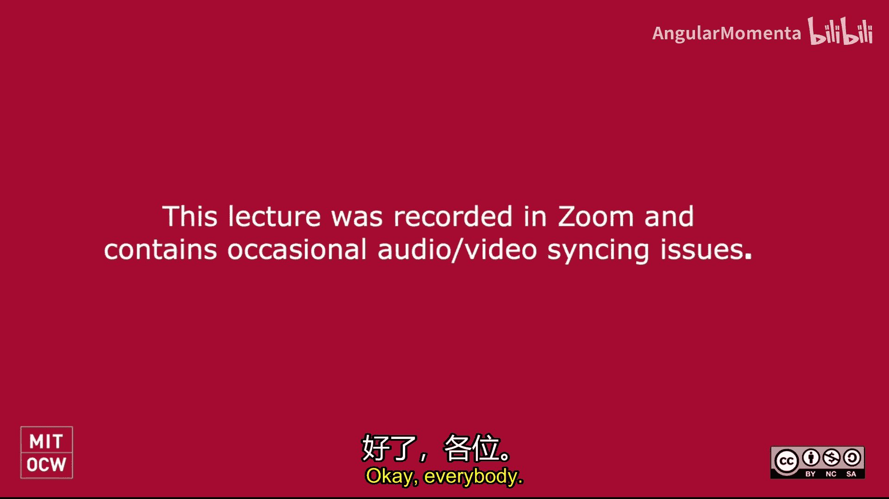
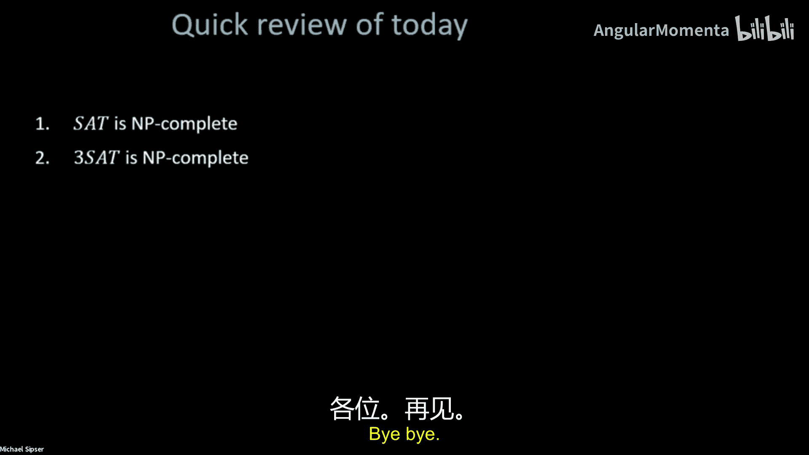
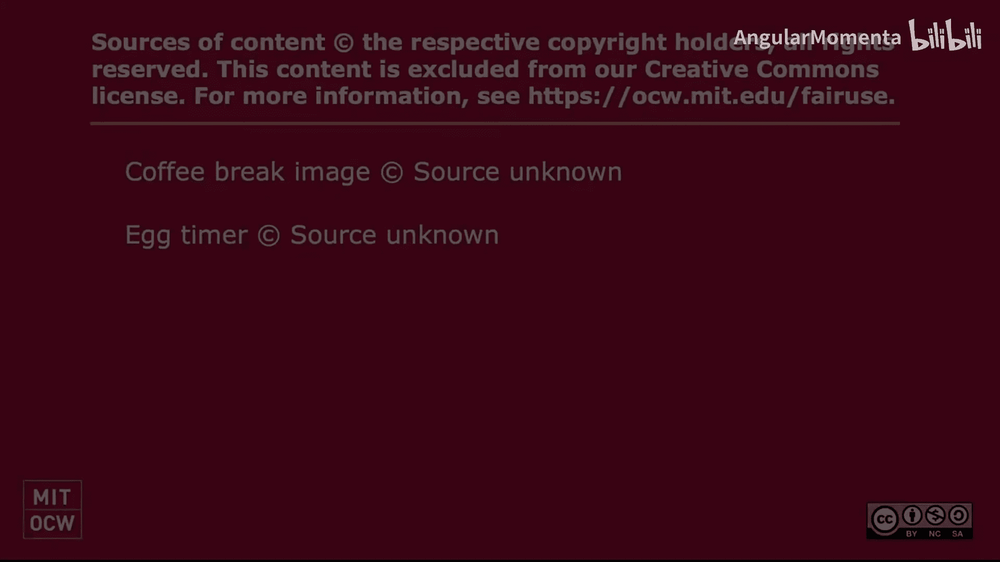

# 【麻省理工】计算理论  ｜  MIT 18.404J Theory of Computation, Fall 2020 p15 16. 库克-莱文定理 -BV1pt7GzeEjb_p15-

Okay， everybody。Let's begin。Welcome back。Good to see you all here on Zoom。

So we're going to pick up with what we had been discussing。Last week， which was。

AAn introduction to NP completeness， so we're following on our description of time complexity we started talking about the time complexity classes。

The class P， the nondemin classes， the class NP， P versus NP problem。

 and then leading to this discussion of NP completeness。

And today we're going to prove the big theorem in the field。

 which really kind of got things going back in the。

Early 1970s by Coen Levin that there was actually an NP complete problem that satAT in particular is an NP complete problem。

 and then we'll also talk about threeat， which is a useful tool。So just to remember。

 we had this notion of NP completeness。a language is then complete if it's in NP and everything else in NP is polynomial time reducible to it。

And if an NP complete problem turns out to have a polynomial time solution。

 then every NP problem has a polynomial time solution。

And that's part of the importance of NP completeness because since we。

Consider it unlikely that P equals NPp and that there probably are some problems that are an NP but are not solvable in polynomial time。

That's would me imply that an NP complete problem would have that property and so proving。

A problem and being empty completele is evidence， very strong evidence that it doesn't have a polynomial time solution。

 and so therefore it we call intractable， it's a very difficult problem。嗯。So。

The way we are going to typically show problems NP complete is by reducing a known a previously known NP complete problem to that problem。

Often it's threeatAT as we've seen several examples already or it could be some other example。

 so let's just survey briefly the things that we've already languages that we've already seen which are MP complete so we have the languages sat which has a direct reduction from every NP problem and。

嗯。So we're going to show that today。That every NP language is polynomial time Reducible to set。

 which is in turn Reducible to threeat。And we showed previously that threeatAT is reducible to Cique and handpath。

And in recitation， if you went to that， they showed that the sub problemble and the undirected handpath problems are also reducible from previously shown well。

 from either from3SAT or in the case of their undirected handpath problem。

 it's reducible from the handpath problem and the conclusion， once we have these two blue。

Reducbil shown， then we know that all of these problems are empty completelete。嗯。

So the class NPP basically breaks down into the NP complete problems，P problems。

 problems that are in P， and then there might be problems in between as well。

 so there are some problems that are not known to be in either category and in fact there's a old theorem which shows that if P is different from NP。

 then there are actually problems that are in the intermediate state。And of course。

It's possible that P equals NPp， and then everything collapses down to be the same with a tiny exception of the Sigma star and empty set languages which can never be complete。

嗯。Okay so that's our quick review here' is a check in that i'm going to use to get us ready for the big proof that we're going to be spending most of the lecture on about showing sat is NP complete but just to defined a little notation which you might have maybe you've seen already。

 but I'm going to do it in the form of a check in。So I'm sure you've all seen the big sum notation using a big sigma to represent a sum over some set of possibilities。

Just as there is the big Sigma notation we have， you can have other operations that apply to a set of elements。

 so in this case we're going to be seeing the big and and the big orR operation， it's a notation。

 which is going to allow us to talk about taking the and of many things or the ore of many things because we're going to be building these Boolean formulas and so ands and ors are going to be the operations that we're going to be focusing on。

And so just as an example， just to make sure you we're all understanding this notation if you have。

Two strings， X and Y。Written out in terms of their individual symbols。

 so they're both of length n so x is x1 to xn Y is y1 to y n。

And now I write the following expression， the big and。

For I ranging between1 and n of X I equal to Y I， If that big n is true。

 what does it tell us about X and Y， And I'm just going to offer you two possibilities that either x and Y agree in some symbol or they are equal。

 namely that they agree on every symbol。And so let's just pull that up as a quick poll to get us going here。

Just want to make sure you understand the notation because we're going to be using that a lot。

In describing the polynomial time reduction。From languages in N to the Sa language。Okay。

 I think most of you have got the idea but。So let's finish this up quick。嗯。To another 15 seconds。

 please。Just to give you a chance to participate。嗯。Okay， so we'm going to close this close this poll。

 last chance， last call。All right。So， yes。The big and， as most of you can see。

 the big and says that you know x1 equals y1 and x2 equals y2 and x3 equals y3， so they're all。

Every symbol in x is equal to the corresponding symbol and y， if we had a big or instead of it began。

 then a would be the correct answer because then just there would be some place where they agree instead of every place where they agree。

Okay， so let's then start to launch in to this big theorem。The proof itself is a massive details。

With one underlying idea。And in fact， it's an idea we've seen before。

 but let's before we get ahead of ourselves， let's us understand what we're trying to do。So。

We want to show that this language S is NP complete remember what S is it's booleying formulas that are satisfiable。

呃。So we already showed that the set Pro so being NP complete means it has these two features。

 it's in NP and everything in NP is reducible to it。So first of all。

 SA is in NP as we've already seen。The witness that shows a formula is satisfiable is simply the satisfying assignment。

Evaluates the truth。So now we're going to pick。Some language in NPA and show that A is polynomial time reducible to S。

Okay。😊，So this is going to apply to any language A in N， so let A be some language in NP。

It's decided by some non deterministic Turing machine M in time into decay K。

That's what it means to be an NP i'm going to make ignoring the constant factors when we could carry that throughout the proof it just would make this the description a little more cumbersome and wouldn't change any of the ideas。

 but so let's just say it's。M runs in time into the K。

And recognizes or decides this language A in so and it's a non deterministic machine。

So we've got to give a polynomial time reduction from A to sat， that's what I have to。

Demonstrate to you。So what does that reduction look like， it's going to map strings。😡。

Which may or may not be an A to formulas， which may or may not be satisfied。

That's what the reductions got to do。Saying that out more formally is。

If it's going to take some string W and map it to a formula， we'll call p sub MW。

 where M is the machine that decides A and W is the input。呃。So F is going to map W to this formula。😡。

Where the string is in the language， exactly when the formula is satisfied。

And that formula is going to depend upon m and w， that's why it just has it's written in this way。

 so we've seen that kind of thing before。So basically my job， you。

 you know we have this language A that's an NP， and now we have some string W。

 which might be an A or maybe not is an A， and I have to quickly in polynomial time now produce a formula。

😡，Which is going to be satisfiable exactly when。The string W is in a。Okay。

 so how is that formula going to work？How can I produce such a formula。

 which I mean of course I don't know whether W is in a or not because I I'm just a polynomial time reduction and a is an NP language so polynomial time probably is not enough to solve whether W is in a so I've got to do that mapping without knowing。

The answer。And the idea is that， and this is where you know， we've seen things like this before。

 the formula we're going to construct simulates the machine on W。

So in some way it's going to do that simulation， the trick is figuring out how to what that means。

Um but。The interpretation of that formula is that in a sense。

 describes and says in my informal language that M accepts W。Very much like， you know。

 there's a lot of parallel here between this construction and for example， the construction。

 the PCP construction， where we made an instant， you know given a machine and an input。

 we made a set of those dominoes， where finding a match forced you to simulate the machine。Here。

 finding a satisfying assignment。😡，Is going to force you to simulate the machine。嗯。

So the satisfying assignment is going to be a computation history for MMW。

And I'm just going to write that computation history in a particular way。

 so it's going to have a somewhat different encoding。

 which is going to help us to visualize what's going on better。😡，Okay， so that's that's the。

That's the that's the approach that's the basic idea of what we're trying to what we're going to do so i'm happy to take a minute if that's if you have any questions about this part。

 but otherwise I'll just move on to start doing the actual construction of what the formula looks like how is it going to do that how is that formula going to work？

Okay， so no questions， hopefully we are all together。Okay。First of all。

 let me describe what my computation histories are going to look like。😡。

And the situation is a little bit different than what we had before。

 because when we were talking about the post correspondence problem。

 we had a deterministic machine and now where our machine is non deterministic。Okay， so。

We're going to call the object instead of an accepting computation or a computation history。

 we're just going we're going to call it a tableau or sometimes an accepting tableau if you want to emphasize the accepting nature of it。

 but generally we're just going to call it a tableau。

So a tabau is really an accepting computation history for the machine。On an accepting branch。

Of its non deterministic computation。So if M accepts W， it's got to have some accepting branch。😡。

And the tableau is going to be the sequence of configurations that the machine goes through on that accepting branch。

 if there are several accepting branches， there may be several tableaus。

 there will be several tableaus， so there's going to be one tableau for each accepting branch of the machine's computation on W。

If the machine does not accept W， there won't be any tableaus。

And so the whole point is that we're going to make our formula。😡，And。

Represent the statement that there is a tableau。And satisfying that formula is going to correspond to filling out the symbols in the tableau to make it a tableau。

😡，Okay so here is a tableau， so tableableau is just again。

 an accepting computation history on some branch， some accepting branch of the machine's computation。

 and the rows of the instead of writing the computation history out linearly we're going to represent it in a table form where each configuration is going to be on a separate row。

All right， now the dimensions of that table are going to be n to the K by end to the K。

Because the machine。Runs for into the K steps。Sos if there's an accepting branch。

 it's going to accept within that number of steps and we'll have enough rows here to write down all of the configurations that the machine goes through one after the next row by row each one having a configuration in it。

 and then at the bottom there'll be an accept。😡，You know。

 minor detail if the machine accepts earlier， we'll just say the machine stays in the once it enters in accept。

 the machine does not change from that point on so the rule of the machine is nothing changes and it just remains in the same configuration from that point on。

Okay， so。Important to understand what we're， you know。

 if you're not following what I mean by a tableau， you're doomed。For this lecture。

So it makes sense if you know if you to ask a question to understand what we mean by tableau okay。

 so just a few more elements here so this is going to be the start configuration for MW this would be an accepting configuration here down at the very last row。

And you might imagine。You know， I think I've filled out some。Hypothetical。

First step of the machine after the start where maybe the machine was when its in remember how we encoded our configurations。

 so this is the machine is in state Q0， looking at W the first symbol of the input W1 and maybe when it's in Q0 looking in that first symbol。

 it moves to state Q7 and goes right and then changes that W1 to an A。

And so now here is the head shown moved one position to the right in the new state Q7 I mean of course that depends on what the machine is designed to do what the what the transition function is。

 but this you know could possibly is it what happens so does the okay so good does a tableau trace all steps of all branches no。

The tableau corresponds to one accepting branch。Each different accepting branch is going to have its own tableau so there might be several different ways of filling out that second row even of course the first row is going to be in any tableau is got to be the same you know once I know W here I've written down maybe I should unpack this for you you know it's in the start state here then here are the first you know here the n symbols of W Ws of length n so it's w1W2 up to WN and then i'm patting out the rest with blanks。

😡，So should have said that too， but okay， so I want to make my table into the K by n to the K because that's going to be enough to represent the entire all of these。

Configurations of M running for most end of the K steps。RightBecause the machine。

 even if it sends its head moving to the right as fast as it possibly can。

 it's never going to have it's never going to。Go outside this box。

If it only runs for enter to the K steps， so this is going to be big enough to represent the entire computation of M。

Smuming it's running for n to the K time and the input W is like that。All right。

 what is k so K is the running time of the machine。

 so we assumed from the previous slide that M runs in time N to the K。Okay。So a good question here。

 how can the tableau be a square table if we have a low number of computation histories。

 but a lot of tape。Well， I mean low number of computation history that's a problem you're not saying that well。

Each computation history。Is in a different table。So this I'm representing a single computation history here。

 there are going to be many configurations。So I can't have a small number of configurations using a lot of tape。

Because， you know， I can only use one more cell and more one additional tape cell each time I meant。

 you know each additional step of the machine。嗯。Yes。

 so there's really no difference between this if you want to think of this as a computation history that's fine。

 this is really just the standard terminology that's used when you're proving this particular theorem typically people talk about it as a tableau but it's really just a computation history。

嗯。嗯。The state， I mean， the question about what are these states queue。

 this is the way we represent configurations。So this means the machine is in state。

 they're not all going down the diagonal， the states are going to zigzag here through this picture here。

 depending upon how the head of the machine moves。So you have to go back and review how we represented configurations of the machine。

 remember the configuration is a snapshot of the machine at a given point。嗯。

How do we know that M runs in polynomial time we're assuming M runs in polynomial we started off with a language that's in NP so it's a nondeterministic polynomial time machine and we're picking one branch that accepts and writing down all the sequence of configurations the machine goes through。

 let's move on and maybe as you know ask more questions as they come to you and I'll pick out some to answer if that's going to be helpful to others。

Okay。So we're going to now construct this。嗯。Forula to say that M accepts W again。

 that was what we that's our goal and it says that a tableau for M on W exists。U。And basically。

 what that means is we want to say that it starts right。

It ends right and everything in between is right。And then we're going to need some other stuff to talk about how we're going to be encoding those symbols using Boolean variables。

So those are going to be the four parts， here's the starts right， here's ends right。

 here it moves right， and here talks about the encoding of the symbols into boolean variables。

So those are the four parts of this formula that I'm going to describe。Um。

I hope you got your question answered as to why the total number of columns is into the K because it's just big enough to fit the entire all configurations if the machine's running for at most end the K steps。

Which is what we're assuming。Okay。Okay， so now just getting back to that。

 I'm going to describe these different components now on separate slides。😡。

Um let me start off with this component fee cell， which is sort of the most fundamental one because it talks about how we're going to be encoding。

Those symbols of the tableau into the boolean variables。So again。

 here's kind of our the picture to have in mind of this tableau。

 this is this end to the K by end to the K table。Representing。You know， the some accepting branch。

Of the machine's computation。If there is one。And so now let me draw a。SomeOne of the cells here。

 I'm going to magnify it。So this is the IJ cell。Here。And I'm going to there are going to be。

A collection of Boolean variables associated with each one of the cells。

 so each one of the cells is going to have a bunch of variables all to itself。😡。

And those are going to be basically indicator variables。

 they're going to indicate which symbol that cell gets to have in it。Okay， so again， picture here。

In this tableau， you know， we don't know how it's going to get filled out。

 but however it gets filled out， each one of these cells gets some symbol。嗯。

And that symbol could either be a tape alphabet symbol or its symbol representing a state。😡。

That's the way we do our configurations， so it could be a tape alphabet symbol here。

Showing the magnification。Maybe it's the tape alphabet symbol which represents the blank symbol。

Or maybe it's a。Represents some state。对。Now， how am I going to encode that with variables？So this。

 let me。This is the collection of variables that's going to apply to the entire formula fees of MW。😡。

嗯。Each cell is so each cell IJ is going to have a set of variables。

 one for each possible symbol sigma。That's in the configuration alphabet。

 namely a tape symbol or a state symbol。Okay嗯。So I'm going to have。Well。

 maybe this will become clear as I'm writing it。If I turn the variable， X Ij sigma equal to true。

That's just a way of saying that cell IJ contains a sigma。So if I have X you know， Ij A。

 that means a symbol contains an A， so I'm going to illustrate that now for you。

So imagine you have lights representing all the differents， XJs for the different sigmas。

didn't say that well， so we're in cell Ij， so these are all X Ij variables。

 they're all X Ij sigma variables for the different sigmas。

That can go in that can go in this cell so all different possible sigmas， so this is gamma union Q。

Okay， so now if I have an A here。In that cell。So then the variable IJA is true。

And I'm just helping you visualize that I'm going that's going to correspond to turning the light on there's going to be a light associated with each one of these variables and it's going to be turned on when that variable is true。

Similarly， if I'd have。The blind symbol is the thing that goes in in that cell。

 then that variable gets turned on I hope you can see it maybe it's a little bit small on your screen。

UmThe XIj blank。A variable is true and similarly， if it's Q7 here， the X IjQ7 variable is true。Okay。

 so that's the way we're going to be encoding the contents of these cells using these indicator variables。

And now we have to start making some Boolean logic to make sure that those variables。

Reasonably represent。The cell you know contents of these cells， so for example。

 what would be the first thing that comes to your mind？😡。

Well we better not have two lights going on in any one of the cells because then we have two symbols on that cells and that's not a allowed each cell is we want each cell to have exactly one symbol and that corresponds to each each cell having exactly one of its lights turned on or equivalently each cell should have exactly one of the variables be true。

😡，That's the very first part of the formula is just going to say that。

 so let's let me show you how that what that looks like。Okay。

So here we're talking about this fe cell， it says that there's exactly one light on perce cell。

 or in other words， exactly one of the XIj sig is true for each IJ。

So this is how I'm going to actually express that using my Boolean formula。呃。

Sot of color coding the different parts of the formula， which I'm writing out to you here in English。

So first I want to say there's a so in every cell， there's at least one light that's on and there's a most one light that's on。

So here's the green part， This is going to say at least one light is on。

 so I'm going to say that by taking。All of the symbols that can appear in that cell and taking an or over all of those different associated variables。

So it's either got the first symbol on or the second symbol is there or or dot dot dot or the last symbol is there。

 one of those has got to be there。I'm going to write this using my big or notation。😡。

So for Sigma appearing in this set of possibilities。One of those variables has got to be on。

 at least。😡，That's what this org， big order tells you。

Now I want to make sure that there's at most one。That's on so that there are not。

 there's one at least one on， but there are not two that are on。

So I want to have an additional part of the formula here， which says， and I hope you can read this。

A little small。If I have two different symbols， Sigma and tau。

That are configuration possible configuration symbols where sigma and tower are not equal。

 so that's I'm reading it out to you if you can't if it's too small for your screen。

Then I'm going to say it's not possible so I have the negation of X Ij Sigma and X Ij tau。

 so saying in another way， it's not the case that that cell contains both sigma and tau for any two symbol sigma and tau as long as they're different。

😡，And I'm going to take these two formulas and add them together。And this tells me in the cell IJ。

There's exactly one of the variables is true， exactly one of the lights is on。

 and that's going to represent which symbol goes into that cell。

And then I want to take the and over all possible cells to make sure that I'm going to now apply that everywhere。

😡，And so now I do an and for I and J ranging between 1 and n to the K to apply this logic throughout the picture。

Yes， sigma unions asking Sigma union 2 contains the input output， yes。This is not a sigma。

 this is a gamma， gamma is the tape alphabet， this is any symbol including an input symbol from Sigma is going to be in gamma。

 so this is any symbol that can appear around the tape。Okay， and that's this this expression here。

 that is the expression fe sub cell。Okay， so here's a little check in for you。

 but maybe before we jump into the check in， let's just make sure maybe better to take some questions and then we can ask a check in。

They for you。You understand， I mean， if you're not getting this。嗯。YouYou should try to。

Try to figure out how to get it because this is really just。The foundation， it only gets more。

 it's not a really complicated proof once you sort of get the idea of what's going on。

 but if you're not getting this part， you won't be able to get the rest。Okay。

 I have no idea what what that means， but i'll read it out to you guys this looks like a one hot tensor encoding same from commonly same form commonly used in ML。

Okay， it's just an indicator I would just call an indicator variables。嗯。

Why is it Sigma Union Q for the big and here？Sigma union Q， you mean gamma union  Q？This is wrong。ok。

Now I need to say why everybody is upset。This should be a gamma， not a sigma。呃，这是步步。Sorry about that。

I don't know if I can fix that without wrecking the whole slide。

 but so I'm not going to even try this symbol here should be gamma， not sigma， its a typo。

Thanks for catching that。嗯。Yes， so the question is。Okay， so。呃。Fet of sale。

I just trying to make sure that the encoding represents setting a bunch of symbols into the tableau not so each cell is going to have one symbol exactly。

 not two， not zero。😡，So that's what fe if you've satisfied。

 if you set the variables to satisfy Fe sub cell。😡。

Then there's going to be in one symbol in each of' cells。

Now another question this is not a cF no this is not a cF that's the second half of the that's going to be if we hope we don't run out of time。

 but I have a way of converting general St formulas to cFs and preserving satisfiability so we're going to do that reduction afterward。

Okay， let's let's。Is that a little check to see if you understand at some level what's going on？

How many variables？Does this formula actually have？Is it order n， order n square into the K。

 remember this K is the running time of the machine or into the 2 k。What do you think？

So I mean for how many variables， I mean that in all of M P sub M。

 how many variables do we have all together？In this formula， if that's what the question is。

And here are other the variables， so describing them here X I J sigma。Okay， I'm going to close this。

So pick something。All right， ending polling。1，2，3。Okay。Yeah， so。

Okay so that's a good question so first of all， the the correct answer is in fact the its order into the 2 k now。

I'm getting some questions about what about the size of gamma and Q Well。

 those are going to be fixed。😡，They depend only on the machine， but they don't depend on n。

 so thinking about it in terms of functionally in terms of n。

 that's going to be a constant multiplier and so it's going to be absorbed within the big O。

So that's why we have you， you know， these are constant relative to end， these are fixed。嗯。

They are not into the K possible symbols。There's a fixed number of symbols。

 Depend only on the machine。So looking at a particular machine and what happens when you look at large inputs。

So why is it D and not C？Well， don't forget， how big is this table？This is n to the K by n to the K。

 so there are end n to the 2 k cell into to the K quantity squared or n to the 2 k cells here。

And so there's a collection of variables for each cell， some fixed number variables for each cell。

 so that's why it's order n to the 2k。Good， okay， so let's let's move on I think we're actually I would know。

Okay， so we have one more slide and I think then we have a break after so now let's next。

Talk about constructing。嗯。Two more pieces of the Fe sub MW formula。

 so we already got Fe sub cell done。Let's look at。Feace of start and Fe of accept。

And FeA is going to tell us that the start configuration has exactly these symbols。And we accept。

Tells us that the bottom。Configuration contains an accepting state somewhere。

So how are we going to write that down？Well， first of all。

 I'm going to write these down just cell by cell。So first of all。

 if we start is going to say the cell 11。Contains a Q zero I mean I know what the start configuration is should be。

Because you know you thinking of me or you know us as the reduction， the reduction is given M。

 it's given W， so it knows what the start state is， it knows what the symbols of W are。

 so it knows what that start configuration is， it's just  Q0 followed by the n symbols of W followed by blanks。

So it wants it wants the very first cell in the in the left hand corner here to be a Q0。

 the start state of the machine， which it knows， so it's going to say。

X sub 11q0 that has to be turned on， so it's going to be and of a bunch of variables here。

And in order to satisfy fe of start， all of those variables have to be set to true。So， it means。

We have to have a Q0 in that cell。 So now we're going to do the next the next cell here。The one，2。

 the next cell of the start configuration。 So fee start is going to have x1，2。

 So that's the next place contains W1。And so on， x13 contains W2。

All the way up to WN and then there's going to be a bunch of additional。

Parts which say that the that we have blanks in the rest。

 just spelling out exactly all of the symbols in that top row。Because that's what the fees start。嗯。呃。

Formula or sub formulaula of the overall formula we're making looks like。Okay。

 now let's take a look at Fe accept。If accept。Because I'm just looking for Q except to appear somewhere。

😡，In that bottom row。I want to do that in terms of an or。

So here is the variables now notice have n to the K because it's the last row in the table。

 so row n to the K。😡，Here。And then I'm going to vary J from1 to n to the K， so J。

 the column number is going to range from1 to n to the K， and I'm looking for that Q except。

 so x into the KJ where j is varying and Q accept。One of those has to be true。

One of those has to be turned on， and so that's why it's a big war。And that's my。Feet accept。Peace。

 okay， and now we'll take a little break and feel free to ask me some more questions。

Let me just start the our clock。Go grab yourself。Some coffee or ask me some questions。

m happy to answer them。Why don't we check that Q except only appears once is it possible for Q except to appear twice that's a great question。

嗯。So that would definitely be a broken configuration。If that happened。

 because a configuration must have exactly one state symbol appearing。

The way we're going to enforce that is with the fee move。呃。Part of the formula。

 which we haven't seen yet。 So fee move is going to guarantee that the machine is acting correctly so that all of the rows of the tableau are all legal configurations and they all legally follow from the previous。

So that really， in a sense， the hard heavy lifting is coming in fee move。

But it's really not that bad。Somebody says out of curiosity。

 how close is this intuition proof to the actual proof？This is the actual proof， there's no， I'm not。

 I'm not hiding anything。I mean you know we're being a little loose here。

 but you can turn this this is this not cutting in any corners here。

 this is exactly how the proof goes and so。Not you're getting a real deal here。

Somebody wanted to see the previous slide， so here we are， whoops。Is there something you want to ask？

嗯。Okay， so fe cell says there's exactly one symbol per cell。

And the variables are set in a way in terms of thinking of them as indicator variables。

 there's exactly one variable set to true in each cell。So it's exactly one symbol per so。

That's what fe cell tells you。know if you don't have that， then you have a mess。

So you've got to start with that。And then with the other things there are going to be additional conditions。

 which when satisfied， going to enforce the rest of the properties that we want。

Why would the proof fail if we replace n to the K with 2 to the end to the K？So， okay。I presume。

 where does this use the polynomial running time of the machine of M， the non deterministic machine？

I mean， if you had an enormous cut， we have to show ultimately that this reduction is a polynomial time reduction。

And that's going to depend on how big the tableau is because that's going to tell us how big the formula we're producing is piece of MW。

IfF sub MW is exponentially big， we don't have a prayer of being able to output that formula in polynomial time。

😡，Okay。If there were less than end to the case steps do we repeat the last configuration yeah that's what I said if we have if the machine ends early the last configuration just stays there so we're going to modify the definition of the machine slightly so that you know the so it just stays。

Yeah。嗯。ok。嗯。Yeah。Yeah， let me not take the other， there's a bunch of other questions on them a little on the technical side。

Let me。Maybe i'll try to address them as they come along if if it if it turns out to work to do that Okay。

 so the the break is over。Why don't we is it possibly that the encoding configuration will not fit in？

Ento the K。No， no， so the question is， is there a possibility that the encoding of the configuration won't fit in end to the K if the machine runs for end to the K steps？

The configuration has to fit with an end to the K because it can't use anything more。

within end the case steps to think about it， but no， the the answer is there's the configurations。

If the machine runs time into the K， that whole tableau is big enough to write down the entire computation history。

All right， so let's continue。Fe of move。Um this is， in a sense， the part。

 which is going to tell us that。We started right。We ended right fee cell says every cell contains one symbol and now we have to say that the whole interior is correct how are we going to do that so these are the parts we've already done。

And the way I'm going to describe that。Yeah。Is in terms of these kind of little windows I'm calling neighborhoods so imagine here we have a two by three rectangle。

 which I'm going to call a two by three neighborhood。And what I'm going to argue。

 but I'm not going to prove here， I'm just going to really state it。

 but it's it's really just a sort of more or less obvious fact， but the proof the。

Book has the formal proof。That if any every one of these here is legitimate is legal according to the rules of the machine。

 if every single imagine。😡，you have these oops， let me put myself back on here so you can see me。

If you have。If you have here every。Two by three window。Yeah。

 can take this as a window and you slide that over the entire picture of the tableau。

And everything here looks okay as far as the running of the machine。

 so I'll say what that means in a second。😡，But if everything looks locally fine everywhere。

 then the whole tableau has to be a valid tableau in terms of the rules of M。嗯。

Maybe it's easier if I describe what I mean by these being legal。

So these neighborhoods these two by three neighborhoods are legal if they're consistent with M's transition function so I'm going to describe rather than you mean to do this formally。

 I would have to go through kind of a process that we went like what we did when we went through the the construction for the post correspondence problem and save if the machine moves left。

 this thing happens if it moves right that' I think that's。It's not really necessary。

 you can kind of get the idea very clearly by doing it a little bit at a higher level。

So let's look at what I mean by a legal neighborhood。

 so this legal neighborhood is a setting of the values。

 the six values of this two by three neighborhood。in a way which doesn't violate M's rules。

 so for example， if M when it's in state Q7 reading a B。Goes into state Q3 and moves left。

Then this would be a legal neighborhood。Because it shows。The head moving left。The B becoming a C。

 so reading a B， I should also say that it right converts that B to a C and moves its head left into state Q3。

 so this would be a legal neighborhood if that's the way so being legal depends upon depends on the transition function of the machine。

So given the transition function， that's going to tell you which of the legal neighborhoods。

So another legal neighborhood， this would always be a legal neighborhood is that if nothing changes。

 so that means the head of the machine was somewhere else。And so。You know。

 whatever was on the tape in this step is going to be the same stuff in those places one step later。

Here's another possible legal neighborhood is if the head suddenly appears。You know。

 on one of the cells either in the left or the right。Um， that would correspond the machine。

 to the machine moving its head from somewhere the off the neighborhood into the neighborhood。

You know， in that step， so this could be a legal neighborhood。

Provided the machine actually does move its head left into a state Q5 at some point under some conditions。

嗯。And here is another kind of a weird legal neighborhood if you have ABC and then the A changes to a D。

 that could also be a legal neighborhood if the machine transition function allows。😡。

An A to get converted to a D machine when there is some state reading that A and that state also moves its head left。

 so it doesn't move into this picture。So those are examples of legal neighborhoods。

 let me show you some illegal neighborhoods。Just I'm doing this。

 this is kind of proof by example now this is perhaps the most intuitive part。

 but I claim that this is easy to turn this into something airtight informal。

So this would be clearly illegal if you have a piece of the tape in the previous step where it's ABC and then suddenly the beak changes to a D。

 to symbol on the tape changes out of nowhere without having a head nearby to a different to something else that could never happen。

 so that would be illegal。Another thing would be illegal is if a state appears from nowhere。

That could never happen。Or if it just disappears， that could ever happen。

And then here's another here's an interesting one。If a state becomes two states。

Don't forget that the machine is non deterministic。

 so the machine in principle could move its head left。

On one branch and move its head right on a different branch。

 but those would have to be in different tableaus they can't be in the same tableau because that doesn't correspond to any of the threads of the computation those are multiple threads and I say this because if you think about。

My claim， which is going to put down over here that if every two by three neighborhood is legal。

 then the tableau overall corresponds to a computation history。

This illustrates why it's not enough to have a two by two two by two neighborhood where you really need a two by three because if this was a two by two neighborhood。

 if you just look at these for this leftmost two by two， that could be。😡。

A legal neighborhood if it was a two by two。If the rules of the machine allowed for that and the right for box。

 right for cells could also be a legal neighborhood。

So you could have something that looks okay from the perspective of two by two neighborhoods。

 but globally in terms of the overall tableau is completely nonsensical because it has multiple hits。

嗯。But if you have a three two by three neighborhood。

 it's big enough to prevent this situation from occurring and then you know you can check the details and I think it's very plausible that it guarantees that the overall tableau is legitimate if all of the two by three neighborhoods are legal。

Okay， and so that's what we're going to turn into a。A bulloleying expression。

We're going to say for each cell。That the set for each neighborhood。

 so here's a neighborhood at the IGA location that's I'm calling the sort of this position here is sort of the home location for that neighborhood。

For each。For each neighborhood。It has to be set to one of the legal possibilities。😡。

And there's again， only a fixed number of those because there's a fixed number of possible symbols that can appear in those cells。

 so this is that fixed number to the sixth power at most。And I'm going to say that。

 you the cell in the upper left， which would be this one is an R and this one and this one here is an S and this one is a T。

 and this one is a V， if you just trace down what the indices are telling you。

 it says that that piece of the tape， that piece of the tableau here is set according to one of the possible legal settings。

And I'm just going to ore over all of those possible fixed number of legal settings。

 and then I take a an and over all possible tape cells over all possible neighborhoods。😡，嗯。

And so that's going to be my fee move。And that's it。嗯。Okay， let's see。

 can I explain again the third example of illegal， so this one over here。

 I presume is I'm being asked about。Well， you know， if the machine is in a state  Q7。You know。

 reading a C。You know， the head has to move either left or right。

 so at the next you know in the next configuration。

There's got to be a state symbol appearing either in this cell。Or in this cell？

And here the head has basically just vanished。With no， you know， it's gone。

That could not happen in a in the。You know。According to the rules of the machine。

 the way we talk about Turing machine， so that's not possible， so this would be an illegal。嗯。

A neighborhood。You want to prevent any of the bad stuff from happening anywhere in here。

 it's only good stuff can be happening locally， and that guarantees the overall picture is okay。嗯。

Do we have to check that the head doesn't leave the tabau from the left most to right Yeah。

 there are some little details here like that， so the question is you know have to make sure that the the you probably need to mark I think the book probably does this correctly you may have to mark the left and right ends to make sure that I mean the right end can is not a problem because the the the。

The machine can never go。O the right end and if you design the machine so that it never moves its head off the left end either。

 which you can do， then you wouldn't have to worry about that possibility。

 but yeah otherwise you would have to put some sort of delimiter here to enforce the head not wing off the left end so there are some details like that too。

嗯。There will be two heads in the same row， no this can I don't know what somebody says there will be two heads in the same row。

Please elaborate because。This is designed not to allow two heads in the same row。

Could I go over the or for legal again， okay， the or so the big ore here。

What I have in mind is I take， there's going to be， first of all。

 I look at the machine and I look at the transition function。And based on that， I write down。

The list of all the legal two by three neighborhoods so all the settings which correspond to legal two by three neighborhoods there's going to be some fixed number of those。

😡，You know， 100。So there's 10 possible legal neighborhoods of which know I've written down here for。

But maybe there's some some number， say 100， so now there's going to be an or over those 00 different possibilities。

It's either going to be this legal neighborhood or some other legal neighborhood or some other legal neighborhood and for each one of those legal neighborhoods。

 I'm going to say well。The variables are set according to that legal neighborhood。

 or the variables are set according to the next legal neighborhood。

 or the variables are set according to the next legal neighborhood and do that  a00 times。😡。

One of those has got to end up， and it's an ore， so one of them has to work。😡，Otherwise。

 the formula fails and will be false。Because you're going to now and end that over all of the neighborhoods in the picture。

嗯。Is it possible to have a head on the far left of the configuration and one on the far right？

You mean a head over here and a head over there， you mean had did the head get there can happen。嗯。

You knowThe head has to come from a head above it。If you're going to be worrying about the details of the boundaries here。

 you know。It's all that's fixable， so let's not。You know， lose sight of the main idea， I mean。

 if you understand the main idea， you can fix little details。

So I wanted to make sure you understand the main idea of what's happening。Okay。

 so let's finish up this proof。So in summary， we gave a reduction from a to sat。

 this is what we needed， it was in those four pieces。And you really just need to argue that that。😡。

Formula we're building is not too big and it's going to be basically the size of the tableau if you look at what we constructed。

 the number of variables is roughly the size of the tableau and the amount of logic that we're putting into the formula is also going to be a fixed amount of logic independent of n。

For each of the variables in that tableau and somebody asked me about like the how big the indices are。

You know， the indices。For the the X value， the I and J values。

technicalically they're going to be numbers between one and n to the K。

 so you're going to have to write those down and so that's going to be a slight additional logarithmic cost to write those things down but it's not really that interesting a point。

嗯。And so the overall F is going to be computable in polynomial time because the output is not very big and it's also not complicated to write the output down。

So that's the end of the proof。I can take a couple of questions。

WeW can't we just check that the whole this is a good question。

 why can't we just check that the whole role is legal？嗯。

You know that you can check that a row actually is a configuration。

 but to check that the row follows from the previous row。嗯。

You know ultimately the operation of a turing machine is is a local thing I mean you know the way the the way it moves from one configuration to the next depends locally on how the those you know where the head is and so really that's just another way of。

The way I'm saying it is just really checking the whole configuration， but just doing it locally。

I don't know if that's satisfying to you Okay why don't I move on because I just want to make sure we have enough time to get to the very last part。

 which is a little bit I'm afraid a little technical so。

We're going to kind of shift gears now and talk about reducing sat to three sat。😡，And。

Let's let's see how it goes I don't always have the most success with presenting this this little piece because it's slightly a technical argument but。

If you don't get it， don't worry， just you have to accept that it's true。

 but I'd like to show it to you just to make the whole presentation。You know， complete in that sense。

Okay， so I'm going to give a reduction that maps。General formulas to three CF formulas。

So that's how I map set to three set。If you remembers three sad is satisfiability， but true。

3 cnfs so it conjunctionjuncttive normal form you're in the form of those clauses。

 which are added together and each clause。Is an ore of a bunch of literals。

 which are variables or negated variables。So I want to convert feehi to feehi prime。

Which is a three cF formula， but preserve the satisfiability。

And fee prime is not going to be logically equivalent to fee because you I could do that too。

 I can convert any formula to a logically equivalent CF formula。

 maybe not even a threeCNF but you won't be able to get a three cNF， but you can get a CF。

But it might be exponentially larger and that's not good enough I have to do the reduction in polynomial time so I can't generate a much larger formula that's exponentially larger and so I'm going to do that by adding additional variables。

So it won't be logically equivalent because the new formula is going to have additional variables in it。

Okay， I'm going to kind of do it by example。And let's see how that goes。So his fee， which is not in。

3 cF， it's not even in CF。Because it's got you know， oars of ans appearing。

 which are not allowed to happen in a Cf。Okay， so how are we going to convert that？

Into a three cF formula preserving the satisfiability and just working it through with this example。

I hope at least give you some idea of how to do the conversion in general。So first of all。

 I'm going to represent this formula as a tree using its natural tree structure。

So you understand so A and B becomes A and B written as a tree， and then I take ore that with C。

So I get the tree structure here in sort of the natural way。

 and I'm going to label all of these intermediate nodes which are associated now with。Operations。

And I'm assuming also that the formula is fully parenthesized so that each operation I'm only thinking about is applying just a two。

 it's a binary operation。and let's ignore negations for the minute because negations。

 you can always push those through down to the leaves。

 but it's just going to make it too complicated， so negations turn out not to be a problem。呃。

So there's only going to be negations at the level of the inputs。

 not negation operations in the middle。Okay， so we have this tree structure here。

 and now I'm going to use these two logical facts， you know， and I don't know have。You know。

 you've probably all seen An znos， I hope otherwise its going to be really tough。

 but there's also other logical operators such as the implication operator。

Where you have A implies B。Thought of as a logical operator operation。

 and so that this is only this requires that if a is true， then B is true。诶。However， if a is false。

 B can be anything。And similarly， if B is true， a can be anything。

The only thing that's prohibited is that if a is true and B is false。

 that's the only thing that's would be invalid and so if you think about it that's going to be equivalent to saying that either a is false or B is true。

One of those has to be， and that's going to be logically equivalent to saying that A implies B。

Another logical equivalentvalence maybe is more familiar to you is just simply the Morgans laws。

 the Morgans law， which says that if you have the。A knot of A and B that's equivalent to saying the knot of A or the not of B。

Okay， I'm going to make use of both of these。Now。Here want to I ran out of room on the slide。

 so I'm going to take myself out of the picture here for a minute。I no place else to put this。

 so here we have if you' going to think of the and。In terms of its truth table。

So here's A and B in terms of A and B。So if one and one is one。

 but all other settings of A and B yield zero for the hand。I'm going to represent those。

If you imagine A and B is going to be called C， I'm going to represent this information。

With four small formulas which taken together， you and them together。

 kind of force C to have the correct behavior associated with A and B。Okay， so。

So if A and B are both1， then C is1， if a is zero and B is1。Then that so then it forces C to be zero。

Um， and similarly， you know， every other setting besides A and B being being true u。

 u for C to be false， which is what you want when you have and。

So I'm going to write this expression here down with Z1 being in the place of C。

By just taking those four。Expressions and ending them together。

 so this is exactly those same four expressions written out linearly。

Now I want to do the same thing for Z2， but now that's written in terms of an or。

So it's a slightly different truth table here up in this corner。嗯。So now if either one is a one。

 we get a one result。And so now。You know， if A and B are true， you get C is true。However。

 if A is true and B is false， that still implies C is true。so。I'm going to write down。

Those rules for specifying how Z2。Must be set。And each one of these things is going to get converted into clauses。

 clauses with three literals using these rules over here。😡。

So I'm going to do that for each ZI and lastly， to make sure the whole thing is satisfied。

 which means there's an output of one here， I'm going to have one clause associated。

 which says that Z4， the output is a one。Now I can convert all of those。

When I have A and B implies C， that's logically equivalent to not A or not B or C。

And the way you can see that is really by repeated by application of these rules here running a little low on time。

 so maybe you'll just have to check this offline but。Quickly。

 A and B implies C using the first equivalence is the not of this part or C。

And then I can use the Morgan to convert that knot of an and to an ore of the knots。

And then I can remove the parenthesis because or is associated。And so I get a a clause。

 which is what I need so each one of these guys is really equivalent to a clause and so I just get a bunch of clauses and actually technically this needs to be three copy of。

Three things here should be Z4 or Z4 or Z4， which is a lot。

mSo check in numbers iss why I realized my check is broken because I only realized that last point just now as I was talking。

 so the the actual value that you get in terms of oh no， the number of closests is correct。

No I take it back this is fine， so if you understood what I'm saying hopefully you can see how big the formula fee prime。

Is in terms of the number of operations and fee， so let's let's see how many people get that。

I acknowledge this and maybe a little on the technical side。嗯。Okay， I'm going to close it。

Close it down。Please enter your value。Okay。Yeah， the correct answer is 4 k plus1。

Because each one of these。Operations is going to end up being a row in this picture。

It's going each operation is going to have a variable associated to it it's going to become a row in this picture and so then on each row is going to have four。

Cuses which define you know what you need set what you need in order to force that variable to have the right value corresponding to that operation。

Okay， and so then and you need one extra clause here for saying that this whole thing evaluates to true。

Okay， so that's all I wanted to。Due today， we proved those two main theorems and now we know that there are NP complete problems and all of the other problems that we can get from by reductions from these problems are also going to be NP complete as long as they're an NP。

Okay so that's it feel free to put some questions into the chat or move on to whatever else you're going to be doing next Okay。

 so a good question here is why is fee prime not logically equivalent with this construction can't be logically equivalent has logically equivalent means that it gives you exactly the same function as if you set the variables in the same way。

 you get the same result coming out。Well fee prime has more variables than fee does。

 so it wouldn't even make sense to talk about logical equivalentvals because there are two functions on different numbers of variables。

 so in that sense it doesn't really make sense you know what you could say is that for every setting of the。

Of the overlapping variables， of the variables that appear in both phi and phi prime。

 so those are the original variables of phi that' is going to exist some setting of the new variables。

Which is going to make the。Well。Yeah， going to be there will exist some setting of the new variables。

 which will make the two formulas agree， but that's not the definition of logical equivalence。Okay。

 so why going back to the proof of satisfiability proof and the legal neighborhoods？

Could I go over why the number of legal neighborhoods is polynomial？

The number of legal neighborhoods is not only polynomial， it's constant。

It depends only on the machine， it does not depend on N。

So because each cell can have at most some fixed number of。

You know can have the number of tape symbols plus the number of state symbols that's you know that depends on the machine only so now we have six six tape cells for the six cells in a two by three neighborhood。

 so you're going to have that number to the six power but it's still it's a constant to the six power still a constant doesn't depend on n。

So it's not a question of even being polynomial it's it's it's a constant value it's a constant multiplier if you want to think about it in terms of the。

The size of the formula that's going to result。 Don't forget， you know。

 we're trying to make a formula。Which is。Well， the reduction has to be polynomial。

It's a polynomial time reduction， so that means that as n increases。

 the time to calculate the reduction increases as a polynomial。But。嗯。We're fixing M。

 so M does not change。😡，So therefore， anything that depends on M only is just going to be a constant impact on the formula。

 it's not going to be it doesn't depend on M。Okay， everybody。

Bye bye， see you。

