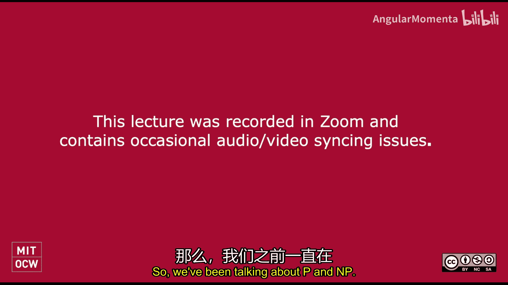
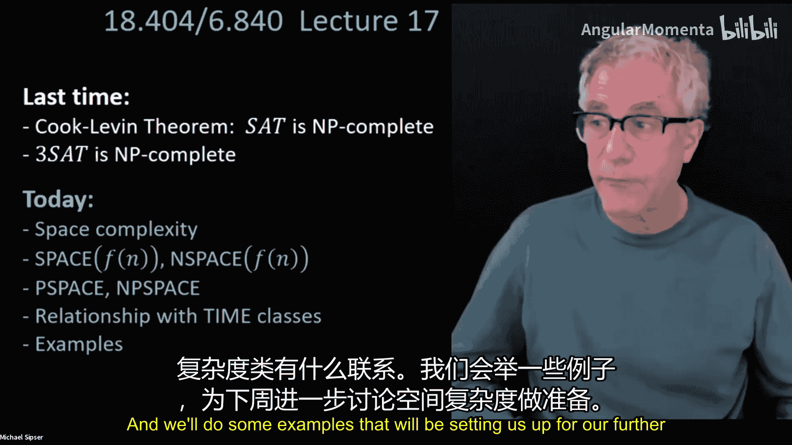
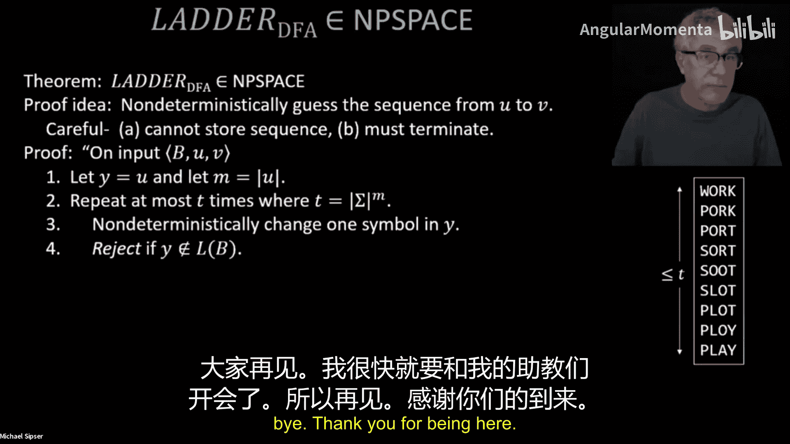

# 【麻省理工】计算理论  ｜  MIT 18.404J Theory of Computation, Fall 2020 p16 17. 空间复杂度，PSPACE，萨维奇定理 -BV1pt7GzeEjb_p16-

So we've been talking about。😡，呃。P and NP and the time complexity classes and today we're going to shift gear。

 we're going to talk about space complexity or memory complexity as the space complexity is what complexity theorists usually refer to it as and you know time and space are the two basic most basic measures of complexity that we consider and so today we're going to look at the second of those two the space complexity。

So we will define a lot of this is going to be by analogy with what we did for time complexity。

 we're going to define complexity classes， we'll talk about polynomial space and nondeterministic polynomial space。

 see how those classes connect up with the time complexity classes that we've already defined。

And we'll do some examples that will be setting us up for our further discussion about space complexity next week。

So we're going to talk about， first of all， what it means for a Tring machine to run in a search。

Certain amount of space and that's simply going to be counting the number of cells that the Tring machine scans over on its tape during the course of its computation it might be reading that cell might be writing on that cell。

 but the total number of cells that it actually visits of course visiting the same cell multiple times only counts once because space can be reused。

But we're going to count the number of cells that the Tring machine visits during the course of its computation and then define the space utilization by analogy with what we did for time。

 so we'll say a Tring machine runs in a certain amount of space F of n will say if first of all it has to always hold so all of the machines are deciders。

And it uses at most that much tape， that much it visits that number of cells on all inputs of length n so just like we said for time complexity。

 the machine has to run within T of n time on all inputs of length n here it's going to have to use at most F of n cells。

On all inputs of length N， in order for it to be running in space F event。Okay。

 a tape cell is simply a little square of the tape where you can write a symbol。

Okay answering a question， a good question that came in from the chat so you know。

I'm not sure I have a diagram for that， but the each of the little squares on the tape are going to be the tape cells。

Generally， we're going to be sticking to one tape tuuring machines。

 but I'll make a brief remark about multita tuuring machines shortly。Better tape cells， sorry。

On all inputs of length in。Souring now， okay， so that's for deterministic Turing machines。

For non determinticuring machines， we will say that it。Also runs in a certain amount of space。

So for a non deterministic machine， it has to。Use。At most。That many tape cells。

On each branch branch of its computation separately。

 you don't add up the total number of cells used across all of the branches。

 just like we don't add up the total amount of time the machine uses across all of its branches for the machine to be running and say space and squared。

😡，It has to be using at most n squared cells or order n squared cells on each one of its non deterministic branches separately。

😡，There might be exponentially many branches if that's okay。

 but on each branch it's going to be using at most n squared or order n squared cells。importantlyly。

 though that still the machine has to be a decider。

 it's not enough to be looping forever and using a small amount of space， it could do that。

 but that's not going to count toward the machine contributing to its space complexity of that language。

 so for the machine to be running and a certain amount of space we say that the machine holds on all of its branches。

😡，And each one of its branches uses at most that much space， okay？Again。I can see lots of typos here。

 thank you， I don't even mess this all up today。呃。So non deterministic。Good， thank you。嗯。All right。

 so we're going to define the space complexity classes analogous to this time complexity classes。

 so these are languages。That you can do。With machines。That run within that space bound。

So space F of n， you can think of space n squared is all of the language。

ages that a deterministic one tape turing machine can do within can decide within by using at most n squared tape cells or to order n squared tape cells。

 Similarlyly， the non deterministic space complexity class are all of the languages that are non deterministic one tape turing machine can decide running within that amount of space。

哎。嗯。And lastly， we have polynomial space， so that's the union over all polynomial space bounds of the space complexity class and non deterministic polynomial space。

 the same for all of the non deterministic。Polynomial space classes。ok。

So I think I do have a check in on this。Whoops。Which talks about multita touring machines。

So we could define space complexity for multi tape tuuring machines just we've been with just as we did for one tape tuuring machines。

And then define the associated space complexity classes and then define the class piece space。

 but that would be for multiuring machines。Now for time remember that the class P that you would get for multita tuuring machines is exactly the same as the class P that we got for one tape tuuring machines that was part of the。

Nice quality of the class P is robust in that sense of natural。

 So how about for P space What do you think do we get the same class。No， maybe。Or yes。

 because we can convert a multita turing machine to a single tape turing machine by only squaring the amount of space。

That was what happened with time as you remember， or maybe we can do even better converting a multita tuuring machine to a single tape only increases it by by less by say a constant factor here remember this is how we're defining space complexity for multitape tuuring machines we're taking the sum of all the cells used on all of the tapes。

All right， so let's launch that poll and see what you think。Hopefully this is not too hard。嗯。Yeah。

 I think most of you have got the idea， though， some of you are。

 I worry sometimes about some of the answers that I get。

 I don't know if you're serious or you're really badly confused。But anyway， let's。

Let's wrap this up another。10 seconds or so。Let's call。Okay， I'm going to end it。Yeah， I mean， I。

I think。Answer B is a reasonable answer， in fact， answer to C is the correct answer， you can。

 if you just look at the same simulation from multita to single tape and how much space overhead that simulation introduces。

It's only linear， you're basically just taking all of the tapes of the multitape machine and writing them down next to one another。

 obviously you know ignoring all the infinite infinitely many blanks we just taking the active portion of the tapes。

 writing them down next to each other so the total amount used is just going to be the sum on the single tape of what was used on each of the individual multitas in the original machine。

So there's just a linear cost overhead by converting from altar tape to single tape when you're looking at space。

 the amount of memory that's used。For time remember there was some additional overhead because we had to be updating where the virtual heads were and that cost extra time to move our single head around to do that but for space the amount of time that's introduced is not is irrelevant we're only looking at the amount of memory and so that's a link going to be just a you know the overhead on that is very low。

I do worry about the folks who are answering A， for example for this question。

 you should be rethinking what's really going on here。Okay。Now。

 let us move on here from that to our next slide。And compare the time and space complexity classes。

 you， or time and space complexity， how do they relate to one another？And so first of all。

 we're going to point out。Let's start out here T of n is going to be represent some bound either on the time of the amount of space and generally at least up till this point and mostly going forward though there's going to be one variation on that later。

 but we're going to be focusing on bounds which are at least big enough to either read the input or at least hold the input so that's why we we refer to T of n being at least n。

So now if we look at the time complexity class T of n， think of that T of n like typically would be。

 say n squared， maybe。And the things that you can do in n square time。😡。

I claim you can also do an n squared space。U and basically it's just using the very same machine。

 suppose you have a machine that runs in n square time。

 how could it possibly use say n square n cubed space if it's running only in n square time even if it tries to use as much tape it possibly could。

 as many tape cells as it possibly could。And you know sending its head cruising out into the blank portion of the tape chewing up as much as many tape cells as it possibly can in n squared time it's only going to be able to use n squared space so the very same machine that runs in T of N time is also going to run in T of N space so this。

😡，Containment here。Follows you know really without doing any work at all。

 so just restating that here a。Turing machine that runs in T of N steps cannot use more than T of N tape cells。

Okay， so right now we're focusing on， we could prove some analogous statements about。

No deterministic complexity， but let's focus here on the deterministic complexity。

Now let's look at going the other direction， suppose we have a touring machine that uses T of N space now。

Does that immediately imply it's using only T of n time？😡。

And that's not so clear and in fact probably not true because a space appears to be much more powerful than time and within a certain amount of space。

 you can run for much longer than that same amount of time， so how long could you run？

So what you can show is that if you're running within a certain amount of space T n space。

 let's say n squared space， for example， the amount of time you could use is going to be exponential in n squared。

 say two to the order n squared。Sometimes we also write that as the union of C to the n squared by sort of pulling down that constant here if you want well it's also just to understand what we mean by order T of n up in the exponent it means that the union over C to the T of n for all C either of these are just completely equivalent。

 so whichever one you're more comfortable with。But why is this going to be true。

 why does a Turing machine that runs in say？Say n squared space use at most。呃呃。

Two to the order n squared time。And that's because if you look at how many possible configurations the machine can have。

 remember that a configuration is essentially the contents of the tape。

 there's also the hip position and the state， but the dominant the dominant aspect of a configuration is the tape。

 and so how many different tape contents can you have。Well。

 it's going to be exponential in the length of that tape。

Because you know each cell can have some fixed number of symbols in it。

If a machine repeats a configuration， it's going to go forever。

 which we're forbidding in these machines， because they're all going to be deciders。

So they can only run for an amount of time， which is bounded by the number of configurations that the machine can have。

And so the machine can have。You know， if it's running in T event space。

 then the amount of time that it could be running is going to be at most some constant to the T event。

Or two to the order of the event saying the same thing。You know。

 unless it's going to repeat a configuration and end up looping。Okay。

 so these are the two fundamental connections between time and space time is contained within the same amount of space。

 space is contained within that amount of time exponating。Okay。

 so one car artery of that is that the class P is contained within P space。Similarly。

 NP is going to be contained within an NP space for the very same reason。嗯。Okay， is this。

Understandable。You know this is a good place or an mom would have one more lying to。

To tell you about， but leading into the next slide where。

If you understand the definitions of what we've done so far。

All of this is a fairly straightforward theorem and the corollary is immediate。结续。

Anything that you can do in n squared time， you can do in n squared space。

 and so for if anything you can do in polynomial time， you can also do in polynomial space。Yes， C。

 somebody's asking me， you know， what is the C C is essentially going to be the size of the tape alphabet。

Because that's going to govern how many different configurations you have this is a slight extra factor you know slight extra factor for the tape the head location and also the state。

 but the main thing is going to be the。A numberumb of tape symbols and the length of the tape。Okay。

 but what's going to come next is we're going to prove something more powerful than this corollary that P is contained in P space because not only is P contained in P space。

 but NPP is also contained in P space and for that we're going to have to do more work。Okay。

UmSo somebody asking me about the number of states， the number of states。

Is going to be fixed depending on the machine only。So it doesn't depend upon n。

 so it could and most affect the number configurations by a constant factor。

And those constant factors are going to be absorbed。

Within the definitions of these complexity classes because that's you know we define them to be you know。

Ignoring the constant factors。But you know， why don't we just take a， you know。

 this may be a good place to pause for a second and see if there's any questions？Because， you know。

I think for some of you amid this may be straightforward。

 but you know I think it's less common to be measuring thinking about the amount of memory as a complexity measure。

 so this is perhaps a little less familiar some of you have seen，Measuring time in other classes。

 but measuring the amount of space that the algorithm uses probably is a little less familiar and maybe that it's worth spending a moment or two answering questions about that。

So I'm not sure I understand the question that just came in， but I'll read it out there。

 is it possible that a turing machine can loop forever， absolutely。

 but a tuuring machine that loops forever does not count as one that runs within the space bound to run within the space bound the machine must hold on every input it has to be a decider we're only considering deciders here。

So is it possible a touring machine can look forever， yes。

 isn't the touring machine we're talking about a member of space and does a decider？嗯。嗯。

Not totally sure I understand the question， but if a Tring machine is。Not halting on all inputs。

 it's not a decider， that's our definition。嗯。re we good and I'm not getting very many questions here。

 so I'm assuming you're all with me or。So lost you don't even know what to ask。

Which is not good so be bold if you're confused throw a question out there becausem I don't want to race through this lecture since it's it's maybe a little less familiar to some of you。

Okay， so let's move on， as promised， I'm going to show you now that NP。

 not only P as is kind of happens immediately， but NP is contained as a subset of a P space。

So that is I did get a question moved on before I answered this question can I explain part two of the proof again part two。

 okay， let's just do it。呃。If something runs in a certain amount of space。

 you have to just think about how many different configurations the machine can have within that amount of space。

 remember the configurations that we defined way back at Lbas。

So the number of configurations the machine can have depends on how much space it's allocated。

Like the LBAs， they had a fixed number of configurations and we gave a calculation for that。Um。

 which is basically an exponential in the amount of space。

 that's how many configurations the machine can have。So if the machine is not looping。

 if it's a decider， it can never repeat a configuration and that's going to tell us how long the machine can possibly run for。

You know it it's important to understand i'm not sure if I knew how to say that in any way that different from what I said before but。

Okay， getting back now to proving that NP is a subset of P space so now we're going to have to do something that's sort of in a way different from what we did on the previous slide because now。

It's not going to be enough to work with the same machine before when we were converting。

 were showing that a certain amount of time time class contained within a space class。

 it was by virtue of the very same machine by just showing that if it's running within a certain amount of time。

 then it has to be running within that same amount within that same amount of space or in terms of the space the given a certain amount of space。

 it has to be running that same machine within a certain amount of time。

Here we're going to mixing non determinism and determinism。

 so we're going to have to take a machine that's an NPP type machine。

 a non deterministic polynomial type machine and convert it into a deterministic machine that doesn't use a whole lot of space。

So there's。A difference in the character of this theorem because we have to introduce a new machine。

And so way we're going to prove that。I'm going to take advantage of some of the things we've already shown to prove this one could also prove it a little bit more directly and maybe it's worth understanding making sure you understand both proofs so the first thing I'm going to observe。

Is that satAT our NP complete language？The satisfiability language。Itself is a member of Peacespace。

And the reason for that is when you're given。A formula。

And now you want to test if that formula is satisifiable。One way to do it。

The most obvious way to do it is try all assignments。1 by one。

And see if any of them satisfy the formula。Now that's going to take a lot of time。

But how much space does it use？I have in mind reusing the space every time we try the next assignment。

😡，Think of going through all of the assignments the way an odometer would work。

 Just trying every possible assignment。But reusing the space where you're going to write that assignment down。

Sort of incrementing it like a number written in binary。

 if you wish going through all the possible assignments every time you get in the next assignment you plug it into the formula and see if the formula is satisfied if it is then you can accept immediately if not you go on to the next assignment and only when you've gone through all the assignments in that way and none of them have satisfied the formula then you can reject so how much space does that use。

That doesn't use a whole lot of space because you're reusing the space to write down one assignment after the next。

Okay it's only going to be using an amount of space which is big enough to hold an assignment。

 which is basically linear because it's the size of the number variables of the formula so that's going to be a linear amount of space to solve the satisfiability problem and so the satisfiability problem is certainly in P space。

Step one。Step two is we're going to take advantage of what we know about Reducibility so if a is polynomial time reducible to B we've already commented we didn't say this exactly in this way。

 but you know it's still going to follow that anything you can do in a certain amount of time you can also do in that amount of space because there's a very same machine。

Does can't use any more space than the amount of time it was allocated。

So if a is polynomial time Redducible to B， it's also going to be reducible in polynomial space。

 a polynomial space machine could do the reduction。

So that means if A is polynomial time reducible to B， and B is in polynomial space。

 then a is also in polynomial space。But we know because satisfiability is NP complete that every language of NP。

😡，Is Reducible to satAT， so put satAT in place of B Every N language is polynomial time Reducible to SAT。

And we now know that sad is in peace space。So therefore。

 every language in NP is in peace space because they're all polynomial time redducible to set。

Okay so just by using some of the technology we've developed。

 namely the notion of completeness sort of shows some of its power that if you want to conclude something about an entire class。

 an entire complexity class， if you have a complete problem for that complexity class。

 often it's enough just to work with the complete problem。

 and then everything else by virtue of the reducibility is going to inherit the same property。

 it doesn't work in all cases， but in many of the cases。

 as long as know the reducibility can be computed by by the type of procedure you're working with。

 then it follows。You know， you could also prove this more directly。

 I think it's in some ways a little clumsy or a little bit less elegant， but you can say， well。

 let me just take my。Take a language that's in NP， it has a non deterministic polynomial time algorithm。

And then give a deterministic polynomial space algorithm simulates that NP algorithm just by going through all the different branches。

 but making sure that going through a lot of those different branches you're reusing the space and not using new space every time you're going through a different branch and you can arrange things if you're just a little bit careful to do it that way so you could give a direct simulation and polynomial space of any NP Tring machine so that mean that's also completely satisfactory but I think this is a little more elegant。

So now let's also this。Furthermore is going to allow us to conclude some additional。

Languages are in peace space。That's define class we have not yet seen。

 though maybe you've seen I think we've talked about this notion of Co before。

 I think we talked about couring co touring recognizable so the class those are the class of languages whose complements are touring recognizable and the same for co NPP。

 this is the class of languages， whose complements are an NP。

So you take the complement of every language that's an NP and now you get the older languages that are in this class co NP complement of NP。

So for example， the complement of the handpath problem， so all the graphs which don't have。😡。

Hamiltonian paths from you know STT， so the non Hamiltonian graph， the non Hamiltonian path problem。

 that's a coP problem。Or here's a language we haven't when I'm not going to define。

As in terms of its complement， it's the toutology problem。

 so these are the language these are all formulas these are the formulas where all assignments satisfy the formula all assignments make the formula true。

So a totalology is a statement that's always true。So no matter how you plug in the variables。

So the totalology language is in CoP。Because ass a complement， which is the non toutologies。

 those are the formulas for which。There's some assignment which makes it false。

 so that's going to be clearly an NP language。So toutology is a co&P language。Okay。😊，嗯。Now。

 one thing that we get immediately from the theorem as a corollary relations write this as a corollary is that coP。

Is also a subset of peace based。And the reason for that is， and this is something that。You know。

 it's。Again。Easy， but make sure you understand it is that。

Peace base itself is closed under compliment。Because it is。

Defined in terms of deterministic machines and deterministic machines。

 you can always flip the answer。And get a machine of the same type。

 which will decide the complementary language。So for deterministic machines。

 the deterministic deciders， I should say， you can always flip the answer。Now。

So here we have anything that's in P space， it has a deterministic polynomial time。

 a polynomial space machine， and so it's complementary language is also going to be in P space So P space and cospace coP space are equal。

 And so that's why co and P。Is going to be in peace based。It's going to be a subset of peace based。

Okay， hope that's。Not getting mixed up by all of the different alphabet soup here， but。

Here is maybe a picture， maybe that'll be helpful of how the world looks for the time and space complexity classes so far。

So we have P。Is a subset of NP， it's also a subset of co NP。Um again。

 for the same reason that P and Co are equal， we never even really talk about Co because it's the same as P。

嗯。But NP and ColP that those are two classes where we don't know whether they're equal or not because an NP machine。

You know you can't necessarily complement the behavior of an NP machine and end up with an NP machine So question how do we know that co&p is a complete class of problems I didn't say that there's anything about completeness and Co P is just a collection of languages I'm not saying that's anything any particular feature about it In fact。

 it does have a complete problem just like NP has a complete a complete problem The compliments。

And I'm not going to prove this right here， but though it's pretty straightforward。

 complements of all the NP complete languages are going to be coinNP complete languages。And so。

So I'm getting so okay， so let's。I will answer some of the questions about or about。

Possible alternate worlds， this is how we believe the world looks like with each one of these regions being separated from one another。

 including this little corner of the world here， NPp and intersect coNP which is not there might be languages in here which are not NP P and we actually believe there there are such languages。

 but again all of this is conjectural， and even whether P and P space are the same or different is is an open question。

We don't even know the answer to that， which is perhaps even more shocking that we don't know how to solve P and you prove P different from NP that we don't know how to prove P different from P space。

 which seems to be a much bigger class， it would be incredible than anything you can do with a polynomial amount of space。

You can also do with a polynomial amount of time。Don't know how to prove that they're different and in fact。

 so this is how the world could look。诶。Everything could collapse down， p could equal P space。

 and then all of these classes would be the same。And I should also mention。

 I don't have this as another diagram here， but just to answer。

You know there's also there's other possibilities， for example。

P could equal NPp without being equal to P space and then you'd have a different looking Venn diagram here where it'd be just two classes P and p and co and P would all be the same P space would be different that's possible at least we have no idea。

A lot of these things can collapse in various ways。

 and you just to make sure that there are some collapses that obviously could not occur like P if P equals NPp。

 it's also going to equal colon P。So you can't get some there are obviously some crazy collapses which could not happen that P collapsing P and NPp being the same。

 but different from CO B， that can't happen。But。啊。Avoiding some obvious contradictory situations。

 everything else is possible。So somebody so here's a question， let me just answer a few of these。

 did we use the completeness of CoNP to show that Co&P is a subset of coP space no。

 we didn't do it that way。We showed that。CoNP。嗯。呃。Oh let's see， did we， is that fair？Well， I suppose。

 you know， NP of subset of peace space immediately implies because you're complementing both sides that CoP is a subset of co piece space。

So you don't have to deal with the。The complete problems on the other side。

 that's too complicated to get into here， but you don't you don't need to talk about。

Co NPp complete problems though again， those are very simple to get from NP complete problems let's see what else is here。

Are there NP complete problems that are in CO NPP？So the answer to that is no， not as far as， well。

 I mean， there would be if there was an NP complete problem in CON。

 then all of NP would be in CO NP and they would be equal。

So we suspect the NP complete problems are not in CO NP， but don't add to prove that。嗯。

So why is toology in CoNP， so here is toutology sits in this class here。

 the reason is that its complementary languages in NP， the complement of toology。

Are the languages where there is some assignment？😡，Which makes the formula false。

So with an NP machine， you can just guess that assignment and check that it makes the formula false。

So the complement of totalology。Is an NP language， and so torology is a co NP language。嗯。Okay。

So somebody's asking about P space and NP space and how do those relate to one another so that's looking ahead to what we're going to be doing next week。

 but I'll give you a preview。An old but at the time surprising theorem was that。

Peace base and end peace space actually are equal。So there this analogy with time breaks down。

So polynomial space and non deterministic polynomial space do turn out to be equal。

The most obvious way proving of trying to simulate an NP an NP space machine would be give you an exponential deterministic space algorithm。

 so we'll go through that， but there is an algorithm which collapses。

Not deterministic polynomial space down to deterministic polynomial space， which again。

 at the time was kind of surprising。呃。And so last question I'll take here。

 is there some equivalent concept to the idea of a certificate for Co&P？Yes。

 there is a notion of a certificate， but now it's going to be a certificate that you're not in the language instead of a certificate that you're in the language。

And then again works for the very same reason that we had certificates for NP languages where you had certificate for membership for Co&P you have certificate for non membership I don't know if there's no other certificate for membership in Co&P。

Okay， so let's move on。Okay， so now we're going to introduce we're going to look at some important examples these are examples that we're going to i'm going to give you two examples first one called TqBf and then we're going to have a second example。

 both of those we're going to。One of them is going to be an example of a problem in。

Peace B then other one is going to be an example of a problem and peace based and it's these are going to be important languages for us so they're not just going to serve as examples for today but。

You know， they're going to be useful languages for us later on。

 so just keep that in mind as we're going through going through it。So to understand TQBF。

 you have to understand what are called quantified Boolean formulas。Or QBFs。

So those are boolean formulas， just like the ones we've been talking about with Boolean variables and the ans ors and negated variables。

But now you're going to add quantifiers。It exists quantifiers， prefer quantifiers。

If you haven't seen quantifiers， you need to go back and review those know I think that we already kind of introduced talked about them briefly earlier in the term。

 but this is part of the basic math that you need to know。没必要。

Not comfortable with them you'll pick it up somewhat during the course of todays and the next few lectures。

 but anyway so if you have a booleing formula formula I'll give you some examples that has exist and for all quantifiers。

 one of the requirement for to be a QBF is that all of the variables have to be within the scope of one of the quantifiers so all of the variables of the formula have to be quantified。

By one of the quantifiers and we're going to assume that the quantifiers are in front or it sort of leading quantifiers in front of the rest of the expression。

So because all of the variables have been quantified。

Then a quantified bullying formula is going to be either true or false following the meaning of the quantifiers。

And again， some of this may become clear as we do some examples。呃。Okay。

 so here are some examples coming。So here is one， here is a QBF。So all of the variables。

 which are just x and Y， they both appear in front of next to some quantifier。

 so that's going to be that's a requirement if we have a QBF。And so this says for all x。

 there exists a Y， this expression。Holds。So we need to kind of unpack that and understand what it means that says for every X。

For every way of assigning a Boolean value to x， so x is going to be either true or false。

 there exists a way of assigning a boolean value for y to make the rest of the expression hold true。

And we'll go through that， but let's contrast that with a second example where I invert the order of the quantifiers because that's going to be important。

For the meaning of the formula。So if I say for every x there is a y which makes this the rest of it true。

 that says， well， no matter how I set X X is going to be way to set y to make this true so that says well if I set x to true。

Itt to be some way to set y to make the remaining expression hold， so if I said X to true。

 what should I set y to be？Well。IfI to set x to be true， and maybe I could said y to be true。

Well then this clause is satisfied， but this clause won't be satisfied。

 so setting y to be true is not it won't work， but for every x Im all I need to show there exists some y so if I pick X to be true I can say y to be false。

And now this one is this one holds and this one holds and the formula holds。

 but I have to make sure that that's going to be the case for both settings of x because I'm saying for all x so if I said x not a false because I already showed that works for x equal to true。

 if I said x to false， if I said now y to be true。This is going to hold。So this。Expression is true。

Because it is the case that for every way to set X， there is a way to set y， so this part holds。

Let's compare that with this case。Is there some way to set why？Such that no matter how I set X。

This is gonna hold。And that's not going to be true no matter what you pick for why。

There was going to be some way to set X to make this false。

So does it exist to y such that every X makes us true， no。If you try x equal to true。

 it's not going to work， if you try x equal to false， it's not going to work。So this。Second。

 P2 expression， quantified QBF is false。ok。We're going to be playing with these a lot。

 so it's important to understand how this quantification works。😡，So TQBF。😊。

Is the problem of testing whether one of these QBFs is true？😡，Or phrase as a language。

 it's the collection of true QB true QBFs， and that's where we get the acronym TQBF， not acronym。

 the abbreviation， TQBF for the true quant bullolean formulas。U so going back to that example。

 P1 is a true quantified billing formula and P2 is not a true quantified billing formula。

 so that's why P1 is in the language， V2 is not in the language。嗯。Now。

 our computational problem is to test whether。😡，Quantified bulloleying formulas are true or not。

And that we can do in polynomial space。Oh， there's a check in first。

I claim that satAT is a special case of DQBF。Why is that？How can we think of sad？As a special case。

 if I give you a SAT formula， how can I see that as also a TQBF problem if you want to test if that formula is true？

What would you say remove all the quantifiers？Or add some quantifiers and what kind of。

Quantifierifies， maybe。How is that？Just testing a formula is satisifiable。Special case of this。

What I claim is a more general problem of solving these TQBF problems。ok。Closing down。Let's call。Yes。

 indeed， you know， satisfiability。So C is correct when you're talking about a satisfiability problem。

 you're saying is there a satisfying assignment Another way of writing that down is。

Take the Boolean formula take that Boolean formula and put exists in front of all the variables。😡。

Saying does there exist a way to set x1 and x2 and x3 and x4 to make the formula？True。

 make a formula hold。So SAAT is a special case by aiding exist quantifiers。Of a TQBF problem。

So C is correct。嗯。Okay， so why is this problem in peace space？As I claimed。And for that。

 we're going to give a simple recursive algorithm。You know any。

A quantified bulloleying formula now if you want to test if it's true or not， you know。

 we're going to basically strip off the leading quantifiers。So if it's an exist quantifier。

 well remove it and plug in true and false associated to its。Variable。

 and then solve those problems recursively。Okay， so this is just going to be a recursive procedure for solving TQBF problems。

opperating by stripping off the quantifiers in front and getting smaller and smaller formulas。

 but now we're going to be plugging in values true and false instead of relying on the quantifier。

Give us the meaning of the formula。Okay。So first of all， if there are no quantifiers。

 then there are no variables because all variables have to bound within quantifiers and in that case that quantified bulloleying formula has to simply be the statement true or the statement false。

 and so you're going to output accordingly because that's all it can be if you have no variables。

If the formula starts with an exist quantifier。What you're going to do so heresi is the remainder of the formula after you strip off that exist quantifier。

So you're going to evaluate saw now， but take that variable that was bound by the exist and just plug in true。

😡，Or and false respectively， so you're going to get two now new problems。

And run them and evaluate them using the same procedure recursively。

 but now with x plug for true plugin for x and also then with false plugin for x。嗯。

And get the answers for those two cases， and if either one of them ended up accepting。

Then you're going to accept because you know there exists a value。4 x。

 which makes the whole thing true because you just。Becausecur relief。

Showed that there was such a value， you know， either true or false， the thing has accepted。

And if both of them fail， then you're going to reject。And the very same idea。

 if you have a ferral quantifier。You're going to evaluate the remainder of the formula again。

 with x equal to true and false as two subpro。But now you're going to require them both to accept because that's the meaning of for that both assignments to X have to make the formula true。

 so you're going to evaluate them recursively and accept if both of them are true as determined by recursive your recursion。

Okay， so how much space does this use？I'm not going to go through this in great detail， but。

Each recursive level uses just a constant amount of space。

 so every time you do a recursion you have to remember that that value。

 that assignment to that variable。you want to think of recursion as being implemented on a stack。

 so you're just going to push on the stack that value of that variable， which is that true or false。

 so basically it's one bit of memory that you're going to require every time you're going down the the recursion you just have to remember what you know。

Which case you're working on， whether x equal to true or x equal to false。呃。

And so each recursive level just involves constant space and the depth of the recursion。

 you know how much might you have to remember， well it's going to be at most one for every quantifier because that's you know you're stripping them off as you're going down the recursion so that's going to be at most the length of the formula that's as most the number of quantifiers you can have and so the total amount of space used by this is going to be just n order n。

Okay， so this problem is solved in end space， and so that's why it's in peace space。Okay。

 I think that's all I wanted to say about this。Okay。

 if we regard the tape and a turning machine as memory in a modern computer。

 what does the finite control correspond to？The finite control corresponds to just a finite additional memory。

 the tape is an unlimited amount of memory， or if we're putting bounds。

 you know the amount of tape is going to be say n squared memory where n is the length of n n is the length of the input so yeah they're both memories。

 but the finite control is。It doesn't grow within， so that's going to be just know some constant amount of memory。

What would be the time complexity of the algorithm time complexity would be bad it's going to be exponential。

 so you'd have to just double check that， but it's going to be something like two to the number of variables that you have two to the number of quantifiers。

Plus， some small overhead for evaluating the formula multiple times。

 but it's going to be exponential。嗯。Those was can I answer for you。嗯。

So someone is asking going back again to CoNP and how do we know there existed a problem in CoP that is CO&P complete we didn't define even what that means。

 but CoNP complete means we're going to start seeing other examples of completeness for different complexity classes in particular one of one thing that's going to happen on Tuesdays is we'll see a problem that's complete for PSp in fact it's going to be TQBF。

Sort of looking ahead is going to。Be a P space complete problem。

 but we even have to have the notion of what we mean by complete for these other classes and in the case of coNP a problem is CoP complete if it's in coNP and every other coNP problem is polynomial time reducible to it so just exactly the same as we have for NP just plugging in coP instead and。

呃。You just have to work through the logic， but it's pretty straightforward the complement of any NP complete problem is going to be a co NP complete problem using that definition。

So just I don't want to go through through that those simple steps。

 but you just can go and verify that offline that that's。It's going to be true。

 and I think we're going to probably talk about that later in the semester too。嗯。So。Another question。

 how does the TQBF algorithm？ is a good question here Why is the TQBF algorithm that I just described in Pe space doesn't the thing every time I'm doing the recursion。

 doesn't things branch out so that I end up using exponential space。Critical thing， which。

I actually don't think I mentioned， which I think is important to observe。

 is that when you're doing those two recursive calls。

 when you set x equal to true and set x equal to false。

After you've determined that the answer for when you set x equal to true， now you reuse that space。

 that very same space。😡，To test what happens when you have x equal to false。

So that's the power of space， which makes it different from time， is that it can be reused。😡。

So after you've got the answer for when you have x equal to true。

 now you free up that space that's no longer needed anymore。

 you just remember the answer and now you see what happens when you have x equal to false using that same space so there's no exponential blowup that's an important point I'm glad you gave me the chance to say it。

So somebody's asking about defining time of a nondetermin machine to the maximum time of each branch well that's sort of what we have done maybe I don't understand your question。

 but you'll have to ask it afterward because I I don't want to be delaying any more than we。

And we have so。We're going to go back and move on here。嗯。Okay。Second example。

 and this one is a kind of a fun example， but it's also going to be an important one for us called the latter problem。

So you may have seen something called the word ladder。But in general。

 a ladder is a sequence of strings， which are all of the same length。

But where consecutive strings differ in a single symbol。So。So for example。

 if you have a word ladder for English， it's going to be a ladder where all the words are all of the strings are English words。

 so here's an example。Don't I fix that。 Okay， here is， here is a。诶 a。Word ladder for English。

 And maybe you've seen these。 Supp I want to try to get from work to play。

But all of the intermediate strings should be English words。

With four letters that differ from their previous one in only a single letter。

And I want to somehow change the word work to the word play， so I don't know。You know。

 so for example， I can change work to pork。So here is just one letter difference。Um。

 whichch looks like it's an improvement because now I have the I'm an agreement on the play。

But sometimes you know you might change it you might have a good change and then you have to undo it later。

 which I think actually happens here so port then is port。

 but then we gave up that progress we made port to sort。To suit。To slot。

 you understand what I'm doing here， each case I'm just changing a single letter。

 but all of these words， all of these have to be legitimate English words of length four。😡，Pt。

Ploy and then play。Okay， so that's what a word letter in English would be。 Of course。

 you can do it in different languages。 And I'm going to talk about it abstractly， where。

Instead of having a natural human language as being the test for a word for being a string being legitimate。

 I'm going to define any old language。Let' let's say it's a is going to be some language。

 some set of strings， and those are going to be the legal strings that can be in the latter。

So a ladder in A is a ladder of strings that are all members of A。And now。The latter DFA problem is。

A is going to be the language of some DFA。So I'm giving you B。

And so I want and then a start string and an end string so this is like work and play U and V are like work and play so where B is a DfaA and its language has a ladder that goes from U to V so here are the intermediate strings。

Okay。And。诶。呃。All right。So I'm going to show you that this latter DFA problem is in NP piece space。

Okay， ands not this is not super hard because basically， well。

 let's just actually look at the slide here。The way it's going to work is it's not deterministically going to guess that sequence from u to V。

So if I'm trying to get from work to play， imagine those， I'm going to be using this as， you know。

 in place of the the。Of the language of my finite automaton just because this is easier to talk about。

 but imagine these are being strings that are accepted by that debt DFA。Um。

 so now I'm trying to get from my string U to the string V， and I want to test， can I get there？

By some changing one letter at a time， but staying as strings that are accepted by the DFA。嗯。

I'm just going to guess that sequence。No deterministically。

But I have to make sure careful of two things， I don't want to guess the sequence hold in advance because that sequence might be exponentially long。

You have to calculate how long it could possibly be， but you might change to one symbol。

 then change it to a different symbol， then change it back to that original symbol or so the only bound that you can write down is the number of possible strings that you can have of that length。

So it might be exponential you don't want to write down that whole thing because that's going to be exceeding your space bound。

But what you don't need to， you're just going to guess them one at a time。

Forgetting about the previous ones， just keep guessing the next one in the sequence and only remembering that one。

And seeing if you ever get to the string， your target string。But then when you do that。

 you have to make sure that you don't end up going forever。Because that's not allowed your in your。

In your NP space algorithm。USo you're going to have to keep a counter to make sure that if you go beyond。

That bound， which is going to be the maximum number of strings you could possibly have。

 then you're going to just shot that branch of the nondeminantism off。

You're going to just reject on that branch。Okay， so here is I'm going to write to say this here。

Here is my non deterministic。You know， polynomial space procedure， I'm given my language。

 my DFAB and my start and end strings， I let y equal to start string。

Write down the length of my strings that I'm going to have to keep in mind all the way through and then I'm going to just repeat the following t times where t is the maximum length as can be。

 which is the size of the alphabet of these things to the ms power where m is the length of those strings。

And I'm just going to not deterministically change one symbol at a time。

Making sure that I'm staying in the language。So rejecting immediately if that change introduced a string outside the language。

And accepting if that string that I get by changing that single symbol。Is now my target。

And if I've gone through my bound and I haven't managed to reach that target。

 then I'm just going to reject。嗯。And we just have to observe that this algorithm doesn't use too much space。

 so if you imagine what we need， here's my input UNV， which is a blank in。

And the total amount of space， I just have to remember the current y。嗯。And。And also my counter T。

 my counter up to T。So each of those can be written down with it with essentially end space。

 so the total amount is going to be order in space。

So that shows that this latter DFA problem is actually in non deterministic space N。

Not determined it's a linear space。嗯。And what we're going to show next。

Is that this language is actually solvable in deterministic space and this is kind of perhaps a bit of a surprise。

Okay。So what's the size of the input， the size of the input is。

Going to be what it takes to write down the DFA and the two strings U and V。So。Here。Yeah， I mean。

 I should have also included as part of the input， the description of B itself。But so。

But that's going to even work in my favor because so this is slightly incorrect because B itself has to appear as part of the input。

 so apologies for that， but still the amount of space use is going to be order in。

Because these are going to be actually less than it。嗯。

So let me jump so we don't run out of time for the lecture we can save additional questions for afterward I'll stick around for a few minutes。

 just really have one more slide here and that is proving this theorem that latter can be done in deterministically in Ponom's place and that's going to be important as a kind of a preview of what we're going to be doing on Tuesday。

And you know。If this goes a little fast， I'll go over it again on Tuesday。

 so let's just see how it goes。So I'm going to show the same latter DFA problem。😡。

Is solvable deterministically。In polynomial space and but this time it's going to be n squared space instead of non deterministically an end space。

 so there's going to be a some cost， but it's only going to be a squaring。

To remember what the problem is。You know I'm giving you that DFA and I'm giving you two strings in the language of that DFA。

 and I want to know， can I get from one the first string to the second string by changing one symbol at a time。

 but always making sure that the strings are along the way are accepted by that DFA。😡，嗯。Okay。

 so I'm going to introduce notation saying can I get from string U to V by a ladder。

 but now I'm limiting how many steps I can take， so I'm writing U to V but doing it only within B B intermediate strings。

 B steps。So is there a ladder from U to V of length it most be。

 that's what it means to write this notation down。So I'm going to give you a recursive procedure to solve the bounded ladder problem where it's just like the before。

 but now I'm going to say not only does there a ladder from U to V。

 but there's a ladder of length it must be。Okay so that's going to allow me to solve the latter problem recursively by shrinking the size of B。

😡，嗯。呃。Okay。So let's how is this going to work？呃。Well， here is going to be the idea。

 so here is my U and my V。And the procedure is going to work by instead of non deterministically guessing。

The steps that take me from work to play because I don't have non determinism anymore I have to operate deterministically what i'm going to do is work instead of。

Um I want to instead of going from looking at the very first thing that follows from you。

 I'm going to jump right to the middle。And try every possible middle string。

I have no clue even what that middle string should look like。

 so I'm going to try all possibilities in the sequence。😡。

But then I'm going to use once I have one of those possibilities。

 I'm going to recursively try to solve the problem by splitting that now。

 but I'm now going to divide that B value in half。😡，Okay。

 so here is the maximum value we can have this is the T from the previous slide。

 which is the maximum length and I。Here I'm going to try every possible intermediate。

 let's start off with a， all A's。😡，and now I cut the problem in half can I get from work to old A's and O A's to play well very first thing I should check is make sure that O A's in fact is a string in the language and if we're thinking of the language as sort of you know matching it like English old A's is not a legitimate word so you try the next one。

AA AB and this is how it's going to work， but now you're going to be instead of using English you're going to feed it into the finite automaton just one after the next trying every possibility until you know。

 like a clock like like an odometer trying them all。😡，Until eventually。

 you find a string that's in the language。😡，Sort of i'm representing that by an English word able maybe that's the first word that you would have found and then once you find that you're going can I get from work to able and able to play recursively reusing the space again。

But now where the bound is cut in half。Okay， so that's the whole algorithm。So。

Just going through it quickly and we'll do this again。Here is my。

DfaA going from U to V within B steps， first of all。Oh， this is bad T should not be one。

 this should be B if b is one， can I quickly fix that？So these teas should be bees。My apologies。

So if t is one， if b is one， then they have to then only allow a ladder of length one。

 now I just check it directly， do you and V different just in one place？😡，If yes， then accept。

 else I reject。If it's greater than one， now I'm going to do this procedure that I described。

 I'm going to try for each possible W。呃。In the middle， I'm going to。呃。Try that W。

 test whether I can get from U to W in half the number of steps and from W to V in half the number of steps。

 and accept if they both accept。😡，And if trying all possible Ws， none of them work。

 then I know that there's no way to get from U to V and B steps， and so then I reject。Okay。

 and then to do the original problem， which was not the bound ladder problem。

 I just do the bound I do the bounded ladder problem where I put in T。

 which is the maximum possible length that it could be to get from work to play or to get from U to be。

Okay， so the space analysis。Well I'm kind of out of time here so we're going to go through this again next time like we have a very quick。

So let me skip that analysis， I'll review this next time， I have a very quick check in。

 I just want to get to you get here， find an English word letter that connects the word must to the word vote。

You can think about that I mean it's not that hard to come up with such a word letter。

 so I encourage you to think about that also sort of think about voting， which is also important。

That's coming up。嗯。Okay， another five seconds here。嗯。Okay， I'm going to end this。

 so make sure you get your credit for the check in。Okay。

 so we're at the end of the hour the end of the end of the 80 minutes anyway。

 so this is what we did today。And looks like I ran over by a minute， so my apologies。

 but I'll stick around here if any of you have any further questions。

 but otherwise lecture is over see you guys。Do we know anything about ladder for other kinds of languages？

I don't know。Interesting question， whether you can say some nice things about the latter。

The latter problem in other cases I don't know。Okay， why is T here？This value of T。Sigma to the M。

 the maximum length。Of a of a word letter so what what first of all。

 we have to M maybe I should have written this down m is the length。Of the words。

Sigma is the alphabet。Of the words。So the number of possible different words is sigma to the n。

These are all possible words that there could possibly be。😡，So。

There's no reason in a word letter ever to repeat the word。

 but you can just find a shorter word letter that still does the job of connecting to connecting a start in the end。

You can just cut out that middle。Part， the repeated part。In that case。

 the longest possible word letter is going to be the total number of possible words that you're can have。

 which is going to be sigma the size of sigma to the M。

Explain again why Co&P is a subset of peace space。嗯。Well， maybe I'll say it this way。

Why is every CoNP language also in PD space？We'll take the complement of your Co&P language。

 that's an NP language。An NP language is in peace based because that's what we proved。

But if a language is in peace space， its complement is also in peace space because for a deterministic procedure。

 you can just flip the answer of the machine。So now you get。You know。

 if so if B language B is in Co and P it's complement B complement is in NP， which is in peace space。

 but now so B complement is in peace space so now。Peaceb you can invert the answer and now B is also in peace space I hope that helps。

Somebody's giving me the answer to get from must to vote but you know I've seen that answer and that's you know there are online tools that will answer word letters so you just plug in the two you know the start in the finish and it'll give you the word letter the one that this person is sent me is the one you get from that tool so I suspect didn't find it himself I actually before lecture I actually solid it on my own besides the one that I know the one that the one that the tool will give you so that tool gives one and I think five steps and I found one on my own of six steps it's not that hard。

Yeah must。Most lost， lose， rose， wrote and vote。Let leave that seven steps。Um，Anyway。

 you can for short words， you can solve these generally pretty quickly on your own。嗯。

What else can I do for you？Do we need to worry about coming back to a previously visited word。

 visited word？On the construction on this page， no。

 we don't have to worry about coming back to a previously visited wordd。

 all you need to worry about is making sure that you bound how long you're going to go for。

And that's where the previously visited issue。Com in。You know， if if the。

If the word letter that you found repeats some word， well。

 then there would would have been a shorter word letter that would have also worked。

 but you know it still shows that it's possible to get from the。The start word to the finish word。

If you you're if you have a repeated one in between， so that that doesn't matter。

 we don't have to worry about that。If you did， then it would be problem。

So I think I will it's four or five， I think I want to head out， see you all guys。

 and I'm going to join my TAs in a meeting shortly， so bye bye， thank you for being here。

