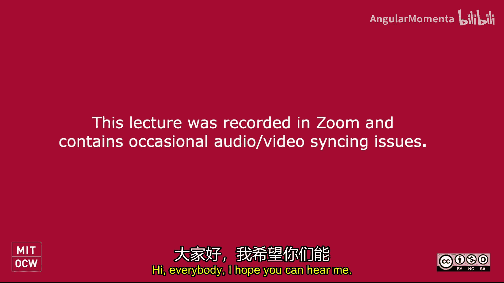
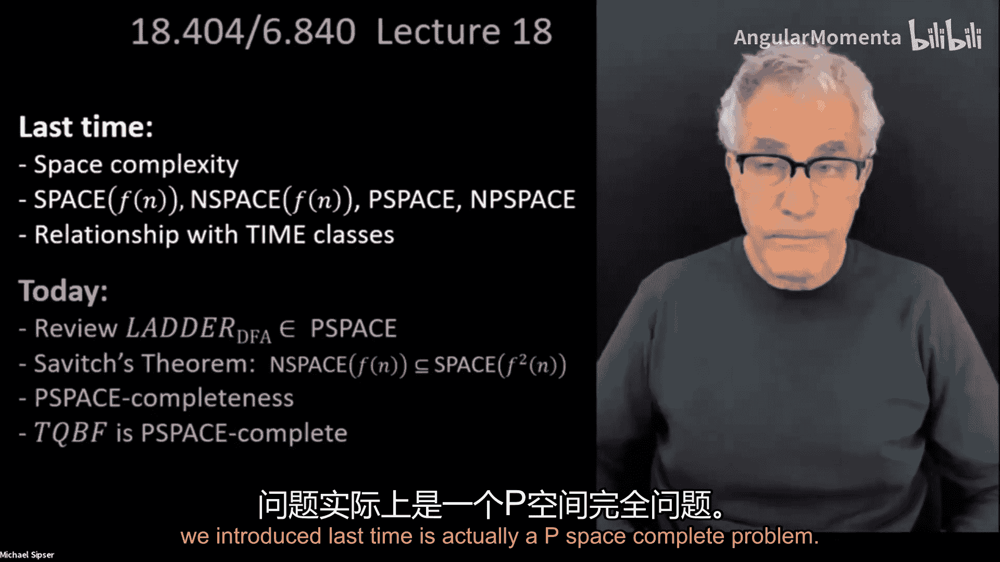
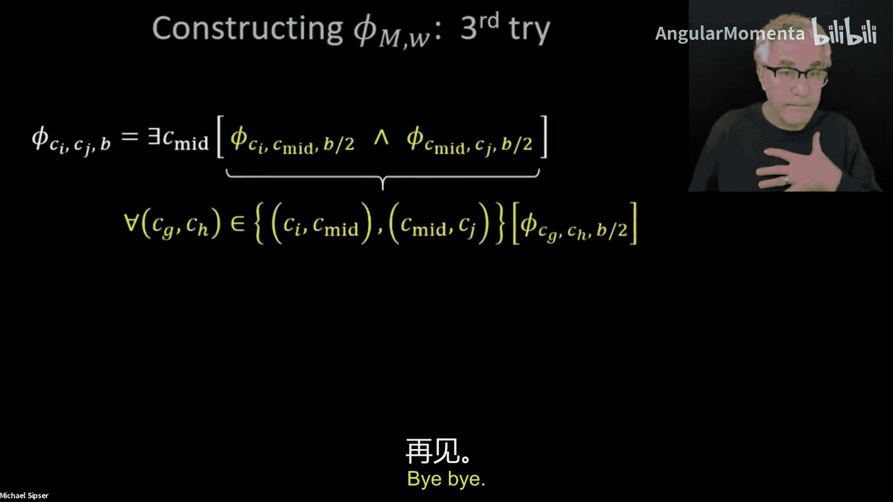

# 【麻省理工】计算理论  ｜  MIT 18.404J Theory of Computation, Fall 2020 p17 18. PSPACE-Completeness -BV1pt7GzeEjb_p17-

Hi， everybody。I hope you can hear me。Give me a thumbs up if you can good。Yeah。

 I see I'm coming through。So we're going to get started okay。

 so getting back to what we've been doing， you know。

 we've been talking about space complexity measures how much memory the algorithm requires or various problems require。

And。We defined the。Space complexity classes， space F of N and non deterministic space F of N。

 the polynomial space and non deterministic space classes。

And gave some examples and so on and today we're going to pick up where we left off last time one of the examples which is going to be an important one for us is concerns this latter DFA problem so I'm going to go over that again give a little bit more emphasis to the space analysis which I got some questions about last time and then we are going to move on from there and improve savages theorem and then talk about complete problems for peace space and show that this problem TQBF which we introduced last time is actually a piece space。

 complete problem。

But all in due course， a little bit of a review， so we defined what we mean by a Turing machine to run in a certain amount of space。

 that means it uses at most F of n， if it's running in space F of n uses at most F ofn cells tape cells on every input of length n and similarly a non deterterministic Turing machine does the same。

 but what's in addition to that， the not deterterministic machine has to hold on every branch of its computation。

 and each branch of its computation has to use at most that bound， that bounded amount of tape cells。

嗯。So we're going to be talking about non deterministic space computation today as well。

 that's going to be relevant to us。So we defined the classes。

 as I mentioned and the polynomial and the piece space and not theistic peace based classes。

 and this is how they see how we believe they relate to one another the classes coP and NP as well and of course as I mentioned last time。

There are some very major unsolved problems in this area。

 so everything could conceivably collapse down to P， which would be， of course be very surprising。

 but we don't know how to prove otherwise。And the big theorem that we're going to prove today is that polynomial space and not deter deterministic polynomial space actually do collapse down to each other。

beinging the same plus so in contrast with the situation that we believe to be the case for time complexity where we believe the nondeterministic converting non deterministic to deterministic gives an exponential increase for space complexity。

 it only gives a squaring increase as we'll see。So。Any questions on any of this。

 or we will just march into a little review of this latter problem。嗯。So。ReReviewing。

Some of the notation and let me emphasize that so the big theorem we're going to be proving today is that peace space and end piece space are equal and also we're going to be talking about peace based completeness。

But both of those involve proving theorems in the first case savages theorem that converting non deterterministic to deterministic spaces a squaring and in the second case proving that TQBF is piece based complete both of those theorems can be thought of as generalizations of this。

Theorem here that the latter DFA problem can be done in the deterministic polynomial space or n squared space。

嗯。So it really pays to try to understand how the proof of this theorem works because in a sense this theorem is a more concrete version of what we're going to be seeing in those other two theorems in a somewhat more abstract form okay so I like understanding things in a more concrete way first so that's why this is a good example to start out with but really in the end of the day it's the same proof just repeated for those three theorems so this is a really three three for the price of one three theorems one proof here so you're going to be seeing the same proof repeated three times。

But in different levels of abstraction。Okay so lets let's review again and I know some of you got it but maybe some of you didn't and let's just try to be clear on the algorithm to solve the ladder DfaA problem so if you remember first of all let me just jump on ahead the ladder problem is you a ladder first of all is a sequence of strings that change one symbol at a time。

That perhaps connect go from one string to another so you're going to go from work to play changing one symbol at a time。

 so we give an example of this or you can easily come up with an example of doing this but。

The computational problem is can you do it， can you get from this string to that string and stay within a certain language。

 so it might be the language of English words or it might be the language of all strings that some specific DFA recognize recognizes。

 so it might be all of the string these might all be strings that some DFA accepts or you know might be English words or some other rule。

And so。呃。That's what we mean by trying to test if there's a ladder and so the latter problem is well I don't think I wrote down down the ladder problem itself but the bounded ladder problem is basically the same idea you're given a DFA you're given the strings U and V and now this is the bounded version of the problem where I'm going to give you a limited limit on the number of steps you can take so I'm illustrating that here so you're going to be given a B and you want to say can I get from this string to that string within B steps。

Okay， and we had a notation for writing that going from U to V。

 if there's a ladder that connects U to V within it most B steps。

And so the bounded ladder problem which I'm introducing because I'm going to be aiming toward a recursive algorithm to solve this problem。

Is can I get from u to V by a ladder changing one symbol at a time where each string along the way is accepted by B？

And I'm only allowed B steps， little B steps。Okay。😊。

So that is the computational problem that i'm going to be solving with the algorithm that i'm going to describe so the algorithm i'm going to call bL for bounded ladder problem。

And here is the input and the algorithm is， first of all， going to look to see if b equals1。

 if I'm just trying to get from u to V in a single step。In that case。

It's a very simple problem because you want to test。

 obviously that U and V in the you know are accepted by the autoomicton and they just have to differ in one place and then you have a very simple one step ladder that takes u to V Okay so for the case B equals one it's very simple。

For larger values of B。We're going to solve the problem recursively in terms of smaller values of a B。

So。For B greater than one， we're going to recursively test， you know。

 if you're trying to solve the problem， can I get from U to V。

 instead we're going to try each possible halfway through。We don't know that it's halfway through。

 so we're just going to try each possible string。😡，And we're going to test。

 can we get from you the initial string to that new string that。W in half the number of steps。

 And can I get to the final string V in half the number of steps， if I can do that。

Then I can get from U to V。The total number of steps B。

 so I'm just going to try to do this1 w at a time for every possible W this is going to be very expensive in terms of time。

 but we're not worried about time right now we're trying to cut down on the amount of space that we're using and this is going to be a big savings in space。

😡，Let's not worry about the division B over two here。

 all of the divisions and we're going to be seeing this several times going forward in the lecture。

 we'll think of them rounding up and I'm not going to cumber up。

 make the notation look cumbersome by writing that every time。Okay， so here we go。

 here is some candidate W string， which is halfway halfway through。Um。

 recursively test kind to get from the starting string to that W and from W to that ending string。

If I can， if I find such a W， then I accept。And if I try all possible W and I never managed to find a way to make both the top and the bottom work。

 then I know I cannot get from you know from the starting string to the ending string within B steps。

 and so I reject。Okay， and now I'm going to solve the original unbounded。

Laadtter problem by simply putting the biggest possible bound into the bounded ladder problem。😡。

And that's is value T， which is。Gives the very trivial bound of the total number of possible strings that I can write down within my length M that I'm working with。

😡，So this is if sigma is the alphabet of these strings。

 it's just sigma to the M that's all possible strings。

 of course that's going to be a maximum size on the ladder。

Okay so now how much space does this take and I think this is where people got a little bit lost in the lecture last time so i'm going to try to animate this I don't know if that's going to help or not but in the end of the day you just have to going to have to think through how to how do you account for the cost of this recursion。

嗯。Okay， but the main thing to start off， you have to make sure you understand the algorithm。

To get from here to there， we're going to try all possible midpoints and then solve the upper part and the lower part recursively reusing the space。

 that's the critical that's the way we're going to get a saving。Solving this problem。

 reusing the space that we use to solve this problem。😡，Okay。

 so I'm going to try to show this to you on actually how the space gets used on the Tring machine。

 you can kind of think of here's the input and then after that is going to be the stack for the recursion if you're not that familiar with how to implement recursion doesn't really matter。

 but you can just，Think about what the algorithm needs to keep track of。😡。

And so as it's trying every possible W， so you know， just in a order like an odometer。

 just trying every possible every possible string eventually maybe it finds a string that's in the language that hear's an English word one of the first English words of length four that you might run into and so now it makes sense actually to do the recursion。

So that's all every time you're going to have to have a register or a location on the tape where you're going to be writing down those different ws so let's say it's over here and and we're just going to go through or that's not too small for you to see you know that's really where that action is happening and finally maybe you got to the string W now you're going to try to do the recursion so here is you know as you're re doing the recursion on the top half。

Again， you're going to be cutting， you're going to be finding a new W for the intermediate point just solving this upper upper problem where were testing if I can get from work to A later I'm going to have to deal with getting from able to play。

😡，嗯。Um， good， so here again we're going to be trying fixing able， fixing that but the first W。

We're going to try every possible way of getting from work you know from the start string to that middle string。

 so we're going to try every possible thing here， eventually maybe we find some string some other string in the language we get down to the string book。

And。That's all going to get stored， have you can't forget the string able。

 but now we're going to use some more space to store those candidates。😡。

So that's a second version of W deeper in the recursion， so here we're going to be triangle to。

Possible strings here again， eventually we get to some string book and you know if that succeeds in getting us from work to able via book we're going to jump down to do the bottom half to see if I can get from able to play as a separate problem which gets solved in the same space so now here we're going to try all these possibilities getting from able to play。

 maybe call is the right intermediate string there and so now we're going to erase the book。

And now we're going to solve the lower sub problemm in the same location。

 I hope this is helpful which theres a lot of work making these animations and so。嗯。

I hope so the point of all this is every time we go down the level of the recursion。

 there's another register whose size is big enough to hold one of the strings is needed。

And that register gets reused。Times as we're at。You know throughout as as we're going through through this recursion so anyway。

 I hope that's helpful anyway， so each level of the recursion adds another order in to record the W and so you have to how many levels do we get。

Well， the depth of the recursion is going to be how many times we end up having to divide this picture in half to get until we get down to one。

And so the height of this， you know， when we start off is going to be basically an exponential in M M is roughly the size of n。

 so when you take the log of that。You're going to get。

You're going to pull down the exponential so it's going to be order m or which is again roughly the same size as the input m is like half the input because the whole input is U and V m is just the size of U。

And so each level requires order n and the depth is going to be order n deep， you know。

 the log of the initial height of this ladder。And so the total space use is going to be order n squared。

Okay， so why don't we just take a minute， I'm happy to spend a little time going through this。

 either the algorithm's correctness。understandinging the recursion or understanding the space analysis。

 if there's any question that you feel you can ask that would be clarifying for you， jump in。

 I'll set aside a few minutes just to answer questions here。嗯。

So I've got a question here in step five， why do we reject？If all fail。Instead of just one fails。嗯。

Well， here。So remember what we're trying to do， we're trying to say。

 can I get from U to V in B steps？😡，The way I'm going to be doing that。

Is trying every possible intermediate string W。😡，Um。If I find some W， which does not work。😡。

That doesn't mean that there's not some other W， which might work All I need is1 W for which I can get from U to W in half the number of steps and W to V in half the number of steps。

 so I'm going to try every possible W if any one of them is good。😡。

Then I can accept if any one of them succeeds where I can get from U to W in half the steps and from W to V and half the steps。

 then I know I can get from U to V in the full number of steps so I only need to find one if one particular one doesn't work。

 I'll just go on to the next one。嗯。Okay， this is a good question。Do we have to save the word book？

So once we succeed in getting from work to able， let's say via book。😡。

Do we need to save that word book anywhere No， all we need to remember is that we've succeeded in getting from work to able。

😡，We don't need to remember book anymore we just you know remember that we've succeeded and that is by virtue of where we are in the algorithm so we but you know if we have succeeded then we move on to the second second call recursive call so we found some way to do it so we found some intermediate point which succeeds for this one so we move on to that one we don't have to keep any of that work anymore all you have to do is remember yes I can get from work to ableB in half the number of steps now I need all that's left is to get from able to play in half the number of steps。

It it doesn't matter how I got to Abe。In the first place， so we don't have to remember that。

That was a good question though。So I think I understand this before we replace。The value for book。

With call。With the work involved to find coal。Yet we have to check that we can get from work to book and book to able。

So we keep onto book while we're working on the upper half。😡。

And only when we finally succeeded in getting from work to able， let's say do via book。

 then you can throw a book away。But while you're working on the upper half， you try book。

 you try different， you know， different strings of length four until one of them works。嗯。So。

OkayI'm not sure somebody's asking me about breath for search and depth for search。

 i'm not sure I see it。This。I don't sure that's going to be a helpful way of thinking about this。

 so i'm not going to answer that right now but。You know， you can ask that offline later if you want。

 why is the recursion？Why is the recursion depth？Log T instead of log M。😡，Okay， well。

 how high is this thing？Initially。It's T high。But every time we're doing a level。

 we're calling the recursion， we're cutting T in half。First， it's you know， if you you know。

 I'm stopping this in general for B， but we starting off with b equal to T T is the maximum size。😡。

So。Initially this is going to be t and then it's going to be t over two， then t over four。

 so it's going to be log T levels before we get down to one。嗯。Yeah。

 so somebody's asking can we think of this as a memory stack， yes。

 this is like that's the way the typical implementation of recursion is kind of with a stack where you push when you make a call and you pop when you return from the coal。

嗯。Is it possible that V can appear during BL procedure on T？Is it possible that V can appear？

mI'm not sure what that means it can V reappear， you know， so I'm starting with U to V。

 is it possible that V might be one of these intermediate trendss， yeah？You know。

 you're going to try every possible intermediatemedia string， you know， blindly。

 including V is one of them。You know， if you can reach V more quickly。Well， great。

 I guess I have not deal dealt with the issue of what happens if you get to a。嗯。呃。Technically。

 it's going to work out because I'm allowing。You know， the difference to be in at most one place。

 so even if you get there early you're allowed to not change anything and that still is a legal step in the latter。

嗯。呃。Yeah， I don't see how to do this from a bottom up perspective。

 somebody's asking is there a bottom up version of this， I don't don't think so but。No。

 I don't think so。All right， why don't we move on so now we're going to see this proof again。

But this time， we're going to be proving。That you can convert any NFA to a DFA with only a squaring increase so really。

Well， let me just put that up there， so this is going to be savages here。

Among other things proves that peace B equals N peace B。

So it says that you can convert a non deterministic machine to a deterministic machine only squaring the amount of space so you're comfortable with this notation here。

 anything that you can do in F event space non deterministically you can do an f squared event space deterministically and we're going to accomplish that by converting a。

You know， an NTM to a deterministic TM， but only squaring the space used。

 so n is going to get converted to them M and now this proof is going to look very similar to the proof from the previous slide。

It's the same proof。and you know， and and the fact from the previous slide， you know。

 about ladder really is implied by this because you know we we had an easy algorithm to show that the ladder problem is solvable in in non deterministic you know an NP piece space so ladder problem was easily shown to be in here if you remember you just guess。

The you basically guess the steps of the ladder so non deterministically you can easily check can I get from the star to the end but。

呃。Savage' Theorem tells us that anything you can do non deterterministically in polynomial space。

 you can do deterministically in polynomial space， so what we showed in the previous slide follows from this slide。

 but this slide is really just a generalization of the same proof。Okay。

MaybeI've said it too many times now。We're going to introduce a notation very similar to the notation we had last time。

 but now we're going to be talking about。Simulating this non deterministic machine with a deterministic machine。

And we're going to have take two configurations of this not deter deteristic machine， C and CJ。

And say， can I get from C to CJ in at most B steps？😡，I'm going to have a notation。

Very similar to like the notation for the latter where I can get from this word to that word in at most B steps by a ladder here。

 can I get from this word to that can I get from this configuration to that configuration with at most B steps of the Turing machine's operation？

So these are two configurations now。UmOf n， so can N go from this configuration C to that other configuration CJ。

 but only taking B steps along the way。That's now the computational problem that I'm going to solve for you with an algorithm。

 and it's going to be a recursion exactly like the previous one。嗯。So M gets his input。

 the two configurations， C and CJ and and the bound B and want to check。

 can I get from I to J within B？Okay， so now the picture is a little different， but's very similar。

 So instead of a ladder appearing here， it's really something that's basically a tableau for。

For the machine end where I have an initial configuration and an ending configuration。

 this would be this would happen to be。The starting point for the whole procedure if you're testing whether n accepts W。

 but we would be solving this in general for any configurationfi you know so for that case so I have the stark configuration of n on W and the accepting configuration or an accepting configuration。

 but in general what I，We'll be solving is starting at any configuration C and going to any configuration CJ。

So I want to test， can I get from CI to CJ within it most B steps？So first of all， if B is one。

You can just check that directly， you know， and now again。

 this is we're operating deterministically to simulate the non deterministic machine。

So this is the deterministic machine now。So M can easily if it's given two configurations of n and says can I get from the first one to the second one in one step。

 well that's an easy check， you just lay out those two configurations。

 look at the N's transition function and say， is this a legal move for n？😡，Yes or no。

 and you accept or reject according。Now， if B is larger than one。

You're going to try all possible intermediate。😡，Configurations。I'll calling them C mid。

 this was like the W from the previous theorem。😡，This is all strings all possible configurations seeid。

And you know， I don't， you know， a configuration is just going to be a oh。

So far so okay this is all possible looked like my PowerPoint crash that seems okay this is all possible configurations which is just a string with a string of tape symbols with a state symbol appearing somewhere that's all it is you're going to try all possible。

Configurations as。canandidate middle configurations and say。

 can I get from the upper one to the middle to this candidate middle one and from that middle one the to the lower one within half the number of steps each time。

So。And solving that problem incursively。嗯。Okay， so I get a question here about the possibility of looping forever。

First of all， if n is going to be looping， I don't have to worry about it because。I'm starting off。

I'm only happy to simulate machines that always hold that are deciders。

Because I'm trying to show that any language in here has to be accepted has to be decided by some non deterministic machine。

So I'm not going to worry about machines that are looping if they're looping， you know。

M may misbehave in some way， but that's not going to be a problem for me。

So let' let's keep life simple， think about the deciders only。Okay。

 so we're going to recursively test here， so that means I have going to try every possible middle。

 see if I can get from the start to the middle and the middle to the end if both of them work。

From my if my I test them recursively， then I am going to accept， if not， I'm going to continue。

And I reject if I try them all and none of them have worked。

 then I know there's no way for N to get from this configuration to that configuration in B steps。

Okay。And the overall picture I test whether n accepts W as I mentioned by starting a C I is a start configuration and CJ is the accepts configuration and now how big is T because I need to calculate abound on how how deep the recursions are going to be so T here is going to be the total number of possible configurations you know if this is holding it never repeats a configuration so this is going to be abound on how many steps and can be taking。

And that's simply you know， we calculated this before， it's the number of。

States times the number of head positions， times the number of tape contents。Tpe contents。

 and this is really going to be the dominant consideration anyway， and so。Now each recursive level。

 and maybe I should have emphasized this at the beginning， how wide is this picture。

 it's big enough to store a configuration configuration is essentially a tape contents。😡。

So that's going to be FN wide。So each recursive level stores one configuration。

 now the W costs F ofn space to write down。😡，And the number of levels is going to be the log of the initial height。

Wwhichch is this so this is going to be the dominating part of it。

 so the log of this is going to be again order f of n so this each one takes f of n space to write down the depth of the recursion is going to be order f of n so the total is going to be order f squared to n and that's how much space this uses。

And that's the proof of savages there。So yeah so this is a good point there I was thinking somebody asked can there be multiple accepting configurations I should have made a I forgot to say this but and I was just realizing it as I was explaining it one of the things I should have you can enforce that there was just a single accepting configuration this is kind of a detail but so don't worry about it if you。

If you don if you don't want to， but you can make sure that there's a single accepting configuration by telling the machine when it accepts it should erase its tape and move its head into the leftmost cell in the accept configuration so there's just going to be a single accepting configuration to worry about instead of having to try multiple。

Possibilities， which you could do in this algorithm。

 but it would just be annoying to have to write it that down that way。

 so we often assume there's just going to be at a single accepting configuration for these machines。

嗯。嗯。Okay， so this is。How do you know F of N， so that's actually a little bit of a delicate issue。

I mean， if you could compute F of n。The bound， which is for example。

 if it's going to be a polynomial bound， you can just compute F of n it's very easy to compute n squared or un cubeed if and so you can just。

嗯。呃。Compute that and then use that as。The size of the registers you're going to be writing down for if you want to prove this in general for F ofn it's a little bit technical to have to deal with it and i'm going to have to refer you to the book on that one the book tells you how to do solve this for a general F of n you basically have to。

Try every possible value from one until it works。乐。

I'm afraid that's going to derail us trying to decipher that so let's not worry about that aspect of it。

 buts it' you can handle general F ofN here you don't need to put any conditions on F ofN。嗯。

Can we go over this term here？So we've seen this term once before when we talked about LbaAs and seeing that Lba is always。

We can solve the ALBA problem， this is simply the number of different configurations the machine can have。

😊，Because the configuration is a state， it's a head position and a contents of the tape and this is the number of each of those。

That you can possibly have number of states。Head position。You know。

 the size of the tape of F of n is F of n， so this is that many different head positions and this is the number of if D is the size of the tape alphabet。

This is the number of contents， tap contents that you can have。嗯。Okay。

 how is seeing if n accepts W with this algorithm convert a non deterterministic tuuring machine to some deterministic tuuring machine Well n is the nondeterministic tuuring so n is we're converting nondeterministic Turing machine n to deterministic tuuring machine M so M is the deterministic simulator of n that's what this whole M is。

So if we can do this for any end that we've proved our theem。嗯。Okay。

 why don't we defer I think you know we're I think I got to most of the questions here if there's other things we can save them for the。

Coffee break， which is coming soon， I think we have one more slide before that。Okay。

 so I'm going to define piece based completeness， I think yeah。

 and then I think I think after that we have the break。So peace based completeness is defined。

And very much inspired similarly to NP completeness。

A problem is Pe space complete if it's in peace space and every other member of PeaceB is reducible to it。

In polynomial time。And we'll say a bit about why we choose polynomial time Reducibility here。

Um so here's a kind of the picture of how peace based or how complete problems of。You know。

 relate to their complexity classes。So you kind of think of a complete problem for a class。

 it's kind of the hardest problem in that class because you can convert。

 you can reduce any other problem in that class to the complete problem。

So here are the NP complete problems。Sort of the hardest for NP here' the piece space complete problems。

 kind of the hardest for peace space。If any an NPp complete problem goes into P that pulls down all of NPp to P。

 if any p based complete problem goes into P， it pulls down all of p space into P by following the chain of reductions because any P based problem is reducible to the complete problem。

 which in turn if it's in P， then everything goes into P so if，You have a P based complete problem。

 which is in P， then all a peace based goes into P。So why do we use？

Polynomial time Reducibility and say instead of say polynomial space Reducibility。

When we define this notion。It's kind of a very reasonable question， but if you think about it。

 using polynomial space reducibility would be a terrible idea。UmBecause。

And we've seen this phenomenon happen before。Every two problems in peace space are going to be peace space reducible to one another。

 we haven't even defined that notion yet， but you can imagine what it would be because a peace based reduction can solve the problem for a problem in peace space and then it can direct its answer anywhere that it likes so in general when we think about reductions。

😡，The reduction should be not capable of solving the problems in the class because if they could。

Then every two problems in the class would be reducible to one another。

And then all problems in the class would be complete because everything would be in the class would be reducible to any one of the other problems。

So it would not be an interesting notion， what you want to have happen is that the reductions should be weaker。

Then the power of the class。And so。Every， you know。

 and if you if you look at the reductions that we've defined so far， they're actually very simple。

You know， the only thing is they have to make sure that they can make they can make the output big enough。

 but actually constructing the output they would do very simple transformations in fact。

 even polynomial time is more than you typically need there's even much more limited classes that are capable of doing the reductions as we'll see。

So having powerful reductions is really not in the spirit of what reductions are all about you want very very simple transform transformations to be the reductions anyway hope that's helpful so what what we're going to be aiming for in the second part of the lecture is showing that tqBF is piece based complete。

嗯。And let me ahead a check in。呃。So this is our first check in coming a little late into the lecture。

 suppose we have proven that as we will that TQBF is piece based complete。

What can we conclude if TQBF is actually not necessarily NP P only goes to NP。

And this is relevant to a question that's coming in from the chat， but i'll answer that later。

 so suppose tqBf ends up being an NP and not NP p what what can we conclude remember if if tQBf is in P。

Then p space equals p。Suppose it goes to NP。What happens then？Check。

 you there may be several correct answers here。To check all that apply。All right。

 so we're near the end of the。呃。Poll， so let me give you another 10 seconds and then we're going to shut it down。

嗯。Okay， are we all in？Closing it down。嗯。Here are the results so yes。

 so first of all the most reasonable solution， the most reasonable answer is B。

 which I think most of you have gotten that if。You know。

 if a piece based complete problem goes down to NP。

 well NP is capable of simulating the polynomial time reduction and so。

Any other problem in peace B would then also be an NP and peace base would equal NP， but note。

If P space equals NPp， they're also NPP equals co NPp because P space itself is closed under complement。

So that was kind of a little bit extra fact that you could conclude from this as well so let me let's move on then to our coffee break and we'll pick up the proof that TQBF is piece based complete after that。

Okay。So。So was D true or not D was p equal NPp no we cannot conclude that p equals NPp if from p space equal to NPp so if TQBF is an NP。

 it doesn't tell us anything， it's sharp me for all we know p equals NPp。

 but from the stuff that that we know so far we cannot conclude that P equals NPP。嗯。Oh and yeah。

 so you can conclude， oh， I'm sorry， you you can B and D are both。Correct here。嗯。

Let me just shut this thing off。So B and D are correct， so if a P based complete problem goes to NP。

 then NPp equals p space and equals co andp。So the correct answer of B and D。Sorry。

 I got myself confused so C， but C is not something you can conclude or A。Okay。就什么意思？

Somebody's asking me a fair question。You know I say the reduction method should be weaker than the class。

But you know， for example， even in the case of P space， P space might be equal to P。

 and then it wouldn't be weaker than the class if we use polynomial time reductions。

But I think maybe I should say apparently weaker， as far as we know it's weaker。

 but we believe it to be weaker， if it's true if P equals P space。

 then every problem in P is going to be p space complete。

It's just going to be a weird world if P equals be based， similar， same thing for NPP and NP。

So I'm getting a number of questions also about other possible reducbilities that are even weaker than polynomial time Reducibility。

So we're going to see very soon weaker reduced you know complexity classes within P so first of all P space seems to be bigger than P we're also going to look at log space but that's going to be actually in Thursday's lecture these are classes that seem to be inside well they're inside P they may be properly we believe they're properly inside P but we'll see that later。

嗯。Let me just see here。没啦。It really should have so we're almost out of time let me put our timer back in fact our timer is showing us out of time so why don't we。

Get going， let me move this。Back to。Okay。Continuing。Pace TQBF is piece based complete。

 So first of all， let's remember TQBF。嗯。These are all of the。

Quantified Boolean formulas that are true， so TQB stands for true quantified Boolean formulas。😡，嗯。

And remember we saw these examples from the previous lecture。That。

You know here these are two quantified these are two QBFs， the first one is true。

 the second one is false and it's kind of interesting to think about。

 you know here they're exactly the same except for the order of the quantifiers。

And so what's really going on， you know， here， just I think it's。

Good to understand these expressions， they come up everywhere in mathematics， these quantifiers。

 you know in the other one， when we say for every X there exists a y that y can depend。

On the choice of X。You choose to make a different x you're allowed to pick a different y。

 but but the lower expression says there's a universal y。

 there's one particular y that works for every x。So in a sense。

 the lower statement is a stronger statement。You know。

 whatever you have in the interior the quantifier free part。

 so the lower one implies the upper one happens that the lower one in this case is false and the upper one is true。

 but in general the lower in the you know when you have this change of quantifiers like this。

 the the lower one would imply the upper one。Okay， anyway， that's a sort of a side remark。

 so let's get back to the proof that TQBF is piece based complete that's what our goal is。All right。

 now as I mentioned。This is the same proof you're going to be seeing it for the third time today but。

You know， there's a certain amount of it's sort of。The context changes。In each case。

So now we want to show that TQBF is PeSp Comp， so it is one of these hardest problems now。

 but for PeSp。Where satisfiability was like a hardest problem for NP。啊。

So we want to show that every language in peace based is Reducible to TQBF。😡。

And so we're going to give。Polynomial time reductions that map。Some particular problem A。

 which can be done in space into the K。Problem solvable in peace space。

We're going to show how F maps a to 2 QBF， we have to construct the F。

So F is going to be a mapping that maps strings， which may or may not be an A， so strings W。

 which may or may not be an A。😡，To these formulas。These quantified formulas。

So W is going to get mapped to some formula fe of Mw it had exactly the same even symbols we used when the proof of the Cook Levinth theory about Sap being NP complete this is a very similar proof。

Um， but you'll see that we have to do something more in order to make it work in this case。呃。

So if you know， W is an A， if and only if this formula is going to be in TQBF， in other words。

 if and only if this formula is true。嗯。So this formula is going to kind of express the fact that M accepts W。

😡，Which means that w was an A because M is the machine， is the piece based machine for a。

So this formula says M accepts W。And it achieves that by。Building in a simulation。Of M on W。

It kind of describes a simulation for MW， which ends up accepting。And if M does not accept W。

 that description is going to inevitably be false。嗯。Okay。

 so let's just see how that's what that's going to look like。

So we're going to use the same idea that we initial that we used for the cooklevin theorem that sat is NP complete。

 this notion of a tableau。So if we remember that， we had it was basically a table。

Which was just simply a way of writing down a computation history for MW。Okay。

 so the rows are the steps of the machine。The top row is the start configuration the bottom row is。

 let's say。Some particular。Except configuration such as I just described with a machine。

Clears its tapes and moves its head to the left end。

 so there's only one accepting configuration we have to worry about。

Okay in each of the rows here is a configuration of M。Okay。

because M runs in space into the K the tableau kind of similarly to what I described before has width into the K so in that now you know we're talking about polynomial time machines。

So the F， which is the bound， the space bound is going to be some polynomial into the K。

So the width of this tableau， the size of these configurations are going to be into the K。

How high is this tableau going to be Well， that's going to be limited by the possible running time of the machine。

😡，Um， which is。Similar to what we saw before， it's going to be exponential in the space bound。

So it's going to be D to the end of the K， where D is the essentially the tape alphabet of the machine。

Okay， so。Are we all together on this？This is very similar to the proof of。SAT is NP complete。

The key difference there was M was non deterministic。嗯。Which might be something to think about later。

 but let's not focus on that right now here this M is deterministic。

And but the important difference was the shape of the tableau the size of the tableau was very different in the case of SA is NP complete we started off with a polynomial time nondeterministic machine so it only could run for a polynomial number of steps here is a polynomial space machine which can run for an exponential number of steps that's going to be an important difference here so let's see why。

呃。The reduction has to construct。This。Formula， fe of MW。

Which basically says that this tableau exists。Now we already saw how to do that when we proved。

The Cook11 theorem that satAT is empty completele。Remember， we had all of those。

 we had variables for each cell that told us what the contents of that cell was。

And then we had a lot of logic here， we had a bunch of logic that said that those you know those neighborhoods were correct。

 which basically says that the tableau corresponds to a correct computation of the machine。

So why don't we just do the same thing？He said， why don't we just build our formula？😡。

Using exactly the same process that we used to build a formula when we had SAT being NPP completele。

Something goes wrong， we can't quite do that。The problem is that if you remember the formula that we built before was really about as big as the tableableau was。

Because it had some logic for each one of the cells。

 it had said of some of the had variables for each one of the cells and it had some logic。

 you know for each of those neighborhoods， basically so he says that each of the cells。

Does the right thing。嗯。So it was a pretty big formula， but it was still polynomial。

The problem is that Tau is now n to the K by D to the end to the K。

That's an exponentially big object。So if your formula is going to be as big as the tableau。

 there's no way you can hope to produce that formula in polynomial time。And that's the problem。

The formula is going to be too big。Remember， we're trying to get a polynomial time reduction。😡。

From this language A。So we have an input to a， you know， a string that might be an A。

 which is with simulating the machine and then you know。

 the size of the tab below relative to W is going to be something enormous。

And so if the formula is as big as the tableau， there's no way to produce that formula in polynomial time。

Is it not going to work？Let's try again。So now we have here。呃。

So remember this notation from CI to CJ and B steps。Okay。

 so we're going to give a general way of constructing formulas。😡。

Which express this fact that I can get from configuration I of M to configuration J of M in B steps。

Whatever that B is B is going to be some bound， and I want to know。

 can I get from this configuration to that configuration and I want to write that down as a formula which is going to express that fact and it'll be either true or false。

And I'm going to give you a recursive construction for this formula。

 so I'm going to build that formula。For value B。Out of formulas for smaller values of B。Okay。

 so this is going to be a way of constructing that formula in terms of other formulas that I'm going to build and there's going to be a basis for the recursion when b equals1。

Because that's the big picture， so let's see how does this formula look？

So let's not worry about the case for B equal one right now， this is the case for larger values of B。

So I'm to the fact of that I can get from CI to CJ within B steps。

I'm going to write this down in this way。And let's try to。Unpack that and see what it's saying。

You know， without worrying about。How we going to carry this out。

 let's just try to understand at a high level the semantics of this thing and what is trying to say to you。

It's going to say， well， I can get from CI to CJ and B steps。So M can get from C to CJ and B steps。

If there is some other configuration， C mid。I'm calling some other configuration I'm calling it CM very much inspired by the previous proof of Savage's theorem where there was C mid was that intermediate configuration so now instead of trying them all I'm saying does there exist one？

Where I can get from C to C mid in half the number of steps and from C mid to CJ in half the number of steps。

So if I can build these two formulas。Then they can combine them。

With this sort of extra stuff out here and them together and put an exist quantifier says。

 does there exist some configuration， some way to find a configuration such that it works as these formulas require？

If I can do that， then i'm going to be good because then I can well good least i'll be good in terms of making something that is going to work so first of all let's understand what I mean by writing down does there exist c mid it's really。

If you're you know thinking back to the way we did the Coch11th theorem。

 we represented these configurations by variables which were indicator variables for each of the cells。

 and we're going to do exactly the same thing， so we're going to have a bunch of boolean variables which are going to represent。

Some configuration。So。More， formally or in more detail。

What does their resideency mean really is an assignment to all of those variables that represent the cells of the contents of the cells of that configuration。

Okay， so now let's see how to。In how will the recursion work？

To get this value here I'm going to do the recursion further so does there exist a c mid and now for getting from C to this C mid of is there some other c mid this is like another value of W from the previous slide where I'm getting again I'm cutting the number of steps in half again so I'm going from P over two steps to B over four steps。

And I'm going to do the same thing over here。So I'm just unraveling the。

The construction of this formula in terms of by building it up recursively。嗯。

So and then I'm just going to keep doing that。Until I get down to the case where B equals1。

UAnd when if I'm now trying to make a formula。That's going to be。

 say I can get from C to CJ in just a single step。So this is really talking about a tableau of height one or height two。

😡，Then I can just directly write that down the way I now the Tableau is not very big。

 so now I can write that down using the neighborhoods and so on that I did in the Cook 11th Theorem proof。

嗯。And this is how you put it all together。嗯。And now if you want to talk about the。Getting from。

Does M accept W， so I initially say can I get from the start configuration to the accept configuration in T steps。

 which is the maximum running time of the machine so again。if you followed me， what happened？

In savages theem， it's the same values。呃。Now the thing is。

 is we have to understand how big this formula is。And if you think it through。嗯。呃。

If you think it through。This is a problem。Because what's going on here？

I'm expressing this formula in terms of formulas where the size of B is cut in half。

But now there are two of them。So it's two formulas on half the value of B。

 that's not going to be a recursion that's going to work in our favor。So let's just see what happens。

So each recursive level doubles the number of formulas。😡，Go here， we have two formulas here。

 we're going to have four formulas。And so on， so the number of formulas doubles each time。

So the length of the thing that we're writing down is doubling in size each time we go down the recursion。

That's going to be okay if we don't go too many levels。

 but unfortunately we are going quite a few levels because the number of levels is going to be log of this initial exponential size thing so it's going to be end to the K levels and so if you're doubling something end to the K times you're going to end up with an exponentially sized formula and。

Again。We failed。Okay， so let's I have a check in on this。

 but I'd like maybe we should spend a couple of minutes just making trying to understand what's going on here because the next slide is my really my last slide and it's going to fix this problem。

But let's make sure we understand what the problem is before we try to fix it。嗯。

Why can we no longer write over each layer of the recursion as we did in ladder oh that's kind of a cool question what does it even mean to write over the different well？

Yeah。So that that's kind of an interesting question here so in a sense。

 that's going to be the solution。We're going to。嗯。You know， reuse things in a certain way。

 but but for but。I want you to understand that this method。Itself。Does not work。

Because this recursion here where I'm writing the formula。

 I'm building the formula for B out of formulas for smaller values of B。😡，If if I do it that way。

 I'm going to end up if I do it as it's described in this procedure here。

 I'm going to end up with an exponentially big formula。And that's not good enough。

So if you cut the formula in half each time， even though you have two formulas。

 won't the length be the same？嗯。I'm not cutting the formula in half。

 I'm cutting the value of B in half。嗯。So you have to say B is initially an exponentially big value。

So we're going to end up with an exponentially big formula。

So it's not really cutting the formula in half， cutting the B in half， and B it starts out big。

And I mean， is b is initially this value here D to the n to the K。

I'm worried not too many questions here I feeling that that's probably not a good sign。If you're。

Well I mean if you're hopelessly confused maybe I can't fix it quickly so why anyway why don't we move on and see how to repair this how to fix this problem。

And that is going to be by a trick。嗯。In fact， I know the people who were involved with coming up with us。

 this was actually this proof was done originally at at MIT and many years ago in the 1970s and the folks who were involved with it called it the abbreviation trick。

So that's what we're going to do on the next slide。呃。Oho， no， this is a check in first。

Why shouldn't we be surprised that this construction fails？嗯。A。

 well we can't just the notion of defining a quantified bulloleying formula by by using recursion is just。

Not allowed。So just you can't define formulas that way。

Doesn't use the fer all quantifier anywhere or because we know that TQBF is not in P。Okay。

 see would you。WhatWhat do you think why can't？Why should we not be surprised？

I guess I could have put a D in there， not surprised because you don't know what's going on。

So that's another reason not to be surprised， but anyway。

 hopefully have some glimmer of what's happening here。And why don't we just almost finished？

So I'm going to。Shut this down in a second。Last call。Okay， ending。All right。So in fact。

 the right answer is B I mean one should be suspicious that if you're not you know if you're not you're not there's no foroles appearing in this construction anywhere。

 so really what we're doing is we're constructing a formula that has only exist quantifiers so it's a satisfiability problem so really what we just did was we construct。

We did in a more complicated way the cookle1 construction because you end up with a satAT formula only with exist quantifiers and so really try one and try two were the same。

So it's not surprising that you end up with an exponentially big。For me as a result。

 I don't know a lot of you answered we know that TQBF is NP P is not NP P we don't know that I don't know where you。

What's happening with you guys？But no， maybe that was a protest vote。Anyway。

 no we don't know that Tq and what has that got to do with anything anyway。

 so anyway that's let's let's see how we solve this in our remaining few minutes here。嗯。And。

So here is the solution。Remember this part where we're saying we're trying to find C mid。

Does there exist a CM， such I can get from CI to C mid and half the number of steps and C mid to CJ and half the number of steps？

I'm expressing one formula in terms of two formulas。😡，That's where the blow up is occurring。

Because these two are then in terms of going to each of so these two are going to become four become eight and that's not good can I express this fact in terms of just one formula？

And it's kind of a little bit in the spirit of someone your suggestions can we kind of reuse things in a way and that's what we're actually kind of kind of to do so here's another way of saying the same thing but with just a single formula and it uses a forral and the idea behind it is that an and is kind of like a forral。

Or forole was kind of like an hand。Just like it exists is kind of like an orar。

So when you're saying does something exist？You know it's is it this thing or that thing or that thing or that thing and when you want saying for all it has this thing and that thing and that thing and that thing so ands and the fors are very much related and so we're going to convert this and into a forole we're going to say。

For all configurations， CG and CH that are either set to CIC mid or to C mid CJ。

The formulaula Cg CH I can get from Cg to CH in half the number of steps so you have to think about what this is meaning here。

And I also want to make sure that you don't feel I'm cheating you because， well， first of all。

 so now we have just a single formula。We're going to go down to the case be equals one as we did before。

You have to make sure that。Saying this restricted for all is not a cheat when you have for all x is an s like we have over here。

Is equivalent to saying for all X。 If x happens to be an S， then the other thing follows。

 And this implication can be expressed using ans and ors。嗯。And as before。

 the initial starting point is going to be with going from C start to C except and T steps。

And so the analysis that we get is that。Because there's no longer a blow up。

 each recursive level just adds。This stuff here in front。The exist cid and this forole part。

 so that's going to be adding order n to the formula instead of multiplying because we have two formulas。

And so now the total number of levels is order into the cage as before。

 so the size is going to be into the K times n the K or order into the 2 k。

I actually had a brief check in here， which I'd like you to do just in our remaining few seconds。

Does this construction depend on m being deterministic so let me just launch that I want you to guys to get your check and credit here。

But。In fact， if you。You have to think this through where that formula says that the tableau。

 you get a tableau。Is that going to matter depending upon whether it's deterministic or non deterministic it's actually。

嗯。Well， it's kind of running 50， 50 here。Iant to just pick something because I'd like to just close this out and just get to our last slide。

So if you don't don't follow， don't worry， but it's actually an interesting point that。

The fact that this， so I'm going to end this all in。So in fact。

 the right answer is it still would work if it's non deterministic and this would give you an alternative way of proving savage's theorem so really this all comes down to this proof。

 which implies savage's theorem and then in turn implies the latter DFA problem。So anyway。

 that's side note， not critical for understanding really。

 you can take those as all separate results and that's good enough。All right so。诶。Coming back whoops。

 coming back。This is。This is what we did。And。So each recursive level。

 the size of the QBF is not the same somebody's asking is it the same at each recursive level now we had to add in。

呃。Let's just see what what。Each recursion， so you we have this this is recursively built here。

 but now we have to add this part in front and this part here in front。So the quantifier， you know。

 which is quantified over a bunch of variables representing the configuration that gets added on at each level。

So it's not just a stays the same， there's stuff that's get added in。

 but what's important is that doesn't blow up exponentially。

This stuff stuff gets added in every time， but not multiplied。嗯。Okay， so we're done here。

 so anybody you can all take off， I think many of you already have。拜e拜e。

Thank you。

