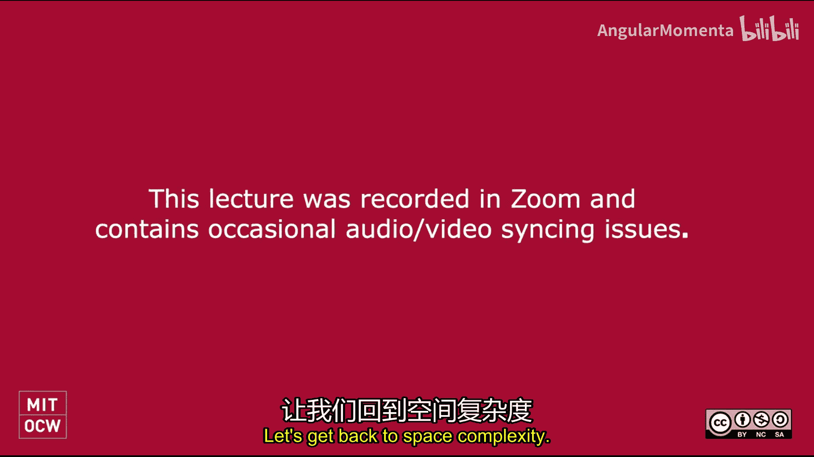
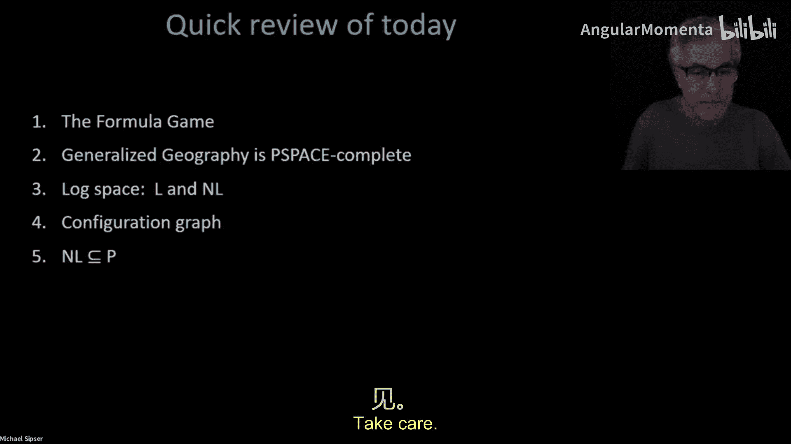

# 【麻省理工】计算理论  ｜  MIT 18.404J Theory of Computation, Fall 2020 p18 19. 游戏，广义地理 -BV1pt7GzeEjb_p18-

Let's get back to space complexity。So just to review what we've been doing from last lecture， which。

Feels like a long time ago， but it was only two days ago。We're looking at。Those three theorems。

Which all had this basically the same proof。One was the ladder about the latter problem where you're trying to see if you can get from one string to another string。

 changing one symbol at a time， and all of the strings were in the language of some finite automaton or you had some reasonable rule for saying which are the valid strings and which are not and then we built on that idea we showed savages theorem that going from any non-deterministic machine to a deterterministic machine。

 only squares the amount of space and then。We finally proved that tqBF this problem about quantified boolean formulas and testing whether they are true that that problem is complete for peace space so we're going to build off of that last theorem today and talk about。

One other complete problem and also show a connection between piece base and testing which side can win in certain kinds of games。

So and then at the end of the lecture， we will， the second half of the lecture will talk about diving deeper into space complexity。

 we're going to talk about a different part of the parameter space where instead of looking at polynomial space。

 we're going to talk about what happens if you have logarithmic space。

 which is another natural point to look at for space complexity。

 but we'll get to that after the break。Okay。Talk about game complexity and games so when I was little we used to play me and my sisters would play a game called geography I don't know if how many of you have heard it or maybe it goes under a different name but it was a game about basically about words and places and it has a very simple set of roles let's say there were two people you take turns picking names of places。

嗯。And then each person has to pick a place which starts with the letter that the previous person's place ended with。

So for example。You know， you have two people playing， perhaps you have， you know。

 you agree on some starting place like a major city nearby like Boston so you know one player。

 the first player picks Boston and then after that the next player has to pick a place that starts with n because Boston ends with n。

And so maybe Nebraska would be a possible response to Boston and then the first player would have to respond to that with a place that starts with an A because Nebraska ends with an A like maybe Alaska。

Whi also starts with a ends with a so then Arkansas maybe would be a not reasonable response to that and then that ends with S so San Francisco and then so on and so on and。

Of course， you want to forbid people from reusing names because then you'll just get into a loop。

 you know， saying Alaska， Alaska， Alaska won't make the game very interesting。

 so you have to forbid that possibility， names cannot be reused， can be used at most once。

And then so eventually one side or the other is going to run out of names and not have either because to the lack of their geographical knowledge or maybe you've just exhausted all the possibilities and will not have a response and that person will be stuck and that person is the loser the other person has won the game。

So the objective is to try to avoid getting stuck so let's just take a look I'm going to think about that games in a somewhat slightly more abstracted formalized way。

 so you write down all of the legitimate places they become nodes of a graph such as I've shown here and then you draw an edge from one node to another if that。

If that corresponds to a legal move in the game， a legal step of the game。

 so you Boston connects to places that start within like New York and Nebraska。

 so the first person might pick Boston， the second person might pick either of these two and then back to the first person if they pick in Nebraska。

 they could pick Arkansas they can pick Alaska and so on just as I described。Believe it or not。

 we actually played this game， I can remember playing this game when I was a kid。

 thats it was of course before we had you know League of Legends and other fun stuff。

 but this is what kids used to do so。Anyway， so just to get it down on the slide， the rules are。

 we'll assume we have two players call them player one and player two， player one goes first。

And they take turns picking places that start with a letter which ended the previous place。

 not no repeats a allowed， and the first person stuck the first player stuck loses we know the person who doesn't have a move to make。

So what we're going to look at today is a generalized version of that where we're kind of just going to take away the names。

 but just leave the underlying graph。And we're only going to call that generalized geography。

 so here that can be played on any directed graph you take away。The names of the edges。

 the names of the nodes， now you just have some arbitrary graph。

 you're going to designate a particular node as the starting node。

 and then the players take turns following those edges。嗯。And what your。

Because you're going to forbid having any loops reusing any node， what you end up。

Doing is working together， you're going to be constructing a simple path in that graph。

Simple path just follows those edges and never intersect itself and the first person the first player to be stuck is the loser so the other one is the winner Okay so that's we're going to call that generalized geography and we're going to look at the computational complexity of deciding for a given graph and starting point。

Which side would win if both players played？Optimally as best you're the best possible Okay。

 and we'll name that problem G G or look at its associated language。

 So here is a graph and the starting node。And you want to say that pair is in the language G。

If the first player， player one， who must play at that node A to start off with， has a forced win。

In that generalized geography game on that graph starting a day okay where again what I mean by a forced win i'm not going to define this formally that we could do that it's not hard to do but a forced win also it's also called a winning strategy that just means that both sides play optimal they pay the best possible not up their capability I mean absolutely the best possible play then that player one。

Would still win there's nothing that player two can do to prevent player one from winning if player one has a winning strategy or a forced win you may have seen。

 for example。There were examples of this that I mean I don't even know if they still exist。

 but it used to be in the newspaper， they used to be examples of chess boards and they would say you know if they would start from a certain position and they would say white to win in three。

And so that means white has a forced win， no matter what black does。

 white is going to end up winning， but you have to think of what the strategy is。

 it may not be so obvious to think through what are the right moves that White makes。

 but the point is that no matter what black would do white would end up winning and what you can show we're not going to do that。

 but for a class of games that includes this generalized geography。

 either one side or the other is going to be guaranteed to have a forced win。

 that not necessarily true for all possible games obviously。

 but for a large class of games in one side or the other is guaranteed to have a winning strategy or a forced win。

Okay。😊，So let's just review that because this is going to be essential for you know the first half of the lecture to understand what we mean by game and what we mean by one side or the other to have a forced win Okay。

 so let's let's just oh yeah and what we're going to show is that G is piece based complete。

That the problem of giving one of these graphs and a starting point， figuring out。

 does player one have a force win or is it player two that has a force win？😡。

Which side is guaranteed to win under optimal play， that's a piece based complete problem。

And so let's do a little check in on that， and so I'm going to give you a very small example of a generalized geography game。

And you have to figure out whether it's player one or player two that has the forced win the winning strategy or maybe neither or both those are the four options okay and you understand player one has to play here because that's the starting place of this general geography game。

 so then it's up to player two to continue on。All right， so let's launch that poll。

 you'll have to think about it a little bit。And。Let me know what you think which side has a forced win？

Which player makes the first move， It's player one makes the first move and player one plays。

 as I showed you here， this is player one playing at a， the player one picks a。

Picks and then player two has to pick one of these two。Okay， all right。

 I think we're going to end the poll， everybody's in。Pick something。U。

You guys did not do well on this boat。At least not too many of you picked D that's a little reassuring because you can't have both players having forced win I did say that in games over this kind one side of the other is going to have a forced win so C is not a very good choice either so you're maybe you should spend less time reading your email and more time listening to the lecture。

The actual correct answer is B。Player two which is obviously is a minority position here player two has the forced win let's understand why so。

Player one plays here。As I said， that's that's the first move player two can either take the upperer node or the lower node。

😡，Okay。😊，Player two takes the upper note。Then player one has no choice but to take the rightmost node。

And now there's no move for player two。So player two will lose。If player two takes the upper node。

 the upper choice there because player two will go here。

 player one will go there and it'll be game over and player one will have one because player two was stuck。

However。Player two had another choice。嗯。Player  two had another choice。

 playerer two could have also gone down here。So player two， if a player down here。

 things are looking a lot better for player two because player two goes here。

 player one's move is forced goes here， but now there's another move left that player two could make so player so two goes here one goes there。

 player two goes up there。And that player one is stuck。So add player twos choice。😡。

Player two can make a move， which will end up。Causing player one to get stuck。

And so because you know， that's the nature of what we mean by having a winning strategy。

 there is some way to guarantee if you're playing optimally and you're certainly playing optimally mean you'll take that lower move。

Then you will take that so under optimal play， player two will win this game。

And so player two has a winning strategy， it has a forced win okay， so I see so。

I'm not going to define playing optimally a I'm going to you know there's some questions here about that about that that's。

You know， you can think about， I'm going to leave it you know， somewhat informal。

 but we could make that all precise， I don't think it would be clarifying to go through a precise definition of that。

You know， you you can just think we don't even have to think about it in terms of optimal play you can say that there is a forever。

呃A。嗯。呃。You say a player has a force win if they have moves that they could make in response to every possible move the opponent could make。

That will guarantee that they will end up winning。So it doesn't necessarily say we don't even have to talk about optimality here or just talk about every possible opponent。

😡，Every possible opponent is going to lose to somebody who you know。

hass a winning strategy and follows that strategy。Okay okay I can see there was some confusion about who was going first and so on i'm glad we that was part of the reason I gave this check and just so hopefully to clear up some of those points so player one plays here then player two goes and I got some comments that some people were confused about what does it mean for the first。

Where does the first person move， okay， hopefully that's。That's。Clearer， all right。

 so let's move on because we're going to make we're going to be spending a while。😡。

Proving something about generalized geography and these graphs。Okay， so let's continue。

So in order to make a connection。Between games。And complexity。

 we're going to need to talk about a problem， one that we've actually related to one that we've already seen。

 where we can reformulate that problem as a game。And that's going to be a problem on quantified Boolean formulas called the formulaing game。

Okay， so this is a different game now。Not one that you're likely to end up playing。

 but in a sense in which you'll see， this is still a reasonable game where two players can play against one another and one of them is going to end up winning and one of them is going to end up having one of the other will have a winning strategy。

 so let's understand what the game is。The game is played。呃。The game is played on a formula。

So you write down a quantified boolean formulala， remember we talked about that you know for several lectures now。

 you know it's a bunch of quant variables with quantifiers。

And then there's the part that has no quantifiers， which you know。

 you can always put into conjunctive normal form if you want。

 but for the purposes of this discussion so far， it doesn't matter later on we'll actually want it to be in CNF。

 okay， but for now， we just have some formula。And associated to that formula。

 there is a game in a very natural sense， so first of all， let me there are going to be two players。

But now the names of those players are going to be player exist and player for all。😡。

OkayAnd the way this is how the game goes。The player exists。

Both players are going to be picking values for variables。😡，They're going to say。

 you know variable x1 is true， variable x2 is false， variable x3 is false， variable x4 is true。

 and they're going to be that's how the moves of the game go。

 they're just assigning values to variables。So that in the end。

 all of the variables have been assigned a， a boolean value， and so we end up with an assignment。But。

Before we get to that stage， which players get to pick which variables and the way it works is the exist player is going to assign values to the exist variables。

So exist， we'll pick x1 and x3 and assign them values。

The ferral player is going to pick the very assigned values to the variables that have a fer quantifier attached。

 so in this case would be x2 would be the ferral player will pick the value for the x2 variable。

mFading out here。Okay。Now so and the order of play is according to the order of the appearance of the quantifiers in the formula。

😡，So the way I have it written out in this particular formula it's exists x1 so exist will'll pick the value for x1。

 then it's for all's turn for all pick the value of x2。

 then it's going to be exist picking the value for x3。

And and so on until they get to the end and all of the variables have been assigned a value by one side or the other。

And now the game is over。ok。😊，So。What's left is to understand who has won at that point。嗯。

And the way we say who has one is exist。Winds。If， in the end。This parts。

 which is the part without quantifiers， ended up being satisfied by those。

By that assignment that the two players together ended up picking。And then for all we'll。

When if that part of the formula is not satisfied。So let me just write that down here after the variables have been assigned values。

 we determine the winner exist wins if the assignment that they together built they built cooperatively together。

 satisfied Psi and otherwise for all wins if it doesn't satisfy Psi。😡，Okay。

 so you kind of think about it this way。You know， exist is picking the values of those variables he's trying to make this。

😡，Part of the formula satisfied trying to satisfy this part of the formula for all is picking values。

 but she is trying to make this part of the formula unsatisfiyed。

 so they're you know they're in opposition to one another。And。In the end。

 one of them is going to have succeeded and the other one will have failed and now thinking about it as a game。

 one side， depending upon the formula， one side or the other is going to have the ability to dominate the other one and always win。

😡，And so。The question is。Which side has that ability to always win which side has the winning strategy。

 of course it'll depend upon the formulas， some formulas it'll be the exist player who has the winning strategy and other formulas it'll be the for all player who has the winning strategy and computationally we'd like to make that determination。

 which side is going to win you know for a given formula。And there's a very。

 very nice and actually very easy and simple way to understand that。

Because we've already run into that problem before。

 the problem of determining which side has a force win is exactly the same thing as determining whether this quantified bulling formula is true。

Because the exist player has a force win win that formula game on that formula。Let me say it again。

 the exist player has a force win when that formula is true。嗯。

So if this quantified bullying formula were a true quantified bullying formula。

 then exist is guaranteed to be able to win that game if it plays its hand right。

If this is a false formula， the for all player will always be able to win if it plays at Sandr。Okay。

 so why is that？And。It really follows kind of almost。You know without doing any work at all。

 this is kind of a， you know， this proof， even though it looks superficially like it might be not so easy to prove。

 it follows for a very simple reason because。The meaning of what it means for exist to have a winning strategy is exactly captured by the semantics of the quantifiers。

😡，Let's see what that means， what does it mean that exist has a forced win？Let's save up here。

That means that will exist has a move that it could make。That exists can pick some value for x1。

 so there is some move for for there is some way to assign x1 so that no matter what the opponent does。

 no matter what for all does，This's going to be a response that it exists can make some assignment to x3。

嗯。So that no matter what for all does， there's going to be an assignment to the next variable。😊。

And so on and so on， so that this thing ends up being true。

So let me just say that again somehow I didn't feel it came out very clear。

 so exist has a winning strategy exactly when there is some assignment to x1 that exists can make such that no matter what assignment that Ferole makes to x2。

 there is some assignment to x3 such that no matter what assignment that Ferole makes to x4 and so on。

Makes this thing true。That's what it means for exist to have a winning strategy。

 that's exactly what the quantifiers are saying in the first place。😡。

So even really without doing anything， you can see that Ex has a winning strategy means exactly the same thing as the formula。

 the quantified formula being true。So making the test of whether which side has a winning strategy is the same as testing whether the formula is true。

Okay。So let me try to turn to the chat now before we move on to anything else。All right， whoops。

Here we go。嗯。ok。So I'm getting some questions about the order of play and about the alternation of the quantifiers here。

So the way I'm showing it is that the quantifiers always alternate， it exist forole exist for all。

 that doesn't really matter， you know you could have several exists in a row and that would correspond to exist making several moves in a row before turning it over to Ferole。

But。Alternatively， we could just add extra variables which don't play any role inside。😡。

And they're just kind of dummy variables that surface spacers。

 so if you have two exist in a row and you don't like that。

 you can just add a forll of some variable that you never see again in between so you can always get it to be alternating if you want。

So。Okay， well so question the difference between Phi and Si。

 so Sa is the part here that does not have any quantifiers。

So the way we always write down our QBFs is they're leading quantifiers with the variables which you know and all variables have to be within the scope of one of the quantifiers quantified variables。

 so you know there are no free variables that are unquantified in our QBFs。好。Um， and so there's。

 you know， all of these QBFs have a run of quantifiers and then a part without quantifiers where is's the sort of the Boolean Boolean logic part。

 I'm saw here is the Boolean logic part。And fee is the whole thing together with the quantifiers。嗯。

So。I'm not sure I understand some of these why not have the forole player have a forced win the forral player might have a fer forced win no one side or the other is guaranteed to have a forced win so if exists does not have a forced win then then Ferole will have a forced win that you know I'm not going to prove that。

But that's a fairly simple proof by induction， which I'm not going to go through。

 just take it as a fact。Somebody's asking why does Ferul want to not satisfy this expression。

 the side part well I mean that's the way we set up the game you know in order to make this correspond to TQBF just the truth of this expression we want to make exist。

 try to satisfy this part and Ferll try to unati make it not satisfied and som not sure。

Because that's what works， I'm not sure what else whether why I can answer there。Somebody。

 I'm going to answer some of the you know most basic questions here。

 so somebody's asking how do we know how many variables to use？

So the variables are the variables of the formula， so somebody's going to hand you a formula。

That's going to have x1 to x10， whatever that formula has， some number of variables。

 and so that game is going to have 10 moves。You know if the quantifiers alternate。

 then the moves will alternate but whatever the pattern of the quantifiers is going to be the pattern of the moves so exist is going to follow the you know the places where the exist quantifier occurs and forole is going to follow the places where the for all quantifier occurs so if you have you know exist for all exist for all exist will move first then Ferole move then exist will move then Ferole will move together they're picking values to their respective variables with their opposing goals exist is trying to make the thesi part satisfied forole is trying to avoid making it satisfied to make the assignment not satisfy that part。

And if you think about what that means。Just in terms of the meaning of that。

 that it's going to mean exactly the same thing that the formula is true。嗯。So。Anyway， if you don't。

 let's see， I don't know if there's any more questions that I can try to answer here。嗯。Well。

So it's still about the numbers of variables。Each formula is going to define a different game。

 you see the formula。So the formula however big it may have 50 variables it may have two variables well we'll do an example maybe that'll help the next check in which is coming up for pretty soon and might actually be now we'll give you an example so then we'll see who's who's understanding and who's not okay so let's continue here。

So。So therefore， the problem of determining does exist have a force win is exactly the TQBF problem because exist has a forced win exactly when the formula is true。

😡，And what we're going to show is that TQBf is。polynomial time Redducible to generalized geography。

 but it's conceptually we're going to think about TQBF now as a game because that's how geography generalized geography is set up。

So we're going to given a formula like this， we're going to construct an instance of generalized geography。

 we're going to construct a graph。😡，Where play on that graph is going to mimic。

Play in the formula game。So making the moves in that graph are going to correspond to setting variables true and false。

 because the graph is going to be specially designed to force that behavior。😡，Okay。

 so I think we have a check in coming in yeah， so let's just see how I suggest you pay attention to this check in and really try to think about it and solve it because I think that'll help you make the connection between the truth。

Of the formula and exist having a winning strategy。Okay， so。So if you take this formula here。

 here's you know， this is some particular formula exists x for O Y， blah， blah， blah。

 this are going to be associated to that formula a formula game。

 where first exist moves a signs of value for x and depending upon that value for all is going to move and they're going to assign a value for y。

And after that's done， this part here is either going to be true or false。

 iss either going to be satisfied or unsatisfied。😡，And I want to know。

 can exist always find a way to guarantee that this part is going to be satisfied or can for all always find a way to guarantee that this part is not satisfied？

Okay， so it's you have to stare， you have to look at this。😡。

Formula to understand which side is going to end up succeeding。So you you have to。

 if you're not clear in the rules。 Look back here， Exist is trying to make this part satisfied for all trying to make this part unsatisfied。

 But they neither of them has the， no， the totally upper hand because exist is picking one of the variables for all those picking the other there。

But they're doing it in certain order。Okay， first exist is going to pick。

 then if Fer all is going to pick。😡，Okay， so that's the way the game works， exist picks of value。

 then for all pixels of value， and then you see who wins。So who wins？

Who's guaranteed to win you know can we make sure exist always wins or can we make sure that referralral always wins for this particular formula so there's just two variables there。

And you can think about this in either of two ways， strictly speaking purely as a game。

Or you can look at understand whether that formula is true or not。嗯。

Theyre equivalent ways of looking at the problem。In fact， in a certain sense， it's the same。

 that's what I'm trying to get across。Thinking about this as a game or thinking about in terms of quantifiers doesn't make any difference。

Okay。Almost done here。So think。All right， last call。Closing the poll。Okay。

 I think this one you got you did pretty well on， so yeah the correct answer is the for all player has a winning strategy。

 has a forced win。啊。And also similarly， the expression is p is false because you know。

 if you try to find some X such that no matter what y you pick， this is going to be true。

 this is going to be satisfied， you're at a luck because you know if you make x true， well， then。呃。嗯。

If you make X true。No， I'm confused。What is going on if you make x true， then y if you make x true。

 then x bar is false， so y bar has to be true。嗯。Now I'm completely confused， oh no。

Make x true you have to work for all Y so this thing is clearly false if you make x true then then then this x bar is going to be false and it's not the case that for every y of setting for y because y is false here y is going to have to be true y bar is going to have to be true so y is going to have to be false so if you make。

very clearly but if you make if you now if if you try again to make x false。

 maybe that's one to think about first， if you make x false。

 so you're going to be stuck on the first clause because you it has to work for both settings of y but maybe think about as a game is better you know if you no matter what X does y is going to find have a way of making one of those two clauses unsatisffied so if x is true y can。

Con set it' why we can set why to make the second clause unsatisfied and if is false we can find why can be assigned to make the first clause unsatisfied so anyway。

The right answer is the4 player has a winning strategy here at the end of the day it's not critical that you understand this correspondence。

 but you have to then if you don't quite understand that。

 you're going to have to take on faith that the formula game is the same as TQB。

Because that's we're going to use and by the way I would like to also mention here that that this correspondence between games and quantifiers is something things that mathematicians use all the time。

 because if you have a if you have some expression which comes up often in mathematics where there are you know a whole run of quantifiers you know in front of some。

Some statement it's really kind of hard for anybody to really。

Get a feeling for what that means if you have like six alternating quantifiers。

 which happens often in mathematics you're going to have statements that have a lot of alternations of quantifiers very hard to get a feeling for what that means。

 but if you think about it as a game it's much more intuitive。😡。

And it's completely equivalent to think about quantifiers go back and forth between quantifiers and gangs。

Anyway， so let's。Look at at the reduction the construction that shows generalized geography is complete a little longer than I thought maybe this is I just want to make sure everybody's with me on this so why don't we call the break now and then we'll come back and we'll look at the construction after that because the construction itself is going to take about 10 minutes to work through to figure out how to reduce。

T Q B F。And build a graph that simulates the formula。Okay， so I'm going to move right on to the。

And we'll come back。Okay， so feel free to ask some questions and get ready for us diving in to a construction for the reduction of TQBF to generalize geography。

So there's kind of an interesting question about。You know。What's a relationship？

Between a formula and when you swap the order of the quantifiers。

You know the question was asking does that somehow relate to the negating the you know the part。

 the quantifier free part， the part without the quantifiers and I don't think that that's the right correspondence there it actually is some relationship when you say。

You know there exists for all is' actually a stronger statement than saying that for all there exists and in general the that actually implies。

 you know exists x for all y implies for all y there exists in X because what you're saying is that there is the choice of y。

 there exists in x。For all Y， there was one x that works for every one of the y's。

 if you're saying for all Y there exists in x， the choice of that x can depend on the Y。

So there is a connection， but you have to think through what it means in order to understand that connection。

You won't need to know that in order to process what we're going to be doing。

 but maybe it just helps you think about it。Other questions here。Okay， I think we're。

We're out of time here。🎼啊。So let's return to。Our lecture。Um。So I'm going to go back。

Hopefully that won't。Crash everything。Here we go。Okay。

 so now we're going to be reducing TQBF to generalized geography are we all together now。呃。Okay。

So I'm going to illustrate this construction， which is very nice construction， by the way。

 I'm going to illustrate this construction just by doing an example or a partial example。Okay。

 but I think it'll give you the idea。So you understand which so what I'm trying to do here is I'm starting off with a。

Quantified Booleying formula。So here it is。I'm going to assume it's in conjuncive normal form。

 which I can always。Convert it into that form， maybe by adding some additional variables。

 but without doing anything too drastic to it。呃。And so now what I'm going to。

Starting from that formula， I'm going to now build a graph。😡。

We're playing the geography game on that graph， which is remember taking turns， picking nodes。

 which form a path。Is going to correspond to playing the formula game。

 which is picking the variables of that formula。And then you want the。

If the exist player wins in the formula， then player one is supposed to win in the geography game。

Okay。So here is how the graph is going to look。Okay so good to try to follow this so it's going to be kind of it's going to be kind of two parts one that's going to correspond to the variables and the other part that's going to correspond to the clauses and so for each variable i'm going to have like a diamond structure here so there's a little starting thing that's going to be unique to the first variable but then every variable is going to have like a little diamond structure here and they're going to be attached one to the next。

And we'll to understand how this what this means when we play。Geography。On this piece of the graph。

So but lets us understand the structure first。Okay。So this is the start node。

And now here player one is going to play the role of exist。

 player two is going to play the role of forole and in fact I'm going to identify that。

 so I'm going to call because it's going to be helpful just to have helpful just to think about player one is being the exist player so the exist player is going to be playing on this graph。

😡，The existing the fourral players are going to be playing on the script。

 it's really just players one and two。So exist player player one has to。But by the rules。

 has to pick the start note。And now with player twos move， these deferral players move。Now。

If you're with me。On this graph。The for all players move is not very interesting because it's forced。

It has to go to here because again， theyre just picking the。

The nodes of a simple path in this script so the for player to the forral player has to go here is if exist started over there now now it's now it's the exist player's turn and now now something interesting happens the exist player has a choice。

You can either go left or right。There were two possibilities。And then after that。

The four players turn。WIt was again just forced so so far Fer all has not had much interesting stuff to do and this has not had to has not had to think hard。

So for all players， no matter whether it exists went left or right。

 the ferll players move is forced and ends up over here。😡，And now' see exist players turn again。

 this is kind of an easy one。Oh， so before I do that， let's just look at how that play could go。

So the first two moves， as kind of I was suggesting， exist goes here and then for all goes there。

II'm going to illustrate。Kind of possible plays through this graph by tracing them out in green。Um。

 so now exist goes here for all goes there， those those were forced。

 but now the exist player goes could either go this way or could go that way。ok。😊。

So those are two possible different ways of playing the game that set we're building。And now。呃。嗯。Now。

 whose turn is it here？This was the Ferole player picked this one。

 so the next turn is the exist player and that's forced。But now notice， now for the first time。

 the ferral player has to think because the ferral player can either go left or right。

So could you go left？Or it could go right。嗯。And so。

Then there's going to be a sequence of these diamond structures where。

in they're constructed so that alternately either the exist has a choice or the parole player has a choice。

Until you get the all the way down to the bottom。Okay。😊。

That is the graph we built so far now if we stopped here then。😡，Whoever ended up at this point。

 whether it was existence or for all would be the winner because there's nowhere the other for the opponent to go。

Of course， that wouldn't be very interesting， so there's going to be more stuff we're going to add on which are going to correspond to the clauses。

😡，Now， how to think about what's happened so far？Now。So maybe as some of you might be guessing。

Is that when the exist player over here has a choice could have either gone left or right。

 that's going to correspond because this is supposed to be mimic mimicking the formula game That's going to correspond to the。

Exist player in the formula picking the variable either true or false。😡。

So the left or right is going to correspond to true or false。

And so let's just arbitrarily say left is going to correspond to picking it true and right is going to correspond to picking false。

Okay， so that。So the way I've said it so far is exist， ended up picking the first variable false。

 then for all pick the second variable false。And the m variable also got setful。

 everything got set full so far and who knows what happened over here of course。Okay。

 so just to understand what we've done so far。Now I'm want to show you how to build the rest of the graph。

 so let's take away the green part。And now we're just back to the construction。

The green part is actually how you use that construction， so back to the construction here。

 now what do we want to achieve？Now， by the time the。

The players on the graph have got down to here they've effectively made an assignment to the variables by going either left or right at each one of these diamond。

 so the assignment is done from the game from the perspective of the formula game。

 the game is over and now one side or the other has won。😡。

Here we want to build some extra structure here was a kind of an end game to make sure that。

The fer player gets stuck。If the exist player has made an assignment which satisfies the formula。

 satisfies this part of the formula。And the exist player should get stuck if the forral player。

 if the assignment that they made does not satisfy the form。Okay。

 so let's see how we're going to achieve that with some additional structure。

So there's going to be some extra nodeA over here， let me just tell you what the structure is and then we'll argue why it works。

So there's going to be going from this bottom node， we're going to start a kind of， you know。

 the second part of the graph， there's going to be a node which fans out to a node for each one of the clauses。

And each one of those clauses， in turn， fans out to a node for each one of its literals。

So you see we have clauseus c1， and it has the literals x1， x2 bar x3， x1 x to bar x3。

 so there's a node for each of the literals in clause C1， same for clause C2 and so on。

Now we're almost done now I'm going to tell you how to connect up these literal notess。😡，So x1。

 each node is going to get correspond back to its own diamond。

 so now we're going to tie it back to the first part where we made the assignment。

 the assignment part of the graph。😡，X1 is going to connect back to the true part of the X1 diamond。

And x2， because it's negated， is going to tie back to the false part of the x2 diamond。

Because it's an x2 variable。Similarly， x1 bar。😡，Now in you know， because X bar。You know。

 here's x1 bar and close two。X1 bar is going to connect up now to the full side of the X1 diamond。

An x2 bar is going to connect them to the full side of the x2 diamond。And so on， so if we had。

 I don't have the other diamonds here， but the x4 would connect up to the true side of the X4 diamond。

For example。That's the whole construction， let's understand why it works。Okay。

 so the end game here is we want exist to win。If the assignment satisfied all the clauses。

And Ferl should win if there was some unsatisfied clause。

Okay so why does this happen so let's put back an assignment here that was made so heres here the one I'm putting back is you know the assignment that they cooperatively built had X1 being true X2 being false。

And some other stuff。Now why does this work so what we want to have happen now now so now the move proceeds over to here and you need to arrange it so that exists。

😡，Is the one who picks that note？If you have a， if this would have been for all。

 just add an extra node to switch whose turn it is。

But you want exist to be up here and what you want is for all to be picking the clause。😡。

The close note now here is。Heres the part to understand what's going on。嗯。

We want for all to win if this is not satisfied。So for all is's going to make a claim。😡。

If this is not satisfied， there is some clause， which is not satisfied。

 There's some clause which ended up being false in the assignment。

 So the fer all player are going to say， I think I won。

And I won because clause number one is unsatisfiyed。So it's going to pick clause number one。😡。

So his the fourral players weren't going， he has exist player。

 and so the4ral player picks the claws claimed unsatisfied so over here。

Full player says close C1 is unsatisfed， I'm going to move here。Exist player says， a ah。

 I don't agree with you。The assignment， you know， you're line。

Assignment actually makes one of the literals true in close C1。

Let's say it made x1 was true as in fact it is here x1 in fact is true。

 so exist is now its turn it's going to pick the literal that was true in the assignment in that clause。

😡，That the role player is claiming is unsatisfiyed。One of them is lying at this point。😡。

This is either now true in here， which means a fer all player did not pick on unsatisfied clause or the exist player picked a false literal。

 which is the exist player picked a false literal， which was the exist player's lot。😡。

So now we're going to now。The moment of truth。Because。Let's see if it exists got picked here。

 now it's the Feroles player's turn。😡，It's connected back to the true side of the diamond。

So that node was already used that's the only place that Ferole could possibly go Ferole is stuck and exist has won the game。

 which is what you want because。Forole's claims are false and the exist was correct in saying that x1 satisfied clause c1。

So X1 is true， so there's no for for all to go， but compare that with a situation if the assignment。

On this part of the graph had gone through the false。Had assigned x1 to be false。

So the path had gone through the full side of the diamond。

Now this node would still be unoccupied would still be available。😡，So now the for play。

 so if exist was claiming that X was true and it really was false。

The fraud player would be able to move on that node。

 and now it's the exist player's turn and the exist would be stuck because this node down here is guaranteed to have been used。

😡，Okay， so that。Is the idea。It's really very beautiful and actually not that complicated you have to you have to stare it a bit。

 So let's just see what happens， for example， if I had one other case。

 maybe it's not necessary at this point， but you know if the for all player claimed well。😊。

It's the second clause， which is unsatisfied in the mutually selected assignment then。呃。

So this is sort of the case where the forral players is correct， you know。

 in that if the exist player now says， well， I think X1 bar satisfied that。Second clause。

But you know， this assignment made x1 true， so x1 bar is false。

 and so the exist players line this time。And so now the ferral player can take this last edge and go here and has one last move to make and then the exit player stuck。

So the f will went in that case， so let's turn now shifting gears entirely to a different。

Part of the space you know of space complexity instead of looking at polynomial space which is like very powerful we're going to look at log space which is comparatively speaking much much weaker so log space are the things yet you can do when you only have enough space to write down essentially a pointer or some fixed number of pointers into the input that's what you get when you have logar rhythmithmic space。

嗯。And you know， because law space is enough to write down an index of something so you can just this is what you can do with a bunch of pointers and。

In order to make sense of this， we have to change the model of computation because if we use the ordinary one tape Turing machine just scanning across the input we'll just read in the input with the way we've defined it would cost space N and so you can't even read the input if you have less than end space available like log space so we're going to introduce a different model just。

To allow us to define this， and that's a model where it's going to have two types。

Where the part that contains the input doesn't count。Next。

 in order to make sure it doesn't you know it's not being cheated。

 the input tape is going to be read only。But it doesn't count toward the space used。

 only the worktape。Whi now can be read or written or read is going to count toward the spacebound。

Okay， so now what we're going to define is。knowUsing this definition for our space complexity will define space log n。

The things that you can do if you have only a log amount of space here。On the work tape。

So the length of the input is N the length of the。Of the work tape is order log in so we have。

The deterministic and non deterministic associated classes， space log n and N space log n。

 we're call it that L and NL。Log space and non deterministic log space。Okay， and as I said。

 that's just enough space to write down some pointers into the input and let's do some quick examples。

嗯。So if you take the language of palindromes essentially or WW reverse that's in logspace so here's a string I don't know here's a string that's in WW reverse and I mean the ordinary way you might use to test whether a string is of this form in WW reverse might be to cross off corresponding locations here。

 but you can't do that it's a read only input tape so you have to somehow avoid writing on the input tape but still testing whether you're in this language it's not hard to do。

 you can use the worktape just to keep track of where your pointers would be and in so doing you can just make sure youre matching off corresponding locations with each other in the input。

So logspace， because of its ability to store some fixed number of pointers。

 it gives you enough to test membership in this language。So this is solve in log space。呃。

The path problem， which we've seen before， you know you're given a graph and a start node and an ending node or a start and a target。

 you're given a graph and an S&T。It's a directed graph and you I know what can I get from S to T。

 so that problem is solvable in non deterministic log space。Because， as。The way we would do that。

 not writing this down in any detail， but what you would do in your nondemin signal log space machine。

 you have your input graph written here in the input。

And you're just going to guess the sequence of nodes one by one。

 which takes you from the start node to the target node。

You're not going to write down that whole sequence because that in advance because that would be cause you way too much space to write down。

 the only space that you're going to use is to remember the current location were sitting。

So you start out， you know， you write down on the worktape， the start node。

 then you're going to non deterterministically pick one of the outgoing edges from the start node and look at its associated node and replace that on your worktape and keep repeating that if you ever get to the node T then you can accept。

And you also have to be a little careful I don't have this on on the slide。

 you also have to make sure that if the graph has a loop in it。

Or because that's not allowed in space complexity so you going need also a counter to make sure that if you count up to you've gone through a number of nodes which exceeds the total number of nodes in the graph。

 then you can shut down that branch of the nondeterminism because you know it's。You know。

 just it's just going in a loop if there's any path that connects S to T。

 there's certainly going to be a path that has at most the number of nodes of the graph in it。Okay。

 so path is in NL， this language here is in in L what's the relationship between L and NL well certainly the deterministic class is contained in the nondeterministic class。

 that's all that's known。Whether these two collapse down to be the same is unsolved。

 and so we're going to spend a little time in next lecture exploring this。

But let's first look at some of the basic facts about logspace。

So of setting ourselves up for next lecture。So first of all。

 anything that you can do in log space you can do in polynomial time。In a sense。

 kind of trivially and in a sense， we almost kind of really proved this already because if you remember。

We said that anything that you can do with a certain amount of space。

 you can do in that much you can do。In time。That's exponential in the amount of space。

 in the corresponding amount of space， so going from space to time blows you up exponentially。

And log the exponential of order log n is polynomial。So the way we're going to prove this and again。

 we kind of proved this already， but let's just go through it again specific to logspace。

We'll say and this is going to be a useful definition for us anyway。

 a configuration for M on W so we also we already talked about a configuration of touring machine M。

 which is just a snapshot， which is the tape。The state and the head position when we have。And。

Input which is sort of an read only input which is not being counted toward the space。

 we don't include that in the configuration we just say it's a configuration of M on that particular input。

 but we're going to be counting configurations and I don't want to count all the different inputs as well I'm going to fix the input and count all of the configurations relative to that input。

And so the number of such configurations is just simply going to be the number of states times the number of head positions for the two heads now times the number of possible tape contents。

 and which is as I mentioned here is the number of different possible tape contents。

 it's D which is the tape alphabet to the order log n。

 and that's just going to be n to the K for some k， so it's going to be polynomial。So that tells us。

That because the total number of configurations for MW was polynomial。

This machine can only be running for a polynomial number of steps， otherwise it'll be loopy。

Be repeating a configuration。 and so therefore that machine has to run itself in polynomial time。

 so you don't really in a sense to have to do any work。

If a machine is deterministically deciding a language in log space。

 it's also deterministically deciding the language in polynomial time because that's all the time you can use when you have log space unless you're looping。

 which is not allowed。😡，Okay， so therefore， the same machine shows that you're also in pain。哦。

I'll get to that in a second one thing I forgot to mention on the previous slide when I'm talking about the model is by the way。

 this model is not so unreasonable where you have kind of a imagine having a very large read only input。

And your local storage is much smaller， it's much too small to pull in the entire input。😡。

The way I used to explain this。Years ago was like you have a your input is a CD roM which you guys probably barely even know what it is anymore。

 but used to distribute software that way， so the roM was like on a DVD or a CD which contained your。

Whatever you're trying to like your， you're trying to distribute， you know。

 it was some large thing relatively。 And so you would imagine having a smaller amount of。

Memory relative to that so you didn't want to necessarily copy that whole thing into your storage。

 maybe even a better example now is like you think of the input as being the entire internet。

Obviously you can't download unless you're Google， you download can't download the whole internet into your own local memory。

But you're going to have references， pointers into the input into different places。

 that's perhaps more analogous to this sort of read only input touring machine model that I'm describing。

Okay， so。And it's another fact I want to mention is that I'm not going to savage anything that you can do in non deterministic log space。

 you can do in deterterministic space， but now with a squaring。And that's using the same proof。

 that's using Savage's theorem， which you have to check， also works down to log space。Same proof。嗯。

So anything that you can do non deterministically in log n space。

 you can use deterministically in log squared space。Okay。

 so let me just see if there's a couple of questions I want to answer here。The relationship between。

L and NL is not known to be strict， nobody knows of an example， no one knows whether they're equal。

And。And have people looked at sublinear time classes？Yes。

 generally for when you have nondeterministic or probabilistic， which we're not haven't defined yet。

 but we will， people have looked at those subline time classes as well deterministically doesn't make so much sense because then you can't even talk about the whole input。

嗯。Okay， let me move on。Okay， so this is my last slide let me see if we can do this before we break not only is L contained within P but the much stronger statement is that NL is contained within NP P and that for that you'll have to do some work because converting your not aministic log space machine to a deterministic。

Machine， obviously you're going to have to change the machine。

And so we'll introduce a new method here， maybe we'll。

Quickly go over this at the beginning of the next lecture。

I don't like rushing through things at the end， but for this。

If I'm given a non deterministic machine。That runs in log space。

 I want to make a new machine that runs in polynomial time deterministically for the same language。

And I'm going to define something called the configuration graph for M on an input W。

And that's just you take。M。And it's NW， its input， and you look at all of the configurations。😡，嗯。

For MW actually configuration graph actually that's should be called the computation graph。

 that's what it's called in the book， but okay it's the typo here， I'll fix that next time。

doesnn't matter computation graph configuration graph all the same basically you're going to take all of the configurations of MW of which we already observed。

Only number or only polynomial in number。And they become the nodes of a graph。

And the edges connect to configurations if one follows another according to the rules of the machine。

Okay， so here's the picture。Hence this is some graph。

 the nodes of this graph are the configurations of Mmandadi。

So each node here corresponds to the machine， a snapshot of the machine。😡，A tape contents。

 head position and state。Um， so writing down all those different configurations。

 I connect one to the other if I can get to CJ from CI in one step legally on the machine。And then。

The non deterministic machine M accept W。Exactly one is a path from the start configuration to an accept configuration。

 let's assume we have just a single accept configuration。As we argued。

 we can do one of two lectures back。If we clean up the tapes。

Testing whether you can get from the start to the accept。

Is the same as testing whether the machine accepts its input。And so because we can test。

Whether there's a path in a graph connecting two nodes in polynomial time。

 we can solve this problem on this computation configuration graph in polynomial time。

 and so we can figure out whether the non deterministic machine accepts its input。

Sorry that came a little faster than I like to do so we'll see it again so here's the polynomial time algorithm you construct the graph。

You accept if there's a path from the star to the accept and you reject if there not。

And so that tells us that。Not only is L contained within NL。

 but NL itself is also contained within P， so here's a kind of a nice hierarchy of languages。

We don'tNot only do we not know whether L equals N L， we don't know whether L equals P。

It's possible that anything you can do in polynomial time， you can do deterministically in log space。

 shocking as that might be， because it's a pretty weak class。

But we don't have to prove that there's anything different。Anything in P that's done in here。

Last check in。So we showed that path is in NL what's the best thing we can do about the deterministic space complexity of path so deterministic so this is not deterministic log space what can we say deterministically about path hint this should not be this should not be hard if you think back to what we've。

Showone very recently。ok。Get your check in points， closing up， closing shop here， OlE1， two，3。Okay。

 so the correct answer is log squared space because this is just savages there。

We can do it in log space not deterministically so you can do it in log squared space deminesttically Okay。

 so that's this is what we did today。嗯。And as I mentioned， I will。Do this again。On Tuesday's lecture。

 just to recap that。All right， so I'll stick around a little bit for questions and。Okay。

 someone has to be about the nomenclature， why is it L in that L space？嗯。I you know。

Because it's not really people don't usually talk about L time， so L is sort of。

Everybody knows it's the only reasonable option is space， so people just say L and NL。I mean。

 some of these things have had。You know。Yeahい。You know， these things。

 these names have a little bit evolved over time and even now some people talk about。You know。

 I call to classes， some people call it Dton classes。You know， it's just， you know it。

You can make different choices there。Okay， let's see。Good。嗯。Why does Savageist theem work for login。

 you have to look back and see what you needed and all you needed to be able to do was to write down the configurations。

And if you look back at how savage's theem works， you're just needing to write down the configurations。

 so the deterterministic machine can write down the configurations for the non deterministic machine they take exactly the same size and then you look at the recursion and the the depth of the recursion is going to be exponential。

In the size of the configurations and so you're going to end up with a squaring again。

 you have to go back and just。Rethink that proof and you'll see nowhere did it need a linear amount of space it works down to log it actually does not work for less than login login is sort of the lower threshold there and the reason for that is because you also need to store the input location and that already takes log space。

the the tape heads， the tape heads already kind of have kind of a log space aspect to them and so if you're going to use less than log space then funky things happen with the tape head storing the tape heads and so less than log space usually turns out not to be interesting。

It's very specific touring machines and not sort of general models。嗯。Yeah， so somebody's asking。

Suppose in the reduction to General's geography from TQBF， if the formula had two exists in a row。

 then you would do kind of the natural thing in the graph instead of having that spacer edge between the two diamonds。

 you could just have one diamond connecting directly to the other diamond without a spacer edge。

And that would be give you the effect of not switching whose turn it is。

Somebody's asking me just a general question， are people thinking about。These open problems。嗯。

I don't know。People don't say there was a lot of work on problems related that seemed to be related to those many open questions like P versus NP。

L versus N l or L versus p and so on p versus p space we'll say we'll talk a little bit more about some of that there's some very interesting things that have been developed I think there's a sense within the community that people are stuck。

And it's not something you're going to need some sort of major new idea in order to push the thing forward。

 so I don't know how many people are still thinking about them。

I hope people are because I would like to see the answer at some point but。Or get the answer。

I think about them sometimes myself， but。One has to acknowledge。Chances of success are not high。呃。

Okay， so we're a little after past the end of the hour here。Unless there's any other questions。

 if I didn't answer your question， I may have missed it so you can ask again。But otherwise。

 I'm going to。CloseCl the session here。Okay， bye bye all， have a good weekend， see you next week。

Take care。

