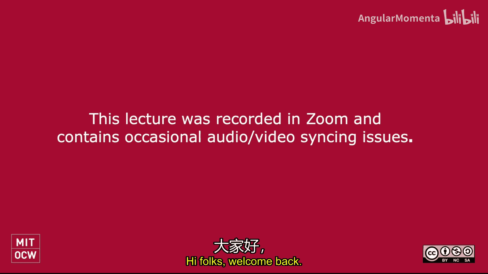
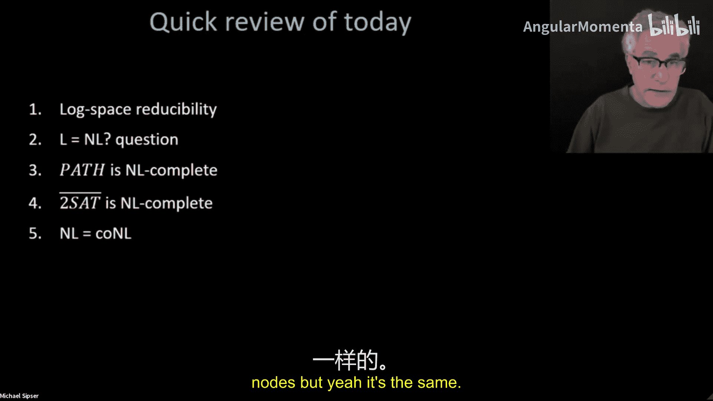

# 【麻省理工】计算理论  ｜  MIT 18.404J Theory of Computation, Fall 2020 p19 20. L和NL，NL = coNL -BV1pt7GzeEjb_p19-

。Hi folks， welcome back。诶。So we will continue our discussion that we've been doing for the past few lectures。

 we first talked about time complexity。And then we shifted gears to talk about space complexity。

 and we saw we had a couple of lectures on Pe space。

Kind of culminating in proving that there were languages which are piece based complete。

 namely this TQBF language which is where we started and then we also proved that there are problems around involving games such as the generalized geography game where determining which side has a winning strategy is piece based complete at the end of the lecture last time we moved to a different regime of space namely from polynomial space down to log space。

And we introduced the classes is L and NL and so I'm going to begin today's lecture by reviewing some of the material on El and NL。

 which I think came a little too quickly last time。

 and then we have two important theorems we're going to cover today。

 one is about proving that there are complete languages。

For NL that has a bearing on the L versus NL question you know log space deterministic log space versus non deterterministic log space that's yet another unsolved problem in our field and so there is a notion of a complete problem for NL and then we're going to prove a。

Theorem that was in its day very surprising to people。

 I remember when it came out in the 1980s that NL， in fact。

 is closed under complement that the NL class and CONL class class both collapse to one that they're equal。

 which is not the way we believe the situation to be for NP。

 but until someone has a proof that they're different， strange things can happen。Okay。

 so with that I will。Move myself to into the corner and let's do our review so we are。嗯。

In order to talk about space complexity classes that are smaller than N。

 we have to introduce a new model， which was the two tape model where there was a read only tape that had the input on it。

 which you normally would think of something very large the whole internet or something so big that you can't read it into your kind of your local memory and。

Then you have a worktape， which is your local memory。

 and the way we're going to think about it in this in the context of log space is that that worktape is logarithmic and the size of the input and that is enough to have small counters or pointers into the input because reference location of the input is just needs you only need login bits to do that。

So we。Gave a couple of examples of the L of L and NL languages。

 so this language of WW reverse as you may remember。

 so here is an input in WW reverse it's a string follow know it's a palindromic string which is of even length and so you can make a machine and log space here that can test whether it's input is of that form and the workta is only all it needs is a pointer into or a couple of pointers that refer to the corresponding places of the input that you're looking at at the moment。

 so you maybe look start out looking at the two outside A's and then then this B symbols at an next to that and you can write down on your tape where you're looking currently and so that's going to be enough for you to you may have to zigzag course back and forth。

A lot in order to do that test， but that's completely fine。using the model。

 we're not going to be measuring time， we're only going to be focusing on how much space we're using。

Another example that we gave is the path language where you're given a graph and a start node and a target note and you want to know is there a path is this a directed graph that goes from S to T and that's the language that's also that language is an NL in fact not known to be an L so the way that would look shifting to an input of in the path language you would have a graph represented say by a sequence of edges。

And a start and a target， and the worktape would keep track of the current node。😡。

So the non deterministic machine would guess a path that takes you from ST node by node。

 and the worktape would keep track of the current node。😡，Okay。

 so I hope you have this develop a little bit of an intuition for these classes L and NL。

 we're going to be spending the entire lecture today talking about that。Okay， so as I mentioned。

 the L and Nl。Problem is an unsolved problem， and it's very much analogous to the P versus NP problem。

 except as I mentioned， as we'll show that NL and its complement end up being the same。

 which is not something that seems to be the case for NPP that we don't know。呃。呃。

Can we think of this as a multi head touring machine i'm getting a question about that。

 which is I think you can， in fact that's an alternative way that people look at it。

 you can think of it as having multi you know a head is basically needs log space to store the location to store。

You know the location of where that head would be so if you imagine having several different heads on the input tape。

 you can think of a log space machine as being sort of a Tring machine that has multiple heads on the input tape it's it's equivalent good question。

So let's move on then。Okay。So one of the things we proved last time was that anything that you can do in L。

 you can also do in polynomial time。And I'll answer some of these chat questions in a minute。嗯。

SoThe class L is a subset of P， this is easy to prove。

 but I think it's nevertheless important to see why it's true because it sort of sets some definitions of things that we're going to use later。

😡，In particular， we really need to know the notion of a configuration。😡。

Of a log space machine on an input。So because the input is。It does not change。

 we don't really consider the input to be part of the configuration。😡。

The only the thing that's relevant in the configuration is the dynamic part of the machine。

 the state， the head locations， and the workta contents。

So we defining that the configuration for the machine on a particular input w is those four things state the two head locations and the tape contents and the important thing to keep in mind for this theorem is that we have only a polynomial number of different configurations if you just do the calculation。

The main part is the number of different tape contentss you can have。

 which is exponential in the log n and that's a polynomial。And so therefore。

Any machine that runs in log space provided it always holds。

 and we always assume our machines always hold， they can only run for a polynomial。Number of steps。

 because that's as many different configurations as they have。They ran for。

 say an exponential number of steps， they would have to be repeating configurations and then they would be looping。

Okay， so。There we go。So okay， so let me just get back so there's somebody asked me a question。

 which is harder P versus ZP or L versus NL。You know， completely no idea it's a。You know。

 I guess there was a common line of thinking that if you're going to。

That it's good to try to think about。If you're trying to separate classes。

 you might as well take classes that are as far apart as one another， you know。

 like if you're trying to prove。If you're comparing P different from NPp and P different from P space。

Maybe Peter from from Peacespace might be easier。Because P& P bay seem to be even further apart than P& NPP。

Nobody knows and I suspect that there's something fundamental about computation that we just don't understand and that once somebody makes a breakthrough and solves one of those problems。

 a lot of them are going to get solved in short order， but again， purely speculation。嗯。Okay， D。

 what is D here， D would be the size of the tape alphabet。😡，Okay。

 so this is the number of different tape contents we have。Good。All right， so let's continue on。

Another thing we mentioned kind of quickly in passing。

 but still an important fact is that Savage's theorem works down to the level of log space。

Same exact proof。So that means that non deterministic。

Log space is contained in deterministic log squared space because that's what Savages the does for you it converts nondeterministic machines。

 a deterterministic machines at the cost of a squaring in the amount of space you need and so I'm not going to go through this in detail。

 but the same picture that I copied off in earlier slide。

 with a simple modification is that instead of you know that I'm write down the the size of the configuration is going to be now log in。

Because that's how big the configurations are when you have a nondeterministic log space machine and so simulating that so these are this would be what the the tableau would look like for an NL machine and then you can simulate that in the same way by you know triangle possible intermediates and then splitting it you know doing the top if and then the bottom half for using the space of course。

 recursively the amount of space you're going to need is going to be。

Enough to store for one level of the recursion， one configuration and that's order log space and then the number of levels of the recursion is going to be another factor of log n because that's loggged to the running time which is going to be exponential in log n which is polynomial so the total amount of space that you would need would be log squared space again this is sort of saying the proof of savage's theem just over again so if it's coming too fast for you just review the proof of savages theorem and observe that it works even if the amount of space that the machine that the non-terministic machine starts off with is log space。

All right。嗯。And last thing Im to last thing in the category of a review is our theorem that not only is all of L within P。

 and that's kind of trivial kind of immediate you don't even have to change the machine if you have a logbased machine for some language。

 the very same machine is a polynomial time machine for that language because it could only be running from polynomial amount of time。

We have a nondeterministic gene for some language， we're going to have to change it to become a deterministic machine that runs in polynomial time。

 and so we're going to give a deterministic polynomial time simulation of a nondeterministic log space machine。

😡，And we kind of did this last time， but a little quickly。 So now if we have some。

Non deterministic log space machine， so an M， which decide a language A in logspace。

we're going to show how to simulate that machine with a deterministic polynomial time machine and the key idea。

 which which is going to come up。In a later theorem。

Good to understand it not only here but to understand it for for the next theorem that's coming is the notion of a configuration graph I was sort of thinking about calling it a computation graph but now on further reflection I think configuration graph maybe is the more suggestive term so let's stick with that。

So configuration graph for a machine on an input。Is just a set of all configurations that the machine has。

 all the possible different configurations the machine can have。

With edges connecting configurations that correspond to legal moves of the machine。😡。

So here is some configuration this is a snapshot of the machine at a moment in time here is some other configuration。

 another snapshot of the machine at a moment in time and you're going to draw an edge between C and CJ if CJ could follow in one step from CI and you could tell by just looking at the configurations whether that could be possible obviously the head has to be one place over in CJ from where it wasn in CI and it has to be updated according to the rules of the machine so you can tell whether you know you could fill out this graph you could write down all the possible configurations and you can put the edges down now the point is that when we have a log space machine we don't have too many possible configurations theres only a polynomial number so the size of this whole graph。

Is polynomial？So our polynomial time simulation is going to write down that entire configuration graph of the log space machine on its input。

😡，There were。Many configurations that can be only polynomially many。

So you can write down all those configurations as the nodes and then go look at each pair of nodes。

 whether this configuration could lead to that configuration， according to。

 you know it's a nondeterministic machine， so a configuration could go to several different。

 you know， there could be several different ways to go。

 but those are just several different outgoing edges from a particular node in this graph representing the configuration which might have several different legal successors in the nondeterministic computation。

Okay， now the important thing here is that M accepts its input W。Exactly when there is a path。

This configuration graph that takes you from the start configuration to the accept configuration and as I mentioned。

 let's assume as we've been doing that the machine I should have put it here。

 but I didn't but the machine when it is about to accept it erases its worktape and moves both of its head。

To the home position at the left end of the tape so there's just one accepting configuration you have to worry about it just makes life simpler。

😡，So there's going to be a start configuration， a single accept configuration in this configuration graph and now。

😊，There's going to be a path indicated here that connects the start configuration to the accept configuration。

If and only if M accepts W。Because that path。Is the sequence of configurations that the machine would go through。

If you launched it on W， it would start at the start。

 and there might be several different ways to go， but if there is one of them it leads you to an accept。

 that's going to correspond to a branch of the computation that's accepting。😡，Okay。

 so that tells us what the polynomial time algorithm is。Itys on inputputW。

 you construct that configuration graph for M onW， G sub MW。

And you test whether there's a path from C start to C except using any polynomial time。😡，You know。

 depth first search or breathth first search， you know。

 algorithm for testing whether theres a connection passed in a graph。

And if there is such a path you accept， because that means the machine M accepted。

 and if there was no path you reject because then M must have not accepted。And therefore。

 you have a polynomial time simulation of your non deterministic log space machine name。Okay。

How are we doing？Okay， so that tells us that NL is contained within P。

And also L is contained with an NL as before。So we have kind of this hierarchy of classes。嗯。

Now you can even talk about not only is L different from NL， even is L different from P。

 is it possible that anything that you can do in polynomial time， you can do a log of space？

Don't know。Open question。嗯。🎼Okay， getting a very good question here just now。

 why is this construction taking log space？It doesn't this construction takes polynomial time this algorithm here。

😡，Yeah。Is not a。Polym this is not a log space algorithm that I'm giving you。

 I'm giving a polynomial time algorithm for stimulating a non deterministic log space machine。

Now later on， you know I don't want to confuse the issue right now。

 for this particular slide all I need to do is construct that graph in polynomial time it's you know it's a polynomial size graph。

 I can't store that whole graph in a log space memory。😡，Okay， a question here。

You know we can see that listing out to the nodes and edges would be polynomial time。

But how do we actually provide structure to this graph representation。

 I don't even know what that means， so if you can clarify that for me then maybe I can try to answer it。

 but you know a graph is just a list of nodes and a list of edges。After that。

We know what the graph is。I mean， you know， you may like a picture。

 but the machine doesn't need a picture。mYou know， our definition of， you know。

 we just represent these things as strength in the end。So please clarify if you want me to。

 I'll try I'll answer at the next pause。I'm grateful for all the questions because I'm sure any question that any of you have。

 another 20 of you also have， so it's questions are good，'t don't be bashful。

and also ask the TAs if Id become overloaded。Okay， now we're going to shift gears into some new material。

 All right， we're going to talk about。The notion that sort of thinking about analogous to the P versus NP problem where there were these NP complete problems。

Now we have the L versus NL problem， there are going to be NL complete problems。😡。

And that kind of capture the essence of NL， the way NP complete problems capture the essence of NP in a sense and that。

All other problems in NP are reducible to them， so they're kind of like the hardest NP problems here we're going to have exactly analogous situation for NL where we're going to show problems where all other NL problems are reducible to them so if you can kind of solve one of them like。

Solve one of these NL complete problems in log space deterministically。

 then you solve all of NL problems in log spaceterministically。

So it's a very similar looking definition to what we had before。

 it's NL complete if it's in NL and then all other。Languages in NL should be reducible。

 but now we have a new notion here with an L instead of a P now before when we talked about NP completeness we had polynomial time reducibility。

That's not going to work anymore。😡，Because if you。Remember。NL is a subset of P。

 so all NL languages are polynomial our languages in P and if we're talking about if we use polynomial time Reducibility。

 all languages in P are reducible to each other， we need to have a notion of reducibility which is kind of weaker than the class。

😡，And so polynomial time Reducibility just would not work here because everything would become an nL complete because everything is reducible to each other so we need to have a weaker notion we're going to use log space Reducibility which we have to define。

😡，So here for that， we're going to have to talk about the notion of a function that you can compute。

😡，In log space。Okay， and it's a little tricky here。

Just like when we talked about language recognition in log space。

 where we had the work tape had to be smaller than the input tape。😡，Because the inputs can be large。

 the work area is small， now the output also could be large relative to the work area。

 so we're going to have a three tape model。😡，Where there's the input is going to be a read only。

 the output is a write only， it's like a printer。😡，It's something you can only write on。

 but you can't read back because otherwise you could cheat by using the output as a kind of storage。

 and then you have your storage area， which is your read write worktpe。Okay。

 so this would call this you know， the traditional name of this is a log space transducer。

So it converts inputs to outputs， but uses only log space for its working memory。Okay。

 so the input tape has stores in symbols。The workt stores login symbols， order login symbols。

 and then we have the output tape。I mean want to think about how big can they there's going to be a check in coming to kind of。

Ask you how big memory could the output be， but also we'll save that for the end if you can mull that over if you're want to think ahead。

But okay。So we think of the log space。Transducer as computing a function。

 which is just the mapping from the input to the output that the transducer provides for you transducer transducer is a deterministic machine。

 by the way。So you take the transducer。You give it W。And you turn it on。

And then it holds with F of w on its outputate， that's what it means to be computing the function F。

😡，Okay， and we'll say that。A is log space Reducible to B。

Using the L subscript symbol on the less than or equal to sign， if it's mapping reducible to B。

 but by a reduction function that's computable in log space。

 just the same way we define polynomial time reducibility。

 but there we insisted that the reduction function was computable in polynomial time。嗯。Okay。

 just quickly， I got a question again， you know why why log space here because。

Polynomial time would be too powerful for doing reductions。啊。Internal to pe。Every。

Language in P is reducible to every other language in P and so everything in NL would be reducible to everything else in L with a polynomial time reducibility and so that would not be an interesting notion we have to use a weaker notion than that weaker kind of reduction using a weaker model so that you don't get the otherwise the reduction function would be able to answer。

Whether you know would be able to solve the problem A itself if we had a polynomial time reduction and we're mapping things from logs in you know NL to other problems in NL。

 the reduction would solve the problem and that's not what you want。

The reduction should be constrained only to be able to do simple transformations on the。

On the problem， not to solve the problem。Anyway， you have to look at that this is an issue that's come up before when we talked about what's the right notion of reduction to use for peace based completeness。

 same exact discussion。Um， okay。Now， there is an issue here， though。

 that we have to be careful of when we have a being log space Reducible to B。And B and L。

 then what you want。呃。If if a is log space reducible to B and B and L。

 then you want a to B and L that's the same pattern we've always had for reductions if a is reducible to B and B is easy then a is easy so here in the notion of E is being in L。

😡，And if you remember the proof of that that we had from before， which I'll just。

Put out for you is that。To show a log space solver for A。😡，嗯。诶。You take an input W。

And now if A is reducible to B， you do compute the reduction and then you run the decider for B。

So if we're assuming a is reducible to B and b is an L， so B has a log space decider。You take your W。

 which you want to know is it an A， you map it over to the B a B problem using the reduction function。

😡，And then you solve it using the decider for me。And you give the same answer。

Now this actually doesn't work。Any more。But it doesn't work in an obvious way。嗯。诶。Because。

If you're following me， I hope most of you are。There is a。There is a problem here。

Which because we're trying to give a log space algorithm for A。嗯。

And that algorithm is going to be computing this reduction function， mapping W to F of W。

FW might itself be very large， as this picture suggests here。You may not be able to store。

F of W in the log space memory。For the machine， that's deciding a。So the this。嗯。呃。

Is an obstacle that we need to solve in order to prove this theorem which we need。😡。

Because that's the whole justification for doing these reducbilities。

Should be a familiar looking kind of line to what we've seen before？

So we don't have space to store F ofW， what do we do？

And I'll also mention that this is going to be relevant to one of your homework problems。

So what do we do， we don't have space to store the intermediate result。

That we need in order to solve the problem， you know we started with W。

 now we'd need to test if F of W was in B。That can run in log space。

 but just simply getting your hands on FFW， what do you do about that？

So what we're going to do is the following。Is。The decider。The decider for B。Which needs F of W。U。

Because it's deciding if F ofW is in B。It doesn't need all of FF W sitting there in front of it all at once。

😡，If you think about how the Turing machine operates。😡，On its input。

 it only looks at one symbol at a time。No， it starts out reading the electroal symbol of F of w。

That maybe it moves his head right and moves the second symbol of FW and then the third symbol of FW maybe gets up to the 10th symbol of FW。

 maybe it moves his head back and goes to the ninth symbol in the eighth symbol。

 but the T machine's head，which is deciding B only looks at one symbol of F of w at a time。😡。

So instead of writing down all of F of W。😡，The idea is that we are going to。

Compute the individual symbols of F of W that we need only at the moment we need them。😡，So， if。

The decider for B。Is reading the tenth0th symbol of F of W。😡，We fire up。U，Transducer。On W。

And as it's writing out its output， which we don't have space to store anymore。

 we throw away all of the output values until we get to the 10th one。😡，And then we said， oh。

 the 10th one is whatever。Is a C。Whatever the value is now we feed that into the decider for B。

 we can now simulate that decider for one more step now the decider says oh now I need the 11th symbol of F ofW okay now we can run that machine for one more place but if it needs but we don't even have to do it if you know I think the better way to think about it is every time that decider for B needs another symbol we start the transducer over again。

And just keep throw away everything except for that one symbol output that we need。😡。

So every time we do another step of simulating B， we're going to have to rerun the transducer from the beginning just to recompute。

😡，That or compute maybe for the first time or recomputed， if we need it subsequently。

 this is going to be slow， but we don't care。😡，to recompute that that symbol that the simulator that the decider for B requires。

 okay， so I'm saying that over here， recompute the symbols of F of w as needed。Okay， so let me。

 let's take a couple of questions and then we're going to move to a check。呃。So。

So somebody's asking why why did we have to introduce transducer for log space Reducibility when we didn't do it for polynomial time Reducibility we could have for polynomial time Reducibility but we didn't need to because we could just all do it on the same tape the problem is for log space the tape is the work tape。

It's too small to hold the input on the output。So we can't you know， since we're only working。

 we have a log and bound that we have to work within。

 we need to separate those functions from the work functions。

 the input function and the output function in the case if we had if we have more than you know the amount of resource we have either time or space was at least n then we could just lump them all together and have that one tape to multi。

😡，You know， multiple functions。And somebody asked me here， yeah， this is mapping Reducibility。

 this M， this is what we from the notion we saw before。Okay。

Does F of w lie on the input tape of B Well， yes， so we are。Good question so F of W。

 you know because。😡，What are we doing， we're trying to find a decider for a here using the decider for B。

😡，And the mapping from A to B。嗯。The reduction from A to B。

 so the decider for B expects to find its input on an input tape。That input is going to be F of w。

But， but you know， we have to。Get the effect of that without actually writing down that input tape because we don't have enough room to write down the input tape for the decider for the B decider because that could be very large and we only have we have no place to put the F of W。

😡，To think about what's going on here， we're making a log space machine whose input is W。😡。

Has to compute F of w as an intermediate value defeated into the B decide。😡，That is not going to be。

Possible to hold on to that whole F of w at one altogether because it's too big。

 but that doesn't mean we don't need it， we only need one symbol at a time， which we can recompute。😡。

嗯。Okay， so let's see。So somebody says can we just ensure that the output tape is order n so we don't need more tape than the input order n is still going to be too big we you going to put that output even if it's or just order n first of all no the answer is no we can't because there are going to be reductions which are bigger than that。

 but the other question is if you know can we just ensure that the output is order N you can't put the output on the input tape。

The input tape is read only， the output tape is right only。So there's no place to。

Just even if the output is just as big as the input， it doesn't help you。😡。

If the output is only log in， okay， then we could do it。

 but that's not going to be interesting for us the output the the you know you're going to need。😡。

For these log space reductions， big outputs， as we'll see in a minute。呃。

What's the running time for this log space reduction， it's all going to be polynomial。

 it's all going to be a log space algorithm， so it's all going to be polynomial。😡，嗯。

Is there any NP completeness reduction which can be done in log space？

All of the NP all typical NP completeness reductions， those polynomial time reductions。

 they all can be done in log space because they are。😡。

Reductions tend to be very simple transformations。😡。

And log space is going to be enough to do all of them。嗯。呃。ok 诶。

I came into the second part of that that's too complicated and I think we should move on so lets let's look at the first check in here。

呃。So if we have a log space transducer that computes F。And if it' feeded inputs of length n。

 how big can the outputs be actually？😡，嗯。So once you think about that and give me an answer。

 I'll give you a minute to answer this question。Oh， this is a tough one。

 These This is I let me just say up front， there are。

I struggle with this lecture because some especially the stuff in the second half。

 it's kind of hard I wouldn't say its it's technical but conceptually I think some of the material is a little harder maybe in part because people are not used to thinking about memory complexity or space complexity even though I don't see why I think it's an important resource to be considering but I think it's less common and I think there's some discomfort with that okay so we're just about done here five more seconds please。

All right。Dr。 rapapp。Wrap the check in， all， one， two， three。All right。So yes。

 the correct answer is C。As I mentioned。You know， we're going to want to have。

Outputs that are larger than log n and there's no reason why they wouldn't be able to be larger than log n according to the definition that I gave gave you there's no bound on the output we're only measuring run the running space of this algorithm in terms of its workta the input and output tape don't count so they can be more the log n they can be more than n polynomial is the right answer Y because。

😡，A log space transducer。If you just ignore the output it's just an ordinary log space machine and it can only run for a polynomial number of steps without an end up going into a loop the same argument that we gave for that before applies here as well。

 so if it's going to exceed a polynomial number of steps it's never going to hold。

And so that's going to be not allow it， it's got to hold with the output on the outputate and so it'll be disqualified as a log space transducer if it doesn't hold。

 so it can't be anything longer than polynomial。It's a good thing to think about to understand。

Okay so let's continue so we're going to show that the path problem is NL complete now we had we defined NL completeness and we've we've seen the path problem before。

嗯。And we're now going to show that PAF occupies that very special position for NL。

 namely that it's an NL complete problem。So if you can solve the path problem。Deterministically。

 in log space， you have gotten a big result。Oneho knows how to do that and it would collapse all of NL down to log space if you could do path in log space deterministically。

Okay， so let's see why that is so first of all the two components of being complete are being in the language and the reduction part so in the language we've shown already。

 now we want to show that for any language other language in NL it's going to be log space reducible to path。

In a certain sense。This may not。Feel so surprising thinking back。To our proof。

That NL is a subset of P because we manage to convert。😡。

Any NL machine and any the running of anyL machine to a path problem。😡。

That the polynomial time machine then solved。It's really the same idea that says that pathf really captures。

😡，Any， you know， any。any NL machine the computation of any NL machine really can be seen as a path problem with the nodes of the configurations of the machine。

So let's just see how let me just try to go through that if that wasn't super clear。

 which i'm not sure it was so suppose we have a machine decided by a language decided by nondemin you know an NL machine and non deterministic machine in log space。

嗯。Again， I should have put this before， but we're going to modify M to erase its work tape and move its head to the left end on accepting。

 so it has a unique accepting configuration。嗯。Now I'm going to give the log space。

Reduction that maps。Our language A， which is in NL to the path language。

So thinking about what that means， I'm going to take an input W。😡。

Which may or may not be an A and produce for you a graph with a start and target node。

Start and targeted notes。And。Where W is going to be in the language。

 if and only if G has a pathchestate。And what do you think that graph is going to be？

That's going to be the configuration graph for the machine that。Deide it。Okay。😊，So。

That is how it's going to look， so maybe here's a picture， right？So F of W。

Where W again is your problem about membership in A is going to become a problem about membership and path and it's just going to be the configuration graph for M on W。

嗯。Now， what's left is the。Sohow that we can do this conversion in with a log space transducer。

 so it's a log space computable。😡，Reduction。So let's just try to go through that quickly not conceptually not super hard get。

So。Here's our transducer。 Let's just think about what it needs to do with that needs to take an input W and convert that F of w to。

This thing here。The computation graph of M on W， the configuration graph M on W。

 the start and accept configuration， so that's going to look like this down here。

 that's what we want to eventually appear on the output tape。嗯。啊。

So the way we're going to achieve that， we all only have a small log space auto log space worktape and the way we're going to be able to produce this output。

Is you know the configuration graph is just a series of edges which are say you can go from this configuration to that configuration in one step So what we're going to do is on our worktape we're going to go through all possible pairs of configurations again just in some like odometer order just by looking at all possible strings really of length order login that are big enough to represent two configurations every once in a while it's going to be actually a pair of configurations at that point we look at those two configurations look at M and see can this configuration go to that configuration If yes you print it out on the output tape if no you just move on to the next pair of configurations so it's and then at the end you write down the start and accept configurations so I've indicated that here here is the transducer it says on input W for all pairs of configurations that now this is getting written down on the right worktape you output。

Those tears， which were legal moves for him。And then finally， you output the start the accept。

 that's it。So let's just see let me take any questions here。U。

Why do we need special except state for M Well we want to have I think you mean accepting configuration I just want to have I don't want to have a multiplicity of different possible accepting configurations because then it's not really a path problem then it becomes a question of can I get from the start to one of those accepting you know nodes representing accepting configurations it's a little messy。

 I could fix it but the simplest fix is just to make there be a single accepting configuration？嗯。

Well why do we output start except at the end of the output tape that's the way I write down my path problem it's a graph followed by a start node and a target node so that's I have to follow that form that's。

😡，Oh I'm not sure what you're asking， you want me to put that first。

I'm not sure what or why it all because it has to be a， you know， here it is。

 here's the output I'm looking for。嗯。Okay。Do the three do the read write worktape here store pointers to configuration or some sort of counter no they store the actual configuration the configuration for M。

Is just think about what it is， it's a log space size object。😡，It's a tape for M。

 it's a location of its heads and its state。So you're going to write down that stuff over right over here on the left side of this left slot。

 and on the right slide， you're going to write another configuration for M on W。嗯。

And you're going to just then put the edges in accordingly。Okay， so somebody did that help， you know。

 somebody again asking， why is the configuration only loggged space？It's just a tape。

 it's a long space tape。That's the main thing in the congors of the tape。嗯。

On the Read W worktpe do we only write two configurations and once， yeah。

 we're just writing down a candidate edge。That we're going to output onto the output tape so that's why we have two configurations I want to know can I get from this configuration to that configuration if yes。

 I print it out print out that pair that's an edge in my my configuration graph。

 which is what i'm supposed to be outputing here。😡，Can the be mo？Okay， why don't we move on？

Again direct questions to our TAs who are would be more than happy to help you and we will let me just quickly give a little running a little tight here time wise but let's just see here's an example of showing some other problem is NL complete you have a homework problem on that so I thought I want to give you example maybe we can just defer this to the recitation if so maybe we'll try to do this a little quickly。

To save us on time。The two set problem， which is just like the three sad problem except with two literals per clause。

Curiously， the complement of that problem， so the unsatisfiable formulas。

 that form an NL complete language。And so first of all， you have to show what's in NL。

 we're not going to do that it's a nice exercises not totally。Trivial to do。

 but it you might want to try that we're going to show that path is reducible。

Does the complement are two set？You've got to give a reduction that converts graphs to formulas。

Where there is a path now when the formula is unsatisfied。And that what's going to happen is the。

Peth is going to correspond to a sequence of implications in the formula which yields a contradiction and forces it to be unsatisfiedable。

😡，Again， this is going to come a little fast， but and then you know maybe we can discuss that over with a break。

 which is next。So every node in G is going to have associated variable。😡，In the formula。

 so there's a variable for every one of the nodes for every edge， there's going to be a clause。

Of implication connecting those two associated nodes。

 so if there's an edge from U to V then there's going to be an implication in the formula that says if X u is true then x v is true and note that that's equivalent to the more conventional way。

Does X u complement or XV hesologically equivalent so i'm not cheating you here in terms of being a two sat problem it really just look like this and lastly i'm going to put two additional clauses。

It's X for the start variable for the start node S here s I want to force that one to be true。

 so it's x since I want to have two exactly two per clause that's xs or xS so that forces x that that variable true。

And similar， and lastly， if T is true， that's going to force。The the the。If Xt is true。

 that's going to force Xs to be false。So now if there's actually a path。In the graph。

That goes from S to T。There's going to be a sequence of implications starting now with S being true。

 forcing other things being true， including forcing T to be true， which enforces S to be false。😡。

And that's our contradiction， which shows that the formula cannot be satisfied。嗯。

So now you have to prove that this works as I said， you can for the forward direction。

 if there is a path you follow the implications to get a contradiction for the reverse。

 let me not spend time here， you can I'll leave this to you to think about offline。

 but if there is no path there is a way of assigning the variables。To true and false。

To make a satisfying assignment to the formula。So that gives the other direction。Okay。

So and you can show it' computable and logspace， that's very simple because of very simple transformation there。

Okay， so I think we're going to move on to the break。U and。

I'm happy to take questions at this point about this。

Does the configuration going back include the input no the configuration does not I mean， as I said。

 the configuration for m on w is。The state， the head positions and the work tape contents。

 not the input tape， because then you would be。It's not there for a reason， the input is huge。😡。

but you don't need the input there because the input is going to be constant for everybody。

 everybody can look at that input， which is a fixed sort of external thing。对。Somebody's asking me。

 are there NP complete problems in？There are definitely NP comparies some I don't I don't know。

There are some problems in number three where it's you know like factoring where we don't know the status somewhere between P and NP you know。

 it formulated as a language of course， but there are problems in solving certain kinds of equations。

 low degree equations。That I don't remember now exampless are actually known to be NP complete now US but NL complete。

I don't know if there are NL complete number theory problems。

Oh good question somebody's asking me does NL also have an alternative definition using certificates or witnesses yeah？

Yes。Sort of。U。呃。For NL， you can make a certificate， which is again， polynomial size certificate。

 but it has to be you're only allowed to read it with a one way ahead。

So it's like a one way one way certificate so it you can only process it in a certain way that's that's a nice exercise actually itself but anyway let us we are now done。

嗯。And we're going to move back， we're going to continue so everybody return。呃。This is。呃。

What's next on the agenda， proving that NL equals co andL， this is a hard proof。

I'm going to try to break it down as much as I can and let's hope you。You get I hope you get it。

 I'll try to help be as helpful I as I can。Okay， but if you're finding it tough， you won't be alone。

so嗯。First of all。We're going to show the way we're going to solve this is by showing that the complement of path is solvable in NL because the complement of path is just as path is complete for NL。

 the complement is complete for CONL and so by doing that problem in NL we're going to reduce all of CoNL will be reducible to problems in NL and so therefore will' be in NL CoNL will be then inside NL and then NL is going to be equal to CONL if that sequence of logical connections is not clear don't worry。

不。The point is that we want。Go back and figure out why that's enough later。

What this means is we want to give a non deterministic machine。

 which we accept when there is no path from STT。Okay。

And and please don't say why don't we just take the machine for path and flip the answer you can't do that with a nondeterministic machine so you better if you're thinking that that's allowed go back and review nondeterminism so you want to make a nondeterministic machine which is going to accept when there's no path so some branch is going to make a sequence of guesses and it has to be sure that there's no path and then it's going to be and then it can accept when there's no path。

Now if you can find a way of like making a separator something that cuts the graph in half and separates S from T。

 then you would be good， the only problem is there there's no obvious way of doing that because those kind of separators even if they were probably too big to write down in in log space。

 so I'm going to give you a completely different way of doing it。And。

I'm going to make this is a little different presentation than what's in the book。

 I think hopefully this is a little longer and therefore a little clearer。We'll see， so first of all。

 I'm want to define a notion of a non deterministic machine computing a function。

And that's a simple idea。What you want is on the different branch， so you have some function F。

Which has for every W， there's an output F of W。Um。

And the non deterministic machine can operate that on all of its branches。

It's allowed to either give F of w or say reject mean punt or say， I don't know。

So every branch has to give right the right answer。

 so all the branches that give an answer have to agree because there's only one right answer。

 all the branches that give an answer have to give the right answer or they can say， I don't know。😡。

Um， the only thing is you have to also say that at least one of the branches actually gives an answer。

So somebody doesnt cannot reject， somebody cannot say I don't know。嗯。

So at least one of the branches gives an answer and gives the answer and all the other branches can either give the answer or they can say they can just reject。

Okay， but there's no notion of accepting， there's just an notion of this non deterministic machine on some branches giving the output value and other branches just punting button saying reject。

Maybe reject is the wrong word， I could just say punt。嗯。All right。

 so we're going to be talking about functions that you can compute with。嗯。

Non deterministic machines with NL machines in particular。All right。

 so we're going to look at this path this path function now now this is not exactly the same as the path language。

 this is a function here written with lowercase so given a graph S&T I'm going to say yes。

 if there is a path and no if there's no path and there is a function now which is going to output yes or no。

😡，Not a language。This is a function it' very closely related I understand， you know。

 so if you can solve the function， you can do the language， but what we're going to give is a。

NL machine， a non deterministic machine， which is going to compute this function。😡，And therefore。

 you can use that to do the path language。Two important things for us is here if G is some graph。

 and here's the starting node S。R is all of the nodes that you can reach from S。

 this is some collection of nodes and C which stands for count is the number of reachable nodes。

So I've written it down here more if you like it more formally。

R number is the collection of nodes for which there's a path from S to that node。😡。

And C is the size of R。So this is， you have to understand。These two。

 because we're going to be playing with this for the next three slides。Okay。Now， first of all。

 this is kind of a little bit of an exercise theorem。

 but it's still going to be a useful fact that we're going to end up needing later。

 but it's also a little bit of just to test your understanding。

Suppose there's some NL machine which computes this path function。😡，So， you know。

 on the different branches of the nondeterminism， given you know， a graph a GS& T。

 there are going to be some branches which may output yes or some branches that may output no and other branches might say I or no。

 but the machine always has to give the right answer if it's going to give any answer so all branches either have to say yes or all branches。

Old branches have to say yes or punt。Or will branches have to say no or punt？😡。

Because one of the o answers is going to be the right answer。

So suppose I have a way of computing path。Buy an NL machine。

Then can I also compute the can I make some other NL machine which computes the count of the number of reach the number of nodes reachable。

 so if I can test if a node is reachable， can I figure out how many nodes are reachable？😡。

This is supposed to be easy。This is kind of a little bit of a practice。

So if I can figure out if nodes are reachable， yes or no。

 then I can say figure out how many nodes are reachable。

 you just go through them one by one testing if they're reachable and count the ones that are。😡。

That only that's all I have in mind。Start with a counter that's set to zero initially and go through each of the nodes of G one by one。

And I use my NL machine that computes path， that's what I mean by this part。😡。

So I test if the NL machine says， yes， there is a path。Then I increase the counter。

And if it says there's no path。Then I just continue without increasing the count。Now。

 when I'm running my NL machine to calculate compute this function， that NL machine my punt。

 might reject sometimes on some branches， that's okay。😡，You know I'm also allowed。

 I'm also an NL machine， I'm computing a value， and I also might punt on some branches。So at the end。

 I'm going to output that count。Okay， so what I'm going to prove next is the converse of this and that's the magical hard part that if I can compute the count。

 then I can do the test of whether individual nodes are connected， have a path from S。嗯。Okay。

 so let's just see。Somebody's asking not deteristic machines。

 so you know like M is not allowed to loop， no if a machine。

 if any one of these machines like an NL machine loops， it's going to be going forever。

 that's not allowed， so no looping。嗯。I'm not sure why that's relevant， but。No loop， no looping。

But what I'm more worried is that you understand this theorem here。

 I think we have a check in coming， let's see。呃呃。Okay， this might be helpful。

So consider the statement that PA complement is N L， that's what we're trying to prove。

And also that some NL machine can compute the path function。These are going to be related。Fact。

Which one can we prove from the other easily？I mean they're both going to be true so in some sense it's trivial。

 but I want to know which can we prove kind of immediately without doing much work that I can solve this path problem in NL the complement of the path problem in NL or that I can compute the path function in NL so what do you think。

😡，Okay， almost done here。要。Ening。呃。You guys didn't do well。That's okay。

 actually the right answer is C。Most of you got that if I can solve the path function。

So the yes no value I can use that now to solve both path and path complement that you know that seems more clear cut。

 but suppose I can solve the path complement problem in N NL and I can also I also know I can solve the path problem in NL that we've already shown。

So knowing both of those。Um。if I give them a GS&T， what I can do is non deterministically pick which of those two directions。

😡，You know， I pick， I'm going to guess well。It's in pathth or it's in the complement of path so there are two different nondeterministic ways to go one of those is going to always end up rejecting and so that's going to end up punting the other direction is going to sometimes end up accepting and sometimes punting。

based upon whether which side is ends up one of the other is going to have some except。

It's going to be accepting and so the one that's accepting is going to tell me whether to answer yes or no。

So actually both directions。嗯。Both implications follow pretty easily。嗯。Okay， anyway。Let's see。

 Let's try。To show this is the hard part and we have five minutes， let's see how far we can get。mSo。

This theorem works by magic。So you know it kind of blew everybody's mind when it was first came out。

 so let's just see it's really not that hard， but it's sort of。It's kind of twisted。嗯。

So suppose some machine can compute C， the count， the number reachable from S。😡。

I'm going to use that to solve path。The path function。To test， yes， I can but yes。

 if there is a path or no， there is no path for each no T。So if I know how many nodes are reachable。

 then I can solve now for individual nodes。😡，Which is。

Strange that you can do that Now I'm not telling you how to compute C， that's for later。

Which I probably won't get to， but just a matter， pretend we can somehow figure out what the count is of the number of reachable notess。

😡，Okay。So here is my。Not deterministic algorithm。For computing path。First， I'm want to compute C。

Well let's say C is given。And now。Maybe the best thing to do is to try to give you the idea upfront。

What we're going to do since we're a little short on time， what we're going to do is。

Suppose I tell you。There are in this graph。100 nodes reachable from S， so C is 100。

It's 100 each people notess。Now I want to know， I say， well， I don't believe that's all very nice。

 but I'd like to know this particular note with T， is that reachable for S？Now。

 you I'm a non deterministic machine。Now， if he was reachable。

Then I'd be fine because not deterministically， I don't even care about the1 hundred。

 I take not deterministically on some branch。😡，Starting from S， I'm going to hit T。

And that branch is going to say yes， the other branches， maybe they'll pun。

But some branches is going to get the right answer。The problem is， suppose he is not reachable。

Then you want some branch to say no， and how could that branch ever say no unless it's sure that T is not reachable and how can one branch be sure？

The idea is this。Suppose I know that there are 100 reachable nodes。

What I'm going to do non deterministically。I'm going to guess those 00 nodes。

 one by one can you can't store them all because it could be100 could be a big number。

I'm going to guess them one by one， I'm going to guess them。And every time I guess a node。

 I'm going to prove it's reachable by guessing the path that shows it's reachable。

So I'm going to guess 100 notes。Prove that they're reachable。

And then C was T one of those reachable notes？If it was， well。

 and then I would have found it and I would notice say yes。😡。

But if T was not one of the 100 reachable nodes， and I know there's only 100。😡。

So if t is not one of those nodes， and in other words， if I found them all。😡。

And he wasn't one of them that I know it's not reachable。And that's how using the count。

I can be sure that certain nodes are not reachable because I just find all the ones that are prove that they are check that the count agrees with what I was given and then say no T is not reachable if it's not one of those。

Notdes that I've found you know， to be reachable， which adds up to my given count。

That's the whole idea。嗯。Of course， how do you get the count？

Odly enough it just it's really it's kind of the same idea I repeat it over and over again。

 but I guess we'll have to do that next time so let's just write this down and we'll kind of use it as the beginning of Thursday's lecture so we're going to go through each node you one by one。

We nowre going to guess for each node。😡，Whether there's a path to it or not。

So I'm going to call it either P or N。Um， again， this is now think about my 100 nodes。

 I'm going to be guessing all 100 nodes， I'm going to not deterinately pick a path。

From that node that I guess is reachable， so if I guess a node there is a path。

I'm going to confirm there's a path by non deterministively picking it。😡，If I don't find that path。

 I just reject punt on that branch。Um，If that。Path that I found actually led me to T。

That so you that know that I'm working on is currently T， then I know to accept。But otherwise。

 I'm just going to count the number of nodes that I find are reachable。😡。

mIf I've guessed that you is not reachable， I'm just going to skip it。At the end。

 I see whether the number of nodes that I've determined are reachable agrees with my original count C。

 so does K equal C or not。😡，If it doesn't equal， if they're not equal。

 then I didn't find all the reachable node。😡，I didn't guess right。And so I punt， I say， well。

 a bad branch of the nondeminism I just give up。But some branch of the non determinism is going to guess all of the correct nodes which are reachable。

😡，And then。If T hadn't been found already to be one of them， at this point。

 I know T is not reachable， and so I cannot put no。😡，ok。😊，So that's。That's the。

 that's the whole thing。 What is M M is the yeah， good question。

 M is the number of nodes of the graph。 I should have said that。 So you don't want to go。

 you don't want to get into a loop。So you better cut off your picking of a path。

To some cutoff value so you're going to cut it off at m， which is the number of nodes。

 which is long going to be long enough actually that。We're going to play with that in a bit later。

 but。Okay， let's just see， how do I know I did not visit the same node twice when counting because I'm just going to go through all of the nodes in some order。

You know， to pick any order， you know the nodes appear in some order in the representation of the graph on the input。

You know， but so any old order I'm just going to go through the nodes in order that' why I'm never going to see the same node twice。

What does step four mean？嗯。Yeah。So yeah， no not。Step4 is step4 means for each node。

 I'm guessing that that node is either has a path to it from S or does not have a path to it from S。

So you know kind of thinking about it the original we're at of time so what why don't I you know i'm happy to discuss this in the office hours i'm just going to skip over the rest of the slides here。

And review， we have a missing check in。呃。My joys， let's just。I want to make sure everybody's got。

All their check ins here。 So don't we just。If we know NL is。Equal to coell。

We also we showed two two SA complement is nL complete it also then follows that twoat itself is nL complete because nl equals co andl so i'm going to give you the answer to this just because I want to。

I want you all to finish this poll。Still， some of you are getting a wrong。😀呵呵。😊，Okay。

So please answer it quick and then we're going to end。Are we all done？

Get your participation points here。Three seconds。Okay， ending。

Okay doesn't matter so we here we we ran over sorry about that quick review。

 this is what we didn't quite finish as part five but we'll finish that next time。Okay。

 when showing path is in， I'll complete。We also need to list the nodes for constructing the graph。

 the slides only mention that is yeah I kind of skipped that， but yeah。

 you can just write down all the nodes。Again， but that's also going to just take a log of space as you as you observe yeah technically when you're writing down a graph。

 you write down a list of the nodes and you write down a list of the edges， I kind of。

Skipped writing down the notess， but yeah， it's the same。Doesn't matter。

 so I want to say goodbye to you all， thank you。

