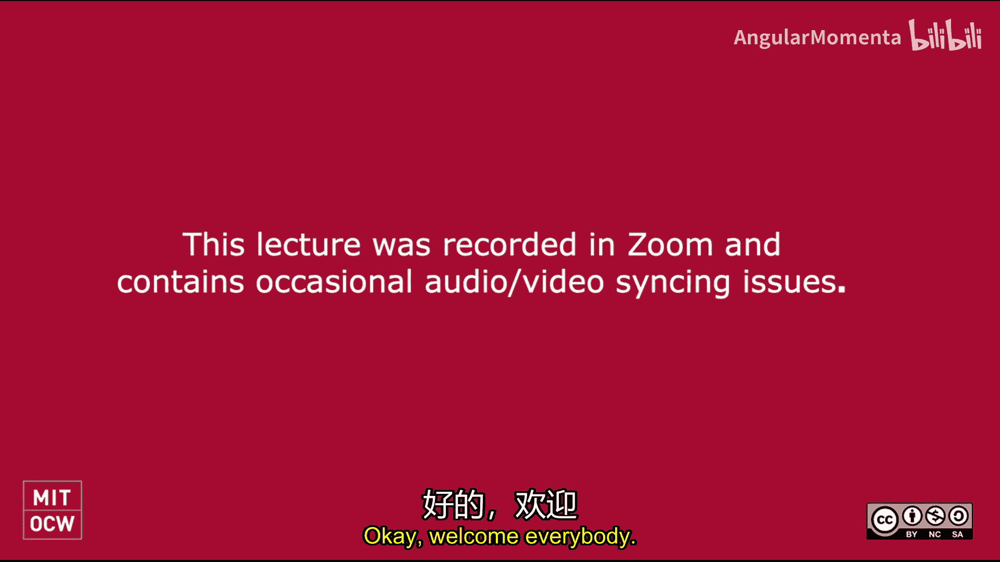
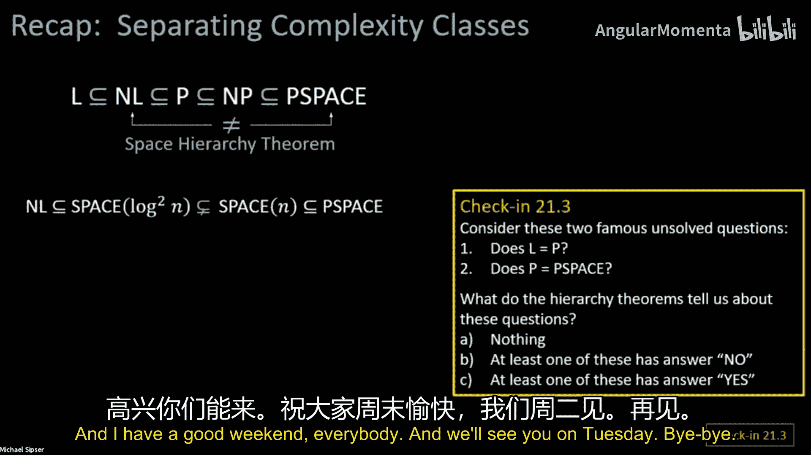

# 【麻省理工】计算理论  ｜  MIT 18.404J Theory of Computation, Fall 2020 p20 21. 层次定理 -BV1pt7GzeEjb_p20-

Okay， welcome everybody， so we are here today lecture number 21 coming into the home stretch of the course。

 I'd say probably。This last quarter of the course is a bit more technical perhaps so a little bit more abstract some of the theems are going to be more difficult so i'll try to work through them slowly and answer your questions but you know it's I think you can expect them to find the material a bit more challenging as we started。

As we started。You know， with。This theorem last time about。

Non deterterministic log space being closed under complement so Nl equals col we kind of only got about part maybe a third of the way through that so i'm going to start over with that and spend kind of the first half of the lecture today talking about that and then we're going to talk about the hierarchy theorems which are very important。

Aspect of the complexity landscape， basically they tell you。That if you allow。You know。

 your favorite model， let's say tuuring machines to have more resources。Then they can do more things。

But we'll get to that in due course。Okay， so let us go back to Oops， reminder to myself。嗯。Go back to。

The Imman seopcheni theorem， which is that Nl is equal to CoNL。

So as I mentioned these are going to be the same slides as last time and i'll just try to walk through them slowly I hope you hope you get it。

 but if you don't you know。Ask me of the Gs questions so we're going to first I mean the I。

The thing we're going to show is that the complement of path is solvable in non deterministic log space we already know that path。

Is solvable in NL that's easy to do， you basically just start at the start node and you guess the sequence of nodes storing only the current node in your log space working memory in your log space worktpe。

You guess a sequence of nodes on the different branches of the nondeterminism and if you ever get to the target node T。

 then you can accept， but how can a nondeterministic log space machine know or accept the complement of path so it would have to accept when there's no path。

And that is。A lot harder， but big surprise to the complexity community that it is true。

So as we discussed last time， we're going to talk about computing functions with a non deterministic machine。

 and that turns out to be a convenient way of looking at this。

So we're going to have nondeterministic machines that have different branches of their nondeterminism you know。

 on some input and they're supposed to compute some function value， you know remaining on the tape。

 but because of the nondeterminism you can imagine that different branches might have different function outputs well that's not allowed all branches must either report the value of the function。

That we're trying to compute or they can punt。Basically， they can reject。And say， well， you。

 you know， it's a basically， I don't know。So old branches can must either report the correct answer or they can say I don't know。

 and some branch must， at least one branch must report an answer。😡，Must report the answer。

and that's what it means to be computing a function with a non deterministic machine。

And we're going to show that certain functions can be computed with non deterministic log space machines。

嗯。In particular， this path function。Which sort of incorporates both the positive and negative of the both when there is a path and when there is not a path。

toInto the function， because the function has to answer yes。

 when there is a path from S T and no when there is no path from S T。Okay， so。If you can do this。

 you're done。😡，Because you make a nondemin you could make an NL machine。

So if you could compute the path function， you can make an NL machine。

 which would accept whenever the function says no。😡，U and the other cases， you know。

 and if the machine that's computing the function rejects， you can then you'll reject as well。

But you accept if the function says no， and so therefore you're going to be making a an NL machine。

 which does the complement of the path problem， so it's you know。

If you can compute the pathth function， that would be great。

So that's what we would like to be able to do。So as I mentioned。

 we're going to have two other values that are going to be relevant to computing the path function。

 which is what we're ultimately going to do。And that's going to be the number of nodes that you can reach from the start node in your graph and R is the collection of nodes and sees the number of reachable nodes。

So showing on this picture and here I'm if it's helpful。Fuffful to you to see it in a more form is。

You think of R as a function of the graph and the start node of course。

 but sometimes we'll just call it R， you know when it's clear which graph and start node we're talking about。

R is the set of reachable nodes， so it's the collection U。Such that。The answer is yes。

And C is the size of R。Okay。So the way we're going to start。Is kind of an easy theorem。

 though this is still going to be relevant kind of at the end， but for now。

 it's really more a practice with the concept that we have come up， you know。

 this function concept that we've just introduced。 So I want to say that。

The path function with an NL machine。Then I can compute the count。😡，Within anL machine。Okay。

 so understand what computing the pathF function means。That you have your NL machine and。

Every branch has to either say I don't know， which is reject or it has to have the answer。

 which it's going to be yes， if there is a path and no if there is no path。

And if I can be able to count the number of nodes。They do have a path。

The number of node for which the answer is yes。嗯。And this。

I think if you're comfortable with the definition， this is more or less obvious because what you would do is you would go through the nodes of G1 by one and test using your path function。

What the answer is。Yes or a no。 And every time it's a yes。

 you add one to the count until you've gone through all of the nodes。And then you have your answer。

 which is modes and that's C。Now， if the machine that's trying to compute the path function on。😡。

The nondeminism rejects， that's okay， you'll computing C， that branch will reject also。😡。

But when you're some branch has to get the right answer on on you know has to get the right answer and so then you get the you know you know what's happening with that node and so you then can either increment the count or you move on to the next node。

 I think I'm trying to say， I'm not sure I'm making any clear by kind of repeating myself， but okay。

 here so you're going to start out with the given the graph and the start node。

We're trying to compute this value C， which is the number reachable from the start node。

You start out with you have a counter which you're going to set initially to zero。

 and you go through every node of the graph。😡，And if。The path function computation says yes。

 you can reach you， then you add one to the count， says no， you cannot reach you。

 then you just continue and maybe I should add another line here if you know if the thing that's computing rejects。

 then you also reject and then at the end you output。

So what we're going to prove is the other direction if I give you the count。

 then I can answer the question for each node whether it's reachable or not and this is。😡，Thing。

 because what it's saying that is I can give you the count， I'm done。If we can get that count。

 that's going to be enough。Okay， so maybe even before the check and maybe we should just answer any questions because you know。

 if if you're stuck here， then youre then you're doomed so I think it's you it makes sense to try to understand what's going on at this at this。

Because I think the the real guts of this proof is coming on the next slide they're kind of the main idea so i'm happy to take if there's any questions about this。

嗯。I'll just wait for a second and see if you're typing away there。Well。

 why don't we go to the check in， Maybe that'll help。 not a very difficult check in。Um。诶。

It'll come up。Okay。Just a little practice with the concept。So， we。

I'm going to give you some graph that has nine nodes and I'm going to know that value of the count。

So we'll assume that S， the start node here is reachable from itself。😡，And now what's the value of C？

嗯。Okay。Are we good？I'm going to shut this down， give you another two seconds。

 please get your answer in。Okay， ready set end。Yeah， the right answer is in fact E， which is six。

 there are six reachable nodes in this graph and that's what the value you C is supposed to tell you is how many nodes can I get to from S okay。

 and what I'm saying is that if I can calculate that，In the sort of non deterministic function sense。

 so some branches can get that answer。嗯。Then I can use that to test for each node whether it's reachable or not。

 which is kind of a little bit of a miracle right that's kind of surprising just knowing how many nodes are reachable will allow me to test whether each individual node is reachable because that that's no obvious reason why that would be。

😡，So there's going to be a procedure for doing that， which is on the next slide and here it is。嗯。

Okay， so this is the key idea that we're going to repeat later。

 but so it's good to understand this is the slide you really need to understand。Okay。

 so I'm giving the graph， let's assume the graph as M nodes。嗯。Now， as I said， okay。

 so let's just say what are we doing here， given that count， we can compute path。

So we'll be able to get the answer for every node in the graph if I just know how many you know。

 so I'll know I can get the answer for which whether a node is reachable or not if I just have if I just know how many reachable nodes there are so what I'm going to do is get get that count of how many are reachable。

Now I'm going to go through I'm going to， okay， so let's see what's the idea here before we even jump into the algorithm。

The idea is。Let's say I know how many nodes are reachable， like 100 nodes are reachable。😡，Now。

 what I'm going to do， what the algorithm is going to do is find all0 reachable nodes。

It's got one by one， but it doesn't add sort of conceptually， it's going to find all reachable notes。

And not deterministically guessing them， so it's not sure in advance which ones they are。

 but it's going to guess basically10 it's going to guess some of the nodes being reachable。

 confirm that the ones that guess are reachable are reachable。

 and then check to see that that number equals 100。😡。

On some branch of the nondeterminism you will guess right and you'll end up with exactly the right set of 100 reachable nodes。

 and then you'll see is T one of those reachable ones in which case you say yes。

 or is t is not one of those 100 nodes？😡，And then you know the answer is no because if you've guessed 100 nodes and you know they're all reachable and you know there are exactly 100 reachable nodes。

 then every other node is not reachable。😡，So that's the spirit of this and I'm just going to write that down here in the algorithm。

Can you guys hear me still， somebody said my audio is like blipping out。

I am getting a sign or two of unstable internet， so you know if you need me to repeat anything。

 just send you note good， thank you。Okay。All right， so well， maybe I should speak slowly if it's。

Not coming through too well okay。So。So what we're going to do is go through eat all the nodes of the graph one by one。

😡，And guess whether it's a reachable node or not a reachable node。😡，If he gets it is reachable。

I'm going to also guess the path， which shows that it's reachable。

And then I'm going to keep account of how many reachable nodes I found。

If that count agrees with the value C。😡，I started with。Then I know I found them all。

And if T is not one of them， then I know T is not reachable。😡，That's the idea。嗯。Okay。

 so here's my this is going to be a count of the number of nodes that I have found。

 which are reachable。That's K。Now here I'm going to non deterministically choose。

 is it a reachable node or not？😡，I've just called it two branches of the algorithm。

 the P branch or the N branch， P means as a path。😡，And N means there's no path。

So if I guessed P at this point for this node u， so I'm going through each of the nodes one by one each and U is the current node。

If I've guessed that is it does have a path for S， then I'm going to guess that path to make sure that it really is a reachable node。

嗯。嗯。If I fail to find a path， then this is one of the branches of the nondeminism that is going to fail it's going to punt it's going to say I don't know under this branch because either。

😡，You guessed wrong and this node was not reachable or if it was reachable。

 you guess you failed to find a path which shows you that it's reachable there was some path but you didn't guess the right one。

😡，Either way， you made a bad choice， you're just going to punt。Now， if you have determined that T is。

That know that you've just shown is reachable because at this stage you did not fail。

 so you succeeded in showing a path to you。😡，嗯。Then。And U equals t。

 then you know t is reachable so there is a path from S to T and you're finished。

Because that you know you've got the answer you're looking for and so now you can say yes。Otherwise。

 if U is some other node， then you can just increase your account of the number of reachable nodes that you found。

😡，Okay so you found a reachable node， if it's T you're great， you're done， if it's not。

 you just include that as you're in the account of reachable nodes now if you guessed that the node is not reachable。

 okay then you just proceed， you know you're not going to you're just going to move on to the next node because you're looking for a collection of reachable nodes。

😡，嗯。Okay， getting some questions here， but let me let me wait till the end here now。

After I finished going through all of the nodes， so I'm finished with this this loop here of going through all the nodes now I see did I find。

😡，C reachable nodes because K is the count of the nodes that I've found to be reachable。

 if that agrees with C， then I know I found them all， if it differs from C。

 then something has gone wrong because I am told there are C reachable nodes and I did not find C reachable nodes。

😡，So I made some bad guess along the way， I guess some note which really is reachable。

 I guess it was not reachable so I didn't find them all I'm going to punt but if I found them all。

And so and I didn't end up accepting it， I didn't say yes at this stage。

 so T was not one of the ones I found are reachable。

 then I'm convinced that T is not one of those that are reachable。

 it's that was not one of those C nodes that I found which are reachable and now I can say no。😡，Okay。

 so let me， let me take。Questions here because I think we're yeah， that's the end of the slide。

 this is this is kind of an important。Peace to understand and we can spend a couple of minutes trying to work through this。

呃。So somebody's asking how does nondetermininately pick a path fail if you fail。

 what I mean is pick a path from S to U， so you have to go from S to whatever your current node you is。

So you're going to pick some path。To you。You guess you is reachable now you have to demonstrate it's reachable by picking a path from S to you if you don't end up at you。

😡，and the path you don't want to go forever on any branch， so you're going to limit it to M steps。

 your path has to be of length M at most。😡，So after M steps。

 if you have not reached you by that point， you've picked a bad path。And you're going to reject。嗯。

Okay。Okay， so what's the difference between know and reject that's a good question。

Reject in this case is an I don't know， the algorithm could not make a determination based on the guesses that it's made。

😡，In this non deterministic branch of the algorithm， it made bad choices。

 which doesn't allow it to reach a conclusion one way or the other。😡，Okay。

 remember this algorithm here is computing a function now it's not an deterministic algorithm in the language recognition sense。

 this is a function computer， and so it has to get the answer to the path function。

 which is a yes or a no or I don't know on some branches some branches that's allowed to do that too。

😡，So know and reject are totally different。嗯。Okay。Okay。Okay。

 this is the same thing we talked about last time。 Why do we need two branches for P and N if we're only gonna have。

 you know， proposal just to have the P branch。Well， but some nodes are not reachable。😡。

If you're going to look for， if you're going to， you know， if you have a an unreachable node。

So it's not in R。 You can't get to that node from S。

You have to skip over that note because you're trying to find a subset of the reachable notes。😡。

So you're trying to pick that subset here。😡，One note at a ton。

So if you're only going to allow things， you're going to require everything in this subset。

 there are going to be some nodes which are not reachable and you're not going to find a path because they're not reachable and you're going to end up projecting all the time。

😡，You know， on that node， so you're going to be this the algorithm not will not work。嗯。Okay。

 I'm not sure I understand this question here， but somebody says if T is reachable。

 we output yes on that branch， but don't we also output no on some other branch？That's a good。

 let's see what happens。If T is actually reachable。How could we up so if T is reachable。

 there's some branch that's going to output yes， we all agree with that。

 or at least if you're following we agree， but how could some other branch output no。

If T actually is reachable。Okay that's a great question。And no， that's not going to happen。呃。

If T is actually reachable， how could a branch output no？😡，Um。

That must mean that it does not guess T as one of the reachable nodes because it's going through all the nodes here。

 you know， it's going through all the nodes。😡，And picking them as reachable or not。

If it picked T is one of the reachable ones， then it's going to output yes。Because it will find。

 you know it'll either output yes or if it doesn't find the right doesn't guess the right path。

 it'll end up projecting on that path， but some path will end up saying yes。

 so if t is reachable and if you guess if you know t is reachable and you guess T。

 you know you guess U is reachable at the point when you equals t， you will end up outputting yes。😡。

The only way you could not output yes is if you guess that node is unreachable。😡。

But then your count is not going to add up right。Because you did not find all the reachable nodes。😡。

If T is one of the reachable nodes and you know there are 100 reachable nodes。😡。

And you skipped over T as one of the ones that you say is unreachable。

 you at best can only find 99 reachable nodes and you're not going to end up。😡，Saying no。

 you're going to end up projecting。So it's a very good question。

 but you have to think through what's going to happen here that's this C here is kind of a check。

It's almost like， you know。Well in。It's like a check sum if you know what it is it makes sure that everything that you've if you got to C。

 if you got to if K equals C at this point， that means you actually found all the reachable nodes。

 so C is kind of a check。That you found all the reachable node。嗯。Right， so。

If K equals C at this point， you have found every reachable node。

And if he was one of the ones that are reachable， you found tea。呃。Okay， let's see。嗯。

Is the reason we do this with C essentially so that we know when we can stop guessing and correctly identify if it's impossible to reach T Well it's not a matter of stopping guessing it's a check that we found everything because we're going to go through and do all the guessing for every node no matter what。

So we're not going to stop anything early unless we find that T is reachable， then we can stop early。

 but if to show that T is not reachable， we have to go through the whole process。嗯。

How can we intuitively see that we don't have contradictory branches that sort of I was trying to say that just now I dont know I hope that got through you can't have contradictory branches because if you got to this stage here。

You have found all the reachable node， so you've at this stage， if you've got to six。

 you have made all correct guesses。😡，You have found all the reachable nodes。

 you have convinced yourself that they're all reachable by guessing the pass to them。

 and you've checked that you have the right number of reachable nodes because it equals C。

So you must have found them all。So you cannot have a contradictory answer because either T was one of the ones you found in which case you would have already said yes。

 or otherwise you found them all and T was not one of them and so that you're going to say no you can't have both both things cannot happen okay。

 let's move on。😡，Okay， so next thing we're going to do is the next slide is exactly the same as this slide。

Except instead of saying is T reachable， I want to know， is it reachable D within distance D？Okay。

 so。😊，Which is going to mean not exactly the same procedure Can I get instead of asking， can I get。

Um。From S to T with a path of any length， of course it's going to be a most length M now I want to know can I get to it from S to T by a path at most length D。

These are the number of edges in the paths say。That's the same procedure。

 because instead of I'm just going to cut things off at D。

 but if I know in advance how many nodes are reachable within D？😡，Um。

 I'm going to find all the nodes that are reachable within D and see was T one of the ones reachable within D。

😡，It's the same exact idea， so here is the next slide which kind of shows that so here is the definitions。

Paths sub D means reachable by a path of length of most D。😡，Okay， so。

R subD is all of the ones that are reachable by a path of that length。😡。

And C ofD is the count is the number that are reachable with ND。So if you understood the last slide。

 hopefully this slide will seem kind of obvious to you， I'm going to just highlight all the changes。

So if I can now calculate。C sub D， which is the number reachable by a path at most of length D。😡。

Then I contest test whether or not nodes are reachable by path without length。😡，First。

 I calculate C sub D。I go， I pick every node as being reachable within D or not。 Now。

 I just have to check that my path that I'm guessing has linked to most D。

Instead of length at most M， which is what I had before。

Keep count of the ones that I found if that count equals C sub D then I know I found them all。

 if it's not equal to C sub D then I've made some bad choice along the way and I can just punt and say I don't know。

 and if T was not one of the ones that I've shown to be reachable within D，😡。

Then I know it's not reachable with Nd and so。I can say no。Okay。

 so I don't know if this merits any additional questions， but this is really the same。

Is just a repeat of the previous slide what's kind of amazing is now the last slide is going to be again a repeat let me just let me just fores shout of where we're going but feel free to ask a question on this or on the first slide if you didn't on the previous slide if you didn't get that also we can try to help you out with that。

The next slide， what I'm going to do。Is show how to compute。All these C values。And I should mention。

The value C， which is the total number of reachable。

 it was going to be the same as c sub M reachable within an M， the number of nodes of the graph。

 so if I can get up to c sub M I'm done。😡，And what I'm going to show you is that。😊，呃。Knowing C sub I。

 I can compute C sub I+1 or C sub D， I can compute C sub d+ one。And so I'm using D as my index here。

 basically。So C sub zero we know is just s， well R you know。

 it' just one because you can read just start with S， that's the only thing reachable within zero。

And then once I。Nowow that I can figure out C sub1， C sub2， C sub3 and so on。

 and then I get the C sub n and then I have the count of the total number reachable and then I can test the path function。

Yeah。嗯。Okay， so the trick now is being able to count。Given C sub D。

 I would like to figure out what is C sub D plus one。Now how am I going to do that。

 what I'm going to do is that's my goal， what I'm going to do is something in between。

I'm going to do a theem just like this， but instead of given C sub D。

 instead of computing paths sub D， I'm going to compute paths sub D plus one。😡，So knowing。

How many are reachable from D， I'm going to give a test for whether things are reachable within D plus one。

😡，And the fact is， that's easy。Because this thing already tells me how to compute whether I'm reachable within D。

😡，And being able to be reachable within D to one means I have an edge from something that's reachable within D。

😡，So if I can figure out what you're reachable within D， well， and I just want to see。

 do I have an edge， you know？Do I have an edge from one of the nodes that are reachable within D。

 then I'm reachable within D plus one。😡，Then if I can test whether individual nodes are reachable within D plus1。

 I can count how many nodes are reachable within D plus1。

 that was that very first easy theorem that I showed。😡。

So I know there's a lot of pieces here that you have to put together。

 but in the end each individual piece is not that bad。Okay。

 I don't know how many of you following me， oh no， this is not supposed to be here， there we go。嗯。

So here is the last part， which again is just a simple modification of what the previous slide had。

So I'm going to show how to compute。The path D plus one function。

 so testing if there's a path of length D plus one from s to some node T。😡。

But only knowing how many nodes are reachable within D。😡。

So I'm going to find all nodes that are reachable within D。😡，Just like I did before。

 but see if any one of those nodes has an edge。😡，To。Not necessarily that one is equal to t。

 because that says that T is reachable within D， but I want to know， does it have an edge to t。

 that means t is reachable within D plus one。😡，So if I find all the nodes that are reachable within D。

😡，And T turns out to be reachable from one of those by an edge。

 then t' is reachable within D plus one。😡，And if D is not reachable for any of those nodes with an edge。

 then T is not reachable when D plus one， I hope you're following me， I'm not sure you are。😊。

So anyway， that's the algorithm here and the corollary is that you can compute C sub D plus one from C sub D because if you can count the path。

 if you can test for each node if it's reachable， as I mentioned before you go through all the nodes。

 see whether they're reachable D plus D plus one and then count them up。

 now I have C sub D+ one and now I'm done。Because。呃。U。

I'm going to compute each D+ one from the value D that I previously computed。

 I'm going to do that for all these。Should say zero here actually and except if the path says if the path function now says there's no that the answer is no because I'm trying to do you know the complement of the path language and reject if the path thing for M says yes。

And that's my non deterministic algorithm for the pathF complement。Problem。Anyway。

Maybe you need to look at a little bit offline， it's presented in a little bit different way in the book。

 I don't know if that'll be more or less clear to you。

 but kind of I think this has been a little bit more unpacked for the purposes of the lecture。U。

So let's just see， Duway， I'm not getting any questions。

 which probably means I've lost a huge chunk of you。

 but the good news is we're going to move on to a different topic。So。

But feel free to ask a question on this if you want。

 or we're going to shift gears now to talking about the hierarchy theorems。

 which is going to be the second half of the lecture， also not so easy。

 I have to say probably a little less technical than this one is。

 but's also there are going to be spending time on just mainly just one theorem。

But anyway looking ahead to what where we're going and then we'll have a break。Um。We啊。

What we've shown so far。These are the major complexity classes。

 I'm not including let's say the complementary classes， the CONP type classes。

 these are the major complex classes we've seen so far and as we've seen they form a hierarchy of containments。

嗯。Some of those containtaants trivial and some slightly less trivial。

 but we have not shown whether any of these classes are different。You know。

 we've pointed out that there were some unsolved problems here。

 but do we know any of these classes different from each other？Or could it all collapse down to L？

And the answer to that is we do know that P space and L are actually different。That we can prove。

And it's a it relies on the theorem that says if you give a。Tururing machine， more space。

Then you can do more things。So because P space is much is a bigger bound than log space。

 we know we can do more things。In fact。Because NL is contained within log squared space deterministically。

 and P space is bigger than that， we actually can separate P space and NL。

So we're going to prove that today so that basically the idea of the theorem says that if you give a tuuring machine a bit more time or a bit more space then it can do more。

So there are some conditions on that that we have we'll get into。

One of the conclusions that we'll show is that time n squared。

 if you compare with time you know the time the things you can do in n squared time versus the things you can do in N cube time。

 there are more things you can do in n cube time than what you can do in n squared time。

 I mean that's what you would expect。But it's not the case that everything we expect in complexity theory we can prove this is one of the things we can prove so as you add more time you can do more things。

 so this is a proper subset here so there are some things in time N cube that are not in time and squared and didto for space。

Okay， so that's going to be that brings us to our coffee break and so feel free to shoot me any questions about。

What we've done so far or anything else， and otherwise we will。

Launch our timer and I'll see you in five minutes。Okay， so getting some good questions here。

 could we also make a solution this is getting back to that。嗯。The lux， the Nl equals co L。

 somebody saying， could we just？Make another selection just by non deterministically choosing C vertices。

And then checking that they're all reachable。That's effectively what we're doing。But。

Be careful because we cannot store C vertices。😡，So that's why we're doing them one at a time。

 we can't guess all C vertices up front because where are you going to store all that？

We only have log space。Okay， another so maybe somebody's asking how much working space do we need for storing the intermediate steps。

 I'm not sure what intermediate steps you mean， but if it's all the CI values。

Going from C0 to C1 to C2 to C3， we don't store those。

We all you need you need C sub d to calculate c sub d plus one and then you forget c sub D you couldn't store all the C values。

 but you don't need them all， you only need the most recent one to go to the next one okay somebody's asking can I go over why the complement of path in NL implies Nl equal co Nl because the complement of path is essentially it's co nl complete I mean it is so。

Everything in NL is reducible to PAth。😡，这。Everything in Cohenll is reducible to the complement of PF。

By the same reduction。And so if you can do the complement of path in any class。

 you can do all of the complements of NL languages in any class and so you can do the complement of path in NL you can do all of the。

Colon L problems in NL， and so then Nl equals colonll。

You have to you have to just think through the logic of it is not that part is not hard why it's enough to solve the path complement problem in NL that does everything else because it's because of the same completeness phenomenon that we've been seeing okay somebody's asking about the twoat problem that we talked about last time and is it and you know I pointed out that that's in NL that you know the twoat problem well the complement of the twoat problem。

You know， the unsatisfiable two set formulas that that's an NL language because you can basically look for a contradiction non deterministically in log space。

That's。I think I probably won't be able to explain that in a minute。

 but maybe we'll have our recitation instructors cover that in recitation。It's a nice proof。

 not very hard， but it's a nice proof。It's's it's it's， you know， it's not。

It's something you have to do， you have to think about and you have to argue， but it's still。

 it's not super hard。Understanding the two set problem and you know the complement of twoat we showed is in NL and because Nl equals conl also the two set problem itself without complement is in NL。

And in fact is NL complete？Okay。I think we're going to have to move on。

I'll stick around if the lecture in cases any questions that I can answer quickly at that point。

 sorry if I couldn't get to your question just now。All right。Continuing on here。Okay。Shifting gears。

 the Space hierarchy Theorem。So。Um。So as I mentioned， I think maybe it's good to just go back。

To this slide here， we're going to do the time and space hierarchy theorems which show that if you can do a little bit more。

 if you give a little bit more time or a little bit more space， you can do more things。

We're going to do the space case first， because that actually tends to be slightly。

For certain technical reasons， slightly easier。Space hierarchy theorem。

 so here is the statement of the theorem。And。Sas for any bound。Think of this is going to be some。

You know， space bound。And again。F has to satisfy some technical condition in yellow。

 remember that it's yellow because that's going to be relevant later so there's going to be some technical condition no matter what function you have whatever space bound you have as long as it satisfies this condition which is a mild condition but you need it whatever space bound you have you can find a language a。

Which requires exactly that much space。So if F is like in cubed。

 we're going to find a language A that requires NCubid space， if it's end to the 100th。

 we can find a language that requires n to the0th space and cannot be done within the999 space。

Whatever it is， you can find a language that requires exactly that much space and if you like it a little bit more formally so that means that it can be decided in that much space。

But it cannot be decided in less space。Okay。Fraaming it at a slightly different way in terms of our space classes I'm going to define a notion which is you know kind of it's not not said this way in the book。

 but maybe it's a helpful way to write it down it's space little O of F of n so those are all the things that you can do by a function that's little O of F of n in space。

So space little O of F of n is properly contained within space F of n。In other words。

 there's something here， which is not in there。Okay， pictorially， I'm going to exhibit some language。

 some explicit language A。😡，Which I can do in this much space， but not in any less。Now， you。

 you can sort of think of this as a little bit like the situation for context free languages and regular languages。

 where we exhibited a particular language that differentiated that was context free but not regular。

And we're can I kind of do the same thing now？But the one key difference is that in the case of separating the context free in the regular。

 we could give a nice language like zero to the K1 to the K。Here。

 the language is not going to be so nice to describe。😡。

It's going to be the language that some Turing machine we're going to give decides。😡。

But you're not going to be able to get a nice simple understanding of a it's going to be whatever that Turing machine does some in that sense it's not a very natural language that's easy to sort of get your mind around so the outline and really you don't have to。

😡，Worry about this， but maybe it helps， it's really going to be a kind of a diagonalization proof。

the way this machine D is going to operate， so D is going to give you my language A。嗯。

So D is going to be designed， and I'm going to show you D on the next slide。😡。

D is going to run within my target space bound F ofN。And's key， here's the kicker。

D is going to be designed to make sure that its language cannot be done in less space。

And the way it does that is it makes sure that its language is different from any language that that is。

Decidable by a turing machine in less space， and it's going to be different in at least one place。

So any D is going to guarantee that its language cannot be done in little O of F of events space。

 because it's going to be different from every language that's doable in little O of F of events space somewhere。

😡，Okay， that's the point and then the language A is going to be the language of this touring machine D。

Okay， so it looks like a tall order that D has to make sure that each。😡。

You know that for every machine， its language differs from that machine's language if that machine is running a little low of F event space。

But it's basically going to be a diagonalization。So for all of the different possible inputs to D。

 that input is going to actually code up a machine。😡，On which。

We're going to make sure that we're different from that machine if it's a small space machine。

Let's see if said so I can take a couple of questions here does F have to be computable so that's going to be one of the conditions that we're going to have to guarantee where F satisfies the text and condition yeah it's going to end up being have it's going to be computable but that's not enough。

嗯。Good question though。啊。Okay， so let's， let's。Let's move on from there， okay， no。

So here is now what what my job is to give you this Turing machine D。 So。

 these language is going to be my my language A， which I can， which requires F of N space。

 cannot be done unless。Okay， oops， I need to， I need the full slide here。

 so I have to take myself out。Um。对。嗯。All right， now this is my goal。

 I want to exhibit this language A， which I can do in this much space， but not in any less。呃。

And so I'm going to give this machine D， as I mentioned， where A is these's language。

D runs an order F event space and that sort of that achieves this part。And D。

 makes sure that its language cannot be done。In any less space， so that achieves this part。

So it's different from the language of any machine that runs in little O F event space。Okay。So。呃。

This is how D is going to work。OkayI'm going to try to give you a little picture to help see to accompany the description。

So D gets its input W。Which is a length in。The very first thing D does is it marks off。

F events space。Because it's only allowed to use， we're only going to allow D to use F of N space because otherwise we're in danger of D not of a not being in space F of N。

 so D is going to guarantee that by making sure it's going to mark off F of N space。😡。

And if it ever tries to use more than that， it just rejects。And but by virtue of that。

 we're sure that D language is in space F of N because D is an F of N space term machine。

And it's going to be decided。Okay， so。This part。So far， it not too hard。Okay。

 now we're going to start getting into the meat here。So。Yeah。If W。🎼嗯。Now。

 what we want to think of W as a description of a machine that we're going to feed that's that's going to run on W。

 So this is going to little bit。You know， back to an earlier when we talked about diagonalization so don't get thrown off by this we if we're going to think of W not only as the input to D。

 but it's also going to be the description of a machine。

And if it turns out that W is doesn't describe anything， it's just a junk W， then we' not interested。

 we' we're just going to reject on that W， we're only interested in the Ws that do describe some machine in。

Okay。So if MW describes some machine M， then we're going to run M on W。And we're gonna do the。

 do the opposite of what what M does。And that's the whole idea。

We're just going to make sure that what we're doing is not the same as what Em is doing。Yeah。So at。

 at a high level。The basic idea for this is not hard。So we're going to simulate M on W。If M rejects。

 then we'll accept and if M accepts， then we'll reject， we're just going to do the opposite。Um。

And I think that is， so we have to be careful when we do the simulation。

 this is a little bit of a detail， but you know， this is a proof where you need to pay attention to some details。

嗯m。The cost of simulating M。😡，On D is only a constant factor。

Because if M uses a certain amount of space。When D is simulating M。You know。

 M may have a larger tapA alphabet than D does， but D can then encode m's tape by using several cells for each of M's cells。

 but it's only going to be a constant factor and that's important here because we have to make sure that。

You know， if this was a big blow up， D would not be able to run M。😡。

I think I'm sort of arguing the details without making sure we understand the fundamental concept。

Let me back up。The point is， is that D is doing something the opposite of M。😡。

Now D can't be different from everyM because D itself is a touring machine， of course。

 but the thing is is that。😡，D is only running within F of N tape cells。

 so it has to be able to do that simulation of M within that amount of tape if M is using a lot of tape。

 then D is going to use a lot of tape and it's just going to reject。😡，Yeah。

So this is only going to really come into play getting being able to simulate them if A is amount of a small amount of space so that D can do this simulation。

😡，Okay， so let's just see maybe so there are going to be some issues here， but before I get to that。

 let's just see what what your questions are。How can a Turing machine know if W is encoding some other Turing machine？

No that's simple you know what is a coding of a Turing machine it's just you know the standard we have a standard coding it' just you know coding the rules of the machine so it has to have states transition function blah blah blah so it just has to be some you know whatever our encoding for the Turing machine is we can always test whether。

A string is a legitimate encoding of a turing machine so that shouldn't be bad somebodybody says why do we reject if we use more than F of n cells isn't it okay to use order F of n。

Yes， it could be， but we have to cut it off somewhere， you know。

 I mean it might be it's okay we could use2 f of n， we could use 10 f of n。

 but we have to have some constant for D and let's just simply constant one so D has to run within F of n cells。

😡，And that's going to guarantee that's going to be good enough for us。 Okay。

 do we have to make sure that M runs in little O of F of so we can't really tell whether M is running in little O of F of N。

All we can tell is whether we can finish the simulation。😡，So that's actually going to be。

 maybe you can just hold off on that question because there is a point that we have to follow up on in that。

 which is just because，You know we may or may not be able to finish simulating M on this W doesn't necessarily tell us what the asymptotic behavior of M is。

 but we'll have to look at that in a bit Okay so somebody's saying what happens if M loops on W that's going to be one of our issues we have to deal with that's a good good question there。

😡，Step two alone can use them more than F of N cells Yeah。

 step two alone can use more than F of N cells if it does， we just going to end up projecting。Okay。

 so we're getting good questions here， some of them we going to I'm going to address anyway。

 so why don't we just move on。Okay。So here is sort of question I think this is one of the questions that related to one of the ones that got asked what happens if it runs in little O of F of N space so remember what we're trying to do is be different from every small space。

 little O of F of N space machine。So what if M runs a little O of F event space。

 but has a big constant？So what I mean by that concrete leaf is suppose D is an n cubed space。

 so suppose we're trying to get a in n cubed space， but show what's not in n squared space。😡。

So D is going to run an n cubed。And we have to make sure that any machine that's running in n squared space cannot do the same language。

So we're going to be different from that。 But the problem is that in。U。The machine am。

Might be running in n squared space， but with a huge constant so it might be running in a million n squared so that's still a machine that's running in a little O of n cubed and we have to be different from it but for the particular W we're working on。

 we might not have enough space to run M because of that huge constant that the asymptotic behavior is only going to be relevant or for large W for smaller we may not see that we may not have enough space to run m so what are we going to do to fix that we're going to run that M on infinitely many different Ws So there's going to be infinitely many different Ws that are all going to encode the same M。

And the way I'm going to do that is by。Thinking of W as representing M。

 but having an unbounded number of trailing zeros after that。😡。

So I'm going to strip off the very first thing I'm going to do with W is I'm going to strip off the trailing zeros up into the final one I'm going to remove those and then take the rest and as the description of the machine So now I'm going to have potentially Ws that have an enormous number of zeros at the end。

😡，嗯。Big enough so that I can see the asymptotic behavior of M and that if M is really running in little O of F of n space。

 I'll have enough space to run M to completion on W and so then I'll be able to be different from it。

😡，Okay， so I'm kind of showing that over here， so here's a very large W。

I'm going to strip off the trailing zeros。The rest of it is just going to be M and I'm going to run this M on the whole W。

😡，The entire W without the zero stripped off。 So now M is going to be running on a very large input。

Big enough so that D which has asymptotically more space than M does。

 will have enough space to run empty to completion。Now another question that got askeds。

 what happens if M loops？That's going to be a problem because D always has to hold and if it just blindly simulates m。

 then D might be looping on M not a M is going to use a lot of space by the way。

 because then D is going to catch it in step one， but if M uses is loops on a small amount of space。

 then D。Might end up looping as presently constructed so what i'm going to do is i'm going to put a counter which makes it stop if it runs for two to the f ofn space so basically because that's how long D could possibly run without looping anyway M could be running without looping anyway and so we're going to run it for this amount of this number of steps and i'm going to reject if it hasn't yet halted as well as that because it has to be looping at that point anyway and so it's not interesting for us it doesn't matter what we're going to do if it hasn't halted because。

M is not a decider。And the last thing is how to compute F。

So I'll try to address some questions here in in our remaining time。 how to compute F。

So to Mark of F event cells， we also have to compute F。

 I didn't think anybody but any of you guys asked that question except maybe at sort of the very beginning about F being a computable function。

Certainly if it's going to have to be computable， but not only does it have to be computable。

 it has to be computable within the space balance。And that's just going to be a condition we're going to impose on F。

 it's so called space constructible， namely that you can compute it within its own space bound。

And all nice functions that we care about are going to be space constructible。

 so it not doesn't turn out to be an obstacle to applying the hierarchy theorem。

 but it is a condition that we need， it actually is not true without that condition。嗯。Okay。

 let's let's just oh I have a check in here， maybe we can take a couple of questions first。

Some of you are anticipating my check actually， which is good。

 so let me hold off on those sorry a bit confused about what is M。😊。

Can we say D is input M and simulate M on yeah？Somebody's saying can we say that D has input m and simulates M on itself。

 yes， that's exactly what's happening the reason why we're doing that is because we have to cover all possible Ms。

😡，So as we get all possible inputs， W。😡，They're going to range over all possible Ms。

 and so every possible M is going to get addressed to see if we can run it within the space bound and be different from it。

😡，These job is to be different from each of those ends， but it's not you know again。

 there were some details here that got raised in these issues。😡，But in a sense， this is just kind of。

More technical。I would focus on understanding what I originally wrote down because that's the main idea the rest of it is just kind of implementation details。

😡，Okay he so， why don't I？Can I give an example of a non space constructible function？Yes。Log， log。

 log and space。You cannot compute log log log n space within log log log n space and in fact it's known that there's nothing new between constant space。

 which is just regular and log log log n space anything you can do in log log log n space is a regular language。

So the hierarchy theorem' doesn won't apply there， because well， it applies。

 but it's not a it doesn't well， you know， not it's not space constructible。

To find higher level large non space constructstructible functions， you can do it。

 but they they're not easy to describe。Okay， let's do our check in here。

What happens when we run DRn itself I got a couple of people asking me about that so that's this is just a good lead into our check in and this a little you really have to understand what's going on。

To see what does D do when if you feed in itself maybe with some trailing zeros because remember the algorithm strips off trailing zero so what is what does it do in that case so here are my options there you can get to pick which ones which one。

You you think is the answer， so I'll give you another 30 seconds on this because this requires a little bit of thinking if you want to invest in it all right。

Wrap this up， guys。Five seconds to go。Okay， I'm going to end it so get your。Participation points in。

Bs of you have not said anything， come on。I can see the count here and it' is a。

Three or four of you are not not answered well you're going to lose out closing all right so the right answer is in fact see it does reject let's just understand what happened is definitely we don't get a contradiction I mean this is an algorithm I just described it's going to do something。

呃。I'm assuming the people who picked eard。Having fun as I did when I came up with the check in but。

Not a question answer A doesn't is not going to be good either because D has to be a decider so it can't loop on anything。

 so the only sort of reasonable answers are reject except or reject。😡，When you run D on itself。呃。

What's it going to try to do， It's going to the very first thing it's going to。

 you know mark off F of N tape cells， and then it's going to get its input， which is itself。

Tryries to simulate itself on the same input that simulated D is also going to try to mark off F of N tape cells。

 but due to some simulation， you know there's going to be some cost to doing the simulation when the simulated D is going to try to mark off F of N tape cells。

 it's going to blow。The original Ds space bound and exceed the bound and so D is going to reject upright in step one。

😡，When it to get an input of itself。So that's。It's very clear what's going to happen in this。

 it's just going to reject because for this reject， this reject in particular。And notice this。

 you know， yeah。You know， okay， let me not try to confuse it。 Okay， so that's that's。

 that's all I want to say about this。 Let's now move in our remaining seven minutes to the time。

Hierarchy theorem， which is very has the same proof。

 but some of the technical details are slightly different。Okay。So now if I give you a time bound。

 again， we going to have faced with the same notion that you have to be able to compute F within F's amount of time。

😡，So it has to be a time constructible， I'm not going to define that so there's a language A which requires that much time。

So it has to be decidedidal within that much time， but there's a slight difference here and this is an artifact of the proof of the theorem。

 not because there's an absolute truth as far as we know。

It's not that it's not decidable little O of F of n you actually you can only prove something slightly weaker when you have one tape turing machines that it's little decidable little o over there's a slight。

Gap in what you can prove。 So it's not only that you can' prove you it requires little O。

 but little O of over log， little O of F event， over log F event。

Is what you can prove that you get from this time hereitum。

 but let's not get caught up on that for now。呃。Okay。

So the proof outline is the same outline as we had before。

 we're going to give a D that runs an order F event time。So， it's。呃。

It ensures that the language is in that time complexity class， time F ofN。

And it makes sure it's different from every machine that runs faster by some significant a log factor faster。

呃。Okay， and so why don't I。Show how that goes。The proof is in some ways。Almost exactly the same。

I'm going to give a D which runs this much time and it shows it different from every M that runs in。

A lot less time。Here is the algorithm for D。Now， it computes F of N。

 but it does something a little different with F of N。 Remember， in the space hierarchy theorem。

 we marked off F of N space。Now this FN is going to be used for a different purpose。

 it's going to be a clock。😡，And you have to shut M down。If it runs for more than F of N steps。

Not if it uses more than F of N space。Yeah。Because we're only interested in Ms that use significantly less than F of time。

 so we're going to run M you know for F for some number of steps。

Whatever M says we're going to do the opposite， and only if we can actually finish that simulation。

 we'll be able to be sure that we're different from what M is doing。

So this is the whole algorithm here， we don't have to do any further modifications。

And where is that login factor coming from？It's actually coming from a funny place。Um。

And you know you have to get into the little bit of the guts of this when you're simulating M on W。

Remember that M itself was described by W。So you're going to have to write down a copy of M。

 which is you know as described by W then so youre going to and then you're going to have the tape that M is working on。

Which is starting out with W on it。Um， and you have to be now you have to be a little careful how you manage that because if your description of M is just sitting at the beginning of the tape。

As you're simulating M， every time you do one step and modifying the tape。

 you don't want to have to go back。😡，To the beginning of the tape， to look up the next step of M。😡。

So you actually have to carry M along with you。😡，As you're doing the simulation。

And you can do that by expanding the tape alphabet of the tape so that you can effectively have two symbols on one cell。

 one is going to be for describing M and the other one is going to be just for Ms for the simulation tape。

And you'd be carrying M along with you wherever your head is。

 so you don't have to go very far to look up M。😡，And。

So that's all possible because that's going to add only a constant factor because am's fixed in size doesn't depend on you know。

You know， for large inputs to MM is fixed， but the tricky thing here is the counter to make sure we're not using too much time。

嗯。The counter has size log Fn because that's how big it has to count up to so you can shut it down if it's going to exceed the F ofn steps。

And you know， you， you have to run for a certain amount of time and countering the keeping the counter nearby has the counter nows couldn be pretty big。

And so that's going to cost you a log factor of simulation cost to move that counter around all the time。

And so that's why you have to run for only a log factor less so that you can actually finish within Fn time as you're required to do。

Okay I realize that that's a mouthful there and you may not have all understood that it doesn't matter it's not that critical。

 I think what i'm really more concerned is you understand the main idea of the the hierarchy theorem。

 some of these implementation details。You know， you。If you don't get them。I wouldn't worry about it。

 I feel I have to include them for completeness sake and to be honest with you about the proof。

 but if you didn't follow everything， that's okay， I do want to understand the main idea， though。

 of the algorithm making sure that what it's doing is different from whatever machine is doing if that machine runs in little O of F ofN space or a small amount of time。

 you little O of FN over log F event time。Okay， so and I think we're going to we're going to end here so come pretty much out of time I'm going to stick around for a little bit。

In case there's any questions here， oh wait theres one let's check in though let's let's look at this this is kind of an interesting sort of follow on to the hierarchy theorem if you look at the two questions does L equal p and does p equal p space。

These are both unsolved problems。😡，DoesWhat， if anything。

 does the hierarchy theorem tell us about those questions？😡。

And it's kind of interesting that there actually， well， I'll leave it to you to。呃。

Tell me if you can see what it might actually be telling you。Closing， get your answer in。Okay， one。

 two， three。Ieel like I'm running an auction house here。I should have a gavel。Okay。Yes， in fact。

 we know that you know these are separated， so it's not even though we don't know if L equals p or p equals p space。

 they can't both be equal。😡，Because then L would equal p space， and we know that's false。

So at least one of these has answered no。Okay， so with that let's wrap up today's lecture know we prove these hierarchy theorems and why don't we just I'm going to。

Shut us down here， but but before well I mean we're over so you can feel free to go。

 but I'll stick around in case anybody has any questions for a few minutes anyway and then we'll call it a day。

Since we just showed space n is a proper subset of space into the K for any K， why can't we also say？

Space N is a proper subset of peace space， yes， space N is a proper subset of peace space。Yeah。

 so somebody just asked， we just showed that space N is a proper subset。Of space into decay K。

Does that also say that space in is a proper subset of peace based， definitely？Any。

Space end to the K is a proper subset of space enter to the K plus1， which is a subset of P space。

 so any fixed polynomial is going to be a subset of P space because P space includes all the polynomials。

Which of the two unsolved problems？U whohoops。Do， I think is more likely to be true。Well。

I think most。I mean， I would bet that both of these are not equal， so both of these have answered no。

嗯。It would be weird， you know。I mean， you think L equals P that anything you can do in polynomial time you can do a log space。

 log space is incredibly weak。And peace base is incredibly strong。

 I would be shocked if either of these were equal。So we just。

The problem is that we don't have a method for proving problems。A are actually。

Haveve high complexity of any sort， we don't know how to show things outside of L。

 don't know how to show things outside of P except by using the hierarchy theorem。

 diagonalization is the only method that we have for showing things are outside of classes。😡。

And there's reasons to believe， as this we'll get to， I think， next lecture， in fact。

There's kind of reasons to believe that the hierarchy theorem type argument。

 which is a diagonalization is not going to answer those kinds of questions。

 so we need a different method and diagonalization is all we got。Good question though。

If I didn't get to answer your question， you have a question for me。

 ask it again because it's got buried。So it means we are very far from disproving P versus NP。

 is that right？It could happen tomorrow。You know， how do you。

 how do you how can you tell it doesn't you know， it it seems clear that the present state of mathematics as of right now this。

 you know， we don't have a clue。How to how to answer those kinds of questions and its not obvious that we've even made any progress but。

You know。That's the nature of the game that's the nature of the beast。

You know somebodybody gets a good idea and all of a sudden lots of things can change and that can happen at any point。

 maybe one of you guys。When were these results first， this is the stuff， okay。

 the hierarchy theorem is old。That goes back to the very when time classes were first defined。

 I think is was one of the first results to show the hierarchy。That's。Late 60s。嗯。

The NL equal conhenL， I think I mentioned was like mid 1980s much later。I mean。

 from New York points of view， was it was back in the。Kive。Kage， either way。But yeah。

 but the hierarchy theem that that's actually predates。My coming into the field。

 but the NL equal conll that was something that I personally experienced how surprised people were。

Okay， I think I'm gonna。Send you all off on your way。

 good having you here and I have a good weekend everybody。And。

It'll see you on Tuesday。拜e拜e。

