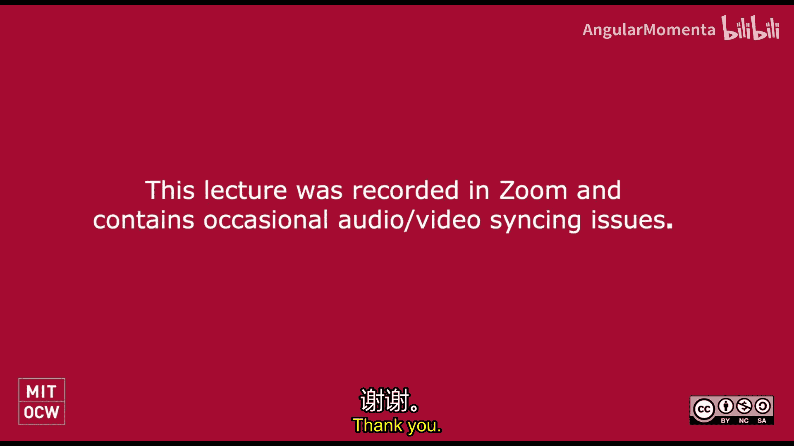
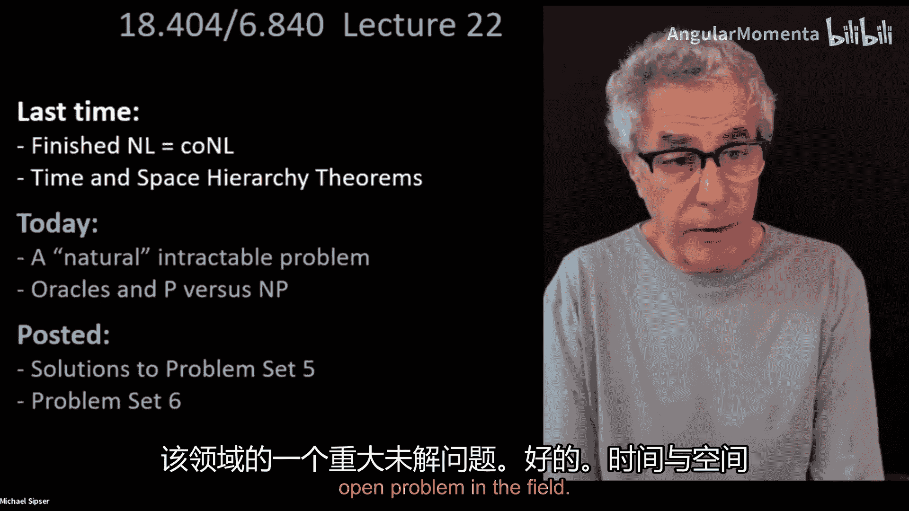
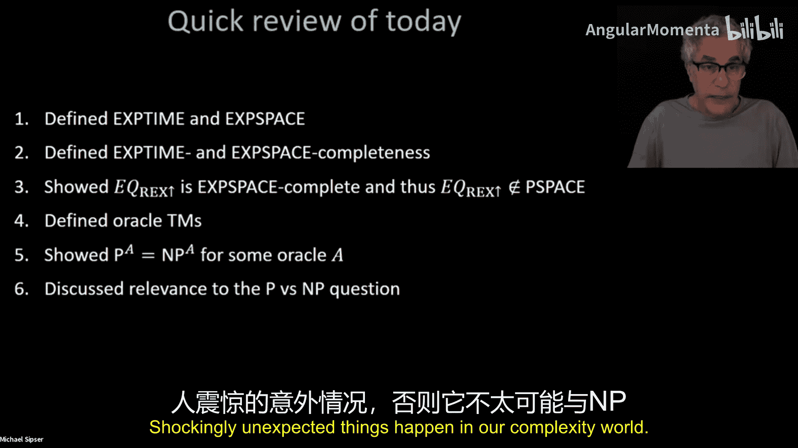

# 【麻省理工】计算理论  ｜  MIT 18.404J Theory of Computation, Fall 2020 p21 22. 可证明的棘手问题，神谕 -BV1pt7GzeEjb_p21-

Welcome everyone， welcome back to Theory of computation and。Just to recap where we are we。

Have been looking at time complexity and space complexity。

And we just finished approving what are called the hierarchy theorems， which。You know， in a nutshell。

 basically say that if you allow the computational model to have a little bit more resource。

 a little bit more time， a little bit more space， then you can do more things。

So with certain conditions。So we proved that last time it was approved basically by a diagonalization。

 I don't know if you recognized the diagonalization there。

 but when you're encoding a machine by an input and then basically running all possible different machines。

 that's essentially a diagonalization。诶。So today we're going to build on that work to give an example of what we call a natural。

Intractable problem we'll say a bit more about what that means。

And then we're going to talk about something which is a different topic， but nevertheless related。

 having to do with oracles and methods which may or may not work to solve the P versus NP problem。

 which of course is a big open problem in the field。

Okay。So。The time and space hierarchy theorems because we're going to be using those today。

 they say that if you give a little bit more space here。

 so if you're for space constructible functions， functions that you can actually compute within the amount of space that they specify。

You can can show that the things that you can do in that much space is probably is larger than what you can do in less space。

 and you have can prove a similar slightly weaker fact about the time complexity classes。

So what that means is that the these classes form a hierarchy， so as you add more time。

 or let's say in this case， space from n squared to n cube to N to the fourth。

 you get larger and larger classes， which I'm kind of illustrating here by putting a dot there。

 which shows that there's something that we know that's new in those classes。

 as you go up these different bounds。This is going to be true for space complexity and it's also going to be true for time complexity。

Um， so。And one of the carrollleries that we pointed out last time is that。

PeaceSp is a properly includes non deterministic log space NL。

 so NL is a proper subset of peace space so this stuff in peace space that is not in NL and remember this notation here this means proper subset。

One of the things that follow on Carri， that we didn't mention last time。

 but that's something that you you should know is that the TQBF problem， you know。

 our piece based complete problem is an example of a problem that's in peace space obviously。

 but we know it's also not in NL。And in order to get that conclusion。

 you have to look again at the proof that TQBF is piece based complete。

And observe that the reductions that we gave in that proof can be carried out not only in polynomial time。

 but they can be carried out in log space。And therefore， if TQBF turned out to go down to NL。

Then because everything in Peaceb is log space Reducible to TQBF。

 that would bring all of Pespace down to NL。😡，But that we just proved is not the case。

 so therefore TQBF could not be an NL。😡，OkayAnd we're going to be using that kind of reasoning again in this lecture。

呃。So just a quick check in， these are a few。More or less easy maybe be more or less tricky follow ons that you can conclude from the time and space hierarchy theorems plus some of the other things we've proven along the way and so just as a check of your understanding。

Maybe these a little bit on the tricky side， so you have to read them carefully which of these are known to be true based on the material。

That we've presented and this is also just material that's the facts that we know to be true in complexity theory。

So I'm going to launch that poll and just check off the ones that we can prove。HOkay。

 I'm going to close it down so please。Answer quickly if you're going to okay， one， two， three end。诶。

Okay。Well， the two leading candidates are correct。So it's and the two that are the laggards here are in fact。

 the ones that are not true。So A and D are not true based on what we know and B and C are true。

 so let's understand， first of all， a we know is false。

Because two to the n plus one is just two times two to the n。

And so that's just these two bounds differ only by a constant factor。

 and so in fact they're the same complexity class and so you don't get proper containment for a。

 so that one we absolutely know is false。Um，D。嗯。Well， if we could prove that。

 then we would have solved a famous problem because we don't know whether even P equals P space。

So if p equaled p space， then certainly p space would equal n NPp， which is in between the two。

 and so we don't know how to prove p space is different from NP as based on the current state of knowledge of the field。

so this would not be something that we know to be true based on what things that we've said。

Now B follows。Directly from the time hierarchy theorem because two to the2 n is the square of two to the n and that is asymptotically a larger significantly larger bound and so。

You can prove that time two to the end is properly contains time two to the end。

C is a little trickier because。You need to remember savage's theorem。

 a savage' theorem applies to space。But you also need to remember that what you can do in time in not a deterministic time n squared。

 you can also do in not a deterministic space n squared。Which then in turn。

 you can do in deterministic space enter the fourth。Um。

W which is properly contained within space into the fifth。

So you can prove that peace base properly contains。Not determined to take time n squared。Okay。

 just a bunch of containments there that's perhaps a little the A and C are perhaps in a sense maybe the most tricky of this group。

Okay。So let's move on， so we'm going to introduce today two new classes。And you know， actually。

 I want to go back to here， you know， what we to what are we going to be trying to accomplish in today's lecture？

So we're going to be looking at provable intractability。😡。

So a problem being intractable for us means it's outside of P。

 so we can't solve it in polynomial time for our perspective。

 we're going to call that an intractable problem。😡，Now， this problem over here。

That's sitting in time two to the end， but not in smaller classes。

 so this is an intractable problem that's outside of P。Um。But。This example of a language。

If you remember how the time hierarchy theorem or the space hierarchy theorem was proved。

 basically this language itself is not an interesting language for other than the purpose that it serves to be in that class and not in a lower class。

But it's not a language that anyone would care about。

 and it's not even a language that is easy to describe。😡。

It's just the language that some touring machine decides where that tuuring machine is specially designed to have the property that its language is at a particular complexity level。

😡，But otherwise， there's no a nice description of that language。

 it's not like ATD and BtDN or some you equivalentvalence of two DFAs or something like that。

So I would say that that language is in a sense it serves its purpose。

 but it's not a natural language that you really care about so the one of the goals of today's lecture is to give an example of a natural language a naturally occurring language in a sense that's easy to describe where you can prove that that language is intractable is actually outside of P。

😡，So that's that's a bit of motivation where we're going so along the way we're going to prove we're going to introduce these exponential complexity classes。

 exponential time and exponential space。😡，Wwhich are exponentially bigger than polynomial time and polynomial space classes。

 so it's two to the end of the K in both cases， two to a polynomial。😡，And。

The first five of these classes L through peace space we've already seen and exponential time and exponential space extend the containments that we've already seen so you have to double check that you understand why peace space。

Is a subset of exponential time， but that's because that you know as we showed。

 going from space to time， you can do that with an exponential increase。

 that's the cost of the simulation。😡，And going from time to space。

 you don't need any increase at all， anything that you can do in a certain amount of time。

 you can do in that much space， so anything you can do in a certain amount of space。

 you can also do an exponentially more amount of time。😡，Okay。

 so those were simple themes that we proved right at the very beginning。嗯。Now。

 the hierarchy thememes allow us to conclude some separations among these classes。

So we already looked at this one， NL versus P space。

 and we saw that because NL is by savageger theorem in deterministic log squared space。

 which is properly contained in polynomial space， you get a separation between those two classes。

 provably。And for similar reasons， polynomial space to exponential space。

 you're going to get a separation from the space hierarchy theorem and polynomial time to exponential time。

 you get provable separation。By virtue of the hierarchy there。嗯。

Now we're going to define complete problems for these two classes。

 exponential time in exponential space， so we have exponential time complete。

It's going to be analogous to what we showed before， which is that。It's a member of exponential time。

 and every problem in exponential time is reducible to it。 let's say in polynomial time。

 though it's not going to really turn out to be matter。 It could be in log space。

 Some simple method of doing the reduction is going to be good enough。 Let's say polynomial time。

 It's a typical definition here。And the same thing for exponential space complete。

We'll say it's exponential space， believe if it's an exponential space and anything else in exponential space is polynomial time reducible to it。

Okay， but the important thing。Is that if something is exponential time complete。You know。

 it's outside of P。For the same reasons we've now seen several times。Namely。

 that if an exponential time complete problem。Ended up being in P。

Then because everything else in exponential time is reducible to the complete problem。

 they would also be in P and so exponential time and P would be equal。

 but we just said they're not equal because of the hierarchy theem。😡。

So the logic is the hierarchy theorem separates the class。And then the complete problem inherits。

The difficulty of the larger class， so a complete problem cannot be any lower than the other problems in the class because they're all reducible to it。

Okay， so the same thing is going to be true for an exponential space complete problem can't be even in peace space。

Because exponential space and P space are different and and if it's not in P space。

 it's not going to be in P and so in both cases， if you have a problem that's complete for exponential space or exponential time。

 we know that those problems are intractable。And our strategy then for giving a natural intractable problem。

 intractable problem， is to show it's complete for one of these classes and it's actually going to turn out to be an exponential space complete problem that we're going to give as our example。

😡，Okay， so that is the plan。I think it's a good time to。

 let's just take a few questions here to make sure we're all on the same page as what we're。

As what we're。Do so let me just read， I got a couple of questions already in here。

So this is a little bit of a side comment that somebody doesn and what's an interesting question。

 basically is it possible that。We may not be able to prove solve the P versus NP problem that it's just it's not a problem that one can answer from the basic axis of mathematics if I'm interpreting the question correctly。

😡，There are certain problems in mathematics， you know I think I perhaps I mentioned earlier in the term the problem of whether there is a set whose size is in between the integers and the real numbers。

 you know we know the real numbers are larger in size than the integers。

That was our first example of a diagonalization and is there a problem of size strictly in between the two？

Bigger than the integers smaller than the real numbers。 so that's a problem that was。

Poposed a long time ago， it was one of Hilbert's problems and was eventually shown to be。

Unanswerable。Using the basic axioms of mathematics。

So the question is maybe P versus NP is in the same category。

It could be that could be true of any unsolved problem in mathematics。

 but at least our experience has shown that the kinds of problems that at least have been shown to be unsolvable。

 you know from mathematical axioms tend to involve infinities and very large things。

 things that are very far from our intuitions， and something as down to earth as P versus NP。

 at least it would be very surprising to me if that turned out to be unanswerable using our mathematical axioms。

 but who knows？Oh this is another good question do the time and space hierarchy theorems have nondeterministic variance yes they do they're much harder to prove however and we're not going to cover them。

 but you can also prove that nondeterministic time and cubed properly includes nondeterministic time n squared you're not going to be responsible for that don't worry if try to if you try to actually prove that you'll see the diagonalization。

嗯。Doesn't directly work and so you have to do something fancier。You know。

 it just people are asking about which reduction method to use， you know， again， you know。

 the kinds of reductions that we encounter are always very simple。

 so we're just going to be working with very weak notions of reductions。

 not interesting yet generally to consider powerful kinds of reductions like。

Polynomial exponential time reductions or things like that so it's just not something that people really think about much I mean I can talk about it at length offline。

 but let's just assume that our reduction strength is something very low like log space is going to be good enough to do all of the reductions in this class。

嗯。Okay so let's move on then so heres and here is the problem that we're going to spend the next 20 minutes or so proving to be exponential space complete I've got to do a little introduction first so。

This is this is not the problem， but this is related to the problem。

 so the problem of testing if two regular expressions are equivalent。😡。

Likes write down to regular expressions， do they generate the same language？

So that problem actually turns out to be in peace space。

 so it's not going to be exponential space complete， it's actually in peace space。

I don't think we're going to have I thought about presenting it in the lecture。

 it's not that hard to show but it just took too much time and doesn't really introduce new methods。

 it's a good exercise actually using savages there but maybe we'll do it in recitation or for the lecture。

😡，Miraculous miraculously， and earlier I'll do it at the end， but I don't think we'll have time。嗯。So。

that's a setup for the intractable problem that we're going to talk about， which is very related。Now。

 okay， before I get to that， so if I have a regular expression。

I'm going to the kind'm going to enhance our regular expression in one simple way by allowing exponents。

Or exponentiation， and that means I if I have a regular expression R。

I can write r to the K to mean r concatenated with itself k times sort of we've been sort of informally using that all the way along anyway。

 like when we talk about zero to the K1 to the K。So if we're going to formally allow that when we write down regular expressions。

 in some cases， that might allow the regular expression to be much smaller。

Especially if we're writing down K in binary。Because I can write R to the million with just a few symbols。

😡，If I have exponiation。But if I don't have exponentiation。

 then I have to write R concatenated with R out a million times and I get a much。

 much longer and exponentially longer expression if I don't have that exponent。😡。

As a way of describing regular regular expressions， and that's going to make a big difference。

So now the equivalence。A problem for regular expressions with exponentiation。

 that's what that little up arrow means。But it was signifies。

Now I'm giving you two regular expressions， but they're allowed to have the exponation operation in addition to the standard regular operations。

 so now testing whether two of these regular expressions that have exponentialonation。

 that problem turns out to be exponential space complete。Okay。

So here's the equivalence problem for regular expressions with exponiation。

 that's an exponential space complete problem and as we pointed out that means this problem is provably intractable。

😊，So there are， you know， there's just no way in general to solve that problem in polynomial time。

 that's proven， that's known。嗯。嗯。So。We're going to go through the reduction I think it's going to be our last reduction of the term of proving problems complete for some class。

 but this one has a each one of those has their own kind of。Something that makes it special。Okay。

 so first of all we have to show that it's in exponential space and i'm not that's really going to rely on this other fact that we didn't prove。

 so i'm going to go over that very quickly， but the interesting part is doing the reduction so if I have something in exponential space then I can show that I can reduce it。

To the equivalence problem for regular expressions with exponentiation， Okay。

 so quickly arguing part one that we're in exponential space。Basically。

 what you do is you take your two regular expressions that you want to test to see if they're equivalent。

 but now they have exponentiation and as a first step you get rid of the exponentiation。😡。

You just expand things out by repeating the parts that have the exponents and of course， as I said。

 that's going to make the expression themselves exponentially bigger。😡。

But now you run the peace based algorithm。On those two exponentially larger expressions。

 so the input to the piece based algorithm is now exponential in the original input size。😡。

But it's piece space in that enlarged input， so that's going to give you an exponential space algorithm in the original input size。

😡，Because you know， you expanded it to become exponentially bigger and then you run the pieceace based algorithm on that expanded。

Problem。Okay， so that gives you an exponential space algorithm for this problem。

But now what we're going to do， the interesting part is the reduction。

So given some language and exponential space。Say decided buy some tuuring machine in that amount of space two to the end of the K。

We're going to give a reduction that maps a to this equivalence problem。Go了。That is the plan。就。

Let's make sure we're all together on the plan before we go ahead and carry out that plan。

So the good pull， you know， if you're， you know， we haven't。

 we just sort of set things up here in a sense for what we're going to be doing so。

Feel free to ask a question on just this。You know， the plan。

This part doesn't it's going to get technical because as doing these reductions always is。

 there's a simulation involved and， you know， you have to kind of。You know。

 describe that simulation in its own way。 So now we're going to be simulating。In a certain sense。

M on W。You know， the decider for this exponential space。Problem A。

We're going to take M on W and I'm going to somehow have to express the fact that M accepts W using this equivalence problem for regular expressions with exponiation。

Okay， so no questions don't we why don't we move on then so here's going to we have I have three slides on this。

But they're kind of dense， I'm sorry to say。U。So here is the plan as usual， we're going to map a。

With a polynomial time reduction。To the equivalence problem for regular expressions with expiation。

So that means we're going to have take an input。Which may or may not be an A and produce two regular expressions。

😡，With exponentiation。Which are going to be equivalent。When。Wby was an A。Or。When M accepts W。Okay。

So it's going to be。As these things always are， these are going to be in terms of the computation history for MW。

 but in this case it's going to turn out to be convenient convenient to work with the rejecting computation history for M onW。

😡，So remember。we have a touring machine am。It's a decider， so that means it always holds。

Put strings in the language it ends up at a Q accept state。

 for things not in the language it ends up at a Q reject state。😡。

So rejecting computation history is the sequence of configurations the machine goes through。

From the start configuration until it ends up at a configuration with a reject state。

 a rejecting configuration。Okay， and we're going to make a regular expression that describes all strings except for that one。

It's going to avoid describing a rejecting computation history for MW otherwise it's going to describe all possible strengths。

😡，Now， if M does not reject W， so there is no rejecting computation history。

 namely M accepts w by the way， so M accepts W does not reject W。

 it does not have a rejecting computation history。😡，What is R1 describing？Well。

 it's describing in that case everything。Because there is no rejecting computation history。

So it's describing every other string besides， so that means it's describing all strings。

If there is no rejecting computation history in the case that M accepts W。

So what does that suggest we should use for R2？😡，R2 is going to be the regular expression that just generates all strengths。

So we'll be testing whether R1 generates all strings or not。Which is the same as saying does M。

Accept W。We're not。Okay， so our two is going to be。You know I would like to say Sigma star。

 but sigma is really the input to M and gamma is the tape alphabe for M。

 so we have a lot of Greek letters to play with， so we're going to use Delta。For the。Alphabet。

That we write the computation histories in。And if you wanted to。Get reminded of what that delta is。😡。

You， a computation history can have a tape alphabet symbol for M。

 it can have a state symbol for M or can have a delimiter hashtag。So it's either a。

Delta capital Delta alphabet is a tape alphabet symbol or a state。

 something representing a state symbol or a hetag。That's just de so don't get you know I always go I heaven me feel bad if somebody gets confused by something that's supposed to be very simple。

 don't get confused by Delta star this is just all possible strings over the alphabet delta。Okay。

 so what does R1 look， So my my job is to do R1 R2， I already told you。嗯。

R1 now has to describe all those strings except for the rejecting computation history。

So everything that fails。To be a rejecting computation history。

 so it fails either because it started wrong。Or it ended wrong or it's wrong somewhere in the middle。

 and by wrong， I mean it fails to correctly describe the way the machine operates。😡。

If it's ending up rejecting W。嗯。So I'm going to describe all those possible strings。You know。

 by breaking it down in those into those three categories， starts wrong。

 ends wrong or somewhere computes wrong along the way。Okay。

 so rejecting computation history looks something like this。

You know there's here's the start configuration as we you know you know usually envision it。

 you know it's a start state looking at the first symbol of the input and there's the rest of the input。

 so let me just write this out。This is a rejecting computation history now。

 so the start first configuration， the second one and so on and so on until we end up at a rejecting computation a rejecting configuration。

Now for convenience。I'm going to insist。That all of these configurations are the same length。😡。

It's going to make my life easier。In doing the proof。

Because and why can I do that well I'm just going to take them you know because usually you think of the configurations they start small because they're just basically blank in。

 but you know this is using exponential space they're kind of getting longer and longer。

 let's just pair them all out with blanks so that they're all the same size so as I've indicated over here but adding in a bunch of blanks that going to be a lot of blanks here right to make sure they all have length two to the end of the K which is the maximum size of a configuration when you have that much space。

嗯。All right。I'm going to construct。 So basically that's my job。

 I'm going to construct our one so that it generates all all those strings。

 So I'm sort of wrote a little。Box。mAround that thing I'm trying to that's that's my。That's my to do。

And I'm also going to， it's going to help me in the coming slides because they're a little bit dense。

嗯。When I'm going to draw this sort of reddish pinkish box around something。

 that means that I'm going to try to describe all strings except for that one。😡，Okay。

 so that that one is。that's the one you know， I I want to avoid describing that one because that's the rejecting computation history。

 but I want to describe everything else that's my that's my that's my wish。All right。

 so here's a check in before we move forward。But we can also。

 maybe we should just take some questions even before we launch the check in， how are we doing here？

嗯。So is R1 describing you know I well R1 is a regular expression so are we over here we're talking about a this is just an ordinary computation history。

 but it ends with a reject that's all rejecting computation history is just one that's a little different at the end the machine just ended up rejecting instead of accepting。

😡，Otherwise， everything has to be。You know。Speeled out。

In accordance with the rules of the machine and the start configuration。Yeah。

 we're assuming if you we're assuming one rejecting state。

 that's the way we actually define touring machines in the first place， but。Who's arguing Yeah。

 there's one， there's one reject state。We're all deterministic， correct？

whyhy do we need the pandding because I want to make these all the same size。

 all of these configurations， that's going to help me later in terms of describing the invalid configurations。

 the ones that are not legal configurations， legally rejecting configurations。😡。

So just simply a matter of convenience， but just accept it for now。

 I just want all of those configurations to be the same length in my rejecting computation history。😡。

Otherwise， I'm not going to。I'm justcoing that and rejecting computation history in this particular way。

Um。So people asking about the details， a bad start， that's yet to come。

 I have two more slides on this。So I'll tell you about how we're going to do those。

So our bad start iss a good question， is our bad start or all these are all the strings that don't start this way。

 we'll see it in a second， but our bad start are all the things that don't start with the you they start bad。

 they're not a they're not starting with the start configuration。

 they're starting with some other junk。😡，嗯。Do we need only one rejecting computation history。

 what about the other ones？You know this is a deterministic machine。

 so there's only going to be what if I prescribe the length as I've done。

 there's going to be only one rejecting computation history because it's deterministic。

 everything is going to be forced from the beginning。😡，Should Iwin be the knot of those three。No。

 I'm trying。 our one is describing all of the strings， except。Except this this one string。

 so I'm capturing all the different possible ways a string could fail to be the string and he could start wrong。

Could be wrong along the middle somewhere or so I have to union them together。

Because I'm disre as in。As I always believe， negations are the most confusing thing to everybody。

 including me。So we're describing all the things that are not this string。

We're trying to stay away from that one， we want to describe everything else okay。All right。

 I think I better move on here got a lot of questions talk to the Ts。All right， check in。嗯。

How big is this rejecting computation history anyway？Interesting。There's a lesson here。

I got a big burst of answers right at the very beginning， all wrong。But then the bright。

 the people who took a little bit more time to think。Started getting the right answer。Which is。

So we got a close election here and folks I have to report。Hope we don't have to do a recount。嗯。Okay。

 come on guys。Answer up 10 seconds。This is not super hard。Stop the account。😀呵。😊，Yeah。

 I think we better stop it。On the edge。U。Okay。Three seconds。And polling。Share results。Well。嗯。

The correct answer is in fact， C。Why is that because each configuration is two to the end of the K？

So that's how much space the machine has， exponential space。But the amount of time。

 which is each one of you know， the number of configurations is going to be the amount of time that's used。

It's going to be exponentially more even than that。

So it's going to be two to the two to the end to the K is how many steps the machine can run。

 and that's going to be how long the computation history could be。So it's a very long thing。

And when you think about it。Um。The regular expression， we are generating how big is that？

The regular expression。Again， a lot of people playing off my comments here about。

Whether vote's legal or not， Okay， so let's focus here so the。So this is。Doubly exponentially large。

 how big is the regular expression that we're generating？Well， that has to be。

Useuced in polynomial time so it's only polynomially big。

 so we have this little teensy wincey relatively speaking regular expression。

 which is only anti decay。It's happening to describe all strings except for this this particular string。

 which is。😡，Two to the2 to the end to the K。So in a sense。

 this string is that that you know is related to that regular expression is doubly exponentially larger than that and that kind of presents some of the challenge in。

😡，Doing the red and create in constructing that regular expression anyway， okay。

 so let's move on and start doing this is the hard stuff。Here is the bad start。

 which is challenging enough， even this little piece is going to be a little bit challenging to describe。

So just rewriting from the previous slide， so we're trying to make R1 which is generating all those strings except the rejecting computation history frame on W。

It's in those three parts。Right now I'm describing the bad start piece。

So that's going to describe all strings that don't start。With this。C1， so let me write that out here。

 It's going to generate all strings that don't start with C C start or C1。

Which is as specified looks like this， so any string that doesn't start with these symbols。😡。

Doesn't start exactly like this。Should be。Described by bad start， that regular expression， Okay。

 so that in itself is going to be further subdivided。

And the reason for that is it not that not that hard to understand I'm going to bad start is going to get the。

Accomplish its goal by saying。Well。Anything that doesn't start this way。

 either doesn't start with a Q0 or doesn't have a W1 in the next place or doesn't have a W2 in the next place or somewhere along the way。

 it has a wrong symbol。😡，Each one of these guys is going to be about one of those。

Symbols being wrong in some particular place。Okay， so i'm going to show you what those look like。

 so right now i'm going to focus my little attention on。

Describing all strings except for this one and then everything， you know。

 all strings that start with with something except for this one。Okay。So just remember。

 Delta is the alphabet for the computation histories。And sort of notation here。

 Delta sub epsilon we've seen this before is you're going to add in epsilon as as an allowed thing for Delta so it's all the symbols or or epsilon now think thought of as a set here and furthermore。

 it's going to be convenient to talk about all of the symbols in Delta。Except for some symbol。

 So like at the very beginning， Q0， I want to talk about all the symbols except for the Q0 symbol。

 because that's what I'm going to be used to start off。嗯。You know。

 our bad start is going to be anything except for Q zero。Okay， so let's just see how that looks。

So here is S0， the very first part of our bad start。It's going to say。

And I'm trying to color sort of the active ingredient here in the pink color。

So Delta with Q0 removed， followed by anything。So this little regular expression here describes all strings that don't start with a Q0 so as I'm indicating over here。

 all strings that don't start with a Q0。😡，Is what S0 describes so you have to。

You have to understand that because it's just going to build up from there。嗯。

So what do we want to say for S1 what's going to be all strings that don't have W1 in the second place。

 so I'm going to write that over here， so S1 is anything in the first place。

I mean if the first place was wrong S zero took care of it， so I'm just going to keep my life simple。

 so if I only I want to do is describe all of the places where the second symbol is wrong。

 namely it's not W1。So anything in the first place？

Something besides W1 in this in the next place and then anything at all afterward。

 those are all strings that don't have。O， so I'll write it over here like that。Now， S2。

 Simile is going to take。Now I'm going to since I have expation， let's use that for convenience。

Delta Dlta or just Delta squared， so anything in the first two places。

Then not W2 and the next place and then anything。😡，So that's going to capture this part。

 So this is what these different s is do and you can sort of get the idea So dot dot dot this S n is going to describe everything except for WN in in that location。

 which going to be the n plus first location actually。

And now I have to continue on doing that for the blanks。So if you think with me。嗯。

Let's just take a look how that could go。So， now。The next symbol， which is。

Skipping over the M plus one that I've already taken care of。I want to say it's not a blank symbol。

In this very first location after the input。So again。

 I'm describing these non these strings which are not the start configuration。

 so it' it could fail because there's not a blank where there's supposed to be a blank and if I do it suppose I do that for each one of these guys。

😡，That would work。嗯。But， but what？Think。This is actually not going to be a good solution for us。

Because。There are exponentially many blanks over here， this is a hugely long configuration。

And so there's exponential in many blanks if I do it this way。

 I'm going to end up with an exponentially large regular expression and that's not doable in polynomial time so I have a more complicated way of getting the same effect。

 which is I don't really expect you to fully parse through this right now in real time in lecture but let me try to help you but I'm going to do is skip over these first initial N plus one places。

😡，And then a variable number of places。whichch is indicated by the next piece here and the way that works is so these are all strings of length n plus one through the the end of the configuration and to understand that。

You know， it's almost。A little too technical to even try， but let's see。If I put Delta to the seven。

 that's all strings of length seven， but if I put Delta sub epsilon to the seven。

 if you think about what that means， that's all strings of length between0 and  seven。Okay。

 because I can either have an epsilon my or a symbol from Delta。

And so that's what I'm doing over here， I'm getting a variable length space spacer of deltas。😡，Um。

 that I'm going to then end up at a certain location， I'm going to say at that place。

 then I have a non blank because all I need to do is describe the strings that fail to have a blank somewhere in this range。

😡，So I've got to sort of have a kind of a variable spacer out to that spot where that missing blank might be Okay。

 so that's what this describes。Okay， if you didn't get that don't worry that is a technical point you can try to think about it offline and then at the very end I want to describe what happens make sure that you know describe the strings that fail to have a pound on a hashtag in that location。

跳艺。Describe all strings that don't start right。Okay。

 that's a lot of work just to do that little piece。Fortunately， the next two pieces are easier。

Surprisingly。Okay， so。You can jump in with a question， but maybe I should push on。

So now I'm going to describe the bad move and bad reject pieces and bad reject generates all strings that don't contain the Q reject symbol。

 so that's going to certainly describe all of the strings that don't end correctly。

And that's a simply。The deelta with the Q reject symbol removed。

And then any string of those so that's all strings that don't have Q reject so that's going to describe all strings that don't end with a Q reject plus some other junk strings along the way。

 but that's that's never a problem to put in other strings that you're going to might be capturing in some some other part of the regular expression that you know are bad strings you just want to make sure you don't put in that one uniquely good string。

 which is the rejecting computation history。Drisray。And lastly。

 we're going to use the notion of the neighborhoods。

This might be you might think this is the hardest part， but in fact not that hard。

 so these are all of the。The strings that have somewhere along the way。A violation。

According to M's rules， you want to describe all of those as well。

 and we'm going to do that in terms of the neighborhoods， but the neighborhoods now are going to be。

Stretched out。They're not not you know， we don't have a tableau anymore。

 so they're not so easily visualizable， but it's the same idea， the neighborhood。

 so this is ABC and DEF， but now it's an illegal neighborhood。DEF does not follow from ABC。嗯。

If all the neighborhoods are legal， then the whole computation is a legitimate computation provided it starts and ends correctly。

So if it's not a legitimate computation， it's got to be an illegal neighborhood somewhere and I'm going to just describe all strings that have an illegal neighborhood and the interesting part is that you have to describe you have to place that separator。

😡，Between ABC and DEF， so this is another place where we're going to critically use the exponentiation。

To。And and the fact that all the configurations are the same length， that's where we're using that。

 we know exactly how far apart the bottom of the two by three neighborhood is from the top of the two by three neighborhood okay and so we're going to take a union over all illegal two by three neighborhoods neighborhood settings I should say and there's only a fixed number of those for the same reason that we had in the Co11th Theor there's a fixed number of those depending upon the machine and then we're going to have say we're going to start with anything here's the top of the neighborhood here is the separator that separates the top from the bottom in the two consecutive configurations here's CI going to C plus one inside my computation history。

And then after that separator， I put in the second part of the neighborhood， which is the DEF。ok。

Its a little bit， you have to really be comfortable with the way we've been presenting these other reductions up till now to really get this。

Anyway， I think we're at the break。So we can just take questions during the break if you have any。

And。I will otherwise see you in five minutes。You know in my description back here。

 so let me just take this off。嗯。For bad reject， it looks like I'm doing kind of overkill and maybe doing something wrong here。

 I'm describing all strings that don't have a reject anywhere。

 but as long as I don't describe the legitimate rejecting computation history。

I do describe all strings that don't end correctly。嗯。I'm good。

I could go through more effort to make sure that I'm only describing the very last configuration here as being as not having the reject。

 but you know that would just be more work and I don't need to do that work so maybe it would be good just to understand why this is sufficient what I've described here and it's not going to cause me any problems。

嗯。ok三。I'm getting a note from one of my Ts Thomas saying that the notion bad perhaps is confusing because bad sounds like rejecting。

 yes， I mean bad in the sense of not describing a legal computation history。

 if you can think of another name I'm happy to switch that for future years。Too late for now。

 but yeah， I don't mean that rejecting， I mean that it's not this not it's a it， you know it's。

I don't know what the right term is illegal or。I'm not sure what a good。

 How are the neighborhoods defined here。 What is the tableau here。

I think you do need didn't think about it after lecture， but the tab。

 you can think of the tab below now here just written out linearly。

They're all of the rows now instead of nicely organized into a table。

 they just appeared consecutively because I'm just trying to describe I need to do it to describe a string whether my regular expression doesn't really make sense to think about I mean you can fold it up into a tableau if you like and then ABC and DEF will just line up。

 but here if you think about them written consecutively。

 this is exactly how far apart they end up being。嗯。

Are there only polynomially many illegal neighborhoods？

So we have to know that that's why I kind of corrected myself it's not illegal neighborhoods that we're told because the number of neighborhoods in this picture is vast。

 but the number of neighborhood settings， the way to set these values to ABC， D EF。And there's only。

 I mean， these are symbols that can appear in the。In a configuration of the machine so these are there's only a fixed number of symbols that can appear here that depend upon the definition of the machine so it's not only polynomial there's a constant number of these things that only depends on the machine so yeah you have to think about what's going on there's a lot this is a lot in the slide。

嗯。Bad history for reject it's a bad history for rejecting somebody suggesting。Yeah。

It's a bad history。Its fake news maybe we should be fake fake would be a good term no。

 that's not so good I don't know。Yeah， two by three。

 the reason two by three is two by three is the right so somebody's asking why two by three two by three is exactly the size you need to say that if all the two by three neighborhoods are correct。

 everywhere in the computation history。Then the whole history is going to be consistent with the rules of M。

 it's going to be a legal representation of a computation of M。So if the string。

 which is allegedly a computation history， has a bad neighborhood somewhere。

 bad two by three neighborhood somewhere， then well， if it's not a legal computation history。

 it's got to have a bad neighborhoods， two by three neighborhood somewhere。Anyway。嗯。Okay。

 let's move on。Because I think we're out of time here。

Our timers up we're going to shift gears now anyway。

 so if you got a little lost in the previous proof。

 we're going to talk about something different and in some ways a little bit I think a little lighter less technical and that's about oracles。

😡，Okay， so。Okay。嗯。What are oracles， oracles are a simple thing。嗯。

But they're a useful concept for a number of reasons。

 and especially because they're going to tell us something interesting about methods which may or may not be useful for proving the P versus NP question when someday somebody hopefully does that。

So what is an oracle？An Oracle is free information you're going to give to a Turing machine。

 which might affect the difficulty of solving problems and the way we're going to represent that free information is we're going to allow the Turing machine to test membership in some specified language。

Without charging。For that for the work involved。So。

I'm going to allow you to have any language at all， some language A。

 and say a touring machine with an oracle for A。written this way M with a superscript A？

It's a machine that has a black box that can answer questions is some string which the machine can choose。

In a or not。And it gets that answer in one step， effectively for free。嗯。

So you can imagine depending upon the language that you're providing to the machine。

 that may or may not be useful， so for example， suppose I give you an oracle for the satAT language。

That can be very useful。It could be very useful for deciding SAT， for example。

 because now you don't have to go through a brute for a search to solve SAT。

 you just ask the oracle and the oracle is going to say yes。

 it's satisifiable or no it's not satisfiable， but you can use that to solve other languages too quickly。

😡，Because anything that you can do in NP you can reduce a SAAT so you can convert it to a SAAT question which you can then ship up to the oracle and the oracle is going to tell you the answer so then you know the word oracle already sort of conveys something magical we're not really going to be concerned with the operation of the oracle so don't ask me how does the oracle work or what does it correspond to in reality it doesn't it's just a mathematical device which provides this free information to the Tring machine which enables it to compute certain things。

It turns out to be a useful concept that's used in cryptography where you might imagine the oracle could provide the factors to some number or the password to some system or something free information and then what can you do with that so this is a notion that comes up in other places。

Um so u。If we have a。An oracle， we can think of all of the things that you can compute in polynomial time relative to that oracle。

 so that's what we the terminology people usually use sometimes called relativization or computation relative to having this extra information。

 so P with an a oracle is all of the language that you can decide in polynomial time if you have an oracle for a。

😡，嗯。Let's see。Yeah somebody that me is it really free or does it cost one unit you know it' even just setting up the oracle and writing down the question to the oracle is going to take you some number of steps so you're not going to be able to do an infinite number of oracle calls in in zero time so charging one step or zero steps not going to make a difference because you all have to formulate the question。

嗯。So。呃。Look。As I pointed out， P with a sad oracle， so all the things you do in polynomial time with a sad oracle includes NPP。

😡，Does it perhaps include other stuff？Or are they or does it equal length pay？

Um would have been a good check in question， but I'm not going to ask that the in fact。

 it seems like it contains other things too， because Co and P is also contained within P given a sat oracle。

Because the sat oracle answers both yes or no， depending upon the answer。

 so if the formula is unsatisfiable， the oracle is going to say no， it's not in the language。And now。

 so you can do the complement of the SAAT problem as well， the unsatiisfiability problem。

 so you can do all of Co&P in the same way。You can also define NP。😡，Relative to some oracle。

 so all the things you can do in with a non deterministic tuuring machine where all of the branches have separately access and they can ask multiple questions。

 by the way， of the oracle。嗯。Independently。U。So let's take let's do another a little bit of a more challenging example。

 the min formula language， which I hope you remember from your homework。

So those are all of the formulas that do not have a shorter equivalent formula。😡，They are minimal。

You cannot make a smaller formula that's equivalent that gives you the same boolean function。Um。

 so you showed， for example， that that language is in peace based， as I recall。

And there was some other yet two problems about that language。

The complement of the min formula problem。Is an NP with a sad oracle？

So mull that over for a second and then we'll see why。嗯。That's because。Here's an algorithm。

 an an NP with a sat oracle。Algorithm。So so in other words， now I want to。You know theyll。

I want to kind of implement that strategy， which I argued in the Homer problem was not legal。

 but now that I have the sat oracle， it's going to turn to make it possible where before it was not possible。

So let's just understand what I mean by that。If I'm trying to。

Do the the non minimal formulas namely the formulas that do have a shorter equivalent formula。

 so I'm going to guess that shorter formula called psi。And now。

The challenge before was testing whether that shorter formula was actually equivalent to feet。

Because that's not obviously doable in polynomial time。

But the equivalence problem for formulas is a Co&P problem。😡。

Or if you'd like to think about it the other way， any formula ineququivalence is an NP problem because you just have to。

 the witness is the assignment on which they disagree。😡。

So two formulas are equivalent if they never disagree。And so that's a CoP problem。Okay。

 so a sat oracle can solve a Cohen problem， namely the equivalentvalence of the two formulas。

 the input formula and the one that you not deterministically guessed。

And if it turns out that they are equivalent， a smaller formula is equivalent to the input formula。

 you know the input formula is not minimal。And so you can accept。And if it gets the wrong formula。

 it turns out not to be equivalent， then you reject on that branch of the nondeterminism just like we did before。

 and if the formula really was minimal， there's not going to be none of the branches is going to find a shorter equivalent formula。

So that's why this problem here is an NP with a sad oracle。ok。😊。

So now I'm going to we're going to try to investigate this on my we're getting near the end of the of the lecture we're going to look at the。

You know， problems like， well， suppose I compare P with a sat oracle and NPp with a sat oracle。

Could those。Be the same well， there's reasons to believe those are not the same。嗯。But。

Could there be any A？Where P with an aorle is the same as N P with an aoracle， it seems like no。

But actually， that's wrong。There is a language， there are languages。

For which NP with that oracle and P with that oracle are exactly the same and that actually is an interest。

 it's not just a curiosity， it actually has relevance to strategies for solving P versus NP。嗯。

Hopefully I'll be have time to get to。Can we think of an oracle like a hash table？

I think hashing is somehow different in spirit of sort of。

I understand thiss sort of some similarity there， but I don't see that hashing is is a way of。

You know， finding is sort of a short name for for objects。

 which has a variety of different purposes why you might want to do that。

And so I don't really think it's the same， let's see an Oracle question， okay， let's see。

 how do we use sat oracle to solve whether two formulas are equivalent？So okay。

 thiss getting back to this point， how can we use a sat oracle to solve whether two formulas are equivalent？

Well， we can use a sad oracle to solve any NP problem。Because it's reducible to set。In other words。

 if P with a sad oracle contains all of NP， so you have to make sure you understand that part。嗯。呃。

But， you know， like if you have like the clique problem。

 you can reduce if I give you a clique problem， which is an NP problem。

 and I want to use the oracle to at test if the formula if the graph has a clique。

I reduced that problem to a sad problem using the Cook Le1th，嗯。

And knowing that a clickique of a certain size is going to correspond to having a formula which is satisfiable。

 now I can ask the oracle。And if I can do NP problems。

 I can do CO NP problems because P is a deterministic class。

 even though it has an oracleal deterministic， it can invert the answer。

Something that non deterministic machines can not necessarily do。Okay， so I don't know。

 maybe that's let's move on。So there's an oracle where P。😡，To the A equals NP to the A。

 which kind of seems like。Kind of amazing at some level because here's an oracle where the non determinism。

 if I give you that oracle，min non determinism doesn't help。嗯。

And it's actually a language we've seen。It'sT Q BF。Why is that？Well， here's the whole proof。

If I have an NP with a TQBF oracle。😡，Let's just check each of these steps。嗯。I claim I can do that。

With a non deterministic polynomial space machine。Which。嗯。That no longer has an oracle。

The reason is that if I have polynomial space。I can answer questions about TQBF without needing an orac。

 I have enough space just to answer the question directly myself。

And I use my non determinism here to simulate the non determinism of。The NP machine。

 so every time the NP machine now。branchranches not deterministically so do I every time one of those branches asks the oracle。

 a TQBF question， I just do my polynomial space algorithm to solve that question myself。😡。

But now NPp space equals p space by savages there。And because TQBF is P based complete。😡。

For the very same reason that。A sad oracle allows me to do every NP problem。

 a TQBF problem allows me to do every piece based problem。

And so I get NP contained within P for a TQBF Oracle， and of course。

You get the containment the other way， immediately。So theyre equal。What does that have to do with？

Some say I'll just I don't want to run out of time so I'll take any questions at the end。

 what has this got to do with the P versus MP problem？Okay， so this is a very interesting connection。

嗯。And。啊。So you know， remember， we just showed。Through a combination of today's lecture and yesterday's lecture and I guess Thursday's lecture that。

This problem， this equivalence problem， is not in peace space and therefore it's not in P and therefore it's intractable。

just that's what we just did。嗯。We showed it's complete for a class which is provably outside of pay。

Prorovbably bigger than pay。嗯。Well， that's the kind of thing we would like to be able to do to separate P and NP。

 we would like to show that some other problem is not in P。Some other problem is intractable。

 namely sat， if we could do satAT。Then we're good， we've set Sp and NP。

So we already have an example of being able to do that， could we use the same method？

W whichch is something people did try to do many years ago to show that SAT is not in。

So what is that method really well that method the guts of that method really comes from the hierarchy theorem that's where you're actually proving problems are hard you're getting this problem with the through the hierarchy construction that's provably。

Outside of peace space。And outside of Pete。That's a diagonalization and if you look carefully at what's going on there。

 so we're going to say no， we're not going to be able to solve set。

 show setsts outside of P in the same way and the reason it suppose we could。Well。

 the hierarchy theoremes are proved by a diagonalization。嗯。

You know what I mean by that is that in the hierarchy theorem， there's a machine D。

 which is simulating some other machine M。m to remember what's going on there。

 remember that we made a machine which is going to make its language different from the language of every machine that's running with less space or with less time。

😡，Right， that's how D was defined。 It wants to make sure its language cannot be done in。

In less space， so it would make sure that its language is different that it doesn't it simulates the machines that use less space and does something different from what they do。

Well， that simulation， if we had an oracle。If we're trying to show that， you know。

 if we provide both the simulator and the machine being simulated with the same oracle。

 the simulation still works。Every time the machine you're simulating asks a question。

 the simulator has the same oracle， so it can also ask the same question。

And can still do the simulation。So in other words， if you could prove P different from NP using basically a simulation。

 which is what a diagonalization is。Then you would be able to prove that P is different from NP for every oracle。

😡，So if you can prove P different NP by a diagonalization。

 that would also immediately prove that P is different from NP for every oracle。Because oracle。

 the argument is transparent to the oracle。If you just put the oracle down， everything still works。😡。

But。😡，Here is the big bot。嗯。It can't be that we know that P。A is we know this is false。

 we just exhibited an oracle for which they're equal。

It's not the case that P is different from NP for every oracle。😡。

Sometimes they're equal for so oracles。So something that's just basically a very straightforward diagonalization to。

 you know it something that's at its core is a diagonalization is not going to be enough to solve p NPP because otherwise it would prove that they're different for every oracle and sometimes they're not different for some ors so that's。

That's an important insight for what kind of a method will not be adequate。

To prove P different from M P， and this comes up all the time。Um， you know。

 people who are make proposed hypothetical solutions that they're trying to show P different F NP。

 one of the very first things people ask is， well， would that argument still work if you put an oracle there？

And often it does， which。Points out there was a flaw。Anyway， last check in。

So this is just a little test of your knowledge about oracles。

Why dont we in our remaining minute here？Let's say 30 seconds。

And then we'll do a wrap on this and I'll point out which ones are right， oh boy。

 we're all over the places of this one。呃。It is。You're liking them all like， well。

 I guess the one that。The ones that are false are lagging slightly。Um， okay。嗯。Okay， let's conclude。嗯。

Did I give you enough time there， share results？嗯。So in fact。呃。Yeah， so。

Having an oracle for the compliment is the same as having an oracle， so this is certainly true。

NP set equal Cohen P set。We have no reason to believe that would be true and we we don't know what to be true so this is but be is。

Not a not a good choice then that's the the laggard here mint formula well is in peace based and anything in peace bases in。

Rducible to TQBF， so this is certainly true。And same thing for NP with TQBF and Co NP with a TQBF once you have TQBF。

You're going to get all of a piece base and as we pointed out you're going to this is going to be equal as well so why don't we end here and I think we're this is the that's my last slide so oh no there's my summary here this is what we've done and I will。

Send you all off on your way how does the interaction between the teering machine and the oracle look yeah I didn't define exactly how the machine interacts with an oracle you can imagine having a separate tape where writes the oracle question and then goes into a special query state you know you can formalize it however like they're all going to be any reasonable way of formalizing it is going to be come up with the same notion in the end。

Um， it does show that P with a TQBf oracle equals P space， yes， that is correct， good point。

Why do we need the oracle to be TQBF wouldn't that also work because it can solve any NP problem so you're asking。

Does P with a sad oracle equal NPp with a sad oracle， not known and believed not to be true。

 but we don't have a compelling reason for that， but no one has any idea how to do that because。

 for example， you know we showed the complement of min formula。Is an N P with a sat oracle。Um。

 but no one knows how to do because there's sort of two levels of nondeminism there。

 theres guessing the smaller formula and then guessing again to check the equivalentvalence。

And they really can't be combined because one of them is sort of an exist type guessing。

 and the other one is kind of a ferole type guessing。And so that's。

No one knows how to do that in polynomial time with the satoracle。So， it。

Generally believe that they're not the same。嗯。And then the check and why was B false B was is。

The same question， does NP with a sat oracle equal cop with a sat oracle？

But I'm not saying it's false， it's just not known to be true。If you can， you know。

 it doesn't follow from anything that we've shown so far。And I think， you know。

 that would be something that。嗯。Well， I guess it doesn't immediately imply any famous open problem。

You know， I wouldn't necessarily， you wouldn't expect you to know that it's an unsolved problem。

 but it is。嗯。ok。Could we have oracles for undecidable languages， absolutely？Would it be helpful。

 well， if you're trying to solve an undecidable problem， it would be helpful。

But people do study that。In fact， the original concept of oracles was presented in the what was derived in the computability theory。

And a side note。You can talk about reducibility I don't want to even go there too complicated but。

What is not known to be true again， what is not known to be true is that NPp with a sat oracle equals co and P with a sat oracle or equals P with a sat oracle。

Nothing is known except the obvious relations among those those are all unknown and just not known to be true or false。

嗯。Is N P with a sad Oracle equal to N。Probably not。NP with a sat oracle for one thing contains CON。

Because it's even more powerful， we pointed out that P with a sat oracle contains con and P。

 and so NPp with a sat oracle is going to be at least as good。

And so it's going to contain co NPp and so it's probably not going to be equal to NP unless。

Shockingly unexpected things happen in our complexity world。

