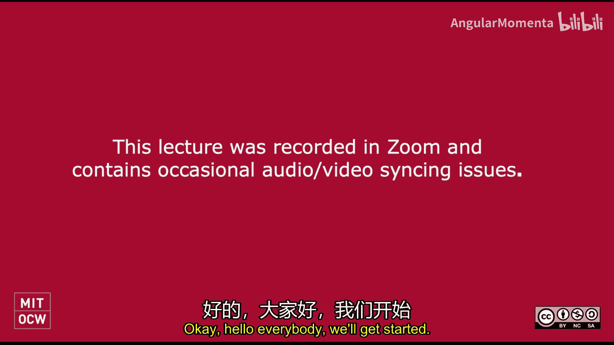
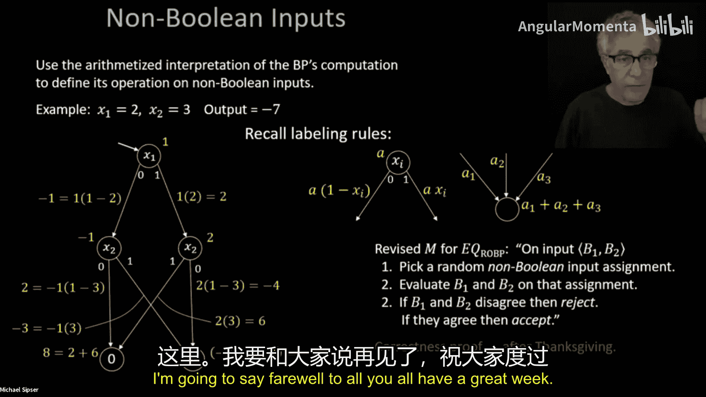
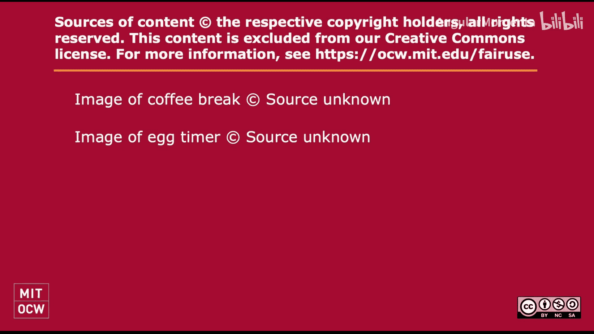
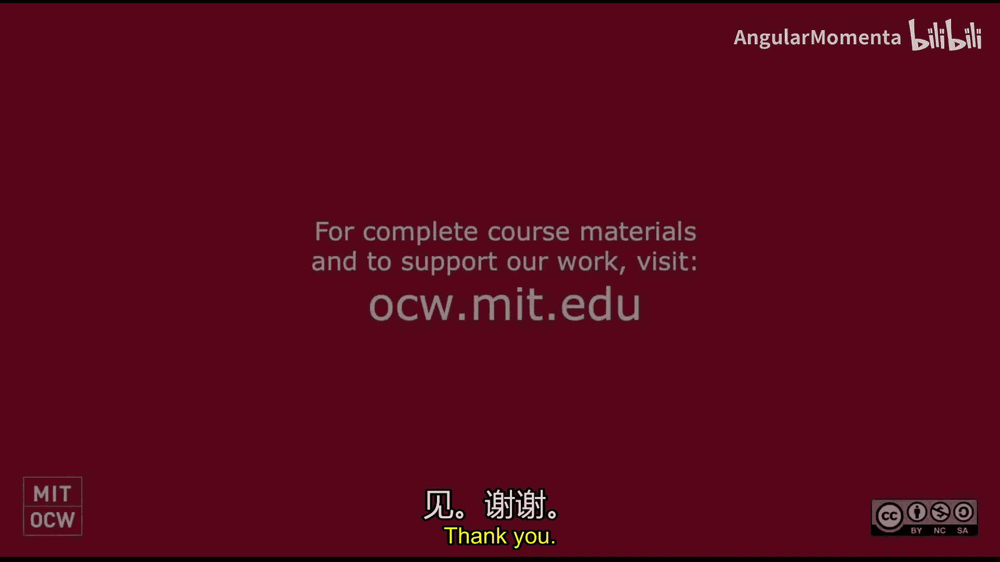

# 【麻省理工】计算理论  ｜  MIT 18.404J Theory of Computation, Fall 2020 p22 23. 概率计算，BPP -BV1pt7GzeEjb_p22-

Okay， hello， everybody。We'll get started。嗯。So just recapping what we did。Um。

AIn the last lecture on Tuesday。We。Had a。It was kind of a two the second part of a two lecture sequence on the hierarchy theorem。

Hier are hierarchy theorems for time and space。And using the hierarchy theorems to show that there is a problem which is intractable。

 that's provably outside of polynomial time。And that was this equivalence problem for regular expressions with exponentiation。

And then we had a short discussion about oracles and the possibility that similar methods might be used to show that satisfiability is outside of P。

 which would then of course solve the P versus NP problem and argued that it seems unlikely this kind of a metatheorem not well well defined notion。

 but seems unlikely that the methods that were used for proving。

The intractability equivalence of regular expressions with expiation could be used to solve P versus NP。

 at least the diagonalization method kind of in a pure form， whatever that means。

 that's not going to be enough。So today we're going to。

Shift gears again begin a somewhat different topic， which is really kind of going to be our。Again。

 a few lectures on probabilistic computation， which is going to wrap round out the semester for us。

 and we're going to start by talking about a different model of computation。

 which allows for probabilism in the measuring the amount ofbilism while measuring allowing for probabilism in the computation。

 define an associated complexity class， this class PPP。

 and then start the discussion of an example about something called ranging programs。Okay。

So with that in mind。呃。嗯。A。呃。So we're going to start off by defining the notion of a probabilistic。

Turing machine or PTM。A probabilistic touring machine is a lot like the way we have thought about non deterterminist touring machines。

In that it's a kind of a machine that can have multiple choices。

 multiple ways to go in its computation， so there's not just going to be a fixed deterministic path of its computation。

 but there's going to be a tree of possibilities and for our purposes we're going to limit the branching in that tree to be either。

A step of the computation with is no branching where it's a deterministic step as shown over here。

 so every step of the way leads uniquely to the next step or there might be some steps which have a choice and we're only going to allow for these purposes to keep life simple having only a choice among two possibilities and we'll associate to that。

The notion of a probability that each choice will have a 50，50 chance of getting taken。

And this kind of corresponds with the way some of us or some of you think about nondeterminism。

 which is not exactly right up and up until this point is that the machine is kind of taking a random branch。

 really we don't think about it randomly until now now we're going to think about the machine is actually taking sort of picking a random choice among all the different branches that it could make and picking a choice kind of uniformly by flipping a coin every time it has an option of which way to go Now you could define I'm getting a question here。

 a machine that has several different ways to more than two ways to go and then you would need to have a three- way coin a four- way coin and so on and you could define it that way as well but it doesn't end up giving you anything different or anything interesting or new for the kinds of things we're going to be discussing so and it's just going to be simpler to keep the discussion limited to the case where the machine can only have two possibilities if it's going to be having a choice。

Or just one possibility when there's no choice。Okay so so now we're going to have to talk about the probability of the machine taking a sub branch of its computation。

 so you imagine here here is the same computation tree that we've seen before in the case of ordinary nondeterministic machines where you have M onW there could be several different ways to go and there might be some particular branch。

 but now we want to talk about the probability that the machine actually ends up picking that branch。

And it's going to be。You knowWhen we talk about the machine having a choice of ways to go。

 we're going to associate that with a coin flip， so we're going to call out a coin flip step when the machine has a possibility of ways to go and so on a particular branch the probability of that branch occurring is going to be one over two to the number of coin flips。

Coin flip states on that branch。And the reason for， I mean， this is kind of the the。

The definition that makes sense in that if you imagine looking at the computation tree here and here is the branch that we're focusing on of interest。

 every time there's a coin flip on that branch， there's a 50。

50 chance of taking a different branch or staying on that branch。

So the more coin flips there are on some particular branch。

 the less likely that branch would be the one that the machine actually ends up taking。

And so it's going to be one over two to the number of coin flips。

And that's the way we're defining it。Now， once we have that notion。

We can also talk about the probability that the machine ends up accepting because as before。

 each of these branches is going to end up at an accept state or reject state。

 thinking about this only in terms of deciders。And。

The probability of the machine accepting here is just going to be the sum over all probabilities of the branches that end up accepting。

So just add up all of those probabilities of a branch leading to an accept。

 and we'll call that the probability that the machine accepts its input。嗯。

And the probability that the machine rejects is going to be one minus the probability is that it accepts。

Because its the machine on every branch is either going to do one or the other。Okay。Now。

 if you're thinking about a particular language。That the machine is trying to decide。

 This probabilistic machine now is trying to decide。Um， you know。On each input。

Some of the branches of the machine may give the correct answer。

 they're going to accept when the input is in the language， other branches may give the wrong answer。

 they may reject when the input is in the language and vice versa。

So there's going to be a possibility of error now in the machine in any particular branch。

 it might actually give the wrong answer。😡，And what we're going to say is bound that error over all possible inputs。

😡，UAnd and we'll say that the machine for any epsilon greater than or equal to zero。

 we will say that the machine decides the language with error probability epsilon。

If that's the worst that can possibly happen， you know， if every for every input。

 the machine gives the wrong answer。😡，With probability at most epsilon。😡，Equiently。

 if you like to spell it out a little bit more， a little differently。

For strings that are in the language， the probability that the machine rejects that input is going to be at most epsilon and for strings in the language。

 the probability for strings not in the language， the probability that accepts is at most epsilon。

So again， this is the machine doing the thing that it's not supposed to be doing for things in the language。

 it should be rejecting very rarely for things not in the language it should be accepting very rarely。

 and that's what this bound is doing for you。😡，Okay。So let's just see。

So we'll talk about so I'm getting some questions here about。嗯。嗯。

So let me just look at these one second here。Yeah， so probability zero so there's a possibility that the machine might have a probability zero say of accepting that means there are no branches that it end up accepting or probability zero rejecting there were no rejecting branches I think we're going to talk in a minute about the connection between this and the standard notion of NP so just hold off on that for a second。

啊。Also about what about the possibility that the machine is you？

Being a decider or running in a certain amount of time。

 so we will look at timebounded machines in a second on the next slide or two。

 talking about machines that run in polynomial time so that means all branches have to hold within some polynomial number of steps so that's where we're going but for the time being we're only looking at deciders where the machine has to hold on every branch。

 but some branches might run for a long time， but for now we're not going to be thinking about machines that have branches that run forever we're all of our machines at deciders so they hold on every branch。

See is anything else here no so why don't I move on so let's define now the class bpp using this notion of a probabilistic Tring machine。

 which is now going to be running in polynomial time。

So BPPP is going to be another one of these complexity classes。

 a collection of languages like P and NP and P based and so on。

 but it's going to be now associated with the capabilities of these probabilistic machines。

 the kinds of languages that they can do。So we'll say the class BppP。Is the set of languages a？

Such that there's some probabilistic polynomial time。😡，Duringuring machines。

 so all branches have to hold within， you know enter the cave for some k。

So somenomial polynomial time probabilistic Turing machine decides a with error possibility at most one third。

So in other words。When it's accepting for strings in the language。

 the machine has to reject with it most one third， so saying it equivalently for strings in the language。

 it has to accept。With two third probability and for strings， not in the language。

 it has to reject with two third probability， at least。In both cases。Um， okay。嗯。Somehow。

 ended up with。Didn't check my animation here， but okay， that's fine。 So there is a。呃。Now。

 if you look at the one third here in the definition。You know。

 it seems strange to define a complexity class in terms of some arbitrary constant like one third why didn't we use one quarter you know or。

You know，1/1 in the definition of BPP。And say the machine has to have an error with at most 11th or 100th well。

 it doesn't matter， and that's the point of this next statement called the amplification lemma。

Which says that。You can always if you have a machine that's running in a certain polynomial time that's running within this with a certain error which is most one half if you have an error one half is not interesting because the machine could you just flip a coin for every input and it could get the right answer with probability one half so probability one half is not interesting you have to have probability strictly less than one half for the machine to actually be doing something that's meaningful about that language。

 so if you have a。Pbabilistic tuuring machine that is error。Let's say epsilon one。

 which is at most half， which is less than one half。Then you can convert that to any。

Eror probability you want for some other。Polynomial time probabilistic touring machine。

 so you can make that error， which maybe starts out as one third and you can drive that error down to one one over a Google。

嗯。And seriously， you can really make the error extremely， extremely small。

Using a very simple procedure， and that's simply this。

So if you're starting out with a machine that has an error possibility of one third， say。

 so that means two thirds at the time it's going to get the right answer and at most one third of the time。

 at least two third of the time， the right answer， most one third of the time， the incorrect answer。

 whether that's accepting or rejecting。And now you want to get that answer down to be something much that error down to something much smaller the idea is you just you're going to take that machine。

And you were going to run it multiple times。Kind of with independent runs， if that mean。

 if you want to think about it， it's sort of more formally speaking， but it's sort of intuitive。

 you're just going to run the machine。Tossing your coins instead of just running it once you're going to run the machine a0 times or a million times。

 but you can do that's say it's a constant factor and even a thousand times is going to be enough to increase your confidence in the result tremendously because if you run the machine a thousand times。

And 600 of those times the machine accepts， and 400 of the time the machine rejects。嗯。

It's very powerful evidence that this machine is biased toward accepting。

 that it's accepting most of the time。So its was。呃。If it had an error probability in most one third。

 the probability that you're seeing it accept 600 times when really two thirds of the time it's rejecting overall is extremely unlikely。

And you can calculate that， which we're not going to bother to do。

 but it's a routine probability calculation to show that the the probability that if you run it a whole bunch of times and you see the majority coming up。

 which is not the。Not the right answer， that's extremely the probability of that is extremely small。

So I'm not saying that very clearly， but the method here is you're going to take your original machine。

Which has error probability 13。Or whatever whatever it is you know you know。

 maybe has error probability 49% and you run it for a large number of times and then you take the majority vote。

And you're kind of sampling the outcomes of this machine and if you take enough samples。

 it's overwhelmingly likely since you're just doing them uniformly。

 you're taking those samples uniformly， it's overwhelmingly likely that you're going to be seeing the predominant one come up more often and exactly what that right value is we're not going to bother to calculate。

 but that's something that you know if you I will I'll refer you to the textbook or you know this is the kind of thing that comes up in any elementary probability book and its sort of very intuitive so I don't want to spend the time and do that calculation which is not all that interesting。

Okay， so just one quick question here that I'm getting what happens if you bound if the error is greater than a half。

 I don't think that because we're bounding the error。

 so we're not saying the error actually is one you know like 60% is on everything because then if you knew the error was 60% guaranteed you can always just flip your answer around and get your error to be 40%。

 but you know I'm saying the error that most。Whatever epsilon is and so if it's you're saying the errors is at most 60%。

 it doesn't tell you anything。嗯。Okay。诶。Another question is does the amplification Lemmo also justify that the choice of model with binary branching choices is equivalent to any other perhaps you could say that because you can change those you know if you had through three way branching you can simulate that with two way branching to any accuracy that you want you know not going to get it down to zero but you're going to get it very close so it's maybe the amplification lemmo maybe yeah sort of all related。

Okay， let's move on。So。The way that it's helpful to think about this class。

 let's contrast it with the other model of nondeministic computation that we have is non determinism is NP。

Somin the un model of non deterministic polynomial time computation was NP， the other class。And。

So the way。It's I think one way to look at think about nondeterminism in the case of NP is for strings in the language for your NP Tring machine。

 there's at least one accepting branch， so I'm indicating the accepting ones in green and the non accepting one the rejecting branches in red。

So you could have almost all of the branches be rejecting branches for strings in the language as long as there is at least one accepting branch。

 that's just the way nondeterminism works， the accepting branch overrules all of the others it's only when you're not in the language that all of the branches turn out have to be rejecting。

That's when they're rejecting sort of you know，'s it has no accepting branch to overru it。

 but the situation for BPP is a little different is different there it's kind of majority majority roles。

So in the case for strings in the language， you need to have。A large， you know。

 the the overwhelming majority of the。Branches have to be accepting and for strings not in the language。

 the overwhelming majority have to be rejecting。What you're not going to allow in the case of BPP is kind of you know。

 an in between state where it's sort of 50，50。Or very。

 very close to 5050 those kinds of machines are not don't qualify as。Deciding a language in BPP。

 they always have to kind of lean one way or lean the other way for every input。Otherwise。

 you won't be able to do the amplification， so it needs to have some bias away from in half in accepting or rejecting。

m so let me so I was going to ask a check in I think at this point yes let's so just thinking about BPpp I hope I was clear so if there's questions about that I think I've somehow didn't。

诶。I'm not sure I describe it totally well here， so I'm going to ask a few questions about PPP。

 but if you have any questions for me first。Go ahead。嗯。Okay， why don't we just run the check in？嗯。

Let me launch this and then I can answer questions as you're asking。Can I start that yeah okay。

 so you have to。Check all of these that you think are true。

Can you think of non deterministic trim machines as try old branches at once？

And get the right answer。嗯。And BPp is guess only one branch。I don't know。You know。

 I would say a little differently， I would say I would think of nondeminism as you can still just try one branch。

 but you always guess the right one。So there's some sort of， you know。

Magical power that allows you always to guess the right answer if there's the right guess if you're in the language in the case of BPP。

 you're going to be picking a random branch no matter what。

And you know that the random branch is likely to give the right answer， but not guaranteed。

And the amplification limitma tells you you can arrange things so that it's extremely likely。😊。

That the random branch is going to give you the right answer。Okay。

 let's see how we doing on our check in here。Got lot vote got a lot of support for all candidates。嗯。

And。I'll give you another。A little bit of time here because there's a bunch of questions。

 almost like four check ins at once。But we have two more real checkins coming later。Okay。

 so why don't we come and let's give it another 10 seconds and then we'm going to stop。Closing down。

One， two， three， close。Okay， so we've got a lot of support here and in fact。

 that's good because all of them are true。Some of them are easier to see than others。

 so first of all C is very easy to see because that's going to be a machine that has the correct answer all of the time。

 so that's error probability zero on both accepting and rejecting。U。This is a little harder。

 D is a little bit harder to see that's in peace space。

 but you you could calculate for every branch what its probability is。

 and you can just go through all the branches and add up all of those probabilities in a peace space machine。

So you have to think about it a little bit， but D is not too hard to see either closure under complement。

 if you just take your your BPP machine and you flip the answer on every branch that typically doesn't work in nondetermin ordinary nondeterminism but it does work here because it's going to change a bias toward accepting into a bias toward rejecting and vice versa。

 so BPP is closed under complement。And closure under union。

 it kind of follows from the amplification Lemma， as long as you can make the probability extremely small。

 then you can just run the two different machines。And even though they each might make a mistake cumulatively。

 the total loop。The probability that each one of them that either of them will make a mistake is still small。

 and so you can just run to the two machines and take the oe of the responses that they get and it's still very likely to give you the right answer for the union。

Okay。Let's continue。呃。So what I'm going to do now for the rest of the lecture is and it's actually going to spill over into the lecture after Thanksgiving because it is going to introduce an important method for us。

If to look at an example of a problem that's in BPP， I love to teach things by using examples。

 and so this is a very good example because it has a lot of meat to it。

And it's a very interesting example in general， proving things in BPP which are not trivially there because they're already in P。

 they tend to be somewhat more involved than some of the other algorithms we've seen。

 so there are no simple examples of problems in BPP which are not already in P。So this is。

One example that we're going to go through of a problem in BPPP that's not known to be inP。

Of course things could collapse down， but as far as we know， this is not this language is not in P。

 so let's see what the language is has to do with these things called branching programs。

 a branching program。Is a structure that looks like this， so let's understand what the pieces are。

First of all， it's a graph， directed graph。嗯。And we're not going to allow and there are no cycles allowed in this graph。

 it's a directed acyclic graph。So you can no loops allowed。And the nodes are in two categories。

There are query nodes which are labeled with a variable letter。😡，And output nodes。

 which are labeled either zero or one。And lastly， there is a one of the query nodes is going to be or one of the nodes is going to be designated as a start。

Okay， and so what you do is。The way this is a model of computation and the way we actually use a branching program。

Is we。Have some assignment to the variables， that's going to be the input。😡。

So you take all of the variables， there are three variables in this case， x1 x2 and x3。

 you give them some a truth assignment， so x let's say zero and1。

 so x1 is0 x1 is one or whatever and once you have the truth assignment you start at the start variable。

And you look at its label。And you see what value the input has assigned to that variable。

So if x1 assigned a1， you're going to follow down the one branch， if it assigned to zero。

 you follow you go down to zero branch， and then when you get down to the next node。

That's another variable that you're going to have to query of depending upon what the input assignment is。

And you're just going to continue that process。Because there are no cycles。

 you're going to end up at one of the output nodes， because all of the variable nodes。

 all the all the query nodes have two outgoing edges， one labeled zero， one labeled one。

So you're going to eventually end up at an output node and that's going to be the output of the branching program so we'll do let's do a quick example。

 so if x1 is1 x2 is0 and x3 is one so we again we start at the start the start node that has the indicated with thearrow coming in from nowhere so you're going to start at x1。

呃。The node labeled x1 so you have to look and see what is x1 in the input。

 it's a one still going to follow down the one branch。Now you see the next node， oh， that's an x3。

See， what's x3 in the input， x3 is 1。So go down to one branch again。

Now you have an x2 node take a look at the input x2 is zero you follow the zero branch now you're at an output branch an output node so that's a zero and that's the output of this computation so writing it this way and thinking about it as a Boolean function which maps you know strings of zeros and ones we have F of101 representing those that assignment that equals zero that was the output and that's the output of this computation okay。

So important we're going to spend a lot of time。You know。

 talking about branching programs so critical to understand this model， I think it's fairly simple。

 but if you didn't get it， please ask。嗯。We can easily correct up any misunderstanding at this point。

嗯。It's not exactly the same as a DFA DFAs for one thing can take inputs of any length。

This this has inputs over some particular length where the branching program has some fixed number variables。

 this one has three so this only takes inputs of length three so there's maybe some connection to think of these estates and so on。

 but it's a different model。呃。So now we'll say the two branching programs。嗯。Let me just ask one more。

 of course， not all nodes need to be used， right？嗯。Yeah。

 I mean there's no requirement that old nodes need to be used and there even could be inaccessible nodes I'm not preventing that that that could be okay so on the particular branch certainly you're not going to you know when you're executing this。

😡，Branching program on an input， obviously certainly you're going to have a path that's going to only use some part of the tree part of the graph。

But there might be some paths that can can never occur。

 you know so if you went down x equal to one here and then x3 was zero。

 now you're rereading x1 so never you wouldn't go down this branch。

Unless you mean I think all the branches in this particular branching program could get used。

 but I didn't check that so maybe I'm wrong okay， so let's continue two branching programs may may or may not compute the same function。

We'll say they're equivalent if they do。呃。Now， two branching programss can be equivalent。

 even though they superficially look different from one another。

And we're interested in the computational problem of given two of these branching programs do they compute the same function。

 do they in other words do they always give the same answer on the setting of the input so we'll define the associated language equivalence problem for branching programs says that you're given two of these branching programs and their equivalent to be in the language we're going to sometimes write equivalentence using the mathematical notation of the three line equal equal sign。

😡，The equivalence sign。Okay， that means they compute the same， they always give the same answer。Now。

 that problem turns out to be co&P complete。As I've asked you to show in your homework， I believe。

this is not a super hard reduction， it's the in CO&P complete， by the way。

 the complement of an NP complete problem or equivalently it's a problem to which all CO MP problems are polynomial time reducible and it's in CO&P。

嗯。So。嗯。This is CoP complete。诶。That's for you to show。

 but that has an important significance for us right now because if you if。You know。

 looking at the question of whether this problem is in BPP。

The fact that it's CONP complete suggests that the answer is no。Because。If。

A CONP complete or NP complete problem more in BPP because everything else in NP or CO&P is reducible to that problem。

 then all of those NP or COP problems would be in BPP for exactly the same reason that we've seen before and that's not known to be the case and not believed to be the case so。

We don't expect that a co and Pete complete problem is going to be in BP that would be you know an amazing and surprising。

Reult so。Because and I hope I made it clear in my previous you know previous discussion that。

 you know， the BPP from a practical standpoint is very close to being like P。

 because you can make the error probability of the machine so incredibly low that。

 you know it's a comparable。呃。You know if you run the machine and the error probability is like one over Google。

 then it's sort of even greater than the probability that some alpha particle came in and flipped the value of some internal memory cell in your in your computation。

 so if you have an extremely low error probability it's pretty good from a practical standpoint。

So it would be amazing if NP problems were solvable in BPP so this is not the language we're going to use as our example。

 we're going to look at a related restricted version of this problem about equivalence for branching programs and that I'm going to introduce right now。

Okay， any questions here？Don't see any questions。Fading out。Okay。U。So let's move on。

So we're going to talk about branching programs that are what are called read once。

 read once branching programs。And those are simply branching programs。

That are not allowed to reread an input that they've previously read。😡，So for example， is this？

Branching program， a read once branching program。No。

This branching program is not a read once branching program because。mYou can。

Find a path that's going to cause you to read the same variable more than once。

 so it's not going to be a read once， so over here it's not read once because there's two occurrences of an x1 on the same branch。

Now you might ask why would anybody want to do that because you've already read the value of x1 well。

 in the case of this particular branching program， there might be a value because you could have got to the X Xx1 branch by going this way or that way。

嗯。But that's a separate question if we restrict our attention to read ones branching programs。

 then the problem of testing equivalence becomes。very different in character and in fact。

 we're going to give a probabilistic algorithm， a BPP algorithm to solve that problem。

 so the equivalence problem for read one branching programs which are not allowed to reread variables on any path。

Um， that's interestingly going to be solvable with a probabilistic polynomial time algorithm。

 you know， with a small error probability。嗯。So i'm going to run a check in now but let's make sure we're all together on this so I got a good question here can every boolean function be described by a branching program yes that's an easy exercise but you can make branch branching programs are they may be a large。

But you can describe any bulloleying function with some branching program that's not hard to show。

Um other question we all together on understanding what read once means and branching programs and all that stuff。

 this is a good time to ask if you're not。Um。Okay， so let's do the check in。So。As I pointed out。

 we will show that the equivalence for Readed once branching programs is solvable in BPP。

Can we use that to solve the general case for branching programs？

By converting general branching programs to Read once branching programs and then running the Read once test。

So。What do you think？Okay， I'm seeing a lot of。Correct answers here。

 so let let's wrap this one up quickly。It's another 10 seconds， please。Okay， ready， are we all ready？

One， two， three， closing。All right， yes， most of you have。Answered correctly well。

 answer a is not a very good answer because we already commented on the previous slide that we don't know how to do。

The general case in BPP so it would be kind of surprising if right here i'm saying yes。

 we could do it by using the restricted case so。啊。You know I think a better answer would be to one of the no。

 but as I did comment， you can always convert， you can always do any bulloleying function with a。

Well maybe I didn't say it for read once branching programs but you even read once branching programs can compute any Boolean function。

 so the conversion is possible， but in general will not be polynomial time and if you imagine even trying to do the conversion over here you could convert this branching program to read once but you'd have to basically separate the instead of rereading the X1 you could remember that x1 value but then you would not be you couldn't reconverge over here you'd have to keep those two threads those two branches of the computation apart those two paths apart from one another and already the branching program would start to increase in size by doing that and so in general。

ConConing is possible， but it requires a increase in the size。

And that will not allow a polynomial time algorithm anymore， even in the probabilistic case。嗯。Okay。

 so now let's start to look at the possibility of showing that this equivalence problem is solvable in BPP。

And it's going to take us in kind of a strange direction。

 but let's let's try to get our intuition going first by doing something which seems like the most obvious obvious approach so here so we're going to give an algorithm now。

hich is going to be an attempt， this not going to work。

 but nevertheless it's going to have the germ of the right idea or not the germ。

 but the beginning of the right way to think about it。

So here are the two branching read once branching programs are B1 and B2。And I want to see。😊。

Do they compute the same function or not？So one thing you might try is just running them on a bunch of randomly selected。

Assignments or inputs。😡，Right， so you going you can just take two random input assignments。

 just take x1。Flip a coin to say it's one of zero x do the same for x2 and so on。

 then you get some input assignment， you run the two branching programs in that assignment。

And maybe that doesn't give you know， even if they agree。

 it doesn't give you a lot of confidence that you got the right answer that they're really equivalent。

 so you do it 100 times， whatever some number of times。Of course。If。🤢。

They ever disagree on some assignment， on one of those assignments。

 then you know they're not equivalent and you can immediately reject。😡，嗯。

But what I'd like to say is if they agree。On those。You know。

 hundred0 tries those hundred assignments there then there then they are。呃。

At least I haven't found a place where they disagree， so I'm going to say that they're equivalent。

Is that a reasonable thing to do well it might be it depends on k so the critical thing is what value of k should you pick？

Which is going to be big enough to allow us to draw the conclusion that if you run it for k times and you never see a difference。

 then you can conclude。With good confidence that the two branching programs are equivalent because。

You've tried to look for a difference and you never found one。Well， the thing is， is that。嗯。

K is going to have to be pretty big。呃。So looking at it this way。

 if the two branching programs were equivalent。Then certainly。

 they're always going to give the same value。So the probability that the machine accepts is going to be one and that's good。

Because we want for this is a case when we're in the language。

 we want the probability of acceptance to be high and here the probability of acceptance is actually one。

So it's always going to accept when the two branching programs were equivalent。

But what happens when the branching programs are not equivalent？

Now we want the probability of rejection to be high。

 the probability of acceptance should be very low。嗯。Right， so if they're not equivalent。

 we want the probability that the machine rejects is going to be。Hi， if they're not equivalent。

 because that's what the correct answer is。Well， the only way the machine is going to reject。

If it finds a place where the two branching programs disagree。But but those two branching programs。

 even though not equivalent。Might disagree rarely。They might only disagree on one input assignment out of the two to the end possibilities。

😡，So these two inevalent branching programs might agree almost everywhere just except at one place。

 and then that's enough for them not to be equivalent。

 but the problem is that if you're just going to do random sampling，😡。

The likelihood of finding that one exceptional place where the two disagree is very low。

 you're going to have to do an enormous number of samples before you're likely to find that point of difference。

😡，And so。嗯。In order to be confident that you're going to find that difference， if there is one。

 you're going to have to do exponentially many samples and you don't have time to do that with a polynomial time algorithm。

嗯。You're just going to have to flip too many coins you have to run too many different samples。

 different assignments through these two machines because they're different。

 but they're almost the same。So we're going to need to find a different method。And。

The idea is we're going to run these two branching programs。In some crazy way。

Instead of running them on zeros and ones the way we've been doing it so far。

 we're going to feed in values for the variables， which are nonbuolean。

They are going to be going to set x1 to2， x3 to seven， x4 to 15。Of course。

 that doesn't seem to make any sense， but it's nevertheless going to turn out to be useful。

 a useful thing to do and it's going to give us some insight into the equivalentvalence or inequvalence of these branching programs。

Okay， so let's just I think are we at the end of yeah we're at that break here so why don't I i'm getting some questions coming in。

 which is great I will answer those questions， but why don't I start off our。Break and then。呃。Okay。嗯。

嗯。Okay， so。There's a question about whether this machine runs deterministically or not。

 so which machine are we talking about so the branching programs themselves that they'd run deterministically。

 you give them an assignment to the input variables。

That's going to determine a path through each branching program。

Which is eventually going to output a 0 or a 1。And you want to know。

 do those two branching programs always give the same value no matter what the input was？

But the branching programs themselves were deterministic。Now the machine that's trying to。

Make the determination of whether those two branching programs are equivalent。

That machine that we're going to be arguing is going to be a probabilistic machine。

 so it's a kind of nondeterministic machine that's going to have different possible ways to go depending upon the outcome of its coin tosses。

So what you can think of as non determinism in the ordinary sense that it has a tree of possibilities。

But now， you know， the way we're thinking about acceptance is different， you know。

 instead of accepting if there's just one except branch。

The machine for it to accept has to have a majority of the branches be accepting。And。

So there's some similarities， but some differences with the usual way we think of nondeminism。

So what's the motivation behind introducing this type of turing machine？Well， I mean， there's a lot。

I guess there are two motivations。呃。嗯。Probabilistic algorithms sometimes called Monte Carlo algorithms turn out to be useful in practice for a variety of things and so that led to。

People to think about them in the context of complexity。

 they're related in some ways to quantum computers。

 which are also probabilistic and in a somewhat different way， but they also have a very nice。呃。嗯。U。

Formulation in complexity theory so complexity theorists like to think about probabilistic computation because I mean you can do interesting things with probabilistic machines and the complexity classes associated are also interesting so as you'll see it leads us in an interesting direction to consider how to solve this problem this read one branching program problem equivalentvalence with a probabilistic machine it's just an interesting algorithm that we're going to come up with。

嗯。嗯。So in our proof attempt， where did we use the probabilistic nature for BPP because we're running the two branching programs on a random input？

嗯。I mean， so you know， you have your two branching programs。

 you pick a random input to run those two branching programs and you see what they do。

So that's why it's probabilistic。When you think about random behavior of the machine。

 that's a probabilistic machine。So each branch of the machine is going to be like the way we normally think about nondeminism。

 somebody's asking whether we think of the complexity of the machine in terms of all of the branches of the machine or each branch separately。

 we always think about for nondeterministic machines， each branch separately。

I'm not totally sure I understand the question there。

 so are all the inputs built in and we randomly choose one through coin flips。

I' try I understand that question either， we're given as input to two branching programs。

And then we flip coins， you know， kind of using our non determinism。

You can think about it equivalent in terms of coin flips to choose the values of the variables。

 so now we have a set of inputs to the values of the variables and we use that to as input to the branching programs to see what whether they to see what answers they give and in particular whether they give the same answer on that randomly chosen input。

Let's move on。All right， so now sort of moving us toward。The actual BPP algorithm for。

Read once's branching program equivalence。Testing， we have to think about a different way to。

We need an alternate way of thinking about。The computation of a branching program。

It's going to look very similar， but it's going to lead us in a direction that's going to allow us to talk about this these nonbuolean inputs that I refer to just kind of where we're going。

 we're going to be simulating branching programs with polynomials。

 if that helps you sort of as an overarching plan， but we'll get there a little slowly。So okay。

 here's a branching program。Read onces branching program。

 we're not going to use the Read once feature just yet， but that'll come later。

 but anyway here's a branching program。嗯。呃。And。Oh my my put crashed herell start that again。Okay。

 so we take an input。Whatever it is and thinking about the computation of the branching program so we're not thinking about the algorithm right now。

 we're just thinking about branching programs for the minute we're going to get back to the algorithm later。

嗯。So the branching program follows a path。As I indicated， when you have a particular input。

 you x1 is0， x2 is one。X3 is1， so the output is going to be one in this case。Okay。呃。So。

The way I want to think about this a little differently。

Is I want to label all of the nodes and all of the edges。With a value。

That tells me whether or not this yellow path went through that notor edge。😡。

It's going to be just doing the same， but。You may think this is no difference at all。

 but I want to label all of the things on the yellow path， I want to label them with one。😡。

And all of the things that are not on the yellow path， I'm going to label with a zero。

So I'm keeping those trying to keep those labels apart from the original branching program which are written in white。

 these labels are written yellow。But these labels have to do with the execution of the branching program on an input。

So once I have an input， that's going to determine a one or zero label for every node and edge。Now。

 if we want to look at the output from this branching program after we have that labeling。

 we only have to look at the label of the one output node because that's if that one has a one on it。

 that means that the path went through that one and so therefore we should output output output the output is one。

嗯。So I'm going to give you another way of assigning that instead of just coming finding the path first and then coming up with the labeling afterward。

 I'm going to give you a different way of coming up with that labeling。

 kind of building it up inductively starting at the start node and building up that labeling。

 you'll see what I mean by my example。😡，So if I have a label on this node。😡。

So I already know whether or not the path went through that node。😡。

Label one means the path went through it， label zero means the path does not go through it。

That's going to tell me how to label the two outgoing edges。So if I've already labeled this with a。

 with a is a zero or1。Then what expression should I use？Under what circumstances will I label。

 what's the right label for this one outgoing edge here？😡，Well， if a is zero。

That means we know the pathf did not go through this node。

 so there's no way it could go through that edge。😡，Similarly， if X I。Is a zero。

That means even if we did go through that node， the path would go through the other edge。

 other outgoing edge and not through this one， so that tells us that the Boolean expression which describes the label of this node in the execution is going to be the and of the value on the node and the query variable of that node。

😡，Now， think about what's the right way to label the other edge？

The execution value of the other edge。Again you have to have go through this node so a has to be1。

 but now you want X to be zero in order to go through that edge。

 so that means it's going to be a and the complement of Xi。😡，Okay。

 so this is going to just tell me this I'm writing now formula for how we labeling these edges。

Based on the label of the parent node。Similarly， if I have a bunch of edges where I already know the values。

 the labels， the execution levels there， let's say so I have A1a2 and A3。

 what is the right label to put on this node？嗯。Well， if any one of those is a one。

 that means the path wentdled through that edge， and so therefore it's going to go through that node。

 so that tells us that the label to put on that node is the or of the labels on the incoming edges。😡。

Okay， questions on this。So now this is kind of setting the stage。For。

Starting to think about this more toward polynomials instead of using a Boolean algebra。So we。

I'm getting question， how do we know what the execution path is， which nodes to label。

 we're going to be labeling all of the notes。😡，So we start off with labeling the did I say that here。

 we should we start up I didn't say but I should have we label the start node with one that because the path always goes through the start node so without even talking about a path we just label the start node one。

Maybe we'll do an example of this also。Now once we label this node one， we have an expression。😡。

That tells us how to label the two outgoing the two outgoing edges， this edge and that edge。

 and I'm doing it without knowing the values of the variables I'm doing it kind of I'm just making an expression which is going to describe what those labels would be once you tell me what the input assignment is。

😡，Okay， so I'm just sort of it's almost like a symbolic execution here。

 I'm just writing down the different expressions for how to calculate what these things should be。嗯。

Let me maybe this will become clearer as we continue。

So the poll now this is the big idea of this proof。

We're going to use something called arithmatization。

We're going to convert from thinking about things in the bulloleing world to thinking about things in the arimetical world where we have arithmetic。

Over integers， let's say for now， so instead of ans andnos we're going to be talking about pluses and types。

And。We're going to， the way we're going to make the bridge is by showing how to simulate the ans and oars。

The hand andno operations with the plus and times operations。

 so assuming one means true and zero means false。If you have。The expression A and B。

As a Boolean expression。We can represent that as a times B。Using arithmetic。Because。

It computes exactly the same value when we have the Boolean representation of true and false being one and zero。

So， you know， one and one is one and one times one is one。And anything else， you know， one and zero。

 zero and1， zero and zero。If you apply the timess operator you're going to get the same value。

 so times is very much like and in this sense。😡，Okay。

 we're going to write it as just AB usually without the time symbol。So if we have a compliment。

How would we simulate that with arithmetic？Well， again， here we're just flipping one and zero。诶。

In using the complement operation， that's going to be the same as subtracting the value from one that also flips it from between one and zero。

How about war if you have A or B？Well， it's slightly more complicated。Because you use a plus B。

But you have to subtract off the product because。What you want is this this。

Simulation should be give you exactly the same value so what if you have one or one。

You want that to be a one answer， you don't want it to be a two。

So you have to subtract off the product。And the goal is is to have a faithful simulation of the and and or by using plus in time。

 so you get exactly the same answers out when you put in Boolean values here。Okay， so。

Just to say where we're going what this is going to。You。

 sounds superficially we haven't really done anything。This is。

But what this is going to enable us to do is plug in values which are not boolean。Because， you know。

 it doesn't make sense to talk about， it makes sense to talk about one and zero。

 but it doesn't make sense to talk about two and three。😡。

But it does make sense to talk about two times three。And that's going to be useful。Okay。

 so let's just see。呃。Remember that。That inductive labeling procedure that I described before where I labeled gave the execution labels on the edges depending upon the label of the parent node and which node which variable is being queried so if I know that this value is an a but now the。

Okay， so i'm just going to write this down using arithmetic instead of using boolean operations。

 so before we have this was a A and X if you remember from the previous slide。Um。

 now what are we going to use instead because we're going to use this conversion here instead of and we're going to use multiplication。

That's just a times Xi。What about on this side here was a and the complement of Xi。Now。

 the complement of Xi is1 minus Xi。InArithmettically， so this becomes a times1 minusxii。Okay。

 similarly。Here we did the war。To get the label on the node from the labels of its incoming edges。

Now we're going to do something a little strange because we have a formula here for or。

 but for technical reasons that will come up later。

 this is not a convenient representation for us what I'm going to use instead of this one I'm just going to simply say just take the sum。

Why is that good enough？In this case， this is still going to be a faithful representation and give the right answer all of the time。

And that's because for our branching programs。Read once or otherwise， read once is not coming in yet。

For our branching programs。They're acyclic。So they can never enter a node on two different paths。😡。

Theres it most one way to come into a node on a path through the on an execution path through the branching program if it comes in through through this edge。

 there's no way for this edge to also have a path because that means you have to go out and come back and。

have a cycle in the branching program which is disallowed。

 so at most one of these edges can have the path go through it。

So at most one of these A's can be a one， the others are going to be zero。

 and therefore just taking the sum is going to give us a value of either zero or one。

 but it's never going to give a value higher， and so you don't have to subtract off these product terms。

😡，Okay a little bit complicated here if you didn't totally get that， don't worry for now。

 you know we're more concerned that you get the big picture of what's going on。嗯。Okay。

 so I think we're almost。Let me just see how far we are。Yeah。

 so I'm just going to work through an example and I think that'll bring us。

Let's just see if we do any questions here。Not seeing any， it means you're either old。

Totally understanding or you're totally lost I never can tell so feel free to ask a question if you're even if you're confused you know I'll do my best。

Okay， maybe this example might help。So now what we're going to do is using this sort of arithmetical view。

😡，Of the way I。Brananding programs， computation。Is executed when we're running it。

You know an input through it this is going to allow us now to give a meaning to running the branching program on non boolean inputs so maybe this example will illustrate that。

So let's just take this particular branching program here。Okay。

This branching program is just on two variables， x1 and x2。

 and actually computes a familiar function。This is the exclusive or function。

 if you look at it for a minute， you'll see that this is going to give you x1， exclusive or x2。

So it's going to be one if either of the x1 or x2 or1， but it's going to be zero if they're both one。

That's what this branching program computes。Now， but let's take a look。

At running this branching program， instead of on the usual Boolean values。

 let's run it on x1 equal to2 and x2 equal to three。嗯。Now。m you know。

 a common confusion might be that you're looking， you know， when you do the X1 query。

 you're looking for another。Outgoing edge， which is labeled too。 No， that's not what I'm doing。

 What I'm doing here is I'm somehow。Through this execution by assigning these other values。

 I'm kind of blending together the computation of X。1 equal to zero and x1 equal to1 together。

I don't know if that makes any sense， but let's go through the example so first of all。

 these are the labeling rules that I had from。The previous slide。

When I used plus and times instead of Andonor。Okay。

Now I'm going to show you how to use that to label the nodes and edges of this graph based on this input。

And that'll determine an output。Would be the value on the OneNote。Okay。

 so we always start out by labeling the start node with one。That's just the rule。嗯。And okay， sorry。

 let's think about it together before I blurt out the answer。

What's that going to be the label on this edge？So this is one of the outgoing edges from a node that already has a label。

 so that's going to be this case here。And what we do is if we take the label of that node。

And since it's a one edge that's outgoing。We multiply that label by the value of that。呃。

Variable of the assignment to that variable。So x1 is2。So we take the a here is1。

 x1 is assigned to two， so it's going to be one times two。Is going to be the value。

 the execution value we put on this edge， so it's going to be two。

What's going to be the value we put on the other edge， the other edge。

 the zero outgoing edge from x1？So why don't you think about that for a second。

So now we're going to use this expression。It's a times 1 minus Xi。And so X I again， is2。

 so1 minus X is 1 minus2。Does that mean that's how complimentate but okay let's say that so it's one minus two so that's minus one times the label one here。

 so you get minus one is the label on the edgech。Now。

mKeep in mind that if I had plugged in and this is very important。

 if I had plugged in Boolean values here。😡，I would be getting out the same Boolean values that you would get just by following through the path。

The things on the path would be one， the things off the path would be zero。But。

But what's kind of what's happening here is that。There's still a meaning when the inputs are not booleant。

😡，So let's continue here and how about what's going to be the value on this node？

So think with me I think it'll help you so now we're using this rule here we add up all the values on the incoming edges there's only one incoming edge which is value two so that means this guy is going to get a two and similar on this one this guy's going to get a minus one。

Now let's take a look at this edge。So this is the zero outgoing edge from a node label2 with label X2。

So this is the zero outgoing edge。The note the label is two。

 so it's going to be two times one minus the x2 value x2 is 3， so1 minus3 is minus2。

 it's going to be two times minus2。不。Which is minus- four。So similarly， you can get the value here。

 the value on the one outgoing edge is going to be two times。X the x2 value， which is three。

 so that's going to be six。And these two here。呃。So you know now we have a minus one。

And the outgoing is a zero edge， so it's 1 minus3， and here it's going to be one times minus3。The。

One times three， I'm sorry， one times  three。嗯。To you the answer is minus-3。

 so now what's the label on the zero output edge？So you have to in add up to two incoming edges here so we have。

ThisThis edge here was a two。This edge coming in here is a six， so it's going to be two plus6。

It's eight。And what about this edge this node here。

 this is an important node because this is going to be the output。So it has。嗯。诶。You know。

 minus three coming in and a minus four coming in， so you add those together。You get a minus7。I mean。

 you may wonder what？What the world is going on here there's this a lot of mumble jumbo but we're going to make sense of all this not today we're going to have to argue why this is what the meaning that we're going to get out of this is going to be。

 but the point point is that，This is going to lead to a new algorithm。

For testing this is again getting back to what we were doing。

 this is the equivalence problem for readed once's branching programs。

 so now what the new algorithm is going to do is going to pick a random nonbuolean assignment。

So it's going to randomly assign values to the x's。

And to some non bulloleing values instead of zeros and ones， we're going to plug in random。

Integer values， we'll make that clear next time what the domain is going to be。嗯。

And then once we have that non bullying assignment， we're going to value B1 and B2。

And if they disagree out there in that extended domain。

Then we have to show that they're not equivalent and we' reject。

And we'll also show that if they were equivalent， then even when we evaluate them。

 then we have to show that if they're not equivalent。

 that they're very likely to have a difference in the Naoleian domain and so if they agree。

It gives you evidence that the two are really equivalent so the completeness proof will come after Thanksgiving so with that i'm going to wish you all a nice break oh we have a check in here sorry oh yeah this is a good one。

I don't know if you're following me but。If I plug in one for x1 and y for x2。

Do the inputs in the assignment need to be distinct no？It could be the same value。

 I could be two and two here， that's perfectly valid。But here I'm going to plug in1 for x1。

 I'm going to plug in a variable for x2 y。And I'm going to do the whole calculation that I just did。

 and now what's going to be the output。And I mean， this looks like a pain to figure out you could do it。

 it looks like a pain， but let me give you a big hint。嗯。

Remember that this thing is supposed to be calculating the original branching program calculates the exclusive or function。

😡，And that means when I plug in a Boolean value。I should get the exclusive or value coming out。

So if I already know that x1 is1。Which of these is consistent with getting。

A value that the exclusive or function would compute。So let me launch the poll on that。

So we're out of time。So let's just let this run for another 10 seconds。Okay， I'm going to close this。

Ready？嗯。Yes， indeed， a is the right answer because that's one if I know that one variable is one。

 then the exclusive or is going to be the complement of the other variable。Which is1 minus y。

 so that's what you would get if you calculated this。嗯。

Because this is what we did today and feel free to ask questions so let me just so we're going to spend a good chunk i'll review this what we've done so far。

 but then we're going to carry it forward and spend a good chunk of Tuesday's lecture after the Thanksgiving break proving that this procedure that I just described work and works and it's。

It's an interesting but somewhat you know it's not such an easy proof so we're going to spend it try to do it slowly and clearly and then but this notion of arithmeization is going to be this is this was。

You know。It's an important notion in complexity and so we'll see it again coming up in another proof afterward。

InAbout interactive approved systems。Okay， so please ask questions。

So the output is the value of the one output one state， yes。That was a question I got。

Other questions。So let me say minus7 is not the x or of two and three。Oh。

What is the X or of two and three？😊，So by the way， I should say we kind of ran a little short on time。

 I'm not saying that we discovered some fundamental new truth about Xor here。

Because that would be bizarre。It really depends on the arbitrary decision that we made to say true is one and false is zero we could have come up with a different representation for true and false and then you would get a different value for X or coming out of that you know from the arithmatization that I just described but for this particular way of representing true and false that's how X or and this particular branching program that's how。

What how XO evaluates the remainder of the proof， so somebody's asking which is which is true the fundamental theorem of algebra。

 which talks about polynomials and the number of roots that you can have that's going to be that's going to be critical。

So that is the fundamental theorem of algebra， that's where we're going， good good question。

Well you know， so somebody's complaining that you know we're not taking the binary representation of two and three and taking the bit by bit XO that's I'm not you know。

 binary representation is not a part of this， we're thinking of these as two elements of a field。

Of a finite field， which we'll talk about later。The binary representation is not entering into this discussion。

嗯。So talk about why just doing the sum is enough。嗯。呃。I think that was。

So why is I mean here why is just doing the sum when I'm？

Looking at how to describe the value of this node based upon the values of all the incoming nodes。

And remember， the starting point of this is that we have to faithfully represent the Boolean logic with the arithmetic。

And then we're going to use that and extend it to non bullolean values， but as a starting point。

 we have to faithfully represent the boolean values。Now， the Booleing values。On the incoming edges。

 at most one of them can be a one。Because the ones correspond to the edges。Of the execution path。

And you can't make an execution path that's going to have two branches that's going to go through a node twice。

 because then you have a loop。😡，And we don't have no cycles allowed。Okay。

So I think where it's at four， I want to say farewell to you all have a great week and I'll see you when you get back。

