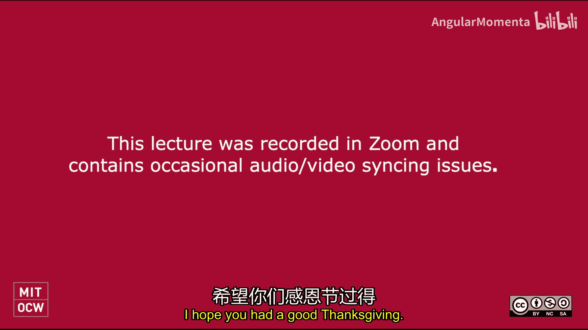
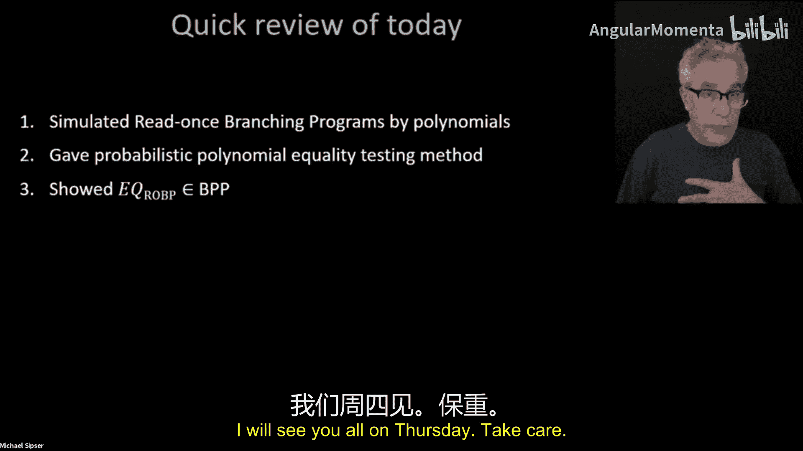

# 【麻省理工】计算理论  ｜  MIT 18.404J Theory of Computation, Fall 2020 p23 24. 概率计算（续） -BV1pt7GzeEjb_p23-

Welcome back。I hope you had a good Thanksgiving and a role refreshed。And ready to。

Think about some theory of computation we're in the home stretch now this is we have this lecture and two more to go and。

So today I have for you。A completion of the theorem we started before the break。

Where we had a where we introduced probabilistic computation。And we talked about the class BPPP。

 as I hope you remember， and we looked in particular at these problems involving branching programs。

Where we started the proof that the problem of equivalence of two read ones branching programs can be solved in this class bP so what i'm going to do is spend the first。

15 minutes or so just reviewing where we are because we started this feels like a long time ago now and I just want to make sure that you're all。

On the same page and we're all。Remembering what we were doing and then I will finish off the proof and along with doing that we'll going into introduce an important method。

Well we started that， we looked at the method of arithmeization last time， so we'll review that。

We're going to use that again in the。Work that we're going to start on Thursday on interactive approved systems。

 so this is a kind of in some ways， both an interesting theorem in its own right and a warm up for what we're going to be doing on in the last topic of the semester。

Okay。So。Let's just。Remember what we were doing。Introduce probabilistic Turing machines so those are these machines that have they're a kind of nondeterministic machine but there's a different rule for acceptance and these are also nondeterministic machines which can either make one choice just to have a deterterministic move at a step or they can make two choices and when the machine makes two choices we actually think of there being a probability there where the machine is tossing a coin to decide which branch to go on。

So with that， there is a tree of possible branches。

And the probability of some particular branch is going to be one over two to the number of coin tosses on that branch。

We then use that to define the probability that the machine accepts。

Which is the sum over all of the probabilities of the accepting branches。

And the probability that it rejects is one minus the probability that it accepts。Um。So you know。

 thinking about it， you know this。Captures the idea that if you just run the machine on a random。

Set of inputs。From the coin horses。What the probability that you're going to end up with the machine accepting？

That's the probability of acceptance defined in that way。Now。

 if we're thinking about the machine deciding some particular language。

 it's supposed to accept the strings in the language and reject the strings which are not in the language。

 but because of the probabilistic nature of the machine。

 it might get the wrong answer on some branches。And so we say that a machine decides a language with a certain error probability means that the probability of getting the wrong answer is going to be at most that error probability epsilon over all of the possible inputs to the machine。

😡，So if we say that the machine is error probability 1 third。

 that means that it gets the right answer for every every string with probability at least two third。

😡，嗯。Okay， so that led us to the definition of this complexity class BPP。

 which I don't even remember if I told you what it stands for， it's bounded。

 probabilistic polynomial time， that's what BPP stands for。And it is。

The bounded means it's bounded away from one half because we don't want to allow the machine to have probability one half because then bad things happen and the machine can just tos a coin when it decides to make an answer and not really give us any information。

U。Then we also went over the amplification Lema， we did not give the proof。

 but we went over the statement of the theorem， the proof is really just a calculation that you can drive down that error probability to something extremely tiny just by basically repeating the machine and taking the majority vote of what it does on several different runs。

 if you run the machine10 times and you see if it's mostly accepting then youre going to accept。

And the chances that the machine was really。Bs toward rejecting even though your in your samples see mostly acceptance is extremely small and you can calculate that but you can make that very tiny so small that for all practical purposes it's really giving you the right answer。

 but you know it's not deterministic so it's not quite 100% guaranteed。U。

And the way I like to think about BPP。In a in terms of the computation tree of the machine。

 so that when it's accepting， most of the branches are accepting。You know。

 weighted by their probability， of course， but most of the branches so the there are many accepting branches when you're accepting and many rejecting branches when you're rejecting。

So just another way of saying the same thing。mNow。We're going to start right jump right in with a check in and this is a little bit more。

Not exactly the material of the course， but a little bit more on the philosophical side。

 but let's just see how you do with it。When you're actually running。A probabilistic machine。

You imagine the machine as we're kind of informally describing it， is tossing coins。

Every time it has a non deterministic， every time it has a choice。

So a choice tosses a coin to decide which way to go of course。You know。

 a real computer does not have a coin to to us presumably well maybe you might actually build some hardware into the machine that lets it access randomness in some sense。

 you know， maybe it uses some quantum mechanical effect you know to get some random value or maybe it uses the time or you know I'm not exactly sure。

 you know， you can imagine having a bunch of ways of implementing that。😡。

A typical way that people implementness randomness in an algorithm is to use a pseudo random number generator。

 which is a procedure that might give you some kind of value that looks random。

 but may not actually be random， it's， for example， giving you the digits of pi， if you。

 if you want binary， expressing pi as a binary，As a binary number then you might calculate the different successive digits supply and use that as for your random number generator of course that's a deterministic procedure so it's not really random and but you know often people do use those kinds of things when they're simulating random machines so what do you think about doing that。

Could we use a random pseudoran generator as the source of randomness for a randomized algorithm？

What。Yes or no or what do you think so let's launch a poll on that and see what your're。

Opinion about using pseudo random number generators instead of truly random true randomness for our ourwl robes。

I'll give you a few seconds a minute two。Weigh in on that。ok。We're going to close this down。

 everybody's participated， who wants to， one， two， three。嗯。Okay。Yeah。

 I think probably the best answer is a let's take a look at mean there are a couple of answers here that really that don't make that aren't as good。

 I would say B well you know usually people think of random pseudo random generators as pretty fast procedures they're not not that interesting otherwise。

 so I wouldn't say that B is a good choice because you know they're usually pretty quick to implement。

C is a worse choice even because touring machines can do anything that any other algorithm can do。

 so certainly if there is such a thing as a pseudoendum number generator and there is and you could implement it on a touring machine。

D is kind of an interesting answer because you're saying， well。

 that would imply that P equals BPPP if you could actually simulate randomness with a deterministic procedure。

But in fact， the reason I would not choose D is because it's perfectly conceivable that p does equal BPppP we don't know that p is different from BPP so it's conceivable that they're equal and in fact I think if you if you poll most complexity theorists they would。

Most people in my field would believe that P does equal BPP。Just for this very reason。

That if you had sufficiently good pseudo random number generators。

 you could actually eliminate the probabilism in these probabilistic computations。

 you could just run them on pseudo random number generator and in fact there is some theory around that。

😡，That has been developed， but at the present time we do not know how to prove that there are pseudorandom number generators and it has some actually is actually in some line of this research has some connection with the P versus NP problem。

 but we don't know how to prove that there are sufficiently good pseudorandom number generators that would allow you to run them on a probabilistic algorithm and have a guaranteed behavior which is as good as running truly random numbers into the probabilistic algorithm and so the answer that I would pick would be a that you could use it sure you might get the right answer but if not guaranteed we just don't know how to do the analysis for the pseudorandom number generators and you know if you had such you had ones that were good enough they would show P is equal to BPP but that might be in fact the correct that might actually be true。

Okay。So let's continue on and。Remember now branching programs。

 you know we had these kind of networks of nodes and edges and there was a procedure you know we'll see a couple of examples again。

 some of the ones that we had from before where you you know you have branching programs look like this。

And you know you have a bunch of query nodes， you look at the settings of the variables to decide whether to go down a zero edge or a one edge and eventually you're going to end up at an output node and that's going to be the output of the branching program and in such a way these branching programs define boolean functions from the settings of the input variables to a 001 output now you might have two branching programs and wonder whether they're computing the same Boolean function or not and testing that is a coNP complete problem as you're asked to show on your homework。

Now， if the branching program， however， has a restriction， namely that it's。

Not allowed to ask to query the same variable more than once on a path。😡，Then with that restriction。

 you can we call it a read once branching program。And then the situation for testing equivalence seems to be different。

 in fact， we can give a BPP algorithm for testing the equivalentvalence of Read once branching programs。

 even though such a thing is unlikely to be the case for general branching programs because of the CONP completeness。

Okay， so I hope you're comfortable and with me on all that reasoning。嗯。诶。Okay。Let's。So。All right。

 so the idea for proving this。I what we're going to do is we're going to take the two branching programs and run them on a randomly selected input。

 but as we observed last time， if you just run them on a random randomly selected Boolean input where we assign the variable zeros and ones。

😡，Then that doesn't give you the right answer with high probability because the two branching programs might be different computing different boolean functions。

 but they differ only on a single input setting。😡，And then just picking them at random。

 you're not going to have a very high probability of finding that one place of difference。😡。

So instead， what we're going to do is define a way to run these branching programs on non Boolean inputs where the variables are set to values other than 011。

😡，2，3，7，22。And make sense of that and then argue that by running the two branching programs on a randomly selected non Boolean input。

That that's very high probability of giving you the right answer。

So somehow by expanding the domain of possibilities。

 you're going to better your chance of getting the right answer very significantly。Yeah。Okay。

 so even though these two branching programs might agree on all of the on almost all of the Boolean inputs。

 we're going to show that by。Doing this arithmetization， so this is the method。Uh， they're going to。

 if they're really not equivalent， they're going to differ almost all of the time on the expanded domain。

😡，Okay， and then we have to prove。So there is。You know， that's where today's work is going to be。

Okay， so why don't we just stop？And make sure we're all together on this。I can take any questions。

I'll also review how the arithmeization goes， but I'll do that next。So are we all okay？On this。Good。

 so let's move on。So in order to move toward understanding what it means to run the branching programs on these non Boolean values。

We're going to have to。Get a somewhat different perspective on the computation of a branching program so the standard perspective is that you take your setting your assignment to the input。

 which is011 for x1 x2 and x3。And use that to follow an execution path through the machine。

So you know， x1 is 0， x2 is 1， x3 is 1， the output is1。Okay， as I've indicated in yellow。U。

This other perspective says， well， let's let's we're going to by operate by labeling the nodes and edges of the machine and。

😡，That's going to have a very direct correspondence with the execution path perspective。

 so we're going to label all of the nodes and edges on the path with a one。As indicated in yellow。

And all the nodes and edges that are not on the path。

 all the other nodes and edges are going to be labeled zero。😡，ok。So by following the ones。

It's like the breadcrumbs， you know and gral， these are this is the path you need to follow to get through the machine。

The zeros are the places where you don't go。嗯。Okay， so the output label here。

 the output is going to be the label of the one output node。Whatever you' labeling that。

 because if it's a one， that means the path went to the one and if it's a zero。

 that means the path didn't go to the one and went to the zero。😡，Okay。

 so so just by looking at this value， you can see what the output of the machine is。All right。

 so let's。Describe a different way of defining this labeling without just looking at the path。😡。

But it's going to capture exactly the same thing。嗯。So we're going to say whenever you have。You know。

 if you've already labeled a node。I'll tell you how to label the two edges that emanate from that node。

U。嗯。I'm going to label the one edge A and。The query variable。Why is that？Well。

A is going to be either a zero or a one。And it's going to tell us whether or not the path。

Entered that node。So if it's a one and entered that node at zero didn't enter that node。

 The only way it's going to go down that this branch here。Is if it did enter。The X node。

 if it didn't enter the X node， there's no way it can go down this this branch。

 so we're going to add that value。😡，So it's so the only way you can go down this branch is if it went through that node。

 so that's the a the value of a and the X I is a one。

 that's why we say a and X I so you really have to understand this little expression here in order you don't understand that。

Your toast。Okay， so you better understand this so that we can move forward I'm happy to take a question。

 these are the simplest questions are sometimes the most valuable。

If you don't understand why I'm labeling it this way， shoot me a chat。嗯。Okay。

 now the other branch other branch， I'm going to say， well， I'm only going to go down this edge。

If well a is true， so I did go through that node and X is false。

 so this is going to be A and the complement of Xi。All right。

 so that's how I'm going to label these this is another way。

Giving these expressions for labeling these edges。Based on the label of that node and similarly in order to complete the picture。

 I've got to tell you how to label the nodes based on the edges that are coming into it。

 So if I know that I have a  one a2 and a3， which tell me。😡，The status in terms of the path of。

Whether the pathf went through any of these edges。Well。

 I know that it's going to go to that node if it went， if it's the or of these values。😡。

If the path went to here or it went to there or went to there。

 then it's going to go through that node。😡，So that's why the or is the right thing to say。

 So this gives me another way of constructing the labeling over here。😡。

Without even talking about paths。But I'm just as I describe it。

 I argued that it's going to give the same result。All right。

So there's a question can we quickly say again why we can't do that on Boolean I'm not sure I understand the question so send it to me again but this is right now everything is boolean we haven't done arithmettically anything yet and the reason why we can't just live in the boolean world is that。

Just by taking Boolean values， Boolean assignments here。

 we don't have a high enough probability of catching a difference between the two machines。嗯。

All right， so let's continue。All right， so now I'm going to talk about how do we're going to extend this to the non Boolean case。

Okay， using the arithmeization method， so first of all arithmeization is a simulation of andonor with plus types。

Such that， if I think about。诶。True as a one and false as a zero。

This is going to give me a faithful simulation， it's going to do the right thing。

's going to compute exactly the same values that we expect。So like A and B。Well。

 times works just like and。嗯。And right， you know， it does for。For one and zero as true and false。

 times exactly works like and。And negation is one minus。

And or is going to be the sum minus the product。😡，And then these just give you the right values。

And A or B。If you just calculate it out by plugging in ones or zeros。

 you get the right answer just by using this arithmetic。嗯。

So now what we're going to do instead of using the boolean labeling。

 we'll just use the arithmetical labeling， but it's going to compute exactly the same thing because the arithmetic simulates the boolean。

😡，嗯。So we always go through the start node so there's no question about labeling the very start node with a one。

 but now I'm going to give expressions just like the Boolean expressions。

 but now they're going to use plus in times instead of anonnos， so let's just see。

 remember what we defed before we had a and Xi for this edge。I'm going to replace that what is and。

 we just look up here in our table， in our translation table and becomes times。

So we're going to replace that with a times Xi。😡，And it's going to work exactly the same。

But you know， the difference is that this makes sense even when we have non Boolean values。

Times and plus are defined。For nonbiolean values。嗯。Whereas Anen or are not。

So what goes down on this edge， well， this was a and the complement of X as you remember？

So that's going to become a times1 minus exon。And then similarly。

We had or over here and here's a little bit of a trick。

 but that's going to be important for the for the analysis that we're going to do instead of using the recipe for or in terms of plus in times。

 we're going to have something a little simpler， it's just going to be the song。

And the reason why that works is good to understand is that。

Because of the acyclic nature of the branching programs。

 at most one of these edges can have a path through it。So this is a kind of very special or。😡。

Sometimes called a disjoint or you're not allowed to have more than one of the values be one because that never happens in when you have an acyclical graph you can never have the path coming down this way and then again coming down that way。

 then you would be entering that node twice had to be a cycle。😡。

So it's going to be good enough for us and necessary for us to represent this or as a sum。Okay。

So I think that's all I wanted to say on this slide。

So somebody's asking is it possible for some of these values to be negative yes。

 the values as it stands right now some of these values can be negative I haven't put any restriction on what the values are going to be so the input could be a negative number and then you're going to just get negative stuff happening in fact there is theres subtractions going on here so even with positive numbers I think we did an example this time I think i'm going to do that example again of exclusive or where you're going to you get negative numbers coming up that doesn't matter but actually what we're going to end up doing。

Is operated doing these calculations modo。Some prime number Q。Okay， so I'm going to pick some prime。

17 and do all the calculations mod 17 and the reason we're doing it that way is really because we're going to be picking random assignments to the variables as our input and and you need to it makes it makes the most sense to do that when you have a finite set of possibilities to pick them up。

so we or not not goingt pick like a random integer there's infinitely many possibilities and you could yeah you could set up a distribution there but that's very complicated that not actually might work i'm not sure I haven't actually gone through that analysis。

 but the typical way people do this is by looking at what's called a finite field。

 so i'll talk about that in a second。Why is there at most 11 among A1 a2 and A3？

The ones remember I'll say one once again， but the ones correspond to the path， so this is a one。

 if the path went this way， just think about it， the path cannot go through a1 and can at the same time go through a2。

😡，Because that means the path went through this node then。😡，How is it going to get over to A2。

 it's going to go through that node twice。In an acyclical graph。

 you cannot have a path going through it the same node more than once。😡。

So you're going to have to think about that。嗯。Okay， let's move on。

So now we're going to talk about the same we're going to look at that nonbuolean labeling applied to an example。

 so here is a very simple branching program that actually computes the exclusive or function in the Boolean world。

嗯。So this is the labeling that we just I just developed for you。

 the arithmetical labeling and we always label the start node with one because the path always goes through there and now let's look at this before we jump ahead let's look at this edge here。

Remember what it is， we have to apply this rule here。

 this is the one edge coming out of a node that already is labeled。

So it's that label on that node times the Xi because that if you're thinking about that's the and captures the and。

😡，So it's just a times Xi， so X it's x1 in this case， so it's going to be x1 is a two。In our input。

So it's going to be one， which is the a times the x1， which is2。

 so that's just this this edge gets labeled two。Now this， well， okay。

 let's look at this edge you now， I think that's next。This is the one minus Xi， this is one minus X1。

 sos one minus2， so you're going to end up with a minus1， one minus times minus one times one minus2。

 which is minus1， so it's a minus1。Now we're going to label these two nodes using the other rule。

 so this gets a two because that's a sum of the incoming edges。

 this gets a minus one because that's a sum of its incoming edges。And now we're going to look at。呃。

Which order did I do this in okay， I'm going to do this this edge now zero edge。

 which is going to be two。Times1 minus its variable。 So there's one minus x2。 x2 is a3。

So it's one minus three。It's a minus2， so two times minus two is minus four。

Okay I don't want to rush through this， no point in just blabbering on I'm just trying to work this example so you get the idea。

Okay， so could you fill this out this next one out yourself？

So this is the one outgoing edge from this x2 node。So x2 is a。X2 is labeled。

With two here so there's a is two this is the one edge going out so it's the one on this side here。

 so it's。Two times the x2， x2 is a3， so it's two times three， so this should be six。Ohoops。

 right here， six。I'm going to do the same thing， so x2 is lay of minus1。嗯。诶。

So minus one times one minus so you got a two here。

 you get a minus three here just following again the same process。

And now let's let's say what is the label on this zero node here。

 so again you take the sum of its incoming labels， so there was a two。😡，And a six。 So that's an8。

And this is a。A minus3 and a minus4 coming in， so it's a minus7， what's the output？

The output is -7 because that's the label on the one note。Okay， output is minus7。Okay。

 so this is going to be our way of defining。Output of a branching program when it has a non Boolean setting on its inputs。

If you had the Boolean setting on its inputs。And you followed this procedure， what would you get out？

没有。You would get the same answer that you would get by following the path。Because the。

Athmetical simulation is a faithful simulation of the anons and the anons capture exactly what the path does。

So this is a strict extension。Of the operation of the branching program into a new realm。

 these non Boolean values on the old realm， it behaves just as it would or had it did originally。

 and that's critical。To understand that。嗯。Yeah， somebody's asking with the final value of the zeros they'd also be the same sure。

 in the Boolean case， if we followed this in the Boolean cases。

 all of the labels would be exactly what they were in the you know， you know。

 they would just be the zeros and ones that we had from before。😡。

So does this exactly mimic Xor if you take this old mod？2。嗯。

I don't know i'd have to think about that I don't think that that's essential in this case it might behave correctly if you take the answer mod2 for Xor but exO is going to be very special and i'm not sure that might happen to be true'd have to think about it for a second。

 but。I'm not sure that's irrelevant。Okay， this is a good question。

 If I picked a different branching program that also implements X or。

So it would be an equivalent branching program。Would it behave the same way？

On the non Boolean values。And the answer to that is yes and no。You understand the question。

 iss a very good question and it's actually we're going to prove this。You know， in the analysis。

It's going to be easy to prove because I gave you both possibilities， yes and no。

 but let me tell you what I mean by that。So so you understand the question suppose I had a different branching program I'm not sure you can come up with a different branching program but let's let's let's let's say you could you have a different branching program yeah sure you can come you can do the variables in a different order for example。

 so you suppose you come up with a different branching program that gives you XO。

And now you plugged in two and three。Would I always get the same value out？Yes。

 if that other branching program was read once。No， not necessarily if it's not read once。

And that's why read once is critical。As we will prove。For two read one branching programs。

 if they behave the same way on the Boolean values。

 they behave the same way even on the non Boolean values。

That's not necessarily true if the branching programs are not read once。Okay。

 so let's we will see that， we will prove that。And use that that's going to be important。Okay。

 so here is the algorithm sketch， which is kind of a little bit even sort of suggested by that very good question。

So what we're going to do is we' going to take the two branching programs for that we're trying to test if they're equivalent。

 we're going to pick a random non Boolean input assignment。

So set the values here chosen from the field， but we'll get there。You know。A random value for x1。

 a random value for x2 and so on， these could be numbers like 17 and 25 and 23 and so on。

 and then run using this process， run the branching programs to evaluate them on that nonbuolean assignment。

If they disagree， then we're going to know that the two branching programs were not equivalent。

 even on the non bullolean case。Even on the bulloleing case did I say they're wrong。

 so if they disagree， even on the non bulloleing case。

 they had to be in equivalent even in the bulloleing case。Not obvious。

But if they agree and if they agree， then it's not a guarantee that they're equivalent。

 but it's going to be very strong evidence that they're equivalent。Okay。

 so that's where the probabilistic nature is going to come in。Okay， so we're going to prove that。

 So first， we have to develop an algebraic fact。And that involves polynomials。

This is a simple thing that I think many of you have run into already。

Perhaps even you know in high school， I'm not going to prove the algebraic facts。

 but I'm going to state them and actually the proofs are not hard they're in the textbook。Okay。

 so suppose we have a polynomial of degree D here it happens to have B so you know some you know there's a bunch of constants。

 these A's are constants， x is the variable of the polynomial。😡。

And I presume you've seen polynomials written out like this。And so if you assign x to some value。

 some constant value z。And the polynomial evaluates to zero。

 we often call that a root of the polynomial。Um， so the poly。

 these are the places where the polynomial values to zero and I've kind of shown over here。

 those are the roots。It's not hard to show that a low degree polynomial cannot have lots of roots。

Basically， if the polynomial has degree at most D， it can have at most D roots as long as the polynomial itself is not the everywhere zero polynomial。

Because obviously then everything is a root。Oops， tyypo， thank you should be d minus2 over there。呃。可。

Pretend that's a two。All right so。All right， so if we have a low degree polynomial。

 let's not get ahead of ourselves， you have a low degree polynomial degree the polynomial degree at mostD。

 it has the most D roots。And that's a simple proof the basic idea is every time you have a if you have a root of the polynomial。

 you know， so if。If setting x equal to five gives you a root of the polynomial。

 you know it's a zero of the polynomial， then x you can easy to see that x minus5 is a factor of the polynomial。

 you can divide out x you can divide out by you can divide by x minus5 and you get a new polynomial of degree one less and you can just which is gone by by induction has one fewer root so you can just divide out by the roots。

 basically it's very straightforward。呃。U。Okay， so now other very important thing。

If I have two polynomials。That are both low degree， they cannot agree on very many places。😡。

That follows from what I just proved above。Because what I'll do is I take those two polynomials and I look at the difference。

 which is also a low degree polynomial。Every time there's an agreement between those two original polynomials。

 there's a zero of the difference polynomial。And because that difference polynomial cannot have too many zeros。

 the two original polynomials cannot have too many agreements。Okay。

 so the corollary is that if x and y are both polynomials of degree of most D。

 and they're not the same polynomial because then the difference would be the zero polynomial。

Then the number of places where they equal is a most deep。Okay。

 so the proof is just letting P be the difference of P1 and P2。It's very standard kind of a trip。

Okay， now the the above is going to hold for any field。

 so we're going to be a field is just a set with plus in times， but the familiar properties。😡。

Of distributive law and so on and identities and all the stuff that you would expect plus in time to have in the normal world and so we're going to talk about finite field。

That has only Q elements。that has exactly Q elements where  Q is a prime number。

 it turns out and I'm not going to approve all this。

 but it's pretty simple stuff that if you just take the numbers from one to q minus1 from zero to q minus1 they and use plus in times mod q that that does has all the right properties to be a field。

Okay， so we just think of it just。Modular arithmetic。Mod some prime Q， Okay。

 and then it's we can in a natural way， pick。A random assignment。To a variable from the field。

 because it's just choosing from among you possibilities。嗯。So。Yeah， so the。Yeah。

 so getting a question here， the coefficients of the polynomial and the assignment to the variables they're all going to come from this field。

So everything' is going to be we're all everything is going to be operating in this field don't get don't let that。

Throw you off or you just your ordinary intuition about the way arithmetic works is going to be just fine。

嗯。Okay， now。If we have。But this is important here from the perspective of thinking about this probabilistically。

 so I'm going to rethink about this polynomial lelemma， which says there are not too many roots。Um。

 in terms of the probability of picking an element of the field。

 what are the changes that it happens to be a root？😡，So if you have a low degree polynomial。

And you pick a random value in the field。What's the probability that you got a root？Well。

 it's just the number of routes divided by the size of the field。

So if you have this really big field and you have this low degree polynomial。

 it's going to be pretty unlikely that you're going to end up picking one of the zeros。

One of the roots just at random。That's allis is saying。啊。

So there's the most de roots out of the Q possibilities。

And the last thing I'm going to introduce here is the multivari version of this。Which is cold。

Perhaps somewhat unfairly， but it's called the Schwartz zipippolemma。

Though in various forms that had been known prior to their work， in some cases。

 the literature actually goes back long ways， but anyway， this is called the short Zlemma。

 it doesn't really matter。except to the people whose credit is being denied。

 but that's not one of us so anyway the Schwartzippolemma says that if you have now a polynomial in several variables。

 which is not the zero polynomial，😊，Where each variable has low degree。

 so if I say if has degree at most D in each Xi。😡，So each variable is going to have at most an exponent of the appearing in that polynomial。

😡，And now if we pick random values to assign to all of those M variables from the field。

The probability that we ended up with a root， and we ended up with a zero。😡。

Is something you can bound。So it's m times D， so the number of variables times this maximum degree divided by the size of the field。

😡，And this is going to come up later for us。And this is another。Fairly simple proof。

 a little bit more sophisticated than the one that we had above and in fact she uses that one as a lemma to prove this the。

Okay， so we're going to not going to prove any of that。

 but I refer you to the book if you're curious。嗯。呃。So嗯。Yeah， so like a couple of good questions here。

What happens if these values are bigger than Q， for example。

 then it's not telling you anything if D is bigger than Q M is bigger than Q or the product is bigger than Q。

 then you learn nothing。From the Lama， from this the。So typically what in applications。

 you're going to pick a large you're going to have the flexibility you get to choose Q to be something that you want。

 so we're going to pick the field to be big enough。😡，So the M and D are going to be relatively small。

In fact， D is going to end up being one as we will see and m is the number of variables。

 so we're going to pick Q， which is going to be substantially larger than the number of variables。呃。

And how is a degree defined in multivariable polynomials， you know if the polynomial has， you know。

 x y squared plus3 x to the fifth y squared Z， you just pull out each variable separately。

And you look at the maximum degree of that variable， so the x in that case had had a degree five。

Appearance， the Y had a degree2 appearance， so you take the maximum of over all of the variables of the degree of that variable。

 and that's going to be the bound on the degree of the polynomial。So in fact， in our case。

 D is going to be one。So all of the variables， there's not going to be any exponents on anything。

Everything's going to be exponent one。嗯。So Q。IIs Q related to the number we choose for the mod， Yeah。

 Q is the number we're choosing for the mod。We're doing everything mod Q。

So all the arithmetic is going to operate in mod Q， and that's the size of the field。

I mean that we're going to pick。Okay， so I think we're here at the break。

 happy to take some more questions， but why don't we just start that off。嗯。And。

I will see you in five minutes， but in the meantime， happy to shoot me questions。Okay。

 so what happens if we use Boolean assignments in the XR example？嗯。So the x， would that work？

To be able to check agreement。嗯。So it to it's hard to。

Make an argument based on just a single example， I think the better thing would be。To look at。呃。

Two branching programs that just differ in a single place， so I can even suggest too。

You can make a branching program that always outputs true。

It doesn't even read its variables or if it reads them and they always go to the same place and then ends up always at the one output so imagine a branching curriculum that always outputs one no matter what the assignments to the variables are and you can you can easily make such a thing。

And then you make another branching program that computes the orR function。

So it reads every variable and。It's going to be one if any one of those variables is set to one。😡。

Okay， so the only time the or function is zero is if everything is set to zero。

But now if you're trying to randomly check whether the always one function is equal to the order function。

Of course， without knowing in advance what they are because that's cheating。

 you're just giving these two functions and you want to know these two branching programs。

And you want to know， are they computing the same thing or not？

And by this procedure of randomly sampling。You're always going to get these branching programs both to say one。

 unless you just happen to pick the random assignment of everything set to zero。

And that's very unlikely that you're going to pick that， you know。

 if you imagine you have your branching program has 100 variables in it。

 it's only two to the minus 100 chance that you're going to set them all to zero randomly。😡。

And so you're almost you're extremely unlikely to find the one place of difference if there's only a single place。

 if there's lots of places of difference then it's not not so bad。

 but if the number the fraction of differences is low。

 you're going to have to do a lot of samples in order to find that it won't be in you know possibly exponentially many samples and then you won't run a polynomial time okay。

 so let me just see if there's other questions here。Why can we accept？

Going back to the Boolean labeling side， why can't we accept that B1 equals B2 if B1 and B2 agree on。

Only on just one input assignment， no， we didn't say that。All right。

 I'll go back there poololeing assignment。Is this， I'm not sure which one you mean。

 is this one you mean？I don't know， bulloleing labeling so it must be it。

Why do we non bullolean labelly okay？嗯。Thank。嗯。So， what。No。

 I see what you're saying you're saying about this here。

 we're just going to pick one random assignment。And if they agree on that one random case。

Then we will say accept。Because you might think what we should take through a whole bunch of samples that's a good question。

 but in fact we're going to arrange the probability such that if the two things are not equivalent then you're it's going to be value the values will be different almost everywhere in large number of places so just picking one and having them agree is going to be strong enough evidence that you're still going to accept and you'll have still a low probability of getting an error。

😡，You don't have to see the analysis。嗯。Are we assuming the roots of the polynomials or integers no？

we're operating over a field here so it's even talking about integers doesn't totally make sense。

 but it doesn't really matter we're not assuming that the bound still。The bound still。

 I should have taken this away the bound still works。The bound still works。You know。

 even if we have non integers。Okay， I'm not sure if I'm being helpful here。

 why don't we just move on？Um， but we're not assuming that these are integers because the bound doesnt doesn't matter if it says there at most five roots。

Including the reels there's still going to be a five mo roots including the integers。

 all right so let's continue。嗯。Good， all right。So now。Everybody's back， I hope。Let's talk about。

Moving forward here。We want to basically what where we're going with this is we want to。

Analyze the algorithm， which picks a random nonbuoleing input。

And evaluates the two branching programs。And in order to do that。

We're going to look a little bit more carefully at what happens when we arithmatize the branching program。

And we run it on these non boolean values。 And so what I'm going to do is。呃。

Take these take this branching program， let's say this is the same X or exclusive or branching program。

 but instead of labeling it。As we did before by setting x1 to 2 and x2 to 3。

 I'm going to leave x1 and x2 variables。And just do a symbolic execution。

 so I'm going to label these things just leaving x1 and x2 as variables。😡，Okay。

 so let's just see what we get if we do that。So remember， we assigned this to be one now。

This edge here is。You know， here's the rule， it's a which is1 times x1。

 so this should be without knowing what the value of x1 is le yet as a variable。

 we're just going and put down x1 over here。Over here， what goes over there。Well。

 it's 1 times 1 minus x1。Just one minus x1。Now we're going to add things up as we did before。

And now what happens， for example， I think I have this edge coming next， let's look at this edge。

 the one edge coming out。So that's the label now is x1 on this node。And the this is the edge。

 this is the one edge coming out， so you multiply by by the value of x2。

 we're leaving it as a variable so we're just going to multiply it by x2。

 and so we' are going to get x1 times x2。X1 x2。On this edge and now what happens on this edge？

So this x1 times， think with me。嗯。Times。1 minus x2。And similarly over here。

 we have1 minus x1 on this node， so I think on this on the one edge coming out is1 minus x1 now times x2。

Because that's this rule again。1 minus x1 times x2。

 and this is going to be 1 minus x1 times 1 minus x2。

Now we're going to add this up for the zero a note。So we have this， this value 1 minus x1。

1 minus x2 plus x1 x2。And on this note here， we're going to。And these two values up。

So 1 minus x1 times x2 plus x1 times1 minus x2， and that's the output now expressed symbolically。

Now you could plug get things in and you're going to get the same value out as you did before。

But let's leave it as a polynomial for now， because that's going to。诶。Help us and analyze this。

So now notice the form of this polynomial is something special。U。

What happens is it's going to look like a bunch of products。Of X's and1 minus X's。

Addd it up so it's a sum of products of that form So each row here is a product。😡。

Of X's and1 minus X's。And then those rows are all added together。

I claim that's going to be the form of this polynomial， you see this already has that form。😡。

And the reason for that is。😊，Every time。You go to a node， you're just adding things up。

 so that's just going to be like adding adding up more rows。😡。

And every time you go down to through an edge， you're multiplying what you have so far。

 either by an Xi or a one minus Xi。😡，So you're just accumulating products of X's and1 minus Xs and you're just addingiding them up。

 so this is what that polynomial is going to look like。ok。Now let's look a little bit more carefully。

At the form of this。So for one thing。Could we have。嗯。Higher powers here。Like a X2 cubed。

Could that happen？So because， you know， when I say it's products of X's and 1 minus X's。

 maybe there's going to be some X's that appear several times in the product。Well。

 that cannot happen。Why。Read once branch it's a read once branching program。

 So every time you multiply by an X I or one minus X I， you're never going to do that again because。

Doing that would imply you're querying that variable more than once。😡，So this can't happen。Okay。

 so I course that， I don't know this has sort of appeared to this idea， but yeah，m coing that out。

 that does not happen。Another thing that is part of that's worthy that's going to be helpful to notice about this。

This polynomial and by the way maybe I'm being confusing here this is I'm supposed to be representing sort of as a generic form of the polynomial this is not some particularly I shouldn't have said this at the beginning。

 this is not some particular polynomial that came from anything i'm just trying to describe what the general form of the polynomial looks like just as an illustration。

😡，So you know it's so this polynomial is1 minus x1 times x2 times 1 minus x3 times x4 and so on and adding up a bunch of rows like this。

 I'm just saying this is what the polynomial will look like for maybe some branching program so every branching programs that are going to have some polynomial that looks sort of like this。

嗯。And what I'm also going to say。WhatFor convenience now。

 I want to say that each row is going to have every single variable appear。

Either as an X or as a 1 minusxii。So in order to get that。

 I need to make a further minor assumption about the branching program that it's to read exactly once。

😡，Currently， when I say read once， it can avoid reading some variables on some branches because I could read it most once。

 but now I want to say that every variable gets read exactly one time on every branch。

And what that's going to mean is that every row is going to contain every variable。😡。

Either as an X or as a 1 minus Xi。We can eliminate that extra assumption easily and i'm going to leave that as an exercise to you it's not very hard to do so I think if you follow me you can see and you play with it for a minute or two you'll see that it doesn't really matter you can either。

But I think just for the first time through this， let's assume that every row has every variable。

Okay， so important to understand。Okay， so so this is the output polynomial of this branching program。

 so let's look further more at this polynomial and understand。The rose。

Let's take one one row out of this polynomial and to understand its。嗯。Understand what it represents。

So one row here， it's a product of a bunch of things， product of a bunch of variables。

 either variables or one minus the variables。Now。Notice。

 let's think about this in the Boolean setting， first of all。So in the Boolean setting。

 each of these variables are going to be zeros and ones。

And the one minus the variables are also going to be zeros and ones。

 so it's going to be a product of zeros and ones。If there's a zero that appears in that product。

That product is going to be a zero。Because zero times anything is a zero。

So the only way that product cannot be zero。Is if all of those。

Of values are once in the Boolean case。So。That means that。X1。Well，'s let's look at the second row。

 So x1 had to be a1， x2 had to be a1。 x3 had to be a1 x4 had to be a zero。

In order to continue the product of ones and so on。So in fact。

 there's only a single Boolean assignment to these variables， which make that row one。😡。

Every other assignment to those variables makes that row zero。😡，Saying that another way。These row。

 each of these rows corresponds to one of the rows of the。Truth table for the Boolean function。

Where where the true table is true， gives a true value。

 gives a one value for the function on that row。Okay。

 so I hope you've all familiar with the notion of a true table of a boolean function。

 you just write down the boolean function。Every possible assignment to the boolean function and you write down one or zero or true or false for what the value of that function is。

 it just a tabular representation of the boolean function called the true table。

This thing here gives you all of the ones， all of the rows that are one in that boolean function。

 that's what this polynomial gives you。😡，Okay， so I think we're。At a pause point。

For this slide and I。Yes。It's definitelyly silent on the chat。

So I have feeling that that was a that one down， that one down rough。For you。

 we're going to it's important to understand the form of this polynomial。Here。

You know that its corresponds to the truth table of the boolean function。

 so each one of these rows is only going to be on again， thinking boolean now。😡。

Each one of these rows is only going to be one on an assignment which makes the function one one of the assignments that makes the function one。

😡，Okay， and somebody says and similarly for the expression for the zero node， yeah， the zero node。

 which I'm not focusing on， but yeah， the zero node would be all of the false rows of the true table。

But the one node， the polynomial for the one node are all of the true rows correspond to all of the true rows in the in the in the。

In the。In the。In the。Function of the branching， the function that branching program computes now。

The reason why this is let me just tell you where we're going。嗯。嗯。

Is it possible to have two rows that are the same？If you think about how the ros are being produced。

 no， you can't have two rows that are going to be the same because for one thing。

You have to think about what this looks like when the Boolean case。If you have two rows of the same。

 that means this thing is going would have an output， which is nonolean。

Um because you' end up going to end up with a two coming out that way by adding those rows together。

 they can never happen and if you just look at the way it's constructed you're never going to because every time you have a branching。

You know one way is an Xi， the other one is a one minus Xi so every time you're branching there every every time there's a node they're different so you're never going to have two rows that are going to be the same。

Let me tell you the importance of connecting up。This polynomial with a truth table。Um。

 because that tells us that if the two functions of the two branching programs that we started off with。

Agree in their Boolean values。Then the two polynomials are going to be the same。嗯。You know。

 because if the two branching programs。Have the same Boolean function。

 so they're equivalent then the。True tables will be the same。

 and therefore these polynomials will be the same。So and therefore。

 they will behave the same way on all。嗯。Non Boolean values because they're the same polynomial。

So I'm sort of getting ahead of myself， but that's without that's what we're going to argue。

 that's why it's important to understand the connection with the truth table。

Of it sort of builds on the。嗯。UnderUnderstanding something about how this thing behaves in the Boolean case is going to give us information about how it behaves in the nonolean case。

ok。But let's continue here then。嗯。Okay， so this is， I think is this my。诶。Yeah。

 this is essentially the last slide。Okay， but we're going to spend some time on this one。

 So here's the algorithm。We are going to take our two branching programs， the variables are x1 to XM。

First of all， we're going to find a prime， which is at least three times m the number variables。😡。

M is not a very big number， it's just a number of variables。

So finding a prime that's bigger than that is straightforward we're not talking about huge primes here we're talking very modestized primes so you can just。

You know， just try them， you even trial and error is going to be good enough。嗯。

Now that's going to be the size of the field， it's going to be field of size Q and now we're going to pick。

😡，A nonbuoleing assignment to the variables。😡，嗯。And。呃。Okay。

 we're going to pick a nonbuoleing assignment to the variables。And。

Evaluate the two branching programs on that nonbuing assignment using the arithmeization。

If they agree， then we'll accept if they don't agree， then we're going to reject。Okay。

 now we have to argue that this works。So we're going to first of all。

 arithmeize these two branching programs and when to get the two polynomials。

They each have the form that as I described。So a bunch of rows that correspond to the truth tables of those two respective branching programs。

Okay， first claim that if the branching programs were equivalent。

 so they compute the same Boolean function。Then the two polynomials agree everywhere。嗯。

So then the two branching programs are going to get the same value。嗯。On every non bullolean case。

 as well as on the bulloleing cases， so they agree in the bullolean， that means they always agree。

 even on the nonbuing。And I kind of argue that already。But okay。

 the other point is that if the two branching programs are not equivalent。

 so they differ at some boolean value。Now picking a random value for the polynomial evaluation。

 you're going to have only a one third chance that they're going to agree。So a small chance。

All right， so now。Let's prove these two facts， the first one I already kind of argued。

 if they two branching programs agree on all the boolean values。

Then their functions have the same truth table。So then the polynomials are identical because the polynomials correspond to the truth table。

😡，And so therefore， they always agree。Even on the nonbuolean values。嗯。Okay。

 so that means that the probability that if you evaluate the two polynomials on a random place。

 whether they'll be equal， that's a certainty。Because in fact， in this case。

 P1 and P2 are the same polynomial。Yeah。Now for two， if the。Branching programs differ somewhere。

 even in one place， well you know， the polynomials could not be the same。😡。

They have to be different polynomials。Because the polynomials include the behavior in the bulloleing case as well as all the breast of the field。

Um， so the polynos have to be the same and now we're going to apply the Schwartz zippolemma。

We have two。Different polynomials。They can only agree in a relatively small number of places。So。

 that says that。From the short simple theorem， then the probability that P1 and P2 agree at this random location is at most this value that we had from before。

The degree times the number of variables divided by the size of the field。😡，The degree is one。

And the field is at least three times the number of variables in size， so that means。

You get this inequality here， and so therefore the probability is a third。And also the third。

And that's good enough this is the probability that you get the wrong answer is going to be at most one third。

😡，So you're going to get the right answer with at least two third probability。

 so even just doing a single sample point is going to be enough to give it a B algorithm。All right。

 so that's what I have are a couple of check ins here now for you。嗯。嗯。Ohoops。Somehow this。

That it take me out of here。All right。So this is a little hard， but let's see how you do on it。

Suppose the branching program。Well maybe I sort of a little bit discussed this already that's okay the branch and burgers would not read once the polynomials might have exponents bigger than one。

 so where would the proof fail？Would they fail the point where。

B1 and B equivalent to B2 implies that they agree on all boolean inputs so that's sort of this the first step here or。

I it that agreeing on old bullolean inputs implies that the polynomials are the same？

Or would it be that having the two polynomials being equal implies that they always agree？

So those are the three sort of steps in the。Part one， the proof of part one。So let's see。

 what do you think there？I a couple of questions about picking the prime number。嗯。

This the prime number here is this is a very small prime number。

 you could even represent that prime number in unary。

Within the amount of time we have because don't forget this a prime number whose magnitude is it most of the number variables so you can write that prime number in unaryary and。

Finding the prime and testing primity of testing whether the number is prime is something that you can do even with this brute force algorithm。

And it would be good enough。So there's， you don't have to do anything fancy about testing primality in this case。

Okay， so why does it have to be pride？You need it to be prime in order for it to be a field。

So this is just the algebra part。If you did not have a prime number。

 then some of the field properties don't work and you may no longer get the fact that the polynomial has a small number of roots。

So that。嗯。That's all I can say about that is the polynomial like a hash function for the branching program the equal if they are the same but sometimes the values also equal if the programs are different that's an interesting idea。

 so is that。Doess a polynom acting like a hash function。

 I think it's there is something to what you're saying。

 but I think it's actually in the other direction。呃。It's acting more it's related to a hash function。

 but it's actually acting more like an error correcting code。Let's say that for later。

 it's a very good point， it's a very good question。

 maybe we can talk about it after if you remind me。嗯。Okay， let let's end this poll here。

Should C be if？Having these two agree implies well I mean。The question is should we change？

P1 and P2 always agree to B1 and B2 always agree， well B1 and B2 are behaving exactly the way P P1 and P2 behaves。

 so I'm not sure it really matters。嗯。呃。Too much time on this chat on this poll here。

 let's end this poll。Sharing results。嗯。Yes， so the correct answer is B that agree in all Boolean inputs implies that they're equal the other two are followed kind of immediately。

 they're still true， but if it's not read once， even though they agree in all the boolean inputs。

 they won't necessarily agree as polynomials。For one thing。

 like if you just take the two polynomials。X1 squared and x1。They agree on all the boolean inputs。

 but they're not the same they agree in the Boolean world because zero squared is zero and one squared is one。

 but they're not the same polynomial。Okay， let's move on， actually。

 I have another check in on the same slide here。And this is actually answering a question that we I got in the chat if P went into where x you know。

How big big are these polynomials these look like they could be big if they're exponentially large。

 would that be a problem for the time complexity？So。Pick A or B here。 We're running out of time here。

 So why don't I。Not say too much and just let you go with it。Okay。I'm going to close this down。E in。

Well。Oh my God， by one point。This is a this is this is like Georgia here but do a recount in fact B was is correct by by by a hair here they are not polynomial on size the true tables can be very large but we don't have to as we did with the。

Branching program for the exclusive or case， you don't actually write down the polynomials to evaluate them。

 you can evaluate them as you're going along the polynomials are huge。

But you don't have to write down the polynomials to evaluate them， that's only part of the proof。

You don't have to the algorithm doesn't have to deal with the polynomials itself。就 maybe诶。

Good good to think about this。Did somebody says did I invent this proof No。

 I did not invent this proof， It's a wonderful proof。

 but it's not mine I would love to have been get get take the credit for it。Okay， so why don't we。

Wrap this up。So you know， can we just， is there some way to simplify the polynomials as we're going along so that we don't end up with them being too big and so that we can then just look at the polynomials。

 not that I know of？嗯。I think the polynomials are really going to be big。

And so there's not going to be any way to。to view it just as Paul， if you could。

 it would be fantastic because that would give you a deterministic algorithm。

I think the only way that people know how to do this is terms of you know random inputs to a polynomial。

 which is too big to write down if you could write it down and just analyze the polynomials。

You'd have a huge， huge result there。嗯。ok。WellI'm glad people like this proof， that's good。嗯。

How many actual quantities are there in the formula， I'm not sure what that means， what formula。

I mean， the polynomial is huge。The number of different polynomials， well。

 I guess I don't understand understand the question， what motivates the idea of arithmeization？

What would make somebody think of this， I'm not sure actually。嗯。

But we're going to use it even in a more remarkable way in the last two lectures of the course。

 so stay tuned。I mean， this is sort of a clever， but seems very specialized。

 but the next part where we're going to the next application。

 we're going to use the standardalized satisfiability。

 which is a much more general kind of a situation and that I think is especially remarkable。嗯。嗯。

For the polynomials， P1 and P2。It's only a polynomial number quantum， I don't think so because well。

 it depends on the size of the field， the size of the no。

 it's going to be something like m to the em power， right？So those are the number of possible inputs。

So it's each field element is。hass3M possibilities roughly and there are M field elements。

 so it's m to the 3M different possible。Inputs。That you were picking at random。So anyway。

 I'm going to shut this down and move over to the others the office hours Zoom。

 feel free to join me there， otherwise I will see you all on Thursday。

Take care。

