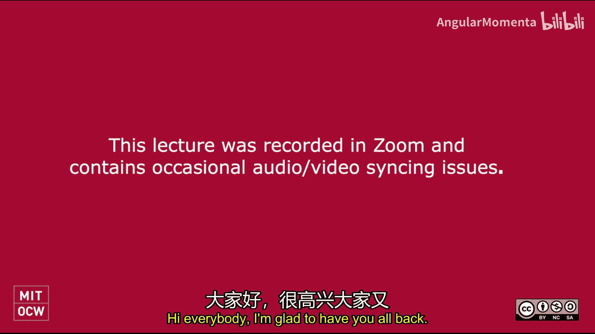
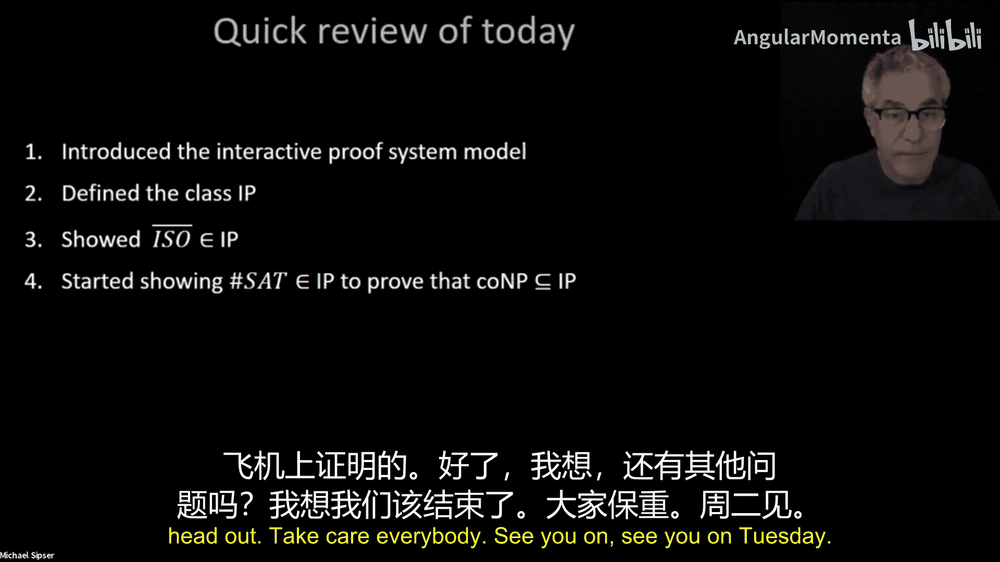

# 【麻省理工】计算理论  ｜  MIT 18.404J Theory of Computation, Fall 2020 p24 25. 交互式证明系统，IP -BV1pt7GzeEjb_p24-

Hi everybody。Glad to have you all back。For our next to last installment of。Theory of computation。

Today we are going to embark on the very last。Big topic for the semester。

And that is in some ways going to be following on what we started。

A couple of lectures back when we looked at probabilistic touring machines。

And probabilistic computation and itss associated class BPppP。Now。

 what we're going to discuss is in some sense， a probabilistic version of NP。

And that's going to be a complexity class called IP。Which stands for interactiveactive proof Systems。

And so we're going to present that model and look at a couple of examples。

I would just like to say at the beginning that this model is a very important one。

 it really has been the starting point for a great deal of research。In complexity theory。

 so we're just really going to be touching on it， but there's a lot more that people have pursued with this model and it's also a connection into the cryptography field which also makes use of the interactive proof system model in fact some of the。

Genesis of that model comes out of cryptography。Where you're having multiple parties either communicating or in some ways interacting to achieve certain goals of。

P。Communication or signing or passwords or what have you so this is both an applied area and also one that has a lot of very interesting theory associated to it。

So with that one we're going to jump in and。Start out by making myself smaller。

And just do an introduction， I'm going to introduce the model or the concept of an interactive proof with an example。

And that example involves the graph isomorphism problem。

That's the problem of testing whether two graphs are isomorphic What we mean by two graphs being isomorphic is that they're really just the same graph。

With one of them perhaps being relabeled or permuted so that。They may look superficially different。

 they may appear with a different sequence of labels or the nodes are appearing in a different order。

 but。Except for that， it's really just the same graph， so I'm kind of illustrating that here。

 if you can see those two graphs here which look different from each other， both on eight nodes。

 they are in fact the same graph as I can illustrate by a little animation which will convert this one into that one。

U。So呃。So the。Two graphs， these graphs being the same， we call that isomorphic。

So these are graphs G andH and they're really the same graph。

 so we call the myomorphic graphs and we have an associated computational problem called ISO。

Wwhich is given a pair of graphs， we'd like to know are isomorphic or not。

 so isSO is the collection of pairs ofgraphs which are isomorphic and it's easy to see that this problem is an NP problem because all you need to do in order to see or to give a certificate that the two graphs are isomorphic to each other is tell you is just to say which nodes in the one graph correspond to which other nodes in the other graph。

And then you all need to check is that the edge relationships are consistent with that mapping or that isomorphism。

 as it's called。So it's easy to see that the ISO problem is an NP and if you're not getting that make sure you understand because this is the whole first part of the lecture will be lost if you don't understand this ISO problem。

Now the question of whether you can test two graphs being isomorphic in polynomial time。

It's not clear， and in fact， that's an unsolved problem to this day。诶。

And it's a problem that has generated an enormous literature there are hundreds of papers on the graph isomorphism problem as it's called。

 to try to resolve you know to try to see if one weren confined a polynomial time algorithm and in fact it was a very big result just in the last 10 years where there was a subexial algorithm given that so that was more faster than the brute force search approach but didn't get it all the way down to polynomial。

Now， why is there so much attention just to this one particular NP problem？😡。

It's not known whether the graph Iomorphism problem is NP complete。

 ISO is not known to be an NP complete problem， and that puts it into a very。

 very small class of problems in NP， which are not known to be either NP or NP complete。😡。

It's kind of a curiosity that for NP problems， almost all of them have ended up being in one side or the other。

😡，And in fact。It's a。呃。嗯。In fact， the。I think it's the only problem that just involves graphs。

That's not known to be either in P or an NP。So I got a question here。

 what would be in between exponential and polynomial， for example。

 I don't remember what the bound is， but it's something in the range of n to the log n。

A time complexity for the graphite models I may be getting that wrong。

 I don't remember exactly what the bound is， but that's significantly better than two to the n or some some exponential amount of time。

 but it's more than n to any constant， so it's more than any polynomial time。Um。So。

Another question of the same sort is whether the complementary problem is in NP or whether whether ISO is in CONP or let's talk about it in terms of the complement。

 whether the complement of ISO， which I'll refer to as the non ISO problem。

 whether that's known to be in NP， so that's also not known，😡，In other words。

 if I give you two graphs。And I ask you to show that they're not isomorphic。

 suppose they aren't isomorphic and you go through the effort of， you know。

 determining that by a brute force search and now you want to。Prove that they're not isomorphic。Well。

 that's not it's not known to be an NP either。 so there's no known short certificate certificate of。

Two graphs not being isomorphic， we don't know how to do that either。

But there's something that's very interesting， nevertheless。And。It has to do with the ability to。

 for one party to prove to another that graphs are either isomorphic or not isomorphic。😡。

So if you're just having like a prover， we haven't really been necessarily formulating that this way so much in this class。

 but this is a completely equivalent way of formulating the notion of NP。

 whether you have a polynomial time verifier and prover who can produce certificates。

 say it's a powerful prover， so if you have a problem that's in NP。

Approvver can convince a polynomial time verifier that strings are in the language， if in fact。

 they are。So in the case of the isSO problem， prover can convince a polynomial time verifier of the graphs are isomorphic just by exhibiting the isomorphism。

Now。For the non isomorphism case。We don't know that that problem is an NP， but it's still possible。

For a prover to convince a verifier that graphs are not isomorphic。

If you change the rules of the game slightly。Um， so even though the non IO problem is not known to be an NP。

 a prover can still convince a polynomial time verifier that graphs are not isomorphic。

 assuming they they are in fact not isomorphic provided。😡，你。

The prover and the verifier can interact with one another。

 so the verifier can ask questions of the prover and the verifier gets to be probabilistic。

So that's in sense in which I mean that this notion is a kind of a probabilistic version of NP。Okay。

 so。Let me show you how that's done。So before we jump in to the method for approver to show a verifier that graphs are not isomorphic。

Let me let's try to get a little clearer on the model。

 so I'm going to first show it to you informally and then we'll look at it formally。Okay。

 so in interactive proofs， there are two parties。Um。

 and I'm going to think about them as one of them is going to be the professor。Okay。

 so the professor is going to play the role of the verifier in a sense。

 but you know it's like the one who checks and the professor being kind of old and tired has's been teaching too long maybe can only operate in。

Probabilistic polynomial time。So the professor wants to tell whether two graphs are isomorphic or not。

Probabilistic polynomial time doesn't seem to be enough。

To tell whether two graphs are isommorph for ornot。

 because it seems to be a more than polynomial problem。However。The professor has。嗯。Help。It has。

An army。Of graduate students。And the graduate students。

They're not limited in the same way the professor is， their graduate students are young。

 they are energetic， they can stay up all night， they know how to code。

So the graduate students have unlimited computational ability。

So that we're going to think of the graduate students playing the role of the prover because they're not limited in their capabilities。

 we'll assume。😡，The professor， on the other hand， is limited。

 so the professor wants to know if the two graphs are isomorphic。Let's say whatever they are。嗯。

Can't do it by himself， so he's going to ask his students to figure out the answer。And report back。

Now there's only one problem。The professor knows that students。

 well in the old days they like to party， I guess these days they like to play on play computer games a lot。

 and so they're not really that eager to spend all their time figuring out whether graphs are isomorphic。

So he's worried that the students will just come up with some answer and figure that he won't be able to tell the difference。

😡，So the professor does not trust the students， it's not enough to for the professor to give the problem to the students and just take any answer that they're going to give the professor wants。

😡，Wants to be convinced。Okay， so。嗯。No。How could the students convince the professor of the answer that they've really done the work and figured out whether the graphs are isomorphic or not。

 Well， if the graphs are isomorphic， if it turns out that the graphs were isomorphic and the students figured that out。

Then life is good because what are they going to do to convince the professor？

They're going to hand over the isomorphism and show， yeah， I mean they are。You know。

 those graphs really are rhomorphic and here's how the correspondence works。Fassa Kche oh， yeah。

 now I'm convinced。But suppose the graphs were not isomorphic。What are we going to do then？Um。

 the students have figured out perhaps and Ielga， the professor wants wants to be convinced， oh， no。

 what are we going to do？Well， in fact， we're going to engage the professor and the students are going to engage in the following protocol。

dialogueialgue。What's going to happen is now you have to make sure this is critical to understand this little part of the story here because it's really going to set the pattern for everything in today's lecture and the next lecture。

😡，Okay， so we're going to engage in a following interaction between the students and the professor。

 which is going to enable the students to convince。😡。

The professor that the two graphs really are not isomorphic。So how is that going to work？

This is a beautiful little thing， by the way， so the professor is going to take the two graphs。

And pick one of them at random。It has the two graphs G and H。

Let's say you they're not they really are not isomorphic the professor doesn't know that for sure that's what the students claim the professor really wants to not be convinced that the students are right so the professor going to pick one other two at random randomly permute that。

😡，That choice， the one that he picked and handed it over to the students。Sa ok。

Here is one of those two graphs randomly scrambled。Then I'm going to ask the students。

 which one did I pick？Okay， now if the graphs were really not isomorphic。😡。

The students can check whether that randomly scrambled graph is isomorphic to either G or to H。

 it's going to be isomorphic to one or the other。And then they students can figure it out and they say。

 oh， you picked G or no， you picked H as the case may be， the students can figure that out。

But if the graphs were isomorphic。Then that scrambled version of GRH could equally well have come from either of them。

😡，And the students would have no way of knowing。Which one the professor picked？

So there's nothing they could do， which would be better than guessing。

So if we do that a bunch of times， the professor picks at random， sometimes secretly， of course。

s the picks either G or picks H。😡，And the students get it right every time。

Either the students are really doing the work。And the graphs are really not isomorphic。

 or the students are just incredibly lucky。😡，They' managing to guess right， let's say100 times。

So how would the professor randomly and secretly picks GRH， uses its probabilism。Flips the coin。

Just a two sided coin says， okay， sometimes I'm going to do G， sometimes I'm going to do H。

 just completely at random。Picks one or the other then with some more randomness。😡。

Gs finds a random permutation of the one that he picked and then sends that over to the students and say。

 which one did it come from？嗯。I'm not sure okay so let's pause here let's let's make sure we all understand this because this is really important so I'm getting a question here how do we i'm not sure what your question is okay so let me just say yeah the professors going to play the role the verifier the graduate students play the role the prove that's coming but I really want to understand this protocol here okay so how is the professor picking the graphs can if you have okay I don't you know picking the graphs at random you have just two graphs they're a part of the input both the students and the professor can see the graphs。

And the professors just picking one of them at random using a coin。

 so I'm not try understand the question there， could P and V be engaged in a protocol with the secretaries on the prover side instead？

The question of revealing the isomorphism， there is no why。

 so I'm not sure I understand this question either。

 maybe we'll make this clear know for this little illustration。The professor。

Doesn't know the graphs could be isomorphic or they could be not isomorphic。😡。

And so the professor wants to be convinced either way whatever the students。

 whatever answer the students come up with， we're going to shift this into a problem about deciding a language next。

 but right now I'm just trying to give a sense of how the model works。😡。

I'm going to move from this informal model and now I'm going to formalize that in terms of model which will be deciding a language。

Okay， so so the interactive proof system。Model， we have two interacting parties， a verifier。

 which is probabilistic polynomial time playing played by the professor in the previous slide。

And the prover， which is unlimited computational power played by the students in the previous slide。

Both of them get to see the input。Which in the previous case， well， it could be， for example。

 the pair of graphs。Um， the exchange of polynomial number of polynomial size messages。

 so the whole exchange。Including the verifier's own computation is going to be polynomial。

The only thing that's not included within the computational cost is the prover's work。

 which is unlimited。嗯。After that， the verifier， after the interaction。

 the verifier will accept or reject。And we're going to define the probability that the verifier。

 together with a particular prover， ends up accepting。😡，As。

You look over the different possible coin tosses。😡，Of the verifier。

Which could lead to different behavior on the part of the verifier and therefore different behavior on the part of the prover。

So over all the different possibilities for the verifier's computation。

 we're going to look at the probability that the verifier with this particular prover ends up accepting。

 and I've written it this way， this is the probability of the verifier interacting with the prover accepts the input。

😊，It's just simply that。And so we' going to through an example。

 we' going to work through the previous example more precisely in a second。

The class IP for Inter Prouse stands for it's the class of Las。

Such that for some verifier and approver。For strings in the language。

The prover makes the verifier accept with high probability。

And here is the interesting part for strings not in the language。

 the prover makes it except with low probability， but every there's no prover which can make it except with high probability。

 so there's no way to cheat。😡，If you think about it in the case of the graph non isomorphism。

There's nothing you know if。If the graphs were really isomorphic。😡。

And the students were trying to in a devious way。Prove。

Through that protocol that they're not isomorphic， they would fail because there's nothing they can do。

If the graphs were isomorphic， then。😡，When the verifier。

 the professor picks one or the other at random。And scrambles it。

 the students would have no way of telling which one the professor did。

 so no matter what kind of scheme they try to come up with。😡，They're going to be out of luck。

So it's no for any strategy。For strings that are not in the language。

 for any prover calling that P with a tilde to stand for a devious or crooked prover。

For any possibly crooked prover。Even that we're working with the verifier is still going to end up accepting with low probability。

😡，So strings in the language， there's going to be an honest prover who just follows the protocol in the correct way。

 which makes the verifier except with high probability for strings not in the language， every prover。

I's going to fail to make it except with high probability。Okay， so that mean。

 the way I'd like to think about it is that Pete Tilda is。A possibly crooked prover。

 which is trying to make the verifier accept when it shouldn't。

 because the string is not in the language。It's like， you know。

 it's like you can think of this in the case of satisfiability。嗯。

You know a crooked prover might try to convince the verifier that the formula is satisfiable when it isn't by by somehow trying to produce a satisfying assignment。

 but that's going to be impossible there's nothing any strategy can possibly work when the formula is not satisfyisifiable if that's what the verifier is going to check it's going to be looking for that satisfying assignment。

😡，Okay， and by the way， this is we're not going to approve this。

 but it's really going to be proved in the same way。

 you can make that one third error that occurs here something very tiny。

By the same kind of repetition argument。Okay， so let's see。

So why can't the prover in the first case be crooked the prover in the first case could be crooked。

 but that's not going to serve the purposes。You know what we want to show。

think about it like we think about NP。For strings in the language， there exists or certificate。

 there is a proof that you're in the language。😡，So if somebody is going to。Not produce the proof。

 that's irrelevant。The question is， if you look at the best possible case， the best possible prover。

 you know who's going to be be able， we're asking， does there exist a way to convince the verifier that the。

😡，String is in the language。So it doesn't matter that there might be some other silly way that doesn't work we're just looking at the best possible way。

 so the best possible way when you're in the language is going to end up with the verifier having high probability。

When you're not in the language the best possible way is still going to end up with low probability where when when I talk about best possible I'm trying to maximize the probability that the verifier is going to end up accepting let's continue not sure as clear as I would like。

 but。😡，嗯。Maybe again， we're going to stick with that example because this is a very helpful example and to try to understand the setup。

U and u so we'll going I'm going to revisit that previous example about non isomorphism。

 but now in the context of this thinking about as a language。

So we're going to take this non isomorphism。嗯。呃， yeah。

We're going to take the non isomorphism problem。And show that it's an IP。

 so there's going to be a verifier together with a prover。

 which are going to make the verifier except with high probability。For strings in the language。

 namely graphs not being isomorphic and nothing there's going to be no way to make the verifier except with high probability for strings out of the language。

 therefore that's when the graphs are isomorphic。Okay。

So the protocol is just going were going to repeat the following thing twice。

 you know I said in the previous case do it a0 times just to help us think about it。

 but actually twice is going to be enough to get the bound we need。

So the verifier is going to operate like this in terms of this is the verifiers in first communicating。

Sending messages to the prover， it's going to randomly choose GRH。

Just's like what the professor did last time。Randomly permute the result to get a new graph K。

 which was going to be， which was， which is isomorphic e to GRH。

 depending upon the choice the verifier made。😡，And then send that graph K。

Now the prover's turn is going to respond by the prove is going to compare k with the two one of the both of the original graphs。

 it's got to be isomorphic to one or the other。😡，And it's going to report back which one。

Just going to say， well， you picked G， no， or you picked H。

Because the prover with its unlimited capabilities can determine that。嗯。

And then V accepts if the prover was right both times。诶。And if the prover was ever not right。

 the verifies as oh something's fishy here because we knows that the prover has unlimited capability so could get it right you know if this was an honest prover and so if。

If it's not getting it right， then the ver is going to reject。呃。So if the graphs are not isomorphic。

 the prove it can tell which one it picked randomly so therefore。If the graphs are not isomorphic。

 the verifier with that honest prover will accept with probability one。

Because that honest proof is always going to get the right answer。

Which is at least two3 is what the bound we need。We don't care about the space used in answer to a question。

If。We were not in the language， so G and IH are not isomorphic。

Then there's nothing any crooked prover could possibly do because it gets a graph can't tell。

 there's no way to tell whether it came from G or came from H。😡，嗯。

So that crooked prove would have the best thing could do is guess。

 so a 50% chance of answercing correctly each time and only a 25% chance for doing it twice。

And that's why I did it twice in order to get that error to be small。

 so it's only a 25 per chance of the prover getting lucky。

 so that would be an error case if the prover just by chance picked the right answer twice。

 even though the graphs were isomorphic。So therefore， for the isomorphic case。

 the verifier interacting with any prover is going to accept that input within most one quarter。

 25% of the time， which is less than a third so those that's just to achieve that bound。Okay， so。

Let'Let's answer some questions first and then I'll try to。Oh呃。I'll ask you。

You understand this I think it's worth trying to understand this model of this interactive approved system。

对。It's a little slippery I realize。If you just hold your hold onto to your intuition of the prover trying to convince。

 you know of。You know， a powerful prover trying to convince a limited verifier。Of。

Some string being in a language。呃。You want the proven to be able to succeed when the string is in the language。

 but fail when the string is not in the language。Yes， we are going to。

 somebody's asking if the prover is identifying G orH by brute force， yes。

 the prover is going to use its unlimited capabilities to determine given K。

 whether it came from G or H。😡，The computational cost of the prover is irrelevant for this it's just like when we think about a certificate。

 you know， for satisfiability， we don't talk about the cost of finding that certificate for NP for I again。

 we don't talk about the cost of the prover running So somebody's asking does the crooked prover answer just randomly or does can the crooked prover have a strategy The crooked prover can have a strategy。

Nowre we're assuming the cr prover is devious。😡，But it's still going to fail。Okay。

 let's do the check in。Suppose we change the model so that the prover can watch the verifier picking its random choices。

So the verifier can act in secret anymore， but the prover can watch the verifier。Now。

 let's suppose we had the same protocol that I just described。 what language do we end up with。

 Is it the same language， different language， and what is that language？听 so。W want to， hopefully。Um。

 buts let it'll give me some sense of how well you're following me by how well this this goes。Yes。

 someone's asking about how this connects up， for example， with NP。

 so we're going to look at that also in a second。Okay， so this is reassuring that most of you。

 I think are on the right track， at least for this check do we assume P uses this access to guess right？

What access P is not really guessing The P is is actually。

 I don't think a P is non determinants or anything like that。

 P is actually trying to get the right answer and using its。

Computational ability to do that if it's possible。😡，May not be possible。

 then there's nothing it can do。Okay， so let's end this， are you all in？Two seconds left。Please。

 vote。Butote now or never。Okay， ending。Yeah， so C is the correct answer here。

If the prover can watch what the verifier is doing。

 the prover can see what graph the verifier picked right from the beginning。😡。

And so the prover without having to do any work can say， you know。

 prover looks over the verifier's shoulder and says oh。

 you pick G and now you're randomly permeing it but I don't care about that I I know you pick G so the。

😡，Prove is going to respond back G， even if the graphs were isomorphic。

 the proof is going to be able to get the right answer。😡，Kind of interestingly。

You can make you can change the protocol somewhat to make it that even if the prover has access to the Verifier's randomness。

 it can still achieve this， but not with the same protocol。So that's a separate question。Okay。

 so let's move on here， I want to get two bogged down。Okay， here's another check。Okay， so。

You have to tell me which of the following statements are true。As far as you know。

Now you have to think about a little bit how these relate to how NP and IP or BPP and IP relate to one another。

 okay？How are we doing on this？Okay， so we're going to have to close this pretty soon， too。

Do the best you can Inter， Okay， closing up shop。Last last vote。Okay， one， two， three。

There's one more person out there who hasn't voted who voted last time， oh well。Alright。In fact。

 they're all true。嗯。Let's see why is N contained with IP contained in IP？Well。

 many of you have seen this already， so let's just quickly go through it。

If we just had a deterministic V。嗯。You know， the。You can。Maybe it's just。

 I that could be enough of deterministic V。I think it's just going to be equivalent。

 but actually just to be doubly sure the。Deterministic V and the prover just sends a message to the verifier and then checks it。

That's the way we normally think about a certificate for NP I don't think it's going to change anything but should double check that if the verifier can still ask questions。

 but I think as long as the verifier is deterministic， you're going to get exactly NP。Here。嗯。

And now how about BPppP？Well， there you don't even need prover because the verifier is already probabilistic。

So verifier can ignore the prove。And this one is a little tricky IP contained a piece because we haven't covered that so there's no way for you to know that unless you happen to read ahead in the book but it's in fact true in some ways it's a little bit like the proof that。

呃。N p。Is contained in peaceSp IP is sort of an enhanced version of NP and it's just basically a piece based brute force algorithm that goes through the entire tree of possibilities of the verifier and verifier with exchanges with the prover and can determine that the verifier is either going to accept for some prover or is going to end up rejecting for every prover so we're not going to prove this statement。

 but something good for you to know anyway， just the fact。But we're going to do the surprising thing。

In reference to part C is that the containment also goes the other way。 This is the amazing。😊，呃。

Was is an amazing result that everything in peace space。You can do it N IP。

So this is IP is actually turns out to be incredibly powerful， gives you everything in peace space。

 you get IP equals P space。So that says that any problem that you can solve in peace based。

 like any of the game， for example。If you can imagine you know， formulating， you know。

 checkers or chess as a piece based problem， which， you know。

 depending upon some details of the rules you can do because you know。

 you have to generalize it to an end by end board， but okay， let's not quibble then。呃。嗯。我。

We don't know which side has a forced win and chess。

And even if somebody goes with the effort of going through the game tree。

And determines that let's say white has a forced win there's no way for them to there's no short certificate。

 we don't know that that problem is not an NP。But by。Going through an interactive proof。

 an all powerful prover could still convince somebody that White had a force convince somebody in polynomial time that white has a forced win。

 let's say in chess again little stretching things because this is you really need to talk about this as an end by n。

 not an eight by eight， but I think in the spirit is fair。So。Okay， so let's continue。

So we're not going to quite prove that peaceSp is contained in IP。

 we're going to prove a somewhat weaker statement， but very similar is that and historically came first that CoP is contained in IP。

😡，So not only is NP contained in IP， but we're going to prove that Co N is contained in IP and this actually has。

Most most of the idea for the peace space being contained in IP and itself it's just an amazing proof。

 a little easier。嗯。Okay， and this was done if I'm remembering somebody asking how old is this。

 it's something in the 19 I think late 90s but I'm not I don' remembered by maybe early 90s I think it's late 90s when this was shown。

So it's been a while now。嗯。Okay。So。Yeah， so in terms of the relationship with cryptography。

 there were two parallel threads。That both independently came up with an notion of an interactive per system。

I was a little bit personally involved with this。In a way as well。

 but but mainly that there was one group in cryptography working on this and there was another group who was actually coming out of the graph isomorphism world of working on it and they came up with。

Two separate models， one involving the private randomness and one involving the public randomness。

 and it it was turned out that was that they are actually equivalent and it's an interesting story but。

Unfortunately， we don't have time for it。So why don't we move on and I'm going to start showing you how the proof that。

CoNP。Is contained in IP。Goes and what we're going to do is work with a problem that's almost like Co&P complete but going to be well it's going to be this number set problem we'll see the connection with Co&P in a second。

呃。So&P， so it's supposed to be exactly case satisfying assignments。F comm aKy。

Is a set of pairs where the formula fee has exactly K satisfying assignments。

 so really there's a problem of counting how many satisfying assignments you have in a formula。嗯。So。

 you know， for NP， you have at least one。Um， but I'm， I want to know exactly how many。

So the number set problem is the pair's formula and the count。So。

And so if we define the count number fee is the number of satisfying assignments of a fee。

Then another way of writing this number set problem is。

The pay's fee K where K is the number of satisfying assignments of fee。

So we're going to be using this notation number fee a lot。

 so just make sure you get you got that notation， this is the number of satisfying assignments of that formula。

😡，Okay。😊，And here's a definition I probably should have given you earlier in the term。

 but better late than ever， so the notion that a language is NP hard。It's like NP complete。

 except without necessarily being an NP。😡，So this is just the reduction part。

 a language is NP hard or Co NP hard or P based hard or any of those other classes that we've looked at。

If every problem in the class is reducible to that language。

But you don't know whether that language is in the class。

 so we just call it NP hard instead of NP complete。Um。

 so you could say the language is NP complete if it's hard and it's in NP。嗯。Okay。

 and so we're going to show that this number set problem is CoNP hard。

So everything in Co&P is polynomial time reducible to number set， and that's easy。

Because what we're going to do is take a coP complete problem。Which is the。Unsatisfiability problem。

 the complement of satisfiability。And should that reduces to the numbers set problem。

And that's easy because。A formula is unsatisfiable exactly when it has zero satisfying assignments。

So if you can tell how many satisfying assignments something has exactly。

Well you can answer the question you know does a formula have exactly。

1 thousand satisfying assignments， if you can do that in general， then you can solve Co&P。

 you can solve the unsatisfiability problem by asking for zero satisfying assignments。

And that allows you to solve anything in CoNP。ok。So we're going to just work with this one problem。

 the number set problem， and show that that problem is in IP。Okay。Let's take a quick break。嗯。Okay。

 feel free to send me。 Let me see if I can catch up with some of the questions that have been cropping up here。

 So if the prover knows the random choices of the verifier Ken can flip the answer to make the verifier reject。

Not sure what that you mean in the context just of the graphite smorphism problem or something in general。

 I'm not sure。You'll have to explain， sorry， I'll respond with a question mark。

We was going to answer a you guys， so I got a question。if I people equal' peace based。

 does that mean that ISO or non ISO in might be peace based complete， but no？That's unknown。

So we're about out of time。Okay。Let's continue here。嗯。Okay。

So this is where we're kind going to start to get into the meat of things。

And if you didn't quite understand everything up till now。

 maybe just try to keep your intuition about how do I？You know， how does a powerful party？Convince a。

A polynomial probabilistic polynomial time party。Of the number of satisfying assignments。

An exact number， not at least， but you want to know exactly the number of satisfying assignments。

So it could be zero， for example。How how do you convince someone that there were zero assignments？

And you you can have an interaction which does that and that's not obvious at all。

Howre you going to do that？嗯。啊，All right。So。Okay， so we're going to have to introduce some notation。

 which don't hope that it doesn't。Cause heartburn here。So。Look， let's say。Again， heres computational。

 the language we're working with number set。And we have a fee where that has M variables。X1 to xm。

Now here's the notation， I'm going to if I write p with free fee of zero。

That just means the formula that I get by plugging in zero for x1 and leaving all the rest of the variables alone。

😡，Okay， so I substitute  zero for x1 where0 means false and one meets true as usual。

And but that's it still going to me some other formula， but just with that substitution。

If I write feehi 01， that means I preset。The first two variables to 0 and 1。If I write fee with。

A bunch of preset values。 I'm just setting the first I variables， x1 to X I to some values。嗯。

And leaving the other variables。As onset。So I'm calling the ones that I'm nailing in there as I'm already saying。

 these are the presets。😡，Okay， so this is just converting some formulas into other formulas that have somewhat fewer variables。

All right， now let's recall that number notation， the number sign notation number fee is the number of satisfying assignments。

Now， if I say number fee of zero。That's a number of satisfying assignments。When I've preset x1 to0。

Similarly， if I preset the first I variables to some values。

And then I want to take how many satisfying assignments subject to those presets。

 I write it this way。So I'm going to use this notation a lot， you have to understand this notation。

 ask if you don't none if you don't get it。😡，So another way of writing it I don't know if this is helpful。

 but another way of writing number phi of A1 to AI， remember we have M variables altogether。😡。

That means I take the。Varis， which I have not yet preset。😡，嗯。

And I allow them to range over all possible zeros and ones and I add up the formulas values for all of those。

 so there's a one every time I satisfy and a zero every time I don't satisfy。

 so I'm adding up all the satisfying assignments subject to these I presets。😡，ok。😊。

So here are two critical facts about this。Number sign notation。First of all。

If I preset the first eye values to something。Now I can， in addition， set the next variable。

 either to zero or to one。😡，And I get this relationship。

Which is just simply a generalization of the fact that the total number satisfying assignments of the formula is equal to the number of satisfying assignments when x1 is0 plus the number of satisfying assignments when x1 is 1。

they together have to add up to the total number because x1 is going to be the e to zero or1。

So that's fact number one。Fact number two is that if I preset everything。All of the variables。

 so there are no variables left。Then the number of satisfying assignments。Subject to that preset。

Of everything is just whether or not I've satisfied the formula。

 which is the value of the formula on those presets。😡，Okay。😊，Both two simple facts。

 but it's going to be critical in the protocol I'm about to describe。Questions on this。

I think do have a question for you。So what' you say。What do you think。

Its just to check your understanding。ok唔。Go about 80%。Getting this。嗯。I'm not sure that's good but。

All right， almost done。Closing。Okay。Okay， so yes， a is the correct answer， you know。

 if there are nine satisfying assignments altogether together and there are six satisfying assignments where the first variable is set to zero。

Then there's only three satisfying assignments with the first variable set to one because nine has got to be equal to6 plus three。

That's actually this fact number one。It's not going to be 15。This is not true either， so it's just a。

Good。Okay。Okay， so let's try to with that knowledge， let's try to see how we can put numberat in IP。

 so this is not going to quite work。😡，But it's really going to set us up to do this。

 to finish this next time。Um， so。You might immediately see where this is going wrong， but you'll。

You'll have to put up with it。Because the setup is what's important。Um， okay。

So understand now here's the setup， we have the input is a formula。And a number。

With that number is supposed to be the number of satisfying assignments。You know。

 it could be wrong and in which case we're not in the language。But if it's right to in the language。

So。The prover is supposed to convince the verifier that it's correct， if it is correct。

And it's going to fail no matter what it tries to do if it's not correct。

So this the prove is going to send， first of all。嗯，是。So the proof is going to send a claim。😡。

About the number of satisfying assignments。Going to send when I say this value here。

 this is what the prover。If it's honest， it's going to send the right value， of course。

 the verifier does not know if the prover is honest。😡。

But I'm describing how the honest prover is going to operate and well have to understand what happens if the prover tries to cheat。

So the prove is going to send the honest prove is going to send the number of satisfying assignments altogether。

 and the prover verifier just makes sure that that matches up with the input。

If it doesn't match up with the input， the verifier is just going to you know， you know。

 the verifier is going to not be convinced that the input is in the language。

So it's going to just reject at that point。Um。Okay。Then now the verifier says okay。

 that was very good that you sent me this。 How do I know that's right？

So what the prover is going to do to try to convince the verifier that this value was correct。

Is unravel at by one level I say， well， you know， there were nine satisfying assignments altogether。

ix of them were when x1 is0 and three of them were when x1 is1。The ver。

 what is the verifier have to check that。These add up correctly。When I preset x1 to0 and to 1。

 it had better add up to the total number of satisfying assignments。If that works out。

 the verifier as happy is still consistent with being convinced that this K was the right value。嗯。

So the next step is。Well， the verifier says， well， how do I know those two values are correct？

The prover says， okay， well， I'm going to send。Unravel them one level further。

U then here's a number of satisfying assignments when the next variable is set to both possibilities for each of the possibilities of the first variable。

😊，No， if you're。Understanding me about what the prover is saying。

 you should start to be getting a little nervous。Because。Something is， I mean。

 this is going to be correct。But it's going to start。

 it looks like it's starting to blow up in terms of the number of。Mot of work that's involved。

 and that's actually a problem。But let's bear with that for the moment。

 Let's just worry about correctness， not about complexity for the moment。So。

The proof is going to now send the number of satisfying assignments for each of those four possible ways of preting the first two variables。

And the verifier is going to check that that was consistent with the information the prover sent in the previous round。

Right， by again， checking this identity here。 So then the proof is going to continue our doing that until it's it's done that。

Through M rounds， where M is the number variables。So at this point， the prove is going to send。

All possible ways of presting all of the variables。

 so that now there's two to the M possibilities here。😡，Again， this is hopelessly not allowed。

 but okay， ignoring that。The prover got to use this at the m round to check what happens at the previous round。

 so that's when there were m minus one values sent because each one has one more you're extending the presets by one so which using this to check that the previous round was values were correct so it's looking for you know the M minus one。

Presets have to add up correctly， in terms of the presets of M values。

For each of those ways of doing those M minus1 presets。

And so now the prover has send all of those two to the M。😡，Counts， which are by the way。

 ones and zeros， because at this point we have preset all of the values of the variables。

 and so there's only one possible assignment at most。That there can be。And now the verifier。

 the prover is done， the verifier is going to check。😡，By itself。That these values make sense。

 that these values are correct。So it's going to do that by looking back at the formula so far up this point the verifier has not been looking at the formula。

 it's just been checking the internal consistency of the provers messages with each other。

 but now at the end the verifier is going to take the messages these values that the prover sent for each of the two to the m presets and see if it matches up with what the formula would do。

😡，Remember， that was the other sort of the base case of the fact number two from the slide or two a go。

 make sure that these agree。Okay， and now the verifier says， well， okay。

 if everything has checked out and all of these are in agreement。😡。

Then the verifier is going to be convinced。That the。That fee had K satisfying assignments。

But if anywhere along the way， one of these checks fails。

 the prove is not the verifier is not going to be convinced and it's going to reject。Okay。

 so in a sense this is kind of dopey， you know， you know， we've just。

 I'm just kind of giving you a complicated way of just counting up one by one each of the satisfying assignments of the formula and seeing if that matches k。

嗯。But nevertheless， this way of looking at it is going to be。

Help us to understand the way to fix this。So bear with me for another minute on this one。

So another way of looking at this， so which I think is particularly useful is to think of。

What happens？Well okay we'll get there in a second， I want to look at what happens if K was wrong。

 but before I do that let's look at the I'm going to give a kind of a graphic graphical view of the information that the prover sends and the verifiers actions in this protocol so the values that the prover sending are going to be in yellow。

😡，So and the information that the verifier has or checks is going to be in white。

So the verifier has the K the。Input value， which is supposed to be the number of satisfying assignments。

And the prover sends some value and the verifier checks that this value。

 which is supposed to be the number of satisfying assignments， corresponds with K。

 so that's one of the checks it does。Then the provers are going to send kind of take that to justify this value。

 it sends the number of satisfying assignments。When you have x1 set to zero or set to one the verify adds goes up to give you and it's supposed to equal the total number of satisfying assignments and so this is if you understood this protocol this is just I'm writing it out in a sort of a simplified way。

 perhaps。Okay， and so。Keeps checking that these things add up correctly until you get down to setting all M values in all two to the impossible ways。

 and now the verifier is going to then check to make sure that that equals。

What the formula would say。嗯。Okay。Okay， so now。Let's what happens？If K was the wrong value。

It did not agree with the number of satisfying assignments。嗯。And what does what happens now？呃。

Could the prover， what happens if the prover tries to make the verifier accept anyway？So。

So the only thing that prover can do at the very first step would be to lie。About you know。

 if the prover sends the if K is wrong and the prove prover sends the correct value for the the the total count the ver is going to reject so i'm trying to see。

😡，Could the prover try to make the verifier accept what happens？So the prover has to lie here。

 and I'm going to indicate that by saying the prover is sending in the wrong value。For。

The total count。Well， if the prove is going to lie here。Um， then。Just like， you know， if you。

 you know， you have a child。wWho tells a lie and then you start， you know， as the parent。

 you start asking questions to try to see if the story is consistent。

 one lie is going to lead to another lie。And that's what happens here。If the。

In order to justify this lie， the proof is going to have to lie in one or perhaps both。

 but at least one of these two values， because you can't have the two correct values adding up to the incorrect value。

😡，Okay you have to think about what's going on here so this is a lie that's going to force a lie at one one side of the other one level down。

 which is then going to force a lie to propagate down and so there's a lie at every stage is going to force a lie at least in one place or another to propagate all the way down to the bottom。

And then the bottom， the verifier will。See that the check doesn't work as when it tries to connect it up with the formula itself and the verifier will reject。

😡，Okay， so just a way of looking at this。If the value， if the input was not in the language。So。

But the problem is that as I said， this is exponential so how are we going to fix that so just looking ahead to what we're going to do on Tuesday。

Okay， let's see if there's any questions。Here， first of all。Okay， yours， I got a question。

 should this be？嗯。Should this be M minus I purposely made this bracket only go not include the very last zero。

 Yeah， there's a total of m zeros here altogether， but the I left out the La zero that's why I said in my M minus1 maybe would have been better to say M。

嗯。Okay， so you get another interesting question here， why can't we reject right away if K is wrong？呃。

Well， the verifier is probabilistic polynomial time， how does the verifier know if K is wrong？

So it mean or right。So what we're trying to do is something like， you know。

 like NP where we have a certificate， but now we have to kind of interactive certificate in the form of this prover。

 maybe that's another way to look at it。嗯。Where if you're in the language。

 there should be some way for the prover to convince to make you accept。

 but if you're not in the language， there should be no way for the prover to make you accept。😡，呃。

So the verifier just can't reject right away because there's no way to tell。

 how does the verifier know it's going to start rejecting things when it shouldn't if it's just going to be rejecting Willieelie here。

嗯。Okay， how does the verify need to determine if the prover is internally consistent instead of just asking？

So why does the verifier need to determine if the prover is internally consistent instead of just asking the questions in step M plus1？

嗯。Yeah， so maybe that's because it looks like all of the work is happening at the very end。

 but I'm really presenting this to you as a preparation。😡，For what we're going to do on Tuesday。Um。

 so it's important to think about the connection from each step to the next。

 each step is going to be justified by what happens at the next step until we get to the very end。😡。

So you'd have to just understand it for what it is， don't try to make it more efficient。

 I realize this is kind of dumb。Good point， we're not using the probabilism here。Um， and moreover。

 we're not really even using the interaction here， the prover is doing old ascending the verifier is just accepting at the end。

Yeah， this is we're not using the power and we're getting a weaker result so let's move on before we run out of time here。

 so how are we going to fix this？😡，So the problem is this blowing up to justify each stage where each value we needing to present two values which add up to it。

😡，And that's leading to a blow up。Now it would be nice if we can do something where each value was supported by just a single value。

At the next level。So here's an idea in order to understand to see that this total count is correct。

 why don't we just pick it random either zero or one and only follow that one down。Well。

 the problem with doing that is because。The sequence of lies could be just a single path through this tree。

And the chances you're going to find that path down to a contradiction at the bottom is very low if you're just doing it at random。

So just randomly picking zeros and ones as the one you're going to justify use to justify the previous value is not going to be good enough。

SoBut this is what we're going to do， however， the values that we're going to pick for these random inputs are not going to be boolean values。

We're going to pick non Boolean assignments to the variables。Which again。

 just as with the branching program case didn't make any sense on the surface of it。

 we're going to have to make it make sense。And we'll have to see how to do that in Tuesday's lecture。

Okay， so that's kind of the setup。Okay。嗯。Yeah， so in a similar question。

 why is this any different from just。Not deterministly guessing the assignments。

 it's because of this。 we're really setting the stage。嗯。Okay。

 so what we did today was we introduced the model and defined the complexity class。

We we did show this one in its。Full glory， we showed that none ISO is an IP。

Really worth understanding this。APro here， making sure you you're comfortable with that。

And also the model itself。And so for Tuesday's lecture we're going to finish this up we started showing that number set is an IP。

 which is what we need to do to prove CoP is an IP and we'll finish that。Next time。

 which will be our last time。Okay， so that's it for today。I'll stick around for questions。

So a good question here， why can't the just。Reject if some of the checks are incorrect。 Yes。

 V could as soon as there's a check that fails， V can just reject at that stage。

I'm just trying to argue that at some point along the way， if the input is not in the language。

There's going to be a check that fails。So I mean， I said reject at the end， but yeah I mean。

You couldn' have rejected at any point along the way。嗯。Okay。

Some asking for what what role did I play so I did my own personal role in this were was twofold first of all I came up with the idea of not the idea I came up with a name Inter proof I remember when Sylvia Mcauley was explaining this to me in my apartment many。

 many years ago he had a kind of。A little bit complicated and I don't even remember what the protocol was for was not for something simple was something involving prime numbers。

And I said， oh， that's a kind of an interactive proof and it stuck from that point on so that was one thing。

 but the other thing in terms of more mathematically。

 my role was so Shafi Goldwasser and I proved the equivalentvalence of the two models。

 the public coin and the private coin version。So that was a。Bo。

My role in this be back and when this resolved all first coming out。

proved it on an airplane on the way to a conference somewhere。Anyway， so I think we're going。

this is any other questions。I think we'll head out， take care everybody， see you， see you on Tuesday。

Bye拜e。

