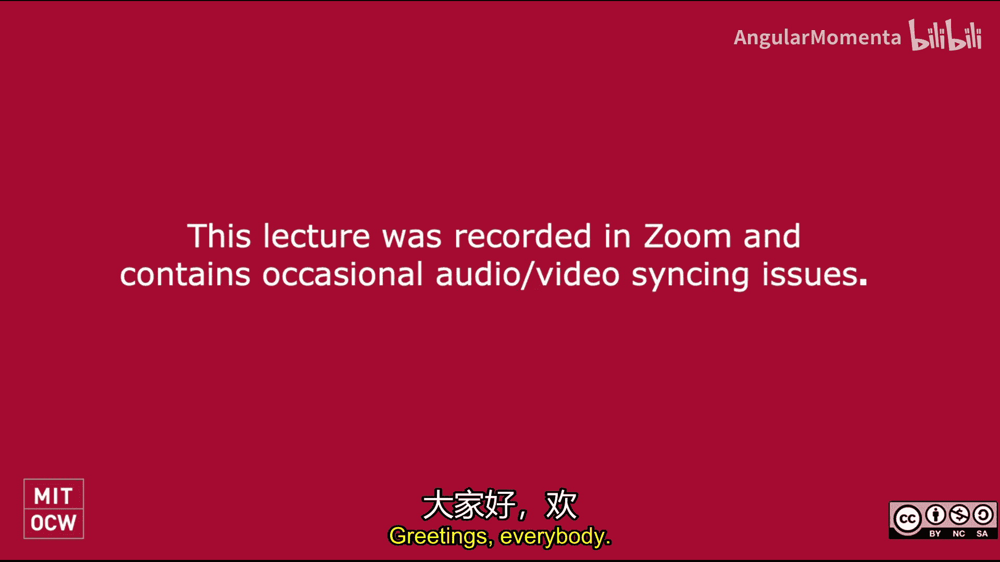
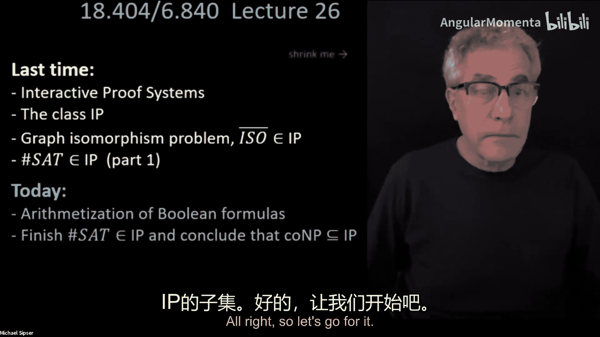
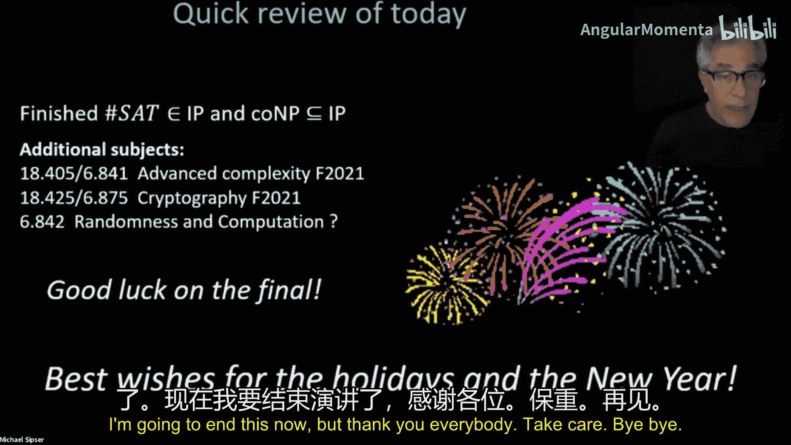

# 【麻省理工】计算理论  ｜  MIT 18.404J Theory of Computation, Fall 2020 p25 26. coNP是IP的子集 -BV1pt7GzeEjb_p25-

Greeting everybody。Welcome to our last lecture of the term we have survived a。

A semester online in 18404， and we are going to conclude our last topic today。

 which is interactive P systemss。That we started last time and。With the big， well， the。

The big theorem of interactive approved systems is that IP equals P space。

And we're going to give the main idea for that in a slightly weaker。Theorem， as we'll see。

So why don't we jump in so today's we have been doing interactive proofs we gave an example of showing that。

The graphite smorphism problem， the complement of that is an IT as you I hope you remember we had those that interaction with the prover and a verifier。

 we're going to go through it quickly， not that protocol but just the setup。

And then we're going to finish by showing that this number sad problem is an IP。

And conclude that COp is a subset of IP。All right。Let's go for it。嗯。

Yes。So just remember。Interactive proof systems， there were these two parties。

 the prover and the verifier， the prover has unlimited computational ability I kind of。呃。You know。

 model that as an army of students， perhaps who are have who can。

Where we we don't they can work all night， they can use computational resources and the prover。

 however， we're not going to measure the computational power of the prover that's unlimited and so the prover can do things like fine certificates。

 it can test whether things are satisifiable， it can。Fact numbers and we don't care。

 they can do whatever we'd like and that's no charge for the provers's computational demands。Okay。

 so the setup we had was the prover and the verifier both see the input。

 the exchange of polynomial number of messages， and then the verifier accepts or rejects。

And we had this notion of the probability that the verifier ends up accepting when paired with a particular prover。

 and what we want is that for strings in a language。

That probability should be high for some prover and for strings not in the language。

 that prover that probability should be low no matter what the prover does。

 so there's nothing the prover can do。And the way it kind of suggests that that any particular any prover。

 but whatever the provers。嗯。Strategy cannot make the verifier accept with high probability。

 just doesn't have enough information or doesn't is just not able to make the verifier accept with high probability。

I I you know you might think of the prover as trying to make the verifier accept so you know the Pete Tilde as a crooked prover I didn't I don't think that that was went down very well with everybody。

 so I have it here another way of looking at it maybe it looks a little bit more like NP here。Where。

IP is the collection of languages where there's a verifier just like we had you can think of NP as a having a verifier which can check certificates here the prover is going to be like the certificate so that for strings in the language there's a prover。

which can interact with the verifier and make it except with high probability and you're not in the language there is no prover which can interact with the verifier and make the verifier except with even more than low probability what's important is this gap just like with BPP between acceptance or rejection and that gap is there。

😡，Because we want to be able to use the amplification Lemma and if there was no gap。

 then you wouldn't be able to amplify and make the probability of acceptance extremely high when you want it to be in the language。

 when you're in the language and extremely low when you're not in the language。😡，Okay。

 so I hope that gives you you know， refreshes your memory as to how that works。

 We're going to walk ourselves through the。Well， through that。What we did last time。

 but let's set the stage for that。 So the surprising theorem， as I mentioned。

 is that IP equals P space。One direction of that is a fairly standard simulation。

You if with peace space， you can basically work your way through the tree of possibilities for an interactive proof protocol。

 and you can calculate the probability that the verifier would end up accepting。

If you had the best possible prover that would make try to make the verifier accept and you can just do that calculation。

 it's in the book， you're not going to be responsible for knowing that actually we haven't covered it in lecture。

 but it's not very hard。Little technical I suppose the other direction is the interesting one and that's the direction we're going to be moving toward today。

 we won't quite get there， but the way it works is that to show that everything in peaceb which is kind of amazing is contained with an IP so everything in peaceb can be done in with an interactive proof system and the way that is done is by using a piecebased complete problem TQBF and showing that that problem itself is an IP but we're not going to prove that that would be sort of the next thing we would prove if we had a little bit more time but we're going to be satisfied with just the somewhat weaker but very similar statement that。

CoP has contained an IP here， again， still very surprising。Because you have to be able to show。

 for example， that a formula is not satisifiable with a prover。

 how can to prove or convince a verifier that a formula is not satisifiable。😡，You know。

 the showing that it is satisifiably you just give the certificate。

 which is the satisfying assignment， but how do you show something's not satisfied？It's unexpected。

And the proof of that is pretty much similar slightly is one kind of。

Technical point which we don't have to get into， so it's slightly easier but。

Very much in the same spirit。So remember this number set problem is you're given a formula and a number and that number is supposed to be exactly the number of satisfying assignments of the formula。

 so in particular formula is unsatisfiable then it would be paired with the number zero and that's why the number set problem is co Pihard。

Because you can easily reduce the unsatisfi unsatisfiability to number set and unsatisfiability is。

Co and be complete。Okay， so remember we introduced this notation last time this is going to be critical for understanding this proof。

 so let's go through it once again。So if you have some formula。

What I'd like to do is preset some of the variables of that formula。

 so that's going to be a formula on M variables x1 to xm。And I'd like to。Preset。The first I。

Variables to certain to zeros or ones， as I wish。So I'm going to indicate that by fee with zero。

Means I'm setting x1 to0 and the rest of the variables remain variables。嗯。And more generally， fee of。

A5 I values A1 to AI， which are going to start off with are going to be just zeros and ones。

 just Boolean values， that's going to be the formula with those first X1 to set to A1 dot dot dot XI set to AI。

For those， I。Constance。W which was zeros and ones and we're going to call those presets because we're preting some of the values of the some of the variables in the formula and the rest of the variables we're going to leave as variables so we get a new formula on fewer variables by doing this presseing process。

Um， and we're going to get to do the same thing in terms of counting the number of satisfying assignments。

So remember the notation number fee is the number of satisfying assignments。

Number fee with a preset of0 is the nerve satisfying assignments when you set x1 to0。And。

Number fee of a1 to AI is where you set the first I variables to those I values and then you're going to。

Look at the。A number of satisfying assignments with those presets in mind。Okay。

 so there were two facts I'm going to call them identities because we're going to。

Rely on those and we're going to actually extend those to the non boolean case。

 as we'll see shortly so these two identities say that。呃。First of all。If I preset。

 I think the understanding the first one is clear just by thinking about it in the case where I equals zero。

😡，This is the case where the number of satisfying assignments。😡。

Altogether is the number of satisfying assignments when I've set x1 to0。

 plus the number of satisfying assignments when I've set x1 to 1。😡。

And this just generalizes that when I look at having already preset the first I variables。😡。

So if I preset the first I variables to these i values。😡。

That the number of satisfying assignments I get there is the number of satisfying assignments I get with those presets plus the next variable set either to zero or to one。

 and then you add those up， the same idea。And lastly， if I set all of the variables。To values。

 so I have no variables left。And I look at the number of satisfying assignments consistent with that fully set。

Varis， so there's no variables left everything is set everything is preset that's just whether or not those values have satisfied the formula already or not。

 so this is going to be equal to zero or one the number of consistent satisfying assignments with those m presets Amazon number variables is just whether the those M values satisfy the formula which case I get a one or they don't satisfy the formula in which case I get a0。

哎。Critical to understand these in the Boolean case because we're going to generalize this to the non bullolean case and it's going to be just more abstract。

 The formulas will look going look the same。 we're going to have to kind of。

We're going to lose the intuition that those things correspond to satisfying assignments。😡。

Or counting the satisfying assignments。All right， so let's have a quick check in here。

 so let's we're just going to do an example。To hope that。You know。

 nail the in this idea so here's a particular formulay。嗯。And now remember number fee。

It's the number of satisfying assignments a feehi， the number of satisfying assignments where I've set x1 to0 and so on。

Okay so just。And here I'm really kind of giving you two options in each row for the value。

Now you have to check all that are true， so it's really going to be one at most one per row。

 presumably。嗯。All right， let's see how if you're with me here。So the number satisfying assignments。

For。Altogether， well， there are two ways of satisfying this formula。

Either this is really like exclusive or so either x1 is1， x2 is 0 or x1 is0 and x2 is 1。

So one of the value variables has to be true， the other one has to be false。

 and then you can end up satisfying both clauses as you can easily see。

Um so B B is correct in the first line， now if I'm going to already commit to saying the first variable is set to zero。

😡，Now， how many satisfying assignments can there be？Well。

 the second variable just has to be set to one in order to satisfy。

So now there's going to be only one satisfying assignment。

Consistent with setting the first variable to zero。Now， if I set the both variables to zero。

 now how many satisfying assignments can there be consistent with that assignment。

 they can be zero because。😡，嗯。If in order to satisfy this formula， one of the variables has to be0。

 the other one has to be one， if I'm pressetting them both to zero。

 there's not going to be any satisfying assignments because 00 does not satisfy the formula。Okay。

 apologies for messing up that。Check in on the last day oh well。All right。Let's get。 Let。

 let's first go over the。诶。呃。The protocol we。Attempted for numbers set。Last week。On Thursday。Okay。

 so we're given the input。The formula。And a。And remember what we want to happen。

 we want the verifier to end up accepting with high probability when k is the correct value and with low probability when K is the not not the correct value now this is going to be。

😡，As you may remember from last time。This is going to end up being a flawed protocol because it's exponential。

 we're only allowed to have a polynomial size protocol， but just looking ahead in this protocol。

 the verifier is going to end up accepting with probability one。

For an honest prover and with probability zero no matter what the prover tries to do so for any prover the probability the verifier can cannot be made to accept so this is kind of an extreme case where there's not going to end up being any probabilities。

But it's an exponential protocol so in that sense it doesn't do what we need。

 so well let's go through it because it really sets us up for the polynomial protocol with the non Boolean values。

All right。So first the prover sends， let's just look at it and not rush it。The prover sends the。

Number of satisfying assignments according to the prover。The verifier checks that is equal to k。

And I think it's best to understand this first with the case that the input is in the language。

 so K is correct， and we have an honest prover。😡，And then we'll understand what happens if k is not in the language and we'll see that no matter what the prover tries to do。

😡，The verifier is going to end up not accepting。And again。

 you know this is just a setup for the real protocol so this is kind of a dope protocol you're going to think what what the world why am I doing this。

😡，It's not it seems like I'm making something that's very simple， complicated。

 but it's really just the framework that I'm putting together because。Well， you'll see all right。

 so the prover is going to send the claim for the number of satisfying assignments。

 which in the honest case is going to be the correct value the verifyifier checks that it matches the input。

Now the verifier says， well， I want to be convinced that your claim is correct。

So the prover is going to。Justify that claim。Like saying， well。

 the total number of satisfying assignments is whatever it is 100 because the number when I have。😡。

X1 set to0。U iss 60 and the number one I have x1 set to 1 is 40， and that adds up to 100。

 which is what you would need to have happen。So the ver checks that the sum is correct。And then says。

 well， now how do I know those two values are right？So then the prover unpacks at one level further。

 so breaks those two down by。Justing that p0 was correct that value 60 was correct by saying， well。

 now if I set the next variable x2 to0 and 1， that's going to have to add up to p0。

 so maybe to get 60 I had you know 50 and 10。And to get 40 for fee number fee of one。I had 20 and 20。

So these have to add up。嗯。So each level justifies the preceding level。😡。

That's we're going to have that happen again。嗯。Now the prover says well I mean I still aren't you know I need to be convinced。

 you know I don't trust you I need to be convinced that these values are correct so level by level the prover is going to be setting more and more of the variables。

😡，In the all the possible ways， until it gets down to the very bottom where it's setting the variables in all possible ways。

 so exponentially many settings here。😡，And the verifier now checks that the previous round was correct。

 so that's where we set。Only the first M minus one， the very last variable hadn't yet been set。

 so checks all of those。Two to the M minus1 possible settings。In terms of。

The new settings that we got where we set those m minus one settings。

 but we extended it by zero and by one， and this is that same identity that we used from before。嗯。

And now that the prover has sent all of those possible values， the verifier。

Needs and be sure that those are still correct， but the thing is is that at this point the verify those are all zeros and ones because they all say。

Whether that assignment satisfies the formula or doesn't satisfy the formula。

 so the verifier can check those directly。Just each of those。

Whether just by plugging into the formula and seeing does it satisfy the formula or not。

 so each one of these is a01 value， which corresponds supposed to correspond to whether the formula was satisfied or not。

😡，Those all are correct。嗯。呃。And everything also along the way has been correct。

 the verifier is going to accept otherwise if at any point。one of those checks failed。

 the verifier is already rejected or at this point it just rejects。Okay， so that is the。The protocol。

 the exponential protocol。And I'd like I you know。I'm not sure if this is helpful to you or not。

 but I like to think of it sort of as a tree of possibilities。So。

These yellow values are what the prover is sending。

 so the prover first sends the number of satisfying assignments altogether。

 the verifier in white is checking is are the doing these checks， so it checks that it equals k。😡，嗯。

And then the proveover sends。The next level， the verifier checks that the edition works out。

 then the prover sends unpacks it further。Assigns values to the first two variables and the verifier checks that just the assignments to just a single variable are consistent with that and so on。

And to it set assigned all M variables and then it checks directly with the formula。Now what happens？

And here is the case， it's going to be important to understand both in both here and in the Na Booleian case。

 what happens if we had an incorrect value for the input？😡。

And what I want to show you is that the prover is going to。know。

 I want to show you that the verifier is going to end up rejecting in this case。嗯。With。Certainty。

Later on， it's just going to reject with high probability。But for this protocol。

 it's going to accept with certainty and why is that because？呃。First of all， if the prover。

 if k was wrong， so I'm indicating the wrong values in red。😡，If K was wrong。

 so it did not equal the numbers of satisfying assignments。😡，If the prover sends the correct value。

 the is just going to go over say it doesn't match up， I reject right away。

So what can the prove possibly do？To prevent the verifier from accepting。

 you're going to see that there's nothing you can do。But later on。

 there's a chance that the prover can get lucky， but here there's nothing you can do let's say let's let's try to。

Humor me and see that what let's the prover try to manage to keep the verifier going as long as possible。

So the prover in order to prevent the verifier from ejecting at the beginning， would have to lie。😡。

About the number of satisfying assignments。But then the prover is going to say， well， okay， you know。

 you know， if you， you know， you're claiming there's only 99。

Satisfying assignments proveever doesn't know what the right real answer is， but the you know。

 the we know it was 10， let's say。But let's say k was equal to 99。

The prover claimed it's 99 now and so the the ver says okay well it's 99 convince me of that so now the prover is going to have to say the number of satisfying assignments for zero and the number of satisfying assignments for one they have to add up。

At least one of those has to be wrong。Because you can't have the two correct values adding up to the lot to the false value。

😡，So a lie here has to yield a lie in at least one of those two places。😡。

And then a lie there is going to have to yield a lie in one of those two places just like， you know。

 each lie kind of forces more lies， you know， as you know you're trying to lie。

 the story gets more and more complicated。In order to try to justify all this。And so in the end。

 you're going to get an inequality。😊，And the verifier is going to end up rejecting。

Somewhere along the line there going to have to be an inequality， if not along the way。

 then at the very end when the verifier does the check itself。

Because one of those if you trace that down， there's going to be lies and lies and lies。

 and then there's going to be a。啊。At the very bottom， one of these values is going to be wrong。

And when the verifier checks them all， it's going to find out that there is。And inequality there。

 and so one of those texts is going to fail。Okay， so。呃。呃。So I'm getting one question here。

 why is this any better than just checking all possible assignments without approval。It isn't。

The only reason I'm doing this is to get us ready。For the。

Arithmatized protocol where we have nonbuolean values coming in。Okay。

 so with questions on this I think it's important to。Understand this one。Don't understand。

 don't ask the question why the why is just going to be we are getting ourselves ready for something later。

 which you't you don't know yet。But just I want you to understand it for what it is。

Even if it seems unnecessarily complicated。Okay， so let's keep going。

So I'm going to ticks that protocol。 So it's not exponential。 So again。

 here is a picture of that exponential protocol and。You know。

 we have that exponential blow up occurring because at every stage each value is going to be justified in terms of two values。

At the next stage， so it's going to be an exponential exponentially many values after a while。

 so instead we're going to try to justify each value here in terms of just a single value at the next stage。

But you know， it's not going to be good enough just to pick either the zero or the one at random。

Because might be each there might be just a single course of laws going through here。😡，And。

The only way you would be to catch that would be to guess correctly at each stage。

 which was the lie and then you would catch it at the end。

If you're just going to be randomly picking zeros and ones。

You're not going to have a high probability of catching the prover when it's when it's lying and so that's not going to be good enough you you want you know the input might be the wrong value。

And you might have a prover， which is just has one path of lies， and then your probability。

 you would still have a high probability of accepting。In that case， even though the input was wrong。

 that's not what you want for the when have the the input is wrong。

 you have to have only a tiny chance， a very small chance of accepting。

so the way we're going to achieve that is by having these。

 instead of picking a zero or one for the values of for these random values。

 we're going to have non Boolean assignments to the variables。And we have to make sense of that。

And we've already seen an example of that， it's going to be very much the same。嗯。All right。

 we are we on all we are， are we all。Together here。So this is a place where we could try。

If you have a question， we can try to。嗯。Answer that。Are we good， let's keep moving。Okay。

 so how we go and arithmatize boolean formulas， it's again。

 the same idea we had before simulating anon norms with plus in times。

So we had this from before same exact picture actually。

 it's even simpler because now we're going to be using the。

True simulation of ore instead of some kind of a special case simulation of or in terms of which we had in the branching program case。

So these。Faithfully。Do what andonor does when you plug in zero for false and one for true。

So that means that we can take an entire formula。And arithmeize it。

 the formula you'll are built out of ans and wars and negations。

 and you're going to get a polynomial that comes out。嗯。And that polynomial。

 what's going to be important for us， is not going to be of extremely high degree。

The actual degree is going to be at most the length of the formula in terms of the number of symbols it has。

 you can check that on your own， but for now you can just trust me the degree of the polynomial because it only goes up during the multiplications。

 but the degree doesn't become too big。嗯。Okay。So and we're going to be doing and I don't want this to be a confusing issue here。

 we're going to be doing， but you know， we have to be。Correct， I don't want to be cheating here。

 so all of the arithmetic is going to be done in a field。So。We have to do plus in times mod some。

Number which is going turns out needs to be a prime number for reasons I'm not going to get into but it doesn't really matter it's just modular arithmetic and that one thing that enables us to pick random values in a natural way because there's only finite any many values in the field and so you're just going to pick one at random。

But here。We want to be able to represent。It's going to be more important for us to have a larger field because we want to be able to represent in the number of satisfying assignments。

 which can be a number between zero and 2 to the m。😡。

So we have to have a field which has at least two toDM elements in it so that we can in a sensible way write down those numbers。

You know let's not get caught up with that， but we can try to answer those questions offline if you want。

 but just think about it for this first pass we're doing the arithmetic modum prime。Okay。So， now。

We have the same notion of presets as we had before。

So if we have a formula and we preset some of the values。

But now those values may be non boolean values。😡，We may be setting plugging in values for the formula。

😡，Not just zeros and ones， but we might be plugging in sevens or 2023s or whatever。 and， you know。

 the formula is going to。You knowIn order to have a value， a meaning to that。

 we're going to treat that formula as the polynomial from the arithmeization。

And just plugging those values into the polynomial and see what the polynomial。Does for you。

So here we're going to be preseing some of the values of the formula like we did before。

 and now we're going to it's going to be the same thing。

 but now in the polynomial we're going to be preassigning some of the values of the variables to these A's。

Which from the field and the remaining variables are going to stay as onset。嗯。

Now we have to give an interpretation。So the new polynomial here。Okay， so I'm getting a question。

 well， maybe Id better take this， let me let me hold off on that for now what the degree is。嗯。Okay。

 I'll come I'll answer the questions in a second so now remember from before。Number fee。

Was the number of satisfying assignments when I preset the first eye values？😡，啊。

It no longer makes sense to talk about satisfying assignments because these values may no longer be bulloleions。

😡，So I'm going to have to write this。😡，Formerally。嗯。As。I'm going to plug in those values。

Those i values for the first i variables and the remaining variables。Which I have not said。

 I'm going to assign them to zeros and ones in all possible ways， only to zeros and ones。😡。

Because what I want to have， you know， you might think well why you know why not we why aren't we assigning these to other values in the field well because what i'm aiming at is that if I were to plug in。

😡，Zeroes and ones at this point into the polynomial。

I'm supposed to get exactly the same values as I had before because I'm simulating ans andnos。😡。

So I'm just extending。😡，The the definition， the evaluation into a new realm。

 but I shouldn't change the values on the old Boolean realm。So I'm going to be adding up。

The unassigned， the unset variables in all possible Boolean ways。

And the first eye values could be non bullolean values。Okay。

 so you have to just accept this as an abstract notion。

No longer has an interpretation as satisfying assignments。Okay， so as I said。

 what's important is that if I happen to put Boolean values in now。Then。Fe and number fee。

Give the same values as they would have before。Because the polynomial acts identically to the formula on Boolean values。

Yeah。Okay， so this is what I'm repeating what I said。

 and there's another point that isn't that is also， you know， you have to check， which is that。

The identities that we had earlier。That connected up what happens when I set the first i values and I set the first i+ one values。

Those still hold。So if I set the first eye values now to possibly non bullolean。

Some nonbuolean assignment。That's what I get when I extend those values。To one more。

A variable being assigned， but I just need to assign that variable to zero and to one and add those up because of the way I've defined things over here。

😡，So I've assigned those variables。You know， to zeros the unset variable to zeros and ones， you know。

 when I'm defining the number fee。function。ok， so。And then lastly， when I assign everything。

Now to possibly non bullolean values， that's going to be there's no longer anything to add up。

 so I'm going to get exactly the same。As I got from before。

 when I saw assigning number fee of totally preset input。

 it's the same as fee with a totally preset input。Okay， because in that case。

 there are no variables left to add up over。 So there's just one just， I just get one single。

Ium has just one element in it。Okay，I'm getting， I got a question here for earlier。

 what happened to the degrees of a polynomials？呃。Well。

 the degree of number fee is going to be at most the degree of feehi because I'm just adding things up in addition doesn't change degrees。

😡，Um as I preset values， the number of variables goes down。

 but the degree may not not necessarily go down。So the question was I got。

 is the new polynomials having lower degrees， not necessarily？They have fewer variables。

But not a smaller degree。嗯。Okay， so let's do this check it。 Let's see if that。Now， again。

 this is I think I have messed up on this。Well， there's one of these that's。

I'll give it away in part， there's only one of them that was true anyway。

You can check the one that's true， according to the way we've defined it。Okay。

 so thiss a little bit of a trick question here， as I'll explain。

 but there's only one of them that' faithfully does the arithmetization as I've described on this page。

And that's the one you should check。Okay， so。So remember here over here， this is the formula。

 this is the recipe for how I'm doing the arithmeticization。Oh， this this whole。Process here。

So one of these lines， one of these。A B or C corresponds to doing that。Okay。

I'm going to close this down， so are we all in？Yeah。So a is the correct answer。诶。

A does the arithmeization。According to the recipe that I just described。

Because if you look at x1 or x2， you can just look check it in the very first part of the polynomial x1 or x2。

 well it's x1 plus x2 minus the product X1 x2 so you can just see it right there。

 the others don't have that。And the simile for x1。Bar and x2 bar， it becomes 1 minus x1，1 minus x2。

 and then the product of those。呃。So a is pretty straightforward as the arithmeization of Phi。Now。

 in fact， any of those would work， I don't want to confuse you here。

 but any of those would have worked because they all agree on the Boolean assignment and that's all that really matters。

😡，Um，h， so if you have any all I care about is that they agree。

 the formula agrees with the polynomial in the boolean cases。

 and these all happen to agree on zeros and one。That doesn't matter though。

 I put those there just in case you tried it by just substitution of zeros and ones in you might have picked the wrong thing。

Okay， so let's take a break here and then we will see about how to go about fixing the protocol。

After the break。All right。So'm also happy to take any questions we haven't really done a whole lot we basically this has all been review of what of what we did last time。

 but let me start the。呃。Timer。And then， but feel free to ask questions it's the setup is。

I'll tell you where we're going。This whole proof。Really comes down to understanding one line。

Which is going to be in the second half。嗯。So I'm really kind of。This is all big setup here。

To get you ready to be able to understand that one I'll tell you when it's coming so you won't have to worry that you'll miss it。

 but that line is not easy to understand， so I think it's important to get all of the framework and all of the the context all set up for you so that then you can understand that line and hopefully you know you see that line and understand it。

Okay， so。The important fact。嗯。嗯。Okay， so let's go back， you wanted to see the important fact。呃。Okay。

嗯。So this is what I was saying before。If I plug in Boolean values。Into the aith meization。

I get the same exact thing as I would have if I applied the Boolean operations before I did the arithmeization。

So plus in times in the arithmeization give a faithful。Simulation。Of andonor。

 according to these little formulas。That's that's all I'm saying with this and so if I plug in。

Bolean values for the A's。I get exactly the same as I would have gotten before I did the arithmeticization because the arithmeticization is a faithful simulation。

W should I also to say it， let's see what does the or rule now why does the or rule now contain the minus AB term while the previous instance of ariithmanization didn't because why remember in the case of branching programs we didn't need the minus AB term over here。

And that was because we could argue that it was a disjoint or。In the case of the branching programs。

 I don't want to get confusing by trying to explain why that was， but in that earlier case。

 we never had took an oar of two ones。It was an ore of0 zero？Possibly zero1 or possibly 10。

 and so therefore we never had to deal with the case when we had an or of a 11。

And here we can have that。So we have to subtract off that AB term because otherwise we would have。

 if we just had a plus B， then when the one one case， we would end up with a two。

And that would not be a faithful stimulation of the ore operation because one or one should be just one。

 not two so this is a good question here， do all the numbers need to be zeros and ones I'm not sure how negation would work would work with larger numbers。

So this is。UThe negation is just， you just blindly follow it。

 even though we're going to be plugging in non Boolean values。嗯。

You know it's going to be one minus7 so you're going to get minus6 you have to do that mod p so whatever modq so whatever whatever that value you get。

 but。You can no longer think about it as negation in the former sense。

Now it just becomes a formal thing， you're just plugging along doing what the polynomial says numbers are coming out。

 and you think you know this is just nonsense， but the thing is it's going to have a meaning that's going to be useful to us that that's what this protocol are going to show。

😡，Yeah， so you can't think about it as negation anymore。

 it's just the negation becomes one minus x in the arithmeized world and you just have to live with that。

Let's see。ok 呃。Another question here。If all the fee are equivalent for boolean inputs in the in the check in。

 so this is back into this check in here。 So if all of the。P。Yeah， you know， so the question is why？

If they're all equivalent in the Boolean case， why is only a correct？😡。

This is a defined piece of fee in a particular way。😡。

And so this was the value you got if you follow the way I define P of fee， the others would work。😡。

They just weren't the way I defined it。嗯。Okay， any other questions here we should probably move on okay。

 can arithmeization be used in other contexts？呃。I orphaned， I don't know。

There are these two cases where artththeization works， whether there are other cases too。

 I'm actually not sure。Okay， so let's move on。Our timer is up。The candle is burned down。Okay。

 so this was， okay， here we go。This is the real protocol。嗯。So。

I'm going to present it to you the way I did before。

 let's think about it with a case first where the input is in the language and we have an honest prove。

Um。So。We start off the same way。The prover sends。Fe， it sends number fee。Which， in the old sense。

 was the number of satisfying assignments it actually still is because。You know。

 since we're not preting anything， there's no non bulloles。

In the picture yet so this is going to be the same value as before the verifier checks that k equals number fee so you have to that's why we have to have the big enough field there so that we can represent numbers up to the number of potential number satisfying assignments but that's a side note so but anyway P since this is exactly what we did before no change。

The number of satisfying assignments you feel like。Now let's just see， let's remember。

 and this is one of those cases where not having a big blackboard hampers us。

So I'm just going to remind you what we did last time。

 but I'm going to change this So remember before P said sent。😡，And unpacked at one level。

 sent a number of satisfying assignments， said number fee of zero and number fee of one。

 and then V did that check to justify the previous value。

 which the verifier doesn't necessarily trust。Okay。Fasten your seatbelts， everybody。

 this is the whole proof in the next line。可。So， but it's a doozy。嗯。嗯。All right。

P is going to send phi of Z。As a polynomial in Z。It's going to send just a single object。

But that object is an entire polynomial。And the way it's going to send that is by sending the coefficients of that polynomial。

Okay， so let's。呃。Let's。Digest。That statement。So first of all。嗯。

Let's understand the value of doing that， so if I can the entire polynomial。

Phi sub Z represented as a polynomial。I can plug in zero and one into that polynomial and allow me allow the verifier to do the check that it needs to do to to。

😡，Demonstrate。That。Number fee is correct。So it's going to check that number fee is。

Number P of zero plus number p of one。But instead of getting those values directly from the prover。

 it's going to get take that polynomial it got and evaluate that polynomial at  zero and1。😡，Okay。

 so and just to remember， let's go back。And remember how we defined number fee。

To make sure that we understand what it means to have a polynomial here。So remember。

 here we're just taking the very first value。😡，You are okay with putting a constant zero or one and then adding up over all possible extensions。

 all possible booleing extensions to that。😡，U， and maybe it's okay to put in a non Boolean value here like seven。

 and then you take the remaining variables and assign them zeros and ones and oldpo boys and add it up。

😡，Now I'm going to do something even a little wilder， I'm going to put in a variable。😡，For a1。Some。

 you know symbolic if you want symbolic value， so I'm going to put in a value z for a1。

 so now I plug in z for a1 here and a2 through AM are going to be zeros and ones in all possible ways。

So I just get a polynomial in Z。😡，The other variables now get assigned and added up over the various Boolean assignments。

 and now I get some polynomial， so I get some expression in Z that's just going to be a single variable polynomial。

Okay， you。Whose degree is it going to be at most the degree of number fee？

So degree is not going to be too big。嗯。So it sends the coefficients。

 so the degree of that is not too big， so there are not too many coefficients to send。嗯。

So the coefficients are in terms of the X's， no， I'm not sure what they mean the coefficients are non terms。

 the X's are gone at this point。The X's we've added up the Xs being assigned to zeros and ones in all possible ways。

😡，So there are no other variables left， there's only Z。

So I'm going to do the same protocol in a more pictorial way in a minute。

 so you're going to see this holding twice， but try to get it， you'll have two chances to get this。

 try to get it you try hard each time。嗯。So it's got Sanphyi as a polynomial and Z。

Now that's going to be enough for me to figure out what number three of zero and number three is of one is because I plug it in。

😡，0 and one for Z。But now I can figure out what number phi of two is also because I can plug two in for Z or number phi of seven。

 I plug seven in for Z。Okay， so let's stop here and let's see another other questions so is the size of number fee。

I don't understand so this question about the size of number fee is it is it2 to the m no。

 it's not2 to the M because the degree of that polynomial。Number fee of Z。you know。

 it's a very large expression if you want to initially， you know， yes。

 writing that it's going to be an exponentially big sum， but the prover iss it all up for you。

And you're just going to have at most。A small number of coefficients because the polynomial is only of a certain degree and polynomial in one variable of degree D has a most D or D plus one coefficients to worry about so it's not that many coefficients as an expression。

So shouldn't the summation take2 to the M time， I'm not caring about the prover's time。

 the prover has a lot of work to do， but the prover sends phi of z。😡，So the prover， yes。

 the prover has a。An exponential job， I don't care。

The verifier always needs to be able to check it in polynomial time and that checking is going to。

 well， we'll have to see， how does the verifier know that that polynomial is right？

That's a question maybe you should be asking。嗯。Yeah。

 I'm getting lots of questions about how much time the prover needs to take。

 yeah the prover is going to have to spend exponential time to figure out that polynomial。

 but that's all right， we're not we don't care about the prove's time。嗯。Yeah。

So the summation here is going to be adding up polynomials， that is correct。😡。

I'm happy to spend time because really here， this is the whole proof。😡，You have to understand well。

 we have to understand why this works but。We kind on the same half of it because knowing that polynomial。

Is enough to， you know， if you could certify that that was the correct polynomial。

For number feet of Z。Then we can use that polynomial to confirm the previous value。

What number fee was because you just plug in zeros and ones for Z and you addte it up。

But now how are we going to justify that the polynomial is correct because this looks like even a worse job now we have a whole bunch of coefficients have to make sure all of those coefficients are right。

 And so instead of just two values now we have like D values where D is the degree of that polynomial。

 which could be at most like。The length of the formula。Um。呃。So here is the next idea。嗯。

So the prover needs to show that phi of z is correct。Okay。The way it's going to do that。

Let's say so even before before we do that so p of Z is going to be some polynomial now the prover may be lying。

 maybe sending the wrong polynomial。How does the prover convince the verifier that that polynomial is the right polynomial？

Well， that seems like a tough job。So what it's going to do is remember that the。嗯。There is。

So there is a correct polynomial。That you would get by plugging in this expression for the correct value。

 so there's some correct polynomial， the prover may be sending some some incorrect polynomial。

But now those so now we have the correct polynomial and the possibly incorrect polynomial， which。

And the point is those two can only agree in a small number of places。

By that fact that we proved a couple of lectures back。😡，Regarding polynomials。

So two different polynomials can agree only rarely。So what we're going to do。

 the way the prover is going to justify that this polynomial was the correct one is by evaluating it at a random place。

😡，And then demonstrating that that value you get is a correct value。

If the polynomial was the wrong polynomial。😡，Then evaluating at a random place is probably going to disagree with the correct polynomial at that place because they can only agree rarely。

😡，So the prove is going to demonstrate that by evaluating that polynomial at a random place。

That value you get is going to be the correct value and it's going to continue to do that in the way using the same protocol as we'll see。

So that's where we're going。 So in order to show that P is Z is correct。

The verifier now gets to pick a random value in the field。

And the prover is going to show that evaluating that polynomial at R1 is correct。

remember this looks a lot like what we had from before where we were showing that number p of zero is correct or number fee of one is correct now we're trying to show that number p of R1 this random value from the field is correct。

So the way we're going to do that is now by unpacking it one level down。😡。

We're going to be using those identity， that identity by because。

This value here is going to be equal to number phi of r1 comma0 plus number phi of R1 comma 1 so the way but we don't want to send both of those。

 so we're going to send them combined into a polynomial of number p of r1 of z。As a polynomial and Z。

 this is a new polynomial M Z。Okay， so now。If you understood the previous line。

 then hopefully this one won't be too hard to swallow because now we're going to check。😡，嗯。

The identity， but here by evaluating the polynomial again。But at one level at the next level。Okay。

 so this is this is。Perhaps a good place to。To take questions because this is this is the hard。

 this is really what I spent all the time setting things up for so that you would be ready to get this thing hopefully without。

😡，You know， and hopefully get be able to appreciate it and understand it。继续嗯。

So let's i'm not getting questions let's let's move on a little further。

 So now in order so the poll again the。Prover has sent this polynomial。嗯。At the next in stage two。

Now the verifier needs to be sure that that polynomial is correct。

 so it's going to evaluate that new polynomial。At a random location。诶。

So by picking a random value R2 in the field。And now you would need to show that this。

Value is is correct because if that polynomial had been the wrong polynomial。

 it disagreed with the correct polynomial almost everywhere and by picking a random place。

 it's probably not going to be the right value。Um and we so until we get to the end。呃。Where we have。

嗯。Almost all of the values have been picked， and so we have one last value to select a0 and1。

 this corresponds to the in。You know it would be great if I could put both pictures on on your screen。

 but I can't so this very much corresponds to what happened in the exponential protocol。

 but just along you know sort of this arithmatized one single path so it checks that，The previous。

Value is correct in terms of expanding it with 0 and1， but again。

 the 0 and1 comes from evaluating the polynomial。Um。

And now the verifier needs to be convinced that that polynomial is right， so it picks a random value。

 but now it doesn't rely on the prover anymore， it's going to see whether that。嗯。But。That assignment。

That it gets。By evaluating the polynomial。With that random of value。

 RM plug is the same as what I get by evaluating the polynomial for the formula itself。

That the verifier can do directly。Because this is now a polynomial。

 it now just plugging into the formula and using therithmeticization to get a value out。😡，Okay。

 so this was the last line of the identity。Okay， we had those two identities。

 so this is the second identity。And we has to check that this is correct。Okay， so。

So I'm going to show this to you in a picture。😡，呃。'Not sure it'll help。

If you're if you're confused but why don't we take some questions on this， so as I said。

 I'm going to give you two chances to understand this because I know it's tough this is especially with the constraints of zoom。

 this is a particularly challenging idea to explain。呃。Okay。

 so let's see so the benefit of this approach is that the。

Prover only sends one item for each depth level instead of multiple items， that's right。

 but that one item is the polynomial。😡，So that captures all of the values for the entire field。

But taking advantage of the arithmeticization， that one polynomial has a lot of information in it。

And what's nice is that you can check that polynomial by just evaluating it at random one random place。

 you can check that that polynomial is correct。嗯。Okay。嗯。

So where does so I'm getting another question here？

Where does this come from here V V checks that this here so this where does this so you have to look to understand what where this is coming from you have to we're at the end round now so you have to look back like a round two V has to check that fee of r1。

😡，Which comes from the end of the first round。So this checks that this fee of R one is correct because that was where。

That was how we justified the polynomial with just a single variable the very first polynomial was correct。

You know。A little hard to say， but this comes from the previous round， this， this guy here。嗯。Okay。

 so this is the polynomial for the current round， this is the value from the previous round。

All right， more questions。呃。书。😔，So why doesn't this run exponential time not the question I'm getting doesn't V need to check twice at each layer。

 Yes， the verifier needs to check。嗯。Gets two values。

 but those two values come from the one polynomial。So there's no blow up anymore。

You know those two values， maybe you'll see it in the picture that i'm going to show so maybe just hold that question and maybe this will become clearer in the diagram。

对。So another question， does this work because the polynomial encodes kind of encodes all of the possible values together。

 I think that's sort of true。😡，If it sort of mixes them all together into one object。

 then you have to check that one object， which can be done with this sort of random probing of it。😡。

嗯。Okay。So this is another good question that we'll see explaineds in the next slide。So similarly。

 in attempt one， the prover can keep lying by picking polynomials in rounds one， you know。

 by continuing to pick polynomials by lyinging about the polynomials。

 but eventually it's going to get caught because this value is going to be the wrong value。You know。

 if the polynomial in the previous stage and the M minus you。

 the polynomial that the prove sent in the M stage is the wrong polynomial。Then you evaluate it。

 you're going to get the wrong value， probably。😡，Um。

 and so then that wrong value is not going to match。

The correct value which is you can read off yourself by reading the formula okay I think we should need to move on to the next slide。

All right。So same proof version two but。Looks different again。

 the input is that here's what the prover sends， here is what the verifier sends。

 I'm going to I sort of whimsically design this as a。

As a telephone chat where they're sending each messages through messaging。Okay， so the prover sends。

The know number feet to start off with and then off the side these are the checks that the verifier is going to be doing。

So here in our first round of the chat。The prover is going to send p of Z remember。

This is just a polynomial。In not too many coefficients。 So as a polynomial in one variable。

The degree is small， so there are not too many coefficients here， you know。

 so this is us so pretending this is what it might look like。

And then the verifier so from that polynomial， the verifier can plug in zero and one。😡。

And see that the add's up。mNow the verifier to check that this polynomial is correct。

 it picks a random of value to evaluate this polynomial on。U。

And so now it's going to have to check that this is correct。

 so this is nothing to check you' just writing this down in anticipation of the next check。

Now the prover to justify that this value is right。That that this polynomial is right。

 so we value it say that to prover in order to check that this value is right is going to send the polynomial for the next level。

Um，Now we can from that， we can plug in0 and1 for z， see if that adds up。

And now to be sure that this polynomial is right， we evaluate it at a random place。

 calculate that value。And then。诶。Have to have to see that this value is correct。

So we now we expand one level down further， we take a polynomial for the next variant。

And we good things to see that adds up。Okay， I'm not sure whether this is helping or not。

But we keep doing that until we get to the very last round with the prover is sending a polynomial。

Make sure that this adds up correctly and the verifier。

To be seen that this polynomial is right picks a random value。And evaluates it。

And now checks that disagrees with the formula。Because we've now assigned all of the variables and then we can check this number fee directly in terms of fee because they have to agree。

😡，Okay。😊，And so the verify would accept if everything checks out。

 let's see what happens so this answer will answer some questions。

Why don't I walk through what happens if the input was wrong and we'll see how the verifier is likely to catch the prover。

 but not guaranteed to catch the prover in this case？So if K was correct。

 the verifier will accept with the honest prover， but if K was wrong。So I'm going to， again。

 indicate the wrong values in red。Um， I want to show you that the verifier is almost certainly going to accept but not guaranteed。

嗯。So。Don't I say they're wrong so if k is wrong， the ver is going to probably reject but it's not guaranteed to reject。

😡，So first of all， if the prover does not lie， does not send the wrong value for number fee。

 the verifier is certainly going to reject because it's not going to be get any quality there。😡。

mSo the prover has to lie。You know， say， you know， you know if k was 99， but the real value was 100。

 the prover， if it says 100， the verifier is going to reject immediately。

 so the ver prover is going to saying well let's let's see what what the prover can do to make the verifier。

Hopefully accept from the provers standpoint， so the prove is going to send 99。

Well the verifier says okay， 99 fine convince me so the prove now。

 you know one of these two testss is going to be wrong。

has to because the two correct values can't add up to the wrong value。

 so one of these is wrong so that means the prover had to send the wrong polynomial。

Because the correct polynomial would evaluate the correct answers here。

 So the prover had to send the wrong polynomial。 So now when we evaluated at a random place。

 chances are。This is going to be the wrong， this is not going to be the same value that the correct polynomial would have given you。

The prover could get lucky。We could have verified it might have just happened to pick a place with a correct polynomial and the incorrect polynomial agree。

In that place the approval think，huh， I'm saved。Now I can act like the honest prover from this point on。

 and you know the verifier will never catch me。You know。

 it' sort of a little bit analogous to the situation maybe。You know。You know。

 I'm trying to see if you really studied the whole course， so I'm giving you an exam。

 but by picking sort of random places there， but maybe you just studied。😡，You know。

 a few facts from the course。You might get lucky， I might happen to ask just about those facts。

And then you give the appearance of having studied everything。

 but you really didn't so here the prover might send the wrong polynomial。

 but the verifier just queries that at the place where it happens to agree with the correct polynomial and the prove just gets lucky and the verifier is going to accept in that case。

 but there are very few of those。😡，So that's why the prover is almost certainly to be caught if it tries to the lie。

But not guaranteed。So just tracing this down。If this was a lie。

 then one of those two has to be a lie， so therefore the next polynomial has to be a lie。

And so we continue。 So then the next value is almost certainly going to be lie， you not guaranteed。

 And so then one of those two values。has to be a， at least one has to be a lie。

 therefore the polynomial has to be a lie and so on until you know unless the prover got lucky along the way somewhere。

 which is very unlikely， even though it has several opportunities。

You know we've arranged it so that the chance of getting lucky is tiny at each stage。

 so even though he has a few chances it's still going to be a tiny chance that you're going to get lucky somewhere。

And so this is wrong， then chances are that's wrong。

 and so therefore this is going to be a disagreement and the verifier at that point。

When it doesn't agree， it's going to reject。Unless the prove got lucky somewhere along the way。

 which is unlikely。Okay， so。I don't know if you had it so that's my all I was going to say about this proof。

 I don't know if you had any questions on it， but let's just see。Okay， so。

Do we have any questions I can answer， how the prover gets。How does a prove get？

Number how does the prover get number fee of Z？嗯。So you have to， you know。

 why is number P of Z have no other variables， you have to go back and look at the definition of number p of a。

 because you a it up over all the other variables。😡。

So now we're pick plugging in instead of a plugging a variable for that。

 but you still adding up over the other variables， so this is a very poll this is a function in just one variable。

 which is we can because it's。😡，You know original thing was a polynomial so this is also going to be polynomial。

I think we're we're starting to run low on time， so this is our very last check in for the semester here。

 so of course。😡，There's one natural question to ask you all。And for our very last check in as we're。

In our last couple minutes of the course， or at least of the lectures。Does P equal NPp。

 what do you think？Will maybe PB equal NPp be solved by a deep learning algorithm or maybe we'll never prove it。

😡，Give me your best guess。Okay， we're kind of running out of time， so let's not think too hard here。

Another five seconds。All right， ending polling。I'll share that with you。Oh yeah， I did share。

 so what do we get D here？We will prove it in somewhere between 20 and 100 years from now。

 that' seems to be the majority opinion。I don't know。I hope it'll be sooner than that。

Because I'd like to see the answer， but we don't know。Yeah。

 if you can prove Peter from N I'll give you an a plus you won't have to take the final but you better be sure you're right all right so that is our quick review we finished number set in IP and therefore that Co&p is a subset of IP if you're interested in further pursuit of this material Ive got a couple of questions on that these are some courses you may want to look at I know I checked with Ryan Williams he's planning to teach advanced complexity。

Full 2021， so that's we're going to be one the most natural follow on subject to this one。

the crypto classes also kind of make use of some of the same ideas and there's of course also randomness computation that Ronne Ruenfeld teaches。

 I don't know if I didn't check with her I don't sure the next time she's going to be teaching that。

U。And good luck on the final and best wishes。So and I'm going to have office hours so if you have any questions。

You know， happy to answer those， but otherwise。See you all。 Good luck。Thank you for the comments。

 yeah I enjoyed having you all as students it was a fun time， a lot of work， but it was a fun time。

I'm always been intrigued by the P versus NP problem and I proved a kind of a。诶。嗯。

I proved the exponential complexity of computing the parity function in a certain weak model of computation。

 so parity function is very obviously very trivial function。But for the parity function。

 if you can't count。Whatever that means， but there is a model that you can kind of set up where you can't count。

Then。Paity requires exponential complexity and surprisingly not easy to prove。

 but that's probably the theorem that I'm most known for。Anyway。

 but that would be a topic for another day。嗯。Another question。

 why not include my the my Hill in the Road Theorem？

Seem I don't know that's a theorem about finiteatmaa and all of those ways of characterizing the regular languages that seems kind of a technical theorem I don't don't see much point in covering it another question that。

So my colleagues ask me， is why would I have Ris theorem。

 which is sort of provides a kind of a machine for proving undecidability？And。I don't know。

 I think that。You can use Rice's theorem without understanding how to prove undecidability become sort of。

It's like a。It's like checking off。Checking off a box checking some boxes and then you can conclude something's undecidable I'd rather have somebody。

Understand it rather than be able to use some powerful tool。嗯。

Can we understand the proof about the parity function that I just alluded to？

That's super hard you can。With the knowledge from this class， I think you can。

That theorem relies on a certain technique which we didn't cover called the probabilistic method。

 which is a kind of an amazing method， not hard to explain。

 but basically you show that something exists by showing that the probability。

That a random object has。The property you're looking for is more than zero。And so therefore。

 the thing that you're looking for that has that property has to exist。嗯。

There were lots of examples of that these days。 but it's， it's kind of an amazing method。

 So use that method。 Do I think quantum computing can solve useful problems beyond the capability of costco computers。

I have no idea whether one can really build a quantum computer， It seems to be always 20 years off。

 at least to doing one that factors and I've been literally。

I remember people 20 years ago saying it's 20 years off， so I don't think it's converging。

I'm skeptical that they'll ever build a quantum computer that can factor。

 I'll go out and limb and say that， but that's controversial。嗯。

And whether it can solve all other useful problems。

 i'm not sure what those useful problems are there。

 well I guess they's simulating quantum systems so maybe that might be possible。😊，U。All right。

 I think I'm going to。I'm going to end this now， but thank you everybody， take care bye bye。

