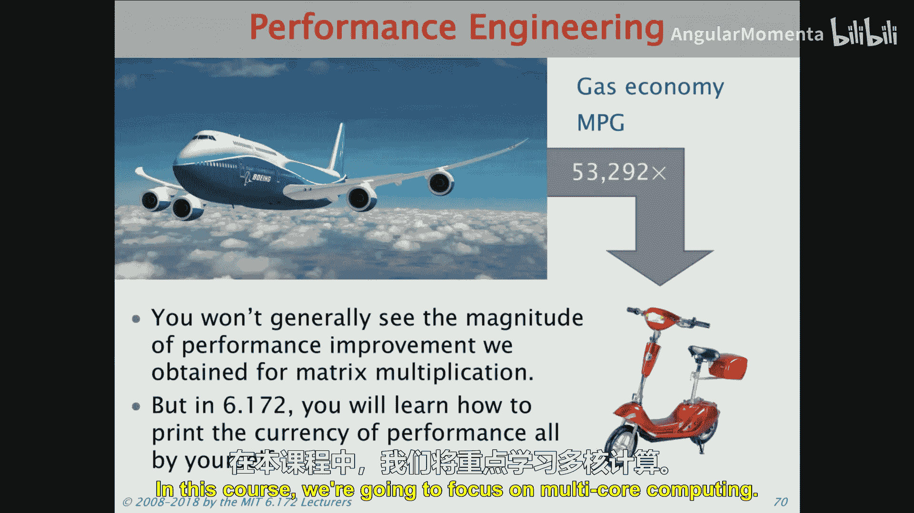

# 【麻省理工】软件系统性能工程 ｜MIT 6.172 Performance Engineering of Software Systems, Fall 2018 p01 1. 引言与矩阵乘法 -BV1esbLzpEFq_p1-

The following content is provided under a Cative Commons license。

 Your support will help Mi T OpenCourseware continue to offer high quality educational resources for free to make a donation or to view additional materials from hundreds of MiT courses。

 Visit Mit Opencourseseware at Ocw。 Mt Eduu。

So welcome to 6172。My name is Charles Lyarson and I am one of the two lecturers this term。

 the other is Professor Julian Sn。We're both in EECS and in seaAL。

On the seventh floor of the Gates building。A。If you don't know it， you are in。

Performance engineering of software systems。 So if this is the wrong。

 if you found yourself in the wrong place， now's the time to exit。

I want to start today by talking a little bit about why we do performance engineering。

And then I'll do a little bit of administration。And then sort of dive into sort of a case study that'll give you a good sense of some of the things that we're going to do during the term。

I put the administration in the middle because it's like if you don't。

 from me telling you about the course。You don't want to do the course， then it's like。

 why should you listen to the administration， right？So。So let's just dive right in， okay。

So the first thing to always understand whenever you're doing something is a perspective on what matters in what you're doing。

 so we're going to study the whole term we're going to do software performance engineering and so this is kind of interesting because it turns out that performance is usually not at the top of what。

People are interested in when they're building software。

What are some of the things that are more important than software？rry， then performance。Yeah。

Deadlines， good。Cost。CorrectCorrectness。Extensibility， yeah， I mean we could go on and on。

 I think that you folks could probably make a pretty long list。

 I made a short list of all the kinds of things that are more important than performance。

So then if programmers are so willing to sacrifice performance for these properties。

Why do we study performance？Okay， so this is kind of a bit of a paradox and a bit of a puzzle。

 why do you study something that clearly isn't at the top of the list of what most people care about when they're developing software。

😡，I think the answer to that。Is that performance is the currency of computing。

You use performance to buy these other properties。So you'll say something like， gee。

 I want to make it easy to program， and so therefore I'm willing to sacrifice some performance to make something easy to program。

I'm willing to sacrifice some performance to make sure that my system is secure。Okay。

 and all those things come out of your performance budget。And clearly。

 if performance degrades too far。Your stuff becomes unusable。

When I talk people with programmers and I say， people are fond of saying， oh， performance， yo。

 you do performance， performance doesn't matter， I never think about it。

Then I talk with people who use computers， and I ask。

 what's your main complaint about the computing systems you use， answer？Too slow。

So it's interesting whether you're the producer or whatever。

 but the real answer is that performance is like currency， it's something you spend。

I would rather have， if you look， you know， would I rather have $100 or a gallon of water？Well。

 water is indispensable to life， there are circumstances certainly where I would prefer to have the water。

 okay， then $100。But in our modern society。I can buy water for much less than $100。

So even though water is essential to life and far more important than money。Money is a currency。

 And so I prefer to have the money because I can just buy the things I need。

 And that's the same kind of analogy of performance。 It has no intrinsic value。

But it contributes to things， you can use it to buy things that you care about。

 like usability or testability or what have you。系。Now， in the early days of computing。

 software performance engineering was common because machine resources were limited。

 if you look at these machines from 1964 to 1977，A。I mean， look at how many bytes they have on them。

 right， in 64， there is a computer with 524 kilobytes。Okay， that was a big machine。Back then。

 that's kilobytes， that's not megabytes， that's not gigabytes， that's kiloabytes， okay？And。

Many programs would strain the machine resources。Okay the clock rate for that machine was 33 kilohertz。

 what's a typical clock rate today？About what？F gigahertz， three gigahertz。

 two gigahertz somewhere up there， yeah， somewhere in that range。

 okay and here they were operating with kilohertz， so many programs would not fit without intense performance engineering。

😡，And one of the things also that there's a lot of。A lot of sayings that came out of that area。

 Donald Cannuth， who's one of the touring Award winner。

 absolutely fabulous computer scientists in all respects。

 wrotePm optimization is the root of all evil， and I invite you by the way to look that quote up because it's actually taken out of context。

So trying to optimize stuff too early， he was worried about， okay。

 Bill Wolf who built the designed the bliss language and worked on the PDP 11 and such said。

 more computing sins are committed in the name of efficiency without necessarily achieving it than for any other single reason。

 including blind stupidity。And Michael Jackson said， the first rule of program optimization。

 don't do it。Second rule of program optimization for experts only， don't do it yet。Okay。

So everybody warning away because when you start trying to make things fast。

 your code becomes unreadable。Making code that is readable and fast。

 now that's where the art is and hopefully we'll learn a little bit about doing that。ok。嗯。And indeed。

 there was no real point in working too hard on performance engineering for many years。

 if you look at technology scaling and you look at how many transistors are on various processor designs up until about 2004。

 we had Moore's law in in full throttle， with。😡，Chhiip density is doubling every two years and really quite amazing。

And along with that， as they shrunk the dimensions of chips because by miniaturization。

 the clock speed would go up correspondingly as well。And so if you found something was too slow。

 wait a couple years。Okay， wait a couple years， it'll be faster。Okay， and so there wasn't。

 you know if you're going to do something with software and make your software ugly。

 that really wasn't a real， you know， wasn't a real good。😡，嗯。Payoff compared to just simply。

Waiting around。And in that era， there was something called Denard scaling。

Where which allowed things to as things shrunk， allowed the clock speeds to get larger。

 basically by reducing power， you could reduce power and still keep everything fast。

 and we'll talk about that in a minute。So if you look at what happened to from 1977 to 2004。

 here are Apple computers with similar。Similar price tags， and you can see the clock rate。

Really just skyrocked， 1 megaertz， 400 meertz， 1。8 gigahertz。

 and the data paths went from 8 pis to 30 to 64， the memory correspondingly grow cost approximately the same。

And that's the legacy from Moore's law and the tremendous advances in semiconductor technology。

 and so until 2004。Moore's law in the scaling of clock frequency， so called Denard scaling。

 was essentially a printing press for the currency of performance。You didn't have to do anything。

 You just made the hardware go fast or very easy， very。And all that came to an end。 Well。

 some of it came to an end in 2004 when clock speeds plateaued。

So if you look at this around 2005 you can see all the speeds we hit you know two to four gigahertz and we have not been able to make chips go faster than that in any practical way since then but the densities have kept going great now the reason that the clock speed flattened was because of power density and this is a slide from Intel from that era looking at the growth of power density and what they were projecting was that the junction temperatures of the transistors on the chip if they just keep scaling the way they had been scaling would start to approach first of all。

 the temperature of a nuclear reactor then the temperature of a rocket nozzle and then the sun's surface so we're not going to build little technology that cools that very well and even if you could solve it for a little bit the writing was in the wall we cannot scale。

frequencies anymore the reason for that is that originally clock frequency was scaled assuming that the most of the power was dynamic power。

 which was going when you switched the circuit and what happened as we kept reducing that and reducing that is something that used to be in the noise。

 namely the leakage currents。Okay， started to become significant to the point where now today the dynamic power is far less of a concern than the static power from just the circuit sitting there leaking and when you miniaturize。

 you can't stop that effect from happening。😡，So what do the vendors do in 2004 and 2005 and since is they said。

 oh， gosh， we've got all these transistors to use， but we can't use the transistors to make stuff run faster。

So what they did is they introduced parallelism in the form of multicore processors。

 they put more than one processing core in a chip， and to scale performance。

 they would you have multiple cores and each generation of Moore's law now was potentially doubling the number of cores。

 and so if you look at what happened for a processor cause you see that around 2005， 2004， 2005。

 we started to get multiple processing cores per chip。

 to the extent that today it's basically impossible to find a single core chip for a laptop or workstation or whatever。

 everything is multicore。You can't buy just one， you have to buy a parallel processor。嗯。And。

And so the impact of that was that performance was no longer free。

 you couldn't just speed up the hardware now if you wanted to use that potential。

 you had to do parallel programming and that's not something that anybody in the industry really had done。

U。So today， there are a lot of other things that happen in that intervening time。

 we got vector units as common parts of our machines， we got GPUs， we got steeper cash hierarchies。

 we have configurable logic on some machines and so forth。

And now it's up to the software to adapt to it。And so although we don't want to have to deal with performance。

Today you have to deal with performance and in your lifetimes。

 you will have to deal with performance， okay， in software。

 if you're going to have effective software。ok。U。You can see what happened also。

 this is a study that we did looking at software bugs and a variety of open source projects where they're mentioning the word performance and you can see that in 2004 the numbers start going up。

 you know some of them it's not as convincing for some things as others。

 but generally there's a trend of after 2004 people started worrying more about performance。

If you look at software developer jobs。啊。As of around early mid2s， 2000 OOs， I guess。Okay。

 you see once again， the mention of performance in jobs is going up。And anecdotally， I can tell you。

 I had one student who came to me after the spring after he'd taken 6172 and he said， you know。

 I went and I applied for five jobs and every job， asked me at every job interview。

 they asked me a question I couldn't have answered if I hadn't taken 6172， and I got five offers。

And when I compared those offers， they tended to be 20 to 30% larger than people are just web monkeys。

Okay， so so anyway， that's not to say that you should necessarily take this class， okay。

 but I just want to point out that what we're going to learn is going to be interesting from a practical point of view。

 I。e。 your futures， okay， as well as theoretical points of view and technical points of view。ok。

So modern processors are really complicated， and the big question is how do we write software to use that modern hardware efficiently？

Okay。I want to give you an example of performance engineering of a very well studied problem。

 namely matrix multiplication， who has never seen this problem。😀ははは。😊，Yeah， okay。

 so we got some jokers in the class， I can see。Okay。嗯。So this is， you know。

 it takes n cubed operations because you're basically computing n squared dot products。Okay。

 so essentially， if you add up the total number of operations。

 it's about two n cubed because there is essentially a multiply and an ad for every pair of terms that need to be accumulated。

 okay so it's basically2 n cubed， we're going to look at it assuming for simplicity that our n is an exact power of two。

ok。Now。The machine that we're going to look at is going to be one of the one。

One of the ones that you'll have access to an AWS， it's a compute optimized machine。

Which has a Hawell micro architecture running at 2。9 gigahertz。

There are two processor chips for each of these machines and nine processing cores per chip。

 so a total of 18 cores， so that's the amount of parallel processing， it does two way hyperthreading。

 which we're actually going to not deal a lot with hyperthing gives you a little bit more performance。

 but it also makes it really hard to measure things。So generally we will turn off hyperthreading。

 but the performances that you get tends to be correlated with what you get when you hyperthread。

For floatinglo point unit， there it is capable of doing eight double precision operations。

 that 64 bit floating point operations， including a fusesed multiply ad per core per cycle。Okay。

 so that's a vector unit， so basically each of these 18 cores can do eight double precision operations。

 and so including a fu multiplay ad， which is actually two operations。Okay。

 the way that they count these things， Okay， it has a cache line size of 64 bytes。

The eyeCash is 32 kilobytes， which is eight ways set associative。

 we'll talk about some of these things， if you don't know all the terms it's okay。

 we're going to cover most of these terms later on， it's got a dcash of the same size。

 it's got an L2 cache of 256 kilobytes。And it's got an L3 cache or what's sometimes called an LLC last level cache of 25 megabytes。

 and then it's got 60 gigabytes of DRAM。 so this is a honking big machine。Okay。

 this is like you can get things to sing on this， okay， if you look at the peak performance。

It's the clock speed times two processor chips times nine。AProces course per chip。

 each capable of if you can use both the multiply and the ad 16。Floing point operations。

 and that goes out to just short of a tariff flops。Okay，836 gigaplops。Okay， so that's。

 that's a lot of power。Okay， that's a lot of power。 These are fun machines， actually， okay。

 especially when we get into things like the。The gameplay AI and stuff that we do for the fourth project。

 you'll see they're really fun to have a lot of compute。Okay。Now the base， here's the basic code。

 this is the full code for Python for doing matrix multiplication now generally in Python you wouldn't use this code because you just call a library subrtine that does matrix multiplication。

But sometimes you have a problem， I'm going illustrate with matrix multiplication。

 but sometimes you have a problem that is for which you have to write the code and I want to give you an idea of what kind of performance you get out of Python in addition。

 somebody has to write if there is a library routine。

 somebody had to write it and that person was a performance engineer because they wrote it to be as fast as possible and so this will give you an idea of what you can do to make code run fast so when you run this code。

 so you can see that the start time you know before the trip nested loop。Right here。

Before the triply nested loop， we take a time measurement and then we take another time measurement at the end and then we print the difference。

 and then that's just this classic。Triling nested loop for。For matrixtri multiplication。um。

And so when you run this， how long is this run for do you think？Any guesses？Let's see， how about。

 let's do this， runs for six microseconds， who thinks six microseconds。How about six milliseconds？

How about six milliseconds， How about six seconds？How about six minutes？Okay， how about six hours？

How about six days？Okay。Of course， it's important to know what size it is this 4096 by 4096 as it shows in the code。

 and those of you didn't vote。Can I wake up， let's get active。 This is active learning。

 put yourself out there。 Okay， it doesn't matter whether you're right or wrong。

 There'll be a bunch of people who got the right answer， and they have no idea why。Okay。

So it turns out it takes about 21，000 seconds。Which is about six hours。Okay。Amazing， is this fast？

Yeah， right， duh， right， it's this fast know that you know， how do we tell？

Whether whether this is fast or not， Okay， you know， what should we expect from our machine。

 So let's do a back of the envelope calculation of。

Of how many operations there are and how fast we ought to be able to do。

 we just went through and said what are all the parameters of the machine。

So there are two n cubed operations that need to be performed。

 we're not doing stress and algorithm or anything like that， we're just doing straight。

Triplely nested loop。So that's two to the 37 floating point operations， okay？The running time is 21。

000 seconds。So that says that we're getting about 6。25 megaflps out of our machine。

When we run that code？Okay。Just by dividing it out， how many？

Floating point operations per second we get， we take the number of operations divided by the time。

Okay。U。The peak， as you recall， was about 836 gigaplops。Okay， and we're getting 6。25 megaflps。Okay。

 so we're getting about 0。00075%。Of peak。Okay。嗯。This is not fast。Okay， this is not fast。

So let's do something really simply， let's code it in Java rather than Python。Okay。

So we take just that loop， the code is almost the same。triply nested loop。 We run it in Java。

 and the running time now， it turns out， is。About just under 3，000 seconds。

 which is about 46 minutes。The same code。Python， Java， okay， we got a。

Almost a nine times speed up over just simply coding it in a different language。Okay。Well。

 let's try C， that's the language we're going to be using here。 What happens when you code it in C。

 It's exactly the same thing。Okay， we're going to use the Kang LLVM 5。0 compiler。

I believe we're using 6。0 this term， is that right？Yeah， okay。

 I should have rerun these numbers for six， but I didn't。So now it's basically 1100 seconds。

 which about 19 minutes。So we got then about it's twice as fast as Java and about 18 times faster than Python。

So here's where we stand so far。We have the running time of these various things。

And the relative speed up is how much faster it is than the previous row。

And the absolute speed up is how it is compared to the first row。

 and now we're managing to get now 0。014% of peak。So we're still。啊。We're still slow。

 but before we go and try to optimize it further。Like， why is Python so slow and C so fast？

Anybody know？It' a see program。Okay， that's kind of on the right track。Anybody else have any eyes？

Articulate a little bit why Python is so slow， yeah。When you write like multiply an a。

 those aren't the only instructions Python's doing。

 it's doing lots of code for like going through Python objects。Yeah yeah。Okay， good。

So the big reason why Python is slow and see us so fast is that Python is interpreted。

And C is compiled directly to byte to machine code。

And Java is somewhere in the middle because Java is compiled to Bcode which is then interpreted and then just in time compiled into machine code。

 let me talk a little bit about these things， so interpreters such as in，😡，Python are versatile。

 but slow。U。It's one of these things where they said。

 we're going to take some of our performance and use it to make a more flexible。

 easier to program environment。The interpreter basically reads， interprets。

 and performs each program statement， and then updates the machine state。So it's not just。

 it's actually going through and each time reading your code。

Figuring out what it does and then implementing it so there's like all this overhead compared to just doing its operations。

So interpreters can easily support high- levelve programming features and they can do things like dynamic code alteration and so forth at the cost of performance。

 so typically the cycle for an interpreter is you read the next statement。

 you interpret the statement， you then perform the statement。

 and then you update the statement of the machine， and then you fetch the next instruction。

And you're going through that each time， and that's done in software。

When you have things compiled to machine code， it goes through a similar thing。

 but it's highly optimized just for the things that machines are done。And so when you compile。

 you're able to take advantage of the hardware and interpreter of machine instructions。

 and that's much， much lower overhead than the big software overhead you get with Python Now Jt is somewhere in the middle what's used in Java。

Jit compilers can recover some of the performance， in fact， it did a pretty good job in this case。

 the idea is when the code is first interpreted， it's executed， it's interpreted。

And then the runtime C system keeps track of how often the various。Pieces of code are executed。

 and whenever it finds that there's some piece of code that it's executing frequently。

 it then calls the compiler to compile that piece of code。And then subsequent to that。

 it runs the compiled code。😡，So it tries to get the big advantage of performance by only compiling the things that are necessary。

 for which it's actually going to pay off to invoke the compiler to do， okay？嗯。So anyway。

 so that's the big difference with those kinds of things。

 one of the reasons we don't use Python in this class is because the performance model is。

Hard to figure out。Okay， see it's much。Closer to the metal， much closer to the silicon。

 and so it's much easier to figure out what's going on in that context。Okay。

 but we will have a guest lecture that we're going to talk about performance in managed languages like Python。

 so it's not that we're going to ignore the topic but。

We will learn how to do performance engineering in a place where it's easier to do it。ok。

Now one of the things that a good compiler will do is， you know once you get to。

 let's say we have the C version， which is where we're going to move from this point because that's the fastest we got so far is it turns out that you can change the order of loops in this program without affecting the correctness okay so here we went。

 you for I for J for k do the update， we could otherwise do we could do for I for k for J do the update。

 and it computes exactly the same thing。Or we could do。For K， for J， for I。Do the updates Okay。

 so we can change the order without effecting the correctness， Okay。

 And so do you think the order of loops matters for performance？

I think this is like this leading question， yeah question。Ccalities。Yeah。

 so and you're exactly right。 Cash locality is what is。 So when we do that， we get。

The loop order affects the running time by a factor of 18。Whoa， just by switching the order。Okay。

 what's going on there， okay， what's going on， so we're going to talk about this in more depth and I'm to just going to fly through this because this is just sort of showing you the kinds of considerations that you do。

So in hardware， there are each processor or region write's main memory in contiguous blocks called cache lines。

Previously access cache lines are stored in a small memory called cache that sits near the processor。

 when it access when the processor access something， if it's in the cache， you get a hit。

 that's very cheap。And fast， if you miss， you have to go out to either a deeper level cache or all the way out to main memory。

 that is much， much slower and we'll talk about that kind of thing。So what happens in？

For this matrix problem is the matrices are laid out in memory in row major order that means you take you know you have a two dimensional matrix。

 it's laid out in the linear order of the addresses as a memory by essentially taking row1 and then after row1 stick row2 and after that stick row3 and so forth and unfolding there's another order that things could have been laid out in fact they are in fortran which is called column major order okay so it turns out C and Fortran operate in different orders。

😡，And turns out it affects performance which way it does it。

So let's just take a look at the access pattern for order IJK。

So what we're doing is once we figure out what I and what j is。

 we're going to go through and cycle through K and as we cycle through K。Okay。

 CIJ stays the same for everything we get for that excellent spatial locality because we're just accessing the same location every single time it's going to be in cash。

 it's always going to be there， it's going to be fast to access C。For A。

What happens is we go through in a linear order and we get good spatial locality， but for B。

 it's going through columns and those points are distributed far away in memory。

 so the processor is going to be bringing in 64 bytes to operate on a particular datum。

And then it's ignoring seven of the eight floating point words on that cache line and going to the next one so it's wasting an awful lot okay so this one has good spatial locality and that it's all adjacent and you would use the cache lines effectively this one you're going 4096 elements apart。

 it's got poor spatial locality okay and that's why。And that's for this one。

 so then if we look at the different other ones， this one the order IKJ。

 it turns out you get good spatial locality for both C and B and excellent for A。

And if you look at you know even another one， you don't get nearly as good as the other one。

 so there's a whole range of things， okay， this one you're doing optimally badly in both okay and so you can just measure the different ones。

And it turns out that you can use a tool to figure this out。

 and the tool that we'll be using is called Ca Gr。And it's at one of the vgriin suites of caches and what it'll do is it'll tell you what the mis rates are for the various pieces of code。

 and you'll learn how to use that tool and figure out， oh， look at that。

 we have a high miss rate for some and not for others， so that may be why my code is running slowly。

 okay？So when you pick the best one of those， we then got a relative speed up of about six and a half。

So what other simple changes can we try， There's actually a collection of things that we could do that don't even have us touching the code。

What else could we do for people who' played with compilers and such？Hin， hint。Yeah。Yeah。

 change the compiler flags， okay， so Kang， which is the compiler well be using。

 provides a collection of optimization switches。And you can specify Fitch。

 switch to the compiler to ask it to optimize。So you do minus0 and then a number and0。

 if you look at the documentation it says do not optimize， one says optimize。

 two says optimize even more， three says optimize yet more。

 okay in this case it turns out that even though it optimize more in03。😡。

Turns out  O2 was a better setting。Okay， this is one of these cases， it doesn't happen all the time。

 usually03 does better than 02， but in this case O2 actually optimized better than03 because the optimizations are to some extent heuristic。

And there are also other kinds of optimization， you can have it do profile guided optimization where you look at what the performance was and feed that back into the code。

 and then the compiler can be smarter about how it optimizes and there are a variety of other things。

 so with this simple technology we now choosing a good optimization flag in this case O2。

 we got for free， basically a factor of 3。25。without having to do much work at all。

 okay and now we're actually starting to approach 1% of peak performance， we got 0。

3% of peak performance。Okay， so what's causing the low performance？

Why aren't we getting most of the performance out of this machine？Why do you think？Yeah。

 we're not using a cars so far， we're using just one core and how many cores do we have？18。

18 cores ah。18 chs， just sitting there， 17 sitting idle while we are trying to optimize one， okay？So。

Multi corere， so we have nine cores per chip and there are two of these chips in our test machine。

 so we're running on just one of them， so let's use them all。

To do that we're going to use the silk infrastructure。

 and in particular we can use what's called a parallel loop， which in silk you call silkk4。

 and so you just relay that outer loop， for example in this case， you say silkk4 it says。

 do all those iterations in parallel。Compiler and runtime system are free to schedule them and so forth。

 okay， and we could also do it for the inner loop。Okay？And you know， it's like。

 or it turns out you can't also do it for the middle loop。If you think about it， okay。

 so I'll let you do that as a little bit of a homework problem， why can't I just。

Do a silk four of the inner loop。系。So the question is which parallel version works best？

So we can do parallel the I loop， we can parallel the J loop， and we can do I and J together。

 you can't do K just with a parallel loop and expect to get the right thing and that's this thing so if you look。

 wow， what a spread of running times， right？If I paralyze just the eye loop， it's 3。18 seconds。

And if I paralyzze the J loop。It actually slows down， I think， right？

And then if I do both I andJ it's still bad， I just want to do the out loop there this has to do it turns out with scheduling overhead and we'll learn about scheduling overhead and how you predict that and such。

 so the rule of thumb here is parallel outer loops rather than inner loops okay and so when we do parallel loops。

 we get an almost 18 x speed up on 18 cores。Okay。Let me assure you。

 not all code is that easy to paralyze， but this one happens to be。

So now we're up to what about just over 5% of peak。Okay。

 so where are we losing where are we losing time here， okay why are we getting just 5% yeah？

Another area。Yep， good， so that's one and there's one other that we're not using very effectively。

that's one， and those are the two optimizations we're going to do to get a really good code here。

So what's the other one？嗯。That's actually related to the same question。

 but there's another completely different source of opportunity here。主要是这个は。Yeah， okay。

 we can actually manage the cache misses better okay so let's go back to hardware cache caches and let's restructure the computation to reuse data in the cache as much as possible because cache misses are slow and hits are fast and try to make the most of the cache by reusing the data that's already there okay so let's just take a look suppose that we're we're going to just compute one row of C okay so we go through one row of C that's going to take us since it's 4096 long vector there that's going to basically be 4096 rights that we're going to do。

And we're going to get some spatial locality there， which is good。

 but we're basically doing the processors doing 4096 rights。Now to compute that row。Okay。

 I need to access。4096 reads from A。Okay， and。I need all of B。Okay， because I go each column of B。

 as I'm going through to fully compute see， do people see that？

So I need to just compute one row of C， I'm going to compute I need to access one row of A and all of B。

😡，Because the first element of C。Needs the whole first column of B。

The second element of C needs the whole second column of B。 Once again。

 don't worry if you don't fully understand this because right now I'm just ripping through this at high speed。

 we're going to go into this in much more depth than the class and there'll be plenty of time to master this stuff。

 but the main thing to understand is you're going through all of B。

 then I want to compute another row of C， I'm going to do the same same thing I'm going to go through one row of A and all of B again。

 so that when I'm done， we do about 16 million，17 million memory access is total。

That's a lot of mariasses。So what if instead of doing that， I do things in blocks。 Okay。

 so what if I want to compute a 64 by 64 block of C rather than a row of C。

So let's take a look at what happens there。 So remember， by the way， this number 16，17 million， okay。

 because we're going to compare with it。So what about to compute a block。

 so if I look at a block that is going to take me 64 by 64 also takes 4096 rights to see same number。

 okay？But now I have to do about 200，000 reads from A because I need to access all those rows。Okay。

 and then for B， I need to access 64 columns of B， okay， and that's another  262，000 reads from B。

 okay， which ends up being half a million memory accesses total。So I end up doing way fewer accesses。

Okay， I can， if those blocks will fit in my cash。So I do much less to compute the same size footprint if I compute a block rather than computing a row。

Okay， much more efficient。And that's a scheme called tiling。

 and so if you do tiled matrix multiplication， what you do is you bust your matrices into， let's say。

 64 by 64 submatrices。And then you do two levels of matrix multiply。

 you do an outer level of multiplying of the blocks using the same algorithm。

 and then when you hit the inner，To do a 64 by 64 matrix multiply， I then do another。😡。

Three nested loops， you end up with six nested loops。Okay。

 and so you're basically you know busting it like this and there's a tuning parameter， of course。

 which is， you know， how big do I make my tile size， you know， if it's S by S。

 what should I do at the least there， should it be 64 should it be。1undd and28， should it be。

 What number should I use there， How do we find the right value of。

How do we find the right value of S， this tuning parameter？Ideas of how we might find it。Yeah。

You could do that。You might get a number， but who knows what else is going on in the cache while you're doing this？

Yeah， test a bunch of them， experiment。Okay， try them， see which one gives you good numbers。

 and when you do that you get， it turns out that 32 gives you the best performance。Okay。

 for this particular problem， okay？So you can block it and then you can get faster and when you do that。

 you now end up with that gave us a speed of about 1。7。

So we're now up to what we're almost 10% of peak。Okay。

And the other thing is that if you use Ca Gr or a similar tool。

 you can figure out how many cash references there are and so forth。

 and you can see that in fact it's dropped quite considerably when you do blocked the tiling versus just the straight parallel loops。

Okay， so once again， you can use tools to help you figure this out and to understand the cause of what's going on。

Well， it turns out that our chips don't have just one cache， they've got three levels of caches。

 okay， there's L1 cash。Okay， and there's data and instructions。

 so we're thinking about data here for the data for the matrix， and it's got an L2 cache。

 which is also private to the processor， and then a shared L3 cache。

 and then you go out to the DRAM you also can go to your neighboring processors and such。

And they're of different size， as you can see， they grow in size 32 to 32 kilobytes。

 256 kilobytes to 25 megabytes to main memory， which is 60 gigabytes。

So what you can do is if you want to do two level tiling。Okay， you can have two tuning parameters。

 S and T。And now you get to do you can't do binary search to find it。

 unfortunately because it's multidimensional， you kind of have to do it exhaustively and when you do that you end up with。

With nine nested loops。Okay。But of course， we don't really want to do it we have three levels of caching。

Okay， can anybody figure out the inductive number， for three levels of caching。

 how many levels of tiling do we have to do？This is a。This is a gimmy， right？12， good， 12， okay。

 yeah you do 12， okay？That really， and man， you know。

 when I say the code gets ugly when you start making things go fast， okay， right， this is like。Okay。

Okay。But it turns out there's a trick。You can tile for every piy of two simultaneously by just solving the problem recursively。

So the idea is that you do divide and conquer divide each of the matrices into four submatrices。

Okay and then if you look at the calculations you need to do。

 you have to solve eight subpro of half the size and then do an addition， okay？

And so you have eight multiplications of size n over 2 by n over  two and one addition of n by n matrices。

 and that gives you your answer， but then of course what you're going to do is solve each of those recursively。

Okay， and that's going to give you essentially the same type of performance。Here's the code。

 I don't expect that you understand this， but we've written this using in parallel because it turns out you can do four of them in parallel and the silk spawn here says。

 go and do this subroutine， which is basically a subproblem and then while you're doing that。

 you're allowed to go and execute the next statement。

 which will do another spawn and another spawn and finally this。

 and then this statement says but don't start the next phase until you finish the first phase。

And we'll learn about this stuff。When we do that， we get a running time of about 93 seconds。

 which is about 50 times slower than the last version。We're using cash much better。

 but it turns out you know nothing is free， nothing is easy in。Typically in performance engineering。

 you have to be clever。Why what happened here， why did this get worse even though turns out if you actually look at the caching numbers。

 you're getting great hits on cash， I mean you have very few， very few cash misses。

 lots of hits on cash， but we're still slower， why do you suppose that is？Let me get some of yeah。

Yeah， the overhead to start with the function and in particular the place that it matters is at the leaves of the computation okay so what we do is we have a very small base case we're doing this overhead all the way down to n equals one so there's a function call overhead even when you're multiplying one by one so hey。

 let's pick a threshold。And below that threshold， let's just use a standard you know good algorithm for that threshold and if we're above that we'll do divide and conquer okay so what we do is we call a you know if we're less than the threshold okay。

We call a base case and the base case looks very much like just ordinary matrix multiply。Okay。

And so when you do that。You can once again look to see what's the best value for the base case。

 and it turns out in this case， I guess it's 64。Okay， we get down to 1。95 seconds。

 I didn't do the base case of one because I tried that and that was the one that gave us terrible performance。

Sorry， 32， oh yeah， 32 is even better， 1。3 good， yeah， so we picked 32， I think I even。

 oh I didn't highlight it， okay。I should have highlighted that on the slide， so then when we do that。

 we now are getting 12% of peak。Okay， and we're doing- if you count up how many cash misses we have。

 you can see that， you know， here's the data cache for L1 and with parallel divide and conquer the lowest。

 but also now so is the last level caching。And then total number of references is small as well。

So divide and conquer turns out to be a big win here。Okay。Now， the other thing that we mentioned。

 which was we're not using the vector hardware。All of these things have vectors that we can operate on。

They have vector heart that process data in what's called SD fashion。

 which means single instruction scene multiple data。

 that means you give one instruction and it does operations on a vector。Okay， and as we mentioned。

 we have eight floating point units per core， which we can also do a fuseed multiply ad。Okay。

So each vector regimen holds multiple words， I believe in the one the machine we're using this term it' four。

Words。I think so。ok。And。But it's important when you use these， you can't just use them Willie nilly。

You've got to have all the， you know， you have to operate on the data as one chunk of vector data。

 you can't you know have this lane doing of the vector unit doing one thing and a different lane doing something else they all have to be doing essentially the same thing。

 the only difference being the indexing of memory。ok。So when you do that。

 you can so already we've actually been taking advantage of it。

 but you can produce a vectorization report by asking for that and it'll tell you。

The system will tell you what kinds of things are being vectorized。

 which things are being vectorized， which aren't， and we'll talk about how you vectorize things that the compiler doesn't want to vectorize and in particular。

 most machines don't support the newest sets of vector instructions so the compiler uses vector instructions conservatively by default。

So what particular， if you're compiling for a particular machine。

 you can say use that particular machine， and here's some of the vectorization flags。

You can say use the AVX instructions， if you have AVX， you can use AVX2。

 you can use thefuse multiply ad vector instructions。

 you can give a string that tells you the architecture that you're running on on that special things and you can say。

 well， use whatever machine I'm currently compiling on。

And it'll figure out which architecture is that？Floating point。Numbers， as we'll talk about。

 turn out to have some undesirable properties like they're not associative。

So if you do A times B times C。How you parentthesize that can give you two different numbers。

And so if you give a specification of a code， typically the compiler will not change the order of associivity。

Because it says I want to get exactly the same result， but you can give it a flag called fast math。

 minus F fast math， which will allow it to do that kind of reordering。

If it's not important to you that it'd be the same as the default ordering， and when you use that。

 and particularly using architecture native and fast math。

 we actually get about double the performance。Out of vectorization。

 just having to compiler vectorize it。Okay。Yeah， question。They're 64 bit。Y。

 so we use these days 64 bit is pretty standard， they call that double precision。

 but it's pretty standard unless you're doing AI applications in which case you may want to do lower precision。

Amatech。No， floatlo is 32。Okay， so generally people use 60 who are doing serious。You know。

 linear algebra calculations do 64 bits。But sometimes they can use actually。

 sometimes they can use less， and then you can get more performance if you discover you can use fewer bits in your representation。

 we'll talk about that too。系。So last thing that we're going to do is there are。

You can actually use the instructions， the vector instructions yourself。

 rather than rely on the compiler to do it。And there's a whole manual of intrinsic instructions that you can call from C。

That allow you to do the specific vector instructions that you might want to do it。

 so the compiler doesn't have to figure that out。And so you can also use some other more insights to do things like you can do preprocessing and you can transpose the matrices。

 which turns out to help and do data alignment and there's a lot of other things and using clever algorithm for the base case。

 okay？And so you。And you do more performance engineering， you think about what you're doing。

 you code and then you run run run to test， and that's one nice reason to have the cloud because you can do tests in parallel so it takes you less time to do your tests in terms of your you know sitting around time when you're doing something you say。

 oh， I want to do 10 tests let's spin up 10 machines and do all the tests at the same time When you do that and the main one we're getting out of this is the AVX intrinsics we get up to。

041 of peak， so 41% of peak and get about 50，000。Speed up。Okay。And it turns out that's where we quit。

Okay， and the reason is because we beat Intel's professionally engineered math Colel library。

At that point， okay？U。You know， there's a good question， why aren't we getting all of Pe。You know？

I invite you to figure that out， it turns out though Intel MKL is better than what we did because we assumed it was a power of two。

 Intel doesn't assume that it's a power of two。And they're more robust and although we win on the 4 496 by 4096 matrices。

 they win on other sizes of matrices， so it's not all things。SoBut the end of the story is that。

 you know， what have we done， We have just done a factor of 50000。 Okay。

 If you looked at the gas economy。Okay of a jumbo jet。Okay。

 and getting the kind of performance that we just got in terms of miles per gallon。

 you would be able to run a jumbo jet on a little Veespa scooter or whatever type of scooter that is。

 okay， that's how much we've been able to do it。You generally。

 let me just caution you won't see the magnitude of a performance improvement that we obtain for matrix multiplication okay that turns out to be one where it's a really good example because it's so dramatic。

 but we will see some substantial numbers and in particular in 6172 you'll learn how to print this currency of performance all by yourself so that you don't have to take somebody else's library。

 you can you know say oh no I'm an engineer that let me mention one other thing in this course we're going to focus on multicore computing。

We are not in particular going to be doing GPUs or file systems or network performance in the real world those are hugely important okay。

 what we found however， is that it's better to learn a particular domain in particular this particular domain。

 people who master who master multicore performance engineering， in fact。

Go on to do these other things and are really good at it。 Okay。

 because you've learned this sort of the core， the basis， the foundation。

