# 【麻省理工】软件系统性能工程 ｜MIT 6.172 Performance Engineering of Software Systems, Fall 2018 p02 2. 宾利工作优化法则 -BV1esbLzpEFq_p2-

The following content is provided under a Creative Commons license。

 Your support will help Mi T OpenCourseware continue to offer high quality educational resources for free to make a donation or to view additional materials from hundreds of MiT courses。

 Visit Mit Opencourseseware at Ocw。 Mt。 Eduu。

So welcome to the second lecture of 6172 Performance Engineering of Software System。

Today we're going to be talking about Bentley rules for optimizing work。All right， so work。

Does anyone know what work means？You're all at MIT， so you should know。So。

In terms of computer programming， there's actually a formal definition of work。

The work of a program on a particular input is defined to be the sum total of all of the operations executed by the program。

So it's basically a gross measure of how much stuff the program needs to do。嗯。

And the idea of optimizing work is to reduce the amount of stuff that the program needs to do in order to improve the running time of your program。

 improve its performance。So algorithm design can produce dramatic reductions in the work of a program。

 for example， if you want to sort an array of elements， you can use an N log N time Quick sort。

Or you can use an n squared time sort like insertion sort。

 so you've probably seen this before in your algorithms courses。And for large enough values of n。

 an n log n time sort is going to be much faster than an n squared sort。

So today I'm not going to be talking about algorithm design。

 you'll see more of this in other courses here at MIT and we'll also talk a little bit about algorithm design later on in this semester。

嗯。We will be talking about many other cool tricks for reducing the work of a program。

 but I do want to point out that reducing the work of our program doesn't automatically translate to a reduction in running time and this is because of the complex nature of computer hardware so there's a lot of things going on that aren't captured by this definition of work there's instruction level parallelism caching。

 vectorization， speculation and branch prediction and so on and we'll learn about some of these things throughout this semester。

But reducing the work of our program does serve as a good heuristic for reducing the overall running time of a program。

 at least to a first order， so today we'll be learning about many ways to reduce the work of your program。

So the rules that we'll be looking at， we call them Bentley optimization rules in honor of John Lewis Bentley。

So John Lewisis Batley wrote a nice little book back in 1982 calledWriting Efficient Programs。

 and inside this book， there are various techniques for reducing the work of a computer program。

 so if you haven't seen this book before is very good so I highly encourage you to read it。

Many of the original ruless in Bentley's book had to deal with the vagaries of computer architecture three and a half decades ago。

 so today we've created a new set of Bentley rules just dealing with the work of a program。

 we'll be talking about architecture specific optimizations later on in the semester。

 but today we won't be talking about this。One cool fact is that John Lewis Bentley is actually my academic great grandfather。

 so John Bentley was one of Charles Leisson's academic advisors。

 Charles Lezason was Guy Bock's academic advisor and Guy Bock who's a professor at Connegie Mellon was my advisor when I was a graduate student at CMU。

 so this is a nice little fact and I had honor of meeting John Bentley a couple years ago at a conference and he told me that he was my academic great grandfatherther。

Yeah， and Charles is my academic grandfather and all of Charles's students are my academic aunts and uncles。

Including your TA， Helen。Okay， so here's a list of all of the work optimizations that we'll be looking at today。

 so they're grouped into four categories， data structures， loops， logic and functions。

 so there's a list of 22 roles on this slide today in fact we'll actually be able to look at all of them today so today's lecture is going to be structured as a series of many lectures and I'm going to be spending one to three slides on each one of these optimizations。

All right， so let's start with optimizations for data structures。

The first optimization is packing and encoding your data structure。

And the idea of packing is to store more than one data value in a machine word。

 and the related idea of encoding is to convert data values into a representation that requires fewer bids。

 so does anyone know why this could possibly reduce the running time of a program。Yes。Right。

 so good answer， the answer was it might need less memory fetches and it turns out that that's correct because computer programs spends a lot of time moving stuff around in memory and if you reduce the number of things that you have to move around in memory。

 then that's a good heuristic for reducing the running time of your program。

So let's look at an example， let's say we wanted to encode dates。

 so let's say we wanted to encode this string September 11th， 2018。You can store this using 18 bytes。

 so you can use one byte per character here。And this would require more than two double words because each double word is 8 bytes or 64 bits and you have 18 bytes。

 you need more than two double words， and you have to move around these words every time you want to manipulate the date。

But it turns out that you can actually do better than using 18 bytes。

 so let's let's assume that we only want to store years between 4096 BCE and 4096 CE。

So there are about 365。25 times 8，192 dates in this range， which is 3 million approximately。

And you can use logb two of3 million bits to represent all of the dates within this range。

 so the notation LG here means log base of two that's going to be the notation I'll be using in this class and LOG will mean log base 10。

So we take the ceiling of log based 2 of 3 million， and that gives us 22 bits。

So a good way to remember how to compute the log basease2 of something。

 you can remember that the logbase 2 of 1 million is 20， log basease2 of 1000 is 10。

 and then you can factor this out and then add in log basease2 of three round it up which is two so that gives you 22 bits and that easily fits within 132 bit words。

 now you only need one word instead of three words as you did in the original representation。

But with this modified representation， now determining the month of a particular date will take more work because now you're not explicitly storing the month in your representation。

 whereas with the string representation， you are explicitly storing it。

At the beginning of the string， so this does take more work， but it requires less space。

So any questions so far？Okay， so it turns out that。There's another way to store this。

 which also makes it easy for you to fetch the month， the year， or the day for a particular date。

So here we're going to use the bit field facilities in C。

 so we're going to create a struct called date underscore T with three fields a year or the month and the date。

And the integer after the semicolon specifies how many bits I want to assign to this particular field in the drug。

 So this says I need 13 bits for the year，4 bits for the month and five bits for the day。

 So the 13 bits for the year is because I have 8192 possible years， so I need 13 bits to。Store that。

For the month I have 12 possible months， so I need log base two of 12 rounded up， which is four。

 and then finally for the day I need log base two of  31 rounded up。

 which is5 so in total this still takes 22 bits。But now the individual fields can now be accessed much more quickly than if we had just encoded the3 million dates using sequential integers。

 because now you can just extract a month just by saying whatever you named your' struck。

 you can just say that struck dot month and that gives you the month yes。C。

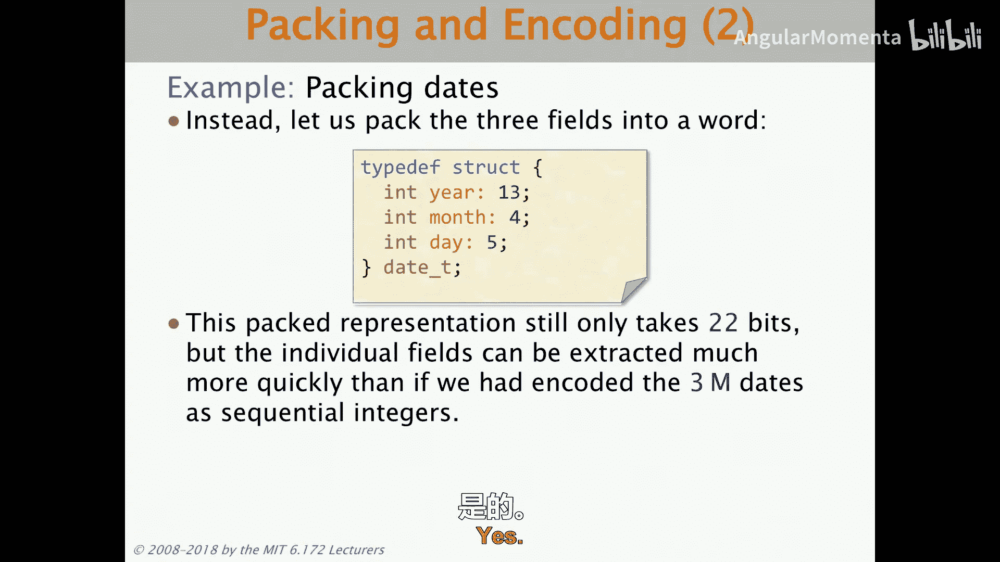

材用せト。It makes it vital the one。Yeah， so this will actually pad thestruct a little bit at the end。

 so you actually do require a little bit more than 20 of2 bits， that's a good question。

But this representation is much more easy to access than if you just had encoded the integers as sequential integers。

Another point is that sometimes unpacking and decoding are the optimization。

 because sometimes it takes a lot of work to encode。

Andcode the values and to extract them so sometimes you want to actually unpack the values so that they take more space。

 but they're faster to access。 so it depends on your particular application。

 you might want to do one thing or the other and the way to figure this out is just to experiment with it。

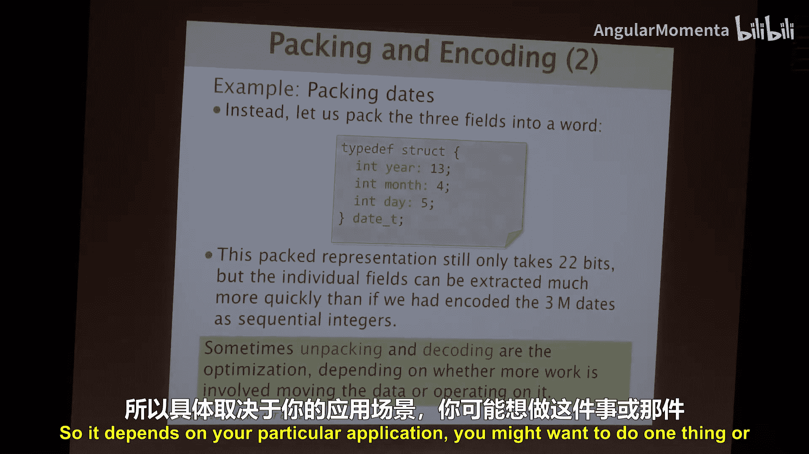

Okay， so any other questions？All right， so the second optimization is data structure augmentation。

 an idea here is to add information to data structure to make common operations do less work so that they're faster。

And let's look at an example， let's say we had two singly linked bliss and we wanted to append them together。

And let's say we only stored the head pointer to the list。

 and then each element in the list has a pointer to the next element in the list。Now。

 if you want to append one list to another list。

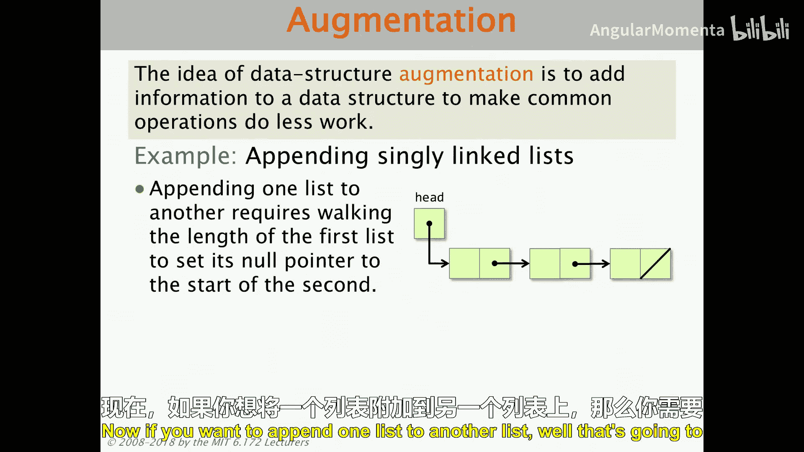

Well， that's going to require you walking down the first list to find the last element so that you can change the pointer of the last element to point to the beginning of the next list。

And this might be very slow if the first list is very long。

So does anyone see a way to augment this data structure so that a pending to list can be done much more efficiently？

Yes。Yes， so the answer is the store pointer to the last value and we call that the tail pointers so now we have two pointers both the head and the tail。

 the head points to the beginning of the list， the tail points to the end of the list。

 and now you can just append two list in constant time because you can access the last element in the list by following the tail pointer and then now you just change the successor pointer of the last element to point to the head of the second list and then now you also have to update the tail to point to the end of the second list。

Okay， so that's idea of data structure augment， we added a little bit of extra information to the data structure such that now a pending to lists is much more efficient than in the original method where we only had a head pointer。

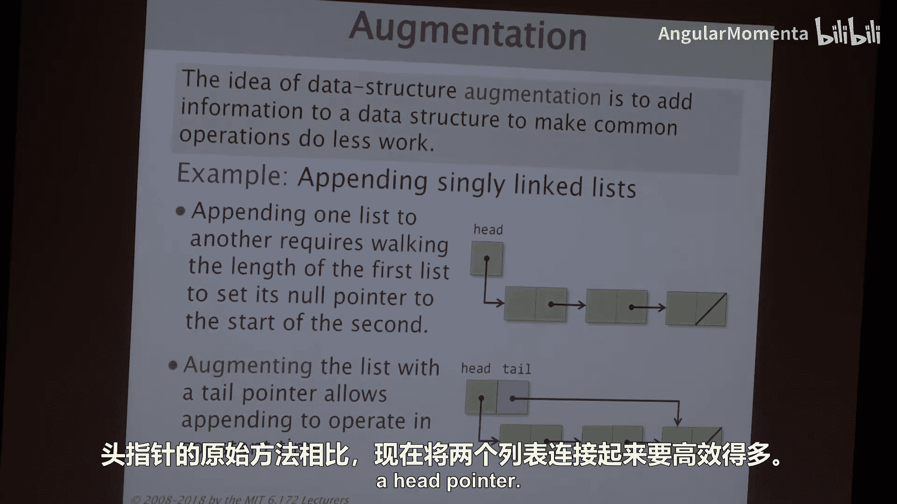

Questions。Okay， so the next optimization is pre computationut。

The idea of pre computationutation is to perform some calculations in advance so as to avoid doing these computations at mission critical times。

 to avoid doing them at runtime。So let's say we had a program。

That needed to use binomial coefficients。And here's a definition of a binommial coefficient。

 so it's basically the choose function。

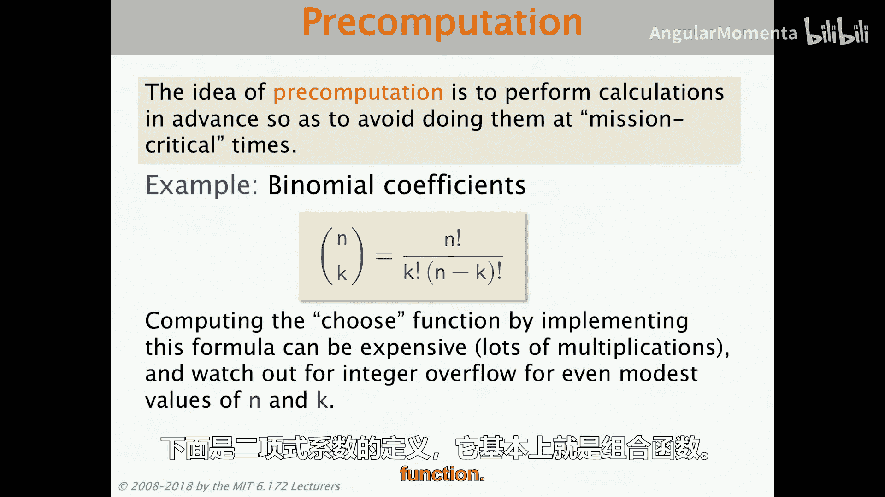

So you want to choose you want to count the number of ways that you can choose K things from a set of n things。

In the formula for computing， this is n factorial divided by the product of k factorial and n minus k factorial。

😡，Computing this choose function can actually be quite expensive because you have to do a lot of multiplications to compute the factorials。

 even if the final result is not that big because you have to compute one term in thenominator and then two factorial terms in the denominator。

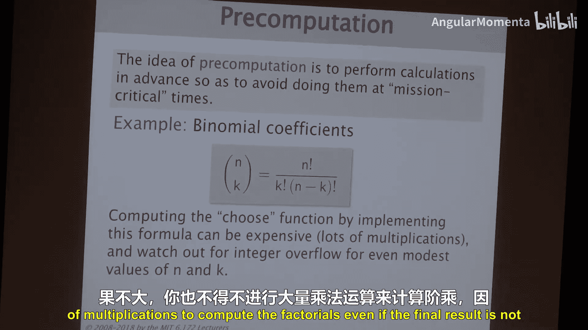

And then you also might run into integer overflow issues because n factorial grows very fast。

 it grows super exponentially， it grows like n to the n which is even faster than2 to the n which is exponential。

 so doing this computation you have to be very careful with integer overflow issues。

So one idea to speed up a program that uses these binomial coefficients is the precomp table of coefficients when you initialize the program and then just perform table lookup on this precomputer table at runtime when you need the binomial coefficient。

So does anyone know what the table？That store binomial coefficients is called。Yes。Yeah。

 Pascal's triangles， good。So here's what Pascal's triangle looks like。

 so on the vertical axis we have different values of n and then on the horizontal axis we have different values of k。

 and then to get n choose K， you just go to the n row in the K column and look up that entry。

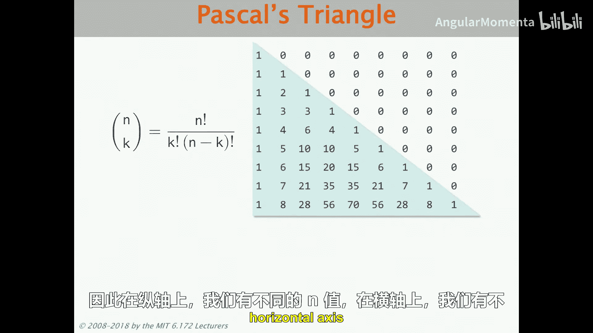

Pascal's tringla is a nice property。That for every element。

 it can be computed as a sum of the element directly above it and above it and to the left of it。

 So here，56 is a sum of 35 and 21。And this gives us a nice formula to compute the binomial coefficients。

So。We first check if n is less than k in this choose function， if n is less than k。

 then we just return zero because we're trying to choose more things than there are in a set。

If n is equal to0， then we just return one because here k must also be equal to 0 since we have the condition and less than k above and there's one way to choose zero things from a set of zero things and then if k is equal to0。

 we also return one because there's only one way to choose zero things from a set of any number of things you just don't pick anything and then finally we recursively call this choose function。

 so we call choose n minus1 k minus1， this is essentially the entry above andagonal diagonal to this。

And then we add entriess of n minus n minus1 k， which is the entry directly above it。

So this is a recursive function for generating this Pascal's triangle。

 but notice that we're actually still not doing precomputation because every time we call this choose function。

 we're making two recursive calls and this can still be pretty expensive。

So how can we actually pre computeute this table？So here's some C code for precomputing Pascal's triangle。

And let's say we only wanted coefficients up to a huge size of 100。

 so we initialized a matrix of 100 by 100。And then we call this in net choose function。

 so first it goes from n equals 0 all the way up to choose size minus1。

 and then it sets choose of n0 to be1， it also choose of nN to be1。

 so the first line is because there's only one way to choose zero things from any number of things in the second line is because there's only one way to choose n things from n things which is just to pick all of them。

And then now we have a second loop， which goes from n equals 1 all the way up to choose size minus1。

And then first， we set choose of0 n to be 0 because here n is or k is greater than n。

 so there to there's no way to pick more elements from a set of things that is less than the number of things you want to pick。

And then now you loop from k equals 1 all the way up to n minus1。

 and then you apply this recursive formulaless， so choose of nk is equal to choose of n minus1。

 k minus1 plus choose of n minus1 k。And then you also set choose of K n to be 0。

 So this is basically all of the entries above the diagonal here， where K is greater than n。

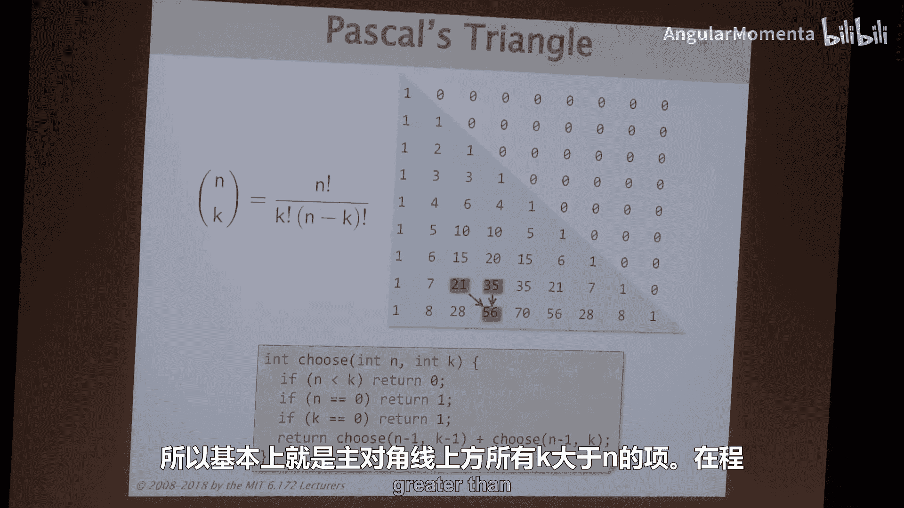

And then now inside the program， whenever we need a binomial coefficient， that's less than 100。

 we can just do table lookup into this table and we just index into this choose array。

So does this make sense， any questions？So it's pretty easy so far， right？

So one thing to note is that we're still computing this table at runtime because we have to initialize this table at runtime。

 and if we want to run or program many times， then we have to initialize this table many times。😡。

Is there a way to only initialize this table once， even though we might want to run the program many times？

Yes。Yeah， so good， so put it in the source code。嗯。And so we're going to do compile time initialization and if you put the table in the source code。

 then the compiler will compile this code and generate the table for you at compile time。

 so now whenever you run it， you don't have to spend time initializing the table。

So the idea of compile time initialization is to store the values of constants。

 duringoring compilation。And therefore， saving work at runtime。

So let's say we wanted to choose values up to 10。

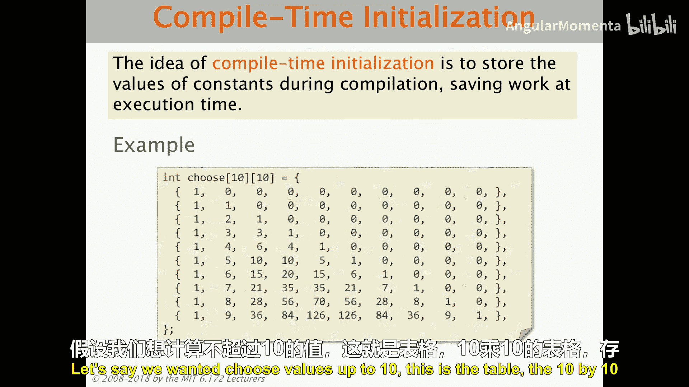

This is the table， the 10 by 10 table storing all of the binommial coefficients up to 10。

So if you put this in your source code， now when you run the program。

 you can just index into this table to get the appropriate constant here。

But this table was just a 10 by 10 table， what if you wanted a table of 1000 by 1000？

Does anyone actually want to type this in a table of 1，000 by 1000？So probably not。

 so is there any way to get around this？😡，Yes。実然。Yeah， yeah。

 so the answer is to write a program that writes your program for you。

And that's called meta programming。So here's a snippet of code that will generate this table for you。

So it's going to call this in niche choose function that we defined before。

 and then now it's just going to print out C code， so it's going to print out that the declaration of this array choose followed by a left bracket and then for each row of the table。

 we're going to print another left bracket and then print the value of each entry in that row followed by a right bracket and we do that for every row。

 so this will give you the C code and then now you can just copy and paste this and place it into your source code。

So this is a pretty cool technique to get your computer to do work for you。

 and you're welcome to use this technique in your homeworks and projects if you need to generate large tables of constant value。

 so this is a very good technique to know。

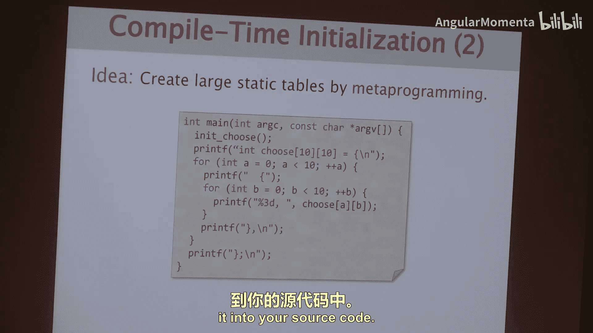

So any questions， yes？I there the other program。As opposed to。Having you copy of this。Yeah。

 so you can pipe the output of this program to a file。Yeah。Yes。So we have street cross。Yeah。

 so I think you can write macros to actually generate this table and then the compiler will run those macros to generate this table for you so you don't actually need to copy and paste it yourself。

Yeah。You know you don't have to write it and see。Just's put you right with Python。書いた。

Just put it in the make file。System you're building。It's in the eightflow。で、すね。First， generate。快。

ling。It's just one more step of the process。For sure。

Generally easier to write these tables with a scripting language like Python。On the other hand。

 if you need experience writing C， practice writing C。Right so as Charles says。

 you can write your meta program using any language。

 you don't have to write it and see you can write it in Python if you're more familiar with that。

 and it's often easier to write it using a scripting language like Python。Okay。

 so let's look at the next optimization， so we've already gone through a couple many lectures already。

 so congratulations to all of you who are still here。So the next optimization is caching。

 the idea of caching is to store results that have been accessed recently so that you don't need to compute them again in the program。

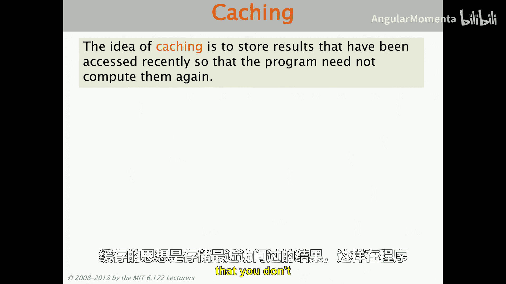

So let's look at an example， so let's say we wanted to compute thepotenuse of a right triangle with side lengths A and B。

So the formula for computing this is you take the square root of a times a plus b times B。Okay。

Turns out that the square root operator is actually relatively expensive。

 more expensive than additions and multiplications on modern machines。

 so you don't want to have to call the square root function if you don't have to。

And one way to avoid doing that is to create a cache。😡。

So here I have a cache just storing the previous hypotenuse that I calculated。

 and I also store the values of A and B that were passed to the function。

And then now when I call the Hytenuse function， I can first check if a is equal to the cache value of a and if B is equal to the cached value of B。

 and if both of those are true， then I already computed hypoten before。

 and then I can just return cache of age。😡，But if it's not in my cache。

 now I need to actually compute it， so I need to call this square root function。

 and then I store the result into cache to H， and I also store a in B into cache A and cache B respectively。

 and then finally I return cache to H。So this example isn't actually very realistic because my cache is only of size1 and it's very unlikely in a program you're going to repeatedly call some function with the same input arguments。

But you can actually make a larger cache， you can make a cache of size 1000 storing the 1000 most recently computer hypoten values。

 and then now when you call the Hyten function， you can just check if it's in your cash。

 checking the larger cache is going to be more expensive because there are more value to look at。

But it can still save you time overall。U。And hardware also does caching for you。

 as we'll talk about later on in the semester， but the point of this optimization is that you can also do caching yourself。

 you can do it in software， you don't have to let hardware do it for you。

And it turns out for this particular program here， it actually is about 30% faster if you do hit the cache about two thirds of the time。

 so it does actually save you time if you do repeatedly compute the same values over and over again。

So that's caching。Any questions？Okay， so the next optimization we'll look at is sparsity。

The idea of exploiting sparsity in an input is to avoid storing and computing on zero elements of that input。

And the fastest way to compute on zeros is to not compute on them at all because we know that any value plus0 is just that original value and any value times0 is just zero。

 so why waste the computation doing that when you already know the result？

So let's look at an example， this is matrix vector multiplication。

So we want to multiply an n by n matrix by an n by one vector。

We can do dense matrix vector multiplication by just doing a dot project of each row in a matrix with the column vector。

 and then that will give us the output vector。But if you do dense matrix vector multiplication。

 that's going to perform n squared or 36 in this example， scalar multiplies。

 but it turns out only 14 of these entries in this matrix are0 are non-zero。

So you just wasted work doing the multiplication on the zero elements because you know that zero times any other element is just zero。

So。A better way to do this is instead of doing the multiplication for every element。

 you first check if one of the arguments is zero and if it is zero。

 then you don't have to actually do the multiplication。

 but this is still kind of slow because you still have to do a check for every entry in your matrix。

 even though many of the entries are zero。So there's actually a pretty cool data structure that won't actually store these zero entries。

 and this will speed up your matrix vector multiplication if your matrix is sparse enough。

So let me describe how this data structure works， it's called compressed Sprse row or CSR。

 there's an analogous representation called compressed Sprse column or CSC。

 but today I'm just going to talk about CSR。So we have three arrays， first we have the row array。

The length of the rows array is just equal to the number of rows in a matrix plus one。

And then each entry in the rows array just stores an offset into the columns array or the calls array。

And inside the causal array， I'm storing the indices of the non zero entries in each of the rows。😡。

So if we take row1， for example， we have rows of1 is equal to2。

 that means I start looking at the second entry in the calls array。

 and then now I have the indices of the nonzero columns in the first row， so it's just one， two。

4 and5， these are the nonzeroice these are the indices for the non-zero entries。😡。

And then I have another array called vows， the length of this array is the same as the calls array。

 and then this array just stores the actual value in these indices here。

 so the vows array for row1 is going to store 4，1，5 and9 because these are the non-zero entries in the first row。

Right so the first the rows array just serves as an index into this causal array。

 so you can basically get the starting index in this causal array for any row just by looking at the entry stored at the corresponding location in the rows array。

 so for example， row2 starts at location6， so it starts here and you have indices3 and 5 which are the non-zero indices。

So does anyone know how to compute the length， the number of non zeros in a row by looking at the rows array？

Yes， yes。To the roary。Right。Yeah， so to get the length of a row。

 you just take the difference between that rows offset and the next rows offset。

 so we can see that the length of the first row is four because its offset is two and the offset for row two is6。

 so you just take the difference between those two entries。We have an additional entry here。

 so we have the sixth row here because we want to be able to compute the length of the last row without overflowing in our array。

 so we just created an additional entry in the rows array for that。

So turns out that this representation will save you space if your matrix is sparse。

 so the storage required by the CSR format is order n plus NNZ。

 where NNZ is a number of nonzes in your matrix。And the reason why you have n plus NNZ。

 well you have two arrays here calls and bowels whose length is equal to the number of non-zes in the matrix。

 and then you also have this rows array whose length is n plus1， so that's why we have n plus N andZ。

 and if the number of non-zes is much less than n squared then this is going to be significantly more compact than the dense matrix representation。

However， this isn't always going to be the most compact representation， does anyone see why？

Why might the dance representation sometimes？Take less space。Yeah。Sorry。

Why might the dance representation sometimes take less space？Right。

 so if you have a relatively dense matrix。Then it might take more space than storing it。

 it might take more space in the CSR representation because you have these two arrays。

 so if you take the extreme case where all of the entries are non zeros。

 then both of these arrays are going to be of length n squared so you already have two n squared there and then you also need this rows array which is of length n plus1。

😡，Okay。So now I gave you this more compact representation for storing the matrix。

 so how do we actually do stuff with this representation？

So it turns out that you can still do matrix vector multiplication using this compressed sparse row format。

And here's the code for doing it， so we have thisstruct here， which is the CSR representation。

 we have the rosar array， the causalar， and then the vows array。

And then we also have the number of rows n and the number of non zeros NN Z。And then now what we do。

 we call this SPMV or sparse matrix vector multiply， we pass in our CSR representation， which is a。

 and then the input array， which is X， and then we store the result in an output array Y。So first。

 we loop through all of the rows and then we set y of I to be0， this is just initialization。

And then for each of my rows， I'm going to look at the column indices for the nonzero elements。

 and I can do that by starting at k equals to rows of I and going up to rows of i plus1。😡。

And then for each one of these entries， I just look up the index。

 the column index for the non-zero element， and I can do that with calls of k， so let that be J。

 and then now I know which elements to multiply， I multiply vows of k by x of J。

And then now I just add that to YFI， and then this after I finish with all of these multiplications and additions。

 this will give me the same result as if I did the dense matrix vector multiplication。

So this is actually a pretty cool program， so I encourage you to look at this program offline to convince yourself that it's actually computing the same thing as the dense matrix vector multiplication version。

 so I'm not going to approve this during lecture today。

 but you can feel free to ask me or any of your Ts after class if you have questions about this。

And the number of scalar multiplications that you have to do using this code is just going to be NNZ because you're just operating on the non-zero elements。

 you don't have to touch all of the zero elements， and in contrast the dense matrix vector multiply algorithm would take n squared multiplications。

 so this can be significantly faster for sparse matrices。

So it turns out that you can also use a similar structure to store a sparse static graph。

 so I assume many of you have seen graphs in your previous courses。

See here's what the sparse graph representation looks like。So again we have this arrays。

 we have these two arrays， we have offsets and edges。

 the offsets array is analogous to the rows array， and the edges array is analogous to the columns array for the CSR representation。

 and then in this offsets array， we store for each vertex where its neighbors start in this edges array。

 and then in the edges array we just write the indices of its neighbors there。So let's take vertex 1。

 for example。The offset of vertex 1 is 2， so we know that its outgoing neighbors start at position2 in this edges array。

And then we see that vertex 1 has outgoing edges two vertices2，3， and 4。

 and we see in the edges array， 2，3，4 are listed there。

 and you can also get the degree of each vertex， which is analogous to the length of each row by taking the difference between consecutive offset。

 so here we see that the degree of vertex 1 is 3 because its offset is its offset is 2 in the offset of vertex 2 is5。

And it turns out that using this representation， you can run many classic graph algorithms such as B search and page rank quite efficiently。

 especially when the graph is sparse， so this would be much more efficient than using a dense matrix to represent the graph and running these algorithms。

You can also store weights on the edges and one way to do that is to just create an additional array called weights whose length is equal to the number of edges in the graph and then you just store the weights in that array。

 and this is analogous to the values array in the CSR representation。

But there's actually a more efficient way to store this if you always need to access the weight whenever you access an edge。

 and the way to do this is to interleave the weights with the edges to store the weight for a particular edge right next to that edge。

And create an array of twice the number of edges in the graph。

 and the reason why this is more efficient is because it gives you improved cash locality。

And we'll talk much more about cash locality later on in this course。

 but the high level idea is that whenever you access an edge。

 the weight for that edge will also likely to be on the same cache lines so you don't need to go to main memory to access the weight of that edge again。

And later on in the semester， we'll actually have a whole lecture on doing optimizations for graph algorithms。

And today I'm just going to talk about the one representation of graphs。

 but we'll talk much more about this later on。Any questions？Okay。

 so that's it for the data structure optimizations。

We still have three more categories of optimizations to go over。So its a pretty fun lecture。

 we get to learn about many cool tricks for reducing the work of your program。

So the next class of optimizations we'll look at is logic。

The first thing is constant folding and propagation。

 the idea of constant folding and propagation is to evaluate constant expressions and substitute the result into further expressions all at compilation times。

 you don't have to do it at runtime。So again， let's look at an example。

So here we have this function called Orary， does anyone know what Orary means？

Can look it up on Google。Okay， so an Orory is a model of a solar system。

So here we're constructing a digital orary。And in order we have these whole bunch of different constants。

 we have the radius， the diameter， the circumference， cross area， surface area， and also the volume。

But if you look at this code。You can notice that actually all of these constants can be defined at compile time once we fix the radius。

 so here we set the radius to be this constant here，6371，000。

I don't know where that constant comes from， by the way， but Charles made these slides。

 so he probably does。U。Sorry。Okay， radius of the earth。Now that diameter is just twice this radius。

 the circumference is just pi times the diameter， cross areas is pi times the radius squared。

Surface area is circumference times the diameter， and finally volume is four times pi times the radius cube divided by 3。

So you can actually evaluate all of these two constants at compile time。

 so with a sufficiently high level of optimization。

The compiler will actually evaluate all of these things at compile time。

And that's idea of constant folding and propagation， it's a good idea to know about this。

 even though the compiler still is pretty good at doing this because。

Sometimes the compiler won't do it in those cases you can do it yourself。

 and you can also figure out whether the compiler is actually doing it when you look at the assembly code。

Okay， so the next optimization is common subexpression elimination。

 and the idea here is to avoid computing the same expression multiple times by evaluatinguing the expression once and storing the result for later use。

So let's look at this simple for line program， we have a equal to B plus C。

 then we set B equal to a minus D， then we set C equal to B plus C。

 and finally we set D equal to a minus D。So notice here that the second and the fourth lines are computing the same expression。

 they're both computing a minus D， and they evaluate it to the same thing。

So an idea of common subexpression illumination would be to just substitute the result of the first evaluation into the place where you need it in future line。

 so here we saw evaluate the first line for a minus D。

 but now in the second time we need a minus D we just set the value to B。

 so now d is equal to B instead of a minus D。So in this example， the first and the third line。

 the right hand side of those lines actually look the same。 they're both B plus C。

 Does anyone see why you can't do common sub expressionion elimination here？Yeah。

 so you can't do common subexpression for the first and the third lines because the value of B changes in between。

 so the value of B changes on the second line， so on the third line when you do B plus C is not actually computing the same thing as the first first evaluation of B plus C。

So again， the compiler is usually smart enough to figure this optimization out so it will do this optimization for you in your code。

 but again， it doesn't always do it for you so it's a good idea to know about this optimization so that you can do this optimization by hand when the compiler doesn't do it for you。

Questions so far。Okay， so next let's look at algebraic identities。

The idea of exploiting algebraic identities is to replace more expensive algebraic expressions with equivalent expressions that are cheaper to evaluate。

So let's look at an example， let's say we have a whole bunch of balls and we want to detect whether two balls collide with each other。

Say ball has an x coordinate， a y coordinate， a z coordinate， as well as a radius。

And the collision test works as follows， we set D equal to the square root of the sum of the squares of the differences between each of the three coordinates of the two balls。

 so here we're taking the square of B1's x coordinate minus B2's x coordinate and then adding the square of B1s y coordinate minus B2s y coordinate。

 and finally adding the square of B1 z coordinate minus B2 z coordinate。

And then we take the square root of all of that， and then if the result is less than or equal to the sum of the two radii of the ball。

Then that means there's a collision， and otherwise that means there's not a collision。U。

But turns out that the square root operator， as I mentioned before。

 is relatively expensive compared to doing multiplications and additionions and subtractions on modern machines。

So。How can we do this without using the square root operator？Yes。I the two ra。本当です。

Right so that's actually a good check to a good fast path check。

 I don't think it necessarily always gives you the right answer， is there another yes。

Wherequare the addition of the radio？Right， right。The answer is that you can actually take the square of both sides。

 So now you don't have to take the square root anymore。 So we're going to use the identity。

That says that if the square root of u is less than or equal to v exactly when u is less than or equal to v squared。

 so we're just going to take the square of both sides and here's the modified code。

So now I don't have this square root anymore on the right hand side when I compute d squared。

 but instead I square the sum of the two radii。So this will give you the same answer。

 however you do have to be careful with floating point operations because they don't work exactly in the same way as real numbers。

 so you sometimes might run into overflow issues or rounding issues。

 so you do have to be careful if you're using algebraic identities and floating point computations。

 but the high level idea is that you can use equivalent algebraic expressions to reduce the work of your program。

And we'll come back to this example later on in this lecture when we talk about some other optimizations such as the fast path optimization as one of the students pointed out。

 yes。Which are you talking about this line？So before we were comparing D。Yeah。Yeah。Okay。

 is that clear，Okay， so the next optimization is short circuiting。

The idea here is that when we're performing a series of tests。

 we can actually stop evaluating this series of tests as soon as we know what the answer is。

So here's an example。Let's say we have an array A。Containing all non negative integers。

And we want to check if the sum of the values in a exceeds some limit。

So the simple way to do this is you just sum up all the values of the array using a for loop。

 and then at the end you check if the total sum is greater than the limit。So using this approach。

 you always have to look at all of the elements in an array。

But there's actually a better way to do this and the idea here is that once you know the partial sum exceeds the limit that you're testing against。

 then you can just return true because at that point you know that the sum of the elements in the array will exceed the limit because all of the elements in an array are non-negative。

And then if you get all the way to the end of this for loop。

 that means you didn't exceed this limit and you can just return false。So。

This second program here will usually be faster if most of the time you exceed the limit pretty early on when you loop through an array。

 but if you actually end up looking at most of the elements anyways or even looking at all of the elements。

 this second program will actually be a little bit slower because you have this additional check inside this for loop that has to be done for every iteration。

So when you apply this optimization， you should be aware of whether this will actually be faster or slower based on the frequency of when you can short circuit the test。

Questions。Okay and I want to point out that there are short circuitrcing logical operators。

 so if you do double amberand， that's a short circuiting and logical and operator。

So if it evaluates the left side to be false， it means that the whole thing has to be false。

 it's not even going to evaluate the right side。And then the double vertical bar is going to be a short circuiting or。

 so if it knows that the left side is true it knows that the whole thing has to be true because or just requires one of the two sides to be true and it's going to short circuit。

In contrast， if you just have a single ampersand or a single vertical bar。

 these are not short circuiting operators are going to evaluate both sides of the argument。

 the single ampersand and single vertical bar turn out to be pretty useful when you're doing bit manipulation and we'll be talking about these operators more on Thursday's lecture。

 yes。What your program has been to set。是能到。一。Yeah， if you use a Do amperserson。

 then that would be true， yes。Yeah。Yes， one example is if you might possibly index an array out of bounds。

 you can first check whether you would exceed the limit or be out of bounds and if so。

 then you don't actually do the index。Okay， a related idea is to order tests。

Such that the tests that are more often successful are earlier。

 and the ones that are less frequently successful are later in order because you want to take advantage of short circuiting。

 and similarly， inexpensive tests should precede expensive tests because if you do the inexpensive tests and your test short circuit then you don't have to do the more expensive test。

So here's an example， here we're checking whether a character is white space。

So character is white space， if it's equal to the Car return character。

 if it's equal to the tab character， if it's equal to space。

 or if it's equal to the new line character。So which one of these tests do you think should go at the beginning？

Yes。Why is that？Yeah， yeah， so it turns out that the space and the new line characters appear more frequently than the carrier return in the tab and the space is the most frequent because you have a lot of spaces in text。

 so here I've reordered the test so that the space， the check for space is first。

And then now if you have a character that's a space。

 you can just short circuit this test and return true next the new line character I have it as the second test because these are also pretty frequent。

 you have a new line for every new line in your text。And then less frequent is the tab character。

 and finally the Carish return character isn't that frequently used nowadays。

So now with this ordering， the most frequently successful tasks are going to appear first。

Notice that this only actually saves you work if the character is a white space character。

 if it's not a white space character， then you're going to end up evaluating all of these tasks anyways。

Okay， so now let's go back to this example of detecting collision of balls。

So we're going to look at the idea of creating a fast path and the idea of creating a fast path is that there might possibly be a check that will enable you to exit the program early because you already know what the result is。

And one fastpa check for this particular program here is you can check whether the bounding boxes of the two balls intersect。

 if you know the bounding boxes of the two balls don't intersect then you know that the balls cannot collide。

If the bounding boxes of the two balls do intersect， well。

 then you have to do the more expensive test because that doesn't necessarily mean that the balls will collide。

So。Here's what the fastpath test looks like， we're first going to check whether the bounding boxes intersect and we can do this by looking at the absolute value of the difference on each of the coordinates and checking if that's greater than the sum of the two radii。

And if so， that means that for that particular coordinate。

 the bounding boxes cannot intersect and therefore the balls cannot collide。

 and then we can return false if any one of these tests returned true。

 and otherwise we'll do the more expensive test of comparing D squared to the square of the sum of the two radii。

And the reason why this is a fast path is because this test here is actually cheaper to evaluate than this test below here we're just doing subtractions。

 additions and comparisons and below we're using the square operator which requires a multiplication and multiplications are usually more expensive than additions on modern machines。

 so ideally if we don't need to do the multiplication， we can avoid it by going through a fast path。

So for this example， it probably isn't worth it to do the FastPas checks since it' such a small program。

 but in practice there are many applications and graphics that benefit greatly from doing FastPas checks and the FastPa check will greatly improve the performance of these graphics programs。

There's actually another optimization that we can do here。

 I talked about this optimization a couple slides ago， does anyone see it？Yes。Right。

 so we can apply commons sub expression illlimination here because we're computing the sub of the two radii four times。

 we can actually just compute it once， stored it in a variable and then use it for the subsequent three calls。

And then similarly， when we're taking the difference between each of the coordinates。

 we're also doing it twice， so again， we can store that in a variable and then just use the result in the second time。

Any questions？Okay， so the next idea is to combine tests together。

 so here we're going to replace a sequence of tests with just one test or switch statement。

So here's an implementation of a full adder， so a full adder is a hardware device that takes us input three bits and then it returns the carry bit and the sum bit。

As output， so here's a table that specifies for every possible input to the full adder what the output should be。

And there are eight possible inputs to the full ladder because it takes three bits and there are eight possibilities there。

And this program here is going to check all the possibilities。

 it's first going to check if a is equal to 0， if so it checks if b equals to0。

 if so it checks if C is equal to0， and if that's true。

 it returns0 and zero for the two bits and otherwise it returns1 and0 and so on。

 so this is basically a whole bunch of ifL statements nested together。

Does anyone think this is a good way to write the program？

Who thinks this is a bad way to write the program？Okay。

 so most of you think it's a bad way to write the program。

 and hopefully I can convince the rest of you who didn't raise your hand。

So here's a better way to write this program。So we're going to replace these multiple FL clauses with a single switch statement。

And what we're going to do is we're going to create this test variable。

 that is a three bit variable so we're going to place the C bit in the least significant digit。

 the B bit， we're going to shift it over by one， so in the second least significant digit and then the A bit in the third least significant digit。

 and then now the value of this test variable is going to range from zero to seven and then for each possibility we can just specify what the sum and the carry bits should be。

 and this requires just a single switch statement instead of a whole bunch of if else clauses。

There's actually an even better way to do this for this example。

 which is to use table lookup so you just precompute all of these answers sort in a table and then just look it up at runtime。

U。But the idea here is that you can combine multiple tests in a single test。

 and this not only makes your code cleaner， but it can also improve the performance of your program because you're not doing so many checks and you won't have as many branch misses。

Yes。Maybe。Yeah， I mean， I encourage you to see if you can write a faster program for this。All right。

 so we're done with two categories of optimizations， so we have two or more to go。

The third category is going to be about loops。So if we didn't have any loops in our programs， well。

 there wouldn't be many interesting programs to optimize because most of our programs wouldn't be very long running。

But with loops， we can actually optimize these loops and then realize the benefits of performance engineering。

The first loop optimization I want to talk about is hoisting。The Gulf hoisting。

 which is also called loop andvariant code motion is to avoid recomputing a loop andvariant code each time through the body of a loop。

 so if you have a four loop where each in each it ratio you're competing the same thing。

 well you can actually save work by just computing at once so in this example here。

I'm looping over an array of length n， and then I'm setting y of i equal to x of i times the exponential of the square root of pi over 2。

But this exponential of square root of pi over 2 is actually the same in every iteration。

 so I don't actually have to compute that every time。

So here's a version of the code that does hoist thing。

 I just moved this expression outside of the for loop and store it in a variable factor。

 and then now inside the for loop I just have to multiply by factor。

 I already computed what this expression is。And this can save a running time because computing the exponential of the square root of pi over2 is actually relatively expensive。

So it turns out that for this example， or the compiler can probably figure it out and do this hoisting for you。

But in some cases， the compiler might not be able to figure it out。

 especially if these functions here might change throughout the program。

So it's a good idea to know what this optimization is。

 so you can apply it in your code when the compiler doesn't do it for you。Okay， Sinels。

Sentinels are special dummy values placed in a data structure to simplify the logic of handling boundary conditions。

 and in particular the handling of loop exit tests。

So here I again have this program thats I have this program that checks whether the sum of the elements in sum array A will overflow if I added all of the elements together。

And here I've specified that all of the elements of A are non negative。

So how I do this is in every iteration， I'm going to increment sum by A of I。

 and then I'll check if the resulting sum is less than A of I。

Does anyone see why this will detect if I had an overflow？Yes。Yeah。

 so if the thing I added in causes as an overflow， then the result is going to wrap around and it's going to be less than the thing I added in。

 so this is why the check here that checks whether sum is less na I will detect an overflow。Okay。

 so I'm going to do this check in every iteration， if it's true， I'll just return true。

 and otherwise I get to the end of this for loop where I just return false。

But here on every iteration I'm doing two checks， I'm first checking whether I should exit the body of this loop。

 and then secondly I'm checking whether the sum is less than A of I。

It turns out that I can actually modify this program so that I only need to do one check in every iteration of the loop。

So here's a modified version of this program。So here I'm going to assume that I have two additional entries in my array A。

 So these are a of n and a of n minus-1。 so I assume I can use these locations。

 and I'm going to set a of n to be the largest possible 64 bit integer or in 64 max。

And I'm going to set a of n plus 1 to be 1。Then now I'm going to initialize my loop variable I to be0。

 and then I'm going to set the sum equal to the first element in a or a of 0。

And now I have this loop。It checks whether the sum is greater than or equal to A of I， and if so。

 the sum I'm going to add a of I plus1 to the sum， and then I also increment I。Okay。

This code here does the same thing as this thing on the left。

 because the only way I'm going to exit this while loop is if I overflow。

 and I'll overflow if A of I becomes greater than some or if the sum becomes less than A of I。

 which is what I had in my original program。😡，And then otherwise I'm going to just increment sum by A ofI and then this code here is going to eventually overflow because if the elements in my array a don't cause the program to overflow。

 I'm going to get to a of n and A of n is a very large integer and if I add that to what I have it's going to cause the program to overflow and at that point I'm going to exit this for loop or this while loop。

 and then after I exit this loop， I can check I can check why I overflow。

 if I overflowed because because of some element of a。

 then the loop index I is going to be less than n and I return true。

 but if I overflowed because I added it in this huge integer well then I is going to be equal to n and then I know that the elements of a didn't cause me to overflow the A of n value here did so then I just return false。

Does this make sense？So here in each iteration， I only have to do one check instead of two checks as in my original code。

 I only have to check whether the sum is greater than or equal to A of I。

Does anyone know why I set a of n plus 1 equal to1？Yes。Yeah， so good。

 so the answer is because if all of my elements were zero in my original array。

 then even though I add in this huge integer， it's still not going to overflow。But now I'm going to。

 when I get to a of n plus1， I'm gonna to add one to it。

 and then that will cause the sum to overflow。 And then I can exit there。

 So this is a deal with the boundary condition when all of the entries in my array are 0。Okay。

So next， loop and rollinging。So loop enrollly attempts to save work by combining several consecutive iterations of a loop into a single iteration。

Thereby reducing the total number of iterations of the loop and consequently the number of times that the instructions that control the loop have to be executed。

So there are two types of loop enrolling， there's full loop enrolling。

 why enroll all of the iterations of the four loop and I just get rid of the control flow logic entirely。

Then there's partial loop enrolling where I only unroll some of the iterations。

 but not all of the iterations， so I still have some control flow code in my loop。

So let's first look at full loop androll。So here I have a simple program that just loops for 10 iterations。

The fully unrolled loop just looks like the code on the right hand side。

 I just wrote out all the lines of code that I have to do in straight line code instead of using a for loop。

And now I don't need to check on every reiteration whether I need to exit the for loop。

So this is full loop enroll。This is actually not very common because most of your loops are going to be much larger than 10。

 and oftentimes many of your loop bounds are not going to be determined at compile time。

 they're determined at run time， so the compiler can't fully enroll that loop for you。

For small loops like this， the compiler will probably enroll the loop for you。But for larger loops。

 it actually doesn't benefit to unroll a loop fully because you're going to have a lot of instructions and that's going to pollute your instruction cache。

So the more common form of loop enrolling is partial loop enrolling。And here in this example here。

 I've unrolled the loop by a factor four。So I reduced the number of iterations of my four loop by a factor of four。

 and then inside the body of each iteration， I have four instructions。

And then notice I also changed the logic in the control flow of my fore loops。

 so now I'm incrementing the variable J by 4 instead of just by one。

And then since n might not necessarily be divisible by four。

 I have to deal with the remaining elements， and this is what the second four Lib is doing here。

 it's just dealing with the remaining elements。And this is the more common form of loop enroll。

So the first benefit of doing this is that you have fewer fewer checks to the exit condition for the loop because you only have to do this check every four iterations instead of every iteration。

 but the second and much bigger benefit is that it allows more compiler optimizations because it increases the size of the loop body and it gives the compiler more freedom to play around with code and to find ways to optimize the performance of that code。

 so that's usually the bigger benefit。If you enroll a loop by too much。

 that actually isn't very good because now you're going to be polluting your instruction cache and every time you fashion instruction。

 it's likely going to be a miss in your instruction cache and that's going to decrease the performance of your program。

And furthermore， if your loop body is already very big。

 you don't really get additional improvements from having the compiler do more optimizations because it already has enough code to work with。

 so given it more code doesn't actually give you much there。Okay so I just said this。

 the benefits of loop unrolling， lower number of instructions in loop control code。

 and then it also enables more compiler optimizations and the second benefit here is usually the much more important benefit and we'll talk more about compiler optimizations in a couple lectures。

Okay。Any questions？Okay， so the next optimization is loop fusion， this is also called jamming。

 and the idea here is to combine multiple loops over the same index range into a single loop。

 thereby saving the overhead of loop control。So here I have two loops。

 they're both looping from i equals0 all the way up to n minus1。

 the first loop I'm computing the minimum of a of I and b of I and storing the result in C of I。

 the second loop I'm comparing the I'm computing the maximum of a of I and B of I。

Storing the result in DI。So since these are going over the same index range。

 I can fuse together the two loops， given me a single loop that does both of these lines here。

And this reduces the overhead of loop control code because now instead of doing this exit condition check two end times。

 I only have to do it end times。This also gives you better cash flow Cal， again。

 we'll talk more about cash flow Cal in a future lecture， but at a high level here。

 what it gives you is that once you load a of I and B of I into cache。

 when you compute C of I it's also going to be in cache， when you compute D of I。

 whereas in the original code， when you compute D of I it's very likely that a of I and B of I are going to be kicked out of cash already。

 even though you brought it in when you computed C of I。For this example here， again。

 there's another optimization you can do common subexpression elimination since you're computing。

 this expression， A of I is less than or equal to B of I twice。Okay， next。

 let's look at eliminating wasted iterations， The idea of eliminating wasted iterations is to modify the loop bounds to avoid executing loop iterations over essentially empty loop bodies。

So here I have some code to transpose a matrix。So I go from equals 0 to n minus1。

 from j equals 0 to n minus1。And then I check if I is greater than J and if so I'll swap the entries in A of I J and A of JI。

 The reason why I have this check here is because I don't want to do the swap twice。

 otherwise I'll just end up with the same matrix that I had before。

 so I only have to do the swap when I is greater than J。

One disadvantage of this code here is I still have to loop for n squared iterations。

 even though only about half the iterations are actually doing useful work。

 because about half the iterations are going to fail this check here。

That checks whether I is greaterer than J。So here's a modified version of the program where I basically eliminate these wasted iterations。

So now I'm going to loop from i equals 1 to n minus1。And then from j equals 0 all the way up to I -1。

 so now instead of going up to n -1， I'm going just up to I -1。

 and that basically puts this check whether I is greater than J into the loop control code。

 and that saves me the extra wasted iterations。Okay， so that's the last optimization on loops。

 are there any questions？Yes。So the check is so you still have to do the check in the loop control code。

 but here you also have to do it， and now you just don't have to do it again inside the body of the loop。

Yes。Where this might be more。有我。I then also safe to。Before you optimize it that。当す。是。

And the first example was give empty。To time。To be able to。ワイファイです。And。Yeah， so。

 so most of these are going to be branch hits， so it's still going to be pretty fast。

 but it's going to be even faster if we just don't do that check at all。So， I mean。

 basically you should just test it out in your code to see whether it will give you a runtime improvement。

Okay， so last category of optimizations is functions。So first。

 the idea of inlining is to avoid the overhead of a function call by replacing a call to the function with the body of the function itself。

So here I have a piece of code that's computing the sum of squares of elements in an array A。

And then so I have this four loop that in each iteration is calling this square function。

 and the square function is defined above here， it just does x times x for input argument x。

But it turns out that there is actually some overhead to doing a function call。

And the idea here is to just put the body of the function inside the function that's calling it。

 So instead of calling the square function， I'm just going to create a variable temp and then I call I set some。

Equal to sum plus10 times10。 so now I don't have to do the additional function call。U。

You don't actually have to do this manually。If you declare your function to be static inline that a compiler is going to try to inline this function for you by placing the body of the function inside the code that's calling it and nowadays a compiler is pretty good at doing this so even if you don't declare static inline compiler will probably still inline this code for you。

 but just to make sure if you want to inline a function， you should declare it as static inline。

And you might ask why can't you just use a macro to do this。

 but it turns out that inline functions nowadays are just as efficient as macros。

 but they're better structured because they evaluate all of their arguments whereas macros just do a textual substitution。

 so if you have an argument that's very expensively evaluate the macro might actually pacee that expression multiple times in your code and if the compiler isn't good enough to do common sub expressionion elimination。

 then you just wasteted a lot of work。Okay。There's one more optimization。

 or there's two more optimizations that I'm not going to have time to talk about。

 but I'm going to post these slides on learning modules， so please take a look at them。

 tail recursion elimination and coening recursion。

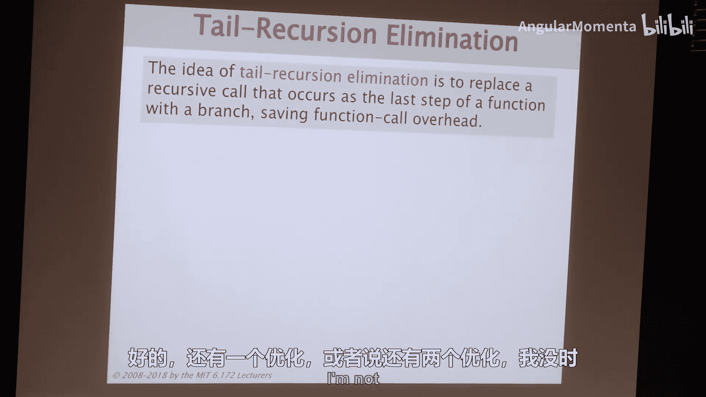

So。Here are a list of most of the rules that we looked at today。

 there are two of the function optimizations I didn't get to talk about。

 please take a look at that offline and ask your TAs if you have any questions。

And some closing advice is you should avoid premature optimizations。

 all of the things I talked about today improve the performance if you' a program but you first need to make sure that your program is correct。

 if you have a program that doesn't do the right thing。

 then it doesn't really benefit you to make it faster。And to preserve correctness。

 you should do regression testing， so develop a suite of tests to check the correctness of your program every time you change the program。

And as I said before， reducing the work of a program doesn't necessarily decrease its running time。

 but it's a good heuristic， and finally the compiler automates many low- levelve optimizations and you can look at the assembly code to see whether the compiler did something。

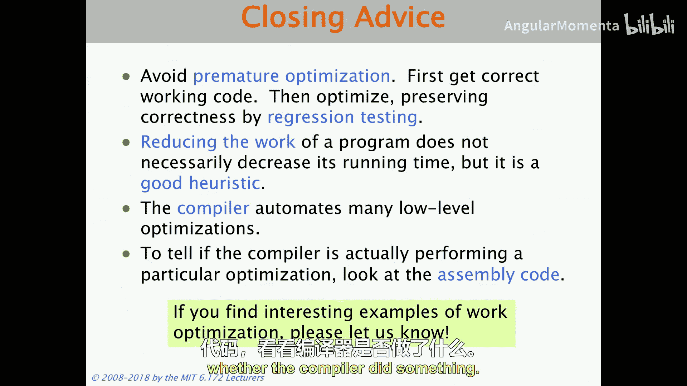

