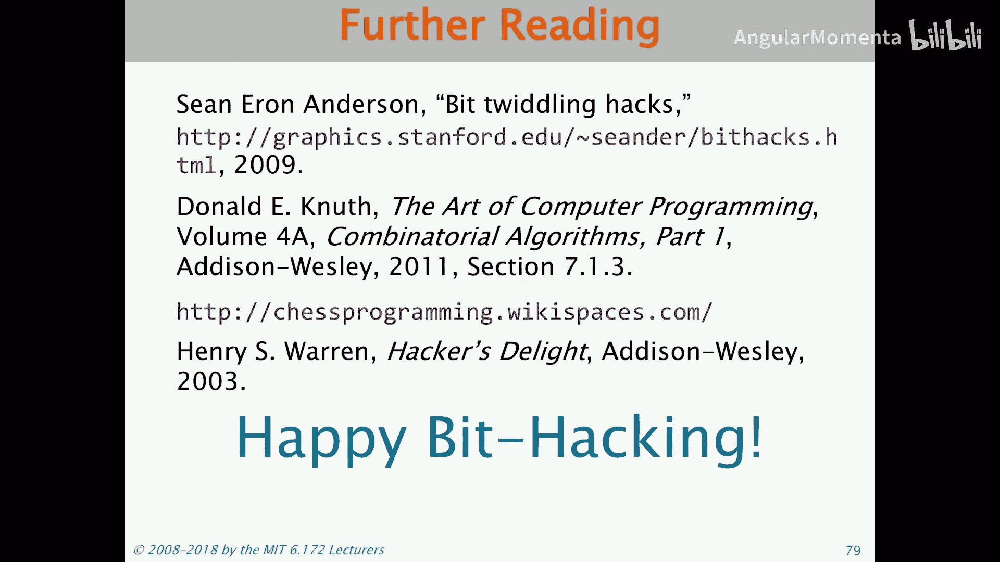

# 【麻省理工】软件系统性能工程 ｜MIT 6.172 Performance Engineering of Software Systems, Fall 2018 p03 3. 位操作技巧 -BV1esbLzpEFq_p3-

The following content is provided under a Creative Commons license。

 Your support will help Mi T OpenCourseware continue to offer high quality educational resources for free to make a donation or to view additional materials from hundreds of MiT courses。

 Visit Mitopcourseseware at Ocw。 Mt。 Eduu。

Good afternoon， everybody。So welcome to the third lecture of 6172。

Today we're going to talk about Bit Hecks and today's going to be a really fun lecture。U。

So first of all， let's recall the binary representation of a word。

So a W bit word is represented as follows， so we're going to number the bits from x0 to x w minus1。

 starting from the right most side。And the unsigned integer value stored in X with this binary representation can be computed as follows。

So it's essentially the sum of a whole bunch of powers of two and you sum the product of the bit with the appropriate power of  two。

 so if the bit is one in position K， then you multiply by to the decay and if it's0。

 then you just add0 so for example， let's say we have this8 bit word here。

And if we apply this equation。We getFirst we get two because there's a one bit in the first position。

 so we multiply one by201， which is two。Then in the second position， we also have a one。

 so we multiply one by2 deta 2， which is four。And then we have 16 and 128。

 so we just sum up all of these powers of two。That gives us the unsigned integer value。

And the0 B prefix here represents a boolean constant。

 so that means we're going to interpret this constant as a boolean value。There's also sign integers。

 so you can also represent negative numbers， which is useful and this is called the twos complement representation and here's the formula for computing the twos complement representation of a word。

For bit 0 all the way up to bit w minus2， you do the same thing as above。

 but for the leftmost bit or bit w minus1， you subtract that bit multiied by 2 to the W minus1。

So for this example here。For we still have  two plus 4 plus 16， that's the same as above。

 but for the leftmost bit since we have a one here， we're going to subtract two to the7。

 which is 128， and this gives us the s value for the integer， which is negative 106。

Does that make sense， Any questions about this representation？Okay。

 so the Lamost bit is known as a sign bit because it。

Tells you whether you need to subtract by this negative value or not。 So if it's 0。

 then you don't have to subtract anything。 If it's one， then you subtract by a large integer value。

So in whose complement， the all zeros word is just zero。

 so you just apply the above formula and everything is zero， so you just get zero。

What's the value of the all ones word？Yes。Negative one， right？So the reason why it's negative 1。

 so you can just use the formula and we're going to sum up a bunch of powers of  two。

 all of the x of subks are going to be 1， so we're summing up 2 to the k from k equals 0 to w minus2 and that's a geometric series which sums to 2 to the w minus1 minus1 and then for the sign bit we're going to subtract2 to the w minus1。

 so now the2 to w minus1s cancel out and we're just left with negative 1。

So this is an important property to know about to' complements representation。

 the all one's word is just negative one。And this leads to important identity。

 which says that x plus the one's complement of x， the one's complement is just all the bits of x flipped。

 is equal to negative 1。This is because if you add X with all of its sps flipped。

 then you're just going to end up with the all ones word。

 and we saw on the previous slide that that's equal to negative 1。And from this identity。

 we have that negative x is equal to the one's complement of x plus1。

 so this relates to two's complement to the one's complement representation。Let's look at an example。

So at， let's say x is equal to this constant here。The ones complement of x or tilde of x is just all of the bits of x flipped。

And then to get negative x， we add one to the one's complement of x and the fact of adding one here is we're going to take the right most zero bit in the one's complement。

 flip that to a1， and then for all the bits， the right of that， we flip them to zeros。U。

So another way to see this is you look at the representation of x and you flip all of the bits up to the rightmost one。

 but not including that rightmost one bit， and then you just copy everything over。

So any questions about this？Okay。So this is a table showing the relationship between hex and binary representation。

 so hex representation is base 16。And the reason why we use hex is because sometimes we have these big binary constants and we don't want to write have to type all of these symbols into our code and hex gives us a more compact format to write these constants and this table you can basically just look up for each possible hex value what is binary representation is and for the values from zero to9。

 we're just going to use the same as decimal representation for hex and then for values 10 to 15。

 we're going to use the characters from a to F。To translate from hex to binary。

 you just take each hex digit， look it up in this table， write out the binary equivalent。

 and then you concatenate together all of the binary values you got。In this example。

 I have this hex constant， which says decide to code for food。

So now I just look up each of these hex values in this table， so D is 1101， E is 1110， C is 1100。

 and so on， and I just concatenate all of these values together and that gives me my binary representation。

And you can also go the other way around converting binary to hex， and you do the same thing。

 just look it up in this table。And the prefix 0 x here doesn't make a hex constant just like0 B doesn't make the Boolean constant。

 so if you're using these constants in your code and you're writing it in text。

 then you should use the 0 x prefix。Okay， so Cia has a bunch of Biwise operators。

And here's a table describing what these bitwise operators do。

 so the Ampers hand is just logical and， the vertical bar is logical or。

This carrot sign is the X or exclusiveore。And Xor just says that if either of the two bits is one。

 then we return one， and if both of the bits are。Zero or both of them are one， then we return zero。

The Tilde sign is the ones complement or the not。And then we have left shift and right shift operators。

So let's look at how these operatives work on this example here。

 so we have these two eight bit words， A and B。To compute A and B。

 we just look at every two bits in the same position and A and B and compute the an of those two bits。

 so one ended with0 is 0， so we get0 here，0 ended with one is0， one ended with one is1 and so on。

A or B is similar， but now you apply the or operator instead of the an operators of either one of the two positions is one。

 then you return one， and if both are0 then you return  zero so in A or B。

 all of the bits except for this bit here is zero because in the original two words。

 both of the corresponding bits were zero。For A X or B。

 we check if exactly one of the two bits is one， so for the leftmost bit we have one and0 so we have exactly one bit set to one and we get a one here。

 the second bit is0 and1， so that's one， the third bit is11， so that's0 and so on。

Tildo A is just the one complement of A we saw that before， we just flip all the bits。

A right shifted by three， we just shift the bit string to the right by three。

 and then we fill in the digits or the bits on the left with zeros。In an A left shift that with two。

 we do the same thing， but to the left， and then we fill in these empty bits with zeros。

So these are the bitwise operators in C。Any questions？Very。U。For。For a right shift。

 there is a shift that will fill in the upper digits with whatever the leftmost digit was。

 but if you're working with unsigned integers， then it's not going to do that for sine integers。

 it will， and when we're doing bit manipulations， we're usually going to stick to unsigned integers so we don't have to worry about that。

Okay， so now let's look at some common idioms that you can do using these bitwise operators。

 so the first one we'll look at is setting the case bit in a word x to1。

So the idea here is to use a shift followed by an ore。So， we're going to。

Compute one left shifted by k if we want to set the K bit to a1。

 and this gives us a mask with a one in exactly the k position and zero is everywhere else。

And then now when we or that in x， that's going to change the bit from a0 to1。

 if it was a0 and if that bit was already set to1， then this doesn't do anything。

 and then for all of the other positions since we're doing an or with zero。

 we're just copying over the bits from x。So that's setting the case bit。

 we can also clear the case bit， and the idea here is to use a shift， a complement， and then an and。

So again， we're going to generate this mask one left shifted by k。

 but now we're going to take the complement of this。

 so now we have a zero in exactly the k position and ones everywhere else。

And now when we end this mass with X。In the case position。

 it's going to clear that bit because we're ending it with a zero。 so the result is going to be zero。

 no matter what was there before， and then for all the remaining bits since we're ending with one。

 we're just copying it over from the original word。

You can toggle the case bit or flip the case bit using a shift and then an Xor。So again。

 we're going to generate this mask， and then now when we do an XO with this mask。

 it's going to change the bit from a0 to a 1 or from a1 to a0 because that's what XOR does。

So in this example is changing from a zero to one， but if it was already a one。

 then it's going to toggle it back to zero。Any questions？Okay。Let's look at another bit trick。

 so here we're trying to extract a bit field from a word X。

 and this is important if you're working with encoded data。And idea here is to do a mask and a shift。

We're going to generate a mask with ones in exactly the positions that we want to extract out of this word。

And then zero is everywhere else， and then we're going to and X with the mask。

 and that's going to give us the bits in the four positions that we wanted to extract in this example。

 and then we have zeros everywhere else。And then now we're going to right shift this value that we extracted so that it appears in the least significant digits so that we can use it in our computation。

So this is a very useful bit trick to know if you're working with compressedory encode encoded data。

 and if you use the bit field facilities in C， it's actually going to generate assembly code that will do masking and shifting for you。

You can also set a bit field in a word。So let's say we want to set a bit field in x to some value y。

The idea is to first invert this mass to clear those bits we want to set in x。

 and then we or in the shifted value of y。So let's say we have these two words X and Y here。

 we're going to generate the mask as we did before。

 but now we're going to flip all the bits in the mask by taking the one's complement。

 and then we end the one's complement of the mass with x， and that's going to clear the bits in x。

Because we have zeros in exactly those positions in the mask， and when you add that into x。

 it will return a zero， and then for all of the other positions， we're just copying in the bits of x。

And then finally， we're going to left shift y by an appropriate amount so that we can line up the value with these four bit positions here。

 and then we can now just or those values in， and this will set the positions and x to the value y。U。

In order to be safe， you should actually do a mask on the shift at y value before you or it in because you don't know that the value of y is within the range of the mask。

 so if y has some garbage values in the higher bits and when you or this in。

 it might pollute the original value of x， so for safety you should actually do a mask before you or the shifted value of y in。

Okay， so any questions on this？So now let's look at how we can swap two integers。

 so we want to swap the values of x and y。The standard way to do this is to use a temporary variable T。

 so we set t equal to x， x equal to y， and then y equal to T。This does involve a temporary variable。

 however， so now the question is whether we can do a swap without using a temporary variable。

 it turns out that you can using bit tricks。So here's the code for doing a no temp swap。

So you first set x equal to x， x or y， then y equal to x x or y， and then x equal to x x or y。

So has anyone seen this before？Okay good， so some of you have seen this before。

 and for the rest of you I'll tell you how it works in the next couple slides。

 so let's first look at an example of how to run this code before we go into why it actually works。

 so we're going to start with these two words in X and Y。We're first going to do x equal x， x， or y。

And now we store the result in x， and this is the result when you do the x or of these two words。

 and then now we do y equal to x x or y。And notice that the value of x here has already changed。

 so we're doing the x score of these two words。And setting that to y。

 and here this value is actually the same as x， so we've already placed x in y。

And then finally we do another x or， we set x equal to x x x or y。

 and then this gives us this value which is y， so at the end we've just swapped x and y without using any temporary variable。

So the reason why this works is because x or it his own inverse， so if you do x。

 x or y and then x or the result of that with y you just get back x itself。

 so let's look at the truth table to see why this is true。

In the x and y columns I've shown all the possibilities。

 so there are four different possibilities of x and y， and then I also have the values of x X or y。

 so it's 1 in the rows where I have exactly 11 and then 0 in the remaining rows。

And then now if I do x or y x or with y， I'm going to x or these values with y0， x or 0 is 0。

1 x or 1 is 0，1 x or 0 is 1 and 0 x or 1 is 1， and notice that these values are the same as the values of x。

So when I exO something in twice， it just canceled out and I get back the original thing。Okay。

 so now let's go into why this Bi trick actually does a swap。

So in the first line what we're doing is we're generating a mask where with ones where the bits in x and y differ。

 because that's what xor is going to give you， it's going to return to1 if the bits are different in0 otherwise。

 so this is a mask that tells us in which positions the bits in x and y differ。

And I'm going to store that into X。And then in the second line。When I do x x or y。

 this is going to flip the bits in y that are different from x because I'm xhoring with this mass。

 which tells me which of the bits differ from x， and then if I x or with that mass。

 I'm flipping the bits in y that differ from x and this will just give me back x and I store that in y。

 so we see that the original value of x is in y now。😡，And then in the last line， I do the same thing。

 but now I'm flipping the bits and x that are different from y。

 so I still have the mass that's stored in x， and then I can x or that mass with y and y has the original value of x。

 so this is flipping the bits and x that differ from y and now I have the original value of y stored in x。

So this is a pretty cool trick， right？Any questions on？Why this works？嗯。

So one thing about this bit trick here is that it's actually poor at exploiting instruction level parallelism。

 so it's actually going to be slower than the naive code that uses a temporary variable because in the original code I had I could actually execute two lines in parallel I can store a value into the temporary and then also change one of the values of X and y at the same time。

 whereas in this code here there's a sequential dependence among these three lines。

 I can't execute any of the lines in parallel we'll learn more about instruction level parallelism in next week's lectures but I just wanted to point out that the performance of this isn't actually that great but this is actually a pretty cool trick to know sometimes it shows up in job interviews。

Okay， so。The next thing we're going to look at is finding a minimum of two integers， x and y。

So let's say we want to store the result of the minimum in a variable R。

Here's the standard way to do this。 We just use an ifL statement， so if x is less than y。

 then r is x and otherwise R is set to y。Here's an equivalent expression。

 it just uses theterernary operator in C， it does exactly the same thing as the FL statement on the left。

U。One performance problem with this code is that there's a branch in the code so we have this if statement that checks if x is less than y and modern machines will do branch prediction and for whatever branch it predicts the code to take it's going to do prefetching and execute some of the instructions in advance。

 but the problem is if it mispredts the branch it does a lot of wasted work and the processor has to empty the pipeline and undo all of the work that it did so。

This is a performance issue due to branch mis prediction。

Modern compilers are usually good enough to optimize this branch away。

 but sometimes the compiler isn't good enough to optimize the branch away。

 so is there a way to do a minimum without using a branch？All right， so here's how you do it。

So we set R equal to xx or y ended with negative x less than y。So it' pretty obvious， right？

So why does this work？So first， we need to know that the C language represents the Boolean values true and false with the injures 1 and0 respectively。

So now let's look at the two possible cases first let's look at a case where x is less than y and then we'll look at the case where x is greater than or equal to y so in the first case when x is less than y the comparison here x less than y is going to return 1 and then we're going to negate that which gives us negative1 and recall from earlier negative one is to all ones word ins complement representation。

So when we add x x or y with all one's word， that just gives us x x or y。And now we're left with y。

 x or x， x or y， and we know that the inverse of x or is itself。

 and therefore the two y's cancel out here and we're just left with x。And in this case。

 x is indeed the minimum。In the other case， we have x greater than or equal to y。

 then the expression x less or y is going to return 0， negative of 0 is still0。

 and then when we and x x or y with 0， we're left was 0， and this just gives us y x or0， which is y。

 and in this case y is the minimum of the two integers。So any questions？

So how many of you knew this already？Good， so we learned something new today。All right。

 so let's see how branches work in a real function。

 so here we're trying to merge together two sorted arrays and this is a subroutine that's used in merge sort if you've seen it before。

So the inputs to this function are three arrays， so we want to merge together。

 arrays A and B and store the result in C， and then we also pass the function the sizes of A and B in NA A and N B。

So what does the restrict keyword do here， does anyone know？Okay。

 so the restrict keyword tells the compiler that this is going to be the only pointer that can point to the particular data。

 and this enables the compiler to do more optimizations。

 so when you're writing programs and you know that there can only be one pointer pointing to specific pieces of data then you can declare the restrict keyword and this gives the compiler more freedom to do optimizations。

Okay， so now let's look at this procedure here。So while the sizes of A and B are non-ze。

 we're going to go into this FL' clause and we're going to check if the element pointed 2 by a is less than or equal to the element point 2 by B。

 and if so， we're going to store the element point 2 by a into C。

 and then we're going to increment both the C and the A pointers。

And then we're going to decrement NA。 This tells us that there's one last element in A that we need to merge in now。

And otherwise， we do the same thing， but with the ray B and N B。

And if one of the two arrays becomes empty， then we go to one of these two wild loops at the bottom。

😡，And we just copy all the remaining elements in the non MTRA into C。

 so here if NA is greater than0 then a is a nonMTRA and then we just copy the remaining elements of A into C。

 and otherwise we copy the remaining elements of B into C。So let's do a simple example。

 let's say we want to merge these two arrays in green into the blue array here。

So let's say the top array is a and the bottom array is B and the blue array is C。

So initially A and B are pointing to the beginning of these two green arrays。

And since both arrays are non empty， we're going to compare the first two elements here。

And we see that three is less than four so we're going to place three into the array C。

 and then we're going to increment the pointer in a to point to the next element。

 and we're also going to increment the pointer in C to point to the next slot。

Now we're going to come here 4 and 12，4 is less than 12， so we place4 into the array C。

 and we increment array B。And then we just keep doing this， so 12 is less than 14。

 14 is less than 19。19 is less than 21， 21 is less than 46， and here 23 is less than 46。

 and at this point one of the arrays becomes empty， so B is empty now。

 so now we get to this second while loop and we see that A still has elements in it and we just copy the remaining elements in A into C and then we're done。

So that's how the standard code for me two sorted array works。

So let's look at each of these branches to see if it's predictable。

 so a predictable branch is a branch that that most of the time it returns the same answer and only rarely does it return a different answer and an unpredictable branch is one where it sometimes returns one value and sometimes returns another value and you can't really predict it。

So let's look at the first branch， does anyone know if this branch is predictable？Yes。

That would be fun。So it turns out that this branch is actually predictable because it's going to return true most of the time except for the last time。

 so it's only going to return false when NB is equal to zero and at that point you're just going to execute this once and then you're done。

 but most of the time NB is going to be greater than zero when you execute this and we call this a predictable branch。

嗯。What about the second one？So。Yeah， so it's also predictable for the same reason。

What about the third one？Yes。It we are knew。Yeah， so this turns out to be unpredictable because we don't know the values in A and B priori。

 so this condition inside the if statement is going to。

Return true about half of the time because we don't know what values are in A and B。

 and that's going to be an unpredictable branch because it's going to return true or fall about 50。

50。What about the last one？Yeah， why yes。For。Some more reasons of one and two。Yeah。

 so it is predictable， the reason why it's predictable is that most of the time it's going to return true and then once it returns false。

 you're never going to look at that again in inside this function call。

 so it returns true most of the time and we call that a predictable branch。So branches one， two。

 and four are okay because they're predictable branches。

 but branch three is going to cause a problem， it's an unpredictable branch。

 and the hardware doesn't really like this because it can't do prefeting efficiently。So to fix this。

 we can use our no branch minimum bit trick that we learned a couple slides ago。

So now what we're doing is we're going to have a variable called comp。

 which stores a result of the comparison between the first element of A and the first element of B。

And then now we're going to get the minimum of A and B as follows。

 this is the same bit that we saw before。U。So now the variable min is going to store the smaller of the first element of A and the first element of B。

And we also have the result of this comparison here so that's stored in comp so first we're going to place the minimum value in C and then based on the result of comp we're going to increment1 of a or B so if a was less than or equal to B then comp is going to be1 and a plus equal comp is going to increment n by a by1 and then B plus equal to not comp is going to not do anything because not comp is0 and then for NA we're going to decrement by comp so it's going to be one if a is less than or equal to B and0 otherwise and then for NB we're going to decrement by the no of the comp so only one of these two lines is actually going to do something based on the result of the comparison。

And then the rest of the code is the same as before。Any questions？

So now we've gotten rid of this unpredictable branch that we had before。

So one thing about this optimization is that it works well on certain machines。However。

 on modern machines using a good compiler like Kang with the minus03 flag。

 the branchless version is usually going to be slower than the branching version because the compiler is actually smart enough to get rid of the branch inside the original version of minimum。

 there's this instruction called C move or a conditional move where it's basically a branchless instruction for doing a comparison we'll learn more about that next week。

 so this trick actually usually doesn't really work there might be some machines and some compilers it works。

 but most of the time the compiler is better at optimizing this code than you are。

So one of the common themes so far is that I've told you about really cool Bi trick。

 and then I told you that it doesn't really work。So why are we even learning about these bits then if they don't even work？

So first is because the compiler does some of these bits and it's helpful to understand what these bits are so you can figure out what the compiler is doing when you look at the assembly code。

Secondly， sometimes the compiler doesn't do these optimizations for you and you have to do it yourself。

Thirdly， many bit hacks for words extend naturally to bit and word hacks for vectors which are widely used in high performance codes。

 so it's good to know about these tricks， these bit tricks also arise in other domains and finally because they're just fun to learn about。

And for Project one， you'll be playing around with some of these bit tricks。

 so it's good to know about these things that I've talked about already。

Here I'll talk about a bit trick that actually does work。

 so here we're trying to do modular addition。So we want to do x plus y mod n。And here。

 let's assume that x is between 0 and n minus1， and y is also between 0 and n minus1。

So the standard way to do this is just to use the mod operator x plus Y， mod n。However。

 this does a division which is relatively expensive compared to other operations unless n is a power of two。

 but most of the time you don't know if n is a power of two at compiled time so the compiler can't actually translate this to a rightshift operation。

And then it has to do a division。So。Here's another way to do it without using division。

So we're first going to set z equal to the sum of x and y， and then if z is less than n。

 then it's ready within the range and we can just return z。If z is greater than or equal to n， well。

 we know it can be at most2 n minus2 because x and y were both at most n minus1。

 so all we have to do is to subtract n and bring it back into range。However。

 this code has an unpredictable branch here because we don't know whether Z is less than n or not。

So now we can use the same trick as minimum， so now we're going to set r equal to z minus n and it with the negative of z greater than or equal to n。

U。So if z is less than n， then this is going to return0 in here and n ended with 0 is0。

 so we're just left to z。And if z is greater than or equal to n， then this is going to be1。

 we negate that we get negative  one， which is all ones word， n ended with all ones is just n。

 so then it's z minus n， which will bring the result back into range。Okay， so any questions？Yes。

 it seems like there essentially is still。Based on the value of Z。So why would that be passed？

So this ratio is just generating either a boolean value1 or0。

 there's actually like the code that you execute after it is still the same in either case。

 so the branch risk prediction only hurts you if there are two different code paths and in this version there are two different code paths because one is doing Z and is just one is doing z minus n。

All right， so the next problem we'll look at is computing or rounding a value up to the nearest power of two。

 and this is just two to the ceiling of log based2 event。

Have recall that LG of n is the log base2 event， thus's the notation we'll be using in this class。

Here's some code to do this。We have a value of n here first， we're going to decrement n。

And then we're going to do an or of n with n rightshift by 1。

 then an or with n and n rightshift by 2 and so on all the way up to 32。

 so we do this for all powers of two up to 32 and then finally we increment n at the end。

 so let's look at an example to see why this works。So we're starting with this value of n here。U。

First， we're going to decrement it。And what that does is it flips the rightmost one bit to zero。

 and then it fills in all the zeros right of that with ones。

And then when we do this line which says n is equal to n ord with n rightshifted by one。

 that's essentially propagating all of the one bits。

 one position to the right and then oring those in。

 so we can see that this one bit got copied one position to the right。

 this one bit got copied one position to the right， these ones also propagate。

 but since they were already ones， it doesn't do anything。

For the next line we're propagating the one bit two positions to the right。

 so this one bit here gets copied here， this one gets copied here and so on。

 and then the next line is going to propagate bits4 positions to the right than 8。

 16 and 32 for this example here when I get to this line I'm already done but in general you have more bits in a word which I can't fit on this slide。

嗯。And now we have something that's exactly one less than a power of two。And when we add one to that。

 we just get a power of two， so we're going to zero out all of these one bits and then place a one here。

 and this is exactly the power of two that's greater than the value n。

So the first line here is essentially guaranteeing us that the log n minus one bit is set。

 and we need that bit to be set because we want to propagate that bit to all of the positions to the right of it。

And then these six lines here are populating all of the bits to the right with ones。

And then the last bit is setting the log n bit to one and then clearing all of the other bits。

So one question is， why did we have to decrement N at the beginning？Yes。Yeah。

 so if n is already a power of2， and if we don't decrement n。

 this isn't going to work because the log n minus1 bit isn't set， but if we decrement n。

 then it's going to guarantee us that the log n minus1 bit is set so that we can propagate that to the right。

Any questions？Yes。Because in general you're using 64 bit words here I don't have that many bits here because I can't fit in on the slide。

 but in general you have more bits。Okay。Let's look at another problem。

 here we want to compute the mask of the least significant one in a word X。

So we want a mass that has a one and only the position of the least significant  one in x and zero is everywhere else。

So how can we do this？So we can set R， the result equal to x ended with negative x。

So let's look at why this works。So here's X。And recall negative x。

Is the two's complement of x plus 1？What we do is we flip all of the bits。Up to the rightmost one。

 but not including it， and then we just copy all of the bits over。

 that's how we get negative x from x。And then now when we compare x and negative x。

 we see that all of the bits when we and them together are going to be0。

 except for the bit at the position corresponding to the least significant one bit in x。

 and that's going to be one since we're ending1 and1 and everything else is going to be0。

 and this will give us the mask that we want。Okay， so this works because the binary representation of minus x is just the ones complement of x plus 1。

So now a question is how can we find the index of this bit so here I'm just generating a mass that has a one in the least significant1 in x。

 but it doesn't actually tell me the index of this bit。

 in other words I want to find the log base2 of a power of two。So that's a problem we want to solve。

 and here's some code that lets us do this。So we have this constant called De Brune。

 it's written in hex here。And then we have this table of Psi 64 called convert。

 and now all we have to do is multiply x by this de Bruine constant， rightshift by 58 positions。

 and then look up the result in the convert table， and that's going to give us a log base2 of a power of  two。

Any questions？Okay so this looks like magic to us， so in this period of magic we're going to do a math magic trick and to do this trick。

 I'm going to need five volunteers and the only requirement is that you need to be able to follow directions。

So who wants to volunteer for this magic trick？Yes， one， two。3。Four， one more， five。All right。

 coming up。So line up here。Yeah， just line up right here。嗯。I can move a little bit over to the left。

Okay cool， so today I have the pleasure of welcoming Jess Ray also known as the Golden Ra to join us for lecture and help us perform this cool magic trick。

 so let's give her a round of applause。I' going be doing a little bit of a magic trick for you all today。

 I'm going to be reading your guys's minds。 And I know you're looking skeptical。

 but I'm hoping I can convince you here。 So we'll get to that part in a second。 but first。😊。

The first big step in reading minds is you got to clear the air。

 like get rid of all the negative vibes， all the bad energy。 throw that out。

 So I'm going to need a little help from you guys in doing this。So first。

 we have this sweet old bell here。 Let's say who wants the bell。All right。

 can you hold that for a second。 So what this bell is going to do is help us get rid of some of those negative eyes me。

 Can you give it a ring。Oh yeah。 So that painful ringing you're hearing in your ears right now is actually just clearing out the air for us。

 making it so I can read your minds。😊，Thank you，ll stop that。All right， next。

We have this magic tome here。 we would like to give this a thin。

can you shake that around a couple times， spin it？Can only a w ri there。 like go like this。

 There we go。All right， perfect。 All right， It's feeling a little clearer here。

 I can start can start getting things off your minds。 Don't worry。

 I won't tell anybody what you're thinking。😊，Oh see what else？

Let me channel the spirits that helped me out here。All right， feeling good。All right so。

What we're going to be doing is， as I said， reading your mind。

 we're going to be doing this by giving you cards， and I'm going to tell you what each of you are holding for the card。

 So I have some cards here。I guess these are a little small。Let go a little bigger。那。Here we go。

This looks better。All right。These are kind of heavy。Get rid of the use。Junk ones up here。 all the。

All right。I needed your help for this。 So what I want you to do is take the cards and cut the deck as many times as you want。

 So basically just going like that however much， just don't actually shuffle them random。All right。

 cool。So now I'm going to hand each of you a card， don't let me see it， feel free to look at it。이よ。

Alright。 So the reason I'm wearing this awesome onesie is this helps me sweat out the bad energy I'm literally sweating right now。

 But there's one more piece that we need for this mind reading trick。😊，ItThe magic hat。All right。

 See if this fits on my head。 There we go。 What is the switch。 All right， Turn it on。All right。

 feeling good here。 All right， you guys ready。All right。

 so I do need a little help getting this trick started。 So if you're holding a red card。

 can you just raise your hand。So， now。Who's got the red card， red， red？You don't have red。Okay， so。

All right， so the first one and the third one。All right。

So let me channel the mind reading abilities here。 Now what I'm going do is going to go left to right and tell you what you're holding。

 Obviously， I know the color， but I'll tell you what suit it is。 And also。

 I'll tell you what the number is。So first God， obviously I know you have a red hmm。

I'm feeling a diamond and also a four。Yeah。All right。All right， good start， good start。All right。

 got to think about what the next one is here。All right， so I know you had a black card。

Let's see black of。Bs。Is it the ace of spas， Oh yeah， there we go。😊，All right。Back to red。All right。

 this one， let's see。Red。Dim and two。All right， all right， we're doing good so far。

 going to get the last two。All right， let's see what we can do here， all right black。Club。4our。

All right， last one， last one。All right。It's going to be a tough。Black。Speed。8ight。😀Yeahは。😊。

And if we had time， I could mystify you and go through the rest of the deck， but we won't do that。

So thank you guys very much， I hope your minds were blown。Yeah。

 help me collect the cards back from you。Thank you。All right， thank you。

 now I can get out of this and stop sweating。It's prettyty cool， right？

So why does this actually work？To know why this trick actually works。

 we need to first study what a de sequence is。So a de Bru sequence S of length2 to decay is acyclic bit sequence。

 such that each of the two to decay possible bit strings。Of length。

 K occurs exactly once as a substring in S。All right， so this is a pretty long definition。

 so let's look at an example， so here's a de sequence for k equals 3。

So the length of this sequence is8 because two to the three is 8。

And you can see that each of the possible three bit substrs。

Occurs exactly once in this cyclic bit string of length 8， so it wraps around at then。

 you can consider this as a cyclic string。So we see that 0，0，0 appears at position zero。

001 is that position 1， then 01，0 is that position 6， 01，1 is at position2。100 is at position7。

 101 is at five。1，1，0 is at 4， and then 1，1，1 is at 3。

 So all of the eight possible substrs of length 3 occur exactly once in this deine sequence。Okay， so。

Now we're going to create this convert table of length eight。In general， this will be2 to decay k。

 and here K is3。 and in this convert table， what we're storing in each position。

Is the index in the dein sequence where the bit string corresponding to that position starts in the De Bruin sequence？

Here we see that convert of two is6 because the bit string corresponding to two is 010。

 and that begins at position 6 in the de Bruine sequence。

We also see that convertive4 is7 because 4 is 100， and that begins at position7 in the deboine sequence。

Now we have this convert table。And recall that we're trying to compute the log base two of a power of two。

 So hopefully you guys remember that。So。The way to do this is we're going to multiply the debroine sequence constant by this power of two。

 so let's say we're working with the integer 16， which is2 to the 4。

 so we're going to multiply this debroine sequence by 2 to the 4。

 and when we multiply by a power of 2， that's the same as left shifting。

So that's going to shift the de Bru sequence four positions to the left。

And then now we want to see which of the eight possiblele substrs appears at the beginning of this sequence。

 and after we do the left shift， 110 appears at the beginning of the sequence。

And we want to extract this out and we can do that by right shifting five positions。

And 110 is just six， and we can figure out where six starts in this de Bruine sequence by looking it up in the convert table。

 so we see that convert of six is four， so the string 110 appears starting at position four in the de Bruine sequence and that means that we did a left shift by four in the first step and that gives us the log base two of the power of two because the only reason why we did a left shift by four is because the power of 2 was2 to a4。

So this returns us a log base2 of the integer that we started with。

And one thing to note is that it's important to start with all zeros in the sequence here because we're representing this as a cyclic bit sequence。

 so when we do a left shift， we need to make sure that the values that fill in on the right side are correct。

 so notice that in the sixth and seventh positions we need zeros at the end when we overflow。

So because the de Bru sequence starts with all zeros。

 when we do the left shift is automatically get filling with zeros， giving us the correct substr。

So the magic trick that Jeest did had 32 cards， and in that case k was equal to5。

 and the cards were arranged according to a de Brone sequence。Of length 32。

 and each of the cards corresponded to one particular bit string of length five。

And the color of the card corresponded to the bit。So when she asked you what the color of your card was。

 she could determine the bits corresponding to the first card in the sequence because she has the five bits corresponding to that card。

And with that， she has some clever way to determine the rest of the cards。 So that's how the。

 the de Brone sequence is related to the magic trick that you just saw。Any questions？Yes。

Up to cyclic translation。So there could be multiple de Bruin sequence。

 we just need one particular dein sequence to make this Bi work。Yeah。

So this example was just for k equals3 in the code I showed you before， that was for k equals8。

 so you can do up to 64 bit words。Yes， how do we know that the sequence exists？

So there's a mathematical proof that says that I can give you some pointers。

So that you can look at it after class， but there's a proof that says that for any length there is a deine sequence。

Yes。Pro just on how exactly it they do？Don face。So。

So we're starting with some integer that is a power of two。So what we multiply by that power of two。

 it's left shifting by the log base two of that。And then we can determine how much we left shifted because we know we can just look at the first three bits of this sequence after we did the left shift。

 and then look at where that three bit sequence appears in the original deine sequence before we shifted it and to do that you can look it up in the convert table。

 this is what we did when we looked up the bit string 110 in the convert table and that tells us that it starts in the fourth position。

 that means that we left shifted by4， and that means that the value of n was two to the four。

Does that make sense？Yes。works。By the sequence by power。也 back过 you power。Yeah。

 so this only works if you're starting with a power of two， so if it's not a power of two。

 this doesn't work。Any other questions？Yes， if it's not a power of two。

 you can round it up to the nearest power of two using another bit trick that we saw earlier。

 and then you can use this bit trick here。The performance of this bit trick is limited by the performance of multiplication and table lookup。

 so you have to do a multiplication by some constant and then you have to do table lookup in this convert table so a table lookup does a memory reference which could be expensive and nowadays there's actually a hardware instruction to compute this so you don't actually have to implement this trick。

 but this trick is still pretty cool and in the past this is how you would do it before there was a hardware instruction that came out。

Okay， so let's look at another problem。 So this is the Anne queens problem。

 How many of you have seen this before。 Yeah， so many of you have seen this before。As a reminder。

 we're trying to place N queens on an end by N chessboard so that no queens attacks another queen。

In other words， there are no two queens in any row， any column or any diagonal。And commonly。

 we want to count the number of possible solutions to the end queens problem for a particular value of n。

And in this example here， this is a valid configuration， you can check for each of the queens。

 it can't attack any other queen on the board。So one common strategy for implementing the N queen's algorithm is to use backtracking。

 we're going to try placing queens row by row we know that there can only be one queen per row so we just need to determine which position in that row the queen will appear in。

 and then if we can't place a queen in any row then we backtrack。So for example， in the first row。

 we'll just place the queen in the first position because there's no queens on the board yet。

 so the first position is valid。For the second row。

 we're going to try to place in the first position。

 but we can't place it there because then it will attack the first queen and then the second position is also invalid。

 so the third position is where we place the second queen。Now for the third row。

 we're going to check the positions until we get to one that's valid。

 and this is going to be the fifth position。Do this again， here we can do it in the second position。

For the fifth row， let's see where this is going to end up。Okay， so it goes in the fourth position。

What about the sixth row？So oops， so all of the eight positions are invalid because if we place the queen in any of those positions。

 it's going to attack one of the queens that we already placed。

So now we're going to backtrack we're going to find another position for the fifth queen。

 so let's try some more positions。Okay， so we can place it at the end。Now we try again。All right。

 so unfortunately we couldn't find a position for the sixth row again， we have to backtrack。

 but we already tried all the positions in the fifth row。

 we backtrack to the fourth row and you get the idea。

And then whenever we find a configuration where all eight queens are valid。

 then we increment some counter by one， and at the end， we just return this counter。

 which tells us the number of solutions to the N queen's puzzle。Okay， so。

So you can implement this quite easily using a recursive procedure。

 you can implement this backtracking search。But one question is how should we represent the board to facilitate efficient queen placement？

So one way to represent the board is to use an array of n squared bytes。And for each bitete。

 we just have a one if there's a queen in that position and zero otherwise。

Is there a better way to represent the board？Yeah， so that's a good answer。

 so instead of using bytes， we can use bits because the value can only be 01。

 we only need one bit to represent that so we can just have an array of n squared bits。

Is there a better way to do this？Yes。Just say in each row。With the怀。Yes， so good answers。

 so a better way to do this is suggest use an array of n bytes because we know that on each row there can only be one queen。

 so we just need to store the position of that queen。So we have an array of n bytes。

 one by for each row， and then you just use the bite to store the position of the queen in that row。

It turns out to implement this algorithm， there's an even more compact representation。

 which is to use three bit vectors of size n，2 n minus1 and 2 n minus1。So let's see how this works。

 so the first bit vector we're going to use is of length n。

 we're going to call this the down vector and the down vector just stores a one in the columns that have a queen in it and0 in the columns that are empty。

U。And then when we want to check whether placing a queen is safe in any position。

 we first have to check whether that column is empty and you can do this by ending the down bit vector with one left shifted by C where C is a column where you want to place the queen。

And if that's nonze， that means there's already a queen in that column and you can't place it。

Otherwise， we're going to have to do another check and we're going to create this other bit vector called left。

 the length of this bit vector is 2 n minus1。And it stores of one in the diagonal that has a queen in it and zeros otherwise。

 and there are two n minus1 possible diagonals。And then now when we want to place a queen in row R in column C。

 we can check whether it's safe by doing left and it with one left shifted by R plus C。

 and this is going to be non-zero if there's already a queen in that particular diagonal。

 so in that case we can't place the queen there and otherwise we're going to do a final check using this right bit vector。

 which is essentially the same but we're looking at the diagonals going down to the right。So again。

 we have a one in the diagonals that have a queen and zeros otherwise。

 and then now the check is going to be right ended with one left shifted by n minus1 minus R plus c。

And if a particular candidate passes all three of these checks。

 then we know that there's not going to be a conflict and we can place a queen in that particular position。

So this is a bit vector representation， you actually sought have to write the code to count the number of queens using this bit vector representation and it's actually an interesting exercise。

 so I encourage you to try to do this at home。But I just told you about the bit vector representation。

 so any questions？Yes， you repeat。Yeah， so the down vector stores a1 in the columns that have a queen in it and zero is otherwise。

 and what you do is if you want to place a queen in column C。

 you first create the mask one left shifted by C and then you end it with a down vector and that's going to be non-zero if there's a queen in that column。

All right， any other questions？Yes。So it turns out that you don't need it。

 just these three checks is enough to guarantee that you can place a queen in a position if it passes all three of the checks。

 so a fourth check would just be redundant。You not在。Yeah， that's true， good point， yeah。

 so we're only placing one queen in each particular row。All right。Let's look at another problem。

 this is called population count or pop count for a short。

And the problem here is we want to count the number of one bits in some word X。

Here's a way to do this that repeatedly eliminates the least significant one bit in the word。

 so we have this four loop where r is initialized to0 and we're going to repeat this loop until x becomes0。

 and each time we go through this loop， we increment R and inside the loop we're going to set x equal to x ended with x minus1。

 and this is going to clear the least significant1 bit in x。So let's look at an example。

 so let's say we have this value here for x。Well to get x minus1。

 we flip the right most1 bit in x from a 1 to0， and then we fill in all the bits。

 the right of that with ones。And then now when we and those things two things together。

 we're going to copy all of the bits up to the rightmost one。

 and then for the rightmost one we're going to zero it out because we're ending with a0 and then all of the bits the right of that are still going to be zero。

 so x ended with x minus1 is just going to get rid of the least significant one bit。

And then we repeat this process until x becomes zero。

 in that case we've already eliminated all the ones and we know the answer which is stored in R。

Questions。Okay， so。So this code will be pretty fast if the number of one bits is small。

 but the running time is proportional to the number of one bits in the word， so in the worst case。

 if most of the bits are set to one， then you're going to need a lot of iterations to run this code。

So let's look at a more efficient way to do this。This is to use table lookup。

So we're going to create a table of size 256。Which stores for each eight bit word。

 the number of ones in that eight bit word， so we have all possible eight bit words stored in this table。

And then now to get the number of1 bits in x for every eight bit substring in x。

 we're going to look it up in this count table and add it to R。

 and then we're going to write shift x by 8 so that we can get the next word。

 and then when x becomes0， we know we're done。So that's table lookup。

The performance here depends on the size of x， if we have a 64 bit word。

 we need to do this at most eight times， whereas in their initial code。

 we might have to do it 64 times if we had 64，1 bits。

The cost of this code is bottleneck by the memory operations because this table here is stored in memory。

 so every time you access it， you have to go to memory to fetch the value there。

And here are some approximate costs for accessing memory in various levels of the hierarchy。

If somethings stored in register， it very fast andly takes you one cycle， if it's stored in L1 cache。

 it's about four cycles， L2 cache about 10 cycles， L3 cache about 50 cycles。

 and then finally if you have to go to DRM because it's not in cash， it's much more expensive。

 150 cycles， an order of magnitude slower than doing something fetching something that's already stored in a register。

Okay。Let's now look at a third way to do population count where we don't actually have to go to cash or DM。

 essentially we can do everything in registers。So here's how you do it。

So we're going to create these five mass or six mass from M0 up to M5。And these mass。

 the values of these masss are shown in the comments here in this notation here。

 x to the k just means x repeated k times， so the mass M5 has 32 zeros followed by 321s。

 the mass M0 has the best string 01 repeated 32 times and so on。After we create these masks。

 we're going to execute these six instructions at the bottom。

 and this is going to give us a number of ones in the word。Let's do an example to see how this works。

 So let's say we start with this bit string here。InIn the first step。

 what we're going to do is we're going to end x with the mask M0。

 and then we're also going to and x right shifted by one with the mask M0。

And recall that the mask M0 is just 01 repeated 32 times。

 and therefore the mass is essentially extracting all of the even bits。

 so x ended with M0 gives us all of the even bits and then when we write shift x by 1 and ended with M0 that's going to give us all the odd bits。

And then we're going to line those two things up and add them together。

And the result of doing this is it's going to tell us for every group of two bits。

 the number of one bits in that group。So now for each of these pairs of bits is telling us how many of them were one。

 so in the leftmost group here we had two ones， so the result of adding one and one is one0。

 which is two for the rightmost group we have two zeros and the count there is00 and this is the same for all of the other groups。

So this gives us the number of ones in every pair of positions。

Now we're going to and the result with M1， and we're going to write shift it by  two and also it with M1 and add those two things together。

And M1 is a mask that will give us the bottom two bits in every group of four bits。

So when we write shift x by 2， that's giving us the top two bits。

 and then now we add those together and it will give us the count of the number of one bits in every group of size4。

And these counts are stored in the result here now so you can verify that each of these groups has the count of the number of one bits。

 so for example， we have 100 here and this is correct instead of four1 bits。

Now we do this again with the mass M2 that's going to give us the counts for all groups of size 8。

Do we go to groups of P size 16？And then finally， we add these two together giving us the number of bits in this group of Ps 32。

And this is actually the pop count， so the value here is 17。

 and you can verify that there are indeed 17 ones in the input word X。Any questions？

So the performance of this code， which is based on parallel dividing conquerr is going to be proportional to log based 2 of w where w is the word length。

 because on every step I'm doubling the size of my groups。

 and after I do this log based2 of w times I have the whole group。

In the first two instructions that I executed here。

 I have to actually do the and separately for x rightshifted by 1 and x and also x rightshift by  two and x and then add them together because there's an overflow issue。

 the overflow issue is that the size of the groups here。

 might not be large enough to actually store the count of the number of one bits in that group。

 but once I get to the larger groups， the count can always be stored in a group of that size and I don't need to worry about overflow。

So for the last four lines， I can actually save one instruction I don't need to do the and twice。

Okay， so it turns out that most modern machines nowadays have an intrinsic pop count instruction implemented in hardware。

 which is faster than anything you can code yourself。

 and you can access this pop count instruction via compiler Ins， for example， in GCC or Cla。

And in GCC， it's underscore underscore built in underscore pop count。U。One warning though。

 is that if you write this code using these intrinsics， run。

 if you try to compile the code on a machine that doesn't support it。

 your code isn't going to compile， so it makes your code less portable。

 but this intrinsic is faster than the parallel dividing conquer version。

So one question is how could you get the log base two of a power of two quickly using a pop count instructions。

 so instead of using the De Bruine sequence trick？Yes， and use pop。Yes。

 so what you do is you subtract one from the power of two and that's going to flood off the lower bits with ones and then now when you execute pop count it's going to count the number of ones and that gives us the log base2 of the power of two a good answer。

All right， so those are the bit tricks I'm going to be talking about today。

 there's a lot of resources online if you're interested in learning more。

 there's this really good website maintained by Sean Aaron Anderson。

There's also the news textbook which has some bittris in there。

 there's a chess programming website which has a lot of cool Bitris。

 some of those are used in implementing chess programs and then finally this book called Haerss Delight so you'll be playing around with many of these Bitris in Project one。

 so happy bit hacking。

