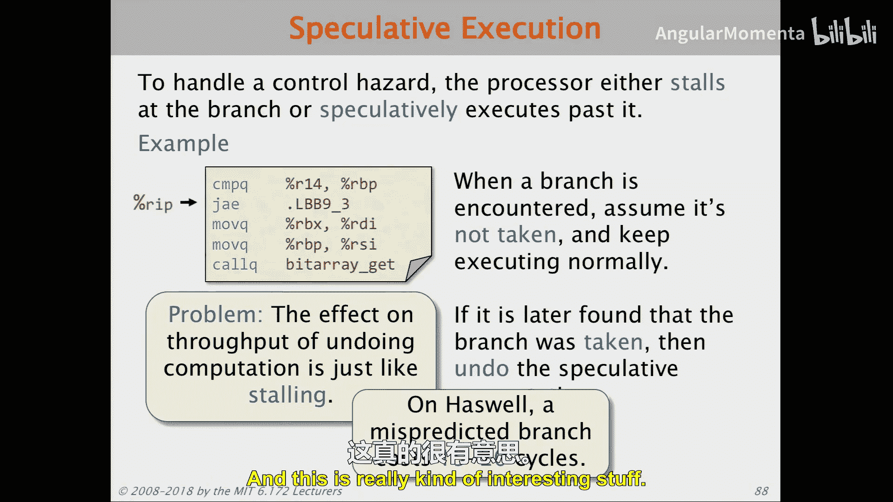
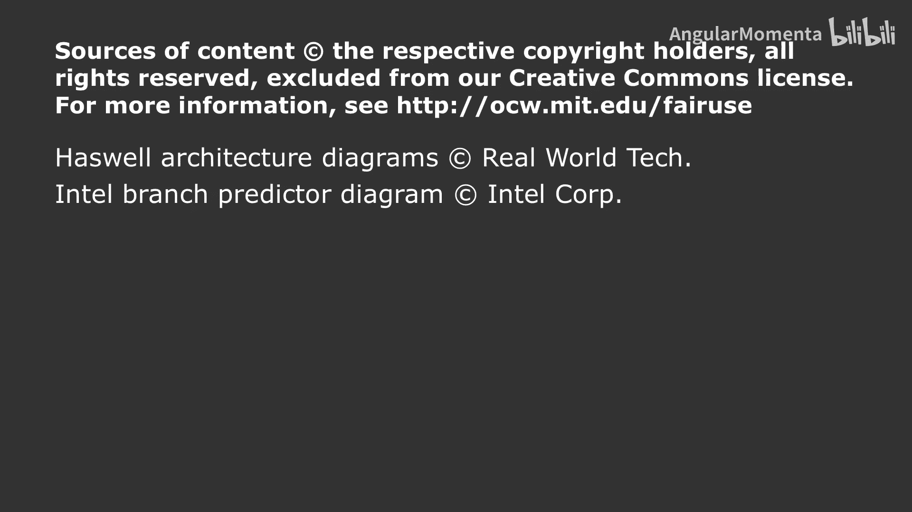

# 【麻省理工】软件系统性能工程 ｜MIT 6.172 Performance Engineering of Software Systems, Fall 2018 p04 4. 汇编语言与计算机体系结构 -BV1esbLzpEFq_p4-

The following content is provided under a Cative Commons license。

 Your support will help Mi T OpenCourseware continue to offer high quality educational resources for free to make a donation or to view additional materials from hundreds of MiT courses。

 Visit Mit Opencourseseware at Ocw。 Mt Eduu。

So today we're going to talk about assembly language and computer architecture。U。

It's interesting these days， most software courses don't bother to talk about these things。

And the reason is because as much as possible， people have been insulated in writing their software from performance considerations。

 but if you want to write，哎。Fast code。You have to know what is going on underneath so you can exploit the strengths of the architecture and the。

 the best interface that we have to that is the assembly language。

 so that's what we're going to talk about today。So when you take a particular。

AP of code like fib here。To compile it， you run it through Kang。

 as I'm sure you're familiar at this point。And what it produces is a binary machine language。

That the computer is hardware programd to interpret and execute。

It looks at the bits as instructions as opposed to his data。And it executes them。

 and that's what we see when we execute。U。This process is not one step。

 it's actually there are four stages to compilation。Preproces， compiling， sorry for the redundancy。

 that's sort of a bad name conflict， but that's what they call it assembling and linking。

So I want to take us through。Those stages。So。So the first thing that goes through is you go through a pre processcess stage and you can invoke that with clang manually so you can say。

 for example， if you do clang minus E，Okay that will run the preprocessor and nothing else。

 and you can take a look at the output there。And look to see how all your macros got expanded and such。

Before the compilation actually goes through， then you compile it and that produces assembly code。

Okay so assembly is a mnemonic。Structure of the machine code that makes it more human readable than the machine code itself would be。

And then once again， you can produce the assembly。Yourself with clang minus S。And then finally。

 you well penultly， maybe you can assemble that assembly language code。To produce an object file。

And since we like to have separate compilations so you don't have to compile everything as one big monolithic hunk。

 okay， then there's typically a linking stage to produce the final executable。

 and for that we are using LD for the most part， we're actually using the gold linker but。

But LD is the command that calls it。ok。So let's go through each of those steps and see what's going on。

The preproces is really straightforward， so I'm not going to do that。

 that's just a textual substitution the next stage is the source code to assembly code。

So when we do clang minus S， we get this symbolic representation and it looks something like this。

Okay，Where we have some labels on the side。Some labels on the side and we have some operations。

 we may have some directives， and then we have a lot of gibberish。

 which won't seem so like so much gibberish after you've played with it a little bit， okay。

 but to begin with looks kind of like gibberish。U。From there。

 we assemble that assembly code and that produces the binary。And once again。

 you can invoke it just by doing running Kang Kang or recognize that it doesn't have a C file or a C++ file。

 it says， oh goodness， I've got an assembly language file and they'll produce the binary。Now。

 the other thing that turns out to be the case is because assembly and machine code。

 they're really very similar in structure。Okay just。Things like the op codes。

 which are the things that are here in blue or purple， whatever that color is， like these guys。

 okay those correspond to specific bit patterns over here in the machine code。Okay。

 so and these are the the addresses and the registers that we're operating on the opera ends， okay。

 those correspond to other。To other bit codes over there， okay， and there's very close。

 there's a very much a， it's not exactly one to one。

 but it's pretty close one to one compared to if you had C and you look at the binary it's like。

It's way， way different， okay？So。So one of the things that turns out you can do is if you have the machine code and especially of the machine code that was produced with so-called debug symbols。

 that is it was compiled with DG， you can use this program called ODump。

 which will produce a disassembly of the machine code。So to tell you， okay。

 here's what the mnemonic more human readable code is， the assembly code from the binary。

And that's really useful， especially if you're trying to do things， well， let's see。

 why do we bother looking at the？So why would you want to look at the assembly of your program。

 does anybody have some ideas？Yeah。Yeah， you can see whether certain optimizations are made or not。

So other right reasons？Everybody's going to say that one。Okay。Another one is well， let's see。

 so here's some reasons okay the assembly reveals what the compiler did and did not do because you can see exactly what the machine what the assembly is that is going to be executed as machine code the second reason which turns out to happen more often you would think is that hey。

 guess what compiler is a piece of software it has bugs。So your code isn't operating correctly。

 oh goodness。What's going wrong？Maybe。The compiler made an error， and we have certainly found。

Found that for， especially when you start using some of the less frequently used features of a compiler。

You may discover oh， it was actually not that well broken in。And as it mentioneds here。

 you may only have an effect when compiling it minus03， but if you compile it minus00 minus 01。

 everything works out just fine， so then it says gee， somewhere in the optimizations。

They did an optimization wrong， okay， so one of the first principles of optimization is do it right。

 and then the second is make it fast。And so sometimes the compiler doesn't that。

It's also the case that sometimes。You cannot write code that produces the assembly that you want。

And in that case， you can actually write the assembly by hand。Now it used to be many years ago， many。

 many years ago that a lot of software was written in assembly。In fact。

 I had a my first job out of college， I spent about half the time programming in assembly language。

Okay， and it's not as bad as you would think。Okay， but it certainly is easier to have high level languages。

 that's for sure， you get a lot more done a lot quicker。And the last reason is reverse engineer。

 you can figure out what a program does when you only have access to its source， so for example。

 the matrix multiplication example that I gave on day one。Okay， you know。

 we had the overall outer structure， but the inner loop。

 we could not match the Intel math kernelel Library code。So what do we do？

We looked to see what we didn't have the source for it， we looked to see what it was doing， we said。

 oh， is that what they're doing？Okay， and then we were able to do it ourselves。

 without having to get the source from them， so we reverse engineered what they did。

 so all those are good reasons。Now in this class we have some expectations。

 so one thing is you know assembly is complicated and you needn't memorize the manual。

 in fact the manual has。It has like over 1 thousand0 pages。Okay， it's like。Okay。

 but here's what we do expect of you， you should understand how a compiler implements various seed linguistic constructs with X86 instructions。

 and that's what we'll see in the next lecture。And you should be able to read X86 assembly language with the aid of an architecture manual。

 and on a quiz， for example， we would give you snippets or explain what the op codes are that are being used in case it's not there。

 but you should have some understanding of that so you can see what's actually happening。

You should understand the high level performance implications of common assembly patterns。

So what happens in you what does it mean to do things in a particular way in terms of performance。

 so some of them are quite obvious vector operations tend to be faster than doing the same thing with a bunch of scalar operations okay？

Um。If you do write an assembly， typically what we use is there are a bunch of compiler intrinsic functions built in so called that allow you to use the assembly language instructions。

And。You should be after we've done this able to write code from scratch if the situation demands it some time in the future。

 we won't do that in this class， but we expect that you will be in a position to do that after after you should get a mastery to the level where that would not be impossible for you to do。

 you'd be able to do that with a reasonable amount of effort。So the rest of the lecture here is。

 I'm going to first start by talking about the instruction set architecture of the X8664。

 which is the one that we are using for the cloud machines that we're using。

I'm then going to talk about floating point in vector hardware。

 and then I'm going to do an overview of computer architecture。Now all of this I'm doing。

 this is a software class， right？OkaySoftware performance engineering we're doing so the reason we're doing this is so you can write code that better matches the hardware therefore to better get it in order to do that I could give things at a high level。

 my experience is that if you really want to understand something。

 you want to understand it to the level that's necessary and then one level below that。

It's not that you'll necessarily use that one level below it。

 but that gives you insight as to why that layer is what it is and what's really going on okay and so that's kind of what we're to we're going to do a dive that takes us one level beyond what you probably will need to know in the class so that you have a robust foundation for understanding。

 does that make sense？That's just that's my part of my learning philosophy is， you know。

 go one step beyond and then you can you know， come back， okay， the ISA primer， okay。

 so the ISA talks about the syntax and semantics of assembly。This is。

There are four important concepts in the instruction set architecture， the notion of registers。

 the notion of instructions， the data types and the memory addressing modes。

 and those are sort of indicated， for example here we're going to go through those one by one。

So let's start with the registers， so the registers is where the processor stores things and there are a bunch of X86 registers。

 so many that you don't need to know most of them， okay the ones that are important are these。Okay。

 so first of all， there are general purpose registers and those typically have width 64。

 and there are many of those。There is a so called flags register called our flags。

hich keeps track of things like whether there was an overflow。

 whether the last arithmetic operation resulted in a zero。

 whether there was a carryout of a word or what have you。The next one is the instruction pointer。

 so the assembly language is organized as a sequence of instructions。

And the hardware marches linearly through that sequence， one after the other。

 unless it encounters a conditional jump or an unconditional jump。

 in which case it'll branch to whatever the location is， but for the most part。

 it's just running straight through memory。Then there are some registers that were added quite late in the game that are namely the SSE registers and the AVX registers。

 and these are vector registers so the XMM registers were when they first did vectorization they use 128 bits。

 there's also for AVX there're the YMM registers and in the most recent processors which we're not using this term there's another level of AVX that gives you 512 bit registers。

 but maybe we'll use that for。For the final project because it's just like more a little more power。

 okay， for the game playing project。But for most of what you'll be doing。

 we'll just be keeping to the basic to the C4 instances that in AWS you guys have been using。Okay。

 now。The X8664 didn't start out as X8664， started out as x86。And it was used for machines。

 in particular the 8086， which had a 16 bit word。Okay， so really。Short。

How many things can you index with a 16 bit word？About how many？Yeah， about 65，000，65536， okay。

 words you can execute in sorry you can address or bytes， this is biteed address。Okay。

 so that's 65 k bytes that you can address。How could they possibly use that for machines？Well。

 the answer is。That's how much memory was on the machine， you didn't have gigabytes。

So as the machines， as Moore's law marched along and we got more and more memory。

Then the words had to become wider to be able to index them yeah。Yeah。

 but here's the thing is if you're building stuff that's going to have to that it's too expensive and you can't get memory that's big enough。

Then if you build a wider word， like if you build a word of 32 bits。

Then your processor just costs twice as much as the next guy's processor。So instead。

 what they did is they went along as long as that was the common size and then had a。

Some growth pains and went to 632。 and from there they had some more growth pains and went to 64。

Okay， those are two separate things and in fact they did some really weird stuff， okay。

 so what they did in fact is when they made these longer registers。

They have registers that are alias to exactly the same thing for the lower bits so that they could address them either by a byte。

Okay。So these registers all have the same， you can do the lower and upper half of the short word or you can do the。

The 32 bit word or you can do the 64 bit word okay and that's just like if you're doing this today。

 you wouldn't do that， you wouldn't have all these registers that alias and such。Okay。

 but that's what they did because this is history not design。

 and the reason was because when they're doing that they were not designing for the long term now。

 are we going to go to 128 bit addressing probably not 64 bits？

Addresses a spectacular amount of stuff。Not quite as many，2 to the 64th is what is like。诶。

It's like how many gazillions， it's a lot of gazillions， okay？Okay， so yeah。

 we're not going to have to go beyond 64， probably。Okay， so here are the general purpose registers。U。

And as I mentioned， you know they have different names， but they cover the same thing。

 so if you change EAX， for example， that also changes RAX。

And so you see they originally all had functional purposes。

 now they're all pretty much the same thing except for the but the names have stuck because of history。

Okay， instead of calling them register zero， register one or whatever。

 they all have these funny names， okay， some of them still are used for a particular purpose like RSP is used as the stack pointer。

And RBP is used to point to the base of the frame for those who remember their 6 double04 stuff。

So anyway， there are a whole bunch of them and there are different names depending upon which part of the register you're accessing。

Now the format of an X8664 instruction code is to have an op code and then an opera end list。

 and the opera end list is typically 01，2 or rarely three operarans separated by commas。

Typically all operaNs are sources and one operaran might also be the destination， so for example。

 if you take a look at this ad instruction， the operation is an ad and the operaran list the is these two registers。

 one is EDI and the other is ECX， and the destination is the second one。Okay， when you add。

 in this case， what's going on is it's taking the value in ECX， adding the value in EDI into it。

 and the result is in ECX， yes。Funny， you should ask。Yes， okay， so what does op AB mean。

 it turns out naturally that。The literature is inconsistent about how it refers to operations and there's two major ways that are used。

 one is the AT&T syntax and the other is the Intel syntax。So the AT&T syntax。

 the second operaend is the destination， the last operaend is the destination， in the Intel syntax。

 the first operaend is the destination。Okay， is that confusing， okay？

So almost all the tools that we're going to use are going to use the AT&T syntax。Okay。

But you will read documentation， which is Intel documentation， it will use the other syntax。

 don't get confused。Okay。I can't help。I can't help that this is the way the state of the world is。

 okay。Yeah。Oh， yeah。In particular， if you could compile it and undo。

 but I'm sure there's I mean this is not a hard translation thing， Ill bet if you just Google it。

 you can in two minutes in two seconds find somebody who willll translate from one to the other。yeah。

 this is not a complicated translation process。Now。Here are some very common X86O codes。

 and so let me just mention a few of these because these are ones that you'll often see in the code。

 so move， what do you think moveve does？Yeah， it puts something in one register into another register。

 of course when it moves it， this is computer science move， not real move， you know。

 when I move my belongings in my house to my new house，They're no longer in the old place， right？

But in computer science， for some reason when we move things。We leave a copy behind。

 so they may call it move but。啊，系。Yeah， why don't they call it copy？You got me， okay？Yeah。😊，Okay。

 so there's conditional move， so this is move based on a condition like move and we'll see some of the ways that this is thing like move if a flag is equal or equal to zero or and so forth。

 so basically conditional move doesn't always do the move。Then there's then you can extend the sign。

 so for example， suppose you're moving from a。32 bit value register into a 64 bit register。

Then the question is， what happens to the high order bits？

So there's two basic mechanisms can be used， either can be filled with zeros。Or。

Remember that the first bit。The leftmost bit， as we think of it， is the sign bit， right from。

From our lecture on binary， that bit will be extended through the high order part of the word。Okay。

 so that the whole number will be。If it's negative， we'll be negative and if it's positive。

 it'll be zeros and so forth。Okay。Does that make sense？

Then there are things like push and pop to do stacks。

 there's a lot of integer arithmetic and you can take there's addition subtraction。

 multiplication division， you know various shifts， address calculation shifts， rotations。

 incrementing， decrementing， negating， et cetera there's also a lot of binary logic， and or exort。

 not those are all doing bitwise operations。And then there is booleing logic like testing to see whether。

Some value has a given value or comparing。There's unconditional jump， which is jump。

 and there's conditional jumps which is jump with a condition。

 and then there's things like subroutines and there are a bunch more which the manual will have and which will undoubtedly show up like for example。

 there's a whole set of vector operations we'll talk about a little bit later。Okay， now。

The op codes may be augmented with a suffix that describes the data type of the operation or a condition code。

Okay， so an off code for data movement， arithmetic or logic uses a single character suffix to indicate the data type。

And if the suffix is missing， it can usually be inferred， so take a look at this example。

 so this is a move with a Q at the end， what do you think Q stands for？Qud word， okay。

 how many bytes in a quad word？eight。That's because originally it started out with a 16 bit word。

So they said a quadword was four of those 16 bit words so that's8 bytes okay you get the idea right that let me tell you this is all over the X86 instruction set all these historical things and all these mnemonics that if you don't understand what they really mean you can get very confused okay so in this case we're moving a 64 bit integer because a quad word has8 bytes or 64 bits okay this is one of my it's like whenever I prepare this lecture I just go into。

Spasms laughter。as I look and I say， oh my God， they really did that like for example。

 on the last page when I did subtract。Okay， so the sub operator， if it's a two argument operator。

 it subtracts the， I think it's the first and the second。

 but there is no way of subtracting the other way around。It puts the destination in the second one。

It basically takes the second one， minus the first one and puts that in the second one。

But if you wanted to have it the other way around to save yourself a cycle， anyway。

 it doesn't matter that you can't do it that way。And all this stuff the compiler has to understand。

Okay， so here are the X8664 data types， okay， the way I've done it is to show you the difference between C。

And X 8664， so for example， here are the declarations。Wops，Here are the declarations in sea。

 so there's a char， a short int。Unsigned in， long， et cetera。

 here's an example of a C constant that does those things。

 and here's the size in bys that you get when you declare that。Okay， and then。

The assembly suffix is one of these things， okay， so in the assembly it says B or W for a word。

 an L or D for a double word， a Q for a quad word， i。e。 eight bytes， single precision。

 double precision， extended precision。Okay。So S extension used two data type suffixes。

 so here's an example。So the first one says we're going to move and now you see I can't read this without without my cheat sheet。

 so what is this saying， this is saying。We're going to move a。诶。With a zero extend。

And it's going to be the first opera end is a bite and the second opera end is a long， is that right？

If I'm wrong， it's like。I got to look at the chart too。

 and of course we don't hold you to that so but the Z there says extends with zeros and the S says preserve the sign。

Okay， so that's the things now。That would all be all well and good。

 except that then what they did is。If you do 32 bit operations where you're moving it to a 64 bit value。

 it implicitly zero extends the sign。If you do it for smaller values and you store it in。

 it simply puts overwrites the values in those registers， doesn't touch the higher order bits。

But when they did the 32 to 64 bit extension of the instruction set。

They decided that they wouldn't do what had been done in the past。

And they decided that they would zero extend things unless there was something explicit to the contrary。

Okay， you got me， okay。嗯。Yeah。I have a friend who worked at Intel and he had a joke about the Intel instruction set。

 he discovered the Intel instruction is really complicated， he says。

 here's the idea of the Intel instruction set， he said to become an Intel fellow。

You need to have an instruction。In the Intel instruction set。Okay。

You have an instruction that you invented and that that's now used in Intel。

 He says nobody becomes an Intel fellow。For removing instructions。

So it just sort of grows and grows and grows and gets more and more complicated。For each thing。Now。

 once again， you can， for extension， you can sign extend， and here's two examples。In one case。

 moving an  eight bit integer to a 32 bit integer and zero extended it versus preserving the sign。

Conditional jumps and conditional moves also use suffixes to indicate the condition code。So here。

 for example， the NE indicates the jump should only be taken if the argument of the previous comparison are not equal。

 so ne is not equal， so you do a comparison and that's going to set a flag in the R flags register。

Then they jump will look at that flag and decide whether it's going to jump or not。

 or just continue the sequential execution of the code。

And there are a bunch of things that you can jump on。So。

Which are status flags and you can see the names here， there's Carrie， there's parody。

 pary is the Xor of all the bits in the word。There's and just I don't even know what that's for。

Okay there's the zero flag， tells whether it's zero， there's a s flag。

 whether it's positive or negative， there's a trap flag which an interrupt enable and direction overflow。

 so anyway you can see there are a whole bunch of these okay so for example here this is going to decrement RBX and then it sets the zero flag if the results are equal and then the jump。

 the conditional jump jumps to the label if the ZF flag set is not set in this case。Can make sense？

After a fashion， doesn't make rational sense， but it does make sense。Okay。

Here are the main ones that you're going to need， the carry flag is whether you got a carrier or a borrow out of the most significant bit。

 the zero flag if the ALU operation was zero， whether the last AU operation had the sign bit set and the overflow says it resulted in arithmetic overflow。

The condition codes are if you put one of these condition codes on your conditional jump or。

 whatever， this tells you exactly what the flag is that is being set， so for example。

You know the easy ones are if it's equal。But you there are some other ones there， so for example。

You know， if you say why， you know， why， for example， do the condition codes E and N E。

 check the zero flag。Okay。And the answer is typically。

Rather rather than having a separate comparison， what they've done is separate the branch from the comparison itself。

 but it also needn't be a compare instruction。It could be the result of the last arithmetic operation was a zero。

 and therefore it can branch without having to do a comparison with zero。So for example。

 if you have a loop。Okay， that where you're decrementing a counter till it gets to zero。

That's actually faster to by one instruction， to compare whether the loop index hits zero than it is if you have the loop going up to n。

And then every time through loop having to compare with N in order before you can branch。Okay。

 so these days， that optimization doesn't mean anything because as we'll talk about in a little bit。

 these machines are so powerful that doing an extra integer arithmetic like that probably has no bearing on the overall cost yeah。

Just looks at the flags， yep， just looks at the flags， doesn't take any arguments。Okay。Now。

 the next aspect of this is that you can give registers， but you also can address memory。

And there are。There are three direct addressing modes and three indirect addressing modes， okay？

At most， one Op may specify a memory address。So here are the direct addressing items。

 so for immediate what you do is you give it a constant like 172。

ranandom constant to store into the register in this case。

 that's called an immediate what happens in the if you look at the instruction。

 if you look at the machine language， 172 is right in the instruction。Okay。

 it's right in the instruction， that number 172。ok。

Register says we'll move the value from the register， in this case， percent CX。

 and then the index of the register is put in that part and direct memory says。

 use a particular memory location。Okay and you can give a hex value when you do direct memory。

 it's going to fetch it out of that it's going to use the value at that place in memory。

And to indicate that memory is going to take you on a 64 bit machine， 64。

8 bytes to specify that memory。Whereas， for example， the move queue， I can get 17。

2 will fit in one by。OkayAnd so it will move， you know I'll have spent a lot less storage in order to do it。

 plus I can do it directly from the instruction stream and I avoid having an access to memory which is very expensive。

 so how many cycles does it take if the value that you're fetching from memory is not in you know is in cache or whatever？

or a register， if I'm catching something， remember how many cycles of the machine does it typically take these days？

Yeah。Yeah， a couple hundred or more， yeah， a couple hundred cycles。To fetch something from memory。

It's so slow。No， it's the processors are so fast。Okay， and so clearly。

 if you can get things into registers， most registers you can access in a single cycle。Okay。

 so that we want to move things close to the processor， operate on them， shove them back。

And while we pull things from memory， we want other things to be working on。

 and so the hardware is all organized to do that。Now。

 of course we spend a lot of time fetching stuff from memory and that's one reason we use caching and we'll have a big thing。

 caching is really important we're going to spend a bunch of time on how to get the best out of your cash。

There's also indirect addressing， so instead of just giving a location you say oh。

 let's go to some other place， for example， the a register and get the value。

And the address is going to be stored in that location， so for example here。

 register indirect says in this case， move the contents of RAX into sorry the contents is the address of the thing that you're going to move into RDI。

Okay， so if RAX was location 172。Okay， then it would take whatever's in location 172 and put it in RDI。

registered index says， well， do the same thing， but while you're at it， at an offset。Okay。

 so once again， if RAX had 172。In this case， it would go to 344。Okay。

 to fetch the value out of that location 344 for this particular instruction。

 okay and then instruction pointer relative， okay， instead of indexing off of a general purpose register。

 you index off the instruction pointer。That usually happens in the code where the code is。Is。

For example， you can jump to where you are in the code plus four instructions。

so you can jump down some number of instructions in the code。

 usually you'll see that only use with control because you're talking about things。

 but sometimes they'll put some data。In the instruction stream。

 and then it can index off the instruction pointer to get those values without having to soil another register。

Now， the most general form is base index scale displacement addressing。Wow。Okay。

 this is a move that has a constant plus three terms。

And this is the most complicated instruction that is supported。The mode refers to the address。

Whatever the base is， okay， so the base is a general purpose register， in this case， RDI。

And then it adds the index times the scale， so the scale is one，2，4， eight。Okay。

And then a displacement， which is that number on the front。Okay。

 and this gives you very general indexing of things off of a base pointer。

 so you'll often see this kind of accessing when you're accessing stack memory。Okay。

 because everything you can say here's the base of my frame on the stack and now for anything that I want to add。

 I'm going to be going up a certain amount， I'm going to be scaling by a certain amount to get the value that I want。

 okay。So once again， you know。You will become familiar with these。With a manual， okay。

 you don't have to memorize all these， but you do have to understand that there are a lot of these complex addressing modes。

The jump instruction take a label as their operaran which identifies a location of the code。

 for this， the labels can be symbols， in other words you can say here's a symbol that I want to jump to。

 might be the beginning of a function or it might be a label that's generated to be at the beginning of a loop or whatever。

 they can be exact addresses， go to this place in the code， or they can be relative addresses。

 jump to someplace as I mentioned that's indexed off the instruction pointer。Okay。

 and then an indirect Trump takes as its opera in an indirect address。Ohpe， Icott。Okay。

 as it's opera as it's operaand， okay， so that's a typo just takes an opera as an indirect address。

 so basically you can say go you know， jump to whatever is pointed to by that register using whatever indexing method that you want。

Okay。So that's kind of an overview of the assembly language now let's take a look at some idioms so the XOR op code computes the bitwise XOR of A and B we saw XOR was a great trick for swapping numbers for example the other day so often in the code you will see something like this XOR RAX RAX what does that do？

Yeah。It zeros the register， why is that zero the register？Yeah。

 taking it's basically taking the results of RAX， the results of RX xoring them。

 and when you exor something with itself， you get zero storing that back into it。

 so that's actually how you zero things so you'll see that whenever you see that， hey。

What are they doing， they're zeroing the register， okay。

 and that's actually quicker and easier than having a zero constant that they put into the instruction。

 it saves a by。Because this ends up being a。Very short instruction。

 I don't remember how many bytes that instruction is but。Okay， here's another one the test op code。

 test AB， computes the bidwise and of A and B， and discards the result preserving the R flags register。

Okay。So basically， it says， what does the test instruction for these things do？ok。

So what is the first one doing？So it takes RCX， yeah。So it takes the bitwise and of A and B。Right。

And so。Then it's saying jump if equal。So。Right。And is non zero if any of the bits are set。

That's right， so if the zero flag is set， then RCX is set。

 so this is going to jump to that location if RCX holds the value0。

in all the other cases it won't set the zero flag because the result of the end will be zero。

 so once again that's kind of an idiom that they use what about the second one？

So this is a conditional move。So both of them are basically checking to see if the register is zero。

 and then doing something if it is or isn't。Okay， but those are just idioms that you sort of。

Have to look at to see how it is that they accomplish the particular thing。Okay， here's another one。

 so the ISA can include several no opP， no operation instructions。Including NP NP A。

 that's an operation with an argument and data 16， which sets aside two bytes。Of a Noop。

So here's a line of assembly that we found in some of our code。Okay，Da 16， data 16， data 6， No opP W。

And then send CSX。You know。So no op W is going to take this argument。

 which has got all this address calculation in it。So what do you think this is doing？

What's the effect of this， by the way？They're all no ops， so what the effect is。Nothing， okay？

Effect is nothing。Okay， now it does set the r flags， but basically。Mostly it does nothing。

Why would the compiler generate assembly with these idioms。

 why would you get that kind of thats crazy， right？Yeah。Yeah。

 it's actually doing alignment optimization， typically， okay that is its or code size。

 so it may want to start the next instruction on the beginning of a cache line。And in fact。

 there's a directive to do that， if you want all your functions to start at the beginning of Caline。

 then it wants to make sure that if code gets to that point，It will you know。

Proceed to jump through memory， can do through memory。So mainly it to optimize me。

 so you'll see those things， I mean， you just have to realize， oh。

 that's the compiler generating some no ops。So that's sort of our brief excursion over assembly language。

 X86 assembly language， now I want to dive into floating point and vector hardware。

 which is going to be the main part and then if there's any time at the end I'll show the slides there I have a bunch of other slides on how branch prediction works and a variety of other machines sorts of things that if we don't get to it's no problem you can take a look at the slides and there's also the architecture manual。

So floating point instruction sets。Mostly the scalar floating point operations are accessed via a couple of different instruction sets。

 so the history of floatinglo point is interesting because originally the 8086 did not have a floating point unit。

 floatinglo point was done in software， and then they made a companion chip that would do floating Point。

 and then they started integrating and so forth as miniaturization took hold。

So the SSE and AVX instructions do both single and double precision scalar floating point。

 IE floats or doubles， and then the X86 instructions。

 the X87 instructions that's the 8087 that was attached to the 8086 and that's where they get them support single double and extended precision scalar floating point arithmetic including float double and long double。

 so you can actually get a great big result of a multiply if you use the X87 instructions sets。

 and they also include vector instructions you can multiply or add there as well。

 so all these places on the chip where you can decide to do one thing or another。

Compilrs generally like the SSE instructions over the X87 instructions because they're simpler to compile for and to optimize and the SSE optcodes are similar to the normal X86 opcodes。

 and they use the XMM registers and floating point types and so you'll see stuff like this where you've got to move SD and so forth。

 okay the suffix there is saying what the data type in this case it's saying it's a double precision floating point value。

 IEA double。Okay。嗯。Once again， they're using Suffix。

 the SD in this case is a double precision floating point。

 the other option is the first letter says whether it's single IEA Scalar operation or PA IEA vector operation。

Okay and the second letter says whether it's single or double precision。

And so when you see one of these operations， you can decode， oh。

 this is operating on a 64 bit value or a 32 bit value。

 floating point value or on a vector of those values。Now， what about these vectors。

 so when you start using the PAact representation and you start using vectors。

 you have to understand a little bit about the vector units that are on these machines。

So the way a vector unit works is that there is the processor issuing instructions and it issues the instructions to all of the vector units。

Okay， so for example， if you take a look at a typical thing you may have a vector with four vector units。

 each of them is often called a lane LANE。And the x is the vector with and so when the instruction is given is' given to all of the vector units and they all do it on their own local copy of the register。

 so the register you can think of as a very wide thing broken into several words and when I say add two vectors together it'll add four words together。

and store it back into another vector register， okay？And so whatever k is， you know。

 in the example I just said， K was four。And the lanes are the thing that each of which contains the integer floating point arithmetic。

But the important thing is that they all operate in lockstep。

It's not like one is going to do one thing and another is going to do another thing。

 they all have to do exactly the same thing， and the basic idea here is the price of one instruction。

Okay， I can command a bunch of operations to be done。Now， generally。

 vector instructions operate in an element white fashion where you take the I element of one vector and operate on it with the I element of another vector and all the lanes perform exactly the same operation。

Depending upon the architecture， some architectures， the operas need to be aligned。

 that is you got to have the beginnings at the exactly same place in memory。

 a multiple of the vector length， there are others where the vectors can be shifted in memory。

Usually there's a performance difference between the two。 if it does support。

 some of them will not support unaligned vector operations。

 so if it can't figure out that they're aligned， I'm sorry your code will end up being executed scalar。

In a scalar fashion。If they are aligned。It's got to be able to figure that out and in that case。

 sorry if it's not aligned， but you do support vector optimizationizations un。

 it's usually slower than if they are aligned。And for some machines now。

 they actually have good performance on both。Okay， so it really depends upon the machine。

And then also there are some architectures will support cross lane operation。

 such as inserting or extracting subsets of vector elements， permuting， shuffling， scatter。

 gather types of operations。嗯。So X86 supports several instruction sets， as I mentioned， there's SSE。

 there's AVX， there's AVX2， and then there's now the AVX 512 or sometimes called AVX3。

And which is not available on the machines that we'll be using the Hawell machines that we'll be doing。

Generally the AVX and AVX2 extend the SSE instruction set by using the wider registers and operate on it2。

 the SSE used wider registers and operate on most two opera。

 the AVX ones can use the 256 and also have three operas， not just two operas。

 so you can say add A to B and store it and C， as opposed to saying add A to B and store and B。

Okay so it can also support three。嗯。Yeah， most of them are similar to traditional op codes with minor differences so there's。

 you know， if you look at them， they look， you know you basically if you have an SSC。

 it basically looks just like the traditional name like add in this case。

 but you can then say do a Pact ad or a vector。With PAC data。So the V Pri says it's AVX。

 so if you see it's V， you go to the part in the manual that says AVX。Okay。

If you see the Ps that say it's PAC data， then you go to SSE if it doesn't have the V。ok。

And the P prefx distinguished an vector instruction， you got me， I tried to think。

 why is P distinguishing a an integer？s。P， good mnemonic for integer， right？Okay。Then in addition。

 they do this aliasing trick again， where the YMM registers actually alias the XMM registers。Okay。

 so you can use both operations， but you got to be careful what's going on。Okay。

 so because they just extended them and now， of course with AVX 512。

They did another extension to 512 bits。Okay。That's vectors stuff so you can use those explicitly the compiler will vectorize for you and the homework this week takes you through some vectorization exercise。

 it's actually a lot of fun we're just going over it in the staff meeting and it's really fun。

 I think it's really fun exercise we introduced that last year by the way hadn't or maybe two years ago。

 but in any case it's a fun one。For my definition of fun。Which I hope is your definition of fun。Okay。

Now I want to talk generally about computer architecture。

 and I'm not going to get through all of these slides as I say。

 but I want to get started on them and give you a sense of other things going on in the processor that you should be aware of。

So in 6004， you probably talked about a five stage processor， do anybody remember that？Okay。

 five stage processor， there's an instruction fetch， there's an instruction decode。

 there's an execute， then there's a memory addressing and then you write back the values and this is done as a pipeline so as to make you could do all of this in one thing but then you would have a long clock cycle and you'll only be able to do one thing at a time instead they stack them together so here's a。

Block diagram of the five stageage processor， we read the instruction for memory and the instruction fetch cycle then we decode it basically it takes a look at what is the op code。

 what are the addressing modes etc cea and figures out what it actually has to do then actually performs the AU operations and then it reads and writes the data memory and then it writes back the results into registers that's typically a common way that these things go for a five stageage processor by the way this is vastly oversimplified okay you can take 6823 if you want to learn truth okay I'm going tell you I'm going to tell you nothing but white lies。

Okay， for this lecture。Now， if you look at the Intel has well。The machine that we're using。

 it actually has between 14 and 19 pipeline stages。

The 14 to 19 reflects the fact that there are different paths through it that take different amounts of time。

It also， I think， reflects a little bit that nobody has published the Intel internal stuff。

 so maybe we're not sure if it's 14 to 19。But somewhere in that range， okay。

 but I think it's actually because the different lengths of time I was explain。

So what I want to do is you've seen the five stage price line。

 I want to talk about the difference between that and a modern processor by looking at several design features。

 we already talked about vector hardware， I then want to talk about superscalealar processing out of order execution and branch prediction。

Okay， a little bit， and at the out of order， I'm going to skip a bunch of that because it has to do with scoreboarding。

 which is really interesting and fun， but it's also time consuming。

But it's really interesting and fun， that's what you'll learn in 6823。So historically。

 there's two ways that people make processors go faster by exploiting parallelism and by exploiting locality。

 and parallelism， there's instruction- well we already did word level parallelism right in the Bitrix thing。

 but there's also instruction level parallelism， so calledled ILP vectorization multi corere。

And for locality， the main thing that's used there is caching。

I would say also the fact that you have a design with registers that also reflects locality because the way that the processor wants to do things is fetch stuff from memory doesn't want to operate on it in memory。

 that's very expensive， wants to fetch things into memory。

 get enough of them there that you can do some calculations， do a whole bunch of calculations。

 and then put them back out there。Okay， so this lecture we're talking about ILP and vectorizations。

 let me talk about instruction level parallelism。So when you have a， let's say a five stage pipeline。

You're interested in finding opportunities to execute multiple instructions simultaneously。

So an instruction one。It's going to do an instruction fish than it does its' decocode and so it takes five cycles for this。

For this instruction to complete。So ideally， what you'd like is that you can start instruction two on cycle two。

 instruction three on cycle three and so forth， and have five instructions。

 once you get into the steady state， have five instructions executing all the time。

That would be ideal。Okay， where each one takes just one thing， so that's really pretty good。

 and that would improve the throughput， even though it might take a long time to get one instruction done。

 I can have many instructions in the pipeline at some time。Okay。

So each pipeline is executing a different instruction， however， in practice。

 this isn't what happens in practice。You discover that there are what's called pipeline stalls when it comes time to execute an instruction for some correctness reason。

It cannot execute the instruction has to wait， and that's a pipeline stall。

 that's what you want to try to avoid and the compiler tries to bruise code that will avoid stalls。

So why do stalls happen， they happen because of what are called hazards。

 there's actually two notions of hazard and this is one of them。

 the other is a race condition hazard， this is the dependency hazard。

 but people call them both hazards， just like they call the second stage of compilation compiling。

It's like they make up these words， okay。So here's three types of hazards that can prevent an instruction from executing first of all。

 there's what's called a structural hazard， two instructions attempt to use the same functional unit the same time。

If there's， for example， only one floating point。You know。

 multiplier and two of them try to use at the same time， one has to wait。

in modern processorss a bunch of each of those， but if you have， you know。

K functional units and K plus one instructions I want to access it。You're out of luck。

One of them is going to have to wait The second is a data hazard。

 this is when an instruction depends on the result of a prior instruction in the pipeline。Okay。

 so one instruction is computing a value that is's going to stick in RCX say。Okay。

 so they stick it into RCX， the other one is to read the value from RCX and it comes later。

It's got to wait that other instruction has to wait until that value is written there before it can read it。

 that's a data hazard。And a control hazard is where you're。

Where you decide that you need to make a jump and you can't execute the next instruction because you don't know which way the jump is going to go。

So if you have a conditional jump。It's like well what's the next instruction after that jump。

 I don't know， so I have to wait to execute that I can't go ahead and do the jump and then do the next instruction after it because I don't know what happened to the previous one。

Okay。Now of these， we're going to mostly talk about data hazards。

So an instruction can create a data hazard， I can create a data hazard due to a dependence between I and J。

So the first type is called a true dependence， or I read after write dependence。

And this is whereas in this example， I'm adding something and storing into RAX and the next instruction wants to read from RAX。

So the second instruction can't get going until the previous one。

 or it it may stall until the result of the previous one is known。

There's another one called an antidependence， this is where I want to write into a location。

 but I have to wait until the previous instruction has read the value。Okay。

 because otherwise I'm going to clobber that instruction。AndClbber the value before it gets read。

Okay， so that's an antidependence。And then the final one is an output dependence where they're both trying to move something to RAX。

😡，So why？Would two things want to move things to the same location， after all。

 one of them is going to be lost， just not do that instruction。Why would things。

Yet maybe because it wants to set some flags。Okay， so that's one reason that it might。

Might do this because know the first instruction set some flags in addition to moving the output to that location。

And there's one other reason， what's the other reason？I'm blanking， there's two reasons。

And I didn't put him in my notes。嗯。I don't remember。Okay， but anyway。

 that's a good question for quiz then。G me two reasons， yeah。There could， but of course。

 then if it's going to use that register。Then。Oh， I know the other reason。

 okay so this is still good for a quiz， okay， the other reason is there may be aliasing going on。

 maybe an intervening instruction。Uses。One of the values and its alias。Okay。

 so use as part of the result or whatever， there still could be a。A dependency。Anyway。

Some arithmetic operations， arithmetic operations are complex to implement in hardware and have long latencies。

 so here's some sample op codes and how instructions， how many latency they take。

 they take a different number。So for example， integer division actually is variable。

 but a multiply takes about three times what most of the integer operations are。

 and floating point multiply is like five， and then FMA， what's FMA？Fs multiply ad。

 this is where you're doing both a multiply and an ad， and why do we care aboutfuse multiply ads？

Not for memory action， this is actually floating point multiply and ad。It's called linear algebra。

Okay， so when you do major multiplication， you're doing dot products。

 you're doing multiplies and ads。So that kind of thing， that's where you do a lot of those。

So how does the hardware accommodate these complex operations？

So the strategy that much hardware tends to use is to have separate functional units for complex operations such as floating point arithmetic。

So there's a there may be， in fact separate registers， for example。

 the XMM registers that only work with the floating point。

 so you have your basic five stage pipeline， you have another pipeline that's off on the side and it's going to take multiple cycles sometimes for things and maybe pipeline to a different depth。

Okay。And so you basically separate these。Separate these operations。

The function is maybe pipeline fully partially or not at all。😡，Okay。

And so I now have a whole bunch of different。Different functional units。

 and there's different paths that I'm going to be able to take through the data path of the processor。

So in Ha well， they have integer vector floating point distributed among eight different ports。

 which is sort of the。From the entry。SoGiven that things get really complicated。

 if we go back to our simple diagram， suppose we have all these additional functional units。

 how can I now exploit more instruction level parallelism？So right now we have。

 you know we can start up one operation at a time。What might I do to get more parallelism out of the hardware that I've got？

What do you think computer architects did？Okay。Yeah， so even simpler than that。

 which is implied in what you're saying is you can justch fetch and issue multiple instructions per cycle。

So rather than just doing one per cycle， as we showed with a typical pipeline processor。

 let me fetch several that use different parts of the processor pipeline because they're not going to interfere。

Okay。To keep everything busy， and so that's basically what's called a superscalealar processor。

 where it's not executing one thing at a time， it's executing multiple things at a time。

So HaSwell in fact breaks up the instructions into simpler operations called microOs and they can emit four microops per cycle to the rest of the pipeline。

 and the fetch and Dcode stages implement optimizations on microcode processing。

 including special cases for common patterns， for example， if it sees the X or of RAX and RAX。

 it knows that Rx is being set to zero， it doesn't even use a functional unit for that。

It just does it and it's done。has just special logic that observes that because it's such a common thing to set things out。

 and so that means that now your processor can execute a lot of things at one time and that's the machines that you're doing。

 that's why when I said if you save one ad instruction。

It probably doesn't make any difference in today's processor because there's probably an idle adder lying around。

 there's probably did I record how many。Where did we go here？Yeah， so if you look here。

 you can discover that there are actually a bunch of ALUs。That are capable of doing an ad。嗯。So， you。

 they're all over the map in Haswell。Now， still， we are insisting that the processors execute in things in order。

 and that's kind of the next stage is how do you end up making things。Run。That is。

 how do you make it so that？That you can free yourself from the tyranny of one instruction after the other。

 okay？And so the first thing is there's a strategy called bypassing。

 so suppose that you have you know a instruction that's writing into RAX。

 and then you're going to use that to read。Well， why bother waiting for it to be stored into the register file and then pulled back out for the second instruction？

Okay， instead。Let's have it， let's have a bypas， a special circuit that identifies that kind of situation and feeds it directly to the next instruction without requiring that it go into the register file and back out。

Okay， so that's called bypassing， there are lots of places where things are bypassed。

 and we'll talk about it more。So normally you would stall waiting for it to be written back and now when you eliminate it。

 now I can move it way forward because I just use the bypas path to execute and allows the second instruction to get going earlier。

Okay。What else can we do， well， let's take a large code example。Given the amount of time。

 what I'm going to do is basically say you can go through and figure out what are the read after right depends and the right after read depends they're all over the place and what you can do is。

I if you look at what the dependencies are that I just flash through， you can discover， oh。

 there's all these things， each one right now has to wait for the previous one before it can get started but there are some。

 for example， the first one is just issue order， you can't start the second if it's in order。

 you can't start the second until you've started the first okay that it's finished the first stage。

 but the other thing here is there's a data dependence between the second and third instructions so if you look at the second and third instructions。

 they're both using XMM2。And so we're prevented， so one of the questions there is well， why not？

Do a little bit better by taking a look at this as a graph and figuring out what's the best way through the graph and there are a bunch of tricks you can do there。

 which I'll run through here very quickly， okay and you can take a look at these okay。

You can discover that some of these depends are not real dependences。

 and as long as you're willing to execute things out of order and keep track of that。

 it's perfectly fine。Okay， if you're not actually dependent on it。

tThen just go ahead and execute it and then you can advance things and then the other trick you can use is what's called register renaming if you have a destination that's going to be read from。

Sorry， if you have a， I want to read from something but if I want to write to something。

 but something I have to wait for something else to read from it， okay。

 the right after read dependence。Then what I can do is just rename the register。

So that I have something to write to。That is the same thing。

 and there's a very complex mechanism called scoreboarding that。

That does that so anyway you can take a look at all of these tricks and then the last thing that I want to so this is this part I was going skip over and indeed I don't have time to do it I just want to mention the last thing which is is worthwhile so this you don't have to know any of the details of that part but it's in there if you're interested so it does renaming and reordering and then the last thing I just want to mention is branch prediction so when you come to branch prediction。

The outcome， you can have a hazard because the outcome is known too late。And so in that case。

 what they do is what's called speculative execution。

 which you've probably heard of okay so basically that says。

 I'm going to guess the outcome of the branch and execute。

 okay if it's encountered you assume it's taken otherwise and you execute normally。

 and if you're right， everything is hunky dory， if you're wrong， it costs you something like a。

YouYou have to undo that speculative computation and the effect is sort of like stalling。

 so you don't want that to happen。And so there are a mis predicteddicted branch on haswell costs about 15 to 20 cycles。

 most of the machines use a branch predictor to tell whether or not it's going to do。

 there's a little bit of stuff here about how you tell about whether something is going to be branch is going to be predicted or not。

Okay， and you can take a look at that on your own。So sorry to rush a little bit at the end。

 but I knew I wasn't going to get through all of this。

 but it's in the notes you know in the slides when we put it up and this is really kind of interesting stuff。

 once again I remember that I'm dealing with this at one level below what you really need to do。

 but it is really helpful to understand that layer so you have a deep understanding of why certain software optimizations work and don't work。

Sound good。Okay， good luck on finishing your project ones。

