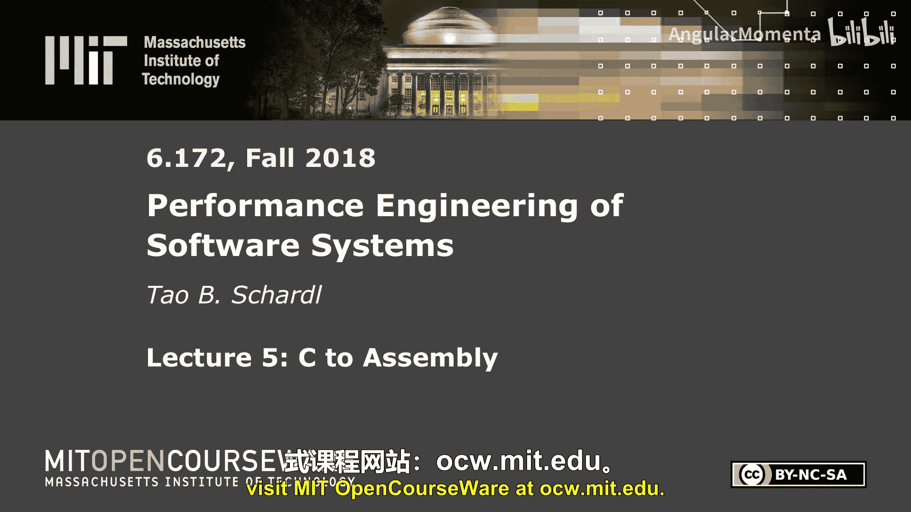
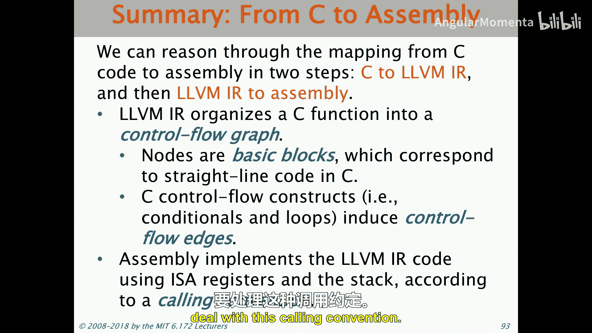

# 【麻省理工】软件系统性能工程 ｜MIT 6.172 Performance Engineering of Software Systems, Fall 2018 p05 5. C语言转汇编 -BV1esbLzpEFq_p5-

The following content is provided under a Creative Commons license。

 Your support will help Mi T OpenCourseware continue to offer high quality educational resources for free to make a donation or to view additional materials from hundreds of MiT courses。

 Visit Mit Opencourseseware at Ocw。 Mt。 Eduu。

Good afternoon， everyone。So today we have TBB Shatle here。

 he's going to give us the lecture on CEA assemblyly。

 so TBB is a research scientist here at MIT working with Charles Lyersson。

 he also taught this class with me last year and he got one of the best ratings ever for this class。

 so I'm really looking forward to his lecture。All right， great。

 so thank you for the introduction Julian today will be so I hear you just submitted the beta for Project one。

 hopefully that went pretty well。😊，How many of you slept in the last 24 hours？Okay， good， all right。

 so you know it went pretty well that sounds great。

 Yeah so today we're going to be talking about C to assembly and this is really a continuation from the topic of last lecture where you saw computer architecture。

 if I understand correctly， Is that right， you looked at computer architecture， X 8664 assembly。

 that sort of thing。😊，So how many of you walked away from that lecture thinking， oh yeah。

 X8664 assembly， this is easy， this is totally intuitive， everything makes perfect sense。

 you there's no weirdness going on here whatsoever。How many of you walked away not thinking that？

Thinking that perhaps this is a little bit strange。

 this whole assembly language like yeah I'm really in the later camp， X86 is kind of a strange beast。

 you know there are things in there that make no sense， you know Quad word has eight bytes。

 P stands for integer， that sort of thing。That's going to- so when we move on to the topic of you seeing how C code gets translated into assembly。

 we're translating into something that's already pretty complicated。

 and the translation itself isn't going to be that straightforward。

 so we're going to have to find a way to work through that。

And I'll outline the strategy that we'll be using in the start of this presentation。

But first let's quickly review why do we care about looking at assembly you should have seen this slide from the last lecture。

 but essentially assembly is a more precise representation of the program than the C code itself and if you look at the assembly that can reveal details about the program they're not obvious when you just look at the C code directly they're implicit things going on in the C code such as typecasts or the usage of registers versus memory on the machine and those can have performance implications。

 so it's valuable to take a look at the assembly code directly。😊。

It can also reveal what the compiler did or did not do when it tried to optimize the program。

 for example， you may have written a division operation or a multiply operation。

 but somehow the compiler figured out that it didn't really need to do a divide or multiply to implement that operation。

 it could implement it more quickly using simpler， faster operations like addition and subtraction or shift。

😡，And you would be able to see that from looking at the assembly。

Bugs can also arise only at a low level， for example。

 there may be a bug in the program that only creates unexpected behavior when you optimize the code at 03。

So that means when you're debugging with OG or01， you wouldn't see any unusual behaviors。

 but when you crank up the optimization level， suddenly things start to fall apart。

And bug and because the C code itself didn't change， it can be hard to spot those bugs。

 looking at the assembly can help out in that regard。And when worse comes worse。

 if you really want to make your code fast， it is possible to modify the assembly code by hand。

One of my favorite uses of looking at the assembly though。

 is actually reverse engineering if you can read the assembly for some code。

 you can actually decipher what that program does even when you only have access to the binary of that program。

Which is kind of a cool thing， it takes some practice to read assemblyly at that level。

 but this is actually one trick that some of us in Professor Leen's research group have used in the past to say figure out what Intel's math kernel library is doing to multiply matrices。

Now， as I mentioned before， at the end of last lecture。

 you saw some computer architecture and you saw the basics of X8664 assembly。

 including all this stuff like the instructions， the registers， the various data types。

 memory addressing modes， the r flags register with those condition codes。😊，And that's our thing。

 and today we want to talk about how C code gets implemented in that assembly language。Okay， well。

If we consider how C code becomes assembly， what that process actually looks like。

 we know that there's a compiler involved and the compiler is a pretty sophisticated piece of software and frankly the compiler has a lot of work to do in order to translate a C program into assembly For example。

 it has to choose what assembly instructions are going to be used to implement those C operations。

 it has to implement C conditionals and loops， those if analysis and those loops for and while loops into jumps and branches。

It has to choose registers and memory locations to store all of the data in the program。

It has to move data， it may have to move data among the registers and the memory locations in order to satisfy various data dependencies。

It has to coordinate all the function calls that happen when subroutine A calls B， calls C。

 and then returns， and so on and so forth。And on top of that， these days。

 we expect our compiler to try really hard to make that code fast。😡。

So that's a lot of work that the compiler has to do， and as a result。

 if we take a look at the assembly for any arbitrary piece of C code。

The mapping from that C code to the assembly is not exactly obvious。

Which makes it hard describe hard to execute this particular lecture， and it hard to in general。

 read the binary or the assembly for some program and figure out what's really going on。

So what we're going to do today to understand this translation process is we're going to take a look at how that compiler actually reasons about translating C code into assembly Now this is not a compiler class。

 6172 is not a class that you take if you want to learn how to build a compiler and you're not going to need to know everything about a compiler to follow today's lecture。

But what we will see is just a little bit about how the compiler understands a program and later on how the compiler can translate that program into assembly code。

Now。When a compiler compiles a program， it does so through a sequence of stages which are illustrated on this slide。

 starting from the C code it first preprosses that code dealing with all the macros。

And that produces pre processed source。Then the compiler will translate that source code into an intermediate representation for the clientAang compiler that you're using。

 that intermediate representation is called LLVM IR。

 LLVM being the name of the underlying compiler and IR being the creative name for the intermediate representation。

😊，That LVMIR is really a sort of pseudo assembly。Kind of like assembly。

 but as we'll see it's actually a lot simpler than X8664 assembly。

 and that's why we'll use it to understand this translation process。Now。

 it turns out that the compiler does a whole lot of work on that intermediate representation。

 we're not going to worry about that today。We'll just skip to the end of this pipeline when the compiler translates L ofVMIR ultimately into assembly code。

Now the nice thing about taking a look at the LVMIR is that if you're curious。

 you can actually follow along with the compiler， it is possible to ask Kang to compile your code and give you the LLVMIR rather than the assembly。

 and the flags to do that are somewhat familiar rather than passing the dashS flag。

 which hopefully you've already seen that will translate see code directly into assembly if you pass dashSm LVM that will produce the LLVMIR。

You can also ask Kang to translate LVMIR itself directly into assembly code。

And that process is pretty straightforward， you just use the dashS flag once again。

So this is the outline of today's lecture first we're going to start with a simple primer on LLVMIR。

 I know that LVMIR sounds like another language， oh gosh， we have to learn another language。

 but don't worry this primer。I would say is simpler than the X8664 primer based on the slides。

 for X8664， that primer was 20 some slides long， this primer is six slides。

 so maybe a little over a quarter。Then we'll take a look at how the various constructs in the C Peran language get translated into LVMIR。

 including straight line code， C functions， conditionals， in other words， ifN else， loops。

 and we'll conclude that section with just a brief mention of LVMIR attributes。And finally。

 we'll take a look at how LVMIR gets translate into assembly。And for that。

 we'll have to focus on what's called the Linux X8664 calling convention。

And we'll conclude with a case study where we see how all this whole process works on a very simple code to compute Fibonacci numbers。

 Any questions so far？All right， let's get started， brief primer on L ofVMIR。

So I've shown this in smaller fonts on some previous slides， but here is a snippet of LLVMIR code。

 in particular， this is one function within an LLVMIR file。😊，And。Just from looking at this code。

 we can see a couple of the basic components of LLVMIR。哎。In L ofVMR， we have functions。

 That's how code is organized into these chunks。Chunk's call functions。And within each function。

 the operations of the function are encoded within instructions。

 and each instruction shows up at least on this slide on a separate line。啊。

Those functions operate on what are called LVMIR registers， these are kind of like the variables。

And each of those variables has some associated type。

 So the types are actually explicit within the IR。And we'll take a look at the types in more detail in a couple of slides。

So based on that high level overview， we actually see a couple- we can do a little bit of a comparison between LVMIR and assembly language。

 the first thing that we see is that it looks kind of similar to assembly。

It still has a simple instruction format， there's some destination operaand。

 which we were calling a register， and there's an equal sign and then an op code be it addd or call or what have you。

 and then some list of source opera， that's roughly what each instruction looks like。

We can also see that。The LVMR code， it'll turn out rather。

 that the L ofVMIR code adopts a similar structure to the assembly code itself。

And control flow once again is implemented using conditional branches as well as unconditional branches。

But one thing that we'll notice is that LVMIR is simpler than assembly。

It has a much smaller instruction set。And unlike assembly language。

 LVMR supports an infinite number of registers， if you can name it， it's a register。

 so in that sense LVM's notion of registers is a lot closer to C's notion of variables and when you read LVMIR and you see those registers you should just think about C variables。

There's nothing there's no implicit r flags register， there are no implicit condition codes going on。

 everything is pretty explicit in terms of the LLVM。

There's no explicit stack pointer or frame pointer。

 there's a type system that's explicit in the IR itself and it's C like in nature。😊。

And there are C like functions。For organizing the code overall。

So let's take a look at each of these components starting with LVMIR Regs。

 this is basically LVM's name for a variable。All of the data in LVM is stored in these variables。

 which are called registers and the syntax is a percent symbol followed by a name， so percent0。

 percent 1%2， that sort of thing。And as I mentioned before， LVM registers are a lot like C variables。

 LVM supports an infinite number of these things and each distinct register is just distinguished by its name。

 so percent zero is different from percent1 because they have different names。

Register names are also local to each LVMIR function， and in this regard。

 they're also similar to C variables。 If you were at a C program with two functions， A and B。

 and each function had a local variable Apple。Those are two different apples。

 the apple in A is not the same thing as the apple and B。Similarly。

 if you had two different LVMIR functions and they both describe some register5。

 those are two different variables。They're not automatically aliaed。And so here's an example。

 I of youMI Snippet， and what we've done here is just highlighted all of the registers。

 some of them are being assigned because they're on the left hand side of an equal symbol。

 and some of them are being used as arguments when they show up on the right hand side。

There is one catch which we'll see later on， namely that the syntax for LLVM registers ends up being hijacked when LLVM needs to refer to different basic blocks。

 we haven't defined basic blocks yet， we'll see what that's all about in just a couple slides。

Everyone good so far？All right。So LVMIR code is organized into instructions and the syntax for these instructions is pretty straightforward。

 we have a register name on the left hand side， then an equal symbol。

 and then an off code followed by an opera end list。For example， the instruction。

 the top highlighted instruction has register6 equal to add of some arguments。

 and we'll see a little bit more about those arguments later。

That's a syntax for when an instruction actually returns some value。

 so addition returns the sum of the two opera， other instructions don't return a value per se。

 not a value that you'd store in a local register。And so the syntax for those instructions is just an opP code followed by a list of operas。

Ironically， the return function that you'd find at end of the return instruction that you'd find at the end of a function doesn't assign a particular register value。

A。And of course， the operators can be either registers or constants， or as we'll see later on。

 they can identify basic blocks within the function。

The LVMIR instruction set is smaller than that of X86。

 X86 contains hundreds of instructions when you start counting up all the vector instructions。

 and LVMIR is far more modest in that regard， there are some instructions for data movement。

 including stack allocation， reading， memory， writing memory。

 converting between types or doing well yeah， that's pretty much it。

There are some instructions for doing arithmetic or logic， including integer arithmetic。

 floating point or arithmetic， Boolean logic， binary logic， or address calculations。

And then there are a couple of instructions to do control flow。

There are unconditional branches or jumps， conditional branches or jumps。

 subroutines that's call or return， and then there's this magical fee function。

 which we'll see more of later on in these slides。Finally， as I mentioned before。

 everything in LVMIR is explicitly typed， it's a strongly typed language in that sense。

 and the type system looks something like this for integers。

 whenever there's a variable of an integer type， you'll see an I followed by some number and that number defines the number of bits in that integer。

😊，So if you see a variable of type I64。That means it's a 64 bit integer。

If you see a variable of type i1。That would be a one bit integer。Or in other words， a boolean value。

There are also floating point types such as double and float。

 there are pointer types when you follow it with follow an integer or floating point type with a star。

 much like in C， you can have a array， and that uses a bracket notation， a square bracket notation。

 where within the square brackets you'll have some number and then times and then some other type maybe it's a primitive type like an integer or floating point。

 maybe it's something more complicated。You can havestructs within an LVMIR。

 and that uses squiggly brackets with types and yourbri on the inside， you can have vector types。

 which uses angle brackets and otherwise adopts a similar syntax to the array type。Finally。

 you can occasionally see a variable which looks like an ordinary register。

 except that its type is label， and that actually refers to a basic block。

Those are the basic components of LVMIR， any questions so far？Everything clear， everything unclear。

That should be unclear and we'll talk about it。Yeah。😊，M。

Is the vector notation used for the vector registers？In a sense， yes。

 the vector operations within LLVM don't look like SSE or AVX per se they look more like ordinary operations。

 except those R operations work on a vector type， so that's how the vector operations show up in LVMIR。

That makes some sense。Cool。Anything else？Okay， that's the whole primer。

 that's pretty much all of the language that you're going to need to know。

 at least for this slide deck， we'll cover some of the details as we go along。

 let's start translating C code into LVMIR。Sound good。😊，All right。

 let's start with pretty much the simplest thing we can， straight line C code。

What do I mean by straight line C code， I mean that this is a blob of C code that contains no conditionals or loops。

 So it's just a whole sequence of operations。And that sequence of operations in C code。

Turns into a sequence of operations in LVMIR。So in this example here we have fool of n minus1 plus bar of n minus2。

 that is a sequence of operations and it turns into the LVMIR on the right。

 we can see how that happens， there are a couple of rules of thumb when reading straight line C code and interpreting it and in the IR arguments to any operation are evaluated before the operation itself。

So what do I mean by that well？In this case， we need to evaluate n minus1 before we pass the results to F。

And what we see in the LLVMIR is that we have an addition operation that computes n 1。

 and then the result of that stored into Reg 4 gets passed to the call instruction on the next line。

 which calls out to functionF。Sound good。Similarly。

 we need to evaluate n minus2 before passing its results to the function bar。

 and we see that sequence of instructions showing up next in the LLVMIR。

And now we actually need the return， oh yeah， question。NSW that is a。

Essentially that is an attribute， which we'll talk about later。

 these are things that decorate the instructions as well as the types within LVM。

 basically as the compiler figure stuff out， so it helps the compiler along with analysis and optimization。

Good。So for the last operation here， we had to evaluate both F and bar and get their return values before we could add them together。

And so the very last operation in this sequence is the addition that just takes those return values and computes their sum。

Now all of that used primitive types in particular integers。

 but it's possible that your code uses aggregate types by aggregate types， I mean arrays orstructs。

 that sort of thing。And aggregate types are harder to store within registers， typically speaking。

And so they're typically stored within memory。As a result。

 if you want to access something within an aggregate type。

 if you want to read some elements out of an array。

 that involves performing a memory access or more precisely computing some address into memory and then loading or storing that address。

So here， for example， we have an array a of seven integers。

 and then we're going to access a subX in LVMIR that turns into two instructions。

 this get element pointer instruction followed by a load。And in the get element pointer case。

 this computes an address。Into memory and stores the result of that address into a register。

 in this case， register5。The next instruction， the load。Take the address。

 stored in Reg 5 and simply loads that particular memory address。

Storing the result into another register， in this case six。Pretty simple。

When reading the get element pointer instruction， the basic syntax involves a pointer into memory followed by a sequence of indices。

 and all that get element pointer really does is it computes an address by taking that pointer and then adding on that sequence of indices。

So in this case， we have a get element pointer instruction。

 which takes the address in Reg2 and then adds on to it。Yeah， that's a pointer to memory。

 and then it adds on to it two indices， one is the literal value zero。

And the other is the value stored in Reg4。So that just completes the address。

 starting at 2 plus0 plus whatever it was't registered for。So that's all for straight line code。

Good so far。Feel free to interrupt if you have questions。co。Functions， let's talk about C functions。

So when there's a function in your C code， generally speaking。

 you'll have a function within the LVM code as well。And similarly。

 when there's a return statement in the C code， you'll end up with a return statement in the L ofVMR。

 So here we have just the bare bone C code for this fib routine。

That corresponds to this fib call within or not fib call， this fib function within L ofVMIR。

 and the function declaration itself looks pretty similar to what you would get in ordinary C。

The return statement is also similar， it may take an argument if you're returning some value to the color。

 in this case， for the fiB routine， we're going to return a 64 bit integer。

 and so we see that this return statement returns the 64 bit integer stored in register0。

A lot like N。Functions can have parameters， and when you have a C function with a list of parameters。

 basically an LVMIR， you're going to end up with a similar looking function with the exact same list of parameters just translated into LVMIR。

So here we have this C code for the MM based routine。

 and we have the corresponding L ofVMIR for an MM based function。

 and what we see is we have a pointer to a double as the first parameter followed by a 32bit integer。

Followed by another pointer2 or double， followed by another 32 bit integer。

Flow another pointer to a double and another 32 in。And in other series you've been injured。

One implicit thing with an LVMIR， if you're looking at a function declaration or definition。

 the parameters are automatically named percent0 percent 1%2， so on and so forth。

 there's one unfortunate thing about LLVMIR， the registers are a lot like C functions。

 but unfortunately that implies that when you're reading LVMIR it's a lot like reading the code from your teammate who always insists on naming things with nondescript single letter variable names。

Also， that teammate doesn't comment his code or her code or their code。Okay， so basic blocks。

When we look at the code within a function， that code gets partitioned into chunks。

 which are called basic blocks。 A basic block has a property that's a sequence of instructions。

 in other words， it's a blab of straight line code。

Where control can only enter from the first instruction in that block。

 and it can only leave from the last instruction in that block。

So here we have the C code for this routine fib。 C， we're going to see a lot of this routine fib。 C。

 by the way。And we have the corresponding LVMR。And what we have in the C code。

 what the C code is telling us is that if n is less than two， you want to do one thing。

 otherwise you want to do some complicated computation and then return that result。

And if we think about that。We've got this branch in our control flow and what we'll end up with。

Are three different blocks within the L ofV MIR。So we end up with one block， which figures out。

 which does the computation is n less than two。And then we end up with another block that says， well。

In one case， just go ahead and return something。 In this case， the input to the function。

In the other case， do some complicated calculations， some straight line code。

 and then return that result。Now， when we partition the code of a function into these basic blocks。

 we actually have connections between the basic blocks based on how control can move between the basic blocks。

These control flow instructions in particular， the branch instructions， as we'll see。

 induce edges among these basic blocks， whenever there's a branch instruction that can specify that control can leave this basic block and go to that other basic block or that other basic block or maybe one or the other depending on how the result of some computation unfolded。

And so for the Fb function that we saw before， we had those three basic blocks。

 and based on whether or not n was lesson than two。

 either we would execute the simple return statement or we would execute the blob of straight line code shown on the left。

So those are basic blocks and functions， everyone's still good so far。Any questions？Clear is mud。

All right。let's talk about conditionals， we've already seen one of these conditionals that's given rise to these basic blocks and these control flow edges。

 so let's tease that apart a little bit further。When we have a C condition， in other words。

 an if then L statement or switch statement for that matter。

That gets translated into a conditional branch。Instruction or BR in。The LVMIR representation。

 So what we saw before is that we had this if and lesson and lesson2 and this basic block with two outgoing edges。

 And we take a really close look at that at that first basic block。

We can tease it apart and see what each operation does。So first。

 in order to do this conditional operation， we need to compute whether or not n is less than 2。

 We need to do a comparison between n。And the literal value too。

 and that comparison operation turns into an i comp instruction within the LLVMR。

 an integer comparison in the LVMIR。The result of that comparison then gets passed to a conditional branch as one of its arguments。

And the conditional branch specifies a couple of things beyond that one argument。And in particular。

 that conditional branch takes that one bit integer， that boolean result。

 as well as labels of two different basic blocks。So that Boolean value is called the predicate。

And that's， in this case， a result of that comparison from before。

And then the two basic blocks say where to go if the predicate is true。

Or where to go if the predicate is false？The first label is the destination when it's true。

 second label， destination when it's false， pretty straightforward。

And if we decide to map this onto our control flow graph， which we were looking at before。

We can identify the two branches coming out of our first basic block as either the true branch or the false branch。

 based on whether or not you follow that edge when the predicate is true or when the predicate is false。

Sound good？This should be straightforward。Let me know if it's not， me know。If it's confusing。

Now it's also possible that you can have an unconditional branch in LVMIR。

 you can just have a branch instruction with one opera end and that one opera end specifies a basic block。

There's no predicate， there's no true or false， it's just the one basic block。

 and what that instruction says is when you get here，Now go to that other basic block。

This might seem kind of silly， right， Why would we just need to jump to another basic block with。

 why not just merge this code with。The code and the subsequent basic block。Any thoughts？

Other things might jump in。Correct， other things might go to that basic block。And in general。

 when we look at the structure that we get for any particular conditional in C。

 we end up with a sort of diamond shape， and in order to implement that diamond shape。

 we need these unconditional branches。So there's a good reason for them to be around。

 and here we just have an example of a slightly more complicated conditional that creates this diamond shape in our control flow graph。

So let's tease this piece of code apart。In the first block。

 we're going to evaluate if some predicate， and in this case our predicate is x， bitY and1。

And what we see in the first basic block is that we compute the bitwise and， store that result。

Do a comparison between that result and the literal value1 that gives us a boolean value。

 which is stored in Reg 3， and we branch conditionally on whether three is true or false。

In the case that it's true， we'll branch a block four。And in block4。

 that contains the code for the consequent， the then clause of the ifN else。And in the consequence。

 we just call function Fu。And then we need to leave the conditional。

 so we'll just branch unconditionally。The alternative， if x and1 is。Zero， if it's false。

Then we will execute the function bar。But then also need to leave the conditional。

And so we see in block five following the false branch that we call a bar。

 and then we just branch a block six。And finally， in block6， we return the results。

So we end up with this diamond pattern whenever we have a conditional in general。

 we may delete certain basic blocksal are if the conditional in the code is particularly simple。

 but in general， it's going to be this kind of diamond looking thing。Everyone good so far。

One last C construct， loops， unfortunately this is the most complicated C construct when it comes to the LVMIR。

But things haven't been too bad so far。Yeah， let's walk into this with some confidence。So。

The simple part is that。What we will see is this C code for a loop translates into LVMIR that in the control flow graph representation。

Is a loop。So loop and C is literally a loop in this graph representation， which is kind of nice。

But to figure out what's really going on with these loops， we need to tease apart。

 let's first tease apart the components of a C loop。

Because we have a couple different pieces in an arbitrary sea loop， we have a loop body。

 which is what's executed on each iteration， and then we have some loop control which manages all the iterations of that loop。

So in this case we have a simple C loop which multiplies each element of an input vector x by some scalar A and stores a result into y that body gets translated into a blob of straight line code。

 I won't step through all the straight line code just now。

 there's plenty of it and you'll be able to see the slides after this lecture。

But that blobva straight line code corresponds to the loop body。

 and the rest of the code in the LLVMR snippet corresponds to the loop control。

So we have the initial assignment of the induction variable。

 the comparison with the end of the loop and the increment operation at the end。

 all of that gets encoded in the stuff highlighted in yellow， that loop control part。Now。

 if we take a look at this code， there's one odd piece that we haven't really understood yet。

 and it's this fee instruction at the beginning。Theiffy instruction is。Weird。

And it arises pretty commonly when you're dealing with loops。

And it arises for it basically is there to solve a problem with LLVM's representation of the code。

So before we describe the fee instruction， let's actually take a look at the problem that this fee instruction tries to solve。

So let's first tease apart the looppin to reveal the problem。

The C loop produces this looping pattern in the control flow graph。

 literally an edge that goes back to the beginning。

 and if we look at the different basic blocks we have。

 we have one block at the beginning which initializes the induction variable and sees if there are any iterations of the loop that need to be run。

Assuming that there are some iterations， if there aren't any iterations。

 then that'll branch directly to the end of the loop， it'll just skip the loop entirely。

 no need to try to execute any of that code。And in this case， itll simply return。

And then inside the loop block， we have these two incoming edges。

 one from the entry point of the loop， where I has just been set to zero。

 and another where we're repeating the loop where we decided there's one more iteration to execute。

And we're going to go back from the end of the loop to the beginning。

 and that back edge is what creates the loop structure in the control flow graph。Makes sense。

All right。I at least see one knot over there， so that's encouraging。Okay。

 so if we take a look at the loop control。There are a couple of components to that loop control。

 there's the initialization of the induction variable。

 there's the condition and there's the increment， condition says when do you exit。

 increment updates the value of the induction variable。😊。

And we can translate each of these components from the C code for the loop control into the LLVMIR code for that loop。

So the increments， we would expect to see some sort of addition with。

In addition where we add one to some register somewhere， and lo and behold， there's an ad operation。

 so we'll call that the increment。For the condition。

 we expect some comparison operation and then conditional branch based on that comparison。

Look at that， right after the increment， there's a compare。

And a conditional branch that will either take us back to the beginning of the loop or out a loop entirely。

And we do see that there is some form of initialization。

The initial value of this induction variable is zero。

 and we do see a zero among this loop control code。

 it's kind of squirreed away in that weird notation there。

And that weird notation is sitting next to the fee instruction。

What's not so clear here is where exactly is the induction variable。

 We had this single variable I in our C code。And what we're looking at in the LLV MIR。

 our whole bunch of different registers， we have a register that stores what we're claiming to be I+1。

 then we do this comparison and branch thing， and then we have this fee instruction that takes zero or the result of the increment。

 where did I actually go？So the problem here。Is that I is really represented across all of those instructions and that happens because the value of the induction variable changes as you execute the loop。

 the value of I is different on iteration  zero versus iteration 1 versus iteration 2 versus iteration 3 and so on and so forth。

 I is changing as you execute the loop。And there's this funny invariant。Yeah。

 so if we try to map that induction variable to the LVMIR。It kind of maps to all of these locations。

 it maps to various uses in the loop body it maps roughly speaking to the return value of this fee instruction。

 even though we're not sure what that's all about， but we can tell it maps to that because we're going to increment that later on and then we're going to use that in a comparison。

So it kind of maps all over the place。And because it changes values。

 we're going to because it changes values with the increment operation， we're going to encounter。

Oh yeah， and so why does it change registers while we have this property in LVM？

That each instruction defines the value of a register at most once。

 so for any particular register within LVM， we can identify a unique place in the code of the function that defines that register value。

This invariant is called the static single assignment environmentvari。

And it seems a little bit weird。But it turns out to be an extremely powerful invariant within the compiler。

 it assist with a lot of the compiler analysis， and it also can help with reading the LLVMR if you know。

If you expected it。So this is a nice invariant， but it poses a problem when we're dealing with induction variables which change as the iteration or as the loop unfolds。

And so what happens when control flow merges at the entry point of a loop， for example？

How do we define what the induction variable is at that location。

 because it could either be zero if this is the first time through the loop or whatever you last incremented？

And the solution to that problem is the fee instruction。The fee instruction specifies。

It defines a registerger that says， depending on how you get to this location in the code。

 this register will have。One of several different values。

And the fee instruction simply lists what the value of that register will be depending on which basic block you came from。

So in this particular code， the fee instruction says if you came from block6。

 which was the entry point of the loop， where you initially you initially checked if there were any loop iterations to perform。

If you come from that block。Then this register9 is going to adopt the value0。If， however。

 you follow the back edge of the loop。Then the registergi is going to adopt the value， in this case。

 14。And 14 lo and behold is the result of the increment operation。

And so this fee instruction says either you're going to start from zero or you're going to be i plus1。

Just to note， the fee instruction is not a real instruction。

 it's really a solution to a problem within LOVM。And when you translate this code into assembly。

 the fee instruction isn't going to map to any particular assembly instruction。

It's really a representational trick。Does that make some sense， any questions about that？Yeah我。

Why is it called fee， That's a great question。 I actually don't know why it's called why they chose the name fee。

 I don't think they had a particular affinity for the golden ratio。

But I'm not sure what the rationale was。 I don't know if anyone else knows。对。各姑娘 all。Sort of。

So adopt the value 6，0 from block 6 or 14 from block 8。

So that's all of the basic components of C translating into LLVMIR。

The last thing I want to leave you with in this section on LVMIR is a discussion of these attributes。

 and we already saw one of these attributes before is this NSW thing attached the ad instruction。

In general， these LVMIR constructs might be decorated with these extra words and keywords。

 and those are the keywords that I'm referring to as attributes。

 and those attributes convey a variety of information。吓。So in this case。

 what we have here is C code that performs this memory calculation。

Which you might have seen from a previous lecture。And what we see in the corresponding LVMIR is that there's some extra stuff tacked onto that load instruction where you load memory。

One of those pieces of extra information is this align for and what that align for attribute says。

It describes the alignment of that read from memory。

And so if subsequent stages of the compiler can employ that information if they can optimize reads that are4 by aligned。

😊，Then this attribute will say， this is a load that you can go ahead and optimize。

There are a bunch of places where attributes might come from。

 some of them are derived directly from the source code。

 if you write a function that takes a parameter marked as cont or marked as restrict。

 then in the L ofVMIR you might see that the corresponding function parameter is marked as no alias because the restrict keyword said this pointer can ever alias。

Or the cost keyword says you're only ever going to read from this pointer so this pointer is going to be marked read only。

 so in that case the source code itself， the C code。

Was the source of the information for those attributes？

There's some other attributes that occur simply because the compiler is smart and it does some clever analysis。

So in this case， the LVMIR has a load operation that's8 by aligned。

It was really analysis that figured out the alignment of that load operation。Good so far。Cool。

So let's summarize this part of the discussion with what'll be seeing about LLVMIR。

L VMR is similar to assembly， but a lot simpler in many， many ways。

 All of the compute values are stored in registers。 And really， when you're reading L VMR。

 you can think of those registers a lot like。Ordinary C variables。

LLVMIR is a little bit funny in that it adopts a static single assignment paradigm， this invariant。

 where each register name， each variable， is written by at most one instruction within the LLVMIR code。

So if you're ever curious where percent 14 is defined within this function。

 just do a search for where percent 14 is on the left hand side of an equals。And there you go。

We can model a function in LVMIR as a control flow graph whose nodes correspond to basic blocks。

 these blobs of straight line code， and whose edges denote control flow among those basic blocks。

And compared to C， LVMIR is pretty similar。Except that all of these operations are explicit。

 the types are explicit everywhere， the integer sizes are all apparent。

 you don't have to remember that int really means a 32 bit integer and you need in64 to be a 64 bit integer or you need a long or anything。

 it's just I and then a bit width。There are no implicit operations at the Ol Myer level。

 all the type casts are explicit in some sense。LVMR is like assembly if assembly were more like C。

And that's definitely a statement that would not have made sense 40 minutes ago。All right。

So we've seen how to translate C code into L ofVMIR。There's one last step。

 we want to translate the LVMIR into assembly。And it turns out that structurally speaking。

 LVMIR is very similar to assembly， we can more or less map each line of LVMIR to some sequence of lines in the final assembly code。

😊，But there is some additional complexity， the compiler isn't done with its work yet when it's compiling C to LVMIR to assembly。

And there are a couple- there are three main tasks that the compiler still has to perform in order to generate X8664。

First， it has to select the actual XA6 assembly instructions that are going to implement these various LVMIR operations。

It has to decide which Joan purpose registers are going to hold different values and which values need to be squirreed away into memory because it just has no other choice。

And it has to coordinate all of the function calls。

 and it's not just the function calls within this particular source file。

 it's also function calls between that source file and other source files that you're compiling and binary libraries that are just sitting on the system。

 but the compiler never really gets to touch， it has to coordinate all of those calls。😊。

That's a bit complicated， that's going to be the reason for a lot of the remaining complexity。

And that's what brings our discussion to the Linux X8664 calling convention。

This isn't a very fun convention， don't worry。But never realize it's useful。

So to talk about this convention， we need to， let's first take a look at how a program gets laid out in memory when you run it。

So when a program executes virtual memory gets organized into a whole bunch of different chunks。

 which are called segments， there's a segment that corresponds to the stack that's actually located near the top of virtual memory and it grows downwards。

 the stack grows down， remember this。There is a heap segment which grows upwards from a middle location in memory。

 and those two dynamically allocated segments live at the top of the virtual address space。

There are then two additional segments， the BSS segment for uninitialized data and the data segment for initialized data。

And finally， at the bottom of virtual addressure space。

 there's a tech segment and that just stores the code of the program itself。

Now when you read assembly。Code directly， you'll see that the assembly code contains more than just some labels and some instructions。

 in fact， is's decorated with a whole bunch of other stuff。

And these are called assemblymbler directives。And these directives operate on different sections of the assembly code。

 some of those directives refer to the various segments of virtual memory and those segment directives are used to organize the content of the assembly file。

 for example， the dot text directive identifies some chunk of the assembly which is really code and should be located in the text segment when the program is run。

 the dot BSS segment identifies stuff that lives in the assemblymb directive identify stuff in the BSS segment。

 the dot data， directive， identifies stuff in the data segment， so on and so forth。

There are also very storage directives that will store content of some variety directly into the current segment。

 whatever was last identified by a segment directive。So。

If at some point there's a directive x colon dot space 20。

 that space directive says allocate some amount of memory。

 and in this case it says allocate 20 bytes of memory and we're going to label that location x。

The dot long segment says store a constant long integer value in this case， 172， in this example。

 at location Y。The ASCI Z segment similarly stores a string at that particular location。

 so here we're storing the string 6。172 at location Z。

There's an align segment or an aligned directive that aligns the next content in the assembly file to an8 by boundary。

There are additional segments for the linker to obey， and those are the scope and linkage directives。

 for example， you might see Doc Global in front of a label。

And that signals to the linker that that particular symbol should be visible to the other files that the linker touches。

 in this case， dogbal Fb makes Vib fib visible to the other object files and that allows those other object files to call or refer to this Fb location。

Now， let's turn our attention to。The segment at the top， the call or the stack segment。

This segment is used to store data and memory in order to manage function calls and returns。

That's a nice high level description， but what exactly ends up in the stack segment。

 why do we need a stack， what data will end up going there？Can anyone tell me？

Local variables int function， anything else？You already answered once。I may call you again。

 but go ahead。Sorry。Function arguments， very good， anything else？That's all I hand over here。

The return address。Anything else yeah？There's at least yeah， there's one other thing that。

One other important thing that gets stored on the stack。The return value， actually。

 that one's interesting， it might be stored on the stack。But it might not be stored in the stack。

Good guess though。3 your results。Intermediate results， in a manner of speaking， yes。

 there are more intermediate results than meets the eye when it comes to assembly or comparing it to C。

But in particular， by intermediatemedia results， let's say register state。

 there are only so many registers on the machine。And sometimes that's not enough。

 and so the function may want to scroll away some data that's in registers and stash it somewhere in order to read it back later。

 the stack is a very natural place to do it， that's the dedicated place to do it。😊，So yeah。

 that's pretty much all the content of the what ends up on the call stack as the program executes。

Now here's the thing， there are a whole bunch of functions in the program。

 some of them are the may have been defined in the source file that you're compiling right now。

 some of them might be defined in other source files。

 some of them might be defined in libraries that were compiled by someone else。

 possibly using a different compiler with different flags， under different parameters。

 presumably for this architecture， at least one hopes， but。

Those libraries are completely out of your control。And now we have this problem。

 all of those object files might define these functions。And those functions want to call each other。

 regardless of where those functions are necessarily defined。

And so somehow we need to coordinate all of those function calls and make sure that if one function wants to use these registers and this other function wants to use the same registers。

 those functions aren't going to interfere with each other。Or if they both want to read stack memory。

 they're not going to collaborate each other's stacks。

So how do we deal with this coordination problem？At a high level。

 what's the high level strategy we're going to adopt to deal with this coordination problem？

That will be part of it。But for the higher level strategy。

 so that's a component of this higher level strategy， so what yeah， go ahead。Colllin convention。

 you remember the title of this section of the talk great。

 we're going to make sure that every single function， regardless of where it's defined。

 they all abide by the same calling convention， so it's the standard that all the functions will obey in order to make sure they all play nicely together。

So let's unpack the Linux XA664 calling convention， well。

 not the whole thing because it's actually pretty complicated。

 but at least enough to understand the basics of what's going on。So at a high level。

This Col convention organizes the stack segment into frames such that each function instantiation。

 each time you call a function。That instantiation gets a single frame all to itself。

And to manage all those stack frames， the calling convention is going to use these two pointers。

 RBP and RSP， which you should have seen last time RBP。

 the base pointer will point to the top of the current stack frame。

 RSP will point to the bottom of the current stack frame and remember the stack grows down。Now。

 when the code executes call and return instructions。

 those instructions are going to operate on the stack， these various stack pointers。

 as well as the instruction pointer RIEP， in order to manage the return address of each function。

In particular， when a call instruction gets executed。In X86。

 that call instruction will push the current value of RIP onto the stack。

 and that will be the return address。And then the call instruction will jump to its opera brand。

 its opera brand being the address of some function in the program memory， or at least one hopeax。

 perhaps there was buffer overflow corruption of some kind and your program is in dire straits。

 but presumably it's the address of a function。The return instruction complements the call and it's going to undo the operations of that call instruction。

 it'll pop the return address off the stack and put that into RIP。

 and that will cause the execution to return to the caller and resume execution from the statement right after the original call。

😊，So that's the high level of how the stack gets managed as well as the return address。

 about how do we maintain registers across all of those calls？Well。

 there's a bit of a problem because we might have two different functions that want to use the same registers。

Some of this might be reviewed， by the way， from 604， but if it's not， hopefully。

If you have questions， just let me know。So we have this problem where two different functions。

 function A， which might call another function B， those two functions might want to use the same registers。

So who's responsible for making sure？Then a function B operates on the same registers as A。

That when B is done， A doesn't end up with corrupted state in its registers。Well。

 there are two different strategies that could be adopted。

 one is to have the caller save off the register state before invoking a call。

But that has some downsides， the caller might waste work saying， well。

 I have to save all of this register state in case the function I'm calling wants to use those registers。

If the columning function doesn't use as registers， that was a bunch of wasted work。

So on the other side， we might say， well， let's just have the call save all that registered state。

that could waste work if the callee is going to save off register state that the caller wasn't using。

So the colgue says， well， I want to use all these registers。

 I don't know what the calling function used， so I'm just going to push everything onto the stack。

That could be a lot of ways of work。So what does the X86 callinging convention do？

If you had to guess。That's exactly right， it does a little bit of both。

 it specifies some of the registers as being callee save registers and the rest of the registers are call lower save registers。

And so the caller will be responsible for saving some stuff。

 the colee will be responsible for saving other stuff。

And if either of those functions doesn't need one of those registers， then it can avoid wasted work。

In XA664 in this calling convention， turns out that the RBX RVP and R 12 through our 15 registers are all callee saved and the rest of the registers are caller saved in particular。

 the C linkage defined by this calling convention for all the registers looks something like this。

 and that identifies lots of stuff， it identifies a register for storing the return value。

 registers for storing a bunch of the arguments， caller saved registers， callee saved registers。

 a register just for linking。I don't expect you to memorize this in 12 seconds。

 and I think on any quiz， well， I won't say what the course app will do on quizzes this year。But。

Yeah， okay， well， there you go。You'll have these slides later， you can practice memorizing them。

Not shown on the slide， there are a couple other registers that are used for saving function arguments and return values。

 and in particular whenever you're passing floating point stuff around。

 the XMM registers0 through7 are used to deal with those floating point values。Cool。

 so we have strategies for maintaining the stack， we have strategies for maintaining register states。

But we still have this situation where functions may want to use overlapping parts of stack memory。

 and so we need to coordinate how all those functions are going to use the stack memory itself。

This is a bit hard to describe， the cleanest way I know to describe it is just to work through an example。

So here's the setup。Let's imagine that we have some function A that is called a function B。

 and we're in the midst of executing function B， and now function B is about to call some other function C。

😊，As we mentioned before， B has a frame all to itself。

 and that frame contains a whole bunch of stuff， it contains arguments that A pass to B。

 it contains a return address， a contains a base pointer， it contains some local variables。

 and because B is about to call C， it's also going to contain some data for arguments that B will pass to C。

So that's our setup。We have one function ready to call another。Well。

 let's take a look at how this stock memory is organized first。So at the top。

 we have what's called a linkage block， and in this linkage block。

 this is the region of stack memory where function B will access nonre arguments from its caller function A。

And it'll access these by indexing off of the base corner or RPBP， using positive offsets， again。

 the stack grows down。Be will also have a block of stack space after the linkage block and return address and base pointer。

 it'll have a region of its frame for local variables and it can access those local variables by indexing off of RVP in the negative direction。

Stock grows down。If you don't remember anything else， stack rose down。Now。

B is about to call it function C。And we want to see how all of this unfolds。So before calling C。

 B is going to place non register arguments for C onto a reserved linkage block in its own stack memory。

Below its local variables。And it'll access those by indexing RVP with negative offsets。

So those arguments from B to its colors will specify those to be arguments from B to C。

And that what's going to happen， then B is going to call C。And as we saw before。

 the call instruction saves off the return address onto the stack。

And then it branches control to the entry point of function C。When the function C starts。

 it's going to execute what's called the function prologue。

And the function protocollogue consists of a couple of steps。 First。

 it's going to save off the base pointer for B's stack frame。

So it'll just squirre away the value of RVP onto the stack。

Then it's going to set RBP equal to RSP because we're now entering a brand new frame。

 a frame for the implication of C。And then so you can go ahead and allocate the space that it needs on the stack。

 and this will be space that city needs for its own local variables。

 as well as space that he will use for any linkage blocks that it creates for its color or for the things that it calls。

Now there is one common optimization that the compiler will attempt to perform。

If a function never needs to perform stack allocations。Except to handle these function calls。

 in other words， if the difference between RVP and RSP is a compile time constant。

Then the compiler might go ahead and just get rid of RVP。

And do all of the indexing based off the stack point or RSP。

And the reason they'll do that is because if it could get one more general purpose register out of RVP。

Well now RVP is general purpose， and it has one extra register to use to do all of its calculations。

 reading from a register takes unit time， reading from even L1 cash takes significantly more for。

 I think four times that amount。And so this is a common optimization that the compiler will want to perform。

Now， it turns out that there's a lot more to the callinging convention than just what's shown on these slides。

We're not going to go through that today。If you'd like to have more details， there's a nice document。

 the System 5 ABI that describes the whole calling convention。Any questions so far？All right。

So let's wrap all this up with a final case study， and let's take a look at how all these components fit together when we're translating a simple C function to compute Fibonacci numbers all the way down to assembly。

And as we've been describing this whole time， we're going to take this in two steps。

Let's describe our starting point， fib。c， this should be basically no surprise to you at this point。

 this is a C function fib， which computes the n Fibonacci number in one of the worst computational ways possible。

 it turns out， but it competes the Fibonacci number f of n recursively using the formula f of n is equal to n when n is either0 or1。

 or it computes f of n minus1， and fFmn minus2 and takes their sum。

This is an exponential time algorithm to compute Fibonacci numbers。

I would say don't run this at home except invariably you'll run this at home。

 there are much faster algorithms to compute Fibbonacci numbers。

 but this is good enough for a didactic example， we're not really worried about how fast can we compute Fb today。

Now the C code for Fibot C is even simpler than the recurrence implies。

 we're not even going to bother checking that the input value n is some non-negative value。

 what we're going to do is say， look if n is less than two go ahead and return that value， n。

 otherwise do the recursive thing。We've already seen this code a couple of times。

 everyone good so far， any questions on these three lines？Great。😊，All right， so let's translate fib。

c into fib。ll。 we've seen a lot of these pieces in lecture so far。

And here we've just rewritten Fiibdosci a little bit to make drawing all the lines a little bit simpler。

So here we have the C code for Fib。 C。 The corresponding LVMR looks like this。😊。

And as we could guess from looking at the code for Fib。t C。

 we had this conditional and then two different things that might occur based on whether or not n is less than 2。

And so we end up with three basic blocks within the LBMIR。

The first basic block checks event is less than two and then branches based on that result。

 and we've seen how all of that works previously。If then happens to be less than two。

 then the consequent， the true case of that branch ends up showing up at the end。

 and all it does is it returns the input value， which is stored in register0。Otherwise。

It's going to do some straight line code to compute fib of n minus1 and Fb of n minus2。

It'll take those return values。Add them together， return that result。

 that's the end Fipinacci number。So that gets us from C code to LV MIR。Questions about that。

All right，5 of M1，5 M2， add them， return it， we're good Okay， so one last step。

 we want to compile LVMIR all the way down to assembly as I alluded to before。Boughly speaking。

 the structure of the LLVMIR resembles the structure of the assembly code。

 there's just extra stuff in the assembly code。And so we're going to translate the L MIIR more or less line by line into the assembly code and see where that extra stuff shows up。

So at the beginning we have a function， we were defining a function Fb， and in the assembly code。

 we make sure that Fb is a globally accessible function using some asmbler directives。

 the global Fb directive， and we align to make sure we do an alignment to make sure that function lies in a nice location and instruction memory。

And then we declare the symbol fib。Which just makes this function available or just defines where this function lives in memory。

All right。Let's take a look at this assembly。The next thing that we see here are these two instructions。

 a push queue of RBP， and a mov queue of RSP RBP。Who can tell me what these do？Yes。Cool。

 does that sound like a familiar thing we described？Earlier in this lecture。Yep。

 it's part of the calling convention。This is part of the function prologue， save off RVP。

 and then set RVP equal to RSP。So we already have a couple extra instructions that weren't in the LLV MIR。

 but must be in the assembly in order to coordinate everyone。Okay。

So now we have these two instructions， we're now going to push a couple more registers onto the stack。

 so why does the assembly do this？Any guesses？Callly save registers， yes， call E save registers。

The Fb routine， we're guessing will want to use R14 and RBX during this calculation。

 and so if there are interesting values in those registers， save them off onto the stack。

Presil we we'll restore them later。Then we have this move instruction for RDI。Into RBX。

This requires a little bit more arcade knowledge， but can anyone any guesses as to what this is for？

RDI is the argument to the function， exactly， that's the RK knowledge。😊。

This is implicit from the assembly， which is why you either have to memorize that huge chart of GPR C linkage nonsense。

But all this operation does is it takes whatever that argument was and it squirres it away into the RBX register for some purpose I will find out。

Find out about soon。Then we have this instruction。And this corresponds to the highlighted instruction on the left。

 if in case that gives any hints， what does this instruction do？Sorry。Correct。

 it evaluates the predicate， it checks whether it's just going to do a comparison between the value of n and the literal value2。

Gmer and againststu。So based on the result of that comparison， if you recall last lecture。

The result of the comparison will set some bits in this implicit E flags register or R flags register。

And based on the setting of those bits。The various conditional jumps that occur next in the code will have varying behavior。

So in case the comparison results to false， if n is， in fact greater than or equal to2。

Then the next instruction is JGE。We'll jump to the label LBB0 underscore 1。

 you can tell already that reading assembly is super fun。Now。

That's a conditional jump and it's possible that the setting of bits in our flags doesn't actually follow or doesn't follow true for that condition code。

And so it's possible that the code will just fall through pass this JGE instruction and instead execute these operations and these operations correspond to the true side of the LLVM branch operation when n is less than to。

😊，This will move n into RAX and then jump to the label LBB 03。Any guesses as to why moves N into RAX？

That's the return value， exactly the return value， if you can return a value through registers。

 it'll return it through RAX。Very good。So now we see this label， LBV01， that's the label。

 as we saw before， for the false side of the LVM branch。

And the first thing in that label is this operation， LAQ minus1 of RBX RDI。

 and he guesses as to what that's for the corresponding LBMIR is highlighted on the left， by the way。

This is the LEA instruction means load effective address all LEA does is an address calculation。

 but something that compilers really like to do is exploit the LEA instruction to do simple integer arithmetic as long as that integer arithmetic。

Fits with the things that LEA can actually compute。

And so all this instruction is doing is it's adding negative 1 to RBX， and RBX， as we recall。

 stored the input value of n。😊，And it'll store the result into RDI。

That's all that this instruction does。So competes to negative one stores are little into RBI。

How about this instruction， this one should be easier。Theres is there no ad immediate instruction。

 so you can do an ad instruction in X86 and specify an immediate value。

 The advantage of this instruction is that you can specify a different destination opera brand。Yeah。

😊，That's why compilers like to use it。More arcane knowledge。

 I don't blame you if this kind of thing turns you off from reading X86。

 it certainly turns me off from reading X86， but in any case。

So this instruction should be a little bit easier。Guessses as to what it does。

 feel free to shout it out because we're running a little short on time。Cas of function。

 what function？Call fib exactly great， then we have this move operation。

 which moves RAX into R14 and he guesses as to why we do this。😊，Sa in， sorry。

Get the result of the call， so RX is going to store the return value of that call。

 and we're just going to scrollir it away into R 14 question。Sorry。

It'll actually store the whole return value from the previous call。It's part of that result。

 this will be a component in computing the return value for this call offib， you're exactly right。

 but we need to save off this result because we're going to do as we see another call to fib。

 and that's going to clo RAX。Makes sense。Guo。So RA serve as a result of the function。

 save it into R14， great。These instructions， since we're running short of time， well。

 anyone tell me really quickly what these instructions do， just a wild guess if you had to？

And minus2。Compute on minus2 by this addition operation， stash it into RDI。

And then you call fib on N minus2。And that will return the results into RAX， as we saw before。

So now we do this operation， add R 14 to RAX， and this does。What。当时这。Exactly。

 add the thing- so RAX store is the result of the last function return， add into R14。

 which is where we stash the result of FiIbit n minus1。😊，Cool。

Then we have the label for the true side of the branch。This is the last pop quiz question I'll ask。

 oh pop quiz， God， I didn't even intend that one。Why do we do these pop operations？In the front。

Registers。Exiting the second。Restore the registers before exiting the stack frame， exactly。

 that's in calling in convention terms， that's called the functionction epilogue。😊，And then finally。

We return。So that。It's how we get from C to assembly。

 this is just a summary slide of everything we covered today。

 we took the trip from C to assembly via L the MIR。

 and we saw how we can represent things in a control flow graph as basic blocks contexted by control flow edges。

 and then there's additional complexity when you get to the actual assembly mostly to deal with this calling invention。

😊。

That's all I have for you today， thanks for your time。

