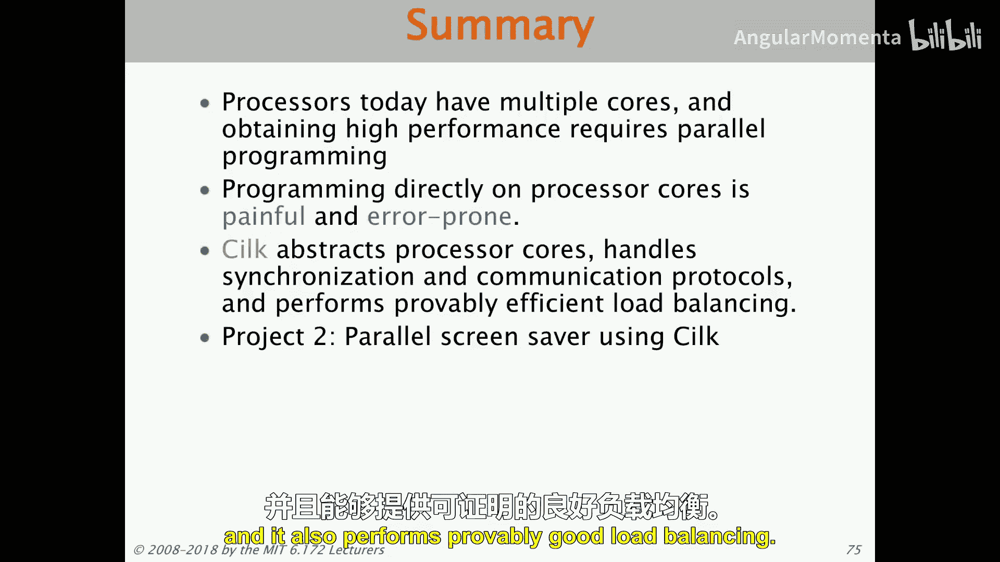

# 【麻省理工】软件系统性能工程 ｜MIT 6.172 Performance Engineering of Software Systems, Fall 2018 p06 6. 多核编程 -BV1esbLzpEFq_p6-

The following content is provided under a Cative Commons license。

 Your support will help Mi T OpenCourseware continue to offer high quality educational resources for free to make a donation or to view additional materials from hundreds of MiT courses。

 Visit Mit Opencourseseware at Ocw。 Mt Eduu。

Today we're going to talk about multi core programming。And as I was just informed by Charles。

 it's 2018， I had 2017 on the slide。Okay。First， congratulations to all of you。

 you turned in the first project beta， here's a plot showing the tiers that different groups reach for the beta and this is in sorted order。

And we set the beta cutoff to be tier 45， the final cutoff is tier 48。

 so the final cutoff we did set a little bit aggressively。

 but keep in mind that you don't necessarily have to get to the final cutoff in order to get an A on this project。

Okay， so we're going to talk about multicore processing today that's going to be the topic of the next project after you finish the first project。

 so in a multicore processor we have a whole bunch of cores that are all placed on the same chip and they have access to shared memory they usually also have some sort of private cache and then a shared last level cache so L3 in this case。

 and then they all have access to the same memory controller which goes out to main memory and then they also have access to IO but for a very long time。

Chhiipps only had a single core on them。 So why do we have multi core processors nowadays。

 Why did semiconductor vendors start producing chips that had multiple processor cores on them。

So the answer is because of two things， so first there's Moore's law。

 which says that we get more transistors every year。

 so the number of transistors that you can fit on the chip doubles approximately every two years and secondly there's the end of scaling of clock frequency。

 so for a very long time we could just keep increasing the frequency of the single core on the chip。

 but at around 2004 to 2005 that was no longer the case。

 we couldn't scale the clock frequency anymore。So here's a plot showing both the number of transistors you could fit on the chip over time as well as a clock frequency of the processors over time。

 and notice that the Y axis is in log scale here。And the blue line is basically Moore's law。

 which says that the number of transistors you can fit on the chip doubles approximately every two years。

 and that's been growing pretty steadily， so this plot goes up to 2010。

 but in fact it's been growing even up until the president。

 it will continue to grow for a couple more years before Moore's law ends。However。

 if you look at the clock frequency line， you see that it was growing quite steadily until about the early 2000s。

 and then at that point is sort of flattened out。So at that point。

 we couldn't increase the clock frequencies anymore and the clock speed was bounded at about four gigahertz。

 so nowadays if you go by a processor it's usually still bounded by around four gigahertz。

 it's usually a little bit less than four gigahertz because it doesn't really make sense to push it all the way。

 but you might find some processors that are around  four gigahertzz nowadays。

So what happened at around 2004 to 2005， does anyone know？Okay。

 so so Moore's law basically says that we can fit more transistors on a chip because the transistors become smaller and when the transistors become smaller you can reduce the voltage that's needed to operate the transistors and as a result you could increase the clock frequency while maintaining the same power density。

 and that's what manufacturers did until about 2004 to 2005。

 they just kept increasing the clock frequency to take advantage of Moore's law。

 but turns out that once transistors become small enough and the voltage used to operate them become small enough there's something called leakage current。

 so there's current that leaks and we're unable to keep reducing the voltage while still having reliable switching。

And if you can't reduce a voltage anymore， then you can't increase the frequency。

 the clock frequency if you want to keep the same power density。

So here's a plot from Intelelbec in 2004 when they first started producing multicore processors。

 and this is plotting to power density versus time， and again the Y axis is in log scale here。U。

So the green data points are actual data points and the orange ones are projected and they projected what the power density would be if we kept increasing the clock frequency at a trend of about 25 to 30% per year。

 which is what happened up until around 2004 and because we couldn't reduce the voltage in more。

 the power density will go up。And you can see that eventually it reaches the power density of a nuclear reactor。

 which is pretty hot and then it reaches the power density of a rocket nozzle and eventually you get to the power density of the sun's surface so if you have a chip that has a power density equal to the sun's surface。

 well you don't actually really have a chip anymore，You。

Right and so basically if you get into this orange region。

 you basically have a fire and you can't really do anything interesting in terms of performance engineering at that point。

So to solve this problem。S semiconductorconduct vendors。

 they didn't increase the clock frequency anymore， but we still had Moore's law giving us more and more transistors every year。

 so what they decided to do with these extra transistors was to put them into multiple cores and then put multiple cores on the same chip。

 so we can see that starting at around 2004， the number of cores per chip becomes more than one。And。

And each generation of Moore's law will potentially double the number of cores that you can fit on a chip because it's doubling the number of transistors and we've seen this trend up until about today and again it's going to continue for a couple more years before Moore's law ends。

 so that's why we have chips with multiple cores today。

So today we're going to look at multi core processing。

So I first want to introduce the abstract multi corere architecture。

 so this is a very simplified version， but I can fit it on this slide and it's good example for illustration so here we have a whole bunch of processors。

They each have cash， so that's indicated with the dollar sign。

And usually they have private cash as well as a shared cash， so I shared last level cash。

 like the L3 cash， and then they're all connected to the network。And then through the network。

 they can connect to the main memory， they can all access the same shared memory。

And then usually there's a separate network for the IO as well。

 even though I've drawn them as a single network here so they can access the IO interface and potentially the network will also connect to other multiprocessors on the same system and this abstract multicore architecture is known as a chip multiprocessor or CMPs。

 so that's the architecture that we'll be looking at today。So here's an outline of today's lecture。

 so first I'm going to go over some hardware challenges with shared memory multi core machines。

We're going to look at the cash coherence protocol。

 and then after looking at hardware we're going to look at some software solutions to write parallel programs on these multi core machines to take advantage of the extra cores and we're going to look at several concurrency platforms listed here。

 we're going to look at P threads。This is basically a low level API for accessing or for running your code in parallel。

 and if you program on Microsoft products， the W API threads is pretty similar。

 then there's Intel threading building blocks， which is a library solution to concurrency。

And then there are two linguistic solutions that we'll be looking at， openM and Silk+。

And So+ is actually the concurrency platform that we'll be using for most of this class。Okay。

All right， so let's look at how caches work。So let's say that we have a value in memory at some location。

 and that value is， let's say that value is x equals 3。If one processor says we want to load x。

 what happens is。That processor reads this value from a main memory， brings it into its own cache。

 and then it also reads the value， loads it into one of its registers。

And it keeps this value in cash so that if it wants to access this value again in the near future。

 it doesn't have to go all the way out to main memory， you can just look at the value in its cache。

Now what happens if another processor wants to load X？Well， it just does the same thing。

 it reads the value from main memory， brings it into it is cache。

 and then also loads it into one of the registers。And then same thing with。

Another processor turns out that you don't actually always have to go out to main memory to get the value if the value resides in one of the other processor's cache as you can also get the value through the other processor's cache and sometimes that's cheaper than going all the way out to main memory。

Okay， so okay， so the second processor now loads X again。

 and it's in cache so it doesn't have to go to main memory or anybody else's cache。

So what happens now if we want to store x， if we want to set the value of x to something else？Okay。

 so let's say this processor wants to set x equal to5。

So it's going to write x equals 5 and store that result in its own cache。

 so that's all well and good。Now what happens when the first processor wants a loadx？Well。

 it sees that the value of x is in its own cache， so it's just going to read the value of x there and it gets a value of three。

So what's the problem there？Yes。Yeah， so the problem is that the value of x in the first processor's cache is stale because another processor updated it。

 so now can' this value of x in the first processor's cache is invalid。Okay， so that's the problem。

 and one of the main challenges of multicore hardware is to try to solve this problem of cash coherence。

 making sure that the values in different processors caches are consistent across updates。Okay。

 so one basic protocol for solving this problem is known as the MSI protocol。And in this protocol。

 each cache line is labeled with a state， so there are three possible states， MS and I。

And this is done on the granularity of cache lines because it turns out that storing this information is relatively expensive。

 so you don't want to store it for every memory location so they do it on a per cash line basis。

Does anyone know what the size of a cash line is on the machines that we're using？Yeah。

4 yeah so it's 64 bytes and that's typically what you see today on most Intel and AMD machines。

 there are some architectures that have different cache lines like 128 bytes。

 but for our class the machines that we're using will have 64 byte cache lines。

 it's important to remember that so that when you're doing back of the envelope calculations you can get accurate estimates。

So three states in the MSI protocol are MS and I， so M stands for modified。

 and when a cache block is in the modified state， that means no other caches can contain this block in the M or the S states。

The S state means that the block is shared， so other caches can also have this block in shared state。

And then finally， I means the cash block is invalid。

 so that's essentially the same as the cash block not being in the cache。

And to solve the problem of cash coherency， when one cache modifies a location。

 it has to inform all the other caches that their values are now stale because this cash modified the value。

So it's going to invalidate all of the other copies of that cache line in other caches by changing their state from S to I。

So let's see how this works， so let's say that the second processor wants to store y equals 5。

 so previously the value of y was 17 and it was in shared state。

 the cache line containing y equals 17 was in shared state。So now when I do y equals five。

 I'm going to set。The second processor is cache， that cache line to modified state。

 and then I'm going to invalidate the cache line in all of the other caches that contain that cache line。

 so now the first cache and the fourth cache each have a state of I for y equals 17 because that value is stale。

Is there any questions？Yes。If we already have to tell the other things to switch to invalid。

 why not just tell them the？Yeah， so there are actually some protocols that do that。

 so this is just a most basic protocol， so this protocol doesn't do it。

 but there are some that are used in practice that actually do do that， so it's a good point。Yeah。

 but I just want to present the most basic protocol for now。Sorry。

Okay and then when you load a value， you can first check whether your cache line is an M or S state and if it is an M or S state。

 then you can just read that value directly， but if it's in the I state or if it's not there。

 then you have to fetch that block from either another processor's cache or fetch it from main memory。

So it turns out that there are many other protocols out there， there's something known as MESI。

 the messssy protocol， there's also MOEI and many other different protocols and some of them are proprietary and they all do different things and it turns out that all of these protocols are quite complicated and it's very hard to get these protocols right and in fact one of the most earliest successes of formal verification was improving some of these cash cos protocols to be correct。

 yes。楽し十。Just try more。あるはですね。Yeah， so if two processor try to modify the value。

 one of them has to happen first so the hardware is going to take care of that。

 so the first one that actually modifies it will invalidate all of the other copies and then the second one that modifies the value。

 well again invalidate all of the other copies and when you do that when a lot of processor try to modify the same value you get something known as an invalidation storm。

 so you have a bunch of invalidation messages going through throughout the hardware and that can lead to a big performance bottleneck because each processor when it modifies its value yes to inform all the other processors and if all the processor are modifying the same value get the sort of quadratic behavior the hardware is still going to guarantee that one of the processor is going to end up writing the value there but you should be aware of this performance issue when you're writing parallel code。

Yes。あです。Yes， so this is all implemented in hardware， so if you take a computer architecture class。

 you'll learn much more about these protocols and all of their variants。

 so for our purposes we don't actually need to understand all the details of the hardware we just need to understand what it's doing at a high level so we can understand when we have a performance bottleneck and why we have a performance bottleneck。

 so that's why I'm just introducing the most basic protocol here。Any other questions？All right。

So I talked a little bit about the shared memory hardware。

 let's now look at some concurrency platforms。So these are the four platforms that we'll be looking at today。

So。First， what is a concurrency platform， well writing parallel programs is very difficult。

 it's very hard to get these programs to be correct and if you want to optimize their performance it becomes even harder。

 so it's very painful and error prone and a concurrency platform abstracts processor core and handles synchronization and communication protocols and it also performs load balancing for you so it makes your lives much easier and。

So today we're going to talk about some of these different concurrency platforms。

So to illustrate these concurrency platforms， I'm going to do the Fibonacci numbers example。

 so does anybody not know what Fibonacci is？So good， everybody knows what Fibonacci is。Okay。

 so it's a sequence where each number is sum of the previous two numbers and the recurrence here is the recurrence is shown in this brown box here。

The sequence is named after Leonardo D Pisa。Who was also known as Fibonacci。

 which is a contraction of Phillius Bacci son of Bacio， so that's where the name Fibonacci came from。

And in Fibonacci's 1202 book， Libber Abaci introduced sequence。

 the Fibonacci sequence to Western Maematics。Although it had been previously known to Indian mathematicians for several centuries。

呵。😊，But this is what we call the the sequence nowadays， Fibonacci numbers。All right。

Here's a Fibonacci program。Has anyone seen this algorithm before？Couple people。Probably more。

 but people don't raise their hands。Okay， so all right， so it's a recursive program。

 so it basically implements the recurrence from the previous slide， so if n is less than two。

 we just return n。Otherwise， we compute thehib of n minus1， store that value in x。

 fihib of n minus2 store that value in y， and then return the sum of x and y。

So I do want to make a disclaimer to the algorithms police that this is actually a very bad algorithm。

So this algorithm takes exponential time and there's actually much better ways to compute the Fibonacci than Fibonacci number。

 there's a linear time algorithm which just computes the Fibonacci numbers from bottom up。

 this algorithm here is actually redoing a lot of the work because it's computing Fibonacci numbers multiple times。

 whereas if you do a linear scan from the smallest numbers up。

 you only have to compute each one once， and there's actually an even better algorithm that takes logarithmic time and it's based on squing matrices。

 so has anyone seen that algorithm before。Yeah， so a couple people。

 so if you're interested in learning more about this algorithm。

 I encourage you to look at your favorite textbook。

 introductiontrouction to algorithms by Corman Liarson， Reve and Stein。So even though this is a。Yes。

So even though this is a pretty bad algorithm， it's still a good educational example because I can fit it on one slide and illustrate all of the concepts of perism that we want to cover today。

So here's the execution tree for FiBA4。😡，So we see that FA 4 is going to call PhA 3 and FBA of 2。

 PhA 3 is going to call Phhi of 2， FB of 1 and so on。

 and you can see that repeated computations here， so FB of 2 is being computed twice and so on。

And if you have a much larger tree， say you ran this on Fibo 40。

 then you'll have many more overlapping computations。U。It turns out that the two recursive calls。

Can actually be paralyzed because they're completely independent calculations。

 so the key idea for parallellyization is to simultaneously execute the two recursive sub callss to Fb。

And in fact， you can do this recursively。 so the two subcas of FA3 can also be executed in parallel。

 and the two subcals of FA2 can also be executed in parallel and so on。

 So you have all of these calls that can be executed in parallel。

So that's a key idea for extracting perism from this algorithm。Okay so。

Let's now look at how we can use P threads to implement this simple Fiminacci algorithm。

So PThs is a standard API for threading and it's supported on all UniX based machines。

 and if you're programming using Microsoft products， then the equivalent is when API threats。

And this is actually a P threads is actually a standard in NCI IIIEE。

 so there's this number here that specifies the standard。

 but nowadays we just call it P threads and it's basically a do it yourselfconcurrency platform。

 so it's like the assembly language of parallel programming。

It's built as a library of functions with special nonC semantics。

 because if you're just writing code in C， you can't really say which parts of the code should be executed in parallel also PTs provides you a library of functions that allow you to specify concurrency in your program。

And each thread implements an abstraction of a processor。

 and these threads are then multipleed onto the actual machine resources。

So the number of threads that you create doesn't necessarily have to match the number of processors you have on your machine so if you have more threads than the number of processors you have。

 then they'll just be multiplexing so you can actually run a P threads program on a single core。

 even though you have multiple threads in the program， they would just be time sharing。

All the threats communicate through shared memories。

 so they all have access to the same view of the memory。

And the library functions that P threads provides mask the protocols involved in inner threat coordinations。

 you don't have to do it yourself because it turns out that this is quite difficult to do correctly by hand。

So now I want to look at the key P thread functions。😡。

So the first P thread function is P thread create， and this takes four arguments。

 so the first argument is this P thread underscore T type。

 this is basically going to store and identifier for the new thread that PTread create will create so that we can use that thread in our computations。

P thread attribute T， this set some thread attributes， and for our purposes。

 we can just set it to null and use the default attributes。

The third argument is this function that's going to be executed after we create the thread。

So we're going to need to define this function that we want the thread to execute。And then finally。

 we have this void star argument， which stores the arguments that are going to be passed to the function that we're going to be executing。

And then P threadread C also returns in error status。

 returns an integer specifying whether the thread creation was successful or not。

And then there's another function called P threadread join。

 Pth join basically says that we want to block at this part of our code all the until this specified thread finishes so it takes as argument P thread underscore score T。

 so this thread identifier and these thread identifiers were created when we called P thread create。

It also has this second argument， status， which is going to store the status of the terminating thread。

And then PT joint also returns in error status， so essentially what this does it says to wait until this thread finishes before we continue on in our program。

So any questions so far？Okay， so here's what the implementation of Fibonacci looks like。

Using P threads。So on the left， we see the original program that we had， the Fb function there。

 that's just the sequential code。And then we have all this other stuff to enable it to run in parallel。

 so first we have thisstruct on the left thread as。

Thisstruct here is used to store the arguments that are passed to the function that the threat is going to execute。

And then we have this thread funk， what that does is。

It reads the input argument from this thread argsstruct。And then it sets that to I。

 and then it calls Fb of I。And that gives you the output。

 and then we store the result into the output of thestruct。And then that also just returns null。

And then over on the right hand side， we have the main function that will actually call the Fiv function on the left。

We initialize a whole bunch of variables that we need for to execute these threads and then we first check if n is less than 30。

 if n is less than 30 it turns out that it's actually not worth creating threads to execute this program in parallel because of the overhead of thread creation。

 so if n is less than 30， we'll just execute the program sequentially。

And this idea is known as coarsing， so you saw a similar example a couple lectures ago when we did coarsing for sorting。

 but this is in the context of parallel programs， so here because there are some overheads to running function parallel。

 if the input size is small enough， sometimes you want to just execute it sequentially。

And then we're going to， okay， so let me just walk through this code since I have an animation。Okay。

 so the next thing it's going to do is it's going to marshal the input argument to the thread。

 so it's going to store the input argument n minus1 in this agstruct。

And then we're going to call P thread create with a thread variable for thread arcs。

 where we're just going to use null。And then we're going to pass a thread funk that we defined on the left。

And then we're going to pass the as structure， and inside this arg structure。

 the input is set to n minus1， which we did on the previous line。U。

And then Pre rate is going to give a return value。So if the P thread creation was successful。

 then the status is going to be no and we can continue and and when we continue we're going to execute now fib of n minus2 and store the result of that into our result variable and this is done at the same time that fib of n minus1 is executing because we created this P thread and we told it to call this thread function that we defined on the left。

 so both Fb of n minus1 and fib of n minus2 are executing in parallel now。

And then we have this P thread join， which says we're going to wait until the thread that we created finishes before we move on because we need to know the result of both of the subcas before we can finish this function。

 and once that's done， while we first checked the status to see if it was successful。

 and if so then we add the outputs of the argument struck to the result。

 so AD output will store the output of FIB of n minus1。U。So that's the Pths code。

Any questions on how this works？Yeah。I have a question about。Yeah。有さ。上证要。Yeah。

 so this is because the PT create function takes us input a void star pointer because it's actually a generic function。

 so it doesn't know what the data type is， it has to work for all data types and that's why we need to cast it to a void star when we pass it to PTread C and then inside the threadf we actually do know what type of pointer that is so then we cast it。

Yeah。So does this code seem very parallel？So how many parallel calls am I doing here？Yeah。Yeah。

 so I'm only creating one thread， so I'm executing two things in parallel。

 so if I ran this code on four processors， what's the maximum speed up I could get？

So maximum speed up I can get is just two because I creating I'm only running two things in parallel。

 so this doesn't recursively create threads， it only creates threads at it only creates one thread at the top level。

And if you wanted to make it so that this code actually recursively created threads。

 it would actually become much more complicated。And that's one of the disadvantages of implementing this code in P threads so we'll look at other solutions that will make this task much easier。

U。So some of the issues with P threads are shown on this slide here。

 so there's a high overhead to creating a thread， so creating a thread typically takes over 10 to the fourth cycles and。

This leads to very coarse grain concurrency because your tasks have to do a lot of work in order to amortize the cost of creating that thread。

 there are something called thread pulls which can help and the idea here is to create a whole bunch of threads at the same time to amortize the cost of thread creation and then when you need a thread you just take one from the thread pulls so the thread pull contains threads that are just waiting to do work。

There's also a scalability issue with this code that I showed on the previous slide。

 the Fibonacci code gets at most 1。5x speed up for two cores， why is it 1。5 here， does anyone know？

Yeah。Yeah， so it turns out that the two calls that I'm executing in parallel。

 they're not doing the same amount of work， so one is computing fib of n minus-1。

 one is computing fib of n minus2s， and does anyone know what the ratio between these two values is。

Yeah so it's the golden ratio， it's about 1。6， it turns out that if you can get a speed up of 1。

6 and that's great， but there are some overheads， so this code will get about a 1。5 speed up。

And if you want to run this to take advantage of more course。

 and you need to rewrite this code and it becomes more complicated。Third。

 there's the issue of modularity， so if you look at this code here。

 you see that the Fibonacci logic is not nicely encapsulated within one function。

 we have that logic in the Fb function on the left。

 but then we also have some of the fiB logic on the right in our main function。

And this makes this code not modular， and if we want to build programs on top of this。

 it makes it very hard to maintain if we want to just change the logic of the Fibonacci function a little bit。

 because now we have to change it in multiple places instead of just having everything in one place。

So it's not a good idea to write code that's not modular， so please don't do that in your projects。

Okay， and then finally， the code becomes complicated because you have to actually move these arguments around that's known as argument marshalling。

 and then you have to engage in error prone protocols in order to do load balancing。

 so if you recall here we have to actually place the argument n minus1 into AGDt input and we have to extract the value out of AGDt output。

 so that makes the code very messy。So why do I say shades of 1958 here？

Does anyone know what happened in 1958？Who is around in 1958？Just Charles。So。

There is the first something in 1958， what was it？So turns out in 1958， we had the first compiler。

 and this was the four Tra compiler。And before we had the Forchan compiler。

 programmers are writing things in assembly and when you write things in assembly。

 you have to do argument marshalling because you have to place things into the appropriate registers before calling a function and also move things around when you return from a function and the nice thing about the first compiler is that it actually did all of this argument marshalling for you。

 so now you can just pass arguments to a function and the compiler will generate code that will do the argument marshaing for us。

So having to do this in P threads is similar to having to write code and assembly because you have to actually manually marshal these arguments。

 so hopefully there are better ways to do this and indeed we'll look at some other solutions that will make it easier on the programmer。

Any questions before I continue？All right， so we looked at P threads。

 next let's look at threading building blocks。So threading building blocks is a library solution。

 it was developed by Intel。And it's implemented as a C++ library that runs on top of native threads。

 so the underlying implementation uses threads。But the programmer doesn't deal with threats。

 instead the programmer specifies tasks。And these tasks are automatically load balanced across the threads using a work stealing algorithm inspired by research at MIT。

 Charles Lyenses research。And the focus of Intel TB is on performance and as we'll see。

 the code written using TBB is simpler than what you would have to write if you used P threads。

 so let's look at how we can implement Fibonacci using。TBB。Okay。

 so in TBBB we have to create these tasks， so in the Fibonacci code we create this Fb task class。

And inside the task， we have to define this execute function。

So the XQ function is the function that performs a computation when we start the task。

 and this is where we define the Fibonacci logic。This task also takes us to input these arguments parameter n in sum。

 So end is the input here and sum is the output。OkayAnd in TBB。

 we can easily create a recursive program that extracts more perism。

And here what we're doing is we're recursively creating two child tasks， A and B。

 that's the syntax for creating the task， and here we can just pass the arguments to FIb tasks instead of marshaing the arguments ourselves。

And then what we have here is a set refF count and this basically is the number of tasks that we have to wait for plus one。

 so plus one for ourselves and in this case we created a two children task and we have ourselves so that's two plus one。

And then after that， we start HaSB using the Spwn B call。

And then we do spawn and wait for all with A as the argument in this place he says we're going to run start task A and then also wait for both A and B to finish before we proceed so this spawn and wait for all call is going to look at the RAF count that we set above and wait for that many task to finish before it continues and then after both A and B have completed。

 then we can just sum up the results and store that into sum variable。And here。

 these tasks are created recursively， so unlike the P threads implementation that was only creating one thread at the top level。

 here we're actually recursively creating more and more tasks so we can actually get more parallelism from this code and scale to more processors。

We also need this main function just to start up the program。

 so what we do here is we create a root task which just computes a fib of n。

 and then we call spawn root and weight of A， so a is a task for the root。

 and then it will just run the root task。So that's what Fibonacci looks like in TBBB。

 so this is much simpler than the P threats implementation。

 and it also gets better performance because we can extract more parallelism from the computation。

Any questions？Okay， so TBBB also has many other features in addition to tasks。

 so TBBB provides many C+ plus templates to express common patterns and you can use these templates on different data types。

 so they have a parallel4 which is used to express loop parallelism so you can loop over a bunch of iterations in parallel。

 they also have a parallel reduced for data aggregation， for example。

 if you want to sum together a whole bunch of values you can use a parallel reduce to do that in parallel。

They also have a pipeline and filter that's used for software pipelining。

TBB provides many concurrent container classes which allow multiple threads to safely access and update the items in a container concurrently。

 so for example， they have hash tables， trees， priority queuees and so on and you can just use these out of the box and they'll work in parallel。

 you can do concurrent updates and reads to these data structures。

 TBBB also has a variety of mutual exclusion library functions such as locks and atomic operations。

So there are a lot of features of TBBB， which is why it's one of the more popular concurrency platforms。

 and because of all of these features， you don't have to implement many of these things by yourself and still get pretty good performance。

So TBBB was a library solution to the concurrency problem。

 now we're going to look at two linguistic solutions， openM and silk。So let's start with OpenM。

So OpenM is a specification by an industry consortium。

And there are several compilers available that support OpenM， both open source and proprietary。

So nowadays， GCC， ICC， and Claang all support OpenM as well as Vi Studio。And OpenMP is。

 it provides linguistic extensions to CNC++ as well as Forran in the form of compiler pragmas。

 so you use these compiler pragmas in your code to specify which pieces of code should run in parallel。

And OpenM also runs on top of native threads， but the programmer isn't exposed to these threads。

OpenM supports loop parallelism， so you can do parallel4 loops， they have task parallelism。

 as well as pipeline parallelism。So let's look at how we can implement Fibonacci in OpenM。

So this is the entire code。So I want you to compare this to the P threads implementation that we saw 10 minutes ago。

 so this code is much cleaner than the P threads implementation and also performs better。

 so let's see how this code works。So we have these compiler pragmas or compiler directives。

 and the compiler pragma for creating a parallel task is。OMP task。

 so we're going to create an openM task for Fhib of n minus1 as well as Fb of n minus2。There's also。

This。Yeah， there's also this shared pragma which specifies that the two variables in the arguments are shared across different threads。

So you also have to specify whether variables are private or shared。

And then the pragma OMP weight just says we're going to wait for the preceding task to complete before we continue。

 so here' going to wait for Fb of n minus1 and Fb of n minus2 to finish before we return the result which is what we want。

 and then after that we just return x plus y so that's the entire code。

And Openmp also provides many other pragma directives in addition to task so we can use a parallel for to do loop parallelism。

 there's reduction， there's also directives for scheduling and data sharing so you can specify how you want a particular loop to be scheduled。

 openmp has many different scheduling policies they have static parallelism。

 dynamic parallelism and so on， and then these scheduling directives also have different grain sizes。

 the data sharing directives are specifying whether variables are private or shared。

OpenM also applies a variety of synchronization constructs such as barriers， atomic updates。

 mutual exclusion， or Mu textex locks， so OpenM also has many features and it's also one of the more popular solutions to writing parallel programs。

And as you saw in the previous example， the code is much simpler than if you were to write something using P threads or even a TBB。

 this is a much simpler solution。Any questions？Yeah。So with every。Does it respond？

So this code here is actually independent of the number of processors。

 so there is actually a scheduling algorithm that will determine how the task get mapped to different processors。

 so if you spa a new tasks it doesn't necessarily put it on to different processor and you can have more tasks than the number of processor available so there's a scheduling algorithm that will take care of how these tasks get mapped to different processors and that's hidden from the programmer。

 although you can use these scheduling pragmas to give hints the compiler how it should schedule it。

Yeah。So I mean underneath this is implemented using P threats。

 which has to make operating system calls to basically directly talk to the processor cores and do multiplexing and so forth。

 so the operating system is involved at a very low level。Okay。

 so the last currency platform that we'll be looking at today is silk。Okay so。

Or we're going to look at silk plus actually， and the silk part of silk Plus is a small set of linguistic extensions to CNC++ that support fork joint perilism。

 so for example， the Fibonacci example uses fork joint perilism so you can use silk to implement that and the plus part of silk+ supports vector perilism。

 which you had experience working within in your homeworks。So silk was。

Sk+ was initially devolved by Silk Arts， which was an MIT spinoff and Silk Arts was acquired by InTtelL in July 2009 and the silkk+ implementation is based based on the award winning Silk Multithreaded language that was developed two decades ago here at MIT by Charles Lyisson's research group。

And it features a provably efficient work stealing scheduler， so this schedule is provably efficient。

 you can actually prove theoretical bounds on it and this allows you to implement theoretically efficient algorithms。

 which will talk more about in another lecture algorithm design。

 but it provides a provably efficient worksealing scheduler and Charles Lyson has a very famous paper that has a proof that this scheduler is optimal。

 so if you're interested in reading about this you can talk to us offline。

SoPlus also provides a hyper objectject library for paralyzing code with global variables。

And you'll have a chance to play around with hyper objects in homework  four。

The Silk plus ecosystem also includes useful programming tools such as a silk screen race detector。

 so this allows you to detect determinacy races in your program to help you isolate bugs and performance bottlenecks。

It also has a scalability analyzer called SilkVi and Silk View will basically analyze the amount of work that your program is doing as well as the maximum amount of parallelism that your code could possibly extract from the hardware。

So that's Intel cell plus。But it turns out that we're not actually going to be using Intel S+ in this class。

 we're going to be using a better compiler， and this compiler is based on taper LLVM。

 and it supports the silk subset of silk+。AndTper LVM was actually recently developed at MIT by TB Sle。

 who gave a lecture last week， William Moses， who's a grad student working with Charles as well as Charles Liarson。

So talk a lot about Charles's work today， and taper LVM generally produces better code relative to its base compiler than all other implementations of silk out there。

 so it's the best silk compiler that's available today。

And they actually wrote a very nice paper on this last year， Charles Lyson in this group。

 and that paper received the best paper award at the Ann Symposium on principles and practices of parallel programming or PPOP。

 so you should look at that paper as well。So right now。

 taper AllVM uses the Intel S+ runtime system by I believe Charles' group has plans to implement a better runtime system。

And Tor LVM also supports more general features than existing cell compilers。

 so in addition to spawning functions， you can also spawn code blocks that are not separate functions and this this makes writing programs more flexible。

 you don't have to actually create a separate function if you want to execute a code block in parallel。

Any questions？So this is the Z code for Fibonacci。So it's also pretty simple。

 it looks very similar to the sequential program， except we have these silk spawn and silk stink statements in the code。

 so what do these statements do？So Sils spawn says that the named child function。

 which is the function that is right after the silks spawn statement。

 may execute in parallel with the parent color， the parent color is the function that is calling silkks spawn。

 so this says that5iv of n minus1 can execute in parallel with the function that called it。

And then this function is then going to call fib of n -2。

 and fib of n -2 and fihib of n -1 now can be executing in parallel。

And then Sok Si says that control cannot pass this point until all of the spawn children have returned。

So is this is going to wait for5iv of n minus1 to return before we go to the return statement where we add up x and y。

So one important thing to note is that the silk keywords grant permission for parallel execution。

 but they don't actually force or command parallel execution， so even though I said silkk spawn here。

 the runtime system doesn't necessarily have to run FIb of n minus-1 in parallel with Fb of n minus2。

 I'm just saying that I could run these two things in parallel and it's up to the runtime system to decide whether or not to run these things in parallel based on its scheduling policy。

So let's look at another example of silk。So let's look at loop perism。

So here we want to do a matrix transpose and we want to do this in place。

 So the idea here is we want to basically swap the elements below the the diagonal to the to its mirror mirror image above the diagonal。

And here's some code to do this， so we have a silk 4， so this is basically a parallel for loop。

It goes from i equals 1 to n minus1， and then the inner4 loop goes from j equals 0 up to i minus1。

And then we just swap A of I J with A of JI using these three statements inside the body of the for loop。

So to execute a for loop in parallel， you just have to add silk underscore to the four keyword。

 and that's as simple as it gets。So this code is actually going to run in parallel and get pretty good speed up on this for this particular problem。

And internally， silkk4 loops are transformed into nested silk spawn and silk sync calls。

 so the compiler is going to get rid of the silk4 and change it into silk spawn and silk sync。

 so it's going to recursively divide the iteration space into half。

 and then it's going to spawn off one half and then execute the other half in parallel with that and then recursively do that until the iteration range becomes small enough at which point doesn't make sense to execute it in parallel anymore so we just execute that range sequentially。

Okay。Besides Lukete perilism in silk， any questions？Yes。That is something weird， can I still do that？

Yeah， so the compiler can actually figure out what the iteration space is so you don't necessarily have to be incrementing by one。

 you can do something else， you just have to guarantee that all of the iterations are independent so if you have a determin you raisese across the different iterations of your silk for loop then your result might not necessarily be correct。

 so you have to make sure that the iterations are indeed independent。Yes。Yeah。

 so you can nest silk fors。It turns out that for this example。

 usually you already have enough perilism in the outer loop for large enough values of n。

 so it doesn't make sense to put a silk for loop inside because using a silk for loop adds some additional overheads。

 but you can actually do nested silk for loops， and in some cases it does make sense。

 especially if there's not enough perilism in the outermost for loop。It's a good question。Yes。

So I mean it has a bunch of calls to the silkk runtime system。

 I don't actually I I don't know all the details because I haven't looked at this recently。

 but I think you can actually generate the assembly code using a flag in the clay compiler。

 so that's a good exercise。Yeah， you probably want to look at the LLVM。

IR rather than the assembly to begin with to understand what's going on。

 it has three instructions that are not in the standard。LLVM。W were added to support parallelism。

Those things， when it's lowered the into assembly， each of those instructions becomes a bunch of assembly language instructions。

So you don't want to mess with looking at it in the asmbler until you see what it looks like in the LLVM first。

Yeah so good question， any other questions about this code here？Okay。Let's look at another example。

SoLet's say we had this floor loop where on each iteration I we're just incrementing a variable sum by I。

 so this is essentially going to compute the summation of everything from i equals 0 up to n minus1 and then print out the result。

One straightforward way to try to parallelze this code is to just change the four to a silk for。

So does this code work？Who thinks that this code doesn't work？Or doesn't compute the correct result。

So。About half of you and。Who thinks this code does work？So， a couple people in。

Guess the rest of the people don't care。So it turns out that。

It's not actually necessarily going to give you the right answer because。

The silk forlo says you can execute these iterations in parallel but they're all updating the same shared variable sum here。

 so you have what's called a determinacy erase where multiple processors can be writing to the same memory reloc we'll talk much more about determinacy erasis in the next lecture。

 but for this example it's not necessarily going to work if you run it on more than one processor。

And silk actually has a nice way to deal with this， so in silk we have something known as a reducer。

 this is one example of a hyper objectject which I mentioned earlier。

 and with a reducer what you have to do is instead of declaring this sum variable just as an unsigned long data type what you do is you use this macro called silk C reducer op add。

 which specifies we want to create a reducer with the addition function。

 then we have the variable named sum， the data type unsed long and then the initial value zero。

And then we have a macro to register this reducer， so a Sil C register reducer。

And then now inside this silk4 loop， we can。Increment the sum or reducer view of sum。

 which is another macro by eye and you can actually execute this in parallel and it will give you the same answer that you would get if you ran this sequentially。

 so the reducer will take care of this determinacy race for you and at the end when you print out this result。

 you'll see that the sum is equal to the sum that you expect。

 and then after you finish using the reducer use other macro called silk unregister reducer of sum that tells the system that you're done using this reducer。

So this is one way to deal with this problem when you want to do a reduction and it turns out that there are many other interesting reduction operators that you might want to use and in general。

 you can create reducers for monooids and monooids are algebraic structures that have in associative binary operation as well as an identity element。

 so the addition operator is a monooid because it's associative。

 it' binary and the identity element is zero。Silk also has several other predefined reducers。

 including multiplication， min Max and or X or et cetera。

 so these are all monooids and you can also define your own reducer。

 so in fact in the next homework you'll have the opportunity to play around with reducers and write a reducer for lists。

So that's reducers。U。Another nice thing about silk is that there's always a valid serial interpretation of the program。

 so the serial illusion of a silk program is always a legal interpretation and for the silk source code on the left。

 the serial illusion is basically the code you get if you get rid of the silk spawn and sync statements。

 and this looks just like the sequential code。U。And remember that the silk keywords grant permission for parallel execution。

 but they don't necessarily command parallel executions。

 if you ran this silk code using a single core， it wouldn't actually create these parallel tasks and you would get the same answer as the sequential program and in the serial illusion is also a correct interpretation。

 so unlike other solution such as TBB and P threads。

 it's actually difficult in those environments to get a program that does what the sequential program does because they're actually doing a lot of additional work to set up these parallel calls and create these argument structures and other scheduling constructs。

 whereas in silk it's very easy just to get the serial illusion。

 you just define silk spawn and silk sync to be null you also define silk4 to be for and then this gives you a valid sequential program。

So when you're debugging code and you might first want to check if the sequential illusion of your SEL program is correct and you can easily do that by using these macros or actually there's actually a compiler flag that will do that for you and give you the equivalent C program so this is a nice way to debug because you don't have to start with the parallel program。

 you can first check if the serial program is correct before you go on to debug the parallel program。

Questions。Yes。でし？这个eration of。Sule。So it turns out that by default。

 it groups a bunch of iterations together into a single task because it doesn't make sense to break it down into such small chunks due to the overheads of parallelism。

 but there's actually a setting you can do to change the grain size of the for loop。

 so you could actually make it so that each iteration it's its own task， and then as you said。

 the scheduler will decide how to map these different task onto different processors or even if it wants to execute any of these tasks in parallel。

It's a good question。Okay， so the idea in silk is to allow the programmer to express logical parallelism in an application。

 so the programmer just has to identify which pieces of the code could be executed in parallel。

 but doesn't necessarily have to determine which pieces of code should be executed in parallel。

And then silkk has a runtime scheduler that will automatically map the executing program onto the available processor course at runtime and it does this dynamically using worksealing scheduling algorithm and the workseing scheduler is used to balance the task evenly across the different processors and we'll talk more about the work sealing scheduler in a future lecture。

 but I want to emphasize that unlike the other concurrency platforms that we looked at today。

 silk work sealing scheduling algorithm is theoretically efficient whereas the Openmp and TBB schedulers are not theoretically efficient。

 so this is a nice property because it will guarantee you that the algorithms you write on top of silk will also be theoretically efficient。

Okay so here's a high level illustration of the silk ecosystem， it's a very simplified view。

 but I did this to fit it on a single slide。So what you do is you take the silk source code。

 you pass it to your favorite silk compiler， the taper LLVM compiler。

 and this gives you a binary that you can run on multiple processors。

 and then you pass a program input to the binary， you run it on however many processors you have。

 and then this allows you to benchmark the parallel performance of your program。

You can also do serial testing and to do this， you just obtained a serial illusion of the silk program and you pass it to an ordinary C or C++ compiler。

 generates a binary that can only run on a single processor and you run your suite of serial regression test on this single threaded binary。

 and this will allow you to benchmark to performance of your serial code and also debug any issues that might have arise when you are running this program sequentially。

U。Another way to do this is you can actually just compile the original silk code but run it on a single processor so there's a command line argument that tells us runtime system how many processors you want to use and if you set that parameter to one。

 then it will only use a single processor and this allows you to benchmark the single threaded performance of your code as well and the parallel program executing on a single course should behave exactly the same way as the execution of the serial ill。

 so that's one of the advantages of using silk。And because because you can easily do serial testing using the silk platform。

 this allows you to separate out the serial correctness from the parallel correctness。

 as I said earlier， you can first debug the serial correctness as well as any performance issues before moving on to the parallel version。

 another point I want to make is that because silk actually uses the serial program inside his task。

 it's actually good to optimize the serial program。

 even when you're writing a parallel program because optimizing the serial program for performance while also translate to better parallel performance。

U。Another nice feature of silk is that it has this tool called SilkS， which stands for Sil sanitizer。

 and the Sil sand will detect any determinacy races that you have in your code。

 which will significantly help you with debugging the correctness as well as the performance of your code。

So SilkS will， if you compile the silk code using the silk sand flag。

 it will generate an instrumented binary that when you run。

 it will find and localize all of the determinacy races in your program。

 so it willll tell you where the determinacy races occur so that you can go inspect that part of your code and fix it if necessary。

So this is a very useful tool for benchmarking your parallel programs。

Silk also has another nice tool called silkk scale， silkk scale。

 it's a performance analyzer it will analyze how much parallelism is available in your program as well as the total amount of work that it's doing。

 so again you pass a flag to the compiler that will turn on silk scale and it will generate a binary that is instrumented and then when you run this code it will give you a scalability report。

So you'll find these tools very useful when you're doing the next project。

And we'll talk a little bit more about these two tools in the next lecture。And right， as I said。

 silk scale will analyze how well your program will scale to larger machines。

 so it will basically tell you the maximum number of processors that your code could possibly take advantage of。

Any questions， yes？So I mean， the silk runtime scheduler that's scheduling the different tasks when you're running the program。

Soれ in the final。So it's linked from the binary， it's not stored in the same place， it's linked。

Other questions？All right， so let me summarize what we looked at today。

 so first we saw that most processors today have multiple cores and probably all of your laptops have more than one core on it。

 who has a laptop that only has one core。Okay， when did you buy it？Yeah， probably a long time ago。U。

😀Yeah。😊，I。So nowadays， obtaining high performance on your machines requires you to write parallel programs。

 but parallel programming can be very hard， especially if you have to program directly on the processor course and interact with the operating system yourself。

So silk is very nice because it abstracts the processor course from the programmer to handle synchronization and communication protocols。

 and it also performs provably good load balancing。

And in the next project you'll have a chance to play around with silkk。

 you'll be implementing your own parallel screen saver， so that's a very fun project to do。

 and possibly in one of the future lectures we'll post some of the nicest screen savers that students developed for everyone to see。

Okay， so that's all。

