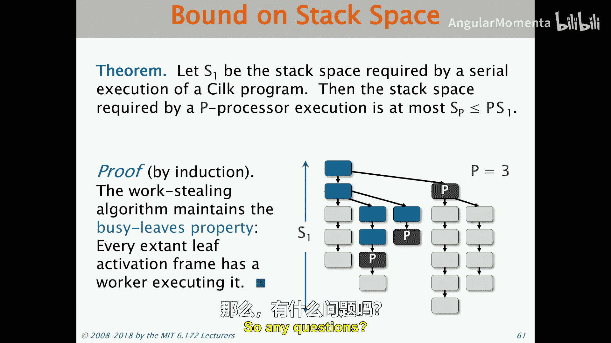

# 【麻省理工】软件系统性能工程 ｜MIT 6.172 Performance Engineering of Software Systems, Fall 2018 p07 7. 种族与并行性 -BV1esbLzpEFq_p7-

The following content is provided under a Creative Commons license。

 Your support will help Mi T OpenCourseware continue to offer high quality educational resources for free to make a donation or to view additional materials from hundreds of MiT courses。

 Visit Mitopcourseseware at Ocw。 Mt。 Eduu。

Hi， good afternoon， everyone。 So let's get started。

So today we're going to be talking about race and perism。

And you'll be doing a lot of parallel programming for the next homework assignment and project。

One thing I want to point out is that it's important to meet with your MIT policy as soon as possible。

 if you haven't done so already， since that's going to be part of the evaluation for the Project one grade。

 and if you have trouble reaching your MIT policy members。

 please contact your TA and also make a post on Piazza as soon as possible。Okay， so as a reminder。

 let's look at the basics of silk， so we have silk spawn and silk sync statements in silk。

 this was the code that we saw in last lecture which computes the Anfibonacci number。So。

When we say silk Spwn， it means that the named child function。

 the function right after the silk spawn keyword can execute in parallel with the parent color。

 so it says that Fb of n minus1 can execute in parallel with the Fb function that called it。

And then Sil syncync says that control cannot pass this point until all of the spawned children have returned。

 so this is going to wait for fib of n minus1 to finish before it goes on and returns the sum of x and Y。

And recall that the so keyword grant permission for parallel execution。

 but they don't actually force parallel execution， so this code here says that we can execute Fb of n minus1 in parallel with this parent caller。

 but it doesn't say that we necessarily have to execute them in parallel and it's up to the runtime system to decide whether these different functions will be executed in parallel and we'll talk more about the runtime system today。

And also， we talked about this example where we wanted to do an in place matrix transpose。

 and this used the Silk4 keyword， and this says that we can execute the iterations of this silk4 loop in parallel。

And again， this says that the runtime system is allowed to schedule these iterations in parallel。

 but doesn't necessarily say that they have to execute in parallel。And under the hood。

 silk spawn statements or silk4 statements are translated into nested silk spawn and silk sink。

The compiler is going to divide the iteration space in half。

 do a silk spawn on one of the two halves called the other half。

 and then this is done recursively until we reach a certain size for the number of iterations in a loopbe at which point it just creates a single task for that。

So any questions on the s constructs， yes。The place。

Issues of reading and writing so it's actually not going to figure out whether the iterations are independent for you。

 the programmer actually has to reason about that， but silk does have a nice tool which we'll talk about that we tell you which places your code might possibly be reading and writing the same relocation and that allows you to localize any possible race bugs in your code so we'll actually talk about races。

 but if you just compile this code， silkk isn't going to know whether the iterations are independent。

All right， so determinationcy races。Okay， so race conditions are the bane of concurrency。

 so you don't want to have race conditions in your code。

 and there are these two famous race bugs that cause disasters。

 so there is this theic 25 radiation therapy machine and there is a race condition in the software。

 and this led to three people being killed and many more being seriously injured。

The North American blackout of 2003 was also caused by a race bug in the software in this left 50 million people without power so these are very bad and they're notoriously difficult to discover by conventional testing so race bugs aren't going to appear every time you execute your program in fact the hardest ones to find and the hardest ones to find which cause these events are actually very rare events so most of the times when you run your program you're not going to see the race bug only very rarely will you see it so this makes it very hard to find these race bugs and furthermore when you see a race bug it doesn't necessarily always happen in the same place in your code so that makes it even harder。

Okay so what is a race， so a determinacy race is one of the most basic forms of races and a determinacy race occurs when two logically parallel instructions access the same memory location and at least one of these instructions performs a right to that location。

 so let's look at a simple example。So in this code here， my first setting x equal to0。

 and then I have a silk4 loop with two iterations and each of the two iterations are incrementing this variable x。

 and then at the end I'm going to assert that x is equal to 2。

So there's actually a race in this program here， so in order to understand where the race occurs。

 let's look at the execution graph here， so I'm going to label each of these statements with a letter。

 the first statement A is just setting x equal to0。

 and then after that we're actually going to have two parallel paths because we have two iterations of this silk for loop which can execute in parallel。

And each of these paths are going to increment x by1。And then finally。

 we're going to assert that x is equal to 2 at the end。

And this sort of graph is known as a dependency graph。

 it tells you what instructions have to finish before you execute the next instruction。

 so here it says that B and C must wait for A to execute before they proceed。

 but B and C can actually happen in parallel because there's no dependency among them。

 and then D has to happen after B and C finish。So to understand why there's a race bug here。

 we actually need to take a closer look at this dependency graph， so let's take a closer look。

When you run this code， x plus plus is actually going to be translated into three steps。

 so first we're going to load the value of x into some processors register r1。

And then we're going to increment R1， and then we're going to set x equal to the result of R1 in a same thing for R2。

 we're going to load x into register R2， increment R2， and then set x equal to R2。Okay。

 so here we have a race because both of these stores。

 x1 equal to R1 and x2 equal to R2 are actually writing to the same memory location。

 so let's look at one possible execution of this computation graph。

 and we're going to keep track of the values of XR1 and R2。

So the first instruction we're going to execute is x equal to 0。

 so we just set x equal to 0 and everything's good so far。And then next。

 we can actually pick one of two instructions to execute because both of these two instructions have their predecessors satisfied already。

 their predecessors have already executed， so let's say I pick R1 equal x to execute。

 and this is going to place a value0 into register R1。Now I'm going to increment R1。

 so this changes to value in r1 to1。😡，And then now let's say I execute r2 equal to x。

 so that's going to read x， which has a value of 0 iss going to place a value of 0 into r2。

 is's going to increment r2， that's going to change that value to 1。

 and then now let's say I write r2 back to x， so I'm going to place a value of 1 into x。

Then now when I execute this instruction， x1 equal to r1 is also placing a value of 1 into x。

And then finally， when I do the assertion， this value here is not equal to two， and that's wrong。

 because if you executed this sequentially you would get a value of  two here。And the reason。

 as I said， the reason why this occurs is because we have multiple rights。

 the same shared by relocation which could execute in parallel。

And one of the nasty things about this example here is that the race bug doesn't necessarily always occur。

 So does anyone see why this race bug doesn't necessarily always show up。Yes。けの。しな。Right。

 so the answer is because if one of these two branches executes all three of these instructions before we start the other one。

 then result the final result in x is going to be 2， which is correct。

 so if I execute these instructions in order of1，2，3，7，4， five，6 and then finally eight。

 the value is going to be two and x so the race bug here doesn't necessarily always occur and this is one thing that makes these bugs hard to find。

So any questions？Okay， so there are two different types of determinacy races。

And they're shown in this table here， so let's suppose that instruction A and instruction B both acts as some location X and suppose a is parallel to B。

 so both of the instructions can execute in parallel。So if A and B are just reading that location。

 then that's fine， you don't actually have a raise here。😡。

ButIf one of the two instructions is writing to that location。

 whereas the other one is reading to that location， then you have what's called a read racese。

 and the program might have a nondeterministic result when you have a read race because the final answer might depend on whether you read a first before B updated the value or whether a read the updated value before B reads it。

The order of the execution of A and B can affect the final result that you see and finally if both A and B write to the same shared location。

 then you have a right race and again this will cost nondeterministic behavior in your program because the final answer could depend on whether A did the right first or B did the right first。

And we say that two sections of code are independent if there are no determinacy races between them。

 so the two pieces of code can't have a shared location where one computation writes to it。

 another computation reads from it， or if both computations write to that location。

Any questions on the definition？Okay， so races are really bad and you should avoid having races in your program。

So here are some tips on how to avoid racists so I mean I can tell you not to write races in your program and you know that races are bad。

 but sometimes I mean when you're writing code you just have races in your program and you can't help it。

 but here are some tips on how you can avoid racists so first。

The iterations of a silk4 loop should be independence。

 you should make sure that the different iterations of a silk4 loop aren't writing to the same memory location。

Secondly， between a silk spawn statement and the corresponding silk sync。

 the code of the spawn child should be independent of the code of the parent。

 and this includes code that's executed by additional spawn or called children by the spawn childil so you should make sure that these pieces of code are independent。

 there's no read or right racists between them。One thing to note is that the arguments to a spawn function are evaluated in the parent before the spawn actually occurs。

 so you can't get a race in the argument evaluation because the parent is going to evaluate these arguments and there's basically only one thread that's doing this。

 so it's fine。And another thing to note is that the machine word size matters。

 so you need to watch out for races when you're reading and writing to packed data structures。

So here's an example， I have astruct X with two cars， A and B。

And updating x dot A and X dot B may possibly cause a race。

 and this is a nasty race because it depends on the compiler optimization level。

 fortunate this is safe on the intel machines that we're using in this class you can't get a race in this example。

 but there are other architectures that might have a race when you're updating the two variables A and B in this case。

😡，So with the intel machines that we' using if you're using standard data types like cars， shorts。

 ints and longs， inside astruct， you won't get racists， but if you're using non-standard types。

 for example， you're using the C bit fields facilities and the sizes of the fields are not one of the standard sizes。

 then you could possibly get a race， and in particular。

 if you're updating individual bits inside a word in parallel。

 then you might see a race there so you need to be careful。Questions。Okay， so fortunately， silk。

 the silk platform has a very nice tool called the yes question。

Because the architecture might actually be updating this struck at the granularity of more than one byte。

 so if you're updating， a single bys inside this larger word， then that might cause a race。

But fortunately， this doesn't happen on in machines。Okay， so the Silk sand Ra detector。

 if you compile your code using this flag minus f sanitized equal to silk。

Then it's going to generate a silk sand instrumental program。

If an ostensibly deterministic seal program run on a given input could possibly behave any differently than a serial illusion。

Then Silk sand is going to guarantee to report and localize the fundinging race。

So Silk sand is going to tell you which memory location there might be a race on and which of the instructions were involved in this race。

So Silk sand employs a regression test methodology where the programmer provides it different test inputs and for each test input。

 if there could possibly be a race in the program， then it will report these races。

And it identifies the file names， the lines， the variables involved in the races。

 including the stack traces， so it's very helpful when you're trying to debug your code and find out where there's a race in your program。

One thing to note is that you should ensure that all of your program files are instrumented because if you only instrument some of your files and not the other ones。

 then you'll possibly miss out on some of these race bugs。

And one of the nice things about the Sil sand Ra detector is that it's always going to report a race if there is possibly a race。

 unlike many other race detectors which are best efforts。

 so they might report a race some of the times when the race actually occurs。

 but they don't necessarily report a race all the time because in some executions。

 the race doesn't occur， but the silk sand race detector is going to always report the race if there's potentially a race in there。

Okay， and Silk Sand is your best friend， so use this when you're debugging your homeworks and projects。

Here's an example of the output that's generated by Soan。

 so you can see that it's saying that there's a race detected at this memory address here and the function。

 code， the line of code that causes race is shown here as well as the file name。

 so this is a matrix multiplication example， and then it also tells you how many races it detected。

Okay， so any questions on Deacy races？All right， so let's now talk about parallelism。

Now what is parallelism， can we quantitatively define what parallelism is。

 so what does it mean when somebody tells you that their code is highly parallel？All right。

 so to have a formal definition of perism， we first need to look at the silk execution model。

 so this is a code that we saw before for Fibonacci。Let's now look at what a call to FBA4 looks like。

So here I've color coded the different lines of code here so that I can refer to them when I'm drawing this computation graph。

So now I'm going to draw this computation graph corresponding to how the computation unfolds during execution。

So the first thing I'm going to do is I'm going to call FhiA 4 and that's going to generate this magenta node here corresponding to call the FA4。

 and that's going to represent this pink code here。

And this illustration is similar to the computation graphs that you saw in the previous lecture。

 but this is happening in parallel， and I'm only labeling the argument here。

 but you could actually also write the local variables there but I didn't do it because I want to fit everything on this slide。

So。So what happens when you call FA4， it's going to get to this silk spawn statement。

 and then it's going to call FA3。And when I get to a silk spawn statement。

 what I do is I'm going to create another node that corresponds to the child that I spawned。

 so this is this magenta node here in this blue box。

 and then I also have a continue edge going to a green node that represents the computation after the silk spawn statement。

 so this green node here corresponds to the green line of code in the code snippet。Okay。

 now I can unfold this computation graph one more step。

 so we see that FIb3 is going to call Fhiab of 2， so I created another node here and here the green node here which corresponds to this green line of code。

 it's also going to make a function call is going to call FhiB of2。

 and that's also going to create a new node。So in general， when I do a spawn。

 I'm going to have two outgoing edges out of a magenta node and when I do a call I'm going to have one outgoing edge out of a green node。

 so this green node， the outgoing edge corresponds to a function call and for this magenta node。

 its first outgoing edge corresponds to a spawn and then its second outgoing edge goes to the continuation strand。

Okay， so I can unfold this one more time。And here I see that I'm creating some more spawns and calls to Fb。

 and if I do this one more time， I've actually reached the base case because once n is equal to1 or0。

 I'm not going to make any more recursive calls。And by the way。

 the color of these boxes that I used here correspond to whether I called that function or whether I spawned it。

 so a box with white background corresponds to a function that I called。

 whereas a box with blue background corresponds to a function that I spawned。Okay。

 so now that I'm done now that I've gotten to the base case。

 I need to now execute this blue statement， which sums up X and y and returns the result to the parent caller。

Okay， so here I have a blue node， so this is going to take the results of the two recursive calls。

 sum them together， and I have another blue note here。

And then it's going to pass its value to the parent that called it。

 so I'm going to pass this up to its parent， and then I'm going to pass this one up as well。

And finally， I have a blue node at the top level， which is going to compute my final result。

 and that's going to be the output of the program。Okay。

 so one thing to note is that this computation dag unfolds dynamically during the execution。

 so the runtime system isn't going to create this graph at the beginning。

 it's actually going to create this on the fly as you run the program so this grapher unfolds dynamically。

And also this graph here is processor oblivious and nowhere in this computation dag did I mention the number of processors I had for the computation and similarly in the code here I'd never mention the number of processors that I'm using so the runtime system is going to figure out how to map these tasks to the number of processors that you give to the computation dynamically at runtime。

 so for example I can run this on any number of processors。

 if I run it on one processor is's just going to execute these tasks in parallel。

 in fact it's going to execute them in a depth first order which corresponds to what the sequential algorithm would do。

 so I'm going to start with Fb of4 go to FI of3， FIb of2 FIb of1 and got pop back up and then do FIb of0 and go back up and so on so if I use one processor iss going to execute it's going to create and execute this computation dag in a de first manner and if I if I have more than one processor it's not necessarily going to follow a de first order。

I could have multiple computations going on。Any questions on this example？

I'm actually going to formally define some terms on the next slide so that we can formalize the notion of a computation DAG。

 so DAG stands for directed acyclic graph and this is a directed acyclic graph so we call it a computation DG。

So a parallel instruction stream is a DG G with vertices V and edges E。

And each vertex in this dag corresponds to a strand， and a strand is a sequence of instructions。

 not containing a spawn， a sink or a return from a spawn。

 so the instructions inside a strand are executed sequentially。

 there's no parallelism within a strand。We call the first strand the initial strand。

 so this is the magenta node up here， the last strand we call it the final strand and then everything else we just call it a strand。

And then there are four types of edges， so there's spawn edges， call edges， return edges。

 or continue edges。And a spawn edge corresponds to an edge to a function that you spawn。

So these spawn edges are going to go to a magenta node。

A call edge corresponds to an edge that goes to a function that you called。So in this example。

 these coming out of the green nodes and going to a magenta node。

A returnturn edge corresponds to an edge going back up to the parent collar。

 so here it's going into one of these blue nodes and then finally a continue edge is just the other edge when you spawn a function。

 so this is the edge that goes to the green node it's representing the computation after you spawn something。

And notice that in this computation D， we never explicitly represented silkk 4 because as I said before。

 silkk4s are converted to nested silk spawns and silk sync statements。

 so we don't actually need to explicitly represent silkk4s in the computation D。

Any questions on this definition？So we're going to be using this computation Dg throughout this lecture to analyze how much parallelism there is in a program。

So assuming that each of these strands executes in unit time。U。

This assumption isn't always true in practice in practice strands will take different amounts of time。

 but let's assume for simplicity that each strand here takes unit time Does anyone want to guess what the parallelism of this computation is。

So how parallel do you think this is， what's the maximum speed up you might get on this computation？

Five， somebodybody said five， any other guesses？Who thinks this is going to be less than five？Yeah。

Coup people who thinks it's going to be more than five。Couple people。

Who thinks there's any perism at all in this computation。Yeah。

 seems like a lot of people think there is some parallelism here。

 so we're actually going to analyze how much parallelism is in this computation。

 so I'm not going to tell you the answer now， but I'll tell you in a couple slides。

 first need to go over some terminology。So whenever you start talking about parallelism。

 somebodys almost always going to bring up AmdA's law。

 and AmDA's law says that if 50% of your application is parallel and the other 50% is serial。

 then you can't get more than a factor of two speed up。

No matter how many processors you run the computation on。Does anyone know why this is the case？Yes。

Right， so you have to spend at least 50% of the time in the serial portion， so in the best case。

 if I give you an infinite number of processors and you can reduce the parallel portion of your code to zero running time。

 you still have the 50% of the serial time that you have to execute and therefore the best speedup you can get is a factor of two。

And in general， if a fraction alpha of an application must be run serially。

 then the speedup can be at most one over alpha， so if one third of your program has to be executed sequentially。

 then the speedup can be at most three because even if you reduce the parallel portion of your code to have a running time of zero。

 you still have the sequential part of your code that you have to wait for。Okay。

 so let's try to quantify apparism in this computation here。

 so how many of these nodes have to be executed sequentially？Yes。

So it turns out to be less than nine。Yes。Seven， turns out， be less than seven。Yes。

So it turns out to be less than six。Turns out to be less than four， you're getting close。Two。

 so it turns out to be more than two。😀Ha。😊，What's left？Three， okay。

So three of these nodes have to be executed sequentially because when you're executing these nodes。

 there's nothing else that can happen in parallel， for all the remaining nodes。

 when you're executing them， you can potentially be executing some some of the other nodes in parallel。

 but for these three nodes that I've colored in yellow。

 you have to execute those sequentially because there's nothing else that's going on in parallel。😡。

So according to Amd's law， this says that the serial fraction of the program is three over 18。

 so there's 18 nodes in this graph here， so therefore the serial fraction is one over6 and the speed up is upper bound by one over that。

 which is6。So Amal's law tells us that the maximum speed up we can get is six。

Any questions on how I got this number here？So it turns out that Amdo's law actually gives us a pretty loose upper bound on the perilism。

 and it's not that useful in many practical cases， so we're actually going to look at a better definition of perilism that will give us a better upper bound on the maximum speed up we can get。

Okay， so we're going to define T sub P to be the execution time of the program on P processors。

And T sub1 is just a work， so T sub1 is if you executed this program on one processor。

 how much stuff do you have to do and we define that to be the work recall in lecture two。

 we looked at many ways to optimize the work， this is the work term。So in this example。

 the number of nodes here is 18， so the work is just going to be 18。

We also define T of infinity to be the span。 The span is also called the critical path length or the computational depth of the graph。

And this is equal to the longest directed path you can find in this graph。So in this example。

 the longest path is nine， so one of the students answered nine earlier。

 and this is actually the span of this graph。So there are nine nodes along this path here。

 and that's the longest one you can find。U。And we call this T of infinity because that's actually the execution time of this program if you had an infinite number of processors。

So there are two laws that are going to relate these quantities， so T sub P。

The work law says that T sub P is greater than or equal to T sub 1 divided by P。

 so this says that the execution time on three P processors has to be greater than or equal to the work of the program divided by the number of processors you have。

Does anyone see why the work law is true？So the answer is that if you have P processors on each time stepub。

 you can do at most P work。So if you multiply both sides by p。

 get p times t sub p is greater than or equal to t1， if p times t sub p was less than t1。

 then that means you're not done with the computation because you haven't done all the work yet。

 so the work law says that t sub P has to be greater than or equal to t1 over P。

Any questions on the work law？All right， so let's look at another law， this is called the span law。

 it says that。T sub P has to be greater than or equal to T sub infinity。

 so the execution time on P processors has to be at least execution time on an infinite number of processors。

Anyone know why the span law has to be true？So another way to see this is that if you had an infinite number of processors。

 you can actually simulate a P processor system， you just use P of the processors and leave all the remaining processors idle。

 and that can't slow down your program， so therefore you have that T sub P has to be greater than or equal to T subinfinity if you add more processors to it the running time can't go up。

Any questions？So let's see how we can compose the work and the span quantities of different computations。

 so let's say I have two computations A and B。And let's say that A has to execute before B。

 so everything in A has to be done before I start the computation in B。

 and let's say I know what the work of A and the work of B individually are。

 what would be the work of a union B。Yes。Yeah， so why is that？Yeah。

 so the work is just going to be the sum of the work of A and the work of B。

 because you have to do all of the work of A and then do all of the work of B。

 so you just add them together。What about the span。

 so let's say I know the span of a and I know the span of B， what's the span of a union B？So again。

 it's just a sum of the span of A and the sum in the span of B。

 this is because I have to execute everything in A before I start B。

 so I just sum together the spans。So this is series computation composition。

 What if I do parallel composition， so let's say here I'm executing the two computations in parallel。

What's the work of a union B？So it's not going to be the maximum。Yes。没提温。Yeah。

 so it's still going to be the sum of T1 of A and T1 of B because you still have the same amount of work that you have to do。

 it's just that you're doing it in parallel， but the work is just the time if you had one processor。

 so if you had one processor you wouldn't be executing these in parallel。What about the span。

 So if I know the span of A and the span of B， what's the span of the parallel composition of the two。

Yes。Yeah， so the span of a union B is going to be the max of the span of a in a span of B because I'm going to be bottlenecked by the slower of the two computation。

 so I just take the one that has longer span and that gives me the overall span。Any questions？Okay。

 so here's another definition， so T1 divided by TP is the speed up on P processors。

If I have T1 divided by TP less than P， then this means that I have sublinear speed up。

 I'm not making use of all of the processors because I'm using P processors。

 but I'm not getting a speed up of P。😡，If T1 over TP is equal to P then I'm getting perfect linear speed up I'm making use of all of my processors。

 I'm putting p at p times as many resources into my computation and it becomes p times faster so this is the good case and finally if T1 over TP is greater than P we have something called superline speedup in our simple performance model this can't actually happen because of the work law。

 the work loss that TP has to be at least T1 divided by P so if you rearrange the terms you'll see that we get a contradiction in our model in practice you might sometimes see that you have a superline speedup because when you're using more processors you might have access to more cache and that can improve the performance of your program but in general you might see a little bit of superline speedup but not that much and in our simplified model we're just going to assume that you can't have superline speedup and getting perfect linear speedup is already。

Very good。U。So because the span law says that TP has to be at least t infinity。

 the maximum possible speed up is just going to be T1 divided by T infinity。

 and that's the parallelism of your computation。This is a maximum possible speed up you can get Another way to view this is that it's equal to the average amount of work that you have to do per step along the span。

So for every step along the span， you're doing this much work and after all the steps and you've done all of the work。

So what's the parallelism of this computation dag here？Two， why is it too？Yeah， so T1 is 18。

 there are 18 nodes in this graph。T infinity is9， and the last time I checked T1 over 18 divided by 9 is2。

 so the parallelism here is  two。Okay， so now we can go back to our Fibonacci example。

 and we can also analyze the work and the span of this and compute the maximum parallelism。So again。

 for simplicity， let's assume that each of these strands takes unit time to execute again in practice it's not necessarily true。

 but for simplicity， let's just assume that。So what's the work of this computation？17， right？

So the work is just the number of nodes you have in this graph。

 and you can just count that up and you get 17。What about the span？Somebody said eight。Yeah。

 so the span is eight， and here's the longest path。So this is the path that has eight nodes in it。

 and that's the longest one you can find here。So therefore， the parallelism is just 17 divided by8。

 which is 2。125。And so for all of you who guessed that the perism was two， you're very close。

This tells us that using many more than two processors can only yield us marginal performance gains because the maximum speed up we can get us 2。

125， so we throw eight processor at this computation， we're not going to get a speed up beyond 2。125。

Okay so to figure out how much parallelism is in your computation。

 you need to analyze the work of your computation and the span of your computation and then take the ratio between the two quantities。

 but for large computations is actually pretty tedious to analyze this by hand you don't want to draw these things out by hand for a very large computation and fortunately silk has a tool called the Sil scale scalability analyzer。

 so this is integrated into the tape or LVM compiler that you'll be using for this course。

And Self-scale uses compiler instrumentation to analyze the serial execution of a program and it's going to generate the work and the span quantities and then use those quantities to derive upper bounds on the parallel speed up of your program。

So you have a chance to play around with silk scale in homework4。

So let's try to analyze the parallelism of Quick sort。

And here we're using a parallel quick sort algorithm。The function quickssort here takes two inputs。

 these are two pointers， left points to the beginning of the array that we want to sort right points to one element after the end of the array。

And what we do is we first check if left is equal to right， if so。

 then we just return because there are no elements to sort。

Otherwise we're going to call this partition function。

 the partition function is going to pick a random pivot。

 so this is a randomized quick sort algorithm， and then it's going to move everything that's less than the pivot to the left part of the array and everything everything that's greater than or equal to the pivot to the right part of the array。

 is also going to return us a pointer to the pivot and then now we can execute two recursive calls so we do quick sort on the left side and quick sort on the right side and this can happen in parallel so we use the silk spawn here to spawn off one of these calls to quick sort in parallel and therefore the two recursive calls are parallel and then finally we sync up before we return from the function。

All right， so let's say we wanted to sort 1 million numbers with this quick sort algorithm。

And let's also assume that the partition function here is written sequentially。

 so you have to go through all the elements one by one。

 Can anyone guess what the parallelism is in this computation？So the guess was 1 million。

 any other guesses？50000。Any other guesses， yes？2。😡，It's a good guess。Lg based two of a million。

Any other guesses， slog based2 of a million，2 50，000 and 1 million。

 anyone think it's more than1 million？No， so no takers on more than 1 million。Okay。

 so if you run this program using silk skill， it will generate a plot that looks like this。

 and there are several lines on this plot， so let's talk about what each of these lines mean。Okay。

 so。This purple line here is the speed up that you observe in your computation when you're running it。

 and you can get that by taking the single processor。

 running time and dividing it by the running time on P processor。 So this is the observed speedup。

 That's the purple line。The blue line here is the line that you get from the span law。

 so this is T1 over T infinity， and here this gives us a bound of about six for the perilism。

The green line is the bound from the work law so this is just a linear line with a slope of one it says that on P processes you can't get more than a factor of P speedup so therefore the maximum speed up you can get has to be below the green line and below the blue line so you're in this lower right quadrant of the plot there's also this orange line which is the speedup you would get if you used a greedy scheduler we'll talk more about the greedy scheduler later on in this lecture。

So this is sort of the plot that you would get， and we see here that the maximum speed up is about five。

 so for those of you who guessed two and log base two of a million， you're the closest。

You can also generate a plot that just tells you the execution time versus the number of processors。

 and you can get this quite easily just by doing a simple transformation from the previous plot。

So C scale is going to give you these useful plots that you can use to figure out how much parallelism is in your program。

And let's see why the parallelism here is so low。😡。

So I said that we were going to execute this partition function sequentially。

 and it turns out that that's actually the bottleneck to the perism。

So the expected work of Quick sort is order n log N。

 so some of you might have seen this in your previous algorithms courses。

 if you haven't seen this yet， then you can take a look at your favorite textbook introduction to algorithms。

And it turns out that the parallel version of QuickSo also has an expected work bound of order analog log N if you pick a random pivot。

 so the analysis is similar。The expected span bound turns out to be at least n and this is because on the first level of recursion。

 we have to call this partition function， which is going to go through the elements one by one。

 so that already has linear span and it turns out that the overall span is also order n because the span actually works out to be a geometrically decreasing sequence and sums to order n。

And therefore the maximum parallelism you can get is order log n。

 so you just take the work divided by the span， so for the student who guess that the parallelism is log based2 of n。

 that's very good， turns out that like it's not exactly log based2 n because they' are constants in these work and span bounds。

 so it's on the order of log of n， that's the parallelism。

And turns out that order log N perilism is not very high， in general。

 you want the perilism to be much higher or something polynomial in N。

And in order to get more perism in this algorithm， what you have to do is。Sorry。

 what you have to do is you have to parallelze this partition function because right now I'm just executing this sequentially。

 but you can actually indeed write a parallel partition function that takes linear work in order log n。

 span， and then this would give you an overall span bound of log squared n。

 and if you take n log n divided by log squared n that gives you an overall parallelism of n over log n。

 which is much higher than order log n here。And similarly， if you were to implement a merge sort。

 you would also need to make sure that the merging routine is implemented in parallel if you want to see significant speed up。

 so not only do you have to execute the two recursive calls in parallel。

 you also need to make sure that the merging portion of the code is done in parallel。

Any questions on this example？やでい。あつ前。Yeah。Yeah， so I mean I believe that that's just due to noise because there's some noise going on in the machines。

 if you ran it enough times and took the average or the media and it should be always going up or it shouldn't be decreasing at least。

Yes。So at one level of recursion， the partition function takes order log n span and you can show that there are log n levels of recursion in this quick sort algorithm。

 I didn't go over the details of this analysis but you can show that and then therefore the overall span is going to be order log squared and I can show you on the board after class if you're interest or I can give you a reference。

Other questions？Okay， so it turns out that in addition to quick sort there are also many other interesting practical parallel algorithms out there so here I've listed a few of them。

 and by practical I mean that the silk program running on one processor is competitive with the best sequential program for that problem。

So you can see that I've listed the work in a span of mergeRS sort here and if you implement the merge in parallel。

 the span of the overall computation would be log cubeubbed in and log n divided by logubbein is n over log squared and that's a parallelism which is pretty high and in general all of these computations have pretty high parallelism。

 another thing to note is that these algorithms are practical because their work bound is asymptotically equal to the work of the corresponding sequential algorithm。

 that's known as a work efficientff parallel algorithm and it's actually one of the goals of parallel algorithm designed to come up with work efficient。

 parallel algorithms because this means that even if you have a small number of processors。

 you can still be competitive with the sequential algorithm running on one processor。

And in the next lecture we'll actually see right in the next lecture。

 we'll actually see some examples of these other algorithms and possibly even ones not listed on the slide and we'll go over the work and span analysis and figure out the parallelism。

So now I want to move on to talk about some scheduling theories。

 so I talked about these computation dags earlier， analyzed the work and the span of them。

 but I never talked about how these different strands are actually mapped to processors at running time。

So let's talk a little bit about scheduling theory。

 and it turns out that scheduling theory is actually very general。

 it's not just limited to parallel programming， it's used in all over the places in computer science。

 operations， research and math。So as a reminder， silkk allows the programmer to express potential perilism in an application。

 and a silk schedule is going to map these strands onto the processors。

That you have available dynamically at runtime。Silk actually uses a distributed scheduler。

 but since the theory of distributed schedulers is a little bit complicated。

 we'll actually explore the ideas of scheduling first using a centralized scheduler and the centralized scheduler knows everything about what's going on in the computation and it can use that to make a good decision so let's first look at what a centralized scheduler does and then I'll talk a little bit about the silk distributed schedule and we'll learn more about that in a future lecture as well。

So we're going to look at a greedy scheduler in an idea of a greedy scheduler is to just do as much as possible on every step of the computation。

 so has anyone seen greedy algorithms before？Right so many of you have seen greedy algorithms before。

 so the idea is similar here， we're just going to do as much as possible at the current time step。

 we're not going to think too much about the future。

So we're going to define a ready strand to be a strand where all of its predecessors in the computation D have already executed。

So in this example here， let's say I already executed all of these blue strands。

Then the ones shaded and yellow are going to be my ready strands because they have all of their predecessors executed already。

And there are two types of steps in a greedy scheduler。

The first kind of step is called a complete step。And in a complete step。

 we have at least P strand ready。So if we had P equal to3。

 then we have a complete step now because we have five strands ready， which is greater than three。

So what are we going to do in a complete step， what would a greedy scheduler do？Yes。Yeah。

 so greedy Sch would just do as much as it can， so it would just run any three of these or anyP in general。

So let's say I picked these three to run， so it turns out that these are actually the worst three to run because they don't enable any new strands to be ready。

 but I can pick those three。And then the incomplete step is one where I have fewer than P strands ready。

 so here I have two strands ready in I have3 processors， so what would I do in an incomplete step？

Yeah， so just rotting all of them。So here I'm going to execute these two strands。

And then we're going to use complete steps and incomplete steps to analyze the performance of the greedy scheduler。

There's a famous theorem which was first shown by Ron Graham in 1968 that says that any greedy scheduler achieves the following time bound。

 T sub P is less than or equal to t1 over P plus t infinity。

And you might recognize the terms on the right handside T1 is the work。

 and T infinity is the span that we saw earlier。And here's a simple proof for why this time bound holds。

So we can upper bound the number of complete steps in the computation by T1 over P。

 and this is because each complete step is going to perform P work。

 so after T1 over P complete steps well have done all of the work in our computation。

 so that means that the number of complete steps can be at most T1 over P。So any questions on this？

So now let's look at the number of incomplete steps we can have。

So the number of incomplete steps we can have iss upper bounded by the span or T infinity。

And the reason why is that if you look at the unexecuted dag right before you execute an incomplete step。

And you measure the span of that unexcuted dag， you'll see that once you execute an incomplete step。

 it's going to reduce the span of that dag by one。So here。

This is the span of our unexcuted dag that contains just the seven nodes。

 the span of this is five and when we execute an incomplete step。

 we're going to process all of the roots of this unexcuted dag。

 delete them from the dag and therefore we're going to reduce the length of the longest path by one so when we execute an incomplete step。

 it decreases the span from five to4。And then the time bound up here。

 T sub P is just upper bounded by the sum of these two types of steps。

 because after you execute T1 over P complete steps and T infinity， incomplete steps。

 you must have finished the entire computation。So any questions？Okay。

 a corollary of this theorem is that any gr scheduler achieves within a factor of two of the optimal running time。

 so this is the optimal running time of a scheduler that knows everything and can predict a future and so on。

So's let TP star be the execution time produced by an optimal scheduler。

We know that TP star has to be at least the max of T1 over P and T infinity。

 this is due to the work and span laws， so it has to be at least a max of these two terms。

 otherwise we wouldn't have finished the computation。

So now we can take the inequality we had before for the greedy scheduler bound。

 so Tp is less than equal to t1 over p plus t infinity。

And this is upper bounded by two times the max of these two terms。

 so a plus B is upper bounded by two times the max of A and B。

And then now the max of T1 over P&T infinity is just upper bounded by TP star。

 so we can substitute that and we get that TP is upper bounded by two times TP star。

 which is the running time of the optimal scheduler。

 so the greedy scheduler achieves within a factor of two of the optimal scheduler。

Here's another corollary， this is a more interesting corollary。

 it says that any greedy scheduler achieves near perfect linear speed up whenever T1 divided by T infinity is greater than or equal to P。

To see why this is true， if we have that T1 over t infinity is much greater than P。

The double arrows here mean that the left hand side is much greater than the right hand side。

 and this means that the span is much less than T1 over P。

And the greedy scheduling theorem gives us that TP is less than equal to t1 over p plus t infinity。

 but t infinity is much less than t1 over p， so the first term dominates。

 and we have that TP is approximately equal to T1 over p。

 and therefore the speedup you get is T1 over p， which is P， and this is linear speedup。

The quantity t1 divided by p times t infinity is known as the parallel slackness。

 so this is basically measuring how much more parallelism you have in a computation than the number of processors you have and if parallel slackness is very high。

 then this corollary is going to hold and you're going to see near linear speed up。

As a rule of thumb， you usually want the parallel slackness of your program to be at least 10。

 because if you have a parallel slackness of just one。

 you can't actually amortize the overheads of the scheduling mechanism。

 so therefore you want the parallel slackness to be at least 10 when you're programming in silk。

So that was the greedy scheduler， let's talk a little bit about the silk scheduler。

 so silk uses a works steal scheduler and achieves an expected running time。

 TP equal to T1 over P plus order T infinity， so instead of just summing the two terms we actually have a big O in front of the T infinity and this is used to account for the overheads of scheduling。

 the greedy scheduler I presented earlier， I didn't account for any of the overheads of scheduling。

 I just assumed that it could figure out which of the tasks to execute。

So this silk works to scheduler has this expected time appvably。

 so you can prove this using random variables and tail bounds of distribution。

 so Charles Lyson has a paper that talks about how to prove this。And empirically。

 we usually see that TP is more like T1 over p plus T infinity。

 so we usually don't see any big constant in front of the T infinity term in practice。And therefore。

 we can get near perfect linear speed up as long as the number of processors is much less than T1 over T infinity。

 the maximum perism。And as I said earlier， the instrumentation in silk scale will allow you to measure the work and span terms so that you can figure out how much parallelism is in your program。

Any questions？Okay， so let's talk a little bit about how the Sil runtime system works。

So in the silk runtime system， each worker or processor maintains a work deck。

 a deck stands for a double ended Q， so it's just short for a double ended queue。

 maintains a work deck of ready strands， and it manipulates the bottom of the deck just like you would in a stack of a sequential program。

So here I have four processors and each one of them have their own decks。

 and they have these things on the stack， these function calls。

 saves the return address to local variables and so on。So a processor can call a function。

 and when it calls a function， it just places that function frame at the bottom of its stack。

You can also spawn things， so then it places a spawn frame at the bottom of its deck。

And then these things can happen in parallel， so multiple processes can be spawning and calling things in parallel。

U。And you can also return from a spawn or a call， So here I'm going to return from a call。

 then I return from a spawn。And at this point， I don't actually have anything left to do for the second processor。

 So what do I do now when I'm left with nothing to do？Yes。Yeah。

 so the idea here is to steal some work from another processor。

So when a worker runs out of work to do， it's going to steal from the top of a random victim's deck。

 so it's going to pick one of these processors at random。

 it's going to roll some dice to determine who to steal from。

And let's say that it picked the third processor， now it's going to take all of this stuff at the top of the deck up until the next spawn and place it into its own deck。

And then now it has stuff to do again， so now we can continue executing this code。

 it can spawn stuff， call stuff， and so on。So the idea is that whenever a worker runs out of work to do。

 it's going to start stealing some work from other processors。

 but if it always has enough work to do， then it's happy and it doesn't need to steal things from other processors and this is why MIT gives us so much work to do。

 so we don't have to steal work from other people。So a famous theorem says that with sufficient perism。

 workers steal very infrequently， and this gives us near linear speed up。

 so with sufficient parallelism the first term in our running bound is going to dominate the T1 over P term and that gives us near linear speed up。

嗯。Let me actually show you a pseudo proof of this theorem， and I'm allowed to do a pseudo proof。

 it's not actually a real proof， but it pseudo proof。

 so I'm allowed to do this because I'm not the author of an algorithms textbook。

So here's a pseudo proof。Yet。So a processor is either working or stealing at every time step。

In the total time that all processors spend working is just T1 because that's the total work that you have to do。

 and then when it's not doing work it's stealing， and each steel has a one over P chance of reducing the span by one because one of the processors is contributing to the longest path in the computation dag and there's a one over P chance that I'm going to pick that processor and steal some work from that processor and reduce the span of my remaining computation by one。

And therefore， the expected cost of all steals is going to be order p times t infinity because I have to steal P things in expectation before I get to the processor that has the critical path and therefore my overall cost for stealing is order p times T infinity because I'm going to do this t infinity times。

And since there are P processors， I'm going to divide the expected time by P。 So T1 plus O of。

P times t infinity divided by P。 And that's going to give me the bound T1 over P plus order T infinity。

So this pseudoproof here ignores issues with independence。

 but it still gives you an intuition of why we get this expected running time if you want to actually see the full proof it's actually quite interesting it uses random variables in tail bounds of distributions and this is the paper that has this。

This it's by Blooff and Charles Liarson。All right， so another thing I want to talk about is that silkk supports C's role for pointers。

😡，So a pointer to a stack space can be passed from a parent to a child。

 but not from a child to a parent。And this is the same as the stack role for sequential C programs。

So let's say I have this computation on the left here。So A is going to spawn off B。

 and then it's going to continue executing C， and then C is going to spawn off D and execute E。

So we see on the right hand side the views of the stacks for each of the tasks here。

 so a sees its own stack， B sees its own stack， but it also sees a stack because a is its parent。

C will see its own stack， but again it sees a stack because A is its parent。

 and then finally D and E， they see the stack of C and they also see the stack of A。

 so in general a T can see the stack of all of its ancestors in this computation graph。

And we call this a cactus stack because it sort of looks like a cactus， if you draw this upside down。

 and Soak's cactus stack supports multiple views of the stacks in parallel。

 and this is what makes the parallel calls to functions work and see。

We can also bound the stack space used by a silk program。

 so let's let S sub1 be the stack space required by the serial execution of a silk program。

Then the SAC space required by a P processor execution is going to be bounded by p times S1。

 so SP is the stack space required by P processor execution， that's less than equal to p times S1。

Here's a high level proof of why this is true。So it turns out that the work stealing algorithm in silk maintains what's called the busy leaves property。

 and this says that each of the existing leaves that are still active in the computation D have some worker executing on it。

So in this example here， the vertices shaded in blue and purple。

 these are the ones that are in my remaining computation D and all of the gray notess have already been finished。

 and here for each of the leaves here I have one processor on that leaf executing the task associated with it。

 so guarantees this busy leaves property。U。And now for each of these processors。

 the amount of stack space it is needs a s space for its own tasks and then everything above it in this computation dag。

And we can actually bound that by the stack space needed by a single processor execution of the silk program。

 S1， because S1 is just a maximum stack space we need。

 which is basically the longest path in this graph。And we do this for every processor。

 so therefore the upper bound on the stack space required by P processor execution is just p times S1。

 and in general this is a quite loose upper bound because you're not necessarily going all the way down in this computation dag every time。

 sometimes you'll be and usually you'll be much higher in this computation dag。

So any questions， yes。In practice， if you have enough perilism。

 then you're not actually going to steal that much in your algorithm。

 so if you guarantee that there's a lot of perism， then each processor is going to have a lot of its own work to do and it doesn't need to steal very frequently。

 but if your perism is very low， compared to the number of processor。

 if it's equal to the number of processor， then you're going to spend significant amount of time stealing and the overheads of the work stealing algorithm are going to show up in your running time。

In one seal。So the standard silk work sealing schedule it takes everything at the top of the deck up until the next spawn。

 so basically that's the strand so it takes that there are variants that take more than that。

 but the silk work sealing schedule that we'll be using in this class just takes the top strand。

Any other questions？Okay， so that's actually all I have for today。

 if you have any additional questions， you can come talk to us after class and remember to meet with your MIT posse mentors soon。

