# 【麻省理工】软件系统性能工程 ｜MIT 6.172 Performance Engineering of Software Systems, Fall 2018 p08 8. 多线程算法分析 -BV1esbLzpEFq_p8-

The following content is provided under a Creative Commons license。

 Your support will help Mi T OpenCourseware continue to offer high quality educational resources for free to make a donation or to view additional materials from hundreds of Mit courses。

 Visit Mit Opencourseseware at Ocw。 Mt Eduu。

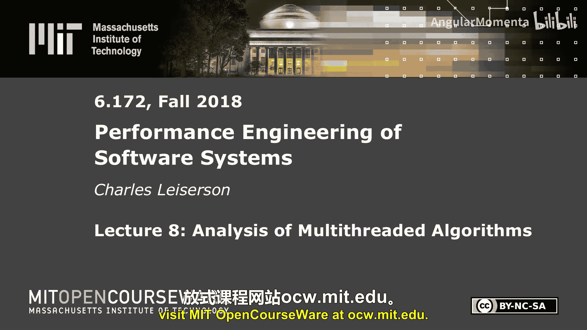

Today， we're going to talk about analyzing。Task parallel algorithms， multi threadreaded algorithms。

And。All。This is going to rely on the fact that everybody has taken an algorithms class。

And so I want to remind you of some of the stuff you learned in your algorithms class。

 and if you don't remember this， then it's probably good to bone up on it a little bit because it's going to be essential。

And that is the topic of divide and conquer recurrences。

 Everybody remember divide and conquer recurrences？These are。

And there's a general method for solving them that will deal with most of the ones we want called the master method。

And it deals with occurrences the form T of n equals a times t of n over B plus f of n。

 and this is generally interpreted as I have a problem of size n。

I can solve it by solving a problems of size n over B。

 and it costs me F of N work to do that division。Accumulate whatever the results are of that to make my final result。

For all these recurrences， the unstated base case is that this is sort of a running time。

 so T of n is constant if n is small， so does that make sense？Everybody familiar with this？Right。

Okay， well， we're going to review it anyway because I don't like to go ahead and just assume and then leave 20% of you。

Or more or less left behind in the woods， so let's just remind ourselves of what this means。

So it's easy to understand this in terms of a recursion tree。

I start out and the idea of a recursion tree is to take the running time here and to reexpress it using the recurrence。

So if I reexpress this。Okay， and I've written a little bit differently， then I have an f of n。

 I can bring f and an n at the root and have a copies of T of n over B。

 and that's exactly the same amount of work as I had or running time as I had in the T of N。

 I've just simply expressed it with the righthand side。And then I do it again at every level。Okay。

 so I expand all the leaves， I only expanded one here because I ran out of space。

And you keep doing that until you get down to T of1。

And so then the trick of looking at these recurrences is to add across the rows。

So the first row adds up to F of N。The second row adds up to a times F of n over B。

The third one is a squared F of n over b squared and so forth。And the height here now。

 since I'm taking n and dividing it by B each time。

 how many times can I divide by B till I get to something that's constant size， that's just。

Log base B of n。So so far， review any questions here？For anybody。So do I get the height？

And then I look at how many， if I've got tier1。Work at every leaf， how many leaves are there？

And for this analysis， we're going to assume everything works out。

 everything to n is a perfect power of B and so forth。So if I go down k levels。

How many subpros are there at K levels？A to the K， so how many levels am I going down？H。

 which is log base B of n， so I end up with a to the log base B of n。Times。What's at the leaf。

 which is T of1？Okay。And。T of1 is constant。A log base B of n。

 that's the same as n to the log base B of A。Okay， that's just a little bit of exponential algebra。

Okay， and you can one way to see that is take the log of both sides of both equations and you realize that all that's used there is the commutative law。

Because if you take the log base。呃。If you take log of A， log BN， you get log BN times log。

If you take a base B， you log B A， and then you get the same thing if you take。

The log base B of the what I have is the result then you get。

The exponent log base B times log base B of n， so same thing just in different orders。

Okay so that's just a little bit of math。This is basically we're interested in what's the growth in end。

 so we prefer not to have log ends and the diameter we prefer to have ends and sorry in the exponent we prefer to have ends。

Okay so that's basically the number of things， and so then the question is， how much work？

Is there if I add up all of these guys all the way down there， how much work is in all those levels？

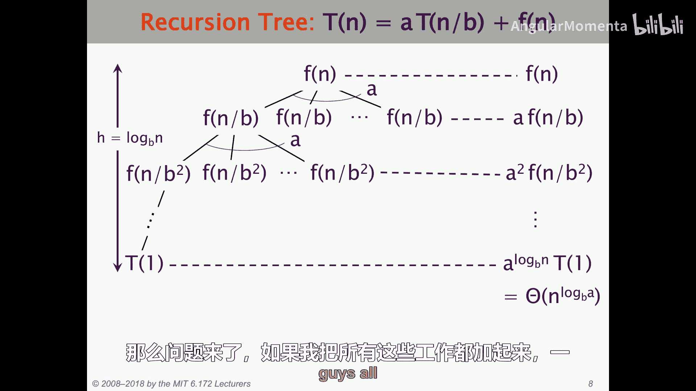

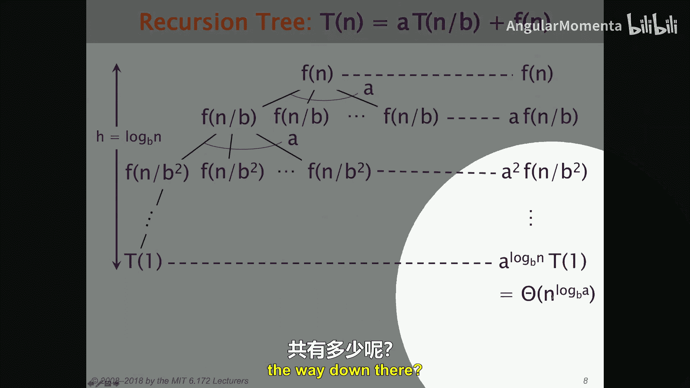

And it turns out there's a trick， and the trick is to compare。

Log base B n to log base B of A with F of N， and there are three cases that are very commonly arising and for the most part that's what we're going to see is just these three cases。

Okay， so case one is that。诶。Is the case where log base B and to the log base B of A is much bigger than F of n？

Okay， and by much bigger。I mean it's bigger by a polynomial amount。

 in other words there's an epsilon such that the ratio between the two is at least n to the epsilon。

 there's an epsilon greater than0， in other words f of n is o of n to the log base b of a minus epsilon in the numerator there。

 okay which is the same as n log base b of a divided by n via epsilon in that case。

 this is geometrically increasing。And so all the weight， the constant fractionion of the weight。

Is in the leaves。Okay， so then the answer is。T of n is n to the log base B of A。

So if n to the log base B of A is bigger than F of n， the answer is n to the log base B of A。

 as long as it's bigger by a polynomial amount。Okay。Now case two is the situation where。

Where in the log base B of a is approximately equal to f of n。They're very similar in growth。

 and specifically we're going to look at the case where f of n is to log base B of a times a polylogarithmic factor。

 log to the K of n for some constant k greater than or equal to0 that greater than or equal to0 is very important。

You can't do this for negative K。Even though negative k is defined and meaningful。

 this is not the answer when k is negative， but if k is greater than equal to0。

 then it turns out that what's happening is it's growing arithmetically from beginning to end。

 and so when you solve it what happens is you essentially add an extra log terms。

 so the answer is since if f of n is n to the log base B of a log to the Kn。

 the answer is n to the log base B of a loggged to the k plus1 of n。Okay。

 so you kick in one extra log。And and basically it's like on average， there's basically， you know。

 it's almost all equal in their log layers。That's not quite the math， but it's good intuition， okay。

 they're almost all equal and they're log layers， so you tack on an extra log。Okay。And then finally。

 case three is the case when。Entellogue base B is much less than F of n。

And specifically where it is smaller by a， once again， a polynomial factor。

 by an end to the epsilon factor for epsilon greater than zero。

It's also the case here that F has to satisfy what's called a regularity condition。

And this is a condition that's satisfied by all the functions we're going to look at polynomials and polynomials times logarithms and things of that nature。

 okay， it's not satisfied for weird functions like you know signss and cosines and things like that。

 it's also not more relevantly， it's not satisfied if you have things like exponentials。Okay。

 so this is。啊。But for all the things we're going to look at， that's the case。

 and in that case things are geometrically decreasing and so all the work is at the root。

And the root is basically costs F of n。So the solution is theta f of n。Okay。So。

We're going to hand out a cheat sheet。So if you could conscript some of the TAs to get that distributed as quickly as possible。

Okay， so let's do a little。A little。Puzzle here， okay。So here's the cheat sheet。

 that's basically what's on it。Okay。And we'll do a little quiz in class quiz， self quiz。

Okay so we have t of n is4 t of n over 2 plus n， and the solution is。

This is the thing that as a computer scientist， you just memorize this so that you can。

 in any situation， you don't have to even look at the cheat sheet， you just know it。

 it's one of these basic things that all computer scientists should know。

 it's kind of like you know what's two to the 15th。呃呃呃呃。But is it？Yes， and interestingly。

 that's my office number。I'm in 32-G768。I'm the only one in the data center with a power of two office number。

And that was totally unplanned。系。So if you need to remember my office number two to the 15th。Okay。

 so what's the solution here？Is case one， and what's the solution？N squared， very good， yeah。

 so n to the log base B of a is n to the log base base two of four。Loug base 2 of4 is 2。

 so that's n squared， that's much bigger than n， so it's case1 and the answer is theta n squared。

Okay， pretty easy。Okay， how about this one？Yeah。Yeah。

 it's n squared log n once again the first part is the same n to the log base B of a is n squared。

 n squared is n squared loggged to the0 n， so it's k2 with k equals0。

 and so you just tack on an extra log factor， okay so it's n squared log n。And then of course。

 we got to do this one。嗯。Yeah。Yeah， andC because once again。And log base P of A is n squared。

 that's much less than n cubed n cubes bigger， so that dominates， so we have theta n squared。Okay。

 what about this one？Yeah。No， that's not the answer。Which case do you think it is？Case two。Okay，Yeah。

It's none of the cases， it's a trick question。Oh， I'm a nasty guy。I'm a nasty guy， okay。

 this is one where the master method does not apply， this would be case2。

 but k has to be greater than equal to0 and here k is minus1， so case2 doesn't apply。Okay。

 and case one doesn't apply。where we're comparing n squared to n squared over log n。

 because the ratio there is one over log n and that is sorry the ratio there is log n。And log n is。

Smaller than any end to the epsilon， and you need to have an end to the epsilon separation。Okay。

 there's actually a more- the actual answer is n squared log log n for that one， by the way。

Which you can prove by the substitution method。And it uses the same idea you just do a little bit different math。

 there's a more general solution to this kind of recurrence called the acrobay method but for most of what we're going to see it's sufficient to just applying the acrobazi method is more complicated then simply you know doing the sort of table lookup of which is bigger and if's sufficiently big it's one or the other or the common case where they're about the same so within a log factor so we're going to use the master method but there are more general ways of solving these kinds of things okay let's talk about some multithread algorithms。

 the first thing I want to do is talk about loops because loops are。

Are a great thing to analyze and understand because so many programs have loops。

 probably 90% or more of the programs that arelyzed are paralyzed by making parallel loops。

The spawn and sync types of parallelism， the subroutine type parallelism is not done that frequently in code。

 usually it's loops。So what we're going to look at is a code to do an in place matrix transpose okay as an example of this。

 so if you look at this code I want to swap the lower side of the matrix with the upper side of the matrix and here's some code to do it。

Where I've paralyzed the outer loop， okay？So we're running the outer index from i equals 1 to n。

 I'm actually running the indexes from zero， from0 to n minus1。

And then the inner loop goes from 0 up to i minus1。Now I have seen people write transpose code。

 this is one of these trick questions they give you in interviews where they sayrite the transpose of a matrix。

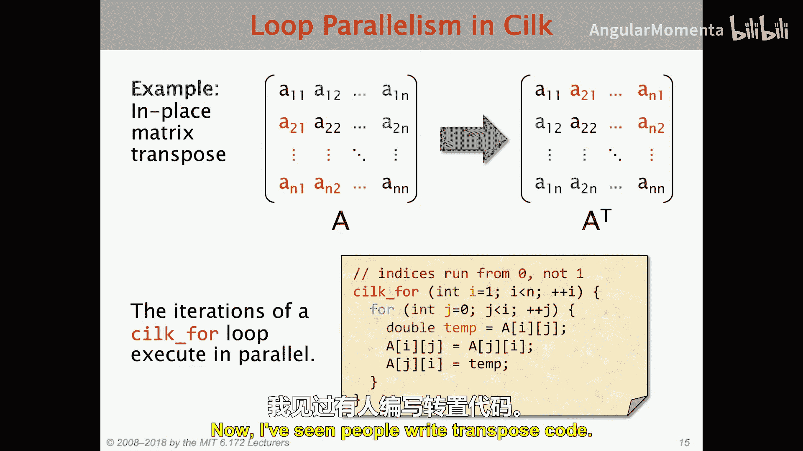

With nested loops， and what many people will do is the inner loop they'll run to end。

Rather than running to I。Okay， and what happens if you run the inner loop to N？

It's a very expensive identity function。And there's an easier， faster way to compute identity。

Then with doubly nested loops where you swap everything， you swap them all back。

Okay so it's important that the iteration space here， what's the shape of the iteration space。

 if you look at the I and J values and you map them out on the plane， what's the shape that you get。

 it's not a square which it would be if they were both going from。From。1 to n or0 to n minus1。

 what's the shape of this iteration space？Yeah， it's a triangle， okay， it's basically， you know。

 we're going to run through all the things in the lower。You know， in this lower area。

 that's the idea。And we're going to swap it with the things in the upper one。

 but the iteration space runs through just the lower。

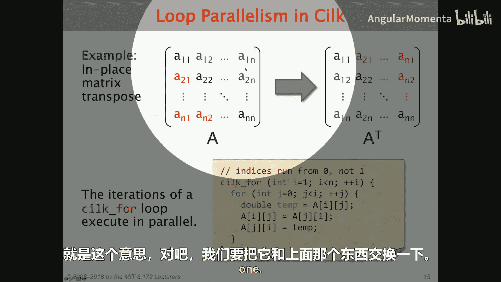

Tangle or correspondingly it runs through the upper triangle if you want to view it from that point of view。

 but doesn't go through both triangles because then you will get an identity so anyway that's just a tip when you're interviewing you know double check that they've got the loop indices to be what they ought to be okay and here what we've done is we've parallellyzed the outer loop which means how much work is on each iteration of this loop。

How much time does it take to execute each iteration of Luke forgiven value of I？

What does it cost us to？Tan。Execcutute the loop， yeah。Yes， theta I。

hich means that if you think about this， if you've got a certain number of processors。

You don't want to just chunk it up。So that each processor gets an equal range of i。To work on。

 you need something that's going to load balance。and this is where the silk technology is best is when there are these unbalanced things because it does the right thing。

Okay， as we'll see。Now。So let's talk a little bit about how loops are actually implemented。

Byu the open silk compiler and runtime system。Okay。So what happens is。

We have this doubly nested loop。

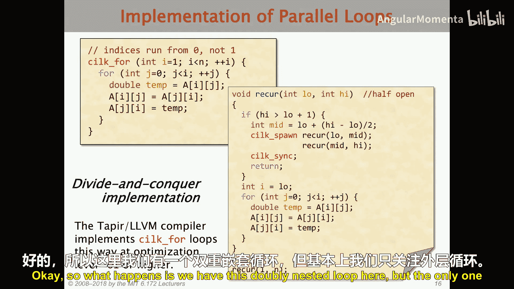

Here，But the only one that we're interested in is the outer loop basically。

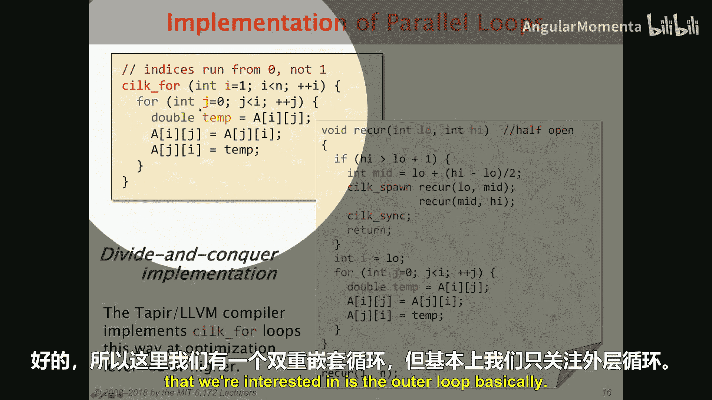

And。What it does is it creates this recursive program。

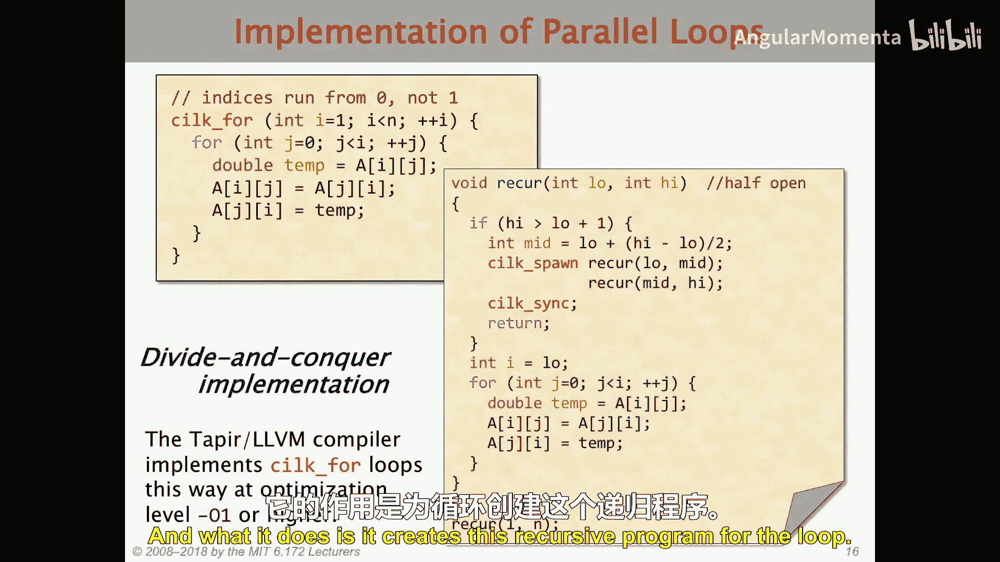

For the loop。

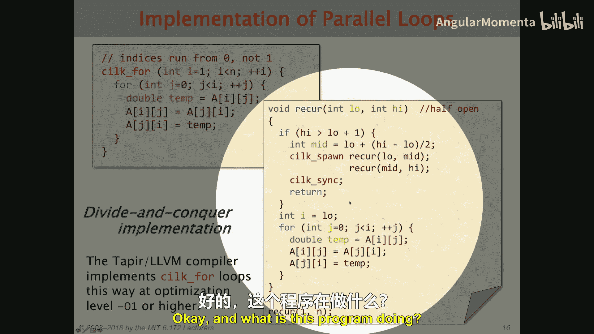

and what is this program doing？So I'm highlighting essentially this part。

 this is basically the loop body。

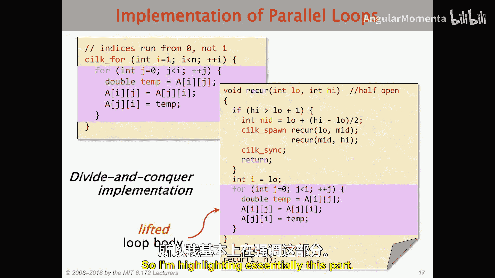

Here， which has been lifted into this recursive program。

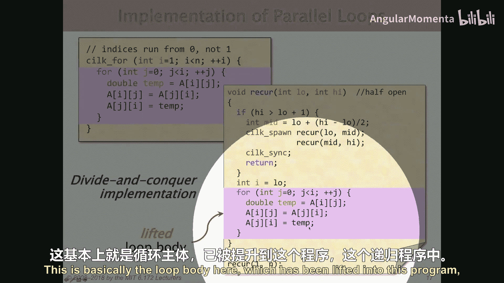

And what it's doing is it is finding a midpoint。And then。Recursively calling。

Itself on the two sides until it gets down to， in this case， a one element。Iteration。

 and then it executes。The inner the body of the loop， which in this case is itself a for loop。

 but not a parallel for loop。So it's doing divide and conquer， it's just basically tree splitting。嗯。

So。So let me。哎。So basically it's got this control on top of it。

 and if I take a look at what's going on in the control， it looks something like this。Okay。

 so this is using the DAG model that we saw before。And now what I have here highlighted is the body。

 the lifted body of the loop， that's just sorry， is the control。

 and then down below in the purple I have the lifted body。

And what it's doing is it's basically saying， let me divide it into two parts。And then I call one。

 I spawn one recurrence， and I call the other， and I just keep dividing like that till I get down to the bot to the base condition。

 and then the work that I'm doing I've sort of illustrated here。

The work I'm doing in each iterational loop is growing from one to n， okay I'm showing it for eight。

 but in general， this is working from one to n for this particular one。Okay。So is that clear。

 so that's what's actually going on， so the open silk runtime system does not have a loop primitive。

Okay， doesn't have loops， it only has essentially this ability to spawn and so forth。

 and so things effectively are translated into this divide and conquer。

 and that's the way that you need to think about loops when you're thinking in parallel。Okay。

 makes sense。And so one of the questions is well what what okay。

 that seems like a lot of code to write for a simple loop， what did we pay for that， okay。

 how much did that cost us， so let's analyze this a little bit。Analyze parallel loops。Okay。

So as you know， we analyze things in terms of work and span。So what is the work of this computation？

Well， what's the work before you get there， what's the work of the original computation。

 the doubly nested loop？

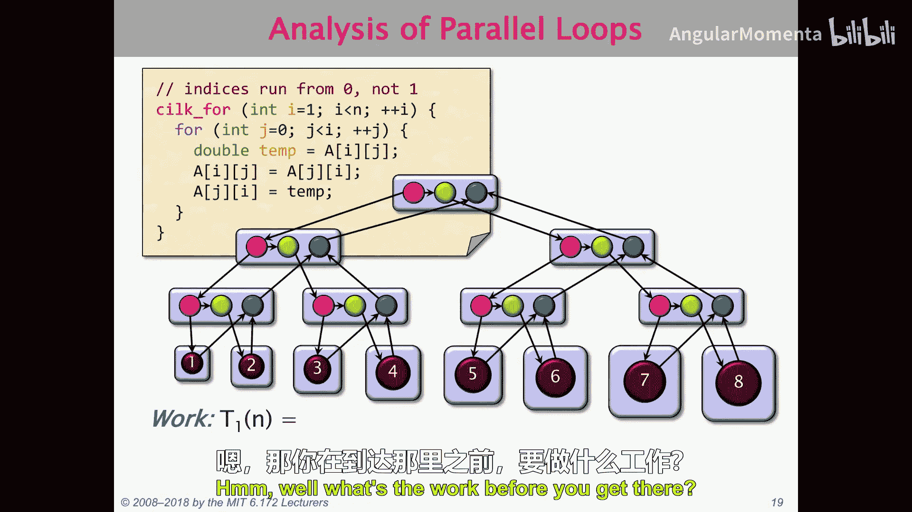

Okay， if you just think about it in terms of loops。Okay， if they were serial loops。

 how much work would be there？Right？Doubly nested loop。In a loop and， iteration。

 you're doing eye work。Some of I equal equals one to n， what do you get？Yeah， it's theta n squared。

 right， doubly nested group， and although you're not doing half the work。You know。

 you are doing the other half of the work of the n squared work that you might think was there if you wrote the unfortunate identity function。

Okay。So the question is how much work is in this particular computation because now I've got this whole tree spawning business going on in addition to the work that I'm doing in the leaves。

OkaySo the leaf work here。A along the bottom here， that's all going to be order n squared work because that's the same as in the serial loop case。

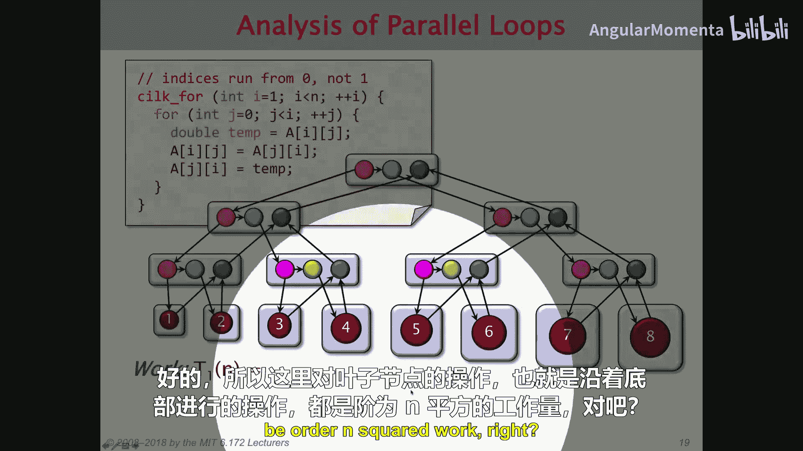

How much does that other stuff up top at there， it looks huge， right， bigger than the other stuff。

 isn't it？How much is there？Basic computer science。Yeah， it's theta n， why is it theta n？

In the upper part， yep。Yeah， so going from the leaves to the root。

Every level is having such geometrics， so it's the total number of leaves because there's constant work in each of those phrases。

 so the total amount is theta n squared。OkayAnother way of thinking about this is。

 you've got a complete binary tree that we've created with N leaves。

How many internal nodes are there in a complete binary tree with N leaves， In this case。

 there's actually in over。I just just say there's n leaves， yeah。

 how many internal notes are there if I have n leaves？

How many internal nodes to the tree that is nodes that have children？There's exactly n minus1。

That's a property that's true of any full binary tree that is any binary tree in which every non leaf has two children。

There's exactly n minus1。Okay。So nice tree properties， nice computer science properties， right。

 we like computer science， that's why we're here， not because we're going to make a lot of money。

Okay， okay。Let's look at the span of this。What's the span of this？Calculation。

Because that's how we understand parallelism is by understanding work in span。嗯。

I see some familiar hands。Okay。Theta n， yeah， how did you get that？ち次業。Yeah。

 so we're basically the longest path is basically take going from here， down， down， down to eight。

 and then back up。

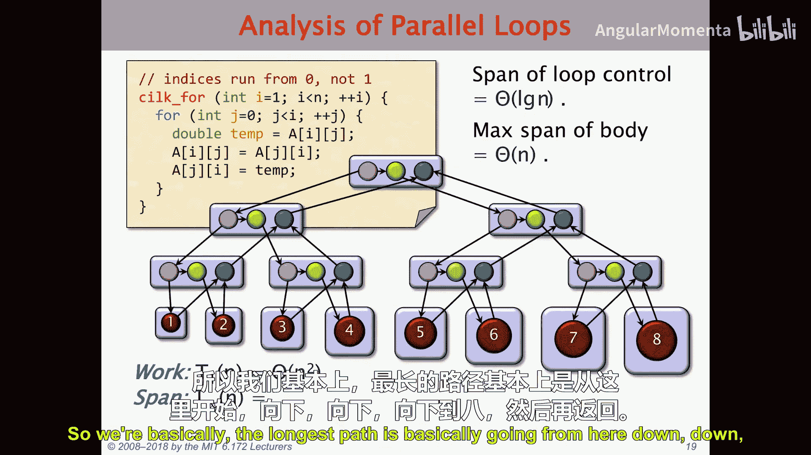

Okay， and so the aid is really n in the general case。Right。

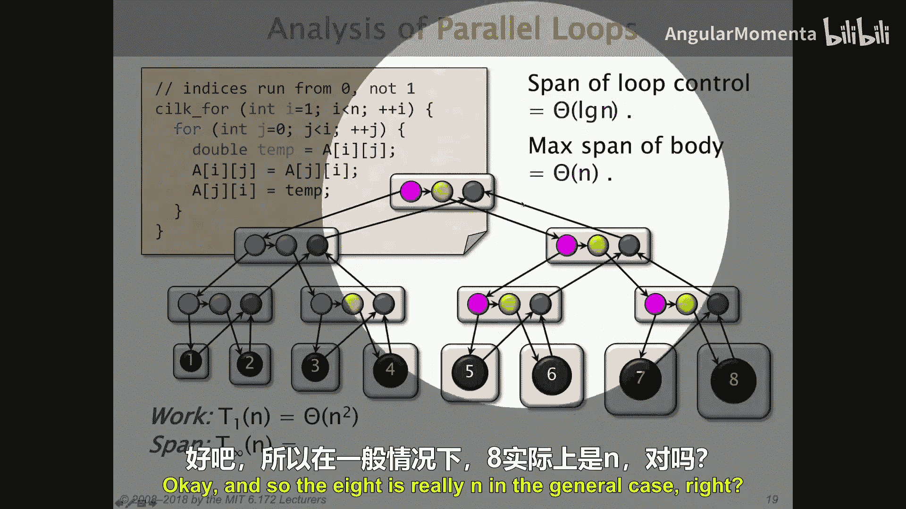

That's really end in the general case， and so we basically are going down and so the span of the loop control is log n。

 and that's the key takeaway here， the span of loop control is log n。

When I do divide and conquer like that， if I had an infinite number of processors。

I could get it all done in logarithmic time。Okay。But。The8 there is linear， that's order n。

In this case， n is eight。Okay， so that's order n， so then it's log n plus order log n。

 which is therefore order n。ok。And so。So what's the parallelism here？Theta n is the ratio of the two。

It' the ratio of two is theta n， is that good？Well， parallelism of n squared do you mean？

Is this good parallelism？Yeah， that's pretty good。That's pretty good because typically you're going to be working on systems that have maybe if you are working on a big。

 big system， you've got maybe 64 cores or 128 cores or something that's pretty big。

OkaySo whereas this is saying， and if you're doing that。

 you better have a problem that's really big that you're running it on。Okay。

 and so typically n is way bigger。T the number of processors for a problem like this。

Not always the case， but here it is。Okay， any questions about this so we can use our。

Work in span analysis to understand that， hey。Work overhead is a constant factor and we're going to talk more about the overhead of work。

 but basically from an asymptotic point of view。Our work is n squared just like the original code。

 and we have a fair amount of parallelism， we have order n parallelism。Okay。

How about if we make the inner loop？Be parallel as well。

Okay so rather than just paralyzing the outer loop， we're also going to paralyze the inner loop。Okay。

 so how much work do we have for this situation？So hint。

 all work questions are trivial or at least no harder than they were。When you were doing。

Ordinary serial algorithms。Okay。Maybe we can come up with a trick question on the exam where the work changes。

Almost always， the work doesn't change。So what's the work？Yeah， n squared， right？

Plyzing stuff doesn't change the work。What it hopefully does is reduce the span of the calculation。

And by reducing the span， we get big parallelism， that's the idea。Now。

 sometimes it's the case when you parallellyze stuff that you add work， and that's unfortunate。

Because it means that even if you end up taking your P program and running it on one。Processing core。

You're not going to get any speed up。It's going to be a slowdown compared to the original algorithm。

 so we're actually interested generally in work efficient parallel algorithms。

 which we'll talk more about later， so generally we're after work efficiency。Okay。

 what's the span of this？It is not still theta n， what was your thinking to say it was theta n？

But now notice that eight is now not is a for loop itself。And then。Okay， not quite。

 but so this is so this man is。Commendable。Okay。Okay。Absolutely， okay this is commendable， okay。

 because this is why I try to have a bit of a Socratic method in here where you know I'm asking questions as opposed to just sitting here lecturing and having it go over your heads。

 okay you have the opportunity to ask questions and to have your particular misunderstandings or whatever correct it。

 okay that's how you learn。And so I'm really in favor if anybody wants to come here and learn。Okay。

 that's my desire and that's my job is to teach people who want to learn。Okay。

I hope that this is a safe space for you folks to sort of be willing to put yourself out there and not necessarily get stuff right。

Okay， I can't tell you how many times I've screwed up。Okay， and it's only by airing it and so forth。

 having somebody say， no， I don't think it's like that， Charles。You know。

 this is like this and I said， oh yeah， you're right。God， that was stupid。You know？

But the fact is that I no longer beat my head when I'm being stupid， okay。

 that's our natural state is stupidity。We have to work hard not to be stupid。Okay， right？

He's hard work not to be stupid。Okay， yeah， question。Yeah。

 but usually when my experience is- and this is， let me tell you from。

 I've been at MIT almost 38 years， okay， my experience is that one one person has a question。

There's all these other people in the room have the same question。And' by you articulating it。

 you're actually helping them out， if I think you're going too slow， okay。

 if things are going too slow that we're wasting people's time。

 that's my job as the lecturer to make sure that doesn't happen and I'll say let's take this offline we can talk after class。

Okay， but I appreciate your point of view that you know， because that's considerate。

 but actually it's more consideration， okay， if you're willing to air what you think and have other people say。

 you know， I had that same question， certainly there' are going to be people in the class who say roll their eyes or whatever。

 okay， but look， I don't teach to the top 10%， I try to teach to the top 90%。Okay， and believe me。

Believe me you know that you know I get。I get farther with students and have more people enjoying the course and learning this stuff。

Which is not necessarily easy stuff。 After the fact， you're going to discover this is easy。Okay。

But while you're learning it， it's not easy， this is what Stephen Pinker calls the curse of knowledge。

Once you know something。You have a really high time putting yourself in the position of what it was like to not know it。

And so it's very easy to learn something and then it's like when somebody doesn't understand。

 it's like， oh， you know， whatever， okay， but the fact of the matter is that most of us， you know。

 it's that empathy， that's what makes for you to be a good communicator。Okay。

 and all of you I know are at some point going to have to do communication with other people who are not as。

Technically sophisticated as you folks are。Okay， and so this is really good to sort of appreciate how important it is know。

 to recognize that this stuff isn't necessarily easy when you're learning it。Okay。Later。

 you can learn it， and then it'll be easy， but doesn't mean it's necessarily easy for somebody else。

 So those of you who think that some of these answers are like， come on， move along， move along。Okay。

Please be patient with the other people in the class if they learn better。

 they're going to be better teammates on projects and so forth。

 okay and we'll all learn nobody's in competition with anybody here。For grades or anything， okay？

Nobody's in competition， we all set it up so we're going against benchmarks and so forth。

 you're not in competition， so we want to make this something where everybody helps everybody to learn I probably spent too much time on that。

 but in some sense not nearly enough。Okay， so the span is not order in。We got that much。

Who else would like to hazard a， okay？It is login， what's your reasoning？loggin from the time before。

Sinceor big expanding that。Yep， I dad into another tree。Log n plus log n good。

 and then what about the leaves？What you got to add in the span of the leaves。

 that was just the span of the control。The leaves are just one。Okay。Right， boom。

 so the span of the outer loop is order log n， the inner loop is order log n。

 and the span of the body is order1 because we're going down to the body now it just doing what iteration of serial execution。

 it's not doing I iterations， it's only doing one iteration。

 and so I add all that together and I get log n。Okay， does that make sense？Okay。

So the parallelism is。This one I showed every hand in the room should be up w to call on me。

 call on me。Sure。Yeah， n squared over log n， okay， that's the ratio of the two。Okay。Good。

 any questions about that？Okay。So the parallelism is n squared over。Log in and。

This is more parallel than the previous one。But it turns out you got to remember。

 even though it's more parallel， is it a better algorithm in practice？

Not necessarily because parallelism is like a thresholdholding thing。

 what you need is enough parallelism beyond the number of processors that you have。

 right the parallel slackness， remember。So you have to have number， the amount of parallelism。

 if it's much greater than the number of processors， you're good。So for something like this。

If with order N parallelism。You're bigger way bigger than the number of processors。

 you don't need to parallellyze the inner loop。you don't need to paralyze the inner loop。

 you'll be fine， and in fact， we're going to talk a little bit about overheads。

And I'm going to do that with an example from using vector Edition。Okay。So here's a really simple。

Pace of code， it's a vector， add two vectors together， two arrays。

 and all it does is it adds B into a， you can see every position adds B into A。

 and I'm going to parallellyze this by putting a silk4 in front rather than an ordinary4。

And what that does is it gives us this divide and conquer tree once again。

With N leaves and the work here is order n because that's。We got in。Iterations of constant time。

 and the span is just the control log in。And so the parallelism is and over log n。Okay。杀。

So this is basically easier than what we just did。OkaySo now if I look at this， though。

 the work here。Include some substantial overhead。Because there are all these function calls。

 it may be order n。Okay， and that's good enough if you're certain kinds of theoreticians。

 this kind of theoretician， that's not good enough。Okay。

 I want to understand where these overheads are going。So the first thing that I might do to。

To get rid of that overhead because so in this case。

What I'm saying is that as I do the divide and conquer， if I go all the way down to n equals 1。

 what am I doing in a leaf， how much work is in one of these leaves here？

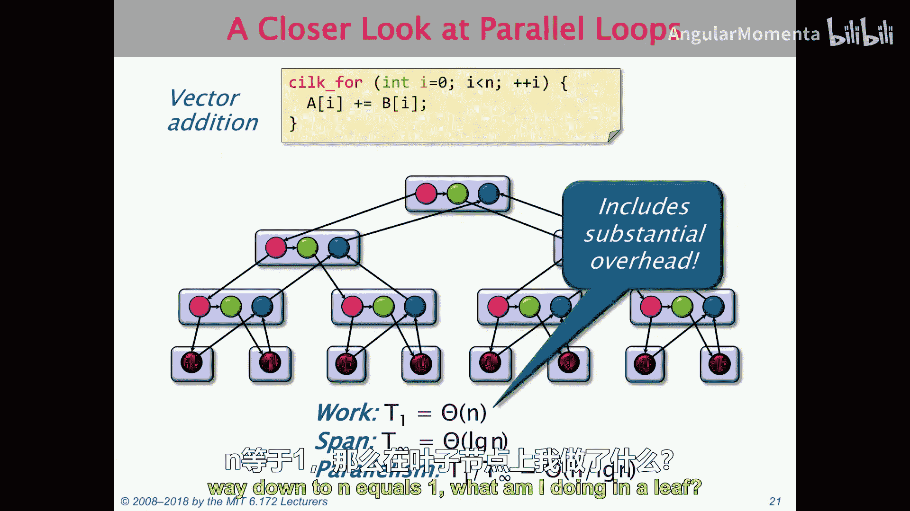

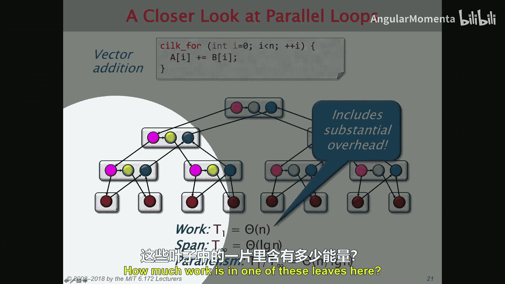

Okay。It's a。It's an ad。Two memory fetches and a memory store and an ad。

The memory operations are going to be the most expensive thing there。Okay。

 that's all that's going on。And yet。Right before then， I've done a subroutine call。

 a parallel subroutine call， mind you。And that's going to have substantial overhead。

And so the question is， do you do a subrtine call to add two numbers together？

That's pretty expensive。So let's take a look at how we can optimize away some of this overhead。

And so this gets more into the realm of engineering。The open silk system has a pragma。

 so pragma is a compiler directive， suggestion to the compiler。

Where can suggest in this case that there be a grain size。

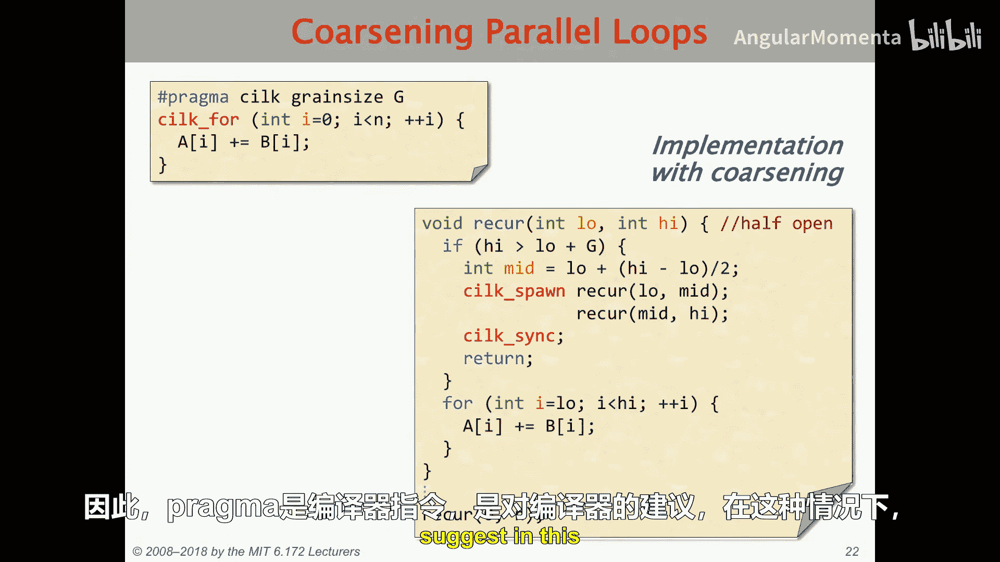

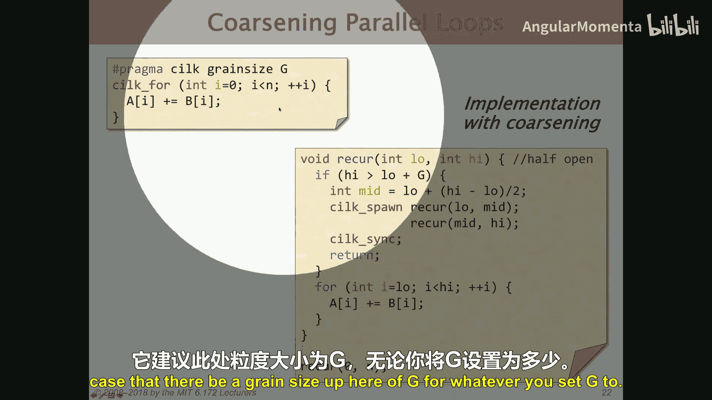

Up here。Of G。For whatever you set G to。

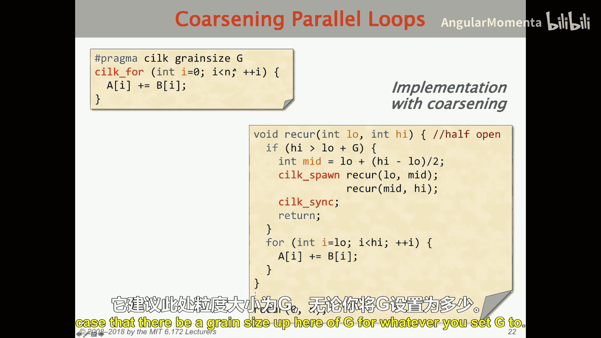

And the grain size is essentially we're going to use。

 and it shows up here in the code as instead of ending up。

 it used to be high greater than low plus1 so that you ended with a single element。

 now it's going to be plus G so that at the leaves， I'm going to have up to G elements。

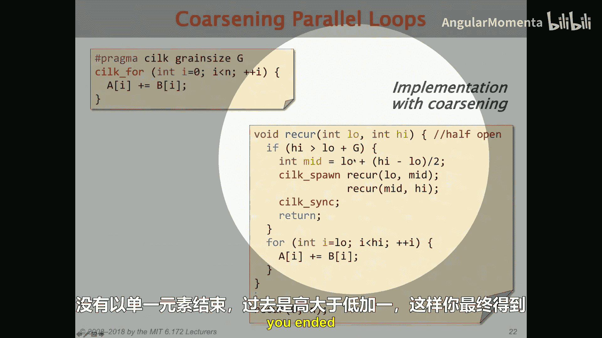

Per chunk that I do when I'm doing my divide and conquer。

 so therefore I can take my subrtoutine overhead and amortize it across G iterations rather than amortizing it across one iteration。

Okay so that's coarsening now if the grain size pragma is not specified。

 the Sil runtime system makes its best guess to minimize the overhead。

So what it actually does at runtime is it figures out for the loop， how many cores it's running on。

And makes a good guess as to the actual how much to run serially at the leaves and how much to do in parallel。

Does that make sense？Okay， so it's basically trying to overcome that。

 so let's analyze this a little bit。So。Let's let I be the time for one iteration of the loop body。

Okay so this is eye for iteration， this is of this particular loop body。

 so basically the cost of those three memory operations plus an a， okay？And。G is the green size。

 okay？And now let's take a look at another variable here。

 which is the time to perform a spawn and return。I'm going to call a spawn return。

 it's basically the overhead。For spawning， okay？So if I look at the work in this context。

I can view it as。I've got。A。T1 work， which is n。

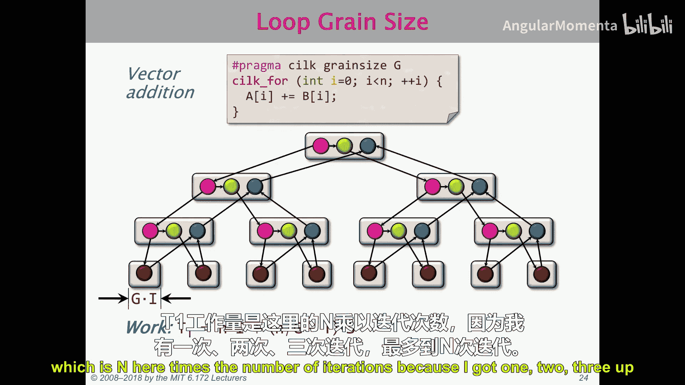

Here times the number of iterations because I got one， two， three， up to n iterations。

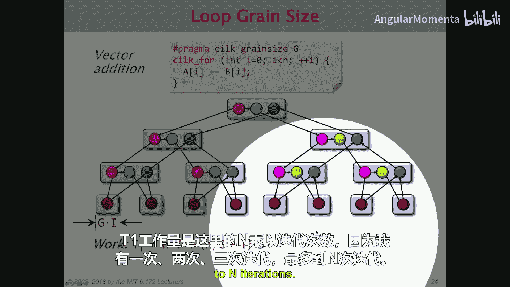

And then。I have- and those are just the normal iterations， and then since I have n over g minus1。

 there's n over G leaves here of size G。Okay， so I have n over g minus1。Internal nodes。

 which are my subroutine overhead， that's S。So the total work is n times I plus n over g minus1 times s。

Now， in the original code， effectively， the work is what？If I had the code without the Sil4 loop。

 how much work is there？Before I put in all this parallel control stuff。What would the work be？

N times I we're just doing antierations and yeah， there's a little bit of loop control。

 but that loop control is really cheap。Okay， and on a modern out of order。know，Pro。

 the cost of incrementing a variable in testing against its bound is like dwarfed by the stuff going on inside the loop。

Okay， so it's NI， so this part here， okay， whoops， what did I do， whoops， I went backward I see。

So this part here。啊。This part here， there we go， okay， is all overhead， okay？

This is what it costs- this part here is what cost me originally。Okay。

So let's take a look at the span of this。Okay， so the span is。Going to be。Well。

 if I add up what's at the leaves， that's just G times I， okay？And now I've got the overhead here。

for any of these paths， which is a basically proportional。

 I'm ignoring constants here to make it easier， log of n over G times S because it's going log levels and I've got n over G chunks。

Because I've got G things that iterations at each leaf。So therefore。

 the number of leaves is n over G。And I've got n minus one of those- sorry， I've got log n of those。

 actually two log n。Two log n over g of those times s。I actually， maybe I don't。

 maybe just have login because I'm going to count it going down and going up。

 it's actually a constant of one it's fine。Okay， who's confused？Okay， let's ask some questions。

You have a question？Okay， I know you're confused， so believe me。

 I spent one of my great successes in life was discovering that， oh， confusion is how I usually am。

 and then it gets getting unconfused， that is， you know。

 that's the thing because I see so many people going through life thinking they're not confused。

 but you know what， they're confused。Okay， and that's a worse state of affairs to be in than knowing that you're confused。

 let's ask some questions， people who are confused， let's ask some questions。

 okay because I want to make sure that everybody gets this。

And for those who you think know it already。Sometimes it helps them to know it a little bit even better when we go through a discussion like this。

So somebody asked me a question。Yes。Yeah， okay， it' the second half of the work part okay。

 so the second half of the work part n over g minus1。

 so the first thing is if I've got gerations at the leaves of a binary tree。

How many leaves do I have if I've got a total of iterations？And over G。

 right okay so that's the first thing， the second thing is a fact about binary trees of any full binary tree。

 but in particular， complete binary trees， how many internal nodes are there in a complete binary tree？

If n is the number of leaves， it's n minus1， here， the number of leaves is n over g。

 so it's n over g minus1。That clear up something for some people。Okay， good。Okay。

 so that's where that， and now each of those， I've got to do those three colorful operations。

 which is what I'm calling S。So you got the work done？Okay， who has a question about span。

 span's my favorite。Work is good， right？Work is more important actually in most contexts。

 but span is so cool。Yeah。So what I saying well， I think what I was saying。

 I think I was miss saying something probably there。

 but the point is that the span is basically starting at the top here and taking any path down to a leaf and then going back up。

 right？

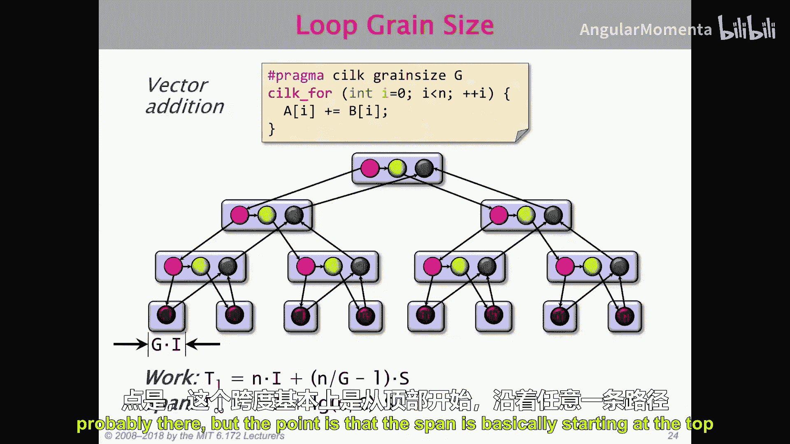

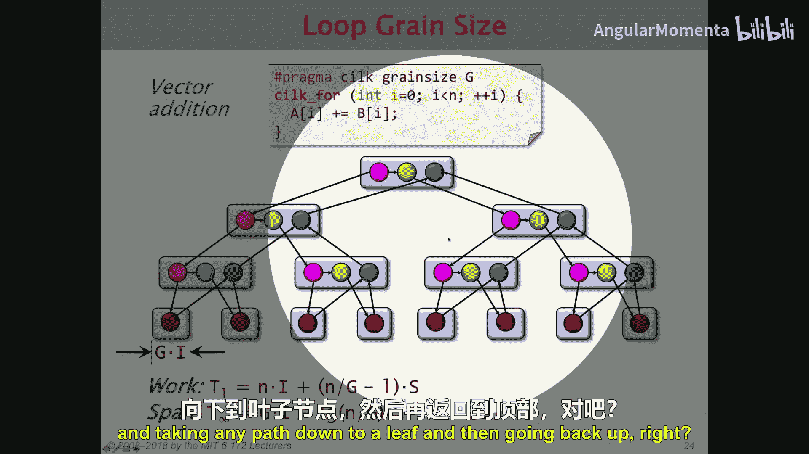

And so if I look at that， that's going to be then log of the number of leaves， well。

 the number of leaves as we agreed was n over G。

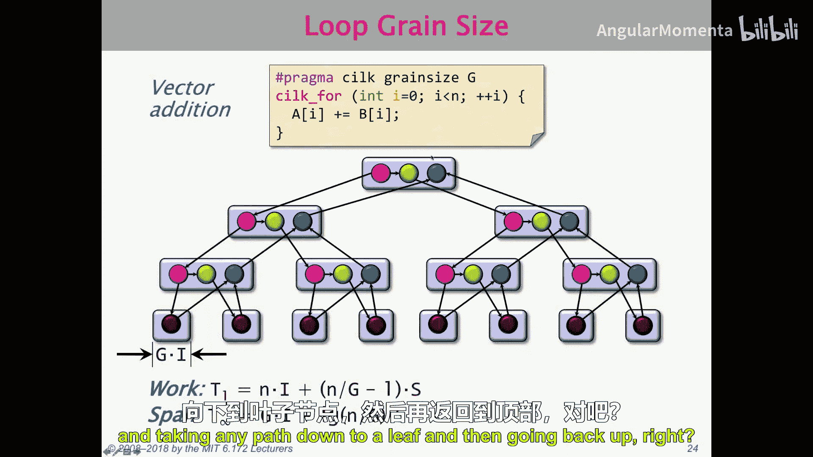

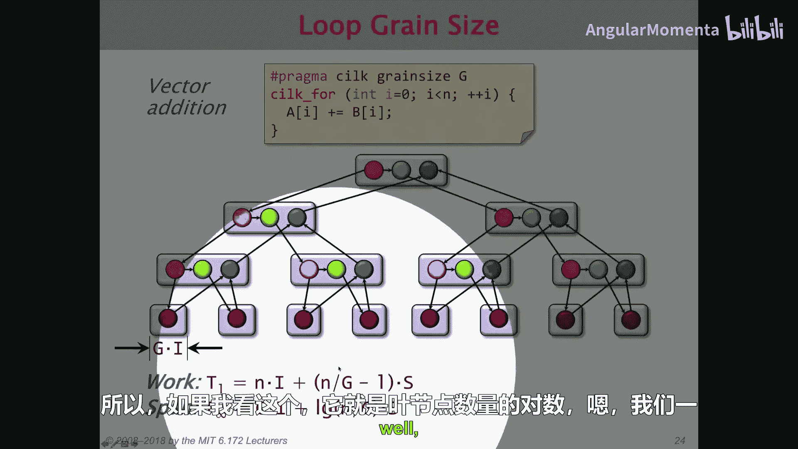

Okay， and then each of those is at most s to do the subrtoutine calling and so forth that's bookkeeping that's in that note。

Does that make sense？

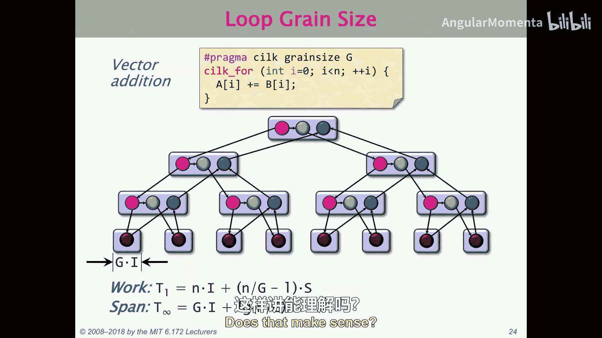

Still， I didn't answer the question。It could be any of the paths， but take a look at all the paths。

 go down and back up， there's no path that's like going down and around and up and so forth。

 This is a dag。

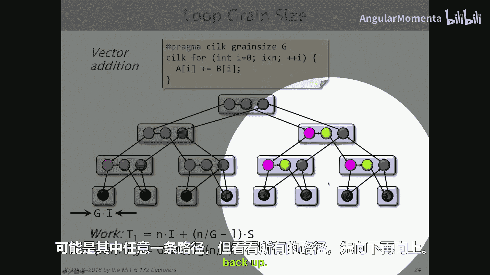

So if you just look at the directions of the arrows。

 you've got to follow the directions of the arrows。You can't go down and up。

 you're either going down or you've started back up。

So it's always going to be essentially down through a set of subroutines and back up through a set of subroutines。

that makes sense， and if you think about the code， the recursive code。

 like what's happening when you do divide and conquer， if you were operating with a stack。

 how many things would get stacked up and then unstacked？

So the path down and back up would also be logarithmic at most。Okay。Does that make sense？

So I don't have a situation if I had one subte here， for example， depending on whoops， that's。

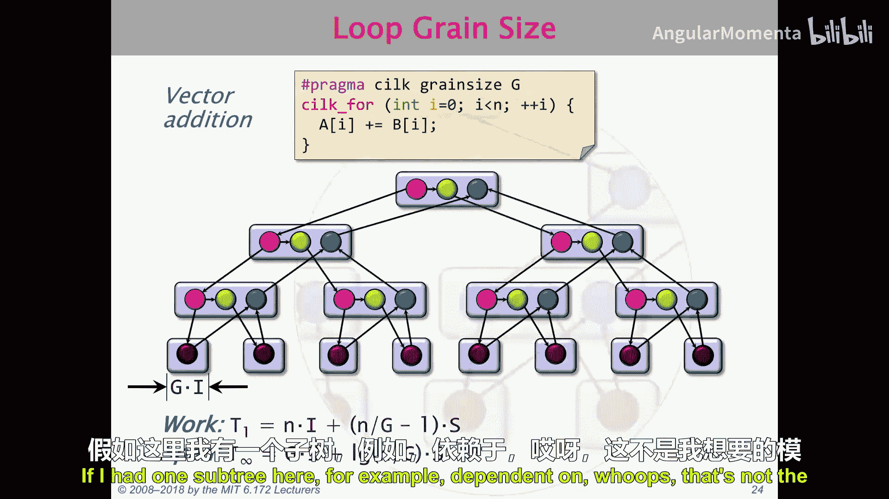

That's not the mode I want to be in so one subre here dependent on another subte。Then indeed。

 the span would grow， okay， but the whole point is not to have these two things to make these two things independent so I can run them at the same time。

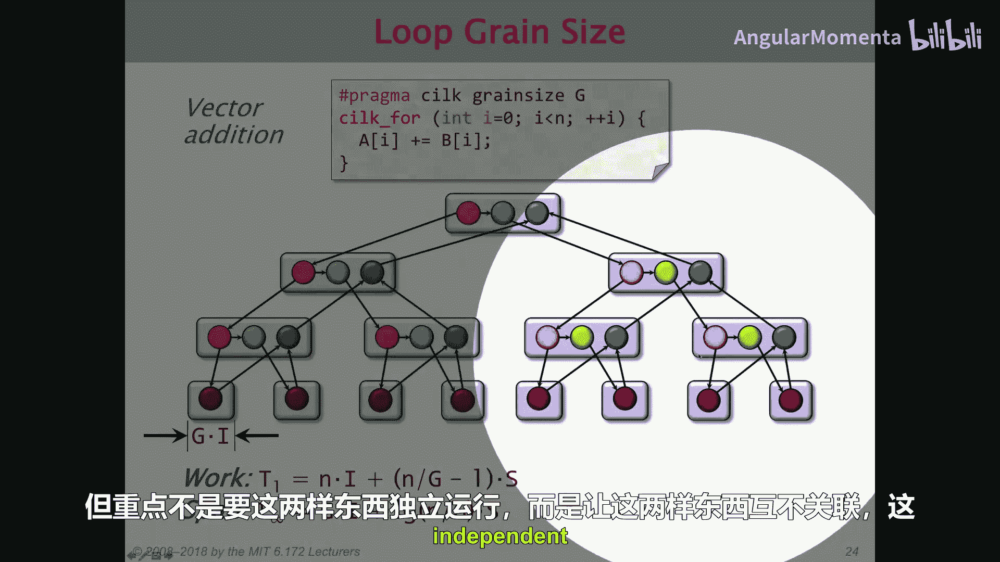

Okay so there's no dependency there。Okay， were we good？Okay。So。So here I have the work and the span。

 I have two things I want out of this。 Number one， I want the work to be small。

I want to be work to be close to the work of the end times I。

 the work of the ordinary serial algorithm。And I want the span to be small so it's as parallel as possible。

 those things are working in opposite directions， okay because if you look the dominant term for G in the first equation okay is as dividing n。

So if I want that to be the work to be small， I want G to be what？Big。Okay。

The dominant term for G in the span is the G multiplied by the I。There is another term there。

 but that's a lower order term。So if I want the span to be small。I want G to be。Small。

 they're going in opposite directions。Okay， so what we're interested in is picking a。

Finding a medium place， okay， so you want G to be and in particular， if you look at this。

 what I want is G to be at least s over I， why if I make G be much bigger than s over I，Okay。

 so if G is bigger than s over I。

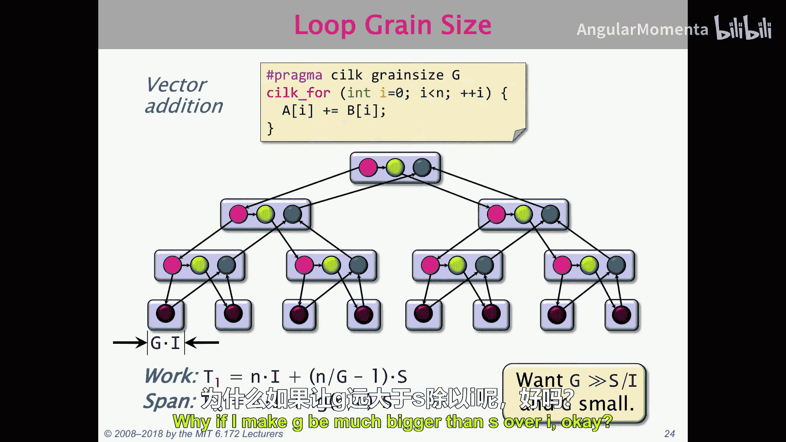

Then this term。Multiply by as ends up being much less than this term。

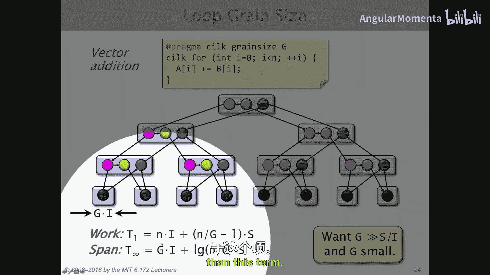

You see that， that's algebra。Okay。So do you see that if I make GB？If G is much less than s over I。

 so get rid of the minus1， that doesn't matter， so that's really n times s over G。So therefore。

S over G， that's basically much smaller than I。So I end up with something where the result is much smaller than N。

Does that make sense？Okay， how are we doing on time， okay。

 I'm going to get through everything that I expect to get through despite my rant。Okay。Okay。

 so as that makes sense we want G to be much greater than S over I。

 then the overhead is going to be small because I'm going to do a whole bunch of iterations。

That are going to make it so that that function call was just like， who cares？Okay， that's the idea。

Okay。So so that's the goal， so let's take a look at let's see what was the。So。

So let me just see here， did I？Somehow I feel like I have something out of order here。Okay， because。

Because now I have。Other implementation。哈。Okay， I think maybe that is where I left it。 Okay。

 I think we come back to this。 Let me just， let me see。 I'm going to lecture on。Okay。Okay。

So here's another implementation of a。Of the for loop to add two vectors。

 and what this is going to use as a subroutine， I have this operator called VA。

 which itself does just a serial vector a。And now what I'm going to do is run through the loop here。

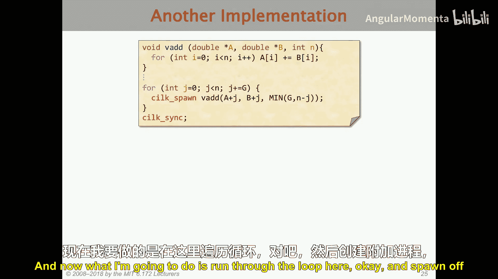

Okay， and spawn off。Additions。Okay， and the min there is just for a boundary condition。

 I'm going to spin off things in groups of G。

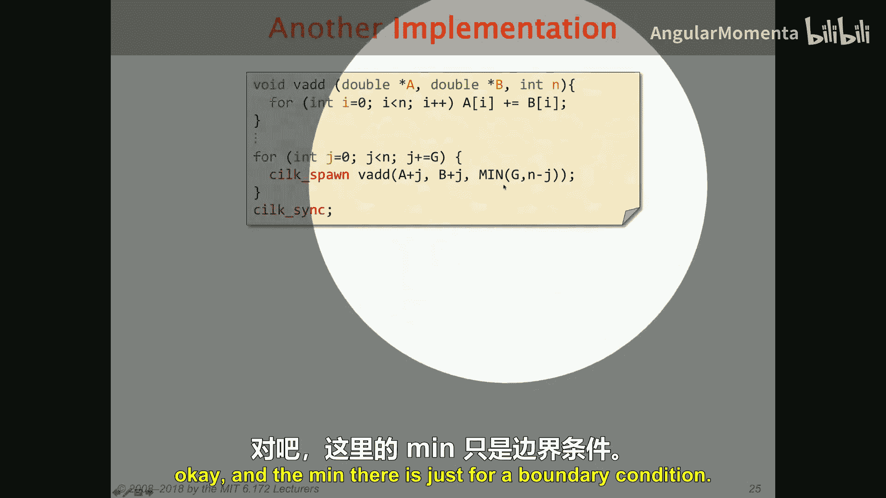

So I spin off， do a vector out of size G， go on vector out of size G， vector out of size G。

 jumping G each time。Okay。So let's take a look at the analysis of that。

 so now what I've got is I've got gerations， each of which cost me I。

And this is sort of the daAg structure that I've got because the for loop here。

That has the silk spawn in it is going along and notice that the silk spawn is in a。

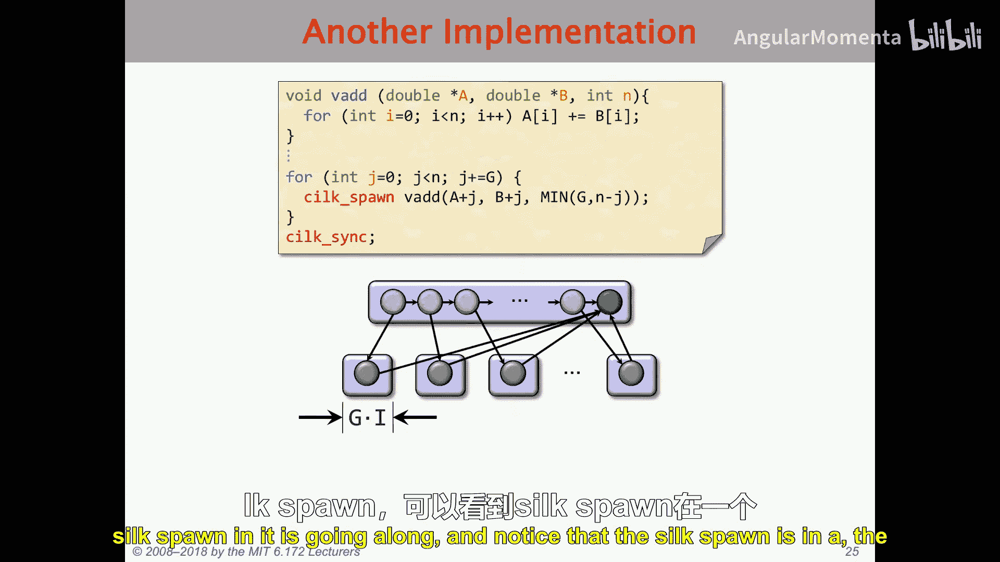

The silk spawn is in a loop， and so it's basically going it's spawning off g iterations。

 say it's spawning off。The vector a， which is going to do Gerations okay because I'm giving basically G because the boundary case。

 let's not worry about okay and then spawn off G spawn off G spawn off G and so forth。

 So what's the work of this。

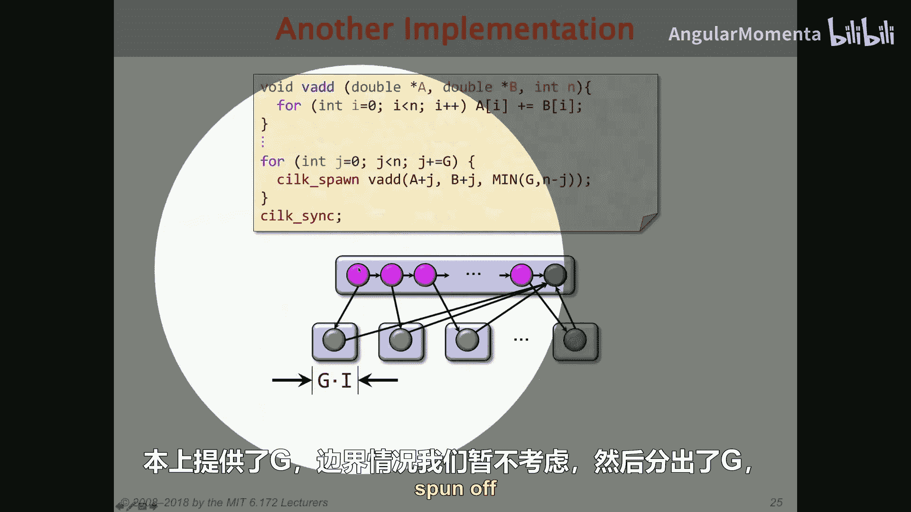

Let's see。Well， let's make things easy to begin with， let's assume G is one。

Okay and analyze it and this is a common thing， by the way。

 as you look to assume that grain size is one and analyze it and then as a practical matter。

 coar in it to make it more efficient So if G is one， what's the work of this？Yeah。Yeah。

 it was order N。RightBecause those other two things are constant so exactly right， okay。

 it's order n okay， in fact。This is what's a technique， by the way， that's called strip mining。

 if you take away the parallel thing where you take a loop of length in and you really have nested loops here。

 one that is going has n over g iterations and one that has g iterations and you're going through exactly the same stuff。

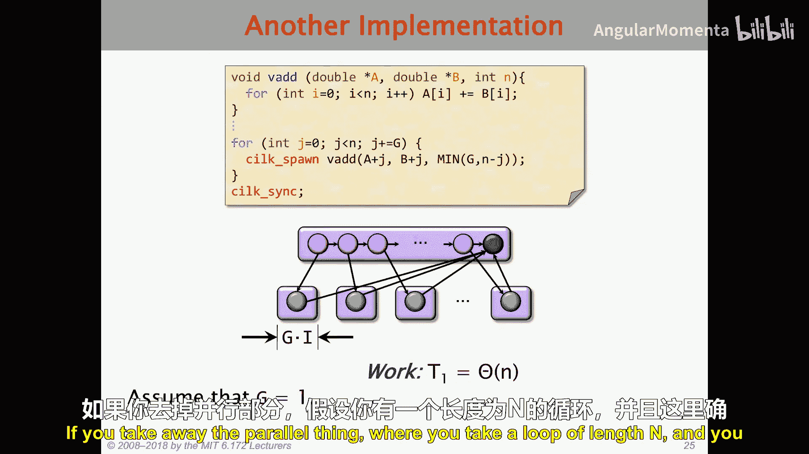

And that's the same as going through any iterations。

 but you're replacing a singly nested loop by a doubly nested loop。

 and the only difference here is that in the inner loop， I'm actually spawning off work。Okay。

So here the work is order N because I basically， I'm spinning off just if G is one。

 then I'm spinning off you one piece of work and I'm going to n minus one，m spinning off one。

 so I've got order N work up here and order N work down below。

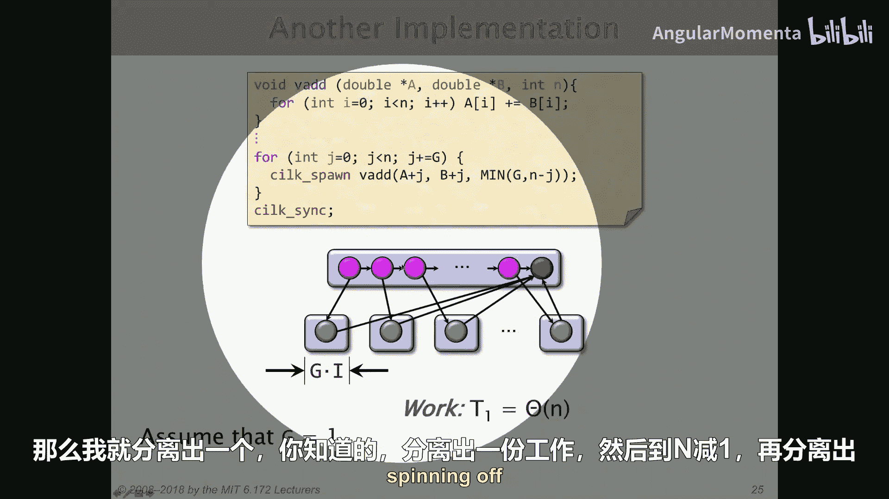

ok。What's the span for this？After all， I got in spans there now， sorry N spawns， not in spans。

 in spawns。What's the span going to be？Yeah。Sorry。So I couldn't hear it there。Theta S。No。

 it's bigger than that。Yeah， you'd think， gee， I just have to do one thing to go down and up。

 but the span is the longest path in the whole dag。Okay。It'The longest path in the whole da。

So where's the longest path in the whole ag start？Upper left， right， and where does it end？

Upper right。How long is that path？What's the longest ones going to go？

All the way down the backbone of the top there。And then b down and back up。

So how many things are in the- if G is one， how many things am I spawning off there？Andd things。

 so the span is。Order N。Okay， right， it's order N， it's long。So what's the parallelism here？Yeah。

 it's order one。And what do we call that？Sad， right？But there's a more technical name。Okay。

They call that puny。Okay， it's like we went through all this work， spawned off all that stuff。

 added all this overhead， and it didn't go any faster。

 I can't tell you how many times I've seen people do this。Okay， when they start parallel programming。

Oh， but I spawned off all this stuff。Yeah， but it didn't reduce the span。Okay。So。

Let's now that was analyzed it in terms of N。Sorry， in terms of G equals 1。

 now let's increase the grain size。Okay， and analyze it in terms of G。So once again。

 what's the work now？Work is always a gimmy。Yeah。And same as before and the work doesn't change when you paralyze things differently and stuff like that。

 okay I'm doing order and iterations， okay， oh， but what's the span？This is a tricky one， yeah。Close。

That's half right。That's half right。Good。That's half right。Yeah。N over G plus G。

Don't forget that other term， so the path that we care about goes along the top here。

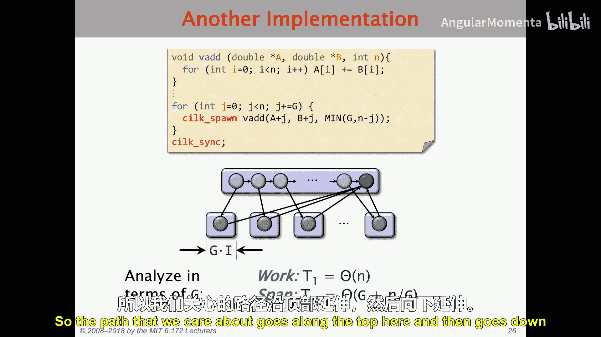

And then goes down there， and this has span G。Right。

So we've got n over G here because I'm doing chunks of G plus G， so it's n over G plus n over G。

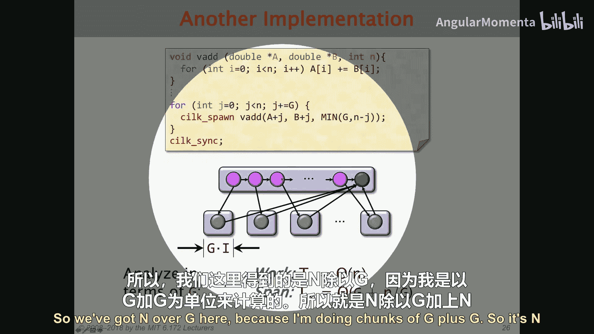

Okay。And now how can I choose G to minimize the span， there's nothing to choose to minimize the work。

 except there's some work overhead that we're not。That we're trying to do。

 but how can I choose G to minimize the span？What's the best value for G here？Yeah。You got it。

 square root of n。Okay。So one of these is increasing。If G is increasing n over G is decreasing。

 where do they cross？When they're equal。That's when G equals n over G。Or G is square root of n。Okay。

 so this actually has。De for n big enough， squareird of n， that's not bad。

So it is okay to spawn things off in chunks， just don't make the chunks real little。Okay。

What's the parallelism？So once again， this is always a gima， it's the ratio， so squared of n。Okay。

Quiz on parallel loops。Okay。U。I'm going to let you folks do this offline， okay， here's the answers。

 if you quickly write it down and you don't have to think about it。出出出出出出出出出出出。😔，Okay。Okay。

 so so take a look at the notes afterwards and you can try to figure out why those things are so okay。

 so there's some performance tips that make。Sense when you're programming with loops。

 one is minimize the span to maximize the parallelism because the spans in the denominator。

And generally， you want to generate 10 times more parallelism than processors if you want near perfect linear speed up。

So if you have a lot more parallelism than the number of process we talked about that last time you get good speed up。

If you have plenty of parallelism， try to trade some of it off to reduce the work overhead。

So the idea was for any of these things， you can fiddle with the numbers。

 to the grain size in particular to reduce it reduces the parallelism。

 but it also reduces the overhead and as long as you've got sufficient parallelism。

 your code run is going to run just fine parallel。It's only when you're sort of in the place whereooh。

 I don't have enough parallelism and I don't want to pay the overhead。

 those are the sticky ones but most of the time you're going to be in the case where you've got way more parallelism than you need and the question is how can you reduce some of it in order to get reduce the work overhead？

Generally， you should use divide and conquer reoccursion or parallel loops rather than spawning one small thing after another。

So it's better to do the Silk4， which already is doing divideide and conquer parallelism than doing the spawn off one thing at a time type of strategy。

 unless you can chunk them so that you have relatively few things that you're spawning off。

 this would be fine， the thing I say not this would be fine， if fo of eye was really expensive。

Fine then。We'll have lots ofel because there's a lot of work there， Okay， but generally。

 it's better to do the divide and conquer。Generally you should make sure that the number of work that you're doing per number of spawns is sufficiently large。

 so the spawns say well， how much are you busting your work into in terms of chunks because the spawn has an overhead。

 and so the question is well how big is that？And so you can do cosing by using function calls and inlining near the leaves。

Generally better to paralyze outer loops as opposed to inner loops if you're forced to make a choice。

Because the inner loops， they， the overhead you're incurring every single time， the outer loop。

 you can amortize it against the work that's going on inside that doesn't have the overhead。

And watch out for scheduling overhead， so here's an example of two codes that have parallelism too。

And one of them is an efficient code and the other one is lousy code。

The top one is efficient because I have two iterations and each of them that I run in parallel and each of them does a lot of work。

Okay， so that there's only one scheduling operation that happens， the bottom one。

 I have n iterations and each iteration does work too。

So I over so I basically have n iterations with overhead， and so if you just look at these。

 look at the overhead， you can see what the difference is， okay。

I want to talk a little bit about major， I actually have a whole bunch of things here that I'm not going to get to。

 but I didn't expect to get to them， but I do want to get to some of major's multiplication。

People are familiar with this problem。Okay。We're going to assume for simplicity that N is a power of two。

So here's the typical way of paralyzing matrix multiplication。The two outer loops。

 and I parallellyze them， I can't easily paralyze the inner loop because if I do。

 I get a race condition。Because I'll have two iterations that are both trying to update C of Ij。

So I can't just paralyze K， so I'm just going to paralyze I andJ。Okay。The work for this is what？

Triplely nested loop。InC， everybody knows make some multiplication unless you do something clever like Strasen or one of the more recent Virggie Williams algorithm。

you know that the running time is for the standard algorithm is n cubed。The span for this is what？

Yeah， that inner loop is linear size， and then you've got two log ends。Log n plus log n plus n。

 so it's order n。Okay， so the parallelism is around n squared。If I ignore constantstance。

 and I said I was working on matrices of， say  a000 by1 thousand0 or so。

 the parallelism is something like。N squared， which is about。诶。A thousand00 squared is a million。Wow。

That's a lot of parallelism。How many processes are you running on？

Is it bigger than 10 times the number of processors？Buy a little bit。Okay。

Now there's another strategy that one can use which is called divideivide and conquer and this is the strategy that's used in Strass and we're not going to do the Strasenss all。

 and we're just going to use the eight multiply version of this for people who know Strs and more power to you。

 it's a great algorithm。Really surprising， really， really amazing。

 and it's actually worthwhile doing in practice， by the way。For sufficiently large matrices。

 so the idea here is I can multiply two n by n matrices。

By doing eight multiplications of n over 2 by n over two matrices， and then add to n by n matrices。

Okay。So when we start talking matrices， this is a little bit of a diversion from the algorithms。

 but it's so important because representation of matrices is one of the things that gets people into trouble when they're doing any kind of two dimensional coding and stuff。

Okay， and so I want to talk a little bit about index and we're going to talk about more this more later when we do cash behavior and such。

So how do you represent sub matrices， the standard way of representing is either in row major or column major order depending upon the language you use。

 Forrann uses column major ordering so there are a lot of subrtines that are column major。

 but for the most part， C， which we're using is row major。And so the question is。

 if I take a submatrix of a large matrix， how do I calculate where the IJ element of that matrix is here I have the IJ element here。

 I've got a matrix M which is embedded and by row major remember that means I just take row after row and I just put them in linear order。

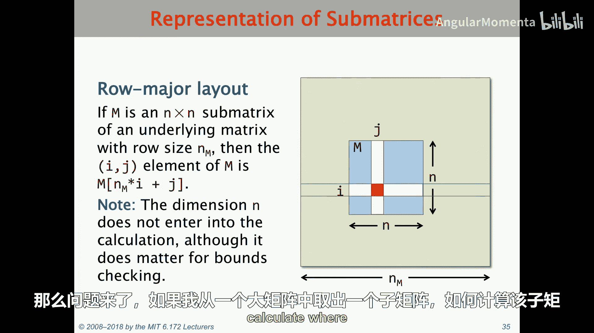

Through the memory。So every two dimensional matrix you can index as a one dimensional matrix because all you have to do is which is exactly what the code is doing。

 you need to know the beginning of the matrix， but if you have a sub matrix。

 it's a little more complicated。So here's the idea， suppose that you have a sub matrixx M。

 so starting in location M of this outer matrix， So here we have the outer matrix， which has length。

N Saam， this is the outer， the big matrix。Actually， I should have called that M。Okay。

 I should not have called this n sub M， I should have called it n of something else。

 because this is my M that I'm interested in， which is this location here。

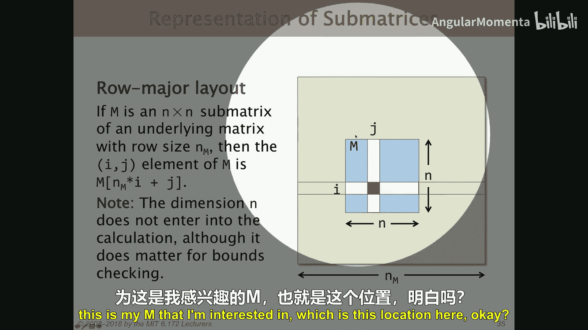

Okay。And what I'm interested in doing is finding out， I named these variables stupidly， okay。

 is finding out where is the IJ element of this submatrix M， if I tell you the beginning。

 what do I add to get to IJ？

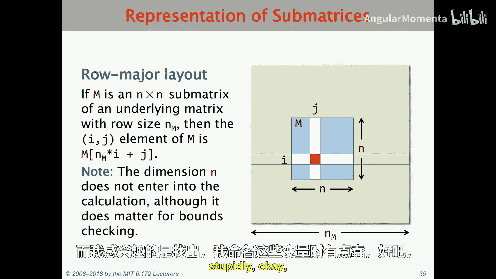

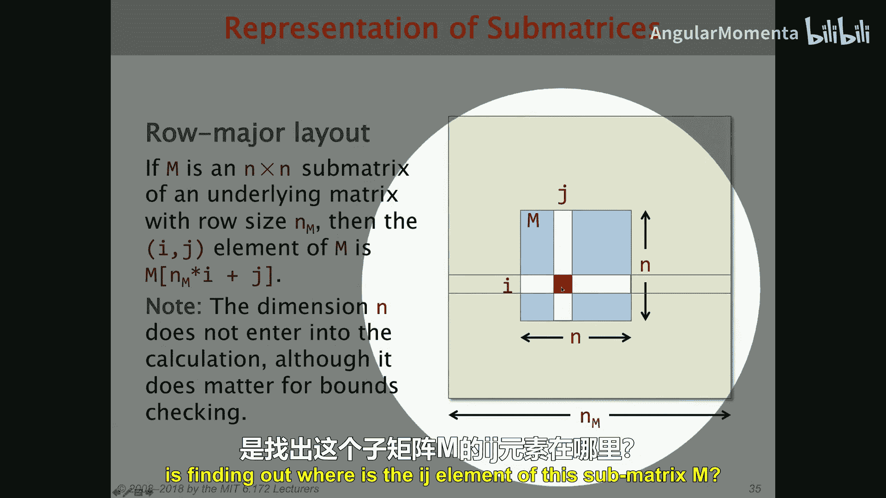

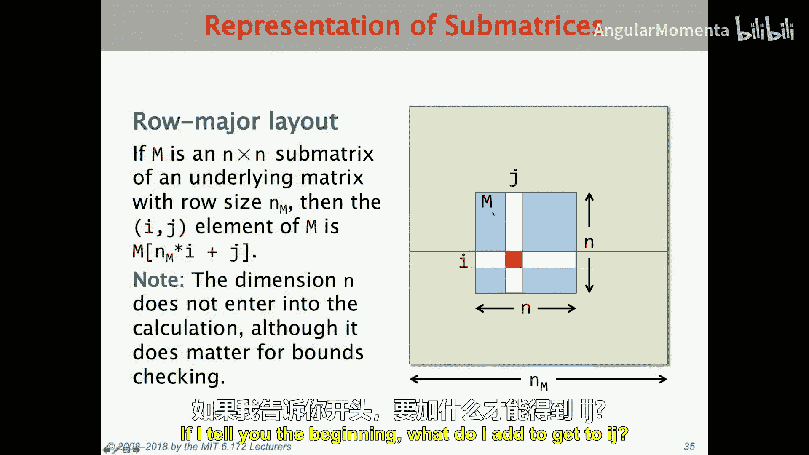

And the answer is that I've got to add the number of rows that comes down here， well。

 that's i times the width of the full matrix that you're taking it out of。

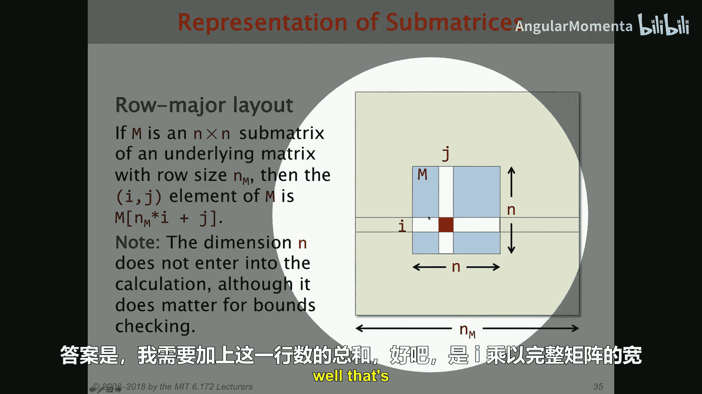

Not the width of your local submatrix。OkayAnd then you have to add in。

The the and then you add in Nj from that point， okay， there we go， okay， so I have to add in。

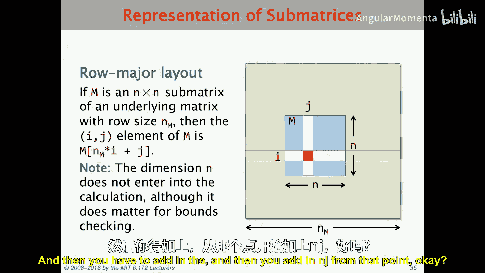

The length of the long matrix plus j for each row I， does that make sense？

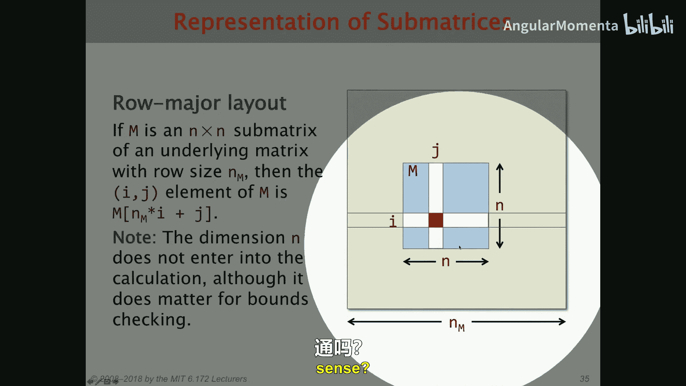

Because it's embedded in there， you have to skip over full rows of the outer matrix。

 so you can't generally just pass a sub matrix。And expect to do indexing on that when it's embedded in a large matrix。

 if you make a copy， sure then you can index it according to whatever the new copy is。

 but if you want to operate in place on matrices， which is often the case。

 then you have to understand that every row， you have to jump a row of the outer matrix。

 not a row of whatever your subma is when you're doing the divide and conquer。

So when we look at doing divide and conquer， I have a matrix here， which is。

Which I want to now divide into four sub matrices of P M over two。

 and the question is where's the starting corners of each of those matrices？So M00。

 that starts at the same place as M。that upper left one， where does M01 start？Where's M01 start？Yeah。

 M plus n over2。Where does M10 start？This is the tricky one。Okay， here's the answer。Okay， M plus。

 the long matrix。Times n over two， because I'm going down M over two rows。

 and I've got to go down the number of rows of the outer matrix。

And then M11 is the same as the two theres。In general， for row and column being 0 and1。

 in some sense， this is a general formula and matches up with that。Okay。

 where I plug in 01 for each one。And now here's my code。

 and I just want to point out a couple things and then we'll quit and I'll let you take a look at the rest of this on your own。

Here's my divide and conquer Ma multiply， okay， I use restrict。

 everybody familiar with restrict says， dont tells the compiler these things you can assume are not alias。

So that when you change one， you're not changing another， that lets the compiler produce better code。

And then the row sizes are going to be n sub C， n sub A， and n sub B。

And then the matrices that we're taking them out of， those are the sizes of the submatri。

 the outer matrix is going to have size n by n。for which when I have my recursion。

 I want to talk about sub matrices that are embedded in this larger outside matrix。

Here is a great piece of bit tricks。This saysN is a power of two。Okay。

Go back and remind yourself of what the bit tricks are。

 But that's a clever bit trick to say that N is a power of two。 Very quick and。

And so take a look at that， okay， and then we're going to coen the leaves with a base case。

 the base case just goes through and solves the problem for small n。

 just with a typical triply nested loop。And what we're going to do is allocate a temporary end by N array。

We're going to define the temporary rate to having underlying row size n。

And then here is this fabulous macro。That makes all the index calculations easy， it uses the sharp。

 sharp operator which pasts together tokens so that I can paste n sub C when I pass R and C。

 it passes whatever value I pass for that， it paste it together。

So it allows me to do the indexing of the and have the right thing so that for each of these address calculations。

 I'm able to do them by just saying X of and just give the formulas there otherwise you'd get reddriven nuts by the formula。

 so take a look at that macro because that may help you in some of your other things and then I sync and then add it up。

Okay。And the addition is just going to be a doubly nested parallel addition。And then I free it。

 so what I would like you to do is go home and take a look at the analysis of this and of what turns out this has way more parallelism than you need and if you reduce the amount of parallelism you get much better performance and there's several other algorithms I put in there as well。

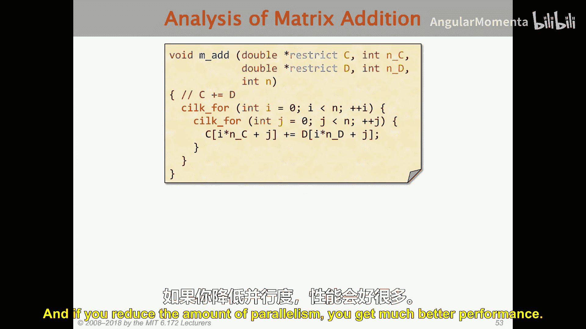

Okay， so I'll try to get this posted tonight。Thanks very much。

