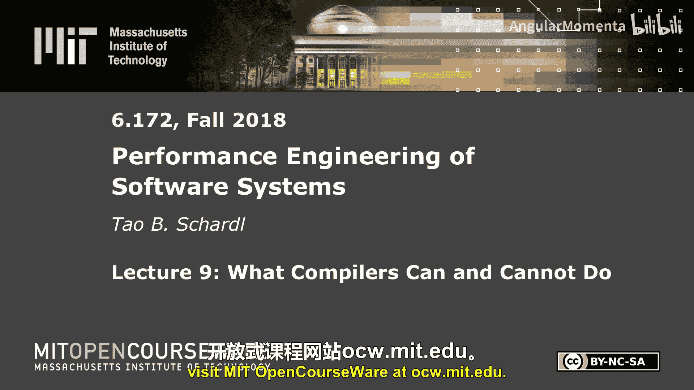
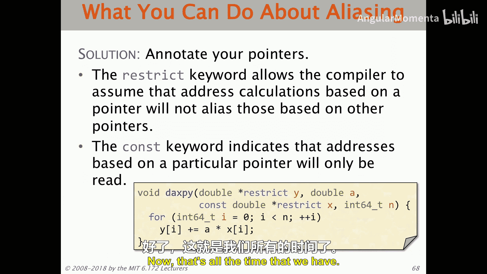

# 【麻省理工】软件系统性能工程 ｜MIT 6.172 Performance Engineering of Software Systems, Fall 2018 p09 9. 编译器能做与不能做的事 -BV1esbLzpEFq_p9-

The following content is provided under a Cative Commons license。

 Your support will help Mi T OpenCourseware continue to offer high quality educational resources for free to make a donation or to view additional materials from hundreds of MiT courses。

 Visit Mit Opencourseseware at Ocw。 Mt Eduu。

It's my great pleasure to introduce again TBB Sle， TBB is not only a fabulous world class performance engineer。

He is a world class performance meta engineer。In other words。

 building the tools and such to make it so that people can engineer fast code and he's the author of the。

Technology that we're using in our compiler， the taper technology that's in the openSt compiler。

For parallelism， so he implemented all of that and all the optimizations and so forth。

 which has greatly improved the quality of the programming environment。

So today he's going to talk about something near and dear to his heart。

 which is compilers and what they can and cannot do。3。Thank you very much。For that introduction。

 can everyone hear me in the back？Yes， great。All right， so as I understand it。

 last lecture you talked about multithted algorithms and you spent the lecture studying those algorithms。

 analyzing them in a theoretical sense， essentially analyzing their asymptotic running times。

 work and span complexity this lecture is not that at all。😊。

We're not going to do that kind of math anywhere in the course of this lecture。 instead。

 this lecture is going to take a look at compilers， as Professor Len mentioned。

 and what compilers can and cannot do。So the last time you saw me standing up here was back in lecture5。

 and during that lecture we talked about LLVMIR and X8664 assembly and how C code got translated into assembly code via LLVMIR。

In this lecture， we're going to talk more about what happens between the LVMIR and assembly stages。

 and essentially that's what happens when the compiler is allowed to edit and optimize the code in its IR representation while it's producing the assembly。

So last time we were talking about this IR in the assembly。

And this time they've called the compiler guy back， I suppose。

 to tell you about the boxes in the middle。Now。Even though you're predominantly dealing with C code within this class。

 I hope that some of the lessons from today's lecture。

 you will be able to take away into any job that you pursue in the future。

 because there are a lot of languages today that do end up being compiled。CNC++， Russ Swift。

 even Haskell， Julia， Haley， the list goes on and on。

 and those languages all get compiled for a variety of different， what we call backends。

 different machine architectures， not just X8664。And in fact。

 a lot of those languages get compiled using very similar compilation technology to what you have in the Kang LLVM compiler that you're using in this class。

 in fact， many of those languages today are optimized by LLVM itself。

 LLVM is the internal engine within the compiler that actually does all of the optimization。😊。

So that's my hope that the lessons you'll learn here today don't just apply to 172， they'll in fact。

 apply to software that you use and develop for many years down the road。

But let's take a step back and ask ourselves why bother studying the compiler optimizations at all。

 Why should we take a look at what's going on within this。Up to this point， black box of software。

Any ideas， any suggestions？And back。加一点。You can avoid manually trying to optimize things that the compiler will do for you。

 great answer， great， great answer， any other answers。😊。

You can learn how to best write your code to make take advantage of the optimizations of the compile。

You can learn how to write your code to take advantage of the compiler optimizations。

 how to suggest to the compiler what it should or should not do as you're constructing your program。

 great answer as well。Very good in the front。For。Only on optimization。

It can absolutely help for debugging when the compiler itself has bugs。

 the compiler is a big piece of software， and you may have noticed that a lot of software contains bugs。

 the compiler is no exception， and it helps to understand where the compiler might have made a mistake or where the compiler simply just didn't do what you thought it should be able to do。

 understanding more of what happens in the compiler can demystify some of those oddities。😊。

Good answer， anything else， any other thoughts？Its fine。It's fun。 Well， okay。

 so in my completely biased opinion。I would agree that it's fun to understand what the compiler does。

You may have different opinions， that's okay。I won't judge。

So put together a list of reasons why in general we make care about what goes on inside the compiler。

 I elighted that last point from this list， my bad。

 compilers can to have a really big impact on software。

It's like's kind of like this Imagine that you're working on some software project and you have a teammate on your team who's pretty quiet but extremely smart and what that teammate does is whenever。

That teammate gets access to some code， they jump in and immediately start trying to make that code work faster。

And that's really cool because that teammate does good work and oftentimes you see that what the teammate produces is indeed much faster code than what you wrote now in other industries you might just sit back and say teammate does fantastic work。

 maybe they don't talk very often， but that's okay， teammate， you do you。But in this class。

 we're performance engineers。 We want to understand what that teammate did to the software。

 How did that teammate get so much performance out of the code。

The compiler is kind of like that teammate。And so understanding what the compiler does is valuable in that sense。

As mentioned before， compilers can save you performance engineering work。

 if you understand that the compiler can do some optimization for you。

 then you don't have to do it yourself。And that means that you can continue writing simple and readable and maintainable code without sacrificing performance。

You can also understand the differences between the source code and whatever you might see show up in either the LVMIR or the assembly。

 if you have to look at the assembly language produced when you produced for your executable。

And compilers can make mistakes， sometimes that's because of a genuine bug in the compiler。

 and other times it's because the compiler just couldn't understand something about what was going on and having some insight into how the compiler reasons about code。

Can help you understand why those mistakes were made or figure out ways to work around those mistakes。

Or let you write meaningful bug reports to the compile developers。And of course。

 understanding compilers can help you use them more effectively。I think it's fun。

So the first thing to understand about a compiler is a basic anatomy of how the compiler works。

 The compiler takes as input L of VMR。And up until this point。

 we thought of it as just a big black box that does stuff to the IR and out pops more L of the MIIR。

 but it's somehow optimized In fact， what's going on within that black box。

The compiler is executing a sequence of what we call transformation passes on the code。

 Each transformation pass takes a look at its input and analyzes that code and then tries to edit the code in an effort to optimize the code's performance。

Now a transformation pass might end up running multiple times， and those passes run in some order。

 that order ends up being a predetermined order that the compiler writers found to work pretty well on their tests。

That's about the level of insight that went into picking the order。 it seems to work well。Now。

 some good news in terms of trying to understand what the compiler does。

You can actually just ask the compiler， what did you do？😡，And you've already used this functionality。

 as I understand， in some of your assignments， you've already asked the compiler to give you a report specifically about whether or not it could vectorize some code。

But in fact， LVM， the compile you have access to， can produce reports not just for vectorization。

 but for a lot of the different transformation passes that it tries to perform。

And there's some syntax that you have to pass to the compiler。

 some compiler flags that you have to specify in order to get those reports。

 those are described on the slide， I won't walk you through that text so you can look at the slides afterwards。

😊，At the end of the day， this string that you're passing is actually a regular expression。

 if you know what regular expressions are great， then you can use that to narrow down the search for your report if you don't。

 and you just want to see the whole report， just provide dot star as a string and you're good to go。

😊，That's the good news， you can get the compiler to tell you exactly what it did。

The bad news is that when you ask the compiler what it did， it'll give you a report and the report。

Looks something like this。 In fact， I've alllighted most of the report for this particular piece of code because the report ends up being very long。

And as you might notice just from reading some of the text。

 there are definitely English words in this text， and there are pointers to pieces of code that you've compiled。

But it is very jargony and hard to understand' the easiest piece of this isn't the easier to report to make sense of。

Okay， so that's some good news and some bad news about these compiler reports。

 the good news is you can ask the compiler and it'll happily tell you all about the things that it did。

 you can tell you about which transformation passes werere successfully able to transform the code。

 it can tell you conclusions that it drew about its analysis of the code。😊。

But the bad news is these reports are kind of complicated， they can be long。

 they use a lot of internal compiler jargon， which if you're not familiar with that jargon。

 it makes it hard to understand。It also turns out that not all of the transformation passes in the compiler give you these nice reports。

And so you don't get to see the whole picture， and in general。

 the reports don't really tell you the whole story about what the compiler did or did not do。

 and we'll see another example of that later on。So part of the goal of today's lecture is to get some context for understanding the reports that you might see。

If you pass those flags to the compiler。And the structure of today's lecture is basically divided up into two parts first。

 I want to give you some examples of compiler optimizations。

 just simple examples so you get a sense as to how a compiler mechanically reasons about the code it's given and tries to optimize that code。

 we'll take a look at how the compiler optimizes a single scalar value。

 how it can optimize a structure， how it can optimize function calls and how it can optimize loops。

 just simple examples to give some flavor。😊，And then the second half of the lecture。

 I have a few case studies for you， which get into diagnosing ways in which the compiler failed。

 not due to bugs per se， but simply didn't do an optimization you might have expected it to do。Dr。 B。

 Frank， I think all of those case studies are really cool， but it's not。

Totally crucial that we get through every single case study during today's lecture。

 the slides will be available afterwards， so when we get to that part we'll just see how many case studies we can cover。

😊，Sound good， any questions so far？All right。Let's get to it。

Let's start with a quick overview of compiler optimizations。

So here is a summary of the various options oh。I forgot that I just copyied this slide from a previous lecture。

Given in this class。You might recognize a slide， I think from lecture two。Sorry about that。

That's okay， we can fix this， we'll just go ahead and add the slide right now。

 we need to change the title， so we'll just cross that out and put in our new title。Yeah， great。

And now well we should double check these lists and make sure that they're accurate data structures we'll come back to data structures。

 loops hoisting， yeah the compiler can do hoisting sentinels not really compilers not good at sentinels。

 loop enrolling， yeah it absolutely does loop enrolling， loop fusion， yeah it can。

 but there are some restrictions that apply， you know your mileage might vary。

 eliminating was iterations some restrictions might apply， okay logic。

 constant folding and propagation， yeah it's good on that， common subexpression elimination。

 yeah it can find common subexpresss， you're fine there， algebra it knows algebra。

 yeah good short circuiting， yes absolutely ordering tests。😊，Depends on the tests。

 I'll give it to the compiler， but I'll say restrictions apply， creating a fast path。

Compliers aren't that smart about fastpas。 They come up with really boring fastpas。

 I'm going to take that off the list combiningbin tests again。

 it kind of depends on the tests functions。 Compliers are pretty good at functions。 So inlining。

 yep can absolutely do that。 tailor recursion elimination。 Yes， absolutely coarsening。😊，Not so much。

 Okay， great。 Let's come back to data structures， which we skipped before。Packing， augmentate， okay。

 honestly。TheThe compiler does a lot with data structures， but really none of those things。

 The compiler isn't smart about data structures in that particular way。

Really the way that the compiler is smart about data structures is shown here if we expand this list to include even more compiler optimizations。

Bottom line with data structures， the compiler knows a lot about architecture。😡，And it really。

 it's put a lot of effort into figuring out how to use registers really effectively reading and writing and register is super fast。

 touching memory is not so fast， and so the compiler works really hard to allocate registers。

 put anything that lives in memory ordinarily into registers。

Manipulate aggregate types to use registers， as we'll see in a couple slides。

 align data that has to live in memory， compilers are good at that。Compbins are also good at loops。

 we already saw some example optimization of the previous slide it can vectorize it does a lot of other cool stuff unswitching is a cool optimization that I won't cover here。

 idiom replacement it finds common patterns and does something smart with those fission skewing tiling interchange those all try to process the iterations of the loop in some clever way to make stuff go fast and some restrictions apply。

 those are really in development in LLVM logic， it does a lot more with logic than what we saw before。

 it can eliminate instructions that aren't necessary。

 it can do strength reduction and other cool optimization I think we saw that one in the bentley slides it gets rid of dead code。

 it can do more idiom replacement， branch reing is kind like reordering tests global value numbering another cool optimization that we won't talk about today functions it can do more on switching it can eliminate arguments that aren't necessary so the compiler can do a lot of stuff for you。

😊，And at the end of the day， writing down this whole list is kind of a feudile activity。

Because it changes over time， compilers are a moving target。Compilr developers。

 they're software engineers like you and me， and they're clever and they're trying to apply all their clever software engineering practice to this compiler codebase to make it do more stuff。

And so they are constantly adding new optimizations to the compile， new clever analyses all the time。

😊，So really， what we're going to look at today is just a couple examples to get a flavor for what the compiler does internally。

Now， if you want to follow along with how the compiler works， the good news is by and large。

 you can take a look at the LLVMIR to see what happens as the compiler processes your code。

 you don't need to look at the assembly。That's generally true， but there are some exceptions。

So for example， if we have these three snippets of C code on the left and we look at what your LLVM compiler generates in terms of the IR。

 we can see that there are some optimizations reflected but not too many interesting ones the multiply by eight turns into a shift left operation by3 because8 is a power of  two。

 that's straightforward， good， we can see that in the IR。

 the multiply by 15 still looks like a multiply by 15， no changes there。

 the divide by 71 looks like a divide by 71， again， no changes there。Now with arithmetic ops。

 the difference between what you see in the LVMIR and what you see in the assembly。

 this is where it's most pronounced， at least in my experience。

 because if we take a look at these same snippets of C code and we look at the corresponding X86 assembly for it。

We get the stuff on the right。And this looks。Different。

Let's pick through what this assembly code does one mind in time。

 So the first one the C code takes the argument n and multiplies it by 8。 And in the assembly。

 we have this LEA instruction。 Anyone remember what the LEA instruction does。

I see one person shaking their head， that's a perfectly reasonable response， yeah， go for it。

Load effective address， what does that mean？Load the address， but don't actually access memory。

 another way to phrase that， compute the do this address calculation and give me the result of the address calculation。

 don't read or write memory at that address， just do the calculation。

 that's what loading an effective address means essentially。But you're exactly right。

The LEA instruction。Doest address calculation and so as a result in the register on the right。

 Anyone remember enough about X 86 address calculations to tell me how that LEA in particular works。

 The first LEA on the slide。Whats stakeholders？But's before the first comma in this case nothing gets added to the product of the second two arguments in those pers。

 you're exactly right， so this LEA takes the value 8， multiplies it by whatevers in register RDI。

 which holds the value n。And it stores the result into AAX。 So perfect。 it does a multiply by 8。

The address calculator is only capable of a small range of operations， it can do additions。

 and it can multiply by one，2，4， or eight。That's it， so it's a really simple circuit in the hardware。

But it's fast， it's optimized heavily by modern processors， and so if the compiler can use it。

 they tend to try to use these LEA instructions。Good job。 How about the next one。

 multiply by 15 turns into these two LEA instructions。 Can anyone tell me how these work？

You're basically multiplying by five and multiplying by three， exactly right。

We can step through this as well if we look at the first LEA instruction， we take RDI。

 which stores the value N。We multiply that by four。We added to the original value of RDI。

And so that computes four times n plus n， which is5 times n。And that result gets stored into EAX。

We've effectively multiplied by five。The next instruction takes whatever is in REX。

 which is now  PhiN。Multiplies that by two。Adds it to whatever is currently in REX。

 which is once again， 5N。So that computes2 times5 n plus 5 n， which is3 times 5n。It is 15 n。

So just like that， we've done our multiply with two LEA instructions。How about the last one？

In this last piece of code。We take the argument in RDI and we move it into EX。We then move the value。

3 billion。871519，817 and put that into ECX as you do。We multiply those two values together。

 and then we shift the product right by 38。So obviously， this divides by 71。

Any guesses as to how this performs the division operation we want？Both of you have answered。

 I might still call on you， but I'll give a little more time for someone else to raise a hand。

Go for it。拿出个。238。It has a lot to do with 2 to 38， very good。啊。Yeah， all right。

 any further guesses before I give the answer away， yeah in the back。最多定为。Using the fact that。

In kinda。This is what's technically called a magic number。 And yes。

 it's technically called a magic number。 And this magic number is equal to 2 to the 38。

 divided by 71。😊，Plus， one to deal with some rounding effects。What this code does is it says。

 let's compute n divided by 71 by first computing。N divided by 71 times 2 to 38。

And then shifting off the lower 38 bits。With that shift right operation。And because it can。

By converting the operation into this， it's able to replace the division operation with a multiply。

And if you remember， hopefully from the architecture lecture， multiply operations。

 they're not the cheapest things in the world， but they're not too bad， division is really expensive。

 if you want fast code， never divide。Also， never compute modulus or access memory， yeah question。

Why did you choose 38？I think it shows 38 because 38 works， there's actually a formula for。

Pretty much， it doesn't want to choose a value that's too large or else it'll overflow。

And it doesn't want to choose a value that's too small or else you lose precision。

 so it's able to find a balancing point。 If you want to know more about magic numbers。

 I recommend checking out this book called Hacker's Delight。😊。

For any of you who are familiar with this book， it is a book full of Bitris。Seriously。

 that's in the entire book， it's just a book full of Beatris。

 and there's a whole section in there describing how you do division by various constants using multiplication。

 either signed or unsigned。It's very cool。But yeah。

Magic number to convert a division into a multiply。

That's the kind of thing that you might see from the assembly。

 that's one of these examples of arithmetic operations that are really optimized at the very last step。

 but for the rest of the optimizations， fortunately we could focus on the IR。

Any questions about that so far？Cool。Okay。For the next part of the lecture。

 I want to show you a couple example optimizations in terms of the L ofVMR。

 and to show you these optimizations we'll have a little bit of code that we'll work through。

 a running example， if you will， and this running example will be some code that I stole from I think is a serial program that simulates the behavior of and massive bodies in 2D space。

😊，Under the law of gravitation。 So we've got a whole bunch of point masses。

 those point masses have varying masses。 and we just want to simulate what happens。😊。

Due to gravity as these masses interact in the plane。At a high level。

 the end body code is pretty simple， we have a top levelvel simulateim routine which just loops over all the time steps during which we want to perform this simulation。

 and at each time step it calculates the various forces in acting on those different bodies and then it updates the position of each body based on those forces。

😊，In order to do that calculation， it has some internal data structures， one to represent each body。

 which contains a couple of vector types， and we define our own vector type to store two double precision floating point values。

Now we don't need to see the entire code in order to look at some compiler optimizations。

But one routine that we will take a look at is this one to update the positions。

 This is a simple loop。😊，That。Takes each body one at a time。

 computes the new velocity on that body based on the forces acting on that body and uses vector operations to do that。

And then it updates the position of that body， again。

 using these vector operations that we've defined。And then it stores the result into the data structure for that body。

So all of these methods with this code make use of these basic routines on 2D vectors。

 points in Xy or points in 2D space。And these routines are pretty simple。

 there's one to add two vectors， there's another to scale a vector by a scalar value。

And there's a third to compute the length， which we won't actually look at too much。

Everyone good so far？Okay。So let's try to start simple。 Let's take a look at just one of these。

One line， vector operations， Vex scale。😡，All V scale does is it takes one of these vector。

One of these vector inputs and a scalar value a， and it multiplies x by a and y by a and stores the results into a vector type and returns it。

Great， couldn't be simpler。If we compile this with no optimizations whatsoever。

 and we take a look at the LVMIR。We get that。Which is。

A little more complicated than you might imagine。The good news， though。

 is that if you turn on optimizations and you just turn on the first level of optimization， just01。

Whereas we got this code before now。We get this。Which is far， far simpler and so simple。

 I can blow up the font size so you can actually read the code on this slide。So just see， again。

 no optimizations。Optimizations。So a lot of stuff happened to get from。

To optimize this simple function， we're going to see what those optimizations actually were。

But first， let's pick apart what's going on in this function。We have our Vex scale routine in LVMIR。

 it takes a structure as its first argument， and that's represented using two doubles。

It takes the scalar as a second argument， and what the operation does is it multiplies those two fields by the third argument。

 the double A。It then packs those values into a struct that'll return。

 and finally it returns that struct。So that's what the optimized code does。

 let's see actually how we get to this optimized code。And we'll do this one step at a time。

Let's start by optimizing the operations on a single scalar value， that's why I picked this example。

So if we go back to the00 code and we just pick out the operations that dealt with that scalar value。

 we narrow our scope down to just these lines。So the argument。

 double A is the final argument in the list and what we see。As so within the Vex scale of routine。

 compile00， we allocate some local storage， we store that AA into the local storage。

 and then later on we'll load the value out of the local storage before the multiply。

 and then we load it again before the other multiply。Okay。

Any ideas how we could make this code faster？Don't store it in memory， What a great idea。

 how would we get around not storing in memory？せブ。Save it and register。In particular。

What property of LLVMIR makes that really easy？There are infinite registers and in fact。

The argument is already in a register。It's already in the register。Percent two article。

 so we don't need to move it into a register， it's already there。

So how do we go about optimizing that code in this case well？

Let's find the places where we're using the value and we're using the value loaded from memory。

And what we're going to do is just replace those loads from memory with the original argument。

 we know exactly what operation we're trying to do。

 we know we're trying to do a multiply by the original parameter。So we just find those two uses。

We cross them out and we put in。The input parameter in his place。That makes sense。Questions so far。

Cool。So now。Those multiplies aren't using the values for turn by the loads。

How further can we optimize this code？Sorry。Dete the loads。What else can we delete？

So there's no address calculation here just because the code is so simple。Good insight。

The allocation and。And the store， great。So those loads are dead code， the store is dead code。

 the allocation is dead code， we eliminate all that dead code。We got rid of those loads。

 we just use the value living in the register， and we've already eliminated a bunch of instructions。

So the net effect of that was to turn the code optimize at00 that we had in the background。

Into the code we have in the foreground。Which is slightly shorter。But not that much。

 So it's a little bit faster， but not that much faster。 How do we optimize this function further？

Do it for every variable we have。In particular， the only other variable we have is this structure that we're passing in。

So we want to do this kind of optimization on the structure。Make sense。

So let's see how we optimize this structure。Now the problem is that structures are harder to handle than individual scalar values。

 because in general， you can't store the whole structure in just a single register。

 it's more complicated to juggle all the data within a structure。But nevertheless。

 let's take a look at the code that operates on the structure。

 or at least operates on the structure that we pass in to the function。

So when we eliminate all the other code， we see that we've got an allocation。

See if I have animations here， yeah， do we have an allocation。

So we can store the structure onto the stack。Then we have an address calculation that lets us store the first part of the structure onto the stack。

We have a second address calculation to store the second field onto the stack， and later on。

 when we need those values， we load one of the first field out of memory and well load the second field out of memory。

😊，So it's a very similar pattern to what we had before。Except we've got more going on in this case。

So how do we go about optimizing this structure？Any ideas， high level ideas？Ultimately。

 we'll want to get rid of。All of the memory references and all that storage for the structure。

 How do we reason through。How do we reason through eliminate all that stuff in a mechanical fashion？

Based on what we've seen so far。Go for it。They are passed in using separate parameters。

 separate registers， if you will， as a quirk of how LLVM does it， so given that insight。

 how would you optimize it？Cross out percent 12%6 and put in their relevance。The relevant field。Cool。

 let me phrase that a little bit differently， let's do this one field at a time。

We've got a structure which has multiple fields。Let's just take it one step at a time。All right。

So let's look at the first field and let's look at the operations that deal with the first field。

We have in our code。In our LVMIR， some address calculations that refer to the same field of the structure。

In this case， I believe it's the first field， yes。Okay。And ultimately。

 we end up loading from this location in local memory。So what value is this load going to retrieve？

How do I know that both address calculations refer to the same field。

 good question what we do in this case is very careful analysis of the math that's going on。😊。

We know that the alaca， the location in local memory， that's just a fixed location。

 and from that we can interpret what each of the instructions does in terms of an address calculation and we can determine。

But they're the same value。So we have this location and memory。That we operate on。

 and before we ultimately use。Before you do a multiply。

 we end up loading from that location of memory。So what value do we know is going to be loaded by that load instruction？

Go for it。Your orient。大家。Orな。Not putting it back， but we don't even worry about putting it back。

We don't need to put it somewhere。Correct。Correct， so what are we multiplying of that multiply？

Which value？First element of thestruct， it's percent zero， it's the value that we stored right there。

That makes sense， everyone see that， any questions about that？All right。

So we're storing the first element of the struct into this location。

 later we load it out of that same location， nothing else happened to that location。

So let's go ahead and optimize it just the same way we optimize the scalar。

We see that we use the result of the load right there。

 but we know that that load is going to return the first field of our struct input。

So we'll just cross out and replace it with that field。

So now we're not using the result of that load， what do we get to do？As the compiler。

And it's how you know the answer。Delete the dead code， delete all of it。Remove the now dead code。

 which is all of those address calculations as well as the load operation and the store operation。

And that's pretty much it， yeah， good。So we replaced that operation。

 and we got rid of a bunch of other code from our function。

We've now optimized one of the two fields in our struct， what do we do next？Optimize the next one。

That happened similarly， I won't walk you through that a second time。

We find where we're using the result of that load， we can cross it out。

 replace it with the appropriate input。And then delete all of the relevant Ed code。

 and now we get to delete the original allocation because nothing's getting stored to that memory。

That makes sense， any questions about that？Yeah。Yep， unpack。When we first compiled LVMR。

 do we unpack thestruct and pass in the separate parameters。

 like how we have three parameters here that are doubled？Our original C code is destructive。Yeah。

LLVMR in this case， when we compiled that it was zero， decided to pass it as separate parameters。

 just as its representation。So in that sense， yes。But it was still doing the standard。

 create some local storage， store the parameters onto local storage。

 and then all operations just read out of local storage。

 It's the standard thing that the compiler generates when。When it's asked to compile C code。

And with no other optimizations， that's what you get。That makes sense。いや。都我来。

What are all the align8s doing， the align8s are attributes that specify the alignment of that location in memory。

 this is alignment information that the compiler either determines by analysis or implements as part of a standard。

So they're specifying how values are aligned in memory。

That matters a lot more for ultimate co generation。

 unless we're able to just delete the memory references altogether。Make sense。Go。Any other questions？

All right。So we optimize the first field， we can optimize the second field a similar way。

Turns out there's additional optimizations that need to happen in order to return a structure from this function。

Those operations can be optimized in a similar way that are shown here。

 we're not going to go through exactly how that works。But at the end of the day。

 after we've optimized all of that code， we end up with this。We end up with our function。

 compile that01。And it's far simpler， I think it's far more intuitive。

 this is what I would imagine the code should look like when I've written the code。

 when I wrote the C code in the first place。Take your input， do a couple multiplications。

 and then it does some operations to create the return value and ultimately return that value。

So in summary， compilers， the compiler works hard to transform data structures and scale their values to store as much as it possibly can purely within registers and avoid using any local storage。

If possible。Everyone good with that so far？Cool。Let's move on to another optimization。

 let's talk about function calls。let's take a look at how the compile can optimize function calls By and large。

 these optimizations will occur if you pass optimization level two or higher。😊，Yeah， just FII。

So from our original C code， we had some lines that performed a bunch of vector operations。

 we had a VCAd that added two vectors together， one of which was the result of a V scale which scaled the result of a VC addd by some scalar value。

 so we had this chain of this chain of calls in our code。

And if we take a look at the code compiled that00， what we end up with。

 is the snippet shown on the bottom？Whi performs some operations on these vector structures。

 does this multiply operation and then calls this Vex scale routine。

 the Vex scale routine that we decided to focus on first。So。

How do we go about any ideas for how we go about optimizing this？

So do you give have a little bit of a hint？What the compiler sees when it looks at that call。

Is it sees a snippet containing the call instruction？And it also see in our example。

 it also sees the code for the Vex Sc function that we were just looking at。

 and we're going to suppose is that it's already optimized VX scale as best as it can。

 it's produced this code for the VX Scalar routine。

And so it sees that call instruction and it sees this code for the function that's being called。😊。

So what could the compiler do at this point to try to make？

The function in the code above even faster。on my archive。We they call。You're exactly right。

 remove the call， and just put the body of the Vex scale code right there in place of the call。

It takes a little bit of effort to pull that off， but roughly speaking。

 yet we're just going to copy and paste this code in our function into the place where we're calling the function。

And so if we do that simple copy paste， we end up with some garbage code as an intermediate。

 we had to do a little bit of renaming to make everything work out。But at this point。

 we have the code from our function in the place of that call。

 and now we can observe that to restore correctness。

 we don't want to do the call and we don't want to do the return that we just paste it in place。

So we'll just go ahead and remove both that call and the return。That is called function inlining。

We identify some function call or the compiler identifies some function call。

 and it takes the body of the function and just paste it right in place of that call。Sound good？

Make sense， anyone confused。Raise your hand if you're confused。All right。Now。

 once we've done some amount of function inlining， we can actually do some more optimizations。

So here we have the code after we got rid of the unnecessary call in return。

And we have a couple of multily operations sitting in place。 that looks fine。

But if we expand our scope just a little bit， what we see。

 so we have some operations happening that were sitting there already after the original call。

And what the compiler can do is it can take a look at these instructions， and long story short。

 it realizes that all these instructions do is pack some data into a structure and then immediately unpack the structure。

So it's like you put a bunch of stuff into a bag and then immediately dumped out the bag。

That was kind of a waste of time， that's kind of a waste of code， let's get rid of it。Right。

Those operations are useless， let's delete them， Compli has a great time deleting dead code。

ButIt's like it's what it lives to do。All right， now， in fact， in the original code。

 we didn't just have one function call， we had a whole sequence of function calls。

 and if we expand our LVMIR snippet even a little further， we can include those two function calls。

 the original call to VecA followed by the code that we've now optimized via inlining。

Ultimately followed by yet another call to VAd。Minor spoiler， the VCAd routine， once it's optimized。

 looks pretty similar to the Vex Scalar routine。And in particular。

 it has comparable size to the Vex scale routine。😊。

So what's the compiler going to do to those two call sites？Inline it， do more inlining。

 inlining is great。We'll outline these functions as well。😊。

And then remove all the additional now useless instructions， we won't walk through that process。

 but the result of that process looks something like this。So in the original C code， we had this VAd。

😊，Wwhichch called the Vex scale as one of its arguments， which called a VA as one of its arguments。

 and what we end up with in the optimized IR is just a bunch of straight line code that performs floating point operations。

It's almost as if。The compiler took the original C code。

And transformed it into the equivalency code shown on the bottom。

Where it Jess operates on a whole bunch of doubles and just does primitive operations。

So function inlinning。As well as the additional transformations， it was able to perform as a result。

Together， those were able to eliminate all of those function calls。

 it was able to completely eliminate any costs associated with the function call abstraction。

At least in this code。Make sense。I think that's pretty cool。

 You write code that has a bunch of function calls because that's how you've constructed your interfaces。

😊，But you're not really paying for those function calls。

 function calls aren't the cheapest operation in the world。

 especially if you think about everything that goes on in terms of the registers and the stack。

But the compiler is able to avoid all of that overhead and just perform the floating point operations we care about。

Okay， well， the function inlining is so great and it enables so many great optimizations。😊。

Why doesn't the compiler just inline every function call？😡，Comfor it。Recursion。

 it's really hard to inline a recursive call。In general， you can't inline a function into itself。

 although it turns out there are some exceptions， so yes。

 recursion creates problems with function inlining， any other thoughts？In the back。

You're definitely onto something， so we had to do a bunch of this renaming stuff when weline the first time and when we inline every single time。

And even though L ofV MIR has an infinite number of registers， the machine doesn't。

And so all of that renaming does create a problem， but there are other problems as well of a similar nature when you start inlining all those functions。

 for example， you copy pasted a bunch of code。😊，And that made the original call site even bigger and bigger and bigger and bigger and programs we generally don't think about the space they take in memory。

 but they too take space and memory and that does have an impact on performance， so great answer。

Any other thoughts？If your function becomes too long。

 then it may not fit in instruction cache and that can increase the amount of time it takes just to execute the function because you're now not getting hash hits exactly right。

 that's one of the problems with this code size blow from inlining everything。😊，Any other thoughts。

 any final thoughts？So there are three main reasons why the compiler won't inline every function。

 I think we touched on two of them here。For some function calls， like recursive calls。

 it's impossible to inline them because you can't inline a function into itself。

But there are exceptions to that， namely recursive tail calls。

 if the last thing in a function is a function call。

 then it turns out you can effectively inline that function call。As an optimization。

We're not going to talk too much about how that works。But there are corner cases， but in general。

You can't inline a recursive call。The compiler has another problem， namely。

If the function that you're calling。I's in a different castle if it's in a different compilation unit。

Then literally in a different file that's compiled independently。

 then the compiler can't very well inline that function because it doesn't know about the function。

 it doesn't have access to that function's code。There is a way to get around that problem with modern compiler technology that involves whole program optimization。

 and I think there's some backup slides that will tell you how to do that with LLBM。But in general。

 if it's in a different compilation unit， it can't be in line。And finally， as touched on。

 function in line can increase code's size， which can hurt performance。Okay。

 so some functions are okay to inline， other functions could create this performance problem because you increase code size。

 so how does the compiler know whether or not inlining any particular function at a call site？😊。

Could her performance？Any guesses？第二。Yeah， so the compiler has some cost model。

 which gives it some information about。How much will it cost to inline that function？

Is the cost model always right？It is not。So the answer， how does an compile know。

 is really it doesn't know。It makes it best guess using that cost model。

And other heuristics to determine when does it make sense to try to inline a function？

And because it's making a best guess， sometimes the compiler guesses wrong。So to wrap up this part。

 here's just a couple of tips for controlling function inlining in your own programs。

 if there's a function that you know must always be inline， no matter what happens。

 you can mark that function with a special attribute。Namely the old ways in line attribute。

 For example， if you have a function that does some complex address calculation and it should be in line rather than called。

You may want to mark that with an always inline attribute。Similarly。

 if you have a function that really should never be in line。

 it's never cost effective to inline that function。

 you can mark that function with the no in line attribute。And finally。

 if you want to enable more function inlining in the compiler。

 you can use link time optimization or LTO to enable whole program optimization。😊。

won't go into that during these slides， let's move on and talk about loop optimizations。

Any questions so far before we continue？いや。であぱ。Sorry。Despite' in on' like you'll sta your line。

I don't pop any。Does static inline guarantee that the compiler will always inline it。

 It actually doesn't。 The inline keyword will。Provide a hint to the compiler that it should think about inlying the function。

 but it doesn't provide any guarantees。 If you want a strong guarantee。

 use the always inline attribute。Good question， though。All right， loop optimizations。

You've already seen someO optimizations， you've seen vectorization， for example。

 it turns out that the compiler does a lot of work to try to optimize loops。So first。Why is that。

 why would the compiler engineers invest so much effort into optimizing loops？

Why loops in particular？确。There'sre an extremely common control structure that also has a branch。

Both things are true， I think there's a higher level of reason though。Or more fundamental reason。

 if you will。嗯。Most of the time the loop takes up the most time you got it loops account for a lot of the execution time of programs。

 The way I like to think about this is with a really simple thought experiment。

 Let's imagine that you got a machine with the two gigahHtz processor。

 we chosen these values to be easier to think about。Using mental math。

 suppose you've got a two gigahertz processorer with 16 cores。

 each core executes one instruction per cycle， and suppose that you've got a program which contains a trillion instructions and ample perism for those 16 cores。

 but all of those instructions are simple straight line code。There are no branches。

 there are no loops， there are no complicated operations like IO。

 it's just a bunch of really simple straight line code， each instruction takes a cycle to execute。

 the processoror exceeds one instruction per cycle。😊，How long does it take to run this code？

Text you the entire terabyte。Binary。Two the 40th cycles。For two to40 instructions。

 but you're using a two gigahertz processor。And 16 cores。

And you got ample perilism in the program to keep them all saturated。So how much time？32 seconds。

Nice， nice job。This one has mastered power of two arithmetic in one's head。It's a good skill to have。

 especially in Corsex。 Yeah， so if you have just a bunch of simple straight line code and you have a terabyte of it。

😊，that's a lot of code， that is a big binary。And yet。The program， this processor。

 this relatively simple processor， can execute the whole thing in just about 30 seconds。Now。

 in your experience working with software， you might have noticed that there are some programs that take longer than 30 seconds to run。

And some of those programs don't have terabyte size binaries。

The reason that those programs take longer to run by and large is loops。

 so loops account for a lot of the execution time in real programs。

Now you've already seen some loop optimizations， we're just going to take a look at one other loop optimization today。

 namely code hoisting， also known as loop andvariant code motion。

And to look at that we're going to take a look at a different snippet of code from the end body simulation。

 this code calculates the forces going on each of the n bodies。

 and it does it with a doubly nested loop。😊，For all the bodies zero or zero to a number of bodies。

 for all bodies zero a number of bodies， as long as you're not looking at the same body。

Call this add force routine， which calculate the force on the force between those two bodies and add that force to one of the bodies。

 It's all that's going on in this code。If we translate this code into L ofVMIR， we end up with。

Hopefully unsurprisingly， a doubly nested loop。It looks something like this， the body of the code。

 the body of the innermost loop has been lighted just so things can fit on the slide。

Well we can see the overall structure on the outside， we have some outer loop control。

This should look familiar from lecture five， hopefully。Inside of that outer loop。

 we have an inner loop。And at the top and the bottom of that inner loop。

 we have the inter loopop control。And within that inner loop。

We do have one branch which can skip a bunch of code if you're looking at the same body for INJ。

But otherwise， we have the loop body of the innermostsly。Basic structure。Now。

 if we just zoom in on the top part of this doubly nested loop， just the top most three basic blocks。

And take a look at more of the code that's going on here。

We end up with something that looks like this。And if you remember some discussion from lecture 5 about loop induction variables and what that looks like in LVMIR。

 what you find is that for the outer loop。We have an induction variable at the very top。

 It's that weird fee instruction， once again。Inside that outer loop。

 we have the loop control for the inner loop， which has its own induction variable。

 once again we have another fee node， that's how we can spot it。And then we have。

The body of the innermost loop。And this is just the start of it。

 it's just a couple address calculations。But can anyone tell me some interesting property about just a couple of these address calculations？

That could lead to an optimization。To finally the out。

The first two address calculations only depend on the outermost loop variable。

 the iteration variable for the outer loop， exactly right。So what can we do with those instructions？

Bring them out of the inner loop。Why should we keep computing these addresses in the innermost loop when we could just compute them once in the outer loop？

That optimization。Is called code hoisting or loop invariant code motion。

 those instructions are invariant to the code in the innermost loop， so you hoist them out。

And once you hoist them out， you end up with a transformed loop。That looks something like this。

What we have is the same outer loop control at the very top。

 but now we're doing some address calculations there。

 and we no longer have those address calculations on the inside。😊，And as a result。

Those hoisted calculations are performed just once per iteration of the outer loop。

Rather than once per iteration of the inner loop。And so those instructions are run far fewer times。

 you get to save a lot of running time。So the effect of this optimization in terms of C code because it can be a little tedious to look at LVMIR。

It's essentially like this， we took this doubly nested loop and sea。We were calling ad force of。Blah。

 blah， blah， calculate force， blah， blah， blah， and now we just move the address calculation to get the I body that we care about。

 we move that to the outer loop。😊，Now this was an example of loop invari code motion on just a couple address calculations。

 in general， the compiler will try to prove that some calculation is invariant across all the iterations of a loop。

 and whenever it can prove that it will try to hoist that code out of the loop。😊。

If you can get code out of the body of a loop that reduces the running time of the loop saves a lot of execution time。

 huge bang for the buck。Makes sense， any questions about that so far？All right。

 so just to summarize this part， what can the compiler do。

 the compiler optimizes code by performing a sequence of transformation passes。

 all those passes are pretty mechanical， the compiler goes through the code。

 it tries to find some property like this address calculation is the same as that address calculation and so this load will return the same value as that store and so on and so forth and based on that analysis。

 it tries to get rid of some dead code and replace certain register values with other register values。

😊，Replace things that live in memory with things that just live in registers。

A lot of the transformations resemble Bentley rule work optimizations that you've seen in lecture two。

 so as you're studying for your upcoming quiz， you can kind of get two for one by looking at those Bentley rule optimizations。

And one transformation pass in particular function inlining was a good example of this。

 one transformation can enable other transformations。

 and those together can compound to give you fast code。😊，In general。

 compilers perform a lot more transformations than just the ones that we saw today。

 but there are things that the compiler can't do。Here's one very simple example。In this case。

 we're taking another look at this calculate forces routine。

Although the compiler can optimize the code by moving address calculations out of the loop。

 one thing that I can't do。Is exploit symmetry in the problem。 So in this problem。

What's going on is we're computing the forces on any pair of bodies using the law gravitation。

And it turns out that the force actually on one body。

By another is exactly opposite the force acting on the other body by the one。

So f of 12 is equal to minus f of 21。The compiler will not figure that out。

 the compiler knows algebra， it doesn't know physics。

 so it won't be able to figure out that there's symmetry in this problem and it can avoid wasted operations。

Make sense。All right， so that was an overview of some simple compiler optimizations。

 we now have some failure， some examples of some case studies to see where the compiler can get tripped up。

😊，And doesn't matter if we get through all these or not， you'll have access to the slides afterwards。

 but I think these are kind of cool。 So shall we take a look。😊，All right。Simple question。

 does the compiler vectorize this loop？So just to go over what this loop does， it's a simple loop。

The function takes two vectors as inputs， or two arrays as inputs， I should say， an array called Y。

Of blank then， array of x or an array x of length then， and some scalar value A。

And all that this function does is it loops over each element of the vector。

 multiplies x of I by the input Scalar， adds the product into y sub I。😊，So does the loop vectorize。

 yes？YX could overlap， and there is no information about whether they overlap， so do they vectorize？

We have a vote for note。Anytone think that does vectorize？He made a very convincing argument。

Everyone thinking everyone believes that this loop does not vectorize， is that true？Anyone uncertain？

Anyone unwilling to commit to yes or no right here？All right。

 a bunch of people are unwilling to commit to yes or no。 All right， let's resolve this question。

 let's first ask for the report， Let's look at the vectorization report。We compile it。

 we pass the flags to get the vectorization report， and the vectorization report says。Yes。

It does vectorize this loop。Which is interesting because we have this great argument that says。😊。

But when you don't know how these addresses fit in memory。

 you don't know if X and Y overlap with each other， how can you possibly vectorize？Kind of a mystery。

Well。If we take a look at the actual compiled code， when we optimize this at O2。

 it turns out you can pass certain flags of the compiler and get it to print out not just the LVMR。

 but the LLVMR formatted as a control flow graph。And the control flow graph for this simple two line function。

😊，Is the thing on the right？Which you obviously can't read。

And because it's a little bit small in terms of its text， and it seems to have a lot going on。

So I took the liberty of redrawing that control flow graph with none of the code inside just get a picture of what the structure looks like for this compiled function and structurally speaking and looks like this。

And with a bit of practice， staring at control Fs， which you might get if you spend way too much time working on compilers。

You might look at this control flow graph and think this graph looks a little too complicated for the two line function that we gave as input。

So what's going on here？Well， we've got three different loops in this code。

 and it turns out that one of those loops is full of vector operations。Okay。

The other two loops are not full of vector operations。 That's unvectorized code。

And then there's this basic block right at the top。That has a conditional branch at the end of it。

 branching to either the vectorized loop or the unvectorized loop。 And yeah。

 there's a lot of other control flow going on as well。

 but we can focus on just these components for the time being。

So what's that conditional branch doing？Well， we can zoom in on just this one basic block and actually show it to be readable on the slide。

And the basic block looks like this。So let's just study this LBMIR code。In this case。

 we have that the address Y is stored in Reg0， the address of x is stored in Reg 2。

 and Reg 3 stores the value n。So one instruction at a time。

 who can tell me what the first instruction in this code does？Yes。Get the address of why。

It doesn't look is that。That what we said？Okay。So it does use the address of Y。

 it's an address calculation that operates on Reg  zero， which storess the address of y。

 but it's not just computing the address of y。It's getting the address of the nth element of Y。

 it's adding in whatever is in Reg 3， which is the value N into the address of Y。😊。

So that computes the address， y plus n。This。Is testing your memory of point here arithmetic can C just a little bit。

 but don't worry it won't be too rough。So that's what the first address calculation does。

 what does the next instruction do？That computer Expo said， very good， how about the next one？

Gs what exp。话。Comparares x plus1 plus y versus y plus n。それは。Ex%。To why。Right。

 so it does a comparison， we'll take that a little more slowly。

 does a comparison of x plus N versus y and checks is x plus n greater than y。

How about the next instruction？Compares y plus n versus x is y plus n greater than x。

 How about the last instruction before the branch。Yep， go for it。Bit wise end of the results。

So this computes the comparison is x plus sign greater than y， bit y n is y plus n greater than x。

Fair enough。So what does the result of that condition mean？Pret much already spoiled the answer。

 Anyone want to era one last time。We had this whole setup。Co word。Checks if they overlap。

So let's look at this condition in a couple of different situations if we have X living in one place in memory and Y living in another place in memory。

Then no matter how we resolve this condition， if we check is both y plus N greater than x and x plus greater than y。

The results will be false。But。If we have this situation where X and Y overlap in memory for some portion of memory。

Then it turns out that regardless of whether x or y is first， x plus7 will be greater than y。

 y plus n will be greater than x。And the condition will return true。 In other words。

 the condition returns true， if and only if。These portions of memory pointed to by X and Y alias。

So going back to our original looping code， we have a situation where。

We have a branch based on whether or not they alias， and in one case。

 it executes the vectorized loop。And in another case， it executes non vectororized code。

And so returning to our original question， in particular。

 actually a vectorized loop if they don't at。So returning to our original question。

Do they does this code get vectorized the answer？I yes and no， so if you voted yes。

 you're actually right， if you voted no and you were persuaded， you were right。

 and if you didn't commit to an answer，I can't help you。But that's interesting。

 the compiler actually generated multiple versions of this loop。

Due to uncertainty about memory aliasing， yeah question。Did use。那你啥了是。This function gets called in。

我系。You may already。So the question is， could the compiler figure out this condition statically while it's compiling the function。

 because we know the function is going to get called from somewhere？😊，The answer is sometimes it can。

A lot of times it can't。If it's not capable of inlying this function， for example。

 then it probably doesn't have enough information to tell whether or not these two pointers will alias。

 for example， you're just building a library with a bunch of vector routines。

You don't know the code that's going to call this routine eventually。Now in general memory aliasing。

 this will be the last point before we wrap up in general memory aliaing can cause a lot of issues when it comes to compiler optimization and it can cause the compiler to act very conservatively in this example。

 we have a simple serial base case for a matrix multiply routine。

But we don't know anything about the pointers to the CAA or B matrices。

And when we try to compile this and optimize it， the compiler complains that it can't do luinvari code motion because it doesn't know anything about these pointers。

It could be that the pointer changes。Within the innermost loop。

 so it can't move some calculation out to an outer loop。

Complies try to deal with this statically using an analysis technique called aliaase analysis。

And they do try very hard to figure out when are these pointers going to alias or when are they guaranteed to not alias？

Now， in general， it turns out that alias analysis isn't just hard， it's undecidable。

 if only you were hard， maybe we'd have some hope。But compilers in practice are faced with this undecidable question and they try a variety of tricks to get useful aliaase analysis results in practice。

 for example， based on information in the source code。

 the compiler might annotate instructions with various metadata to track this aliasing information。

 for example， TBBAA is asing information based on types。😊。

There's some scoping information for aliasing。There's some information that says it's guaranteed not to alias with this other operation。

 all kinds of metadata。Now， what can you do as a programmer to avoid these issues with memory erasing？

Always annotate your pointers， kids。Always anate your pointers。

The restrict key word you've seen before， it tells the compiler。

Address calculations based off this pointer won't alias with address calculations based off other pointers。

The cost keyword provides a little more information and says。These addresses't be read from。

 they won't be written too。And that can enable a lot more compiler optimizations。

Now that's all the time that we have， there are a couple other cool case studies in the slides。

 if you welcome to Peru the slides afterwards， thanks for listening。

