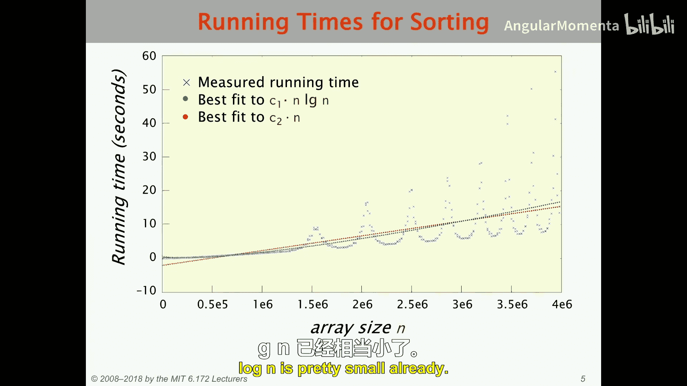
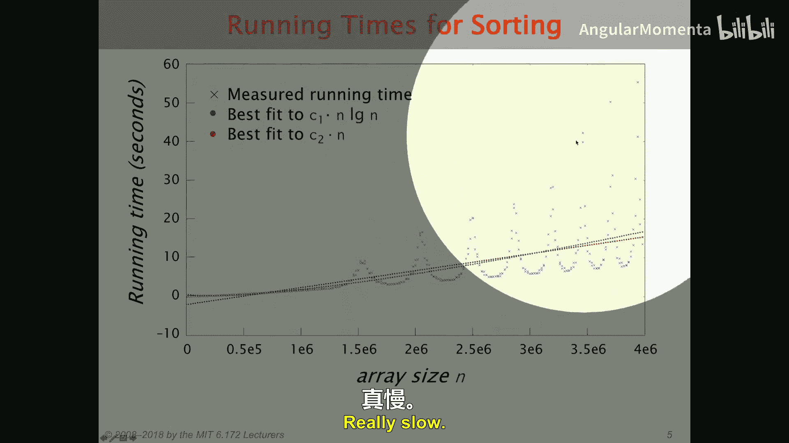
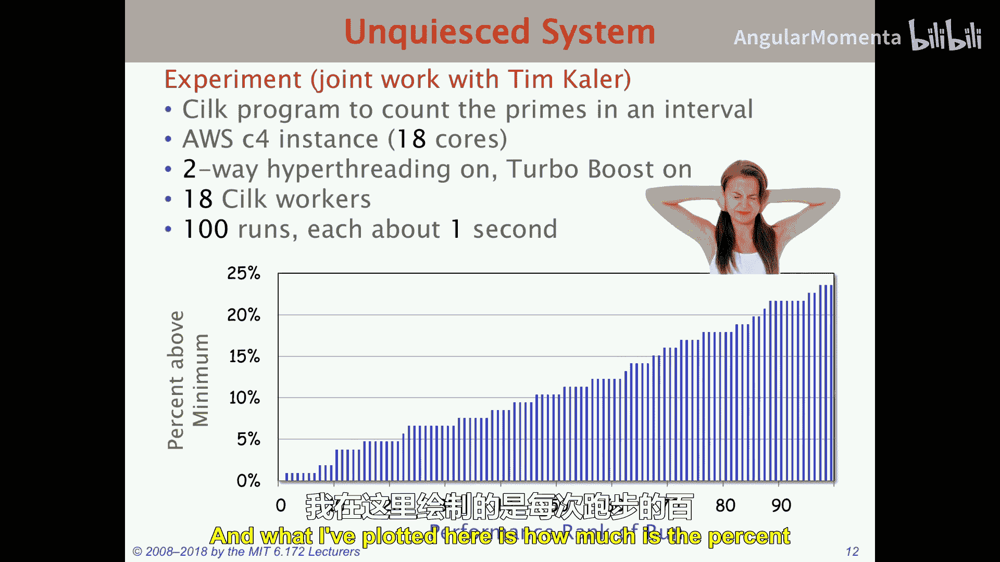
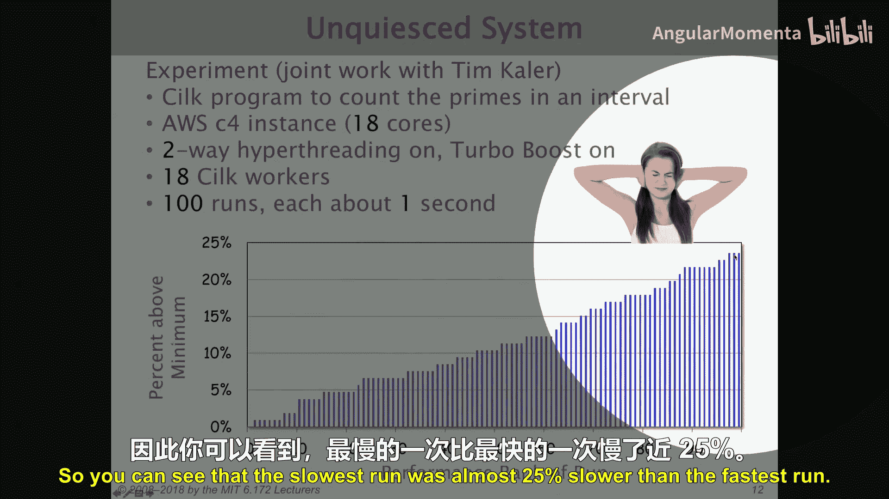

# 【麻省理工】软件系统性能工程 ｜MIT 6.172 Performance Engineering of Software Systems, Fall 2018 p10 10. 测量与计时 -BV1esbLzpEFq_p10-

The following content is provided under a Cative Commons license。

 Your support will help Mi T OpenCourseware continue to offer high quality educational resources for free to make a donation or to view additional materials from hundreds of MiT courses。

 Visit Mit Opencourseseware at Ocw。 Mt Eduu。

Okay， let's get started。So today we're going to talk about。Measurement and timing。

 and I want to start out by just showing you a study that one of my students did。Actually。

 at that point， he was a former student。Where hes timing a code for sorting， so here's the code。

 this isn't exactly his code， but it's。In the same spirit so that you get。The idea。

And so let's just run through this code and take a look to see what it's doing pretty it's pretty straightforward。

 so we have a we're going to use the time。 H header file to get access to the clock get time routine。

 which is going to be what we use to get timing measurements。

And then we have a sorting routine that we're going to time that I'm not showing you。Okay。

 and there is also a fill routine which is going to fill up the array with numbers。

with random numbers， so we have something to sort。And。

The clock get time uses a struct that is defined here。And so I'm defining two timingstructs。

 a start and an end。Okay， so this is just。Absolute boilerplates setting up for taking timing measurements。

And in this case， basically， the high order part of thestruct tells the seconds。

 the low order part tells the nanoseconds。And then we're going to loop over array rays of increasing length。

And then what we're going to do is fill them up。Oh， I forgot the fill。

 and then we're going to measure how much time， what the time is just before we sort。

Then we're going to sort， and then we're going to measure the time after sorting。

And then we compute the difference and figure out what the elapsse time is， print that out。

 and then we do it again for a little bit larger array。So is that clear what's going on。

 so we're just sorting a bunch of numbers that we're sorting some bigger ones。

 sorting some bigger ones so we can see what the growth of the sorting routine should be？Okay， that？

People have a。Pretty good understanding of what the code does。Okay， so。So what do we expect to see？

What's this curve going to look like？What are some properties of it？Yep。Yes。

So micro is un log in but it's certainly going to grow right。

 right it should go should be up into the right， in fact。

 one rule if you ever get into marketing is that all graphs must go up into the right。

If they're going down into the right， then your company's in trouble。Okay。

 so it should be going up in the right end and it should follow， for example。

 N log n if it's an N log N sort， which is what this one was， I think he was， in this case。

 timing a sort。They should go up and the right。And should follow and log in or whatever。

So let's see what actually happened when he took the measurements。

 and these are actually this is actually his data from， gosh。

 this must have been 20 years ago or something。嗯。Here's what it looked like。Okay。

 so the blue x is there。Are the runtime？Okay。And then through that we've plotted two curves。

 one which is the best fit to order n log N growth and the best fit to order N growth。

 you notice that for even though we're going up to 4 million here。

 there's not that much difference between n log N and order N。

 you can see it mostly down in the tails， it definitely the n log N follows a little bit better。

 but really log N is pretty small already。

U。But wow， those measured times， okay， so if you look， their're points way up here， right？

Really slow。

And basically it's going， it starts out it goes you slow a little bit。

 and then it gets a little bit worse and then a little bit worse and a little bit worse。

 notice also that the bumps are getting closer and closer together。What is going on？Why？

I don't know about you， but I thought the data would follow the green dots reasonably closely。Okay。

 but you can see it doesn't。Okay。It's always good to have a model for what you think is going on because then when you。

 because some people will just take numbers， they'll say， here's my numbers for that I've measured。

And if you don't actually have a model for what those numbers mean。You're probably fooling yourself。

You're more likely to have made some sort of error or there's something going on that you're not observing or whatever if you don't actually。

You know， have a model for what you think it should be going on。 So what what's going on here。

 Who can suggest a hypothesis for。For。For what is going on？So he took these numbers on his laptop。

 by the way。What do you suppose is happening here？Some ideas。Yeah。Maybe it doesn't fit in the cash。

 what would you expect to happen if things didn't fit in the cash？Yeah。

 you sort of think that would go along， it would sort of go along， and then it would jump。Right。

So interesting。You know issue， but that doesn't seem to be what's happening there。

 it's going up and things's going back down， it's going up been going back down。 rollller coaster。

What other ideas are there， good idea？Good idea， let's think a little bit about what's going on in the machine。

What are some other good ideas？Or bad ideas。Let's eliminate some。Yeah。They're not powers of two。

These are not powers of two， right？Because they're getting closer and closer as we get bigger and bigger。

 Yeah， so you're right， it doesn't have to do。 it's not correlated with powers of two。Weird。

Because sometimes things are alignment issues and we'll talk more about that， you know。

 come up when we talk about caching after the quiz， everybody knows there's a quiz next time。

Especially all of you who aren't here。So what else might be going on in the machine here？

Because this is reality， this is what happens when you take measurements。

So we're being very nice to you， we're giving you AWS run。

We have done everything we can to make sure those numbers come out。Clean。And beautiful。And untouched。

You know？ThereThey are， that is quality quality measurements we're taking for you okay but if you had to do it yourself。

 that's what this lecture in part is about yeah。So you think that there may be something having to do with the cash。

 but I'm going through each time and I'm refilling the array each time。

 so they're kind of starting from a clean slate， similar clean slate each time。啊。

What else is going on in the machine here？Yeah。Totally unrelated。Yeah。

 there could be totally unrelated stuff running right。

 you're not you know when you're running you might have demons。

 you might have all kinds of things and so forth， so he thought of that，Okay。

 and he shut down everything he possibly could。And this is what he got still。

Okay so but that's a great idea because often there's some external things going on。

 in this case it's called multitenancy， there's more than one thing using the computer at a time。

 okay， good idea， but happens not to be the one。这些。Could be precision with the timing？Yeah。

 sometimes there can be issues there， but this was not a precision issue。

This was not a predict he could have used a really dumb timer and gotten something very similar to this。

What else is going on on your machine yeah？Yeah， maybe it's checking for updates。

 that's once again some external things， no， it wasn't checking for updates。

Well some checking for updates。Okay。What is going on here？What is going on。

 let's have some more ideas， what other things might disrupt measurements。Yeah。Yeah。So this could be。

 but wow， this is so- that would sort of if it was like quick sort。

 this was actually merge sort here was timing， so there's no randomization， but even that。

 if it were quick sort it'd sort of be at random that things would tend to take longer， right？

Rather than following this crazy pattern， what is causing that crazy pattern？Yeah。

 it was like the random bill had to do at the time。

No because a random film is done outside the timer。Okay。

 so we filled and then we you know each time through the loop。

 we fill and then we start the timer and then do we take the measurement and so forth yeah？的。

Maybe it's Aliva， it's not allocating memory， but that's an interesting idea because sometimes you have things going on where you think things are happening right away。

 but the system is being clever and delaying it and so you end up paying for it at some later time。

 and that could possibly create something， turns out not to be what's going on here。Okay， well。嗯。

So what's happening here is that the machine。Is。Changing the clock frequency。

Why is the machine changing the clock frequency？Your laptops change the systems that we have。

 they change the clock frequency， why do they change it？Because laptop is getting hot。

So what are we doing， we're running something computational。And the smaller ones， okay。

 we get a lot of those done until it starts heating up。

And so it slows down the system clock to save power。Okay， and then what happens。

 it slows it down a little bit， cools off a little bit。Starts to speed up again。

Okay and then we run longer and why are these things getting closer and closer together？Yeah。Yeah。

 it takes longer and longer to run the sorts， so you're going to see the effect。You know。

 closer in interval here， even if it happened to be equal in time。Even if it' was equal in time。

 we're doing bigger and bigger problems， so it's。This is nuts， right？Like you know。

 we want to take measurements， we want to know whether the software is faster。

 what are you supposed to do， so here if you just took a measurement and said， look。

 this is the time that it takes me to run this code， you would be hugely missing the boat。😡。

If you were taking one of those high measurements， you compare A to B。You run A first。

 then you run B， B is slower。Oh， well， that's cu when you ran A。

 it heated up the processor so the processor slowed it down。Okay。

 so this particular architectural feature is called DVFS dynamic frequency and voltage scaling。

It's a technique to reduce power by adjusting the clock frequency and supply voltage to transistors。

Okay so the idea is that it if the chip ends up getting too hot or in the case of laptops often。

 if you want to conserve battery。It chooses to slow down the clock。Okay。

And the second thing it can do is reduce the voltage if the frequency is reduced。

So when you're actually running slower， you can actually get the same reliability of switching with a lower voltage。

had a higher voltage， sorry， had a higher clock frequencies。

 you need enough voltage to make sure those electrons are scooting across the transistor junctions fast enough。

So the basic power law that the electrical engineers use， is anybody here an electrical engineer？

Okay。There's good stuff in EE， let me tell you， okay。

 so those of you who are too embarrassed to raise your hands。Okay， I support EE。Okay。

 so power goes as CV squared F， okay where C is what's called the dynamic capacitance。

There's actually another term， which is the static capacitance。

 which doesn't have to deal with frequency or whatever， but for the dynamic power， it's CV squared f。

 it's the dynamic capacitance， it's roughly the area。Of the circuitry times how many bits are moving？

So if bits don't move， they don't consume power。For dynamic power， and then V is the supply voltage。

And then F is the clock frequency。So if you can reduce the frequency and voltage。

 you get a cubic reduction in power and also in heat。So you can see why。You know。

 who thinks they're battery？Doesn't last long enough。Yeah。Okay。

 wouldn't be nice if it lasted a month。So you can see why they're motivated to play this game。

to save the battery。Or to run things as hot as they can， but if it gets too hot， we'll just back off。

But for performance measurement， this is basically。A nightmare， it wreaks havoc。

So the topic of today's lecture is how can one reliably measure the performance of software when we have stuff like this going on in our system？

Now， the good thing about something like DVFS is there's actually ways of shutting it off。

And taking measurements。Okay， but。You know you probably pay some performance for doing that。

Because they can basically， who's ever worked on an overclocked system。Okay。

 some of you game players， right？So part of the game。

 the idea there when they're overclocking it is let's keep get things cool and so forth。

 and there's lots of games like this that are played in overclock systems。

So I'm going to talk about sort of three topics today， one is about quiesing systems。

 which is making them quiet enough that we can take good measurements。

 getting rid of some of the noise。And the second I'm going to talk about is some tools for measuring software performance。

 and then we'll talk a bit about performance modeling。Okay。So I hope this is a little motivational。

 boy， you know， it's like， you think you've seen it all sometimes， okay。

 and then somebody presents you with a puzzle and it's like， what's going on？

And then it takes a little detective work to figure out that that's actually what's going on。

So we'll start first about quiescing systems。Who knows who Janicche Taguci？Was。Anybody here know。

 he's very famous because he's the one who made our automobile industry produce reliable cars。very。

 very famous fellow， he did a lot of different things。

 I'm going to point out one of the things that he observed。And it's。

It's in the context of suppose you were an Olympic pistol coach and you've got two shooters， A and B。

 and you look at their targets and here's A's target Oh， we hit the bull'seye， good。

And if you add that up， he's got a pretty decent score。Then you look at B。

OhB didn't even hit the bull's eye and his score is like really lousy。Who do you want on your team？

A or B。Who do you want？Yeah， because it's easy to tell them what to do， you adjust the sight。

 you teach them to。knowShoot down a little bit lower to the left。

 it's easy to diagnose what his problem is， okay？嗯。That's all you have to do， what do you do for A？

It's not clear what you do， okay？And so what he did in the realm of quality control was say， look。

 when we're producing products。Before we try to fix。

The reliability or whatever is of the product we increase the quality of the product。

 let's first reliably produce whatever we're producing， so we get the same thing every time。

Because then we can go in and see what the problem is and we can adjust for it。

And so the idea is go after the variance first。go after the spread。

 try to get the spread as small as possible， try to figure out how it is that you can isolate。

 produce the same thing even if it's not very good。Okay。

 and then go and try to make changes because if you try to make changes while you have high variance。

 you don't even know if you're making progress or not。

Because it could be in the noise of your measurements。Now in the context of performance engineering。

If you can reduce variability， you can do things like compensate for systematic and random measurement errors。

And you can also do things like not run as many trials to discover whether one program is better than another。

So a lot of advantages to being able to have really quiet things。

 it's kind of obvious that you should want to have reliable measurements， okay but there's actually。

 as I say， a theory behind it for why it is that you want to have quiet measurements and what you need to focus on。

Now in our computer systems， there are lots of sources of variability and some people came up with some of them here。

 let me mention just a few of them here， so there are things like demons and background jobs。

 things that are running on your system that are helping the system to do whatever it's doing。

Many of them are unnecessary and those can be running， so for example。

 maybe you set up a cr job to do something for you every night and that happens to be just when you happen to be be making some measurements。

 well that's not really good because you're now sharing the resource。Okay， interrupts。

Something comes in， I had one time where we were measuring stuff on the connection machine CM5。

 which in its day was the world's most powerful computer， 1993。

 it was the top of the list of the supercomputers。Now this computer is more powerful。

It cost $43 million or something。Okay。Moore's law has really made a difference。All。

And we were measuring the performance of something， and we kept getting these anomalous results。

And eventually we tracked it down， it took us a lot of work， but we tracked it down。

The graduate student who was running it， while he was running it， he was moving the mouse around。

And when you move the mouse， it was interrupting 200 times a second。To deal with the interrupts。

 that was interfering with our measurements。Okay， true story， true story， okay。

 so interrupts can have a， so it's like， oh okay， and you know， we disconnected the network even。

Okay， so that we wouldn't get external things and we're still getting this thing， what is going on？

Okay， and eventually we track it down to the fact that he was just sitting there ilely so it's like started up and then hands off like。

Nobody moved。Okay。Code and data alignment。Where the code lies？

Affects its performance if a code goes across。Two cache lines versus completely within one cache line that can have a difference depending upon what's conflicting in the cache。

 okay or if you go across page boundaries， it can have a very big difference for example。

 in the translation look aside buffer or TLB you may be going for different entries。

 there may be different different things there， so code alignment can make a difference in the what you're doing。

Thread placement。Okay， which？knowIf you have a multi core machine， which core is it running。

 it turns out the system likes to use。Core zero for a lot of its stuff。

So if you're going to take reliable measurements， don't run oncore zero。Okay， runtime scheduler。

The fact that， for example， we have a randomized scheduler。

Which means that there's random numbers going on， so you're going to try to take measurements in the midst of all this randomness。

A hyperthing， hyperthing is where they take one core， it's also called symmetric。

It's called symmetric multi threading。Or no simultaneous multi threadreading。

 that's what it's called simultaneous multithreading or hyperthreading is what Intel calls it What that is is they have one functional unit。

Okay， and then they run two。Instruction streams through it at the same time。

 each with its own set of registers， but using the same functional units。

And they get basically a 20% speed up or something from having。

 it looks from the software point of view like you've got two processors。But really。

 it only gives you 1。2 processors。Okay， so it's one of these things that， by the way。

 if you start counting up how many processors and saying work over the number of processors。

 and you say， well， how many processors do I have？Well。

 you may have just a hyperthed processor rather than a real processor。so one thing， for example。

 in the cloud system that you folks are using， we turn off hyperthreading。Okay。

 so that we can get more reliable measurements and so we can look at the measurements as a function of the number of processors。

Multi tenancy， and this is particularly important in the cloud， if you're in the cloud。

 there are other people using the system， they can end up using lots of resources that maybe you want like cash。

Okay， and they can end up using network traffic that may affect you and such I'm actually quite amazed at how well Amazon does in AWS in making it so that that stuff doesn't affect you very much。

Okay， our numbers show that they're， in fact， they're definitely the leader right now in having repeatable measurements compared to all the cloud providers。

We talked about DVFS， there's also another one called turboboost。

 so tuurbo boostt looks to see how many how many。Jobs are actually running on the multico。

 there's only one job running on the multicot increases the clock frequency for that job。

Or if there's just a few， as soon as another one comes in， it slows things back down。

So it tries to give a boost when you're in executing serialcos that says， well。

 I'm not generating heat from all the cores， I just have to generate it from the one that I've got。

I just have to， you know I can afford to have one of them run hotter。Network traffic， and there's。

 by the way， a bunch of other ones we're going to talk about a few of these but first。

 let me tell you what the impact of quiesing a system is。

So this is joint work that I did in my group with Tim Kayler。

So we wrote a silk program to count the primes in an interval。And we ran on a C4 instance， 18 core。

 similar to what you're running with。We had two way hyper threadreading on。Turbo Bo was on。

 we had 18 silk workers we had 100 runs each about one second okay and what I've plotted here is how much is the percent that each run was。

 we basically ran 100 runs and then I sorted them from smallest run to largest and I normalized them to whatever the minimum one was so that each each thing here is how percentage above the minimum so you can see that the slowest run was almost 25%。

诶。诶。You know， slower than the fastest run。Okay， so you can see sort of what the。Impact it， so 25%。

 if you're trying to produce a code by getting a 3% improvement。You know， 30 times。Aye。You can't。

 you know， there's so much noise here， it's very hard for you to figure out that you're 3% faster。

Okay。So if you quiesce the system。same thing we turn hyperthing off， turn tuber boost off。

Quieed all the demons and so forth。 then out of 100 runs， we got essentially the same value。

Every single time。Except for three times， and notice that the scale here has changed。

The scale here is now less than 0。8%， less than 1%。S。So this says that， hey。

 if I took a couple of measurements。I'm very likely to hit。Something that is the real running time。

 which tends to be for this what the minimum is here。

Because all the other stuff is noise is just adding in。makes sense。

 so it is possible to quiesce a system， it's not that hard， okay。

 it just takes a small matter of know programming and systems work。So here are some。

Some tips on how you quiesce a system if you wanted to do this for your laptop， for example。

 make sure no other jobs are running， shut down demons and cr jobs， disconnect the network。

 don't fiddle with the mouse。Okay， for serial jobs。

 don't run on core zero where interrupt handlers are usually run term hyperthreading off。

 turn off DFSS， DVFS， turn off turbobo， use task set to pin workers to core。

 so task set is utility that says， I want you to run this thread on this core and don't。

Let the operating system bounce it around。So normally the operating system maps， threads to cores。

 the workers， the silk workers to cores in any way that it feels like this says， nope。

 I want you to have it exactly here so that when I run something else it's exactly the same thing。

And so forth， and we've already done a lot of this for you for AWS run。By the way。

 there is no way of getting a completely deterministic。Result out of running on modern hardware。

Does anybody know why， I mean， if I have a serial program？And it's to deterministic serial program。

And I set it up and I reboot the system， so it's got exactly the same。Contact et cetera。

 I still can get non deterministic results。Does anybody know why？Yeah。No， you can turn that off。

So you can make sure that so they actually do randomize address space for security reasons。

 but when you run under the debugger and so forth， they tend to turn that off so that you can。

Get repeatability for debugging purposes， yeah。No， those are generally， well， to a first order。Now。

 those are deterministic， but there is something in the hardware which is non deterministic。

Does anybody know what is？Happ to know， can guess what it is？

Something in the hardware that's non deterterministic， yeah。DisC access would be。

 but if I'm just running something in core， I'm not using disk， I'm just going to run。

It turns out non deterministic， even though I'm just running everything inside with ordinary DRAM memory and so forth。

No， the out of order execution is all deterministic， there's no randomization in there。Okay。Yeah。😊。

Branch prediction is all deterministic algorithms。All deterministic。Yeah。

System clock signals very regular。Very regular if youve turned off DVFS and stuff like that。Yeah。

So the Linux schedule is in fact a deterministic algorithm， and if you're just running on one core。

 this schedule or another comes into it。So there is one source of nondeminism。

 and that is memory errors。So there's a chance that one of your memory。

 when you're accessing the DRAM， that an alpha particle。Collided with one of the bits and flipped it。

And there's hardware in there to do error correction， but it takes an extra cycle to do it。

So if it reads the memory location， discovers that there is an error in what it read。

 then it performs the correction， and then you get it。

And that's something that's completely non deterterministic because it's alpha particles coming from outer space。

Space aliens， know messing with your system， yeah。No。

 actually theres actually was a now most cash is covered by error correction， but the most likely。

 if you look， the biggest memory is the DRAs， that's the most likely source of these things。But yeah。

 there's。So。So in any case， I want to now just talk about a few things which just some examples of things that might come up for you。

 so these are ones that I've mentioned， but I just want to go through them in a little bit more depth。

So one of the things is code alignment can make a difference。Okay， so what happens is you know。

 you have your program and you make a change that you think is improving your program。

But what happens， let's say， is that it causes an extra byte to be put into the code。😡，Okay。

 you know， so maybe you know， the compiles really smart。

 you made some little change then everything that follows it。Get shifted down。

And so the cash alignment issues can be completely different。

 something can go across a page boundary that didn't use to go across a page boundary。

 and that can have a big impact on your performance。This is like yikes。This is like，Yikes。

 how am I supposed to？It's like， maybe we just pack up on performance engineering， right？Okay。

 so everybody gets what the issue is there， so you know in this case I inserted one bite well everything after that it's all linear in memory would change here's another one that's even。

More。诶。Insidious。Okay。U。If you change the order in which the dot O files appear on the Lier command line。

😡，That can actually have a bigger effect than going between minus O2 and minus03。when you compile。

 you compile this order versus this order。Okay， you get。Can have actually quite a big difference。

Yike， okay， so what do you do Well first of all， one of the things I'm glad to say is that the compiler people have recognized this and the situation is not as dire as it was years ago what they do now very often is do a lot of alignment。

Already， so for example， it's common for compilers to produce to start every function on the first word of a cache line。

Okay， that way， when things get slid down， you might pop from one cache line to the next。

 for where it starts， but you're not going to affect the where you lie on the cash line。

 which can make a difference， by the way， in branch predictors and things like that。

Okay and so that helps， that really quiets a lot of things。

 and in fact they give you some directives， so LLVM has these switches。

 as far as I could tell the first one which is align all functions。

 I think I was unable to test this in advance， but I suspect that it's actually already doing this and this is actually aOO because it's already aligning all functions。

I don't know that for a fact， but you can give the switch anyway which will help if I'm lying。Okay。

 so that forces the alignment of all functions， so all functions start on a cache line， and that way。

 if you change one function， it's unlikely to it won't change the cache alignment of another function。

 it'll only change the cache alignment of the function that you're messing with。

You can also ask it to align all blocks in the function。

 so remember that in LLVM we have these basic blocks。

 these pieces of serial code with with you know with links you know the basic blocks so what it will do is force every one of those to be on a boundary。

 but of course what that means is now you've got to jump between these codes even if we're going to be the next instruction or put in a bunch of no ops so that can substantially increase the size of your。

啊。That can substantially increase the size of your binary and it can slow you down。

 but on the other hand， you'll get very reliable results from then on because every block is now cash aligned。

Okay， probably more practical is to law a line。呃。Is to force the alignment of all blocks that have no fall through predecessors。

That is， you don't have to add notes。 So this basically reduces it to the ones that are usually causing the trouble。

So a line of code is more likely to avoid performance anomalies， but it can also sometimes be slower。

 and so one of the questions as well which。Which matters to you in your particular particular thing。

 Okay here's one that I love。 So the example that I gave before of the order of linking。

We have that as a reading assignment， by the way， on the web， that paper。

 and here's another result from。From this paper by Mike Mowitz and。And his colleagues。

 they have a wonderful paper called producingducing wrong Data Without Do anything obviously W。Okay。

 so one of the examples they give be is the ordering of things saying that， look。

 that actually had an impact compared between 02 and 03。The program's name can affect its speed。

 and here's why the executable's name ends up in an environment variable。

OkaySo when you start up a program， it puts it in environment Bureau， the environment variables。

 it turns out end up on the call stack。Okay， so you can find out from the program。

 what's the name of the program I was invoked with， okay？

The length of the name affects the stack alignment。If you have a longer name， they put longer。

you know， a longer piece there， and so if the data happens to go across page boundaries。

 some critical piece of data goes on two pages rather than one。

 that could have a big impact on your performance。And there are other data alignment problems that can arise。

OkaySo yeah， this is kind of nasty stuff， so as I say what we've done we've given you a very quiesced system。

 we've done everything we can to make it so that you're。

 you know that when you submit stuff in this class， it's measured。

 but as we get along in the semester and you're doing more sophisticated stuff。

 some of this is going to fall increasingly to you to do things that make it robust。Okay。Okay。

 let's move on， we talked about quiesing， now let's talk a little bit about tools for measuring software performance。

😡，So I did a little thinking and I figured that there's actually like about five different ways I know of measuring the performance of a program。

嗯。So one is you can measure the program externally。

You can run the time command if you say time and then give a shell command。

It will run the shell command and then tell you at the end how long it took。

You can instrument the program。that means to actually put timing calls into the program。

So you can use things like clock get time， which I recommend and we'll talk a little bit about these other two get time of day and already TSC。

And you can either do this by hand where you say I'm going to time something myself。

 or it turns out you can have compiler support for doing taking timing measurements。

But what that involves is changing the program in order to put these timing calls in。And of course。

 you have the effect that if you're pertuurrbing if you're putting these timing calls in。

 you can be changing the timing。So you've got that problem to worry about as well。嗯。

One of the ones is you can interrupt the program， one of the cheapest ways you can do is just basically take GDP。

 so you start running your program， Gs， you run it under G， and then you type control C。

And then you look。Where is the program？And you do that a few times and you say， hey。

 the same routine is always where the code is running， oh。

 that must be where it's spending all its time。Okay that's actually been put into a thing called pooror Man's profiler and then you can actually this is essentially the method that GPro uses Okay。

 we'll talk about that in a little bit。You can exploit hardware and operating system support。

 so there are a bunch of hardware counters that the operating system and hardware support so that for example。

 Perf uses and so you folks are familiar with the Perf tool set。

 those are basically using hardware and operating system support。

 and you can also simulate the program， you can run it as a sim and then you really can go in and do anything you want to understand。

 but of course it's much， much slower and you hope that your simulator is modeling everything that's of relevance to you。

 maybe it's not modeling something that turns out to be relevant for you。

So I'm going to talk and give some examples of each of these five things， okay。

 so let's start with the time command。So it can measure a lapse time。

 user time and system time for an entire program。 Does anybody know what these three terms mean？

Ellappsse time。User time and system time。Sure。Its a lap time like Fox are so like it eat。

It's what we call wall clock time good。Eieser mode。三さ。

It's in the kernel working on your stuff as opposed to somebody else's okay so that's exactly right。

 so when you run the time command you get some numbers like this where it says here's the real time。

 here's the user time and here's the system time now you might think that the user time and the system time should add up to your total time。

啊啊。Doesn't work that way， and part of the reason is that the processor may actually not be working on your code。

You may be context switched out and something else is in。Okay， so。So in any case。

 we have those three types of things， wall clock time。

 the amount of processor time spent in the user mode。Code within your process and the systems time。

 which is the time spent in the kernel， but within your process。for example。

 satisfying system calls and such。Now。诶。The the。The timing call that I recommend you use and that was used in the example that I gave is clock get time and in particular there are a bunch of options to that and the one that I strongly recommend is clock monoonic okay and it takes about 83 nanoseconds to actually。

Read what the time is。That's about two orders of magnitude faster than a system call。

And one of the things about it is this is such a funny thing to have to say is it guarantees never to run backwards。

Okay， turns out the other timers。Can run backwards。

You can take measurements and discover they're negative。Okay， this one does not run backwards。

Part of it is because some of the other timers do things like， oh， you know。

 there's this national standards thing that periodically your computer goes out to find out what the real time is。

And it resets its clock to be consistent with whatever the global clock is。Okay and。

That will cause the clock to be updated in a nonstandard way。Okay。

 and where suddenly you lost some time or gained some time。ok。So this is really， you know， the best。

 the only unfortunate thing about this is that。It is non deterministic how long it takes。

And let me explain a little bit what's going on in this so what happens is。It takes a measurement。

It has to take two measurements to figure out what the elapsed time is。

 to find out what the actual time is， okay， can't just take one measurement because it may have been swapped out and the kernel helps support in user space。

Something that says， here's the total amount of time you've spent up until you started your time slice。

So when you read that， you have to read those two values， well。

 how do you know that you don't have an animity violation， you read one of the values。

 you got switched out， you got switched back in now you，Have a new value for the other ones。

 so the way it does it is it reads this register。So it reads what the operating system has kept as it's cumulative tide。

 it reads the clock and then it reads that register again， and if those two things differ。

 it knows there's been a switch in there， if they're the same it knows there isn't and the number that it can take is reliable。

So in that kind of case， it will actually take two measurements or more than one measurement。

 I mean you could do it again and it you know you could have another context switch and you could do it again and have another。

 but this thing is generally pretty fast so and on my laptop it takes about 83 nanoseconds to。To run。

U。There's。There's a lot of people say， well， why don't I just read the cycle counter。

 that's actually cheaper， it runs in about 32 nanoiseconds and that you can do with the RDTSC。

You know， read the timestamp counter。Instruction。And you can do it yourself by using a built in assembly。

And what it does is it returns how many clock cycles since the boot。

 and it rhymes in about 32 nanoseconds， but why not use this？Well。

 one thing is that IDTSC may give different answers on different cores on the same machine。

So the cycle counters on a processor by processor basis， sometimes TSC runs backwards。Okay。

 as I mentioned， okay？And also， the counter may not progress at a constant speed。

So remember that the time between the system is possibly slowing and speeding up the counters and so forth。

And converting clock cycles for that reason to seconds can be very tricky。

So I recommend you stay away from this faster counter， this faster timer， okay。

 the other one is don't use get time of day， that's the one most people know。That gives you。诶。

You know microsecond precision， it's not actually microsecond accurate。

 but it gives you microsecond precision because it has similar problems。

 whereas this this particular the。You know， the。Clock get time。

 monoonic has been very well engineered， in my opinion， to give good。

 reliable numbers at a reasonable cost。ok。Any questions about that about？

Taking measurements and what to use this stuff， by the way。Over time， it's going to change， okay。

 you know people are going to come up with better ways or worse ways or they'll say we're not going to support that anymore or what have you and then if you're out there as an engineer you're going to be on your own。

Hope you know what some of the issues here are and you're prepared to be on your own， yeah。

So when it does that it aggregates it and the operating system has to do it。

 those numbers actually are very are relatively coar grained。

 you cannot time something that's very short with time， for example， with with the。Time command。

 okay， in general， my experience is。You should， even with something like you can get fairly fine grain measurements with the。

Clock at time。You can get fairly good measurements there， but unless you're aggregating。

 unless you're running code that's running around a second， certainly at least tenth of a second。

If you're not running things that are that long， you run the risk that you've got really， really bad。

 you know you get unlucky， let me point that out in this particular example。

 so here's the interrupting strategy， which we talked about briefly， this is where I just control C。

At random intervals and you look at the stack and say who needs a fancy profiler， in fact。

 there are large companies who use this for debugging。They are big， big coats。Okay。

 Facebook comes to mind。Okay， they actually use this technique， it is a really easy。

 worthwhile technique for figuring out where time is being spent。Now there are some other things。

 the poor man's profiler and people have built things like GProf and so forth to increment。

 to automate this strategy so you get this information because then it automatically a cu that looks at the stack。

 what's being executed， puts that into a call graph and so forth and figures out you know where the time is going。

But neither of those programs is accurate if you don't obtain enough samples。

 and just to give you an example， GProf samples only 100 times per second。

So if you're going to use GPro for timing something that's only a second long。

 you only got 100 samples， how many samples is 100， that's not actually a real lot。Okay。

 and so you can get wildly inaccurate numbers。From interrupting。But on the other hand。

 for a quick type， we use GProf all the time， it's quick。 We do control seating all the time。

 It's really quick。 I don't have to install anything。I just， you know。

 take a look and it gives me a first cut at what I want to do， okay， it all depends。

 you know you don't need all this surgically precise tools all the time。

 sometimes a really dumb tool is adequate for the job and a lot quicker to deal with。Okay。

Hardware counters， so one of the nice things that's happened in recent years is that there has become available library called livePFM4。

Which is virtualizing all the hardware counters。So that you have access to them to all of these types of events on a per process basis。

So normally there's hardware counters， but then you switch to some other there's context switching going on to some other process。

Then what happens to your counters， they have to be saved， they have to be you know updated。

 so anyway， live PFM4 does all of that kind of virtualization to make it so that the counter you can view it as if it's your own counter。

Okay， and proofof stat， for example， employs that。There are a lot of esoteric hardware counters。

And as I say， good luck in figuring out what they all measure because they often are not well documented。

Okay， a few of the important ones are well documented。

 but most of them are very poorly documented exactly what it does a really good example was we had somebody who was。

Looking at cash misses。Okay， to figure out how much bandwidth。

 so last level cash okay L3 cash misses to count how much data was being transferred from。From DRAM。

Okay。And。They were getting。Curious numbers that didn't seem to measure up。Okay， and it's like。

 wait a minute。Have a miss， moves from。Move from DRAM onto the chip。Why is that not counting？

How much stuff is being moved， if I count up how many cash misses times how many bytes in a cash line。

 which is what on the machines we're using。How many bytes in a cash line on the machines we're using？

oo。Okay， 64， okay， gotcha， you guys are okay， 64 for the but not every machine has that， but anyway。

 so why was this not measuring how much stuff is being moved？I'll give you a hint it used to measure。

How much stuff was being moved？But then those architects， they are such pesky， clever people。

And they put in a great feature。Prefetching。They put in prefeting。

 there's things that fetch it and it doesn't update that counter。So if you want。

 you have to count how many prefetch incidents you have as well。

And so you can often cobble this together， but good luck figuring out what some of these do。Okay。

 also watch out， you may think that the tools let you measure a lot of counters if you want。

But if you read the fine print， it turns out that if you do more than four or five。

 it starts essentially time sharing the available。Counting bandwidth that it has。

And it's actually just doing something statistical rather than actually counting them。

So you can't count more than like four or five， actually four or five， I think is a high number。

 but somebody I know wells。Who knows this stuff said four or five is probably what it is today。Okay。

 so that's hardware counters， so hardware counter is a good technique， next one is simulators。

So things like cash Gr usually run much slower than real time。

But what's great about simulators is you can get repeatable numbers out of them。Okay， you know。

 you run the code， you run it again， if you've set up everything right。

 you can get it and you can see what's going on inside。The downside is that they don't necessarily。

 it's slower and it doesn't necessarily model everything going on in the cache。

 but for things like cash misses， this is a great tool。Okay。

 to just figure out what's the fundamental cash miss。

 and we'll talk about that when we talk about cashs in the next couple weeks。

And if you want a particular statistic in principle。

 you can go in and if it's an open source simulator like Cashgri is。

 you can collect it without perturbing the simulation。

So any question about these ways of collecting measurements？There are a whole bunch of ways doing。

 they all have pros and cons。They all can be useful in a given context。They all have some flaws。Okay。

A really good strategy I'll talk about this later is triangulation。

I never take one measurement and believe it。I always want to take at least two measurements。Okay。

 in different ways and make sure they're telling me the same story。Okay， triangulation。

If there's a discrepancy， then I want to know what's causing the discrepancy。

But I never trust one number and I never trust any numbers without having a model for what I think is coming up and in fact that's what we're going to talk about next。

 is performance modeling。So any questions about measurements and such？

So isn't it good we have AWS run， I mean right， it's like the number comes back， it's the number。

And it's actually a pretty good number， okay， we work very hard to make that a pretty good number。

Okay， so performance modeling。So。Yeah， we cover a lot of stuff in this class。

 as I think some of you have started to notice。And。But really performance。

Software performance engineering is pretty simple process。

 okay you take a program that you want to make go fast program A。

You make a change to program A to produce a hopefully faster program A prime。

You measure the performance of program A prime。If a prime beats A。Then you set a equals a prime。

And if A is still not fast enough。You repeat the process。 that's basically what you're doing， right？

It's pretty simple。Okay。And as as。Should be apparent， if you can't measure performance reliably。

 it's hard to make many small changes that add up because it's hard to tell whether a beats a prime。

 sorry， whether a prime beats a。It's hard to tell。Okay， and so。As a consequence。

 what we want to do is want to model performance so that we're in a position to draw accurate conclusions。

 so we want to do things like drive the variability of measurement down to zero。

And we want to do things like figure out ways of using statistics okay to give us more accurate picture of what's going on than maybe what is a appearance and that's basically what we're going to talk about for a little bit part of what I'm going to do is going to talk about statistics how many people have had a statistics class or a machine learning class or something where you dealt with statistics beyond probability I mean。

 I mean real statistics right you know sample means and things like that。

 so a few of you okay the basics of what you need to know you can find from Wikipedia or math world or someplace like that okay and I'm not going to try to teach you statistics 101 but I point you in some directions and give you some pointers so some tools you can do。

Okay， so here's a puzzle。Suppose you measure the performance of a deterministic program100 times on a computer with some interfering background noise。

What statistic？Best represents the raw performance of the software。

Is it the of the arithmetic mean of those runs？Is it the geometric mean of those runs？

Is it the median of the runs？Is it the maximum of the runs， is it the minimum of the runs？

This is where it's helpful if we had those clickers or whatever they have， but we don't。

So I ask people to vote now I want everybody to vote once again。

 it doesn't matter if you're right or wrong， you can be right for the wrong reasons。

 you can be wrong， but have。The idea right， but it's fun when everybody participates。

 certainly more fun for me when I see hands go up than when I see people sitting there looking bored。

Okay， okay， how many people think arithmetic mean would be a good way of measuring the raw performance？

Athmantic that's the most common statistic that we ever gather。 Okay What about geometric mean？Okay。

What about median？Okay， good， what about maximum？One for maximumim， what about minimum？Okay。

 so it turns out。Actually， these are all good measures to take and depends upon what you're doing with them。

Turns out， minimum。IsDoes the best at noise rejection？

And that's because you expect any measurements higher than the minimum if it's a deterministic program and so forth。

That's going to be due to noise。So if you're really interested in knowing how long。

 fundamentally you're。Co takes on the underlying hardware when there's other things going on。

 taking the minimum rejects it。 Now you might say the median also rejects noise。

But it doesn't because if you view your program as being it's running time plus noise。

Then the median is going to give you some number that is in the midst of the noise。

It's going to have some component， so minimum is the only one that really rejects all of them。

But they're all useful measures in different contexts。

 and there are ways that you can use the mean and some of these other ones。

 as we'll talk about in a minute， to get information about making decisions。

Because the thing that we're after is not necessarily always the raw performance of the software。

 sometimes we're interested in whether A beats B， that's a different question。

Then how fast does this sort of fundamentally go？Now。

So there are a lot of different types of summary statistics and。

There's lots of reasons to pick different ones， so for example。

 if you're interested in serving as many requests as possible in a web server， for example。

 you're going to be looking at something like the CPUU utilization and taking the arithmetic mean to try to understand how those things add up。

😡，If oil tasks have to be completed within 10 milliseconds。嗯。

Then you're going to look atre looking at the total and you're going to add it up and you're going to be interested in making sure that each one is is small。

 And that's also what the mean does。 And you're going to be looking at wall clock time。

If you want to ensure that most requests are satisfied within 100 milliseconds。

You might be looking at the 90th percentile behavior， okay， and you'll say yes， I won't make every。

 but I want 90% of the time I want to get it there and I'll be using something like walk clock time。

Okay。嗯。There may be in a lot of web companies， there's a thing called a service level agreement。

This is what they should give you for your telephone， but they don't。

Tells you what kind of service you can expect and if they don't meet that service requirement。

Then they haven't lived up to it， instead we buy these phones and we get the service and we just get whatever they decide to give us。

But if you're a big company， you insist that you get some kind of service out of the people that you're using。

 and so there that's typically some weighted combination and you're using sort of multiple things。

You might want to fit into a machine with 100 megabytes of memory。

Some sort of embedded machine or whatever then you're going to be interested in maximum of the memory use。

 so it's not all， the performance is not all just time。

You might want the least cost possible and you're looking at things like energy use， et cetera。

 here are the fastest biggest best solutions， you can see average comes up。A lot， you know。

 as as one of the ways， so I wanted to though， cover one particular example。

 which I find is the most commonplace I see a misuse of summary statistics and that's for when I'm summarizing ratios so suppose I have two programs A and B。

And I run the four trials， normally you'd run a lot more， but I wanted to fit on a slide。Okay。

And program A， on whatever trial one was， took nine seconds， say， program two， on trial two。

 it took eight， two， and 10， and program8 at 3，2， 20， and 2。Okay。

So I can compute the mean for each of those， so the mean of the program A is 8。25。

 and the mean of program B is 4。75 over those four benchmarks， okay。

I can also take a look at how much is a winning sorry is B winning over A？Okay。

 and so if I take the ratios， I then get three。诶。4。1，10th and 5 for a mean of 3。13。 It's actually 3。

125， but I'm only keeping things to 2。To two digits， okay， and so if I was asked to summarize this。

 I could perhaps conclude that program three is more than three times better than program A。

Based on these statistics。Okay， but there's a bug in that reasoning， can anybody see the bug？

This is wrong。It doesn't make sense to take the arithmetic mean of a bunch of ratios， why is that？

Yeah， one thing here is that you can see is that notice that the mean of the ratio is not the same as the ratio of the mean。

That should be some suspicious， why am I comparing。

 should I not be comparing the ratio of the mean or should I comparing the mean of the ratios？

Okay so that's not particularly good。Another thing is suppose I take a look at the ratio B over A and I take the arithmetic mean。

Then what I discover is that A is better by a factor of almost three than B。So clearly taking。

The the average of the means is。You assuming the average of the ratios。

 there's something wrong with that， right And in particular， as I say。

 the ratio of the means is not the mean of the ratios。And then your intuition is spot on。Okay。

Suppose instead I compute the geometric mean。So geometric mean is basically like taking the average of the logs。

 the arithmetic mean of the logs， so you're basically taking the product and taking the nth root of the product。

 okay？And I've computed that for these things。And now I've taken the arithmetic mean of the runtime。

 because that makes sense that's kind of how an average over these things， how long did things take？

And now I look at A over B and B over A， and I get the same。The same thing。And it's in fact。

 the case that the ratio of the means is the mean of the ratios。So when you look at ratios。

 there's another place that comes up where you look at rates， and I've seen people look at rates。

 and it turns out when you're looking at rates， often it's the harmonic mean that you want。

in order to preserve these good mathematical properties and make sure that it's really bad if I do this thing and I say。

 look how much better a is than B， and somebody， if I flipped the ratio， B would be better than A。

 that's really suspect if the identity of whether you're A or B and which one was the numinator。

 which in the denominator， had an impact。That would be really suspect。Okay， so this is the kind of。

when you're thinking about how you're reporting things and so forth。

 you want to be careful about when you're aggregating things to make sure that you have the basic mathematical properties met。

Okay，And what's nice is like， you know， one divided by 1。57 here is in fact， 0。64。Okay。

 so it didn't matter which way I took the ratio I got the same answer。Okay， one of them is a。

 so B is better that by a factor of about 1。6， something like that。It was a little bit better。

 It's not three times better。 And it for sure isn't the case that A is better than B by a factor of three。

Okay。Good。Any questions about that is kind。Good， okay。So as I want to compare two programs， A and B。

Which is faster。And I have a slightly noisy computer on which to measure their performance。

 what's a good strategy？What's a good strategy for' comparing them。

 figuring out whether a is better than B or B better than A？Sure。So you could take。Sorry。

 so you're saying I'm going to run multiple runs。That's a great idea， okay？

We're going to do multiple runs， and what am I doing for each of these runs？

The low order statistic of the like， for example， like minimum or 10% or something really low， okay。

 so I take that I have one number for program A， I have one number for program B， I ran them n times。

What else？Well， am I comparing？Am I comparing the？Am I comparing the two minimums I've got there。

 or am I comparing each one？I see you're saying， take all the measurements that go below your 10% cheapest ones。

 10% cheapest ones， and then compare those。Okay。That might give you。

So you're substantially doing noise reduction is what you're saying。And then other than that。

 you're comparing by comparing means。Okay， that's an interesting methodology。

 you probably get something reasonable， I would think。

 but you probably couldn't prove anything about it。But that's an interesting idea， yeah。

 that's an interesting idea。What else yeah？You run vote。非常な。Good。

 so you're saying do a bunch of head to head runs。And Mark。

 just who wins over those things and why is that？Why is that a good so one wins more than the other or the other wins more than the one。

 what good is that？He played the time it takes。She's like。Much more。Yeah。

 so this is actually a very good strategy， and actually has some statistical muscle behind it， okay？

So what you can do is do N head to head comparisons between A and B。Okay， so in both these examples。

 it's like， yeah， we better run it a few times， okay？And suppose that A wins more frequency。

More frequently。So now what we want to do in the statistics where they call the null hypothesis is that B beats A。

 so even though we see A beats B， the null hypothesis that were wrong and that A that B beats A。

 and what we then calculate is what they call the P value。

 which is the probability we'd observe that B that A beats B more often than we did。Okay。

 so for example， for each of these， to imagine that in the worst case。

 let's just say that they were equal in performance and all we're seeing is the noise。

hen I would expect that I would get about an even number of things。

 and so the further that I deviate from them being even。

 especially once I that distribution is essentially a Bnoulli distribution。

 the further I get out or a tea distribution if you have small numbers。

 as I get further out from away from the mean by what the variance is of just flipping coins in that case。

😡，I can calculate what's the probability that I'm seeing something that would be that extreme。

And that gives me a good reason to reject the null hypothesis if it turns out that deviates by a lot。

 okay so this is very standard stuff in the social sciences。

 who's had a course in this kind of stuff in testing null hypothesis biology and so forth Do you remember anything from it or。

Ha。😊，Just vaguely。Yeah， yeah， okay， that's fine。You know。

One of the things I have found in life is that you know I don't remember anything I learned in college to speak of。

 right， okay， what I had to do is relearn it， but I relearned it a lot faster than when I was in college。

You know and so that's part of this as I'll say so when you see it again。

 okay now you know how to go about learning this so I would once again you can look this up on like Wikipedia or whatever if you want to use this methodology it's a good one for being able to determine even in the presence of noise。

 what it does do is it doesn't tell you what the raw performance was。

 but it says in that environment which one is actually faster and that may actually be a more relevant question because you're not always going to have this completely quiet system。

 you may have a lot of noise going on a system you'd like to know which one is going to behave better in what that actual system is and so this methodology is pretty good。

 note that with a lot of noise we need lots of tries。The last thing that I want to talk about。

 which I won't is fitting to a model， and this is the issue of sometimes you measure things。

 but you're interested in a derived statistics such as such as in this case gathering some time。

 counting instructions counting Ca me is counting time and asking， okay。

 what's the know what can I estimate is the instruction time and what is the cache time and to do that you do a least squares approximation。

And there's once again some statistics behind that， I'm not going to go over it here。

 but you can look in the notes。There are a bunch of issues with modeling。

 which is that you can overfit very easily if you add more basis functions。

 you will fit the data better and so how do you know if you're overfitting？😡。

Answer is if you remove a base function， it doesn't affect the quality very much。

Is the model predictive， I'm actually going to just let you guys look at these because it's pretty good。

 I think they're pretty self-ex， let me just finish with a couple of words from a giant of science。

 this is Lord Kelvin， what is Kelvin famous for？Besides Kelvin。Okay， he was。Gurru of measurement。

Okay， and he said， to measure is to know。Hey， that's a good one。And he said， also。

 if you cannot measurement it， you cannot improve it。So。Both very apt sayings from the same guy。

 so there's a reason he's got a big forehead， I guess。

So anyway， that's it， thanks very much。And good luck on the quiz on Tuesday。

