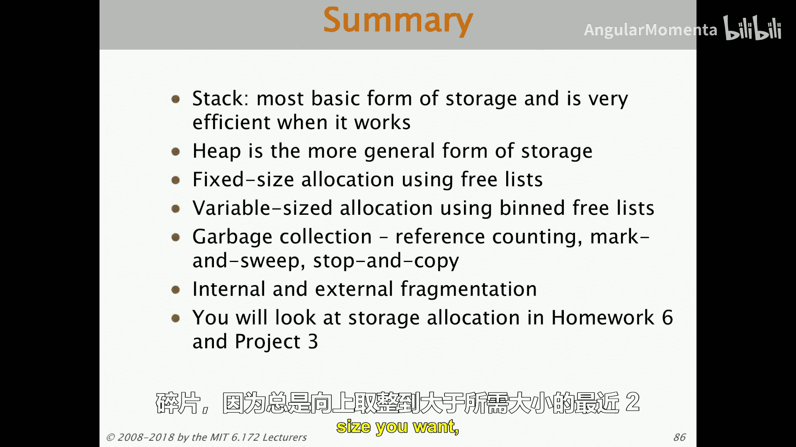

# 【麻省理工】软件系统性能工程 ｜MIT 6.172 Performance Engineering of Software Systems, Fall 2018 p11 11. 存储分配 -BV1esbLzpEFq_p11-

The following content is provided under a Cative Commons license。

 Your support will help Mi T OpenCourseware continue to offer high quality educational resources for free to make a donation or to view additional materials from hundreds of MiT courses。

 Visit Mit Opencourseseware at Ocw。 Mt Eduu。

Good afternoon everyone， let's get started。嗯。So welcome to the 11th lecture of 6172。

Seems that there are many fewer people here today than on Tuesday。All right。

 so today we're going to talk about storage allocation。

And turns out that storage allocation is about both allocating memory and also freeing it。

But in the literature it's just called storage allocation， so that's the term we're going to use。

 and whenever you do a malloc or free， then you're doing storage allocation。

 so how many of you have used Maloc or free before？So hopefully all of you since。呃。

You needed it for the projects and homeworks。So the simplest form of storage is a stack。

And in a stack you just have an array and a pointer， so here we have an array which we call a。

 and then there's some portion of this array that's used for memory and the rest of it is free。

 it's not used， and then there's a pointer SP that points to the end of the used region in this stack。

And if you want to allocate X bytes on the stack。😡。

All you do is you just increment this SP pointer by X。And then。

Of course you should also check for overflow to make sure that you don't actually go off the end of this array because if you do that。

 then you'll get a segmentation fault but actually nowadays compilers don't really check for stack overflow because your stack is usually big enough for most of your program and when you do get a stack overflow。

 you just get a sg fault in and then you go debug your program so for efficiency reasons the stack overflow isn't actually checked。

 and then it returns a pointer to the beginning of the memory that you just allocated。

 so it's just SP minus x。So that's pretty simple and in fact this is how the C call stack works。

 it also uses a stack discipline， so when you call a function。

 you save local variables and registers on the stack and you also save the return address of the function。

 that's calling another function， and then when you return， you pop things off the stack。

So you can also free things from the stack。 So what you do is you just decrement。SP by x。

 if you want to free X bytes。So here we just documented SP by X。

And everything after SP is now considered to be free。And again， if you're careful。

 you would check for a stack underflow， but again， the compiler usually doesn't do this because if you do have a stack underflow。

 there's a bug in your program and you'll get a SG fault and you should go fix it。

So allocating and freeing in a stack takes constant time。

Because all you have to do is manipulate the stack pointer so it's pretty efficient。However。

 you have to free consistently with the stack discipline， so the stack has limited applicability。

 does anybody see why you can't do everything with just the stack？

So what's one limitation of the stack？Yes。So it turns out that you can actually pass a compile time constant to make the stack bigger if you wanted to。

 there's actually a more fundamental limitation of the stack， yes。

Yeah so the answer is that you can only free the last thing that you allocated。

 so there's no way to free anything in the middle of this used region here you have to free the last thing here because the stack doesn't keep track of the objects in the middle of this used region。

 so there's limited applicability but it's great when it works because it's very efficient。

 and all of this code can essentially be in line， you don't have to have any function calls so it's very fast。

And it also turns out that you can allocate on the call stack using this function called Alllaca。

It's actually not a function， it's just a keyword that the compiler recognizes and it will transform it to instructions that manipulate the stack however this function is now deprecated because it turns out that the compiler is actually more efficient when you're dealing with these fixed size frames if you just allocate a pointer on the stack that points to some piece of memory on the heap。

But nevertheless， if you want to allocate on the call stack， you can call this Allca function。

 but you should check that it's doing the right thing since it's now deprecated and the implementation is compiler dependent。

So what's another type of storage besides the stack？So you can't do everything with a stack。

 so what else can we use？Yes， yes， so we also have the heap， which is more general than the stack。

So a stack looks very nice and tidy and it's very efficient to use this stack。

 but it doesn't work for everything， so that's why we have to heap。And the heap is much more general。

 but it's very messy， it's very hard to organize this and work with it efficiently。

 and for the rest of this lecture I'm going to be talking about how to manage memory in the heap。

And I found these pictures on stack overflow， so maybe they're biased towards stacks。Okay。

 so how do we do heAP allocation？So let's first start with fixed size heat allocation。

 where we assume that all of the objects that we're dealing with are of the same size。

 in general this isn't true， but let's just start with this simpler case first。Okay。

 so as I said earlier， if you use Maloc and free in C then you're doing HeAP allocation。

 C++ has the new and delete operators which work similarly to Maloc and free。

 they also call the object constructor and destructor and the C functions don't do that。😡。

And unlike Java and Python's CncC++ don't provide a garbage collector。

 so the programmer has to manage memory him or herself and this is one of the reasons for the efficiency of CNC++ because there's no garbage collector running in the background。

 however this makes it much harder to write correct programs and see because you have to be careful of memory leaks dangling pointers and double freeing。

 so a memory leak is if you allocate something you forget to free it and your program keys running and allocating more and more stuff but without freeing it。

 eventually you're going to run out of memory and your program is going to crash。

So you need to be careful of memory leaks。Dangling pointers are pointers to pieces of memory that you have already freed and if you try to dereference a dangling pointer。

 the behavior is going to be undefined， so maybe you'll get a segmentation fault maybe you won't see anything until later on in your program because that memory might have been reallocated for something else and it's actually legal to dereence that memory so dangling pointers are very annoying when you're using C if you're lucky you'll get a sec fault right away and you can go fix your bug but sometimes these are very hard to find。

There's also double freeing， so this is when you free something more than once and again this will lead to undefined behavior。

 maybe you'll get a Se fault or maybe that piece of memory was allocated for something else and then when you free it again it actually illegal。

 but your program is going to be incorrect， so you need to be careful that you don't free something more than once。

And this is why some people prefer to use a language like Java and Python that provide these built in garbage collectors。

 however， these languages are less efficient because they have a general purpose garbage collector running in the background。

So in this class， we're going to use C because we want to be able to write the fastest programs as possible。

 so we need to study how to manage memory。And there are some tools you can use to reduce the number of memory bugs you have in your program。

 so there's memory checkers like address sanitizer and Valgri which can assist you in finding these pernicious bugs so address sanitizer is a compiler instrumentation tool when you compile your program you pass a flag and then when you run your program。

 it's going to report any it's going to report possible memory bugs you have in your program and then Valgriin。

 it works directly off the binaries， you don't need to do anything special when you compile it。

 you can just pass your binary to vgriin and if there's a memory bug it will it might find it but Valggrin tends to be slower than address sanitizer and it tends to cash fewerer bugs because it knows less about the program than address sanitizer and address sanitizer sees the source code of the program and has more information whereas Valgriin just works directly off the binary。

Also don't confuse the heAP with the heAP data structure that you might have seen before in your algorithms or data structures courses。

 so these are two different concepts， the heEAP data structure in your algorithms course。

 it was a data structure used to represent a priority key where you can officially extract the highest priority element and you can also update the priorities of elements in the set。

 and this could be used for algorithms like sorting or graph search。

 but today we're going to be talking about another heAP which is the he that's used for storage allocation so don't get confused。

So any questions so far？Okay。All right， so we're going to first start with fixed size allocation since that's the easier case。

 so we're going to assume that every piece of storage has the same size。

Some of these blocks are used and some of them are unused。😡，And among the unused blocks。

 we're going to keep a list that we call the free list and each block and this free list has a pointer to the next block in the free list。

 and since this memory is unused， we can actually use the memory to store a pointer as part of our storage allocator implementation。

There's actually another way to do fixed size allocations， so instead of using a free list。

 you could actually place a bit。For each block saying whether or not it's free。

 and then when you do allocation， you can use bid tricks。

 but today Im just I'm going to talk about the freeless implementation。

So to allocate one object from the free list。😡，You set the pointer X to be free。

 so free is pointing to the first object in this free list。

 then you set the free pointer to point to the next thing in the free list。

 so this is doing free equal to the next pointer of free。

 and then finally you return X which is a pointer to the first object in the free list。

So here's an animation， so X is going to point to what free points to。

You also need to check if free is equal to noll， because if free is equal to no。

 that means there are no more free blocks in the free list and the programmer should know this。

 so you should return a special value。Otherwise， we're going to set the free pointer to point to the next thing in the free list。

 and then finally we return X to the program and now the program has a block of memory that I can use。

There is still a garbage pointer in this block that we pass back to the program because we didn't clear it。

 so the implementation of the storage allocator could decide to zero this out or can just pass it back to the program and leave it up to the programmer to do whatever it wants with it so that in the latter case。

 the programmer should be careful not to try to dereference this pointer。Okay。

 so how about deallocation？So let's say we want to free some object X。

What we do is we just set the next point of x to be equal to free。

 so it's going to point to the first thing in the free list。And then we set free equal to x。Right。

 so now free is pointing to X and this X object that we wanted to free now as a pointer to the first object in the original free list。

So pretty simple， any questions on this？So this sort of acts like a stack in that the last thing that you freed is going to be the first thing that you allocate so you get temporal locality in that way。

 but unlike a stack， you can actually free any of the blocks and not just the last block that you allocated。

So with a free list allocating and free take constant and time because you're just adjusting some pointers。

As good temple locality， because as I said， the things that you freed most recently are going to be the things that are going to be allocated。

It has poor spatial locality due to external fragmentation and external fragmentation means that your blocks of used memory are spread out all over the place in the space of all memory。

And this can be bad for performance because it can increase the size of the page table and it can also cause disc thrashing so if you recall whenever you access a page in virtual memory。

 it has to do a address to translation to the physical memory address。

 and if your memory spread out across many pages in virtual memory。

 then you're going to have a lot of entries in the page table because the page table is storing this mapping between the virtual memory address of the page and the physical memory address of the page。

So this can complicate the page table， make it less efficient to do lookups in it。

 and then if you have more pages than you can fit in your main memory then this can cause disc thrashing because you have to move pages in and out of disk。

The translation locoide buffer or TLB can also be a problem， does anybody know what a TLB is？Yes。

Yeah， so the TLB is essentially a cache for the page table。

 so it will cache the results of the translation from virtual memory addresses to physical memory addresses for the most recent translations and looking up a translation in the TLB is much more efficient than going through the page table。

And if you， if you have a lot of external fragmentation。

 then you have a lot of pages that you might access。 And this means that when you go to the T L B。

 it's more likely you'll get a T L B miss。 and you have to go to the page table to look up the appropriate address。

 So that's why external fragmentation is bad。So let's look at some ways to mitigate external fragmentation。

So one way to do this is to keep a free list or a bitmap per disk page。

 and then when you want to allocate something， you allocate from the free list of the fullest page。

 so you sort of skew the memory that's being used to as few pages as possible。

And when you free a block of storage， you just return it to the page on which that block resides。

And if a page becomes completely empty， there are no more items that are used on that page。

 then the virtual memory system can page it out without affecting the program performance because you're not going to access that page anyways。

So this might seem counterintuitive。 why do we want to skew the items to as few pages as possible。

 So let's look at a simple example to convince ourselves why this is actually good for dealing with external fragmentation。

 So here I have two cases in the first case， I have 90% of my。

Blocks on one page and 10% of the blocks on the other page。 In the second case。

 I have half of my blocks on one page and half on the other page。

So now let's look at the probability that two random aes will hit the same page。

 so let's assume that all of the random aes are going to go to one of the two pages。

 so in the first case， the probability that both of the aes hit the first page is going to be a 0。

9 times 0。9。And then the probability that they both hit the second page is 0。1 times 0。1。

 and if you sum this up， you get 0。82 because that's the probability that both of the random aes are going to hit the same page。

In the other case， the probability that both of the aes hit the same page。

 the first page is going to be 0。5 times 0。5， the second page is also going to be 0。5 times 0。

5 so that sums to 0。5 and that means that there's only a 50% chance that two random aes are going to hit the same page so in the first case you actually have a higher chance that the two random aes hit the same page and that's why we want to skew the items as much as possible so that we can reduce external fragmentation。

Any questions？Okay。That was fixed size heap allocation。

 and obviously you can't use that for many programs if you're allocating memory of different sizes。

 so now let's look at variable size heap allocation。

So we're going to look at one allocation scheme called B Freeelless。

An idea is to leverage the efficiency of free list。

It also has stopped the bounded amount of internal fragmentation。

 so internal fragmentation is a wasted space within a block。

 so that means when you allocate possibly more space than you're using。

 then there's some wasted space in there。So in bin Freeless。

 what we're going to do is we're going to have a whole bunch of bins and each bin is going to store blocks of a particular size。

So here I'm going to say that bin Ky holds memory blocks of size to decay。

 I'm going to store blocks of sizes， powers of two。

So why don't I just store a bin for every possible size， Does anybody know why？

Why am I rounding up to powers of two here？Yes， if I wanted a bin for every possible size I would have way too many bins and just the pointers to these bins are not going to fit in memory。

 so that's why I'm only using bins that store blocks of size two to decay。嗯。And。

Now let's look at how I'm going to allocate X bytes from a bin freeless。

 so what I'm going to do is I'm going to look up the bin for which I should take a block from。

And to get that， I'm going to take the ceiling of log base x。 this is log base 2。

 so recall that LG is log base 2。If that bin is not empty。

 then I can just return a block from that bin。However。

 if that bin is empty then I need to go to the next highest bin that's non-empty and then I'm going to take a block from that bin and then split it up into smaller chunks and place them into smaller bins and then I'll also get a chunk that is of the right size so for this example let's say I wanted to allocate three bytes。

 the ceiling of log base two of axis2 so I go to bin2。But bin2 is empty。

 so I need to look for the next bin that's not empty。And that's going to be been four。

And I'm going to split up this block into a smaller powers of two， so in particular。

 I'm going to find a nonempty bin K prime greater than k and split up a block into sizes of 2 to the K prime minus1。

2 to the K prime minus2 all the way down to2 to the k。

 so I'm going to split it into sizes of all the powers of 2 less than 2 to the K prime and greater than or equal to 2 to the K。

 and I'm going to actually have two blocks of size2 to the K and one of those will be returned to the program。

😡，So here I'm going to split out this block。I'm going to place one of the smaller blocks in bin3。

 one of them into binI2， and then I also have another block here that I'm just going to return to the program。

So any questions on how this scheme works？Okay and if there are no larger blocks that exist。

 so that means all of the bins higher than the bin I'm looking at are empty。

 then I need to go to the OS to request for more memory and then after I get that memory I'll split up so I can satisfy my allocation request。

😡，In practice， this exact scheme isn't used， so there are many variants of this scheme。

 so it turns out that efficiency is very important for small allocations because there's not that much work performed on these small pieces of memory and the overheads of the storage allocation scheme could cause a performance bottlenecks。

 so in practice you usually don't go all the way down to blocks of size one。

 you might stop at blocks of size eight bytes so that you don't have that much overhead but this does increase the internal fragmentation by by a little bit because now you have some wasted space。

And then one second， and then you can also group blocks into pages， as I said before。

 so that all of the blocks in the same page have the same size and then you don't have to store the information of the sizes the blocks。

Yes。Yeah， so there are two commands you can use， one is called MMap and the other one is called SBRK。

 so those are system calls that you just， I mean you just call that and then the OS will give you more memory and then your storage allator can use it。

Yes。Do they， they don't have to use like something like this in order to implement those。No， so Mal。

 I mean， the standard implementation of MalC internally it uses these commandsM and SBIC to get memory from the OS the OS just gives you a huge chunk of memory。

 it doesn't split it up into smaller blocks or anything that's up to the storage allocator to do it just gives you a big chunk of memory and then the storage allator will break it up into smaller blocks。

 you can also similar commands where you can free memory back to the OS when you're not using them anymore。

So yeah， so what I said was that you can actually keep blocks of different sizes on different pages。

 so then you don't actually have to store the size of each block。

 you can just look up what page that block resides in when you get the memory address and then for each page you have one field that stores the size of those blocks on that page。

 so this saves you the overhead of having to store information per block to figure out its size。Yeah。

Yeah， so if I mean， if you do change the size of the blocks and can use you can't actually use this scheme。

 so this is actually a variant where you don't change the size of the blocks。

 if you do change the size and you have to change it for the entire page，Yeah。

 so there are many variants of memory allocators out there。

 this is just the simplest one that I described， but it turns out that this isn't this exact scheme isn't the one that's used in practice。

 there are many variants like some allocators instead of using powers of two。

 they use Fibonacci numbers to determine the different bins。Any other questions？

See you actually get a chance to play around with implementing some allocators in Project three and Home six。

So let's briefly look at the storage layout of a program。

So this is how our virtual memory address space is laid out。

So we have this stack all the way at the top and the stack grows downwards。

 so we have the high addresses up top and the low addresses below。

Then we have the heap which grows upward and the heap and the stack basically grow towards each other and this space is dynamically allocated as the program runs。

Then there's the BSS segment， the data segment and the text segment。

 which all reside below the heEAP。So the code segment just stores the code for your program。

 so when you load up your program， this code is going to put your program into this tag segment。

Then there's this data segment which stores all the global variables and static variables。

 these constants that you define in your program， these are all stored in the data segment。

And when you load your program， you also have to this。

 read this data from disk and store it into the data segment。Then there's the BSS segment。

 this segment is used to store all the uninitialized variables in your program and this is just initialized to zero at the start of your program since your program hasn't initialized it。

 so it doesn't matter what we set it to。And then the heap。

 this is the memory that we're using when we're calling Maloc and Maloc and free。

 and then we have the stack which we talked about。嗯。So in practice， the。

 the stack and the heap are never actually going to hit each other because we're working with 64 bit addresses。

 So even though they're growing towards each other。

 you don't have to worry about them actually hitting each other。

And another point to note is that if you're doing a lot of precomputation in your program。

 for example， generating these huge tables of constants。

 those all have to be read from disk when you start your program and stored it in this data segment。

 so if you have a lot of these constants is' actually going to make your program loading time。

 much higher， however it's usually okay to do a little bit of precomputation。

 especially if you can save a lot of computation at runtime。

 but in some cases it might actually be faster overall to just compute the things in memory when you start your program because then you don't have to read stuff from disk。

So here's a question， so since a 64 bit address space takes over a century to write at a rate of 4 billion bytes per second。

We're never effectively going to run out a virtual memory。

So why don't we just allocate out of virtual memory and never free anything？Yes。Yeah。

 so one thing is that you have this issue of fragmentation。

 the blocks of memory that you're using are not going to be contagiguous in memory。

 and then it makes it harder for you to find large blocks。U。So this is called external fragmentation。

 which I mentioned earlier， so if you do this， external fragmentation is going to be very bad。

 the performance of the page table is going to degrade tremendously because the memory that you're using is going to be spread all over virtual memory and you're going to use many pages and this leads to disk thrashing so you have to do a lot of swaps of pages in and out of disk your TLB hit rate is going to be very low。

And basically another reason is that you're also going to run out of physical memory if you never free anything。

So one of the goals of storage allocation is to try to use as little virtual memory as possible and to try to keep the used portions of the memory relatively compact。

Any questions so far？Okay， so let's do an analysis of the B Free list storage allocation scheme。

So here's a theorem suppose that the maximum amount of heat memory in use at any time by a program is M。

If the heap is managed by a bin freeless allocator。

 then the amount of virtual memory consumed by the heapve storage is upper bounded by Mlog M。

Does anybody have an intuition about why this theorem could be true？

So how many bins do we have at most？Right， so the number of bins we have is upper bounded by log M。

And each bin is going to use order M memory， so let's look at this more formally。

 so an allocation request for a block of size x is going to consume to the theing of log base2 of x storage。

 which is upper bounded by2 x， so we're only wasting factor of  two storage here。So therefore。

 the amount of virtual memory devoted to blocks of size to to decay is at most 2M。

And since they're at most log based2 of M free list。

 the theorem holds just by multiplying the two your terms。

 so you can only have log based two of M free list because that's the maximum amount of memory you're using。

 and therefore your largest bin is only going to hold blocks of size M。

And it turns out that the Ben Freeelless allocation scheme is。

Theta one competitive with the optimal allocator and here an optimal allocator knows all of the memory requests in the future so it can basically do a lot of clever things to optimize the memory allocation process。

 but it turns out that the bin freeelis is only going to be a constant factor worse than the optimal allocator。

 this is assuming that we don't coalesce blocks together， which I'll talk about on the next slide。

It turns out that this constant is six， so Charles Lyson has a paper describing this result。

And there's also a lower bound of six， so this is tight。So coalescing。

So coalescing is when you splice together smaller blocks into a larger block。

 so you can do this if you have two free blocks that are contiguous in memory。

 this will allow you to put them together into a larger block。

So bin Freeelless can sometimes be heurically improved by doing coalescing and there are many clever schemes for trying to find adjacent blocks efficiently。

 so there's something called the bodydy system where each block has a body that's contiguous in memory however it turns out that this scheme especially the buddy system scheme has pretty high overhead。

 so it's usually going to be slower than just the standard bin freeless algorithm。

There are no good theoretical bounds that exist that prove the effectiveness of coalescing。

 but it does seem to work pretty well in practice at reducing fragmentation because he storage tends to be delocated as a stack or in batches。

 so what I mean by this is that the objects that you free。

 tend to be pretty close together in memory， so if you decate as a stack then all of them are going to be near the top of the stack。

 and when you delocate in batches， this is when when you decate a whole bunch of things that you allocate it together in your program。

 for example， if you have a graph data structure and you allocated data for the vertices all at the same time。

 then when you delocate them all together， this is going to give you chunk of contiguous memory that you can splice together。

Okay， so now let's look at garbage collection。It's going to be slightly different from storage allocation。

The idea of garbage collection is to free the programmer from having to free objects。

 so languages like Java and Python they have built in garbage collectors so the programmer doesn't have to free stuff themselves and this makes it easier to write programs because you don't have to worry about double freeing and dangling pointers and so forth。

嗯。So a garbage collector is can identify and recycle the objects that the programmer can no longer access so that these memory objects can be used for future allocations。

And in addition to having a built- in garbage collector。

 you can also create your own garbage collector and see which doesn't have a garbage collector。

 so if you have an application you can actually create a special purpose garbage collector that might be more efficient than a general garbage collector。

 yes。答对。Big Frees not order that memory。Why is it not order M？嗯。

Because for each of the bins you could use up to order memory， so if you don't do coalescing。

 I could have basically I could have a bunch of small allocations and then I chop up all of my blocks and then they all go into smaller bins and then I want to allocate something larger。

 I can't just splice those together， I have to make another memory allocation。

So if you order your memory request in a certain way。

 you can make it so that each of the bins has order a memory。Okay， so for garbage collection。

 let's go over some terminology。So there are three types of memory objects。Roots。

 live objects and dead objects， roots are objects that are directly accessible by the program。

 so these are global variables， things on the stack， and so on。

Then there are live objects which are reachable by following the roots via pointers。And then finally。

 there are dead objects， and these objects are inaccessible via sequences of pointers。

 and these can be recycled because the programmer can no longer reach these dead objects。

So in order for garbage collection to work in general。

 you need to be able to have the garbage collector identify pointers and this requires strong typing。

 so languages like Python and Java have strong typing， but in C， it doesn't have strong typing。

 this means that when you have a pointer， you don't actually know whether it's a pointer because a pointer just looks like a integer。

 it could be either a pointer or an integer and you can cast things and C you can also do pointer arithmetic can C。

 so in contrast in other languages once you declare something to be a pointer。

 it's always going to be a pointer and for those languages that have strong typing。

 this makes it much easier to do garbage collection。

You also need to prohibit doing pointer arithmetic on these pointers because if you do pointer arithmetic and you change the location of the pointer。

 then the garbage collector no longer knows where the memory region starts anymore。And C。

 sometimes you do do pointer arithmetic， and that's why you can't actually have a general purpose garbage collector and see that works well。

So first let's look at one simple form of garbage collection。And this is called reference counting。

The idea is that for each object， I'm going to keep account of the number of pointers referencing that object。

And if the count ever goes to zero， then that means I can free that object because there are no more pointoneers I can reach that object。

So here I have a bunch of routes， so these are directly accessible by my program and then I have a bunch of objects that can be reached via following pointers starting from the root。

 and that each of them have a reference count that indicates how many incoming pointers they have。

So let's say now I changed one of these pointers， so initially I had a pointer going to here。

 but now I changed it so that it goes down here。So what happens now is I have to adjust a reference counts of both of these objects。

 so this object here now it doesn't have any incoming pointers。

 I have to decrement its reference count。So that goes to0。 And then for this one。

 I have to increment its reference counts。 So now it's  three。

And now I have an object that has a reference count of zero and with this reference counting algorithm。

 I can free this object。So let's go ahead and free this object， but when I free this object。

 it actually has pointers to other objects， so I also have to decrement the reference counts of these other objects when I free this object。

 so I'm going to decrement the counts。And now it turns out that this object also has a reference count of zero so I can free that as well。

 and in general I just keep doing this process until the reference counts of the objects don't change anymore。

 and whenever I encounter an object with a reference count of zero I can free it immediately。

And the memory that I freed can be recycled， it can be used for future memory allocations。

So questions on how the reference counting procedure works。

So there's one issue with reference counting， does anybody see what the issue is？Yes。Yes。

 so what if it has a reference to itself， more generally， what if it has a cycle。

 reference you can't ever garbage collect a cycle when you're using reference counts。

So here we have a cycle of length three， they all have a reference count of one。

 but you can never reach this cycle by following pointers from the root。

And therefore you can never delete any object in this cycle。

 and the reference counts are always going to be non zero。And furthermore。

So let's just illustrate this cycle and furthermore。Furthermore。

 any object that's pointed to by objects in this cycle can be garbage collected as well because you can't garbage collect the cycle。

 so all of the pointers going out of the objects in the cycle are always going to be there。

So there could be a lot of objects downstream from this object here that can't be garbage collected。

 so this makes it very bad。And as we all know， uncollected garbage stks， so we don't want that。

 so let's see if we can come up with another garbage collection scheme。U。

So it turns out that reference counting is actually pretty good when it does work。

 because it's very efficient and simple to implement。

 so if you know that your program doesn't have these cycles in them among pointers。

 then you can use a reference counting scheme。There are some languages like objective C that have two different types of pointers。

 strong pointers， and weak pointers， and if you're doing a reference counting with a language with these two types of pointers。

 the reference count only stores the number of incoming strong pointers。And therefore。

 if you define these pointers inside a cycle to be weak pointers。

 they're not going to contribute to the reference count and therefore you can still garbage collect。

However， programming with song weak pointers can be kind of tricky because you need to make sure that you're not dereferencing something that a weak pointer points to because that thing might have been garbage collected already。

 so you need to be careful。And C doesn't have these two types of pointers。

 so we need to use another method of garbage collection to make sure we can garbage collect these cycles。

So we're going to look at two more garbage collection schemes。

 the first one is called Mark and Sweep， and the second one is called stop and copypy。

So first we need to。Define a graph abstraction。So let's say we have a graph with vertices V and edges E。

 and the vertex set B contains all of the memory objects and memory。

And the edges E are directed edges。Between objects if there's a。

So there's a directed edge from object A to object B。 If object A has a pointer to object B。And then。

As we said earlier， the live objects are the ones that are reachable from the roots。

 so we can use a breath first search like procedure to find all the live objects so we just start our breath first search from the roots and we'll mark all the objects that can be reachable from the roots and then everything else that isn't reached those are available for to be reclaimed。

So we're going to have a5 OQ first and first outQ for our breakfast search。

This is represented as an array， and we have two pointers。

 one to the head of the Q and one to the tail of the queue。And here let's look at this code。

 which essentially is like a breath search， so we're first going to go over all of the vertices in our graph and we're going to check if each vertex v is a root。

 if it is a root， we're going to set its mark to be 1。

 and we're going to place the vertex onto the Q。And otherwise。

 we're going to set the mark of v to be 0。And then while the Q is not empty。

 we're going to Dq the first thing from the Q， let that be U。

Then we're going to look at all of the outgoing neighbors of you。 So these are vertices V。

 such that there's a directed edge from U to V。We're going to check if these mark is equal to zero。

 if it is， that means we haven't explored it yet， so we'll set its mark to be 1 and we place it onto the queue。

 and if the neighbor has already been explored， then we don't have to do anything。

So let's illustrate how this algorithm works on this simple graph here。And for this example。

 I'm just going to assume that I have one root， vertex R， in general， I can have multiple roots。

 and I just place all of them onto the queue at the beginning， but for this example。

 I'm just going to have a single root。So I'm going to place it onto the queue。

And the location that I place it is going to be where the tail pointer points to。

 and after I place it on Q I increment the tail pointer。

Now I'm going to take the first thing off of my Q， which is R。And I'll explore my neighbors。

 so the neighbors are B and C here， both of them haven't been marked yet。

 so I'm going to mark them and I'm going to indicate the marked vertices with the shaded blue。

 and I'll place them onto the queue。Now I'm going to take the next thing B。

I'm going to check its neighbors， it only has a neighbor to see， but C is already on the queue。

 it's already marked， I don't have to do anything。Now I DQ C and C has neighbors D and E。

 so I placed them onto the queue。D doesn't have any outgoing neighbors。

 so I don't have to do anything now when IDQE has neighbors F。When I DQF。

 it has a neighbor G and when I DQ G， it doesn't have any neighbors。

 so now my cu is empty and my breakfast search procedure finishes。So at this point。

 I've marked all of the objects that are accessible from the root and all of the unmarked objects can now be garbage collected because there's no way I can access them in the program。

So the mark and sweep procedure has two stages。The first stage is called the Mark stage where I use a breath search to mark all of the live objects。

And the sweep stage will scan over memory to free the unmarked objects。

So this is a pretty simple scheme。There is one issue with this scheme。

 does anybody see what the possible issue is？Yes。Yeah。

 so that's one issue where you have to scan over all of memory。

 there are some variants of Mark and sweepep where it keeps track of just the allocated objects so you only have to scan over those instead of the entire memory space besides that are there any other possible issues with this。

Yes。Right， so let's assume that we do have strong typing， any other possible limitations。

Anybody else， I think I called on yeah。Yeah so for the scheme that I described。

 you have to look over all of the things that don't have references to it。

 so that is another overhead。So those are all issues good。

 the issue I want to get at is that the Mark and sweep algorithm that I presented here doesn't deal with fragmentation。

 so it doesn't compact the live objects to be contiguous in memory。

 it just frees the ones that are unreachable， but it doesn't do anything with the ones that are reachable。

So let's look at another procedure that does deal with fragmentation。

This is called the stop and copy garbageb collection procedurec。U。At a high level。

 it's pretty similar to the Mark and sweep algorithm。

 we're still going to use a B search to identify all the live objects。

But if you look at how this breakfast search is implemented。

 is there any information you can use here to try to get the live objects to be contiguous in memory？

So anybody see anything here that we can use to try to reduce fragmentation， yes。Yes。

So the answer is that the objects that we visited are contiguous on the queue。U。

Here in in the market sweep algorithm， I just placed the IDs of the vertices on the cube。

 but if I just placed the actual objects onto the queue instead then I can just use my queue as my new memory。

 and then all of the objects that are unreachable will be implicitly deleted。

 So this this procedure here will deal with external fragmentation。 So let's see how this works。

 So we're going to have two separate memory spaces， the from space and the two space。

So in the front space I'm just going to do allocation and freeing on it until it becomes full。

 so when I allocate something I place it at the end of this space， when I freeze something。

 I just mark it as free but I don't compact it out yet。And。When this from space becomes full。

 then I'm going to run my garbage collection algorithm。

And I'm going to use the two space as my cu when I do my breath search。😡。

So after I run my breakfast search， all of the live objects are going to appear in the two space in contiguous memory since I use the two space as my cu。

U。RightAnd then I just keep allocating stuff from the two space and also marking things as deleted when I free them until the two space becomes full。

 then I do the same thing， but I swap the rolls of the two and the from spaces。

This is called the stop and copy algorithm。 There is one problem with this algorithm which we haven't addressed yet。

 Does anybody see what the potential problem is。Yes。Yeah。

 so that's one good observation if nothing is dead。

 then you're wasting a lot of work because you have to copy this。

 although with the Mark mark and sweep algorithm， you still have to do some copying。

 although you're not copying the entire objects you're just copying the IDs。

 there's actually a correctness issue here。So does anybody see what the correctness issue is？Yes。

Have to be。Yeah， so the answer is if you had pointers。That pointed to objects in the from space。

 if you move your objects to the two space， those pointers aren't going to be correct anymore。

 so if I had a pointer to a live object before and I moved my live object to a different memory address。

 I need to also update that pointer。So let's see how we can deal with this。

So the idea is that when an object is copied to the two space。

 we're going to store a forwarding pointer in the corresponding object in the from space and this implicitly marks that object as moved。

And then when I remove an object from the 50Q in my breakfast search in the two space。

 I'm going to update all of the pointers by following these forwarding pointers。

So let's look at an example of how this works。So let's say I'm executing the Brad search。

And this is my current cu right now。What I'm going to do is when I deque an element from my cu。

 I'm going to first I'm going to place the neighboring objects that haven't been explored yet onto the queue。

 so here it actually has two neighbors， but the first one has already been placed on a queue so I can ignore it and the second one hasn't been placed on the queue yet。

 so I place it onto the queue。😡，And then I'm also going to， oh。

 so this object also has a pointer to something in the from space。

 which I'm not going to change at this time， but I am going to store a forwarding pointer from the object that I moved from the from space to the two space。

 so now has a pointer that tells me the new address。😡，And then for the。

For the object that I just deed， I'm going to follow the forwarding pointers of its neighbors and that will give me the correct addresses now。

 so I'm going to update the pointers by just following a forwarding pointer so this。

The first pointer pointed to this object which has a forwarding pointer to this。

 so I just make it point to this object in the two space， and then similarly for the other pointer。

 I'm going to make it point to this object。So that's the idea of how to adjust aers one question is why can't we just adjust appointmenters when we in cue the object。

 so why do I have to adjust pointers when I teach you an object？Yes。Yeah。

 so the answer is that when you enque an object， you don't actually know where your neighbors are going to reside in the two space。

 and you only know that when you dequee the object because when you dequee the object。

 you must have explored your neighbors and therefore you can generate these forward pointers。

So any questions on this scheme？So how much time does it take to do this stop and copy procedure。

 so let's say n is the number of objects and the number of pointers I have。

 so it's a sum of the number of objects and number of pointers。

How much time would it take to run this algorithm？Yeah。

 so it's just going to be linear time because we're running a Brad search and that takes linear time。

嗯。You also have to do work in order to copy these objects to the two space。

 so you also have to do work proportional to the number of bytes that you're copying over。

So it's linear in the number of objects， the number of pointers。

 and the total amount of space you're copying over。And advantage of this scheme。

Is that you don't actually need to go over the。Objects that aren't reachable because those are going to be implicitly deleted because they're not copied over to the two space。

 whereas in the mark and suite procedure， you have to actually go through your entire memory and then free all the objects that aren't reachable so this makes the stop and copy procedure more efficient and it also deals with the external fragmentation issue。

So what happens when the from space becomes full？嗯。

So what you do is you're going to request a new heap space equal to the use space。

 you're just going to double the size of your from space。

And then youre going to and then you're going to consider it from space to be full when the newly allocated space becomes full。

 so essentially what you're going to do is you're going to double the space and when that becomes full。

 you're going to double it again and so on， and with this method you can amortize the cost of garbage collection to the size of the new heave space so it's going to be amortize constant overhead per per bitete of memory and this is assuming that the user program is going to touch all of the memory that it allocates。

U。And furthermore， the virtual memory space required by this scheme is just a constant times。

 the optimal， if you locate the frommin the two spaces in different regions of virtual memory so that they can't interfere with each other。

 and the reason why it's a constant times the optimal is because you only lose a factor of two because you're maintaining two separate spaces and then another factor of two comes from the fact that you're doubling decides if your array when it becomes full and up to half of it will be unused。

But it constant times optimal since we're just multiplying constants together。And similarly。

 when your from space becomes relatively empty， for example， if it's less than half full。

 you can also release memory back to the OS， and then the analysis of the amortized constant overhead is similar。

Okay， any other questions？Okay， so there's a lot more that's known and also unknown about dynamic storage allocation。

 so I've only scratched the surface of dynamic storage allocation today， there are many other topics。

 for example， there's the body system for doing coalescing。

There are many variants of the smart mark and sweep procedure， so there are optimizations。

To improve the performance of it。There's generational garbage collection and this is based an idea that many objects are shortlived。

 so a lot of the objects are going to be freed pretty close to the time when you allocate it。

 and for the ones that aren't going to be freed， they tend to be pretty longlived and the idea of generational garbage collection is instead of scanning your whole memory every time you just do work on the younger objects most of the time and the once in a while you try to collect the garbage from the older objects because those tend to not change that often。

There's also realtime garbage collections， so the methods I talked about today assume that the program isn't running when a garbage collection procedure is running。

 but in practice you might want to actually have your garbage collector running in the background when your program is running。

 but this can lead to correctness issues because the static algorithms I just described assumes that the graph of objects and pointers isn't changing and when the objects and pointers are changing。

 you need to make sure that you still get a correct answer。

 realtime garbage collection tends to be conservative so it doesn't always free everything。

 that's garbage but but for the things that it does decide to free those can be actually reclaimed。

And there are various techniques to make real-time garbage collection efficient。

 one possible way is instead of just having one from in two space。

 you can have multiple from in two spaces and then you just work on one of the spaces at a time so that it doesn't actually take that long to do garbage collection。

 you can do it incrementally throughout your program。

There's also multi threadreaded storage allocation and parallel garbage collection。

 so this is when you have multiple threads running。

 how do you allocate memory and also how do you collect garbage in the background。

The algorithms become much trickier because there are multiple threats running and you have to deal with races and correctness issues and so forth。

 and that's actually a topic of the next lecture。So in summary these are the things that we talked about today。

 so we have the most basic form of storage which is a stack。

 the limitation of the stack is that you can only free things at the top of the stack。

 you can't free arbitrary things in the stack， but it's very efficient when it works because the code is very simple and it can be inline and in fact this is what the C calling calling procedure uses。

 it places local variables and the return address of the function on the stack。

The heap is the more general form of storage， but it's much more complicated to manage。

And we talk about various ways to do allocation and deallocation for the heEAP。

 we have fixed size allocation using free list， variable size allocation， using bin free list。

 and then many variants of these ideas are used in practice。For garbage collection。

 this is where you want to free the programmer from having to free objects。

And garbage collection algorithms are supported in languages like Java and Python。

 we talked about various ways to do this reference counting which suffers from the limitation that it can't free cycles。

 mark and sweep and stop and copy these can free cycles this market sweep procedure doesn't deal with external fragmentation but the stop and copy procedure does。

 we also talked about internal and external fragmentation。

 so external fragmentation is when your memory blocks are all over the place in virtual memory this can cause performance issues like disc thrashing and TLB misses。

 then there's internal fragmentation where you're actually not using all the space in the block that you allocate。

 so for example in the bin free list algorithm you do have a little bit of internal fragmentation because you're always rounding up to the nearest power of two greater than the size you want。

 you're wasting up to a factor of two in space。

And in project three， you're going to look much more at these storage allocation schemes。

 and then you also get to try some of these in homework six so any other questions。

So that's all I have for today's lecture。

