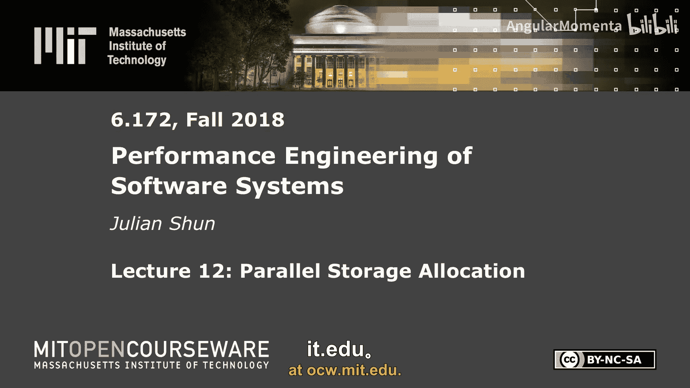

# 【麻省理工】软件系统性能工程 ｜MIT 6.172 Performance Engineering of Software Systems, Fall 2018 p12 12. 并行存储分配 -BV1esbLzpEFq_p12-

The following content is provided under a Creative Commons license。

 Your support will help Mi T OpenCourseware continue to offer high quality educational resources for free to make a donation or to view additional materials from hundreds of Mit courses。

 Visit Mit Opencourseseware at Ocw。 Mt Eduu。

Good afternoon， everyone。So today we're going to talk about storage allocation。

 this is a continuation from last lecture where we talked about serial storage allocation。

 today we'll also talk a little bit more about serial allocation。

 but then I'll talk more about parallel allocation and also garbage collection。

 so I want to just do a review of some memory allocation primitives。

So recall that you can use Maoc to allocate memory from the heap。

And if you call malloc with a size of S， it's going to allocate and return a pointer to a block of memory containing at least Sbittes。

 so you might actually get more than S bytes， even though you ask for Spites。

 but it's guaranteed to give you at least Spites。😡，The return values avoid star。

 but good programming practice is to type Cassa's pointer to whatever type you're using this memory for when you receive this from the Maacol。

There's also aligned allocation， so you can do a aligned allocation with mammal line。

 which takes two arguments， a size A as well as a size S。

And a has to be an exact power of two and it's going to allocate and return a pointer to a block of memory。

 again， containing at least s bytes， but this time this memory is going to be aligned to a multiple of A。

 so the address is going to be a multiple of a where this memory block starts。嗯。

So does anyone know why we might want to do an aligned memory allocation？Yeah。改上了次。Yeah。

 so one reason is that you can align memories so that they're aligned to cache lines so that when you access an object that fits within a cache line。

 it's not going to cross two cache lines and you only get one cash access instead of two。

 so one reason is that you want to align the memory to cache lines to reduce the number of cache misses。

 you get another reason is that the vectorization。Operators also require you to have memory addresses that are aligned to some power of two。

 so if you align your memory allocation with Mammalign， then that's also good for the vector units。

We also talked about deallocs， so you can free memory back to the heap with the free function。

So if you pass it a point or P to some block of memory。

 it's going to delocate this block and return it to the storage allocator。

 and we also talked about some anomalies of freeing。

So what is it called when you fail to free some memory that you allocated？Yes。Yeah。

 so if you fail to freeze something that you allocated， that's called a memory leak。

And this can cause your program to use more and more memory and eventually your program's going to use up all the memory on your machine and it's going to crash。

We also talked about freeing something more than once。 Does anyone remember what that's called？Yeah。

Yeah， so that's called double freeing， double freeing is when you free something more than once。

 and the behavior is going to be undefined， you might get a seg fault or immediately or you'll free something that was allocated for some other purpose and then later down the road your program's going to have some unexpected behavior。

😡，Okay， I also want to talk about MMAPap， so MMAP is a system call。

 and usually MMAP is used to treat some file on disk as part of memory so that when you write to that memory region。

 it also backs it up on disk。😡，In this context here I'm actually using MMap to allocate virtual memory without having any backing file。

 so MMap has a whole bunch of parameters here， the second to the last parameter indicates the file I want to map in if Ipas it a negative one that means there's no backing file so I'm just using this to allocate some virtual memory。

😡，The first argument is where I want to allocate it and zero means that I don't care。😡。

The size in terms of number of bytes has how much memory I want to allocate。

Then there's also permission， so here it says I can read and write this memory region。

Map private means that this memory region is private to the process that's allocating it。

 and then mapon means that there's no name associated with this memory region。And then as I said。

 negative one means that there's no backing file and the last parameter is just zero if there's no backing file。

 normally it would be an offset into the file that you're trying to map。

 but here there's no backing file， and what MAP does is it finds a continuous unused region in the address space of the application that's large enough to hold size bytes。

 and then it updates the page table so that it now contains an entry for the pages that you allocated and then creates a necessary virtual memory management structures within the operating system to make it so that the users' accesses to this area are legal and accesses won't result in a SeG fault。

If you try to access some region of memory without having the OS set these parameters。

 then you might get a Se fault because the program might not have permission to access that area。

 but MMap is going to make sure that the user can access this area of virtual memory。😡。

And MMAP is a system call， whereas Maloc， which we talked about last time is a library call。

 so these are two different things and Maloc actually uses MMAP under the hood to get more memory from the operating system。

So let's look at some properties of MMap。😡，So MAP is lazy。

 so when you request a certain amount of memory， it doesn't immediately allocate physical memory for the requested allocation。

😡，Instead， it just populates the page table with entries pointing to a special zero page and then it marks these pages as read only。

 and then the first time you write to such a page it will cause a page fault and at that point the OS is going to modify the page table get the appropriate physical memory and store the mapping from the virtual address space to physical address space for the particular page that you touch and then it will restart the instruction so that it can continue to execute。

😡，U。You can turns out that you can actually Mmap a terabyte of virtual memory even on a machine with just a gigabyte of DM。

 because when you call MMap， it doesn't actually allocate the physical memory but then you should be careful because a process might die from running out of physical memory well after you call MMap。

 because MMap is going to allocate this physical memory whenever you first touch it and this can be much later than when you actually made the call to MMap。

So any questions so far？Okay， so。So what's the difference between Maloc and MMAP， so as I said。

 Maloc is a library call， and it's part of Maloc and free are part of the memory allocation interface of the HeAP management code in the C library。

😡，And the He management code uses the available system facilities。

 including the MMap function to get a virtual address space from the operating system。

And then the HeAP management code is going within Maik is going to attempt to satisfy user requests for He storage by reusing the memory that it got from the OS as much as possible until it can't do that anymore。

 and then it will go and call M to get more memory from the operating system。😡。

So the MalLC implementation invokes MMAP and other system calls to expand the size of the user's heap storage。

 and the responsibility of Maoc is to reuse the memory such that your fragmentation is reduced and you have a good temporal locality。

 whereas the responsibility of MMAP is actually getting this memory from the operating system。😡。

So any questions on the differences between Maloc and MAP？

So one question is why don't we just call Map all the time instead of using Maik。

 why don't we just directly call M？Yes。Yeah， so one answer is that you might have free storage from before that you would want to reuse。

And it turns out the MMap is relatively heavyweight， so it works on a page granularity。

 so if you want to do a small allocation， it's quite wasteful to allocate an entire page for that allocation and not reuse it。

 you'll get very bad external fragmentation and when you call MAP as it go through all of the overhead of the security of the OS and updating the page table and so on。

 whereas if you use Maloc， it's actually pretty fast for most allocations and especially if you have temporal locality where you allocate something that you just recently freed。

😡，So your program would be pretty slow if you used MMAP all the time， even for small allocations。

 for big allocations， it's fine， but for small allocations you should use Maloc。

Any questions on MAP versus Maloc？Okay， so I just want to do a little bit of review on how address translation works。

 so some of you might have seen this before in your computer architecture course。

So how it works is when you access a memory location， you access it via the virtual address。

 and the virtual address can be divided into two parts where the lower order bits store the offset and the higher order bits store the virtual page number。

And in order to get the physical address associated with this virtual address。

 the hardware is going to look up this virtual page number in what's called the page table。

And then if it finds a corresponding entry for the virtual page number in the page table。

 that will tell us the physical frame number， and then the physical frame number corresponds to where this physical memory is in DRAM。

😡，So you can just take the frame number and then use the same offset as before to get the appropriate offset into the physical memory frame。

So。If the virtual page that you're looking for doesn't reside in physical memory。

 then a page fault is going to occur， and when a page fault occurs。

 either the operating system will see that the process actually has permissions to look at that memory region and it will set the permissions and place the entry into the page table so that you can get the appropriate physical address。

 but otherwise the operating system might see that this process actually can't access that region of memory and then you'll get a segmentation fault。

😡，It turns out that the page table search also called a page walk is pretty expensive。

 and that's why we have the translation Lookaside buffer or TLB。

 which is essentially a cache for the page table so the hardware uses a TLB to cache the recent page table lookups into this TLB so that later on when you access the same page it doesn't have to go all the way to the page table to find the physical address it can first look in the TLB to see if it's been recently accessed。

So why would you expect it to see something that it recently has accessed？

So what's one property of a program that will make it so that you get a lot of TLB hits， yes？一直对。

the access that you do in virtual memory。Nearby one another。

 which means they're probably in the same thing。一个。Yeah。So that's correct。

 so the page table stores pages which are typically four kilobytes nowadays there are also huge pages which can be a couple megabytes and most of the aes in your program are going to be near each other。

 so they're likely going to reside on the same page for accesses that have been done close together in time。

So therefore， you'll expect that many of your recent aes are going to be stored in the TLB if your program has locality。

 either spatial or temporal locality or both。So how this architecture works is that the processor is first going to check whether the virtual address you're looking for is in TLB。

 if it's not， it's going to go to the page table and look it up， and then if it finds it there。

 then it's going to store that entry into the TLB， and then next is going to go get this physical address that it found from the TLB。

 and look it up into the CPU cache， and if it finds it there， it gets it if it doesn't。

 then it goes to DRM to satisfy the request。😡，Most modern machines actually have an optimization that allow you to do TLB access in parallel with the L1 cache access。

 so the L1 cache actually uses virtual addresseses instead of physical addresseses and this reduces the latency of a memory axis。

So that's a brief review of address translation。All right， so let's talk about stacks。😡。

So when you execute a serial C and C++ program， you're using a stack to keep track of the function calls and local variables that you have to save。

😡，So here let's say we have this invocation tree where function A calls function B。

 which then returns， and then a calls function C， which calls D， returns， calls E， returns。

 and then returns again。Here are the different views of the stack at different points of the execution。

 so initially when we call a， we have a stack frame for a。And then when a calls B。

 we're going to place a stack frame for B right below the stack frame of A。

 so these are going to be linearly ordered。😡，When we're done with B。

 then this part of the stack is no longer going to be used， the part for B， and then when it calls C。

 it's going to allocate a stack frame below a on the stack and this space is actually going to be the same space as what B was using B4 but this is fine because we're already done with the call to B。

 then when C calls D， we're going to create a stack frame for D right below C when it returns。

 we're not going to use that space anymore so then we can reuse it for the stack frame when we call E。

😡，And then eventually all of these will pop back up。

And all of these views here share the same view of the stack frame for A， and then for C， D and E。

 they all share the same view of the stack for C。😡。

So this is how a traditional linear stack works when you call a serial C or C++ program and you can view this as a serial walk over the invocation tree。

There's one rule for pointers with traditional linear stacks is that a parent can pass pointers to its stack variables down to his children。

But not the other way around， a child can't pass a pointer to some local variable back to its parents。

 so if you do that you'll get a bug in your program， how many of you have tried doing that before？

Yeah， so a lot of you。So let's see why that causes a problem。So。

If I'm calling if I call B and I pass a pointer to some local variable in B stack to A。

 and then now when a calls C， it's going to overwrite this space that B was using and if B's local variable was stored in the space that C has now overwritten。

 then you're just going to see garbage， and when you try to access that you're not going to get the correct value。

😡，So you can pass a pointer to A's local variable down to any of these descendant function calls because they all see the same view of A stack and that's not going to be overwritten while these descendant function calls are proceeding。

 but if you pass it the other way， then potentially the variable that you had a pointer to is going to be overwritten。

😡，So。Here's one question， if you want to pass memory from a child back to the parent。

 where would you allocate it？So you can allocate it on the parent， what's another option？Yes。Yeah。

 so another way to do this is to allocate it on the heap， if you allocate on the heap。

 even after you return from the function called that memory is going to persist。

You can also allocate it into parent stack if you want， in fact， some programs are written that way。

One of the reasons why many C functions require you to pass in memory to the function where it's going to store the return value is to try to avoid an expensive he allocation in the child because if the parent allocates this space to store the result the child can just put whatever it wants to compute in that space and the parent will see it。

 so then the responsibility is up to the parent to figure out whether it wants to allocate the memory on the stack or on the heEap。

 so this is one of the reasons why you'll see many C functions where one of the arguments is a memory location where the result should be stored。

Okay， so that was the serial case， what happens in parallel？

So in parallel we have what's called a cactus stack where we can support multiple views of the stack in parallel。

 so let's say we have a program where it calls function A and then A spawns B and C。

 so B and C are going to be running potentially in parallel and then C spawns D and E。

 which can potentially be running in parallel。So for this program， we could have functions B， D。

 and E， all executing in parallel。😡，And a caactus stock is going to allow us to。

Have all of these functions see the same view of the stack as they would have if this program were executed serially。

And the Silk runtime system supports the cactus stack to make it easy for writing parallel programs because now when you're writing programs。

 you just have to obey the same rules for programming in serial CNC++ with regards to the stack。

 and then you'll still get the intended behavior。😡，U。

And it turns out that there's no copying of the stacks here。

 so all of these different views are seeing the same virtual memory addresses for A。😡。

But now there is an issue of how do we implement this cactus stack， because in the serial case。

 we could have these later stacks overriding the earlier stacks， but in parallel， how can we do this？

So does anyone have any simple ideas on how we can implement a cactus stack？Yes。You can just。

Each child's。That started。Like a separate stack。just。Preects。Yeah。

 so one way to do this is to have each thread use a different stack and then store pointers to the different stack frames。

Across the different stacks， there's actually another way to do this， which is easier。嗯。Okay， yes。

If the stackg frames have like a maximum。Faced maximum size。Fut them all in the same stack。

Separated by that。Exite。Yeah， so if the stacks all have a maximum depth。

 then you could just allocate a whole bunch of stacks which are separated by this maximum depth。

There's actually another way to do this。Which is to not use the stack， so yes。

That somewhere else in each of。Yeah， so that's actually one way to do it the easiest way to do it is just to allocate it off the heap。

 so instead of allocating the frames on the stack， you just do a heap allocation for each of these stack frames and then each of these stack frames has a pointer to the parent stack frame。

😡，So whenever you do a function call， you're going to do a memory allocation from the heap to get a new stack frame。

 and then when you finish a function， you're going to pop something off of this stack and free it back to the heap。

😡，In fact， a lot of early systems for parallel programming use this strategy of heat based cactus stacks。

Turns out that you can actually minimize the performance impact using this strategy if you optimize the code enough。

 but there is actually a bigger problem with using a heat based cactus stack。

 which doesn't have to do with performance。Does anybody have any guesses of？

What this potential issue is。Yeah， as you allocate memory。Yeah。

 so let's assume that we can do parallel heat allocation and we'll talk about that。

 so assuming that we can do that correctly， what's the issue with this approach？Yeah。

I don't know how big that' going to be。So let's assume that you can get whatever stack frames you need from the heap so you don't actually need to put an upper bound on this。

Yeah。don't know like they're。Yeah， so we don't know the maximum depth。

 but let's say we can make that work， so you don't actually need to know the maximum depth if you're allocating off the heap。

Any other guesses？Yeah。嗯 good。St is allocated on the heat back。ig specs。

So let's say we could get that to work as well。So what happens if I try to run some program using this heat based cactus stack with something that's using the regular stack？

So let's say I have some old legacy code that was already compiled using the traditional linear stack。

So there's a problem with interoperability here because the traditional code is assuming that when you make a function call。

The stack frame for the function call is going to appear right after the stack frame for the particular colley function so if you try to mix code that uses the traditional stack as well as this heatbased cactus stack approach then it's not going to work well together one approach is that you can just recompile all your code to use this heat-based cactus stack even if you could do that even if all of the source codes were available there are some legacy programs that actually in the source code。

 they do some manipulations with the stack because they assume that you're using the traditional stack and those programs would no longer work if you're using a heatbased cactus stack so the problem is interoperability with legacy code turns out that you can fix this using an approach called thread local memory mapping so one of the students mentioned memory mapping but that requires changes to the。

Operating system， so it's not general purpose。But the heat based cactus stack turns out to be very simple and we can prove nice bounds about it。

 so besides the interoperability issue， heat based cactus stacks are pretty good in practice as well as in theory。

So we can actually prove a space bound of a silk program that uses the heat based cactus stack。

So let's say S1 is the stack space required by a serial execution of a silk program。

Then the stack space of a P worker execution using a heat based cactus stack is going to be upper bounded by p times S1。

 so SP is the space for a P worker execution and that's less than or equal to P times S1。

To understand how this works， we need to understand a little bit about how the Silk Work stealing algorithm works。

 so in the silk works stealing algorithm whenever you spawn something a work or that spawns a new task is going to work on the task that it spawned。

So therefore， for any leaf in the invocation tree that currently exists。

 there's always going to be a worker working on it。

 there's not going to be any leaves in the tree where there's no worker working on it because when a worker spawns a task。

 it creates a new leaf， but then it works immediately on that leaf。😡。

So here we have an in tree and for all of the leaves。

 we have a processor working on it and with this busy leaves property we can easily show this space bound。

 so for each one of these processors， the maximum stack space using is going to be upper bounded by S1 because that's maximum stack space across a serial execution that executes the whole program。

 and then since we have P of these leaves we just multiply S1 by P and that gives us an upper bound on the overall space used by a P worker execution。

This can be a loose upper bound because we're double counting here。

 there's some part of this memory that we're counting more than once because they're shared among the different processors。

 but that's why we have the less or equal to here， so it's upper bounded by p times S1。

So this is one of the nice things about using a heat based cactus stack is that you get this good space bound。

Any questions on the spacebound here？So let's try to apply this theorem to a real example。

 so this is the dividing conquer matrix multiplication code that we saw in a previous lecture。

So this is in this code， we're making eight recursive calls a dividing conquer function each of size n over two。

 and before we make any these calls we're doing a malloc to get some temporary space and this is of size order n squared and then we free this temporary space at the end。

 and notice here that the allocations of the temporary matrix obey a stack discipline so we're allocating stuff before we make recursive calls and we're freeing it after or right before we return from the function。

 so stack all of the allocations are nested and they follow a stack discipline and it turns out that even if you're allocating off the heap。

 if you follow a stack discipline， you can still use the space bound from the previous side to upper bound the P worker space。

Okay， so let's try to analyze the space of this code here。

 so first let's look at what the work and span are。

 so this is just going to be reviewed what's the work of this dividing conquer matrix multiply so it's n cubed。

嗯。It's N cubed because we have eight sub problems of size n over 2。

 and then we have to do linear work to add together the matrices。

So our recurrence is going to be T1 of n。It's equal to 8 times t1 of n over 2 plus order n squared in。

That solves to order N cubed if you just pull out your master theorem card。What about the span？

So what's the recurrence here？Yeah， so the span t infinity of n is equal to t infinity of n over 2 plus the span of the addition。

 and what's the span of the addition？No， let's assume that we have a parallel addition。

 we have nested silk4 loops。Right， so then the span of that is just going to be log n since the span of one so for loop is log n and when you nest them you just add together the span。

 so it's going to be t infinity of n is equal to t infinity of n over 2 plus order log n and what does that solve to？

Yeah， so it's going to solve to order log squared and again。

 you can pull out your master theorem card and look at one of the three cases。Okay。

 so now let's look at the space。What's going to be the recurrence for the space？Yes。Actually觉得。

split up， we're just getting more views into。The only place we're generating new spaces when we call this malloc here。

So they're all seeing the same original matrix。So what would the recurrence be？Yeah。Yeah。

So the n square term is right， do we actually need eight sub problemsbles of size N over 2？

What happens after we finish one of these sub problemsblem？

Are we still going to use the space for it？规的。Right。

 so you can actually reuse the memory because you free the memory you allocated after each one of these recursive calls。

 so therefore the recurrence is just going to be s of n over 2 plus theta of n squared。And。

What does that solve to？呃。N squared。Right。So here the n squared term actually dominates。

 you have a decreasing geometric series， so it's dominated at the root and you get theta of n squared。

And therefore， by using the busy leaves property and the theorem for the space bound。

 this tells us that on P processors， the space is going to be bounded by p times n squared。

 and this is actually pretty good since we have a bound on this。

It turns out that we can actually prove a stronger bound for this particular example。

And I'll walk you through how we can prove this stronger bound here。

 so order p times n squared is already pretty good。

 but we can actually do better if we look internally at how this algorithm is structured。

So on each level of recursion we're branching eight ways and most of the space is going to be used near the top of this recursion tree。

 so if I branch as much as possible near the top of my recursion tree。

 then that's going to give me my worstcase space bound because the space is decreasing geometrically as I go down the tree。

So I'm going to branch eight ways until I get to some level K in the recursion tree where I have P nodes and at that point I'm not going to branch anymore because I've already used up all P nodes and that's the number of workers I have。

So let's say I have this lal K here where I have P nodes。😡，U。So。So what。

 what would be the value of k here， if I branch8 ways。

 how many levels do I have to go until I get to P nodes。Yes。Yes， so it's log base 8 of p。

 so we have8 to the k equal p because we're branching Kways and then using some algebra。

 you can get it so that k is equal to log base8 of p， which is equal to log base 2 of p divided by 3。

And then at this level K downwards， it's going to decrease geometrically。

 so the space is going to be dominated at this level k。

 so the space decreases geometrically as you go down from level K and also as you go up from level K。

 so therefore we can just look at what the space is at this level K here。

 so the space is going to be p times the size of each one of these nodes squared。😡。

And the size of each one of these nodes is going to be n over2 to the log base 2 of p over 3。

 and then we square that because we're using n squared temporary space。So if you solve that。

 that gives you p to the13 times n squared， which is better than the upper bound we saw earlier of order p times n squared。

So you can work out the details for this example， not all the details are shown on this slide。

You need to show that the level K here actually dominates all of the other levels in the recursion tree。

 but in general， if you know what the structure of the algorithm is。

 you can potentially prove a stronger space bound than just applying the general theorem we showed on the previous slide。

So any questions on this？Okay， so as I said before。

 the problem with heat based linkage is that parallel functions fail to interoperate with legacy and third party serial binaries。

 yes， was there a question？Yes。まてそ。How do we knowで。Okay。啊。He split along。た。Pluss。Yeah。

 so you don't actually know that， but this turns out to be the worst case。

 so if it branches any other way， the space is just going to be lower。

So you have to argue that this is going to be the worst case and it's going to be intuitively it's the worst case because you're using most of the memory near the root of the recursion tree。

 so if you can get all of the allP notes as close as possible to the root。

 that's going to make your space as high as possible。😡，It's a good question。

So parallel functions fail to interoperate with legacy and third party serial binaries。

 even if you can recompile all of this code， which isn't always necessarily the case。

 you can still have issues if the legacy code is taking advantage of the traditional linear stack inside the source code。

So our implementation of silk uses a less space efficientffient strategy that is interoperable with legacy code and it uses a pool of linear stacks instead of a heatbased strategy so we're going to maintain a pool of linear stacks lying around。

 there's going to be more than P stacks lying around and whenever a worker tries to steal something it's going to try to acquire one of these tasks from this pool of linear tasks and when it's done it will return it back but when it finds that there's no more linear stacks in this pool。

 then it's not going to steal anymore， so this is still going to preserve the space bound as long as the number of stacks is a constant times the number of processors。

 but it will affect a time bounds of the work stealing algorithm because now when a worker's idle it might not necessarily have the chance to steal if there are no more stacks lying around。

This strategy doesn't require any changes to the operating system。

 there is a way where you can preserve the space and the time balance using thread local memory mapping。

 but this does require changes to the operating system。

 so our implementation of silk uses a pool of linear stacks and it's based on the Intel implementation。

😡，Okay。All right。We talked about stacks and that we just reduced the problem to heAP allocations。

 so now we have to talk about heaps。So let's review some basic properties of he storage allocators。

So here's a definition， the allocator speed is the number of allocations and dallocs per second that the allocator can sustain。

um。And here's a question， is it more important to maximize the allocator speed for large blocks or small blocks？

Yeah。So small blocks。Here's another question， why？Yes。So chanceor。

 you're going to be doing a lot of moves。Yes， so one answer is that you're going to be doing a lot more allocations and delocations of small blocks than large blocks。

There's actually a more fundamental reason why it's more important to optimize for small blocks so anybody。

 yeah。not。Yeah， so that's another reason for small blocks。

 it's more likely that it will lead to fragmentation if you don't optimize for small blocks。

 what's another reason， yes？Probably going to just take longer to allocate large blocks anyway。

 so the overhead is going to be more noticeable。And if you have a big overhead when you get small blocks。

Yeah， so the reason the main reason is that'reocating a large， when you're allocating a block。

 a user program is typically going to write to all the bytes in the block。And therefore。

 for a large block， it takes so much time to write that the allocator time has little effect on the overall running time。

 whereas if a program allocates many small blocks， the amount of work useful work is actually doing on the block is going to be it can be comparable to the overhead for the allocation。

 and therefore all of the allocation overhead can add up to a significant amount for small blocks。

So essentially for large blocks， you can amortize away the overheads for storage allocation。

 whereas for small blocks， it's harder to do that， therefore it's important to optimize for small blocks。

Here's another definition， so the user footprint is the maximum over time of the number u of bytes in use by the user program。

 and these are the bytes that are allocated and not freed and this is measuring the peak memory usage it's not necessarily equal to the sum of the sizes that you have allocated so far because you might have reused some of that。

😡，So the user footprint is the peak memory usage in number of bytes。

And the allocator footprint is a maximum overtime of the number a of bytes that the memory provided to the allocator by the operating system。

And the reason why the allocator footprint could be larger than the user footprint is that when you ask the OS for a sum memory。

 it could give you more than what you asked for。And similarly。

 if you ask Maloc for some amount of memory， it can also give you more than what you ask for。

 and the fragmentation is defined to be a divided by you。

And a program with low fragmentation will keep this ratio as low as possible。

 so to keep the allocator footprint as close as possible to the user footprint。

 and in the best case this ratio is going to be once you're using all of the memory that the operating system allocated。

One remark is that the allocator footprint A usually grows monotonically for many allocators。

 so it turns out that many allocators do M maps to get more memory but they don't always free this memory back to the OS and you can actually free memory using something called M onmap which is the opposite of Mmap to give memory back to the OS。

 but this turns out to'll be pretty expensive in modern operating systems or implementation is not very efficient。

 so many allocators don't use onmap you can also use something called M advisedvis and what M advisedvis does is it tell us the operating system that you're not going to be using this page anymore but to keep it around in virtual memory so this has less overhead because it doesn't have to clear this entry from the page table it just has to mark that the program isn't using this page anymore so some allocators use M advice with the option。

Don't need to。Free memory， but A is usually still growing monotonically over time because allocators don't necessarily free all of the things back to the OS that they allocated。

Here's a theorem that we proved in last week's lecture。

 which says that the fragmentation for bin Free list is order log based two of U or just order log U。

 and the reason for this is that，You can have log base two of U bins， and for each bin。

 it can basically contain U bytes of storage。So overall you can use overall。

 you could have allocated u times log U storage and only be using U of those bytes。

 so therefore the fragmentation is order log U。Another thing to note is that modern 64 bit processors only provide about2 to 48 bytes of virtual address space。

So this is sort of news because you would probably expect that for a 64 bit processor you have to the 64。

Btes of virtual address space， but that turns out not to be the case。

 so they only support to the 48 bytes and that turns out to be enough for all of the programs that you would want to write and that's also going to be much more than the physical memory you would have on a machine so nowadays you can get a big server with a terabyte of memory or to the 40 bytes of physical memory which is still much lower than the number of bytes in the virtual address space。

Any questions？Okay， so here's some more definitions。

 so the space overhead of an allocator is a space used for bookkeeping。

 so perhaps you could store headers with the blocks that you allocate to keep track of the size and other information and that would contribute to the space overhead。

Internal fragmentation is the waste due to allocating larger blocks in the user request so you can get internal fragmentation if when you call MalC you get back a block that's actually larger than what the user request did。

 we saw in the bin freeless algorithm we're rounding up to the nearest power of twos if you allocate nine bytes you'll actually get back 16 bytes in our bin freeless algorithm from last lecture so that contributes the internal fragmentation。

It turns out that not all bin Fless implementations use powers of two。

 so some of them use other powers that are smaller than two in order to reduce the internal fragmentation。

Then there's an external fragmentation， which is the waste due to the inability to use storage because it's not contiguous。

So for example。If I allocated a whole bunch of one bite things consecutively in memory。

 then I freed every other bitete， and then now I want to allocate a two byte thing。

 I don't actually have a contiguous memory to satisfy that request because all of my free bites are in one bite chunks and they're not next to each other。

 so this is one example of how external fragmentation can happen after you allocate stuff and free stuff。

Then there's blow up， and this is for a parallel allocator。

 the additional space beyond what a serial allocator would require。😡。

So if a serial allocator requires s space and a parallel allocator requires T space。

 then it's just going to be t over S， that's to blow up。Okay。

 so now let's look at some parallel heap allocation strategies。

So the first strategy is to use a global heap， and this is how the default C allocator works。

So if you just use a default C allocator out of the box， this is how it's implemented。

 it uses a global heap where all of the aes to this global heap are protected by muex。

 you can also use lock free synchronization primitives to implement this。

 we'll actually talk about some of these synchronization primitives later on in the semester。

 and this is done to preserve atomity because you can have multiple threads trying to access the global heap at the same time and you need to ensure that races are handled correctly。

So。What's the blow up for this strategy？How much more space am I using then？Just a serial allocator。

Yeah。Yeah， so the blowup is one because I'm not actually using any more space than the serial allocator。

 since I'm just maintaining one global heap and everybody is going to that heap to do allocations and deallocations。

嗯。But what's the potential issue with this approach？Yeah。That block coordination。Yeah。

 so you're going to take a performance hit for trying to acquire this lock。

 so basically every time you do an allocation or deallocation you have to acquire this lock and this is pretty slow and it gets slower as you increase the number of processors。

Roughly speaking， acquiring a lock， the perform is similar to an L2 cash access and if you just run a serial allocator。

 many of your requests are going to be satisfied just by going into the L1 cash because you're going to be allocating things that you recently freed and those things are going to be residing in L1 cash。

 but here before you even get started， you have to grab a lock and you have to pay a performance hit similar to an L2 cash access so that's bad。

And it gets worse as you increase the number of processors。

So the contention increases as you increase the number of threats。

 and then you can you're not going to be able to get good scalability。So ideally。

 as the number of threads or processor grows， the time to perform an allocation or deallocation shouldnt increase。

But in fact， it does， and the most common reason for loss of scalability is law contention。

So here all of the processors are trying to acquire the same block， which is the same memory address。

 and if you recall from the caching lecture or the multicore programming lecture every time you acquire a memory location。

 you have to bring that cache line into your own cache and then invalid the same cache line in other processor's caches。

 so if all the processor are doing this， then this cache line is going to be bouncing around among all the processor's caches and this could lead to very bad performance。

So here's a question， is law contention more of a problem for large blocks or small blocks？Yes。

So small box。Here's another question。喂。Yes。The time takes to。You'res the small plug。Yeah我觉得。Smallest。

Any applicationss of the application。水や。Yeah so。One of the reasons is that when you're doing small allocations。

 that means that your request rate is going to be pretty high and your processors are going to be spending a lot of time acquiring this lock and this can。

acacerbate the law contention and another reason is that when you allocate a large block。

 you're doing a lot of work because you have to write most of the time you're going to write to all the bytes in that large block。

 and therefore you can amortize the overheads of the storage allocator across all the work that you're doing whereas for small blocks in addition to increasing this rate of memory requests it's also there's much less work to amortize the overheads across。

So any questions？Okay， good。All right， so here's another strategy which is to use local heap。

 so each thread is going to maintain its own heap and it's going to allocate out of its own heap。

And there's no locking that's necessary， so when you allocate something。

 you get it from your own heap and when you freeze something， you put it back into your own heap。

 so there's no synchronization required。So that's a good thing， it's very fast。

 what's a potential issue with this approach？Yes。Yeah。

 so this approach you're going to be using a lot of extra space， so first of all。

 because you have to maintain multiple heaps and what's one phenomenon that you might see if you're executing a program with this local heEAP approach so is the could the space potentially keep growing over time？

Yes， you could maybe like allocate。Process。Yeah， yeah。

 so you could actually have an unbounded blowup because if you do all of the allocations in one heap and then you free everything in another heap。

 then whenever the first heap does an allocation， there's actually free space sitting around in another heap but it's just going to grab more memory from the operating system so your blowup can be unbounded and this phenomenon is's what's called memory drift so blocks allocated by one thread are freed by another thread and if you run your program for long enough。

 your memory consumption can keep increasing and this is sort of like a memory leak so you might see that if you have a memory drift problem。

 your program running on multiple processors could run out of memory eventually worse if you just run it on a single core it won't run out of memory。

And here it's because the allocator isn't smart enough to reuse things in other heaps。

So what's another strategy you can use to try to fix this？Yes。Sorry， can you repeat your question？

But it think this probably independent talk a。非以常啊。Because if you keep allocating from one thread。

 if you do all of your allocations in one thread and do all your de allocationlocs on another thread。

 every time you allocate from the first thread， there's actually memory sitting around in the system。

 but the first thread isn't going to see it because it only sees its own heap and it's just going to keep grabbing more memory from the OS and then the second thread actually has this extra memory sitting around but it's not using it because it's only doing the freeze。

 it's not doing allocate and if you recall the definition of a blow up is how much more space you're using compared to a serial execution of a program。

 if you executed this program on a single core a single you would only have a single heap that does the allocations and freeze so you're not your memory isn't going to blow up。

 it's just going to be constant over time， whereas if you use two threads to execute the memory could just keep growing over time。

Yes。Yes。So it just if you remember the bin Free list approach， let's say we're using that。

 then all you have to do is set some pointers in your bin Free list data structure as well as the block that you're freeing so that it appears in one of the linked lists so you can do that even if some other processor allocated that block。

Okay， so what's another strategy that can avoid this issue of memory drift？Yes。

 at least shuffle the free memory between the。Yeah， so that's a good idea。

 you could periodically rebalance the memory of what's a simpler approach to solve this problem？Yes。

All no， all of。Sorry， could you repeat that？U。Yeah。

 so you could have all of the processors know all the free memory。

 and then every time it grabs something， it looks in all the other heaps。

 that does require a lot of synchronization overhead might not perform that well。

 what's an easier way to solve this problem。Yes。There's to both e。

So you could restructure your program so that the same threat。

Does the allocations and freeze for the same memory block？

What if you didn't want to restructure your program， how can you change the allocator？

So we want the behavior that you said， but we don't want to change our program， yes。Yeah。Yeah。

 so you could have a single free list， but that gets back to the first strategy of having a global heap。

 and then you have high synchronization overheads。Yes。メ啊。For the point that。对对对。That allocate。

sayingF back to the threat that allocated it。Yeah， so that's exactly right。So here each object。

 when you allocate it， it's labeled with an owner， and then whenever you free it you return it back to the owner。

The objects that are allocated will eventually go back to the owner's heap if they're not in use and they're not going to be free lying around in somebody else's heap。

The advantage of this approach is that you get fast allocation and freeing of local objects。

 local objects are objects that you allocated， however。

 freeing remote objects requires some synchronization because you have to coordinate with the other threads heap that you're sending the memory object back to。

 but this synchronization isn't as bad as having a global heap since you only have to talk to one other threat in this case。

You can also bound the blow up by P。So。The reason why the blowup is upper bounded by P is that let's say the serial allocator uses at most x memory。

 in this case each of the heapavs can use at most X memory because that's how much the serial program would have used and you have P of these heaps。

 so overall you're using P times x memory and therefore the ratio is upper bounded by P。Yes。

So when you free an object that goes， if you allocate it。

 that object that goes back to your own heap， if your heap is empty。

 it's actually going to get more memory from the operating system。

 it's not going to take something from another thread's heap。

 but the maximum amount of memory that you're going to allocate is going to be upper bounded by X because the sequential serial program took that much。

😡，Yeah。So the upper bound for the blow up is P， another advantage of this approach is that it has resilience to false sharing。

U。So let me just talk a little bit about false sharing。

So true sharing is when two processors are trying to access the same memory location。

And fall sharing is when multiple processors are accessing different memory locations。

 but those locations happen to be on the same cache line。So here's an example。

 let's say we have two variables x and y， and the compiler happens to place x and y on the same cache line。

Now， when the first processor writes to x， it's going to bring this cache line into its cache。

When the other processor rises to why， since it's on the same cache line。

 it's going to bring this cash line to wise cash。And then now the first processor it writes x is going to bring this cache line back to the first processor's cache。

 and then keep you can see this phenomenon key happening。

 so here even though the processors are writing to different memory locations because they happen to be on the same cache line。

 the cache line is going to be bouncing back and forth on the machine between the different processors。

 caches， and this problem gets worse if more processors are accessing this cache line。U。

So and this can be quite hard to debug because if you're using just variables on the stack。

 you don't actually know necessarily where the compiler is going to place these memory locations。

 so the compiler could just happen to place X and Y in the same cache block and then you'll get this performance hit。

 even though it seems like you're accessing different memory locations。

If you're using the heap for memory allocation， you have more knowledge because if you allocate a huge block。

 you know that all of the memory locations are contiguous in physical memory so you can just space you can space the aes far enough apart so that different processes aren't going to touch the same cache line。

嗯。A more general approach is that you can actually pad the object。

 so first you can align the object on a cache line boundary and then you pad out the remaining memory locations of the object so that it fills up the entire cache line and now there's only one thing on that cache line。

But this does lead to a waste of space because you have this wasted padding here。

So program can induce fall sharing by having different threads process nearby objects。

 both on the stack and on the heEap， and then an allocator can also induce false sharing in two ways。

 so it can actively induce false sharing and this is when the allocator satisfies memory requests from different threads using the same cache block。

And it can also do this passively and this is when the program passes objects lying around on the same cache lines to different threads and then the allocator reuse the object storage after the objects are free to satisfy request from those different threads and the local ownership approach tends to reduce fall sharing because the thread that allocates an object is eventually going to get it back。

 you're not going to have it so that an object is permanently split among multiple processor heaps。

 so even if you see fall sharing， in local ownership it's usually temporary。

 eventually it's going the object is going to go back to the heap that it was allocated from and the fall sharing is going to go away。

Yes。Three5 regions。I mean， you can implement it in various ways， I mean。

 you can have each one of them do have a bin freeless allocator。

 so there's no restriction on where they have to appear in physical memory。

 there are many different ways where you can you can basically plug in any serial allocator for the local heap。

So let's go back to parallel heat allocation， so I talked about three approaches already。

Here's a fourth approach， this is called the hoard Allocator。

This was actually a pretty good allocator when it was introduced almost two decades ago。

 and it's inspired a lot of further research on how to improve parallel memory allocation。

 so let me talk about how this works。In the horard allocator， we're going to have P local heaps。

 but we're also going to have a global heap。U。The memory is going to be organized into large super blocks of size S and S is usually a multiple of the page size。

 so this is the granularity at which objects are going to be moved around in the allocator and then you can move super blocks between the local heaps in the global heaps so when a local heap becomes has a lot of super blocks that are not being fully used。

 then you can move it to the global heap and then when a local heap doesn't have enough memory it can go to the global heap to get more memory and then when a global heap doesn't have any more memory then it gets more memory from the operating system。

So this is sort of a combination of the approaches that we saw before。

The advantages are that this is a pretty fast allocator。

 it's also scalable as you add more processors to performance。Iproves。

 you can also bound the blow up。And it also has resilience to fall sharing because it's using local heaps。

 so let's look at how an allocation using the hoard allocator works。

 let's just assume without loss of generality that all the blocks are the same size so we have fixed size allocation。

So let's say we call Malik in our program and let's say thread I calls the Maloc。

So what we're going to do is we're going to check if there's a free object in HeAPI that can satisfy this request。

And if so， we're going to get an object from the fullest non full superblock in I heap。

Anyone know why we want to？Get the object from the fullest non full superblock。Yes。Right。

 so when a superblock needs to be moved is as dense as possible and more importantly。

 this is to reduce external fragmentation because as we saw in the last lecture。

 if you skew the distribution of allocated memory objects to as few pages or in this case。

 as few superblock as possible， that reduces your external fragmentation。Okay。

 so if it finds it in its own heap， then it's going to allocate an object from there。

 otherwise it's going to check the global heap。And if there's something in the global heap。

 or so here it says if the global heap is empty， then it's going to get a new super blocklock from the OS。

😡，Otherwise， we can get a super block from the global heap and then use that one。😡，And then finally。

 we set the owner of the block we got either from the OS or from the global HeEap to I。

 and then we returned that free object to the program。

So this is how a malloc works using the horard allocator。And now let's look at H D allocation。

So let U sub I be the in U storage in HeapAP I， this is the heap for thread I and let a sub I be the storage owned by HeAP I。

The hoard allocator maintains the following invariant for all heaps I。

 and the invariant is as follows， so u sub I is always going to be greater than or equal to the min of a sub I minus2 times s。

 recall s is the super block size and a sub I over 2。

So how it implements this is as false as when we call free of x， let's say x is owned by thread I。

 that we're going to put x back into HeAP I， and then we're going to check if the in U storage in HeAP I U sub I is less than the min of a subi minus 2S and a sub I over 2。

And what this condition says， if it's true， it means that your heap is less at most half utilized。

 because if it's smaller than this， it has to be smaller than a sub I over2。

 that means there's twice as much allocated than used in the local heEAP I。

 and therefore there must be some super blocklock that's at least half empty and you move that super block or one of those super blocks to the global heap。

So any questions on how the allocation and deallocation works。

 so since we're maintaining this invariant it's going to allow us to prove a bound on the blow up and I'll show you that on the next slide。

 but before I go on are there any questions？Okay， so let's look at how we can bound the blow up of the horde allocator。

So there's actually a lama that we're going to use and not prove the lemma is that the maximum storage allocated in the global heap is at most。

 the maximum storage allocated in the local heaps， so we just need to analyze how much storage is allocated in the local heaps because the total amount of storage is going to be at most twice as much since the global heap storage is dominated by the local heap storage so you can prove this dilemma by case analysis and there's the hoard paper that's available on learning modules and you're free to look at that if you want to look at how this is proved。

 but here I'm just going to use this lama to prove this theorem。

Which says that let U be the user footprint for a program and let A be the Hards allocator footprint。

We have that A is upper bounded by order U plus SP。And therefore， a divided by U， which is a blow up。

 is going to be one plus order SP divided by U。Okay， so let's see how this proof works。

So we're just going to analyze the storage in the local heaps。

Now recall that we're always satisfying this invariant here。

Where u sub I is greater than the min of a subbi minus 2S and a sub i over 2。

So the first term says that we can have 2 S unutilized storage per heap。

 so it's basically giving two super blocks for free to each heap and they don't have to use it。

 they can basically use it as much as they want and therefore the total amount of storage contributed by the first term is going to be order SP because each processor has2S up to 2S unusilized storage so that's where the second term comes from here and。

The second term A sub I over 2， this will give us the first term order U。

 so this says that the allocated storage is at most twice the use storage for and then if you sum up across all the processors。

 then there's a total of order use storage that's allocated because the allocated storage can be at most twice the used storage。

😡，Okay， so that's the proof of the blow up for hoard， and this is pretty good。

 it's one plus some lower order term。Okay， so。Nowadays。

 there are some other allocators that people use so JE Maloc is a pretty popular one has a few differences with hoard。

 it has a separate global lock for each different allocation size。

 it allocates the object with the smallest address among all the objects of the requested size and it releases empty pages using M advice。

 which we talked about I talked about earlier， and it's pretty popular because it has good performance and it's pretty robust to different allocation traces。

 there's also another one called Supermaloc which is an up and coming contender and it was developed by Bradley Kzmal。

Here are some allocator speeds for the allocators that we looked at for our particular benchmark。

For this particular benchmark we can see that supermaloc actually does really well it's more than three times faster than JE Maloc and JE Maloc is more than twice as fast as hoard。

 and then the default allocator which uses a global heap is pretty slow because it can't get good speed up and all of these experiments are 32 threads。

I also have the lines of code， so we see that supermaloc actually has very few lines of code compared to the other allocators。

 so it's relatively simple。Okay， so I also have some slides in garbage collection。

 but since we're out of time， I'll just put these slides online and you can read them。

