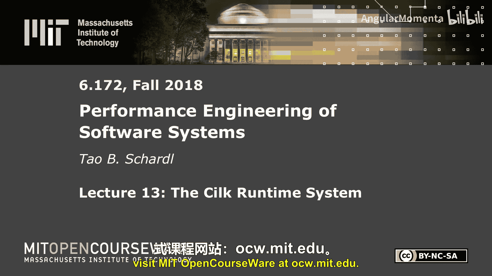
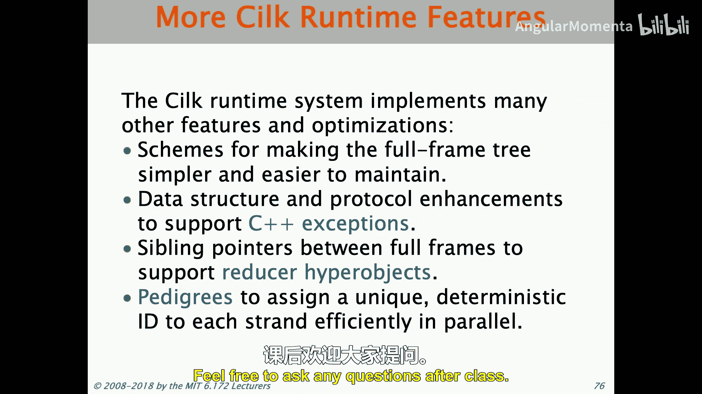

# 【麻省理工】软件系统性能工程 ｜MIT 6.172 Performance Engineering of Software Systems, Fall 2018 p13 13. Cilk运行时系统 -BV1esbLzpEFq_p13-

The following content is provided under a Cative Commons license。

 Your support will help Mi T OpenCourseware continue to offer high quality educational resources for free to make a donation or to view additional materials from hundreds of MiT courses。

 Visit Mit Opencourseseware at Ocw。 Mt Eduu。

Everybody。It's my pleasure once again to welcome TBB Sle， who is the author of your taper compiler。

To talk about the silk runtime system。嗯。Thanks Charles， can everyone hear me in the back seem good？

Okay。Thanks for the introduction today I'll be talking about the Sil runtime system。

 This is pretty exciting for me。 This is a lecture that's not about compilers。

 I get to talk about something a little different for once。😊，嗯。It should be a fun lecture。Recently。

 as I understand it， you've been looking at storage allocation。

 both in the serial case as well as the parallel case。

 and you've already done silk programming for a while at this point。

 this lecture honestly is a bit of a non sequiur。In terms of the overall flow of the course。

 and it's also an advanced topic， the Sil runtime system is a pretty complicated piece of software。

 but nevertheless， I believe you should have enough background to at least start to understand and appreciate some of the aspects of the design all of the silk runtime system。

So that's why we're talking about that today。Just to quickly recall something that you're all。

 I'm sure intimately familiar with by this point， what silkk programming all about。

 well Silk is a parallel programming language that allows you to make your software run faster using parallel processors。

And to use silk， it's pretty straightforward， you may start with some serial code that runs in some running time we'll denote that as TAS for certain parts of the lecture。

 if you wanted to run in parallel using silk， you just insert silk keywords in choice locations。

 for example， you can parallelze the outer loop in this matrix multiply kernel。

And that will let your code run in time TCP on P processors。And ideally。

 T to P should be less than T of S。Now， just adding keywords is all you need to do to tell silkk to execute the computation in parallel。

 what does silk do in light of those keywords at a very high level， silk。

 and it's specifically its runtime system takes care of the task of scheduling and load balancinguncing the computation on the parallel processor and on the multicore system in general。

So after you've denoted logical perilism in the program using Silk Spwn， Silk Snc and Silk4。

 the silk Schr maps that computation onto the processors and it does so dynamically at runtime based on whatever processing resources happen to be available。

And Sililk uses a randomized work stealing scheduler。

 which guarantees that that mapping is efficient。And the execution runs efficiently。

Now you've all been using the silk platform for a while in its basic usage， you write some silk code。

 possibly by parallelizing ordinary serial code， you feed that to a compiler， you get a binary。

 you run the binary you run the binary with some particular input on a multicore system。

 you get parallel performance。Today， we're going to look at how exactly does silk work。

 what's the magic that goes on？Hidden by the boxes on this diagram。

And the very first thing to note is that this picture is a little bit。

The first simplification that we're going to break is to say it's not really just。

Silk source and the Silk compiler， there's also a runtime system library， LibskrtS。

soO in case you've seen that file or messages about that file on your system。

 and really it's the compiler and the runtime library that work together to implement Silk's runtime system to do the work stealing and do the efficient scheduling and load balancing。

😊，Now。We might suspect that if you just take a look at the code that you get when you compile a silk program。

 that might tell you something about how silk works。Here's C pseudocode for the。

 the results when you compile a simple piece of silk code。It's a bit complicated。

I think that's fair to say there's a lot going on here。

 there's one function in the original program now there are two， there are some new variables。

 there's some calls to functions that look a little bit strange。

 there's a lot going on in the compiled result， this isn't exactly easy to interpret or understand and this doesn't even bring into the picture the runtime system library。

 the runtime system library you can find the source code online， it's a little less than 20。

000 lines of code， it's also kind of complicated。So rather than dive into the code directly。

 what we're going to do today is。An attempt a top down approach to understanding how the Sil anti works and some of the design considerations。

So we're going to start by talking about some of the required functionality that we need out of the silk runtime system。

 as well as some performance considerations for how the runtime system should work。

 and then we'll take a look at how the worker decks in silk get implemented。

 how spawning actually works， how stealing a computation works。

 and how synchronization works within silk。😊，That all sound good， any questions so far？

They should all be review more or less。Okay。So let's talk a little bit about required functionality。

You see in this picture before， I hope this picture illustrated the execution model of a silk program here we have everyone's favorite exponential time Fibonacci routine parallelized using silk。

 this is not an efficientff way to compute Fibonacci numbers。

 but it's a nice didactic example for understanding parallel computation， especially the silk model。

😊，And as we saw many lectures ago， when you run this program on a given input。

 the execution of the program can be modeled using as a computation Dg。

 and this computation Dg unfolds dynamically as the program executes。

But I want to stop and take a hard look at exactly what that dynamic execution looks like when we've got parallel processors and work sealing all coming into play。

So we'll stick with this Fibonacci routine， and we'll imagine we've just got one processor on the system to start。

 and we're just going to use this one processor to execute Fi before。

And it's going to take some time to do it just to make。The story interesting。

So we start executinging this computation。And that one processor is just going to execute the Fibonacci routine from beginning up to the silk spawn statement as if it's ordinary serial code。

 because it is ordinary serial code。At this point， the processor hits the silk spa statement。

 What happens？What happens now？Anyone remember？What happens to the dag？

It branches downward and spawns another process。More or less， the way we model that。

The silk spawn is of a routine fib of n minus1， in this case， that would be fib of 3。

And so like a ordinaryary function call， we're going to get a brand new frame for a Fi of3。

 and that's going to have some strand that's available to execute。

 but the spawn is not your typical function call， it actually allows some other computation to run in parallel。

And so the way we modeled out in this picture。So that we've got a new frame for FiIBA3。

 there's a strand available to execute there， and the continuation， the green strand。

 is now available in the frame for FiIBA4。😊，But no one's necessarily executing it。

 it's kind of faded in the picture。So once this spawn has occurred， what's the proor going to do。

 the proor is actually going to dive in and start executing fibo3。

As if it were an ordinary function call， yes， there's a strand available within the frame of FiIA4。

 but the processoror isn't going to worry about that strand， it's just going to say。

 oh FiIA4 calls FiIbit3， going to start computing FiIbit3。Sound good？

And so the processorer dies down from pink strandand to pink strand。

 the instruction pointer for the proer returns to the beginning of the fib routine because we are now calling fib once again。

And this process repeats。It executes the pink strand up until the silk spawn。

 just like ordinary yellow code， the spawn occurs， and we've already seen this picture before。

 the spawn allows another strand to execute in parallel， but it also creates a frame for5 of2。

And the processoror dives into Fi02。Resetting the instruction point here at the beginning of Fb。

P1 executes up to the spawn。Once again， we get another strand to execute。

 as well as in im location of fifth of one。Prosor dives even further。So that's fine。

 this is just the process doing more or less ordinary serial execution of this fib routine。

 but it's also allowing some strands to be executed in parallel。This is the one processor situation。

 looks pretty good so far。Right， and in the Fb of one case。

 it doesn't make it as far through the pink strand because in fact， we hit the base case。

But now let's bring in some more processors， supposeupp that another processor finally shows up and says I'm bored。

 I wanted to do some work。And the size to steel some computation is going to discover the green strand in the frame Fb of4。

And PT is just going to jump in there and start executing that strand。

And if we think really hard about what this means。P2 is another processor on the system。

 it has its own set of registers， it has its own instruction pointer。

 and so what silkk somehow allows to happen is for P2 to just jump right into the middle of this Fibit4 routine。

 which is already executing。It just sets the instruction pointer to point at that green instruction at the call to Fb of M -2。

And it's just going to pick up where Proor one left off when it executed up to this point in before。

Somehow。In this case， it executes FIb of n minus2， that calls Fb of 2， creates a new strand。

 it's just an order function call。It's going to descend into that new frame。

 it's going to return to the beginning of fib。All that's well well and good。

 Another proor might come along and steal another piece of the computation。

 It steals another green strand。 And so once again。

This processor needs to jump into the middle of an executing function。😡。

Its instruction pointer is just going to point at this call the5 of n minus2。

Somehow it's going to have the state of this executing function available despite having independent registers。

And it needs to just start from this location with all the parameters。

Set appropriately and start executing this function as if it's an ordinary function。

It calls Fb of3 minus two is1。And now these processors might start executing in parallel。

 P1 might return from its base case routine。Up to the parent call of Fb of M minus2 and start executing its continuation because that wasn't stolen。

 mean P3 descends into the execution of Fb of1。And then another step。

P3 and P2 makes some progress executing their computation P2 encounters a silk spa statement which creates a new frame and allows another strandx unit parallel P3 encounters this base case routine。

It says， okay， it's time to return and all of that can happen in parallel and somehow the silk system has to coordinate all of this。

And so but we already have one mystery， how does a processor start executing from the middle of a running function？

The running function and its state lived on P1 initially， and then P2 and P3 somehow find that state。

 hop into the middle of the function and just start running。That's kind of strange。

 How does that happen， How does the Sil runtime system make that happen， This one thing to consider。

Another thing to consider is what happens when we hit a sync。

 we'll talk about how these issues get addressed later on。

 but let's lay out all the considerations upfront before we just see how bad the problem is before we try to solve it bit by bit。

So now let's take this picture again and progress it a little bit further。

 let's suppose that Proor 3 decides to execute the return。

 it's going to return to an invocation of FiIBA3。And the return statement。Iss a silk sync statement？

But Proor three， can't execute the sink。Because the computation of5b of2 in this case。

That's being done by Proor 1， that computation is not done yet。

So the execution can proceed past the sink。So somehow P3 needs to say， okay。There's a sink statement。

Bane execute beyond this point。Because specifically it's waiting on processor one。

 it doesn't care what processor2 is doing Proor two is having a dandy time executing fib of two on the other side of the tree。

 Proor3 shouldn't care so processoror 3 can't do something like okay all processors need to stop。

 get to this point in the code and then execution can proceed no no no no。

 it just needs to wait on processor one somehow the silk system has to allow that fine grain synchronization to happen。

In this nested pattern。So how does the silk sink weigh on only the nested subcomputs within the program。

 how does it figure out how to do that， how does the Sil runtime system implement this？

So that's another consideration okay， so at this point we have three top levell considerations。

 a single worker needs to be able to execute this program as if it's an or serialal program。

 thieves have to be able to jump into the middle of executing functions and pick up from where they left off from where other processors in the system left off。

 sinks have to be able to stall functions appropriately based only on those functions。

 nested child subcomputations。😊，So we have three big considerations that we need to pick apart so far。

That's not the whole story， though。Any ideas what other functionality we need to worry about？

For implementing this silk system。It's kind of an open ending question。Any thoughts？

We have serial execution， spawning or stealing and sinking as top level concerns。

Anyone remember some other features of silk that the runtime system？Magly makes happen correctly。

It's probably been a while since you've seen those。The silk cor loops divide and conquer。

 somehow the runtime system does have to implement silk4s。

The silk4s end up getting implemented internally with spawns and sinks。

 that's courtesy of the compiler。Yeah， courtesy of the compiler。

So we won't look too hard at S4s today， but that's definitely one concern， so good observation。

 any other thoughts？Sort of low level system details that silk needs to implement correctly。

Cash coherence。It actually doesn't need to worry too much about cash coherence， although。

Given runGiven the latest performance numbers I've seen from Silk。

 maybe it should worry more about the cash。But it turns out the hardware does a pretty good job maintaining the cash coherence protocol itself。

But good guess。This' be a tough question because it's really just calling back memories of old lectures。

I think you recently had a quiz on this material， so it's probably safe to say that all that material has been paged out out of your brain at this point。

So I'll just spoil the fun for you。Silk has a notion of a cactus stack。

So we've talked a little bit about pros jumping into the middle of an executing function and somehow having the state of that function available。

One consideration is register state， but another consideration is the stack itself。

AndSk supports the C's rule for pointers， namely that children can see pointers into parent frames。

 but parents can't see pointers into child frames。Now， each processor， each worker in a silk system。

 needs to have its own view of the stack。But those views aren't necessarily independent。

In this picture。All five processors share the same view of the frame for function A。Insdentiation A。

And then pros three through five all share the same view for the instantiation of C。

So somehow still has to make all of those views available。Consistent。

 but not quite the same sort of consistent as we get with cash coherence。

Silk somehow has to implement this cactus stack。So that's another consideration that we have to worry about。

And then there's one more kind of funny detail。 If we take another look at work stealing itself。

 you may remember we had this picture from several lectures ago。

Where we have processors on the system， each maintains its own deck of frames and workers are allowed to steal frames from each other。

 but if we take a look at how this all unfolds，Yes。

 we may have a processor that performs a call and that'll push another frame for a calledd function onto its deck on the bottom。

It may spawn， and then it'll push a spawn frame onto the bottom of its deck。

When we fast forward a little bit and we get up with a worker with nothing to do。

 that worker is going to go ahead and steal， picking another worker in the system at random。

And it's going to steal from the top of the deck。But it's not just going to steal the topmost item on the deck。

 It's actually going to steal a chunk of items from the deck。In particular， if it selects。

The third processor in this picture， third from the left。

This thief is going to steal everything up to。Everything through the parent of the next spawn frame。

It needs to take this whole stack of frames。And it's not clear a priori how many frames the worker is going to have to steal in this case。

😊，But nevertheless， it needs to take all those frames and resume execution after all。

That bottom is called frame that it just stole， that's where there's a continuation with work available。

To be done in parallel。And so if we think about it， there are a lot of questions that arise。

 what's involved in stealing frames， what synchronization does the system have to implement。

 what happens to the stack， it looks like we just shifted some frames from one processor to another。

 but the first processor， the victim still needs access to the data in that stack。

 so how does that part work？And how does any of this actually become efficient？

So now we have a pretty decent list of functionality that we need out of the silk runtime system。

 we need serial execution to work， we need thieves to be able to jump into the middle of running functions。

 we need sinks to synchronize in this nested fine grain way。

 we need to implement a cactus stack for all the workers to see。And these have to。

Deal with mixtures of spawn frames and called frames that may be available when they steal computation。

So that's a bunch of considerations。Is this the whole picture？Well。

 there's a little bit more to it than that。So before I give you an answers。

 I'm just going to keep raising questions。And now I want to raise some questions concerning the performance of the system。

 how do we want to design the system to get good parallel execution times？Well。

 if we take a look at the work seal bounds for silk。

 the Sils Workseing scheduler achieves an expected running time of TCP。On P processors。

 which is proportional to the work of the computation divided by the number of processors。

 plus something on the order of the span of the computation。Now。

 think if we take a look at this running time bound， we can decompose it into two pieces。

The T1 over P part， that's really the time that the parallel workers on the system spend doing actual work。

There are P of those workers， they're all making progress on the work of the computation that comes out to T1 over P。

The other part of the bound， Order T and Findi，'s the time that turns out to be the time that workers spend stealing computation from each other。

And ideally， what we want when we parallellyze a program using silk is we want to see this program achieve linear speed up。

That means that if we give the program more procedures to run and if we increase P。

 we want to see the execution time decrease linearly with P。

And that means we want the program to spend the workers in the silk system。

 to spend most of his time doing useful work， we don't want the workers spending a lot of time stealing from each other。

In fact， we want even more than this， we don't just want work divided by a number of processors。

 we really care about how their performance compares to the running time of the original serial code that we were given。

 that we parallellyzed， that original serial code ran in time T sub S。

And now we've paralyzed it using Silk Spwn， silkkinnc， or in this case， silkk 4。And ideally。

 with sufficient parallelism， we're guaranteed that the running time is going to be TCP proportional to the work of a proors T1 divided by P。

But we really want speed up compared to Ts of S。So that's our goal。

 we want T sub b to proportional to T sub S over P。

That says that we want the serial running time to be pretty close to the work of the parallel computation。

So the one processor running time of our silk code ideally should look pretty close to the running time of the original serial code。

So just to put these pieces together。If we were originally given a serial program that random atime T of S。

 and we paralleled it using silk， we end up with a parallel program with work T1 and spanan T and FinNdi。

 we want to achieve linear speed up on pe processors compared to the original serial running time。

In order to do that， we need two things。 We need ample perism。

T1 over T andfin should be a lot bigger than P， and we've seen why that's the case in lectures past。

And we also want what's called high work efficiency。

 we want the ratio of the serial running time divided by the work of the s computation to be pretty close to one as close as possible。

Now the silk runtime system is designed with these two observations in mind， and in particular。

 the silk runtime system says supposeupp that we have a silk program that has ample parallelism。

It has sufficient parallelism to make good use of the available parallel processors。

Then the goal of then in implementing the silk runtime， we have a goal。

To maintain high work efficiency and to maintain high work efficiency。

 the Sil runtime system abides by what's called the Work first principle。

Which is to optimize the ordinary serial execution of the program。

 even at the expense of some additional cost to steals。Now， at 30，000 feet。

 the way that the Sil runtime system implements the Work first principle and makes all these components work is by dividing the job between both the compiler and the runtime system library。

The compiler uses a handful of small data structures。

 including workers in stack frames and implements optimized fast paths for execution functions。

Which should be executed when no steals occur。The runtime System Library handles issues with the parallel execution。

 it uses larger data structures that maintain parallel running time state。

 and it handles slower paths of execution in particular when seals actually occur。😊。

So those are all the considerations， we have a lot of functionality requirements and we have some performance considerations。

 we want to optimize the work even at the expense of some steals。

Let's finally take a look at how silk works， how do we deal with all these problems？

I imagine some of you may have some ideas。As to how you might tackle。One issue or another。

Let's see what really happens。Let's start from the beginning， how do we implement a worker deck？

Now for this discussion。We're going to use a running example。Which is just a really。

 really simple silk routine， it's not even as complicated as Fib。

We're going to have a function foo that at one point spawns a function bar in the continuation calls bathaz。

 performs a sink， and then returns。😊，And just to establish some terminology。

 fo will be what we call a spawning function， meaning that fo is capable of executing a silk spawn statement。

The function bar is spawned by Fo。We can see that from the silks spawn in front of bar。

And the call to bath occurs in the continuation of that silk spawn。Simple picture。Everyone。

 good so far， any questions about the functionality requirements， terminology。

 performance considerations？ok。So now we're going to take a hard look at just one worker。

 we're going to say conceptually we have this deck like structure which has spawn frames and called frames。

 let's ignore the rest of the workers on the system， let's not worry about， well。

 we'll worry a little bit about how steals can work。

But we're just going to focus on the actions that one worker performs。How do we implement this deck？

And we want the worker to operate on its own deck， a lot like a stack is going to push and pop frames from the bottom of the deck。

Steels need to be able to transfer ownership of several consecutive frames from the top of the deck。

 and thieves need to be able to resume a continuation。😊，So the way that the Sil system does this。

To bring this concept into an implementation。Is that it's going to implement the deck externally from the actual call stack。

 those frames will still be in a stack somewhere and they'll be managed。

Roughly speaking with the standard calling convention。

But the worker is going to maintain a separate deck data structure。

 which will contain pointers into this stack。And the worker itself will maintain the deck using head and tail pointers。

Now， in addition to this picture， the frames that are available to be stolen。

 the frames that have computation that a thief can come along and execute。

 those frames will store an additional local structure。

That will contain information that's necessary for stealing to occur。Does this make sense。

 questions so far？Ordinary call stack， deck lives outside of it， worker points at the deck。

Pretty simple design。So I mentioned that the compiler used relatively lightweight structures。

This is essentially one of them， and if we take a look at the implementation of the Sil runtime system。

 this is the essence of it。There are some additional implementation details， but core this is。

 in a sense， the core piece of the design。So the rest of just details。

 the Intel silk+ runtime system takes this design and elaborates on it in a variety of ways。

 and we're going to take a look at those elaborations first off。

 what we'll see is that every spawn sub computation ends up being executed within its own helper function。

 which the compiler will generate。😊，That's called the spawn helper function。

And then the runtime system is going to maintain a few basic data structures as the workers execute their work。

 there'll be a structure for the worker， which will look similar to what we just saw in the previous slide。

 there'll be a silk stack frame structure for each instantiation of a spawning function。

 some function that can perform a spawn， and there'll be a stack frame structure for each spawn helper。

Each instantiation that is spawned。Now， if we take another look at the compiled code we had before。

Some of it starts to make some sense。 Origin we had our spawning function fo and a statement that spawned off a called bar。

And in the C pseudocode of the compiled results， we see that we have two functions。

 the first function， fo， that's our spawning function。

 it's got a bunch of stuff in it and we'll figure out what that's doing in a second。

 but there's a second function and that second function is the spawn helper。

And that spawn helper actually contains a statement which calls barr and ultimately saves a result。

Make sense， now we're starting to understand some of the confusing CC code we saw before。ok。

And if we take a look at each of these routines， we see indeed， there is a stack frame structure。

And so in Intel Sil+ it's called the silk RTS stack frame， very creative name I know。

 and it's just added as an extra local variable in each of these functions。

 you get one inside of fo because that's a spawning function and you get one inside of the spawn helper。

😊，Now， if we dive into the silk stack frame structure itself by cracking open the source code for the Intel Sil+ runtime。

 we see that there are a lot of fields in this structure， the main fields are as follows。

 there is a buffer， a context buffer。And that's going to contain enough information to resume a function at a continuation。

 particularly mean after a silk spawn or in fact， after a silk sync statement。😊。

There's an additional integer in the stack frame called Flags。

 which will summarize the state of the silk stack frame。

 we'll see a little bit more about that later， and there's going to be a pointer to a apparent silk stack frame that's somewhere above this silkartia stack frame somewhere in the call stack。

So these silk cartia stack frames， these are the extra bit of state that the silk runtime system adds to the ordinary call stack。

If we take a look at the actual worker structure， it's a lot like what we saw before。

 we have a deck that's external to the call stack， the silk worker maintains head entailed pointers to the deck。

The silk worker is also going to maintain a pointer to the current silk RTS stack frame。

Which will tend to be somewhere near the bottom of the stack。Okay。

 so there's the basic data structures that a single worker is going to maintain that includes the deck。

 let's see them all in action， shall we？Any questions about that so far？

Before we start watching pointers fly， Yeah， I guess with the previous slide。

 there were arrows on the workers's call。AWhat do the arrows among the elements on the call stack mean？

So in this picture of the call stack， function instantiations are actually in green and local variables specifically the sulartia stack frames。

 those show up in beige。😊，So Fu SF。Is the silk RTS stack frame inside an instantiation of food。

 It's just a local variable， it's also stored in the stack。Right。Now。

 the silkard stackray maintains a parent pointer。And it maintains a pointer up to some Soartia stack frame above it on the stack。

 It's just another local variable also stored in the stack。

So when we step away and look at the whole call stack with all the function frames and the Sil cartS stack frames。

That's where we got the pointers climbing up the stack。But good。Other questions？All right。

Let's make some pointers fly。Okay， this is going to be kind of a letdown because the first thing we're going to look at is some code。

 so we're not going to have pointers slide just yet。呃。

We can take a look at the code for the spawning function fo at this point。

And there's a lot of extra code in here。Clearly， I've highlighted a lot of stuff on this slide and all all the highlighted material is related to the execution of the Sil runtime system。

But basically， if we look at this code， we can understand。Each of these pieces。

 each of them has some role to play in making the silk processing system work。

 so at the very beginning we have our silk stack frame structure and there's a call to this enter frame function。

 which all that really does is initialize the stack frame。That's all the functions is doing。Later on。

 we find that there's this set jump routine， we'll talk a lot more about setch in a bit that at this point。

 we can say the set jump prepares the function for a spawn。

And inside the conditional where the seU occurs as a predicate， we have a call to Spwn Bar。

 if we remember from a couple slides ago， Spwn bar was our spawn helper function， so we're here。

 we're just invoking the spawn helper。Later on the code。

 we have another blob of conditionals with a Sil RTS S call deep inside。

 all that code performs a sync， we'll talk about that a bit near the end of the lecture。And finally。

 at the end of the spawning function， we have a call to pop frame。

 which just cleans up the silk stack frame structure within this function。

 and then there's a call to leaf frame， which essentially cleans up the deck。

That's the spawning function。This is the spawn helper， it looks somewhat similar。

 I've added extra white space just to make the slide a little bit prettier and in some ways it's similar to the spawning function itself we have a silkardia stack frame for the spawn helper。

 another call to enter frame which is just a little bit different but essentially it initializes the stack frame。

 its reason to be as similar to the enter frame call we saw before。There's a call to Silk RGS Detach。

 which performs a bunch of updates on the deck。Then there is the actual invocation of the spawn subroutine。

 this is where we're calling barR。And finally， at the end of the function。

 there's a call to pop frame to clean up the stack structure and a call to leaf frame。

 which will clean up the deck and possibly return。It'll try to return， we'll see more about that。

So let's watch all this in action question。Okay， cool。well。

 let's see all of this in action we'll start off with a pretty boring picture。

 all we've got in our callisac is Maine and our silk worker has nothing on its deck。

But now we suppose that main calls our spawning function fo。

And the spawning function food contains a silkardtia stock frame。

What we're going to do in the silk worker， well that enter frame call is going to perform。

All it's going to do is update the current stack frame， We now have a soaria stack frame。

 make sure the worker points at it。大造。Fast forward a little bit。

 and F encounters this call to Silks Sp Bar。And in the C pseudocode that's compiled for food。

 we have a seum routine。This set is kind of a magical function。

 this is the function that allows thieves to steal the continuation。😊，And in particular。

The Seum takes as an argument， a buffer， in this case。

 it's the context buffer that we have in the silk Cartia stack frame。

And what the set jump will do is it'll store information that's necessary to resume the function at the location of the set jump。

😊，And it stores that information is the buffer。Can anyone guess what that information might be？

The instruction pointed on the stack。Instruction pointer is stack pointer。

 I believe both of those are in the frame， In point， yeah， both of those are in the frame， good。

 what else？All the registers that are currently in use， doesn' it need all the registers。

 you're absolutely on the right track。But is there any way it could restrict the set of registers it needs to save？

the registers。其实。That's part of it， such a isn't that clever though。

 so it just stores a predetermined set of registers。But there is another way to restrict the set。

It as the ca function。Only registers use as parameters in the called function。Yeah， close enough。

 Col saved registers。So registers that the function might that it's the responsibility of food is safe。

This goes all the way back to that discussion in lecture。

 I don't remember which small number talking about the calling convention。

 these registers need to be saved as well as the instruction pointer and various stack pointers。

 those are what gets saved into the buffer the other registers， but we're about to call a function。

 it's up to that other function to save the registers appropriately so we're not going we don't need to worry about those。

啊。Yeah。So I got any questions about that？All right。So this edge jump routine。

 let's take it for granted that when we call a set jump on this given buffer， it returns zero。

That's a good lie for now。We'll just run with it， so set up turn zero。The condition says if not zero。

 which turns out to be true， and so the next thing that happens is this call to the Spwn helper。

 Spwn underscore bar in this case。When we call Sponer score bar what happens to our stack。

 some of this should look pretty routine， we're doing a function call。

And so we push the frame for the calledd function onto the stack。

 and that called function spa bar contains a local variable， which is this sulartia stack frame。

 so that also gets pushed onto the stack。😊，Pretty straightforward。

 we've seen function calls many times before。😊，This should look pretty familiar。

Now we do this Sil RTS Enframe fast routine， and I mentioned before that that's going to update the worker structure and the deck。

Or no， not the deck， just the worker structure。So what's going to happen here。 Well。

 we have a brand new Sorcts stack frame on the on the stack。 Any guesses as to。What change we make？

What would EnFme do？我。Point current stock frame to Sp and bar stock frame， you're right。

 anything else？Hope I got this animation right。What are the various fields within the stack frame？

And what did- sorry， I don't know your name， what's your name？Greg， what did Greg ask about before？

When we saw an earlier picture of the call stack。Set a pointer to the parent， exactly。

So we're going to do is we're going to take this call stack， we do the Enframe faster team。

That establishes this parent pointer in our brand new stack frame。

 and we update the worker' current stack frame to point at the bottom， yes question。

How does EnFrame know what the parent is？Good question， enter frame。Knows the worker。Or rather。

 En frame can do a call which will give it access to the silk worker structure。

And because it can do a call， it can read。The current saing pointer and the worker。

Before we change the。Yeah， in this case， we do。So we add the parent pointer。

Then we delete and update。So good catch。Any other questions？Cool。All right。

 now we encounter this thing。 silk cartius attach。 This one's kind of exciting。 Finally。

 we got to do。😊，Do something to the deck。 Any guesses what we do， how do we update the deck。 Sil。

 here's the hint。 Sil art is attach。This is the function that allows some computation to be stolen。

One silkardteitis attached is done executing。A thief could come along and steal the continuation of the silks spawn。

So。What would Sil RtS detaach do？To our worker and its structures。Yeahep， and back。

Push this do frame to the worker deck。Specifically at the tail。Now， right。

 I gave it away by clicking the animation oh well。Now。

 the thing that's available to be stolen is inside of fo。

So what ends up getting pushed onto the deck is not the current stack frame。

 but in fact it's immediate parent， so the stack frame of fo。

That gets pushed onto the tail of the deck。And we now push something onto the tail of our deck。

And so we advanced the tail pointer。I look good everyone？I see some nods。I see at least one nod。

I'll take it。But feel free to ask questions， of course。And then of course。

 there's this invocation of bar。This does what you might expect， it calls bar。No magic here。Well。

 no new magic here。Okay， fast forward， let's suppose that bar finally returns。

 and now we return to the statement after bar in the spawn helper。That statement is the pop frame。

Actually， since we just returned from bar， we need to get rid to bar from the stack frame， good。

 now we can execute the P frame。What would the pop frame do？

It's going to clean up the stack frame structure， so what would that entail？Any guesses？した。

Move the current saaccharne back to the parent。Very good。I think。That's largely it。

 I guess there's one other thing you can do， that is kind of optional given that it's going to garbage the memory anyway。

So it updates the current stack frame to point to the parent and now it no longer needs that parent pointer so it can clean that up。

In principle。And then there's this call to Socarts's Leframe， this is magic， well， not really but。

It's not obvious。 This is a function call that may or may not return。

Welcome to the Silk runtime system， you end up with calls to functions that you may never return from。

This happens all the time。诶。And the silkards leaf frame may or may not return based entirely on what's on the status of the deck。

 what content is currently sitting on the worker's deck。

 so why anyone have a guess as to why the lead frame routine might not return？In the conventional。

Sense。Nothing else in the left。です。IfIf there's nothing left to do on the deck。

 then it's going to sorry take， just like wait until that's what you can steal。Right。

 if there's nothing on the deck， then it has nowhere to return to。And so naturally。

 as we've seen from silk workers in the past。It discovers there's nothing on the deck。

 there's no work to do， time to turn to a life of crime and try to steal work from someone else。啊。

So there are two possible scenarios the pop cuts succeededd， and execution continues as normal。

 or it fails， and it becomes a thief。Now。Which of these two cases do you think is more important for the runtime system to optimize？

Success， case one。Exactly， so why is that？At least we hope so yeah。

 we assume this harkens all the way back to that work first principle。

 we assume that in the common case workers are doing useful work。

 they're not just spending their time stealing from each other and therefore，Ideally。

 we want to assume that the worker will。Do what's normal， just an ordinary serial execution。

In in normal serial execution， there's something on the deck， the pop succeeds。That's case one。

And so what we'll see is that the runtime system， in fact。

 does a little bit of optimization on case one。Let's talk about something a little more exciting。

 How about stealing computation， we like stealing stuff from each other？😊，Yes。嗯。😊，刚才的这。

Where does it return the result， So where does it return the result in the spawn bar， This actually。

 the answer， you can kind of see two lines above this。So in this case， in the original silk code。

 we had x equal silk Spive bar。And here。What are the parameters to our spa bar function？X and N。Now。

 n is the input to bar。Right？So what's X？We can rewind a little bit。See that you are correct， oops。

 there you go are。Yeah。So in the original silk code， we had x equalQL silk bond bar。

That's the same X。All that silk does is pass a pointer to the memory allocateocator for that variable。

Down to the spawn helper。And now the spa helper， when it calls Barr and that returns。

It gets stored into that storage in the parent stack frame。Good， good catch。Good observation。

 any questions about that that makes sense？Cool。Probably use too many animations in these slides。

All right。Now let's talk about stealing。How do we how does a worker steal computation now the conceptual diagram we had before saw this one worker with nothing on its deck。

 take a couple frames from another worker's deck and just slide them on over。

What does that actually look like in the implementation？Well。

We're still going to take from the top of the deck。

 but now we have a picture that's a little bit more accurate in terms of。

The structures that are really implemented in the system。

 so we have the callisack of the victim and the victim also has a deck data structure and a silk worker data structure with head and tail pointers and a current stack frame。

So what happens when a thief comes along out of nowhere？It's bored， it has nothing on its deck。

 head and tail pointers both point to the top。 current stack frame has nothing。

What's this thief going to do？Any guesses？How does a thief take the content from the worker's deck？

The worker sets their parents。Exactly right。啊。Sorry， I didn't mean to interrupt。All right， cool。

 so the red highlighting should give a little bit of a hint， the current stack frame。

In the thief is going to end up pointing to the stack frame at the top of the deck。

 pointed to by the top of the deck。And the head of the deck needs to be updated。

So let's just see all those pointers shuffle， the thief is going to target the head of the deck。

Is going to deq that item from the top of the deck。

It's going to set the current stock frame to point to that item。

And it'll delete the pointer on the deck。DoesThat that makes sense？Cool。Now。

 the victim and the thief are on different processors。

And this scenario involves shuffling a lot of pointers around。So if we think about this process。

There needs to be some way to handle the concurrent aes that are going to occur on the head of the deck。

You haven't talked about synchronization yet in this class that's going to be a couple lectures down the road there are a couple I'll give you a couple spoilers for those synchronization lectures First off。

 synchronization is expensive。And second， reasoning about synchronization is a source of massive headaches。

😊，Congratulations， you now know those two lectures， I'm just kid go to the lectures。

 you'll learn a lot， they're great。😊，In the silk runtime system。

 the way that those concurrent aes are handled is by using a protocol known as the THE protocol。

This is pseudocode for most of the logic in the THE protocol。

 there's a protocol that the worker executing work normally follows and there's the protocol for the thief I'm not going to walk through all the lines of code here and describe what they do。

 I'll just give you the very high level view of this protocol from the thief's perspective。

 the thief always grabs a lock on the deck before doing any operations on the deck。

Always acquire the lock first。For the worker， it's a little bit more optimized。

So what the worker will do is optimistically try to pop something from the bottom of the deck。

And only if it looks like that pop operation fails。Does the worker do something more complicated。

 only then does it try to acquire a lock on the deck， then try to pop something off。

 see if it really succeeds or fails， and possibly turn to a life of crime。啊。😊。

So the worker' protocol looks longer， but that's just because the worker implements a special case。

 which is optimized for the common case。This is essentially where the leaf frame routine that we saw before is optimized for case1。

Optimize for the pop from the deck succeeding。Any questions about that？Seem clear from 30，000 feet。

Cool。Okay， so that's how a worker steals work from the top of the victim's deck。

Now that thief needs to resume a continuation and this is that whole process about jumping into the middle of an executing function。

 it already has a frame， it already has a bunch of state going on。

 and all of that was established by a different processor。

 so somehow that thief has to magically come up with the right state and start executing that function。

How does that happen？Well， this has to do with a routine。

That's the complement of the setemp routine we saw before。

The complement of set jump is what's called long jump。

So silk uses in particular silk thieves use the long jump function in order to resume a solar continuation previously in our spawning function fo。

 we had this set jump call。And that set jump saves some state to a local buffer。

 in particular the buffer in the stack frame of food。Now the thief。

Has just created this silk worker structure where the current stock frame。

Is pointing at the stack frame of foo。And so what the thief will do is execute a call to the it'll execute the statement。

 long jump。It'll execute the long jump function， passing that particular stack frame's buffer。

 and an additional argument。And that long jump will take the register state stored in the buffer。

Put that register state into the worker。And then let the worker proceed。That makes sense。

 any questions about that？This is kind of a wacky routine。Because if you remember。

 one of the registers stored in that buffer is an instruction pointer。

And so it's going to read the instruction pointer out of the buffer。

 it's also going to read a bunch of col saved registers and stack pointers out of the buffer。

 and I's just going to say that's my register state now。

 that's what the thief says it just stole that register state。

And it's going to set its RIP to be the RIP， it just read。So where does that？

What does that mean for where the long jump routine returns？Yeahや。反这と。

It returnsturn to the stack frame above the one it just stole more or less， but more specifically。

 where in that function does it return？the口。Which call？To the。The spawn bar here。Almost。Very。

 very close。Very， very close。 What ends up happening is that the long jump effectively returns from the set jump a second time。

This is the weird protocol between set jump and long jump。SetU， you pass it a buffer。

 it saves in register state and then it returns and it returns immediately and on its directed vocation that SeU call returns the value0。

As we mentioned before。Now， if you invoke a long jump using the same buffer。

That causes the processor to effectively return from the same set jump call。They use the same buffer。

But now it's going to return with a different value and it's going to return with the value specified in the second argument。

 so invoking long jump of buffer X returns from that set jump with the value X。

So when the thief executes a long jump with the appropriate buffer and the second argument is one。

What happens？Anyone walk me through this， oh well， it's on the slide， okay？诶。😊。

So now that set up effectively returns a second time。But now it returns with a value one。

And nowdi the predicate gets evaluated， so if not one， which would be if false。Well。

 don't do the consequent you just because the predicate was false。

And that means it's going to skip the call a bond bar， and it'll just fall through and execute。

The stuff right after that conditional。Which happens to be the continuation of the spawn？

That's kind of any。I think that's kind of neat， maybe I'm biased。

 Anyone else think that's kind of neat？😀呵。😊，Excellent。

Desperately confused about this set of long term nonsense。

Any questions you want to ask or just generally confused about why these things exist in modern computing？

Yeah， is there any reason you couldn't just add？that。

Is there any reason you couldn't just add some fixed offset to the instruction pointer to jump over the call？

In principle， I think。If you can statically compute the distance you need to jump。

 then you can just add that to RIP and let the long jump do its thing or rather。

The thief will just adopt that RIP and end up in the right place。啊。What's done here is。Basically。

 this was the protocol that these existing set and long term routines implement。

 and I imagine it's a bit more flexible of a protocol than what you strictly need for the silk runtime。

And so。It adds up working， but if you can statically compute that offset。

 there's no reason in principle， you couldn't adopt a different approach。So good observation。

Any questions， any other questions？It's fine to be generally confused why their routines set up and long jump with this wacky behavior。

 compiler writers have that reaction all the time。These are a nightmare to compile。But anyway， okay。

 so we've seen how a thief can take some computation off of a victim's deck。

 and we've seen how the thief can jump right into the middle of an executing function with the appropriate register state。

Is this the end of the story， is there anything else we need to talk about？With respect to stealing。

Or more pointedly， what else do we not need to talk about with respect to stealing？

You're welcome to answer， if you like。Okay。Can you remember that list of concerns we had at the beginning？

List of requirements。Think's what it's called。We will talk about sinks。But not just yet。呃。

What other thing was brought up？As remember this slide from a previous lecture。Here's another hint。

 so the register state is certainly part of the state of an executing function。

 what else defines the state of an executing function？Wheres the other state of the function。

 where does that live？It lives on the stack， so what is there to talk about regarding the stack？

The cactus stack。Exactly。You mentioned before that thieves need to implement this cactus stack abstraction for the silk runtime system。

Why exactly do we need this cactus stack， what's wrong with just having the thief use the victim's stack？

The victim might just free up a bunch of stuff and then it's no longer accessible。

So it can freeze some amount of stuff， in particular， everything up to the function foo。But in fact。

 it can't return from the function fo because some other- well。

 assuming that the silk carts leafframe thing is implemented。

The function food is no longer in its deck， it won't ever reach it。 blah， blah， blah。

 so it won't return from the function fo。While another worker is working on it。But good observation。

There's something else that can go wrong。If the thief just directly uses the victim's stack。Well。

 let's take a hint from the slide we have so far， so the example that's going to be shown is that the thief steals the continuation of foo。

 and then the thief is going to call a function bas。

So if the thief is using the victim's stack and then it calls a function bas what goes wrong？Underne。

Exactly， the victim in this picture。😊，For example， has some other functions on its stack below fo。

So if the thief does any function calls and is using the same stack。

 it's going to scribble all over the state of， in this case， spa bar and bar。

 which the victim is trying to use and maintain。And so the thief will end up corrupting the victim's stack。

 and if you think about it， it's also possible for the victim to grabb the thief stack and bla。

 they can't share a stack。Now they do want to share some amount of data on the stack。

 They do both care about the state of fo， and that needs to be consistent。Across all the workers。

But we at least need a separate call stack for the thief。

We'd rather not do unnecessary work in order to initialize this call stack， however。

We really need this call stack for things that the thief might evoke variables that the local variables the thief might need or functions that the thief might call or spawn。

Okay， so how do we implement the call stack or sorry， the cactus stack， we have the victim stack。

 we have the thief stack， and we have a pretty cute trick， in my opinion。

So the thief steals this continuation。 it's going to do a little bit of magic with its stack pointers。

What it's going to do？Is is going to use the RBP was given， which points out the victim's stack？

And it's going to set the stack pointer to point at its own stack。So RVP is over there。

An RSP for the thief。Is pointing to the beginning of the thiefs call stack。

And that is basically fine， the thief can access all the state in the function fo as offsets from RBP。

But if the thief needs to do any function calls。We have a calling convention that involves。

Saving RVP and updating RSP。In order to execute the call。So in particular。

 if the thief calls a function Ba。It saves its current value of RVP onto its own stack。

It advances RSP， it says RBP equals to RSP。It pushes the stack frame for bathS onto the stack。

 and it advances RSP a little bit further。And just like that。

The thief is churning away on its own stack。So just with this magic of RVP pointing there and RSP pointing here。

We got our cactus stack。Everyone follow that？Anyone desperately confused by this stack pointer base pointer nonsense？

Who thinks this is kind of a neat trick？All right， cool。I think is a really mundane trick。

 hopefully one thingss is a mundane trick。Okay， there's like half a hand there。 that's fine。

 I think this is a neat trick just messing around with the stack pointers。

 Are there any worries about using RVP and RSP this way any。😊。

Any concerns that you might think of from using these two stack pointers as described？

In a past lecture。Briefly mentioned was a compiler optimization for dealing with stacks。Yeah。

We were off。没 need。Right， there was a compiler optimization that said in certain cases。

 you don't need both the base pointer and the stack pointer， you can do all offsets。

 I think is actually off the stack pointer and then the base pointer becomes an additional general purpose register。

That optimization clearly does not work if you need the base pointer stack pointer to do this wacky trick。

The answer is that the silk compiler specifically says if this function has a continuation that could be stolen。

 don't do that optimization， it's super legal， it's very bad， don't do the optimization。😊。

So that ends up being the answer， and it costs us a general purpose register for silk functions。

 not the biggest loss in the world。All right。There's a little bit of time left so we can talk about synchronizing computation。

啊。I'll give you the brief version of this， this part gets fairly complicated。

 and so I'll give you a high level summary of how all of this works。

So just to page back in some context， we have this scenario where different processors are executing different parts of our computation dag。

 and one processor might encounter a silk sync statement that I can't execute because some other processor is busy executing a spawn subcomputation。

Now， in this case， P3 is waiting on P1 to finish its execution before the sync can proceed。

And synchronization needs to happen really only on the subconutation that P1 is executing。

 P2 shouldn't play a role in this。So what exactly happens when a worker reaches a silk sink before all the spawn and subcomputs return？

We'd like the worker to become a thief， we'd rather the worker not just sit there and wait until all the sponsor on computations return。

 that's a waste for a perfectly good worker。But we also can't let the workers' current function frame disappear。

 there's a spawn subcomputation that's using that frame， that frame is its parent。

 it may be accessing state in that frame， it may be trying to save a return value to some location in that frame。

And so the frame has to persist， even if the worker that's working on the frame goes off and becomes a thief。

Moreover， in the future， that's subcomputation， we believe should return。

And that worker must resume the frame and actually execute past the silk sink。Finally。

 the silk sync should only apply to the nested subcomputations underneath this function。

 not to the program in general， and so we don't allow ourselves synchronization just among all of the workers wholesale。

 we don't say okay， we've hit a sink， every worker in the system must reach some point in the execution。

 we only care about this nested synchronization。So if we think about this and we're talking about nested synchronization for computations under function。

We have this notion of cactus stack， we have this notion of a tree of function in vocations。

We may immediately start to think about well what if we just maintain some state in a tree to keep track of who needs to synchronize with whom。

 which computations are waiting on which other computations to finish and in fact that's essentially what the soap Pro system does。

 it maintains a tree of states。callled full frames。

 and those full frames store state for the parallel subcomputations， and it keeps track。

 those full frames keep track of which subcomputations are outstanding and how they relate to each other。

😊，This is a high level picture of a full frame， there are lots of details alighted， to be honest。啊。

But at 30，000 feet， a flow frame keeps track of a bunch of information for the parallel execution。

 I know I'm giving you the quick version of this， including pointers to parent frames and possibly pointers to child frames or at least the number of outstanding child frames。

😊，The processorors when this is a system work on what are called active full frames in the diagram。

 those full frames are the rounded rectangles highlight in dark blue。

 other full frames in the system are what we call suspended。

 they're waiting on some subcomputation to return。That's what a full frame tree can look like under some execution。

 Let's see how a full frame tree can come into being。Just by working through an animation。

So suppose we have some worker with a bunch of spawned and called frames on its deck。

 no other workers have anything on their decks。And finally， some worker says， oh。

 subcon it wants a steal。And I'll admit this animation is crafted slightly just to make the pictures a little bit nicer。

It can look more complicated in practice， don't worry。If that was actually worry of yours。

So what's going to happen， the thief is going to take some frames from the top of the victim's deck。

 and it's actually going to steal not just those frames。

 but the whole full frame structure along with it， the full frame structure is just represented with this rounded rectangle。

 in fact it's a constant sized thing。But the theme is going to take the whole full frame structure。

And it's going to。Give the victim a brand new full frame and establish the child to parent pointer in the victim's new full frame。

That's kind of weird， it's not obvious why the thief would take the full frame as a stealing computation。

At least not from one step， but we can see why it helps。Just give one more step。

 So let's fast forward this picture a little bit。 and now we have another worker try to seal some subcomput。

 some computationut， and we have a little bit more stuff going on。

So this worker might randomly select the last worker on the right。

 steal computation from the top of its deck。And it's going to steal the full frame。

Along with those along with the deck frames。And because it stole the full frame。

All pointers to that full of frame from any child subcomputations are still valid。

The child subcomputation on the left still points to the correct full frame。

The full frame though was stolen has the parent context of that child。

 and so we need to make sure that pointer is still good。If it created a new full frame for itself。

 then it would have to update the child pointers somehow。

 and that requires more synchronization and a more complicated protocol。Synchronization is expensive。

 protocols are complicated， this ends up saving some complexity。

And then create a frame for the child。And we can see this process unfold just a little bit further。

And lo and behold， after a few steals， we end up with a tree。

 we have two children pointing to one parent， and one of those children has its own child。Great。😊。

Masspo has some worker says， oh， I encounter a sink， can I synchronize？In this case。

 the worker has an outstanding child computation， so it can't synchronize。

And so we can't recycle the full frame， we can't recycle any of the stack for this child。

 and so instead the worker will suspend its full frame。

Turninging from dark blue light blue in our picture。And then goes and becomes a thief。

If the program has ample perism， what do we expect to typically happen when the program execution reaches a silk sink？

We're kind of out of time。 So I think I'm just going to spoil the answer for this。

 unless anyone has a guest handy。So what's the common case for a silk sink？For the sake of time。

 the common case。Is that the executing function has no outstanding children。

 All the workers on the system were busy doing their own thing。

There is no synchronization that's necessary。And so how does the runtime optimize this case？

It ends up using some bits， ends up having the full frame。

 use some bits of an associated stack frame。In particular， the flag field。

And that's why when we look at the compiled code for a silk sink。

 we see some conditions that evaluate the flags within the local stack rate。

That's just an optimization to say， if you don't need a sink， don't do any computation otherwise。

Otherwise， some steals really did occur。Go ahead and execute the SilhartS Snc routine。

There are a bunch of other runtime features， if you take a look at that picture for a long time。

 you may be dissatisfied with what that implies about some of the protocols。

 and there's a lot more code within the runtime system itself to implement a variety of other features such as support for C++ exceptions。

 reduce our hyper objectsject， and a form of IDs called pedigrees。We won't talk about that today。

 I'm actually all out of time。Thanks for listening to all of this about the Sil runtime system。

 feel free to ask any questions after your class。

