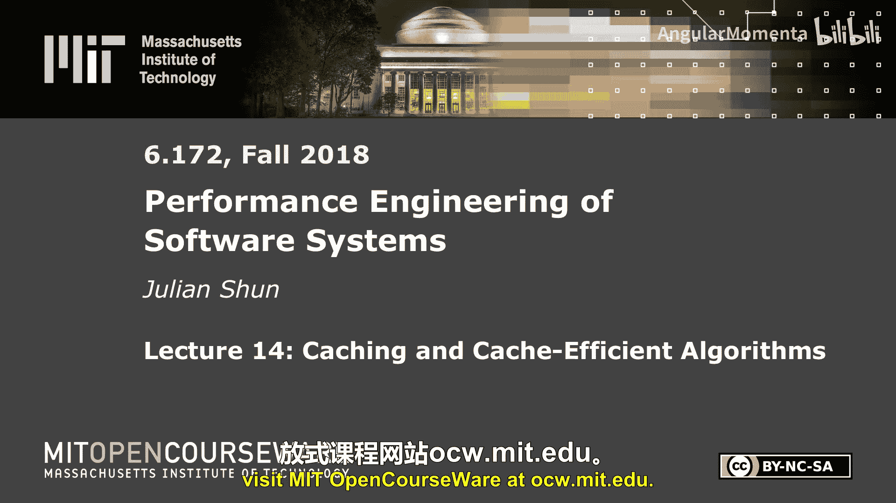
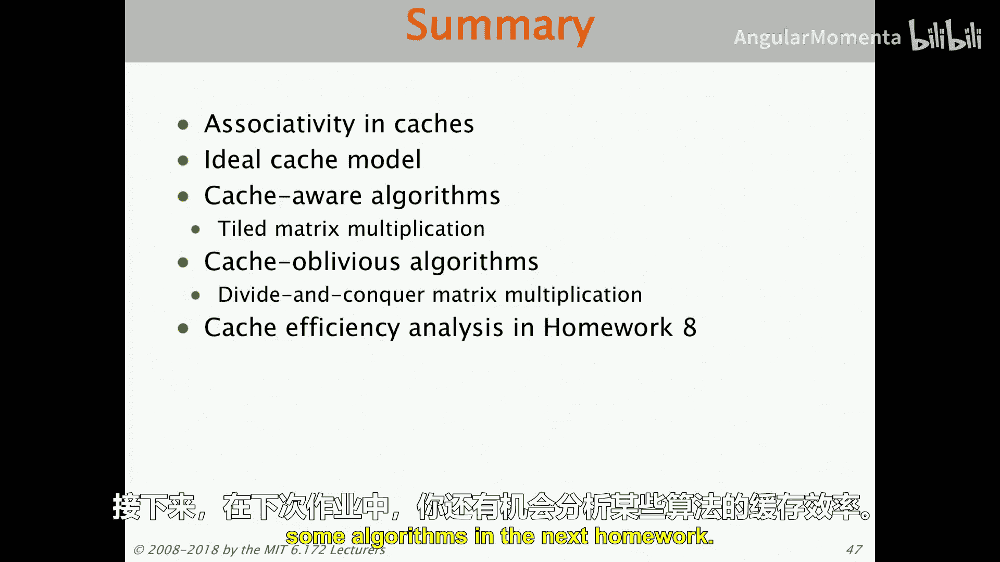

# 【麻省理工】软件系统性能工程 ｜MIT 6.172 Performance Engineering of Software Systems, Fall 2018 p14 14. 缓存与缓存高效算法 -BV1esbLzpEFq_p14-

The following content is provided under a Cative Commons license。

 Your support will help Mi T OpenCourseware continue to offer high quality educational resources for free to make a donation or to view additional materials from hundreds of MiT courses。

 Visit Mit Opencourseseware at Ocw。 Mt Eduu。

All right， so we've talked a little bit about caching before。

 but today we're going to talk in much more detail about caching and how to design cash efficient algorithms。

So first， let's look at the caching hardware on modern machines today。

So here's what the cache hierarchy looks like for a multicoH， we have a whole bunch of processors。

're all they all have their own private L1 caches for both the data as well as the instruction。

 they also have a private L2 cache， and then they share a last level cache or L3 cache。

 which is also called LLC。They're all connected to a memory controller that can access DRAM。

 and then oftentimes you'll have multiple chips on the same server and these chips would be connected through a network。

 so here we have a bunch of multico chips that are connected together。

So we can see that there are different levels of memory here。U。

And the sizes of each one of these levels of memory is different。

 so the sizes tend to go up as you move up the memory hierarchy。

The L1 caches tend to be about 32 kilobytes。 In fact。

 these are the specifications for the machines that you're using in this class。

 so 32 kilobytes for both the L1 data cache and the L1 instruction cache。

256 kilobytes for the L2 cache， so the L2 cache tends to be about8 to 1 times larger。The N1 cache。

 and then the last level cache， the size is 30 megabytes。

 so this is typically under order of tens of megabytes。And then DRAM is on the order of gigabytes。

 so here we have 128 gigabyte D RamM。And nowadays， you can actually get machines that have terabytes of DM。

So the associivity tends to go up as you move up the cash ha。

 and I'll talk more about sociivity on the next couple slides。

The time to access the memory also tends to go up， so latency tends to go up as you move up the memory hierarchies。

 so the L1 caches are the quickest to access， so about two and nanoseconds these are just rough numbers。

The L2 cache is a little bit slower， so say four and nanoiseseconds。Last level cache。

 maybe six nanoseconds， and then when you have to go to DEM。

 it's about an order of magnitude slower so 50 nanoseconds in this example。

And the reason why the memories further down in the cashhar here are faster is because they're using more expensive materials to manufacture these things。

 but since they tend to be more expensive， we can't fit as much of that on the machine。

 so that's why the faster memories are smaller than the slower memories。

 but if we're able to take advantage of locality in our programs and we can make use of the fast memory as much as possible and we'll talk about ways to do that。

In this lecture today， there's also the latency across the network。

 which tends to be cheaper than going to Maine memoryory。

 but slower than doing a last level cash access。And there's a lot of work in trying to get the cash coherence protocols right as we mentioned before。

 so since these processes all have private caches， we need to make sure that they all see a consistent view of memory when they're trying to access the same memory addresses in parallel so we talked about the MSIC protocol before and there are many other protocols out there and you can read more about these things online。

 but these are very hard to get right and there's a lot of verification involved in trying to prove that the cachecoherence protocols are correct。

So any questions so far？Okay so let's talk about the sosociivity of a cache so here I'm showing you a fully associative cache and in a fully associative cache a cash block can reside anywhere in the cache。

 and a basic unit of movement here is a cache block in this example the cache block size is four bytes on the machines that we're using for this class the cache block size is 64 bytes but for this example I'm going to use a four byte cash line so each row here corresponds to one cache line and a fully associative cache means that each line here can go anywhere in the cache。

And then here we're also assuming a cache size that has 32 bytes。

 so in total it can store eight cash lines since a cache line is four bytes。

So to find a block in a fully associative cache， you have to actually search the entire cache because a cache line can appear anywhere in the cache。

And there's a tag associated with each of these cache lines here that basically specify which of the memory addresses in virtual memory space it corresponds to。

So for the fully associative cash we're actually going to use most of the bits of the address as a tag。

 we don't actually need the two lower order bits because the things are being moved at the granularity of cache lines which are4 bytes so the two lower order bits are always going to be the same but we're just going to use the rest of the bits to store the tag so if our address space is 64 bits then we're going to use 62 bits to store the tag in a fully associative caching scheme。

And when a cache becomes full， a block that has to be evicted to make room for a new block。

And there are various ways that you can decide how to evict a block。

 so this is known as the replacement policy， one common replacement policy is LRU or at least recently used。

 so you basically kick the thing out that has been used farest in the past。

There are other schemes such as second Ch and clock replacement。

 and we're not going to talk too much about the different replacement schemes today。

 but you can feel free to read about these things online。So what's a disadvantage of this scheme？Yes。

Yeah， why is it slow？Yeah， so the disadvantage is that searching for a cash line in the cache can be pretty slow because you have to search the entire cache in the worst case since a cash block can reside anywhere in the cache。

So even though the search can go on in parallel and hardware。

 it's still expensive in terms of power and performance to have to search most of the cash every time。

So let's look at another extreme。This is direct map cache so in a direct map cache each cache block can only go in one place in the cache。

 so I've color coded these cache blocks here， so the red blocks can only go in the first row of this cache。

 the orange ones can only go in the second row and so on。U。

And the position which a cash block can go into is known as that cash block set。

 so the set determines the location in the cache for each particular block。

So let's look at how the virtual memory address is divided up into and which of the bits we're going to use to figure out where a cache block should go into cache。

 so we have the offset， we have the set and then the tag fields。

The offset just tells us which position we want to access within a cash block。

 so since a cache block has B bytes， we only need log base two of B bits as an offset。

 and the reason why we have to offset is because we're not always accessing something at the beginning of a cash block we might want to access something in the middle and that's why we need to offset to specify where in the cache block we want to access。

Then there's a set field and the set field is going to determine which position in the cache that cash block can go into。

So there are eight possible positions for each cache block here。

 and therefore we only need log base two of eight bits， so three bits for the set in this example。

 and more generally it's going to be log base2 of M over B and here M over B is8。And then finally。

 we're going to use the remaining bits as the tag， so w minus log base2 of M bits for the tag。

 and that gets stored along with the cache block in the cache。

 and that's going to uniquely identify which of the memory blocks the cache block corresponds to in virtual memory。

And you can verify that。The sum of all of these quantities here sums to W bits。

 so in total we have a W bit address space and the sum of those three things is W。

So what's the advantage and disadvantage of this scheme？So first。

 what's the good thing about this scheme compared to the previous scheme that we saw？Yes。Yes。

 it's fast because you only have to check one place because each cash block can only go in one place in a cache。

 and that's the only place you have to check when you try to do a lookup， if the cash block is there。

 then you find it if its not then you know it's not in the cache。What's the downside to this scheme？

Yeah。ちのす。Yeah， a good answer so the downside is that you might for example。

 just be accessing the red cache blocks and then not accessing any of the other cash blocks。

 they'll all get mapped to the same location in the cache and then they'll keep evicting each other even though there's a lot of empty space in the cache and this is known as a conflict miss and these can be very bad for performance and very hard to debug so that's one downside of a direct map cache is that you can get these conflict misses where you have to evict things from the cache even though there's empty space in the cache。

So as we said， finding a block is very fast， only a single location in a cache has to be searched。

 but you might suffer from conflictnesses if you keep accessing things in the same set repeatedly without accessing the things in the other sets。

 so any questions？Okay， so these are sort of the two extremes for cache design。

 there's actually a hybrid solution called set Associative cash。And in a set associative cash。

 you still have sets， but each of the sets contains more than one line now。

 so all the red blocks still map to the red set， but there's actually two possible locations for the red blocks now。

So in this case， this is known as a two way asso of cash。

 since there are two possible locations inside each set。And again。

 a cache block set determines K possible cash locations for that block。

 so within a set it's fully associative， but each block can only go in one of the sets。

So let's look again at how the bits are divided into in the address。

 so we still have the tag set and offset fields， the offset field is still log base2 of B。

The set field is going to take log base2 of M over KB bits。

 so the number of sets we have is M over KB， so we need log base2 of that number to represent the set of a block。

 and then finally weuse the remaining bits as a tag。

 so it's going to be w minus log base2 of M over K。😡，And now to find a block in the cache。

 only k locations of its set must be searched， so you basically find which set the cache block maps to。

 and then you check all K locations within that set to see if that cache block is there。

And whenever you try to put something in cache because it's not there。

 you have to evict something and you evict something from the same set as the block that you're placing into the cache。

So for this example I showed a two way associative cache。

 but in practice the associivity is usually bigger， say eight way， 16 way or sometimes 20 way。

 and as you keep increasing the associivity， it's going to look more and more like a fully associative cache and if you have a one- way associative cache then there's just a direct map cache。

 so this is sort of a hybrid in between a fully map cache and fully associative cache and a direct map cache。

So any questions on set Associative caches？Okay， so let's go over a taxonomy of different types of cash misses that you can incur。

So the first type of cache miss is called a cold miss and this is a cache miss that you have to incur the first time you access a cache block and if you need to access this piece of data。

 there's no way to get around getting a cold miss for this because your cache starts out not having this block and the first time you access it you have to bring it into cash。

Then there are capacity misses。So capacity you misses are cash misses you get because the cash is full and it can't fit all of the cash blocks that you want to access。

So you get a capacity miss when the previous cash copy would have been evicted even with a fully associative scheme。

 so even if all of the possible locations in your cache could be used for a particular cash line。

 that cash line still has to be evicted because there's not enough space。

 so that's what's called a capacity miss。And you can deal with capacity misses by introducing more locality into your code。

 both facial and temporal locality， and we'll look at ways to reduce the capacity misses of algorithms later on in this lecture。

Then there are conflict misses and conflict misses happen in set associative caches when you have too many blocks from the same set mapping to the wanting to go into the cash and some of these have to be evicted because the set can't fit all of the blocks and these blocks wouldn't have been evicted if you had a fully associative schemes。

 so these are what's called conflict misses， you have to for example if you have 16 things in a set and you keep accessing 17 things that all belong in the set。

 something's going to get kicked out every time you want to access something and these cash evictions might not have happened if you had a fully associative cash。

And then finally there are sharing misses， so sharing misses only happen in a parallel context and we talked a little bit about true sharing of false sharing misses in prior lectures so let's just review this briefly so a sharing miss can happen if multiple processors are accessing the same cacheline and at least one of them is writing to that cacheline if all of the processors are just reading from the cacheline then the cache coherance protocol knows how to make it work so that you don't get cache misses they can all access the same cache line at the same time if nobody's modifying it but if at least one processor is modifying it you could get either true sharing misses or false sharing misses。

So a true sharing miss is when two processors are accessing the same data on the same cache line。

And as you recall from a previous lecture， if one of the two processors is writing to this cash line。

 whenever it does a right， it needs to acquire the cash line in exclusive mode and then invalidate that cash line in all other caches。

So then when another processor tries to access the same memory location has to bring it back into its own cache。

 and then you get a cache miss there。A fall sharing miss happens if two processor are accessing different data that just happen to reside on the same cache line because the basic unit of movement is a cache line in the architecture。

 so even if you're accessing different things， if they are on the same cache line。

 you're still going to get a sharing miss。And fall sharing is pretty hard to deal with because in general you don't know what data gets placed on what cache line。

 there are certain heuristics you can use， for example， if you're mallacing a big memory region。

 you know that that memory region is contiguous so you can space your accesses far enough apart by different processor so they don't touch the same cache line。

 but if you're just declaring local variables on the stack。

 you don't know where the compiler is going to decide to place these。

Variables in the virtual memory address space。So these are four different types of cash misses that you should know about。

And there's many models out there for analyzing the cache performance of algorithms and some of the models ignore some of these different types of cache misses。

 so just be aware of this when you're looking at algorithm analysis because not all of the models will capture all of these different types of cache misses。

So let's look at a bad case for conflict misses， so here I want to access a sub matrix within a larger matrix and recall that the matrices are stored in row major order。

 and let's say our matrix is 4096 columns by 4096 rows and it stores doubles。

So therefore each row here is going to contain two to the 15th bytes because 4096 is 2 to the 12 and we have doubles each one which takes eight bytes。

 so2 to the 12 times2 to the third， which is2 to the 15th。U。

we're going to assume the word with is 64， which is standard。

 we're going to assume that we have a cache size of 32k and the cache block size is 64 which again is standard。

 and let's say we have a four way associative cash。So let's look at how the bits are divided into。

 So again， we have this offset。Which takes log base two of B bits。

 So how many bits do we have for the offset in this example。All right， so we have six bits。

 so it's just log base2 of 64。What about for this set？How many bits do we have for that？Seven。

 who said seven？Yeah， so it is7， so M is 32 k， which is 2 to 15th， and then k is 2 to the2。

 b is22 to the6， so it's 2 to 15 divided by 2 to8， which is 2 to the 7 and log base2 of that is7。

And finally， what about the tag field？51， why is that？Yeah， so it's just 64， minus7 minus6。

 which is 51。Okay， so let's say that we want to access a sub matrix within this larger matrix。

 let's say we want to access a 32 by 32 sub matrix and this is pretty common in matrix algorithms where you want to access sub matrices。

 especially in divide and conquer algorithms。And let's say we want to access a column of this sub matrix A。

So the addresses of the elements that we're going to access are as follows。

 so let's say the first element in the call is sort out address X。

Then the second element in the column is going to be stored at address x plus2 to the 15th because each row has two to the 15th bytes and we're skipping over an entire row here to get to the element in the second in the next row of the sub matrix。

 so we're going to add two to the 15th and then to get the third element we're going to add two times2 to the 15th and so on until we get to the last element。

 which is x plus 31 times2 to the 15th。So which fields of the address are changing？

As we go through one column of this subma。Yeah。Yeah so it's just going to be the tag that's changing。

 the set and the offset are going to stay the same because we're just using the lower 13 bits to store the set in the tag and therefore when we increment by2 the 15th。

 we're not going to touch the set in the offset。So all of these addressess fall into the same set and this is a problem because our cache is only four way associative so we can only fit four cache lines in each set and here we're accessing 31 of these things so。

By the time we get to the next column of A， all the things that we access in the current column of A are going to be evicted from cash already。

 and this is known as a conflict miss because if you had a fully associative cash。

 this might not have happened because you could actually use any location in the cache to store these cash blocks。

So does anybody have any questions on why we get conflict misses here？

Does anybody have any ideas on how to fix this？So what can I do to make it so that I'm not incrementing by exactly to the 15th every time？

Yeah。Yeah， yeah yeah so one solution is to pad the matrix you can add some constant amount of space to the end of the matrix so each row is going to be longer than two the 15th bytes。

 so maybe you add some small constant like 17 so add 17 bytes to the end of each row and now when you add as a column of this subma you're not just incrementing byte to the 15th you're also adding some a small integer and that's going to cause the set and offset fields to change as well and you're not going to get as many conflict misses so that's one way to solve the problem。

It turns out that if you're doing a matrix multiplication algorithm。

 that's a cubic work algorithm and you can basically afford to copy the sub matrix into a temporary 32 by 32 matrix。

 do all the operations on the temporary matrix and then copy it back out to the original matrix。

 the copy copying only takes quadratic work to do across the whole algorithm。

 and since the whole algorithm takes cubic work， the quadratic work is a lower order terms。

 so you can use temporary space to make sure that you don't get conflict misses。Any questions？Okay。

 so this was conflict misses。So conflict misses are important。

 but usually we're going to be first concerned about getting good spatial and temporal locality because those are usually the higher order factors in the performance of a program and once we get good spatial and temporal locality in our program。

 we can then start worrying about conflict misses， for example。

 by using temporary space or padding our data by some small constants so that we don't have as many conflict misses。

Okay， so now I want to talk about a model that we can use to analyze the cash performance of algorithms。

 and this is called the ideal cash model。So。In this model， we have a two level cache hierarchy。

 so we have the cache and then main memory。The cache size is of size M and the cache size is of B bytes。

 and therefore we can fit M over B cache lines insider cache。

This model assumes that the cache is fully associative。

 so any cash block can go anywhere in the cache， and it also assumes an optimal omniscient replacement policy。

 so this means that when we want to evict a cash block from the cache。

 we're going to pick the thing to evict that gives us the best performance overall it gives us the lowest number of cash misses throughout our entire algorithm。

 so we're assuming that we know the sequence of memory request throughout the entire algorithm and that's why it's called the omniscient replacement policy。

U。And if something is in cash， you can operate on it for free。 And if something is in main memory。

 you have to bring it into cash， and then you incur a cash miss。

So the two performance measures that we care about， first we care about the ordinary work。

 which is just the ordinary running time of a program。

 so this is the same as before when we were analyzing algorithms。

 it's just the total number of operations that the program does。

And the number of cash misses is going to be the number of lines we have to transfer between the main memory and the cache。

So the number of cache missedes just counts the number of cash transfers。

 whereas the work counts all of the operations that you have to do in the algorithm。So ideally。

 we would like to come up with algorithms that have a low number of cash misses without increasing the work from the traditional standard algorithm。

 sometimes we can do that， sometimes we can't do that and then there's a tradeoff between the work and the number of cash misses and then it' a tradeoff that you have to decide whether it's worthwhile as a performance engineer。

 today we're going to look at an algorithm where you can actually reduce the number of cash misses without increasing the work。

 so you basically get the best of both worlds。So any questions on this ideal cash model？

So this model is just used for analyzing algorithms。

 you can't actually buy one of these caches at the store。

 so this is a very ideal cache and they don't exist。

But it turns out that this optimal initial replacement policy。Has nice theoretical properties。

 and this is a very important lemma that was proved in 1985， it's called the LRU Lemma。

It was proved by Slater and Tn， and dilemma says，S that an algorithm occurscurs Q cache misses on an ideal cache of size M。

Then on a fully associative cache of size 2M that uses the LRU or at least recently used replacement policy。

 it incurs at most two Q cache misses。So what this says is if I can show the number of cash misses for an algorithm on the ideal cache。

😡，Then if I take a fully associative cache that's twice the size and use the LRU replacement policy。

 which is a pretty practical policy， then the algorithm is going to incur at most twice the number of cash misses。

And the implication of thislemma is that for asymptotic analysis。

 you can assume either the optimal replacement policy or the LRU replacement policy as convenient because the number of cash misses is just going to be within a constant factor of each other。

So this is a very important lema， it says that this basically makes it much easier for us to analyze our cache misses and algorithms。

And here's a software engineering principle that。I want to point out。First。

 when you're trying to get good performance， you should come up with a theoretically good algorithm that has good balances on the work and the cache complexity。

 and then after you come up with a algorithm that's theoretically good。

 then you start engineering for detailed performance。

 you start worrying about the details such as realworld cash is not being fully associative and for example。

 loads in stores having different costs with respect to bandwidth and latency。

 but coming up with a theoretically good algorithm is the first order bit to getting good performance。

Questions。Okay， so let's start analyzing the number of cash misses in programs， so here's alemma。

 so thelemma says suppose that a program reads a set of R data segments where the I segment consists of S subi bytes。

And suppose that the sum of the sizes of all of the segments is equal to n。

 and we're going to assume that n is less than m over3， so the segments。

 the sum of the size of the segments is less than the cache size divided by three。

We're also going to assume that n over R is greater than or equal to B。

 so recall that r is the number of data segments we have and n is the total size of the segments so what does n over B mean n over R mean semantically？

Yes。Yeah， so N over R is just the average size of a segment。嗯。

And here we're saying that the average size of a segment is at least B。

 at least the size of a cash line。So if these two assumptions hold。

 then all of the segments are going to fit into cache。

 and the number of cash misses to read them all is at most three times n over B。

So if you had just a single array of size N， then the number of cache misses you would need to read that array into cache is going to be n over B。

 and this is saying that even if our data is divided into a bunch of segments as long as the average length of the segments is large enough。

 then the number of cache misses is just a constant factor worse than reading a single array。😡。

So let's try to prove this cash mislemma。So here's a proof。

 so a single segment SI is going to incur at most SI over B plus two cash misses。

Sa anyone want to tell me where the S subI over B plus 2 comes from？So this is the。

 let's say this is a segment that we're analyzing and this is how it's aligned in virtual memory。Yes。

Yeah， so S subI over B plus2 is the number of blocks I could overlap with in the worst case。

You need SMI over B cash misses just to load those SI bytes。

 but then the beginning and the end of that segment might not be perfectly aligned with a cache line boundary。

 and therefore you could waste at most one block on each side of the segment。

 so that's where the plus two comes from。😡，So to get the total number of cash misses。

 we just have the sum this quantity from i equals 1 to r。

So if I sum S sub I over B from i equals 1 to R， I just get n over B by definition。

 and then I sum 2 from ig equals 1 to R， so that just gives me2 R。

Now I'm going to multiply the top and the bottom with the second term by B， so 2 R B over B now。

And then that's less than or equal to n over B plus 2 n over B。

So where did I get this inequality here， Why do I know that 2 RB is less than or equal to 2 n。Yes。

Yes， you know that n is greater than or equal to B R by this assumption up here。

 so therefore RB is less than or equal to n。And then Nb plus 2 Nb just sums up to 3 NB。

So in the worst case， we're going to incur3 n over B cash misses。Okay。

 so any questions on this cashsh mislemma？So the important thing to remember here is that if you have a whole bunch of data segments and the average length of your segments is large enough bigger than a cache block size。

 then you can access all of these segments just like a single array。

 it only increases the number of cache misses by constant factor and if you're doing an asymptotic analysis then it doesn't matter。

 so we're going to be using this cache misslemma later on when we analyze algorithms。Okay。

 so another assumption that we're going to need is called the Ta cash assumption。

And the tall cache assumption basically says that the cache is taller than it is wide。

 so says that B squared is less than Cm for some sufficiently small constant C less than or equal to1。

So in other words， it says that the number of cache lines M over B you have is going to be bigger than B。

And this tall cash assumption is usually satisfied in practice。

 so here are the cash line sizes and the cache sizes on the machines that we're using。

 so the cache line size is 64 bytes and the L1 cache size is 32 kilobytes。So 64 bytes squared。

 that's 2 to the 12 and 32 kilobytes that 2 to 15th bytes， so 2 to the 12 is less than 2 to the 15。

 so it satisfies a tall cash assumption。And as we go up， the memory hierarchy。

 the cache size increases， but the cache line length stays the same。

 so the cache has become even taller as we move up the memory hierarchy。

So let's see why this tall cash assumption is going to be useful。

To see that we're going to look at what's wrong with a short cash。

 so in a short cache our lines are going to be very wide and they're wider than the number of lines that we can have in our cash。

And let's say we're working with an n by n sub matrixtri sort and row major order。

 if you have a short cache， then even if n squared is less than CM。

 meaning that you can fit all of the bytes of the sub matrixtri in cache。

 you might still not be able to fit it into a short cache。😡。

And this picture sort of illustrates this， so we have n rows here。

 but we can only fit M over B of the rows in the cache because the cache lines are so long and we're actually wasting a lot of space on each of the cache lines。

 we're only using a very small fraction of each cache line to store the row of this submatrix。

If this were the entire matrix， then it would actually be okay because consecutive rows are going to be placed together consecutively in memory。

 but if this is a sub matrix， then we can't be guaranteed that the next row is going to be placed right after the current row。

And oftentimes， we have to deal with sub matrices when we're doing recursive matrix algorithms。Okay。

 so this is what's wrong with short caches and that's why we want to assume the tall cash assumption。

 and we can assume that because it's usually satisfied in practice。

The TLB actually tends to be short， it only has a couple entries so it might not satisfy the tall cash assumption。

 but all of the other caches will satisfy this assumption。Any questions？Okay。

So here's anotherlemma that's going to be useful， this is called the sub matrixtri Caching dilemma。

So suppose that we have an n by n matrix A and it's read into a tall cache that satisfies B squared less than CM for some constant C less than equal to 1。

And suppose that n squared is less than m over3， but it's greater than or equal to CM。

Then A is going to fit into cache and the number of cache misses required to read all of A's elements into cache is at most 3 n squared over B。

Okay， so let's see why this is true。So we're going to let big n denote the total number of bytes that we need to access。

 so big n is going to be equal to n squared。And we're going to use the cache mislema。

 which says that if the average length of our segments is large enough。

 then we can read all the segments in just like it were a single contiguous array。

 so the lengths of our segments here are going to be little n， so R is going to be little n。

And that's also the number of segments is going to be little n and the segment length is also going to be little n since we're working with a square sub matrix here。

And then we also have that the cache block size B is less than or equal to n。

 and that's equal to big n over R。And where do we get this property that b is less than or equal to n？

So I made some assumptions up here。Where I can use to infer that b is less than or equal to n。

Does anybody see where？Yeah。Yeah， so I know that b squared is less than CM。

 CM is less than or equal to n squared， so therefore b squared is less than n squared in B is less than n。

So。Now I also have that n is less than m over 3 just by assumption。

 and therefore I can use the cachemi lemma， so the cachemilemma tells me that I only need a total of three n squared over B cache misses to read this whole thing in。

Any questions on the submatrix Caching dilema？Okay， so now let's analyze matrix multiplication。

So how many of you have seen matrix multiplication before？So a couple of you。Okay。

Here's what the code looks like for the standard cubic work matrix multiplication algorithm。

So we have two input matrices A and B， and we're going to store the result in C。

 and the height and the width of our matrixes N， we're just going to deal with square matrices here。

 but what I'm going to talk about also extends to non square matrices。

And then we just have three loops here， we're going to loop through I from 0 to n minus1 j from 0 to n minus1 and k from 0 to n minus1。

 and then we're going to let c of IN plus J be incremented by a of IN plus k times B of KN plus j。

 so this is just the standard code for matrix multiply。So what's the work of this algorithm？

Should be should be review for all of you。And cubed。Okay。

 so now let's analyze the number of cash misses this algorithm is going to incur， and again。

 we're going to assume that the matrix is in row major order and we satisfy the tall cash assumption。

We're also going to analyze the number of cache misses in matrix B。

 because it turns out that the number of cache misses incurred by matrix B is going to dominate the number of cash misses overall。

And there are three cases we need to consider， the first case is when n is greater than CM over B。

For some constant C。And we're going to analyze matrix B， as I said。

 and we're also going to assume LRU because we can， if you recall the LRU。

lema it says that whatever we analyze using the LRU is just going to be a constant factor within what we analyze using the ideal cache。

So。So to do this matrix multiplication， I'm going to go through one row of a and one column of B and do the dot product there。

 this is what happens in the innermost loop。And how many cache misses am I going to incur when I go down one column of B here？

So here I have the case where n is greater than M over B。

 so I can't fit one block from each row into the cache。

So how many cache misses do I have the first time I go down a column of B？

So how many rows of B do I have？And yeah， and how many cash misses do I need for each row？One。

 so in total， I'm going to need n cache misses for the first column of B。

What about the second column of B？So recall that I'm assuming the LRU replacement policy here。

 so when the cash is full， I'm going to evict the thing that was least recently used the furthest in the past。

Sorry， could you repeat that。Yeah， so it's still going to be N， why is that？Yeah。

It's still going to be end because I can't fit one cache block from each row into my cache and by the time I get back to the top of my matrix B。

 the top block has already been evicted from the cache and I've to it back in and this is the same for every other block that I access so I'm again going to need nc misses for the second column of B and this is going to be the same for all of the columns of B。

😡，And then I have to do this again for the second row of A。So in total。

 I'm going to need theta of n cubed number of cache misses。

 and this is one cache miss per entry that I access in B。

And this is not very good because the total work was also theta of n cube。

 so I'm not gaining anything from having any e localality in this algorithm here。

So any questions on this analysis？So this is just case1， let's look at case2。

 so in this case n is less than CM over B。So I can fit one block from each row of B into cache。

 and then n is also greater than another constant C prime times square root of M。

 so I can't fit the whole matrix into cache。And again。

 let's analyze the number of cache misses incurred by accessing B， assuming LRU。

So how many cache misses am I going to incur for the first column of B？And so same as before。

 what about the second column of B？So by the time I get to the beginning of the matrix here is the top block going to be in cash？

So who thinks the block is still going to be in cash when I get back to the beginning？Yeah。

 so a couple people who think it's going to be out of cash。

Okay so it turns out it is going to be in cache because I can fit one block for every row of B into my cache since I have n less than CM over B。

 so therefore when I get to the beginning of the second column。

 that block is still going to be in cache because I loaded it in when I was accessing the first column。

 so I'm not going to incur any cache misses for the second column。And in general。

 if I can fit B columns or some constant B columns。In， in， into cash。

 then I can reduce the number of cash misses I have by a factor of B。

So I only need to incur a cacheist the first time I access a block and not for all of the subsequent aes。

And the same is true for the second row of A。And since I have n rows of a。

 I'm going to have n times theta of n squared over B cache misses for each row of A。

 I'm going to incur n squared over B cache misses。So the overall number of cache misses is n cubed over B。

 and this is because inside matrix B， I can exploit spatial locality， once I load in a block。

 I can reuse it the next time I traverse down a column that's nearby。Any questions on this analysis？

Okay， so let's look at the third case and here n is less than c prime times square root of M。

 so this means that the entire matrix fits into cache。

 so let's analyze the number of cache misses for matrix B again， assuming LRU。

 so how many cash misses do I have now？So let's count the total number of cash myths as I have for every time I go through a row of A。

Yes。First。Yeah， so for the first column it's going to be n， what about the second column？Right。

 so so basically for the first row of a， the analysis is going to be the same as before I need n squared over B cache misses to load the cache in。

 what about the second row of a， how many cache misses am I going to incur？Yeah。

 so for the second row v I'm not going to incur any cache misses because once I load B into cache。

 it's going to stay in cache because the entire matrix can fit in cache。

 I assume that n is less than c prime times square root of M。

So a total number of cache misses I need for matrix B is theta of n squared over B since everything fits in cache and I just applied the sub matrixtrix cacheching alemma from before。

Overall， this is not a very good algorithm because as you recall in case1。

 I needed a cubic number of cash misses。What happens if I swap the order of the inner two loops。

 so recall that this was one of the optimizations in lecture one when Charles was talking about matrix multiplication and how to speed it up。

So if I swap the order of the two inner loops， then。Then for every iteration。

 what I'm doing is I'm actually going over a row of C in a row of B。

 and a stays fixed inside the innermost iteration。So now when I analyze the number of cache misses of matrix B。

 assuming LRU， I'm going to benefit from spatial locality since I'm going row by row and the matrix is stored in row major order。

So across all of the rows， I'm just going to require theta of n squared over B has misses and I have to do this n times for the outer loop。

 so in total I'm going to get theta of n cubed over B cache misses。

So if you swap the order of the inner two loops， this significantly improves the locality of your algorithm and you can benefit from spatial locality and that's why we saw a significant performance improvement in the first lecture and we swapped the order of the loops。

Any questions？Does anybody think we can do better than N cube over B cash misses or。

You think that it's the best you can do。 So how many people think you can do better。Yeah。

 and how many people think？This is the best you can do。Okay， and。How many people don't care？

So turns out you can do better。And we're going to do better by using an optimization called tiling。

So how this is going to work is instead of just having three， four loops。

 I'm going to have six four loops， and I'm going to loop over tiles。

So I'm going to loop over s by s submatrices and within each sub matrix。

 I'm going to do all of the computation I need for that sub matrix before moving on to the next sub matrixtri。

 so that three innermost loops are going to loop inside a sub matrix and the three outermost loops are going to loop within the larger matrix。

 one sub matrix at a time。So let's analyze the work of this algorithm。So。

The work that we need to do for a sub matrix of size S by S is going to be s cubed。

 since that's just the bound for matrix multiplication。

 and that a number of times I have to operate on sub matrices is going to be n over s cubed。

And you can see this if you just consider each sub matrix to be a single element and then using the same cubic work analysis on the smaller matrix。

So the work is n over s cubed times s cubed， which is equal to theta of n cubed。

 so the work of this tiled matrix multiplies the same as the version that didn't do tiling。

And now let's analyze the number of cash misses。So we're going to tune s so that the sub matrices just fit into cache。

 so we're going to set s to be equal to theta of square root of M。

We actually need to make this like a one third square root of M because we need to fit three sub matrices into cache。

 but it's going to be some constant times square root of M。

The sub matrixtrix caching level implies that for each submatrix。

 we're going to need s squared over B misses to load it in， and once we load it into cache。

 it fits entirely into cache so we can do all of our computations within cache and not incur any more cash misses。

So therefore， the total number of cache misses we're going to incur。

 it's going to be the number of sub problemsble， which is n over s cubed。

 and then the number of cache misses per subproble， which is S squared over B。

And if you multiply this out， you're going to get n cubed over B times square root of M。

 so here I plugged in square root of M for S。😡，And this is a pretty cool result because it says that you can actually do better than the N cubed over B bound。

 you can improve this bound by a factor of square root of M。And in practice。

 square root of M is actually not insignificant。For example。

 if you're looking at the last level cache， the size of that is on the order of megabytes。

 so a square root of M is going to be on the order of thousands。

 so this significantly improves the performance of the matrix multiplication code if you tune S so that the sub matrices just fit in the cache。

It turns out that this bound is optimal， so this was shown in 1981。

 so for cubic work matrix multiplication， this is the best you can do if you use another matrix multiply algorithm like Strauin's algorithm。

 you can do better。So I want you to remember this bound， it's a very important bound to know。

Says that for matrix multiplication you can benefit both from spatial locality as well as temporal locality。

 so I get spatial locality in the denominator， the B term a denominator。

 and then the square root of M term comes from temporal locality since I'm doing all of the work inside a sub matrix before I evict that sub matrixtri from cache。

Any questions on this analysis？So what's one issue with this algorithm here？Yes。Yeah。

 so the problem here is I have to tune S for my particular machine。😡。

And I call this a voodoo parameter， it's sort of like a magic number I put into my program so that it fits into cache on the particular machine I'm running on。

 and this makes the code not portable because if I try to run this code on another machine。

 the cache sizes might be different there and then I won't get the same performance as I did on my machine。

😡，And this is also an issue， even if you're running it on the same machine。

 because you might have other programs running at the same time and using up part of the cache。

 so you don't actually know how much of the cash your program actually gets to use in a multi programminggraming environment。

And then this was also just for one level of cache if we want to optimize for two levels of caches。

 we're going to have two voodoo parameters S and T。

 we're going to have sub matrices and sub sub matrices。

 and then we have to tune both of these parameters to get the best performance on our machine and multidimensional tuning optimization can't be done simply with binary search so if you're just tuning for one level of cache you can do a binary search on the parameter S。

 but here you can't do binary search show so it's much more expensive to optimize here。

And the code becomes a little bit messier， you have nine， four loops instead of six。

And how many levels of caches do we have on the machines that we're using today？3。

So for three level cache， you have three voodoo parameters， you have 12 nested four loops。

 this code becomes very ugly and you have to tune these parameters for your particular machine。

 and this makes the code not very portable as one student pointed out and in a multiprogram environment you don't actually know the effective cache size that your program has access to because other jobs are running at the same time and therefore it's very easy to mistune the parameters。

Was there a question？So any questions？Yeah。get the size。Yeah， so I mean。

 you can auto tune your program so that it's optimized for the cache sizes of your particular machine。

Instruction to get the size of your cash。I'm not actually sure， do you know？第二也没。把这个。Yeah。

 prox CPU info。Yeah， yeah， so you can probably get that as well。The个は。Yeah。Yeah。

 but even if you do that and you're running this program， when other jobs are running。

 you don't actually know how much cash your program has access to， yes。St like that， optimize around。

No， its they're actually general purpose， where' actually I mean today we're just looking at matrixtri multiply。

 but on Thursday's lecture we'll actually be looking at many other problems and how to optimize them for the cash hierarchy。

Other questions？Okay， so this was a， I mean， this was a good algorithm in terms of cash performance。

 but it wasn't very portable， so let's see if we can do better。

 let's see if we can come up with a simpler design where we still get pretty good cash performance。

So we're going to turn to divide and conquer。We're going to look at the recursive matrix multiplication algorithm that we saw before。

Again， we're going to deal with square matrices， but the results generalize to non square matrices。

So how this works is we're going to split our input matrices into four submatrices or four quadrants。

 and then for each quadrant of the output matrix it's just going to be the sum of two matrix multiplies on n over 2 by n over2 matrices so C11 is going to be a11 times B11 plus a12 times b1 B21。

 and then we're going to do this recursively so。At every level of recursion。

 we're going to get eight multiply ads of n over 2 by n over2 matrices。

Here's what the recursive code looks like， you can see that we have eight recursive calls here。

 the base case here is of size one in practice you want a course in the base case to overcome function call overheads。

Let's also look at what these values here correspond to， so I've color coded these。

So that they correspond to particular elements in the sub matrix I'm looking at on the right。

So these values here corresponds to the index of the first element in each of my quadrants。

 so the first element in my first quadrant is just going to have an offset of zero。

And then the first element of my second quadrant， that's going to be on the same row as the first element in my first quadrant。

 so I just need to add the difference between the I just need to add the width of my quadrant which is n over2 and then to get the first element in quadrant21。

 I'm going to jump over n over two rows and each row has a length row size。

 so it's just going to be n over two times row size and then to get the first element in。

SoQudrant 22 is just the first element in quadrant 21 plus n over 2。

 so that's n over  two times rh size plus 1。So let's analyze the work of this algorithm。

So what's the recurrence for this algorithm， for the work of this algorithm？

So how many problems do we have？E， and what's the size of each subproblem？And over two。

And how much work are we doing to set up the recursive calls？Constant amount of work。

So the recurrences w of n is equal to 8 wn over 2 plus theta of 1。And what does that solve to？

And cubed， so it's one of the three cases of the master theorem。

We're actually going to analyze this in more detail using by drawing out the recursion tree。

 and this is going to give us more intuition about why the master theorem is true。

So at the top level of my recursion tree， I'm going to have a problem of size n。

And then I'm going to branch into eight subpro of size n over two。

 and then I'm going to do a constant amount of work to set up the recursive calls here I'm just labeling this with one。

 so I'm ignoring the constants， but it's not going to matter for asymptotic analysis。

And then I'm going to branch again into eight subproms of size N over4。

And eventually I'm going to get down to the leaves and how many levels do I have？

Until I get to the leaves。Yes。Yeah， so log N， what's the base of the log？Yes。

 this log base two of n because I'm dividing my problem size by two every time。And therefore。

 the number of leaves I have is going to be a to the log base2 of n because I'm branching8 ways every time8 to the log base2 of n is the same as n to the log base2 of8。

 which is n cubed。The amount of work I'm doing at the top level is constant。

 so I'm just going to say one here。The next level was eight times that。Then 64。

 and then when I get to the leaves， it's going to be theta n cubed since I have N cubed leaves and they're all doing constant work。

And the work is geometrically increasing as I go down the recursion tree。

 so the overall work is just dominated by the work I need to do at the leaves。

So the overall work is just going to be theta of n cubed。

And this is the same as the looping versions of matrix multiply， they're all cubic work。

Now let's analyze the number of cache misses of this divideiding conquer algorithm。

So now my recurrence is going to be different。My base case now is when the sub matrixtrix fits into cache。

 so when n squared is less than CM and when that's true。

 I just need to load that sub matrix into cache and then I don't incur any more cache misses。

 so I need theta of n squared over B cache misses when n squared is less than CM for some sufficiently small constant C less than equal to 1。

 and then otherwise I recurse into eight subproms of size n over2 and then I add theta of 1 because I'm doing a constant amount of work to set up the recursive calls。

And I get this state of n squared over B term from the sub matrix cacheching dilemma。

 says I can just load the entire matrix into cache with this many cache misses。

So the difference between the cash analysis here and the work analysis before is that I have a different base case。

And I think in all of the algorithms that you've seen before。

 the base case was always of a constant size， but here we're working with a base case that's not of a constant size。

So let's try to analyze this using the recursion tree approach。So at the top level。

 I have a problem of size n， then I'm going to branch and do eight problems of size n over two。

 and then I'm also going to incur a constant number of cache misses， I'm just going to say one here。

Then I'm going to branch again。And then eventually I'm going to get to the base case where n squared is less than CMm。

And when n squared is less than CM， then the number of cache misses that I'm going to incur is going to be fate of C over B。

 so I can just plug in C here for n squared。And the number of levels of recursion I have in this recursion tree is no longer just log base2 of n。

 I'm going to have log base2 of n minus log base 2 of square root of CM。Number of levels。

 which is the same as log based 2 of n minus2 times log base2 of CM。

And then the number of leaves I get is going to be eight。To this number of levels here。

 so it's 8 to log basease 2 of n minus a half of log basease 2 of CM。And。

This is equal to theta of n cubed over m to the3/2alves。

 so the n cube comes from the8 to the log base 2 of n term。

 and then if I do8 to the log base 8 to the negative12 of log base 2 of CM。

That's just going to give me M over M to the three/ halves in the denominator。

So any questions on how I computed the number of levels of this recursion tree here？

So I'm basically dividing my problem size by two until I get to a problem size that fits into cache。

 so that means n is less than square root of CM， so therefore I can subtract that many levels for my recursion tree。

And then to get the number of leaves since I'm branching eight ways。

 I just do eight to the power of the number of levels I have。

 and then that gives me the total number of leaves。

So now let's analyze the number of cache misses I need at each level of this recursion tree at the top level。

 I have a constant number of cache misses， let's just say one。The next law I have 8，64。

And then at the leaves， I'm going to have theta of n cubed over b times square root of m cache misses。

And I got this quantity just by multiplying the number of leaves by the number of cache misses per leaf。

 so number of leaves is n cubed over m to the3/ halves。

 the cache misses per leaves is state of CM over B， so I lose one factor of B in the denominator。

 I'm left with a square root of M at the bottom and then I also divide by the block size B。

So overall I get n cubed over B1 square root of M cache misses。

 and again this is a geometric series and the number of cache misses at the leaves dominates all of the other levels。

 so the total number of cache misses I have is going to be theta of n cubed over B times square root of M。

And notice that。I'm getting the same number of cache misses as I did with the tiling version of the code。

 but here I don't actually have to tune my code for the particular cache size。

So what cache sizes does this code work for？So is this code going to work on your machine？

It's going to get good cash performance。So this code is going to work for all cache sizes because I didn't tune it for any particular cache size。

And this is what's known as a cache oblivious algorithm。

 it doesn't have any voodoo tuning parameters， has no explicit knowledge of the caches and its essentially passively auto tuunning itself for the particular cache size of your machine。

 it can also work for multi-level cache is automatically because I never specify what level of cash I'm analyzing this for I can analyze it for any level of cache and it's still going to give me good cache complexity and this is also good in multiprogram environments where you might have other jobs running and you don't know your effective cash size。

 this is just going to passively autoted for whatever cache size is available。U。

Turns out that the best cache Olivvious codes today work on arbitrary rectangular matrices。

 I just talked about square matrices， but the best codes work on rectangular matrices and they perform binary splitting instead of eight way splitting。

 and you split on the largest of IJ and K。So this is what the best cache of Libous matrix multiplication algorithm does。

Any questions？Okay， so I only talked about the serial setting so far。

 I was assuming that these algorithms ran on just a single thread。

 What happens if I go to multiple processors？Turns out that the results do generalize to a parallel context。

 so this is the recursive parallel matrix multiply code that we saw before。

And notice that we're executing four subcas in parallel， doing a sync。

 and then doing four more subcas in parallel。So let's try to analyze the number of cache misses in this parallel code and to do that we're going to use this theorem。

 which says that let Q subP be the number of cache misses in a determined sixSL computation when run on P processors each with a private cache of size M and let S subP be the number of successful steals during the computation。

In the ideal cash model。The number of cache misses we're going to have is Q sub p equal to Q sub 1 plus big O of number of steals times m over B。

 so the number of cache misses in the parallel context is equal to the number of cache misses when you run it serially plus this term here。

 which is the number of steals times m over B。And the proof for this goes as follows。

 so if recall in the silk runtime system， we can have workers steal tasks from other workers when they don't have work to do and after workers steals it tasks from another worker its cash becomes completely cold in the worst case because it wasn't actually working on that subprom before。

 but after M over B cold cash misses， its cash is going to become identical to what it would be in the serial execution。

 so we just need to pay M over B cash misses to make it so that the cash looks the same as if it were executing serially。

And the same is true when a worker resumes a stolen subcomputation after a silk sink。

 and the number of times that these two situations can happen is two times SP。

 two times the number of steals。And each time we have to pay m over B cash misses。

 and this is where this additive term comes from， order S sub P times m over B。

We also know that the number of steals。And a silk program is upper bounded by。P times t infinity。

 an expectation where P is the number of processors and t infinity is the span of your computation。

 so if you can minimize the span of your computation， then this also gives you good cash bounds。

So more of the story here is that minimizing the number of cash misses in the serial illusion essentially minimizes them in the parallel execution for a low span algorithm。

So in this recursive matrixx multiplication algorithm。

 the span of this is a follows so t infinity of n is 2 t infinity of n over 2 plus theta of 1。

 since we're doing a same here， we have to pay the critical path length of two subcas。

 this solves to theta of n， and applying the previous Lama。

 this gives us cache miss bound of theta of n cubed over B square root of m。

 this is just the same as the serial execution and then this additive term is going to be order p times n and is a span times m over B。

So that was a parallel algorithm for matrix multiply and we saw that we can also get good cash bounds there。

 so here's a summary of what we talked about today， we talked about sociivity and caches。

 different ways you can design a cache。We talked about the ideal cache model that's useful for analyzing algorithms。

We talked about cash aware algorithms that have explicit knowledge of the cache。

 and the example we used was tile matrix multiply。Then we came up with a much simpler algorithm that was cache oblivious using dividing conquer。

And then on Thursday's lecture we'll actually see much more on cache oblivious algorithm design。

 and then you'll also have an opportunity to analyze the cash efficiency of some algorithms in the next homework。

