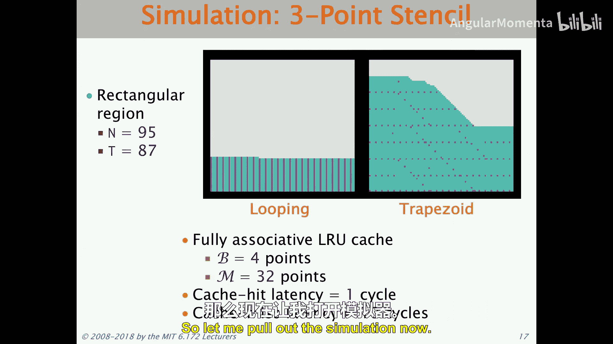
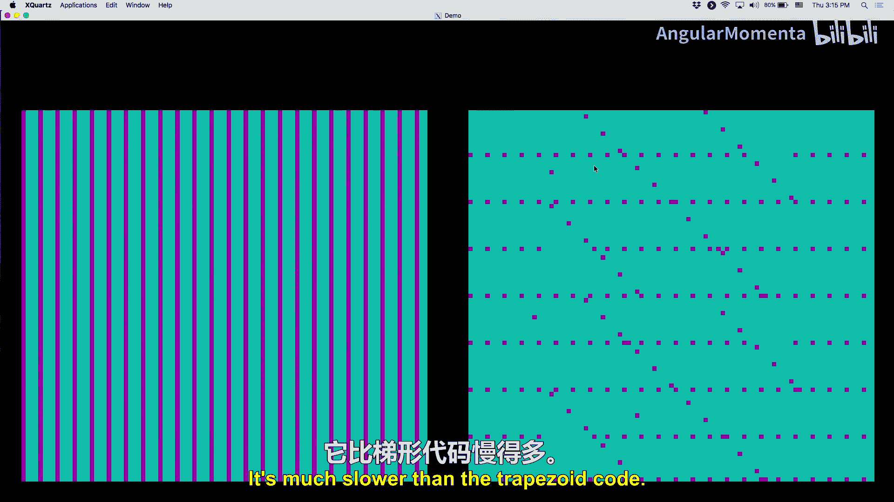
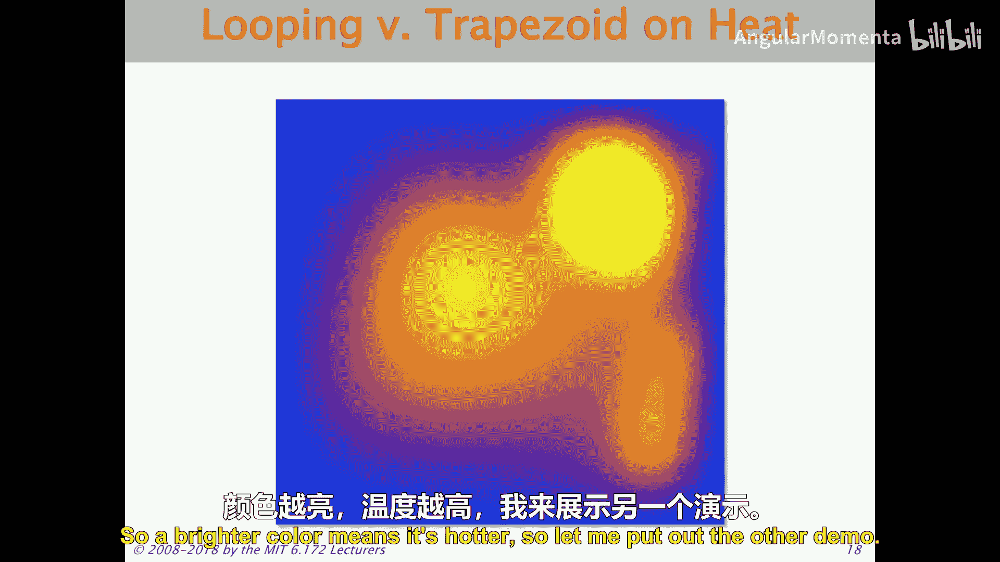
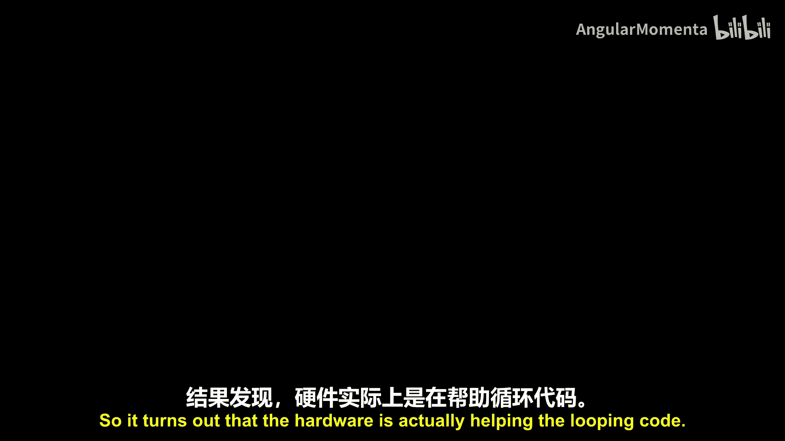
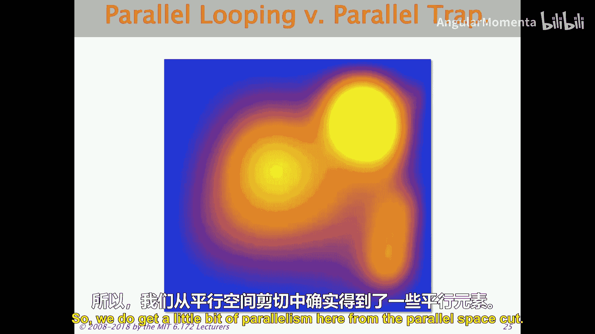
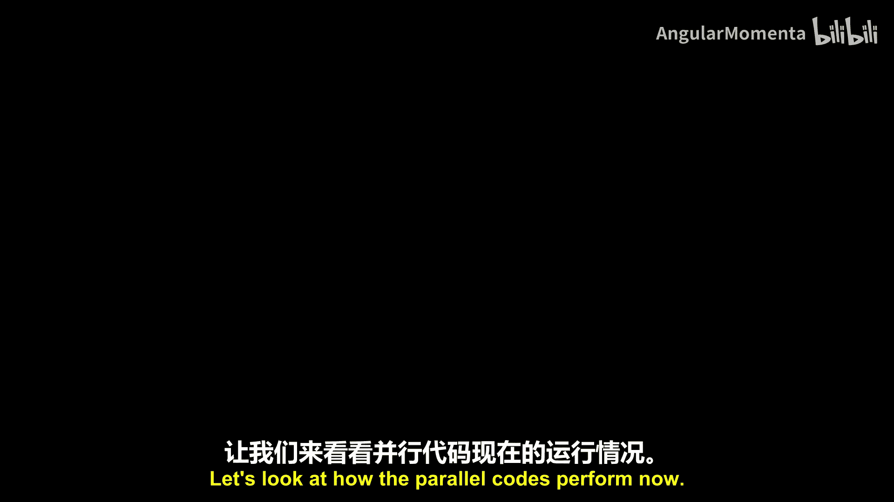
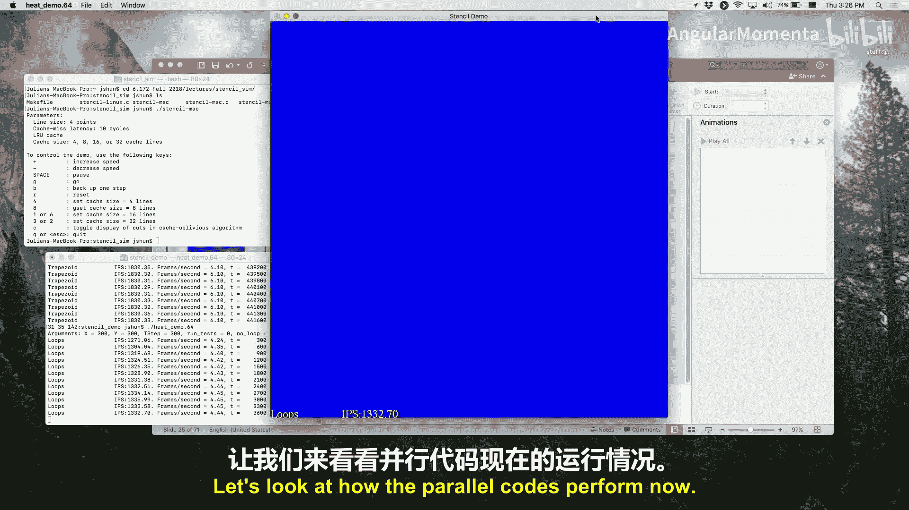
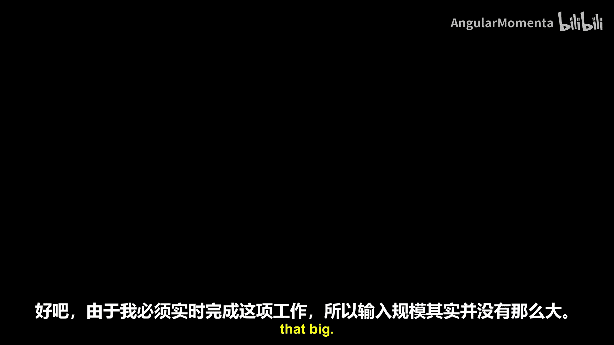
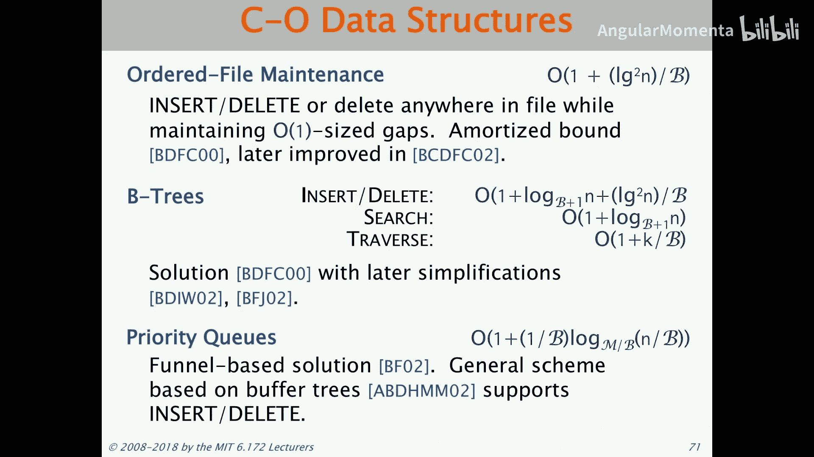

# 【麻省理工】软件系统性能工程 ｜MIT 6.172 Performance Engineering of Software Systems, Fall 2018 p15 15. 缓存无关算法 -BV1esbLzpEFq_p15-

The following content is provided under a Creative Commons license。

 Your support will help Mi T OpenCourseware continue to offer high quality educational resources for free to make a donation or to view additional materials from hundreds of Mit courses。

 Visit Mit Opencourseseware at Ocw。 Mt Eduu。

All right， so today we're going to talk about cash oblivious algorithms。

Who remembers what a cache oblivious algorithm is？So what is a cash oblivious algorithm oblivious to？

Cash size。So a cache oblivious algorithm is an algorithm that automatically tunes for the cash size on your machine so that achieves good cash efficiency。

And the code doesn't need to have any knowledge of the cache parameters of your machine， in contrast。

 a cash aware algorithm would actually know the parameters of the cash sizes on your machine。

 and the code would actually put the sizes of the cache inside。

So today we're going to talk a lot more about cache oblibious algorithms。

 last time we talked about one cache oblivious algorithm that was for matrix multiplication。

 and today we're going to talk about some other ones。

So first example I want to talk about is simulation of heat diffusion。

So here's a famous equation known as the heat equation， and this equation is in two dimensions。

 and we want to simulate this function U that has three parameters， t X and y T is the time step。

 X and y are the X Y coordinates of the 2D space， and we want to know the temperature for each Xy coordinate for any point in time T。

And the 2D heat equation can be modeled using a differential equation。

 So how many of you have seen differential equations before？Okay， so good， most of you。

So here I'm showing the equation in two dimensions。

 but you can get similar equations for higher dimensions。

 so here it says the partial derivative of u with respect to T。Is equal to alpha。

 Al is what's called the thermaldeffusivity， it's a constant times the sum of the second partial derivative of u with respect to x and the second partial derivative of u with respect to y。

So this is a pretty famous equation and you can see that we have a single derivative on the left side and a double derivative on the right side and how do we actually write code to simulate this 2D heat process so oftentimes in scientific computing。

 people will come up with these differential equations to describe physical processes and then they want to come up with efficient code to actually simulate the physical process。

Okay， so here's an example of 2D heat diffusion， so let's say we started out with a configuration on the left and here the collar corresponds to the temperature。

 so brighter color means it's hotter， yellow is the hottest and blue is the coldest and on the left we just have 6172 which is the coarse number so if you didn't know that you're probably in the wrong class。

And then afterwards we're going to run it for a couple time steps and then the heat is going to diffuse to the neighboring regions of the 2D space。

 so after we run it for a couple steps we might get the configuration on the right where the heat is more spread out now。

And oftentimes we want to run this simulation for a number of time steps until the distribution of heat converges。

 so it becomes stable and it doesn't change by much anymore， and then we stop the simulation。

So this is the 1D heat equation I showed you at a 2D1 earlier。

 but we're actually going to generate code for the 1D heat equation since it's simpler。

 but all of the ideas generalized to higher dimensions and here's the range of colors corresponding to temperatures。

 so the hottest colors on the left and the coldest colors on the right。

And if you had a heat source that's on the left hand side of this bar。

 then this might possibly be a stable distribution， so if you keep running the simulation。

 you might get a stable distribution of heat that looks like this。Okay。

 so how do we actually write code to simulate this differential equation？

So one commonly used method is known as finite difference approximation。

So we're going to approximate the partial derivative of you with respect to each of its coordinates。

So the partial derivative of you with respect to T。Is approximately equal to u of t plus delta t。

 where delta t is some small value。😡，And x， and then minus u of Tx and then that's all divided by delta T。

 so how many of you have seen this approximation method before from your calculus class？Okay， good。

 so as you bring the value of delta t down to0， then the thing on the right hand side approaches the true partial derivative。

So as a partial derivative with respect to T， we also need to get the partial derivative with respect to x。

And here I'm saying that partial derivative with respect to x is approximately equal to ut of x plus delta x over 2 minus ut of x minus delta x over 2。

 all divided by delta x， so notice here that instead of adding delta x in the first term and not adding anything in the second term I'm actually adding delta x over 2 in the first term I'm subtracting delta x over2 in the second term and it turns out that I can do this with the approximation method and it still turns out to be valid as long as the two terms that I'm putting in their difference is delta x。

 so here the difference is delta x and I can basically decide how to split up this delta x term among the two things in the en numerator。

And the reason why I chose Dlta x over2 here is because the math is just going to work out nicely and it's going to give us cleaner code。

This is just the first partial derivative with respect to x actually need the second partial derivative since the right hand side of this equation has a second partial derivative。

So this is what the second partial derivative looks like。

 so I just take the partial derivative with respect to x of each of the terms in my enummerator from the equation above。

And then now I can actually plug in the value of this partial derivative by applying the equation above using the arguments t and x plus delta x over 2 and similarly for the second term。

So for the first time， when I plug it into the equation for the partial derivativeative with respect to x。

 I'm just going to get Ut of x plus delta x minus Ut x。And then for the second term。

 I'm going to get UT of x minus delta x and then I subtract another factor of UTx。

 so that's why I'm subtracting two times UTx in the numerator here。

 and then the partial derivative of each of the things in the numerator also have to divide by this delta x term so on the denominator I get delta x squared。

So now I have the second partial derivative with respect to x and I also have the first partial derivative with respect to T so I can just plug them into my equation above。

 so on the left hand side I just have this term here and I'm multiplying by this alpha constant and then this term just comes from here。

So this is what the 1D heat equation reduces to using the finite difference approximation method。

 so any questions on this？Okay， so how do we actually write code to simulate this equation here？

So you're going to use what's called a stencil computation。

And here I'm going to set deelta x and delta t equal to 1 just for simplicity。

 but in general you can set them to whatever you want。

 you can make them smaller to have a more fine grain simulation。😡。

So if I set delta x and delta E T equal to 1， then the denominators of these two terms just become one。

 and I don't need to worry about them。😡，And then I'm going to represent my 2D space using a 2D matrix where the horizontal axis represents values of x and the vertical axis represents values of T。

And I want to fill in all of these entries that have a black dot in it， the ones with the orange dot。

 those are my boundaries， so those are actually fixed throughout the computation。

 so I'm not going to do any computation on those those are just given to me as input so they could be heat sources if we're doing the heat simulation。

😡，And then now I can actually write code to simulate this equation so if I want to compute u of t plus 1x。

 I can just go up here and I see that that's equal to this thing over here and then I bring the negative UTx term to the right。

 so I get UT of x plus alpha times UTx plus 1 minus 2 times Utx plus UTx minus1。And as I said before。

 we just want to keep iterating this until the temperatures becomes stable。

 so I'm going to proceed in time， which in time is going up here。And to compute one of these points。

😡，So let's say this is UT plus 1x， I need to know the value of UTx。

 which is just a thing below me in the matrix， and I also need to know UT x plus1 and UTx minus1 and those are just the things below me and diagonal to either the left or the right side。

So each value here just depends on three other values， and this is called a three point stencil。

 this is the pattern that this equation is representing。

 and in general a stencil computation is going to update each point in an array using a fixed pattern。

 this is called a stencil。😡，So I'm going to do the same thing for all of the other points。

 and here I'm going to compute all of the values of x for a given time step。

 and then I move on to the next time step。And then I keep doing this until the distribution of temperatures becomes stable。

 and then I'm done。Okay， so。These scil computations are widely used in scientific computing。

 They're used for weather simulations， stock market simulations， fluid dynamics。

 image processing probability， and so on。 so they're used all over the place in science。

 So this is a very important concept to know。嗯。So let's say I just ran the code as I showed you in the animations。

 so I completed one row at a time before I moved on to the next row。

 how would this code perform with respect to caching？Yes。Yeah， so if access。Small。

 this would do pretty well， but what if X is much larger than the size of your cash？Yeah。

 you would do badly and why is that？Yeah， so it turns out that there could be some reuse here because when I compute the second row。

 I'm actually using some values that are computed in the first row。

 but if the row is much larger than the cache size， by the time I get to the second row。

 the values that I loaded into cash from the first row would have been evicted。

 and therefore I'm going to suffer a cache miss again for the second row for the values that I need to load in。

 even though they could have been used if we made our code have good locality。嗯。

Another question I have is if we only cared about the values of x at the most recent time step。

 do we actually have to keep around this whole 2D matrix or can we get by with less storage？Yeah。

 so how many rows would I have to keep around if I only cared about the most recent time step？Yeah。

Two and why is that？Did you got an update as you like an update。Right。

 so I need to keep around two rows because I need the row from the previous time step in order to compute the values in the current time step。

 and after the current time step I can just swap the rows of the two rows that I'm keeping around and then reuse the previous row for the next one。

 yes。最みに。3。So I need to know when I'm computing the second row。

 I need to keep around all of these values that I computed in the first row because these values get fed to one of the computations in the second row。

 so I need to actually keep all of them around。Read that。Yeah。

Oh see I see what you're saying yeah so that's actually a good observation so you only need to keep a constant amount more storage because you'll just be overriding the values as you go through the row。

 so if you keep around one row some of the values would be for the current time up and some of them would be from the previous time up so good observation yes。

Okay。So that code， as we saw， it wasn't very cache efficient。

 you could make it cache efficient using tiling， but we're going to go straight to the cache oblivious algorithm because it's much cleaner。

So let's recall the ideal cache model， we talked about this in the previous lecture。

 so here we have a two level hierarchy， we have a cache， and then we have the main memory。

The cache has a size of M bytes， and a cache line is B bytes。

 so you can keep around M over B cache lines in your cache。

And if something's in cash and you operate on it， then it doesn't incur any cash misses。

 but if you have to go to main memory to load the cache line in， then you incur one cache miss。

The ideal cash model assumes that the cash is fully associative。

 so any cash line can go anywhere in the cache， and it also assumes either an optimal omniscient replacement policy or the LRU policy。

 so the optimal omniscient replacement policy knows the sequence of all future request to memory and when it needs to evict something it's going to pick the thing that leads to the few as cash misses overall to evict。

The LRU policy， Jesse Vicks， the thing that was least recently used。

 but we saw from the previous lecture that in terms of asymptotic costs。

 these two replacement policies will give you cash misses within a constant factor of each other。

 so you can use either one depending on what's convenient。😡。

And two performance measures that we care about when we're analyzing an algorithm in the ideal cache model are the work in the number of cash misses。

 so the work is just the total number of operations that the algorithm incurs and serially this is just the ordinary running time。

In the number of cache misses， it's the number of cache lines you have to transfer between the cache and your main memory。

So。Let's assume that we're running an algorithm or analyzing an algorithm in the ideal cache model。

 and it runs serially。😡，What kinds of cash misses does the ideal cash model not capture？

So remember we talked about several types of cash misses。

 and there's one type of cash miss that this model doesn't capture when we're running serially。

So let's assume we're running this serially without any parallelism here。

 so the sharing miss has only come about when you have perism， yes， yeah。

 so the answer is conflict misses and why is that， why does this model not capture it？

There's not specific。It replaced sentences it fully。Yeah， so this is a fully associative cache。

 so any cash line can go anywhere in the cache and you can only get conflict misses for set associative schemes where each cash line can only be mapped to a particular set and if you have too many cash lines that mapped to that particular set then you're going to keep evicting each other even though the rest of the cache could have space and that's what's called a conflict miss。

The ideal cache model does capture capacity misses。

 so therefore it's still a very good model to use at a high level when you're designing efficient algorithms because it encourages you to optimize for spatial and temporal locality and once you have a good algorithm in the ideal cache model。

 then you can start dealing with conflict misses using some of the strategies that we talked about last time such as padding or using temporary memory。

So any questions on this？Okay。This is the code that。Does the heat simulation that we saw earlier。

 so it's just two， four loops， nested for loop in the outer loop we're looping over the time dimension in the inner loop we're looping over the space dimension。

 so we're computing all of the values of x before we move on to the next time step。

And then we're storing two rows here and we're using this trick called the even odd trick and here's how it works so to access the next row that we want to compute that we just do t plus1 mod2 and then to access the current row is just t mod2。

 so this is implicitly going to swap the roles of the two rows that we're keeping around as we progress through time。

And then we're going to set u of t plus1 mod 2 x equal to kernel of u a pointer to UT mod 2x。😡。

And this kernel function is defined up here and recall that when we're actually passing a pointer to this kernel function。

 we can actually treat a pointer as the beginning of an array。

 so we're using array notation up here inside the kernel function， so the array W is passed as input。

 and then we need to return w of0， that's just the element at the current pointer that we passed to kernel。

 and then we add alpha times w of negative1， that's one element before the thing that we're pointing to minus2 times w of0 plus w of1 w of1 is the next element that we're pointing to。

Okay， so let's look at the caching behavior of this code。

 so we're going to analyze the cache complexity。And we're going to assume the LRU replacement policy here because we can。

And as we said before， we're going to loop through one entire row at a time before we go on to the next row。

So the number of cache misses I get， assuming that n is greater than M。

 so the row size is greater than the cache size， the number of cache misses is theta of Nt over B。

So how do I get this cash complexity bound here？So how many cache misses do I have to incur for each row of this 2D space that I'm computing？

Yes。So I need n over B cache misses for each row。😡，And。

This is because I can load in B bytes at a time， so I benefit from spatial locality there and then I have n elements that I need to compute so it's theta of n over B per row and as we said before。

 when we get to the next row， the stuff that we need from the previous row have already been evicted from cache so I basically have to incur theta of n over B cache misses for every row and the number of rows I'm going to compute is t so it's just theta of Nt over B。

😡，Any questions on this analysis？So how many of you think we can do better than this？Okay。

 so one person。Two， three， okay。So turns out that we can do better than this。

 you can actually do better with tiling， but I'm not going to do the tiling version。

 I want to do the cache oblivious version。And the cache oblivious version is going to work on trapezoidal regions in the 2D space and recall that a trapezoid has a top base in a bottom base。

 and here the top base is at T1， the bottom base is at t0 and the height is just t1 minus t0。

In the width of a trapezoid， it's just a width of it at the midpoint between T1 and t0。

 so at t1 plus t0 over 2。So we're going to compute all of the points inside this trapezoid that satisfy these inequalities here。

 so t has to be greater than or equal to t0 and less than t1。

 and then x it's greater than or equal to x0 plus dx0 times t minus t0。

 so dx0 is actually the inverse slope here。And then it also has to be less than x1 plus dx1 times t minus t0 dx1 is the inverse slope on the other side。

 and dx is 0 and dx1 have to be either negative 1，0 or 1。

 so negative 1 just corresponds to inverse slope of negative 1 which is also a slope of negative 1。

 if it's1， then it's just a slope or inverse slope of 1。

 and then if it's0 then we just have a vertical line。Okay。

 so the nice property of this trapezoid is that we can actually compute everything inside the trapezoid without looking outside the trapezoid。

 so we can compute everything here independently of any other trapezoids that we might be generating。

And we're going to come up with a divide and conquer approach to execute this code。

So the divide and conquer algorithm has a base case。

 so our base case is going to be when the height of the trapoid is one。And when the height is1。

 then we're just going to compute all of the values using a simple loop。

And any order of the computation inside this loop is valid since we have all the values in the base of the trapoid and we can compute the values in the top of the trapoid in whatever order。

 they don't depend on each other。So that's the base case， any questions so far？

So here's one of the recursive cases， it turns out that we're going to have two different types of cuts。

 the first cut is called a space cut。So I'm going to do a space cut if the width of the trapezoid is greater than or equal to twice the height。

 so this means that the trapezoid is too wide and I'm going to cut it vertically。More specifically。

 I'm going to cut it with a line with slope1， negative one going through the center of the trapezoid。

And then I'm going to traverse the trapezoid on the left side first。

 and then after I'm done with that， traverse the trapezoid on the right side。

So can I actually switch to order of this， can I compute the stuff on the right side before I do this stuff on the left side？

No， why is that？Yeah， so there's some points in the right trapezoid that depend on the values from the left trapezoid。

And so for the left thezoid， every point we want to compute， we already have all of its points。

 assuming that we get all of the values of the base points。But for the right hand side。

 some of the values depend on values in the left trapezoid。

 so we can't execute the right trapezoid until we're done with the left trapezoid。

And this is the reason why I cut this trapezoid with a slope of negative1 instead of using a vertical cut。

 because if I did a vertical cut， then inside both of the trapezoids。

 I would have points that dependent on the other trapezoid。So this is one of the two cuts。

 it' is called a space cut and it happens when the trapoid is too wide。The other cut is the time cut。

 I'm going to cut with respect to the time dimension， and this happens when the trapoid is too tall。

 so when the width is less than twice the height of the trapezoid。

Then what I'm going to do is I'm just going to cut it with a horizontal horizontal line through the center。

And then I'm going to traverse the bottom trapezoid first。

 and after I'm done with that I can traverse the top trapezoid and again the top trapezoid depends on some points from the bottom trapezoid so I can't switchish the order of those。

Any questions？Okay， so let's now look at the code that implements this recursive divideiding concrete algorithm。

So here's the C code。It takes as input t0 and t1， these are the coordinates of the top and the bottom of the trapoid or bottom and top of the trapoid。

 then x0 is the left side of the trapezoid of the base of the trapezoid。

 Dx0 is the inverse slope and the x1 is the right side of the bottom base of the trapezoid and dx1 is the inverse slope on the right side。

So we're first going to compute the height of our trapezoid and we're going to let LT be the height and that's just t1 minus t0。

 and if the height is1， then we're just going to use a four loop over all of the points in that height1 trapezoid。

we're going to call this kernel function that we defined before。And otherwise。

 the height is greater than one and we're going to check whether we should do a space cut or a time cut。

 so we do a space cut if the trapoid is too wide and this condition inside the if clause is checking if the trapoid is too wide。

 and if so then we're going to make two recursive calls to trapezoid and we're going to cut it in the middle using this slope of negative ones。

 so you see the negative ones here in the recursive calls。

And otherwise we'll do a time cut and for the time cut we just cut it in the middle。

 so we cut it at the value of t that's equal to Lt divided by 2 or t0 plus Lt divided by 2。

 and again we have two recursive calls to trapezoid。Okay。

 so even though I'm only generating slopes of negative1 in this recursive call。

 this code is going to work even if I have slopes of 1 and0。

 because I could start out with slopes of 1 and0， for example， if I had a rectangular region。

 then the slopes are just going to be zero and this code is still going to work。

 but most of the slopes that I'm dealing with are going to be negative one because those are the new slopes that I'm generating。

😡，Any questions？So this code is very concise it turns out that the even oddT still works here。

 you can still keep around just two rows because you're guaranteed that you're not going to write overwrite any value until all of the things that depend on it are computed。

 but when you're using just two rows， the values in a particular row might not all correspond to the same time step because we're not finishing an entire row before we move on to the next one。

 we're actually partially computing rows。Okay， so let's analyze the cache complexity of this algorithm。

Again， we're going to use the recursion tree approach that we talked about last time。

And our code is going to split itself into two cell problems at every level until it gets to a leaf。

😡，And each leaf represents theta of hW points where H is theta of w， so H is the height。

 W is the width， and we have the property that H is equal to theta of W because of the nature of the algorithm when the trapezoid becomes too wide。

 we're going to make it less wide by doing a space cut and if it becomes too tall。

 we're going to do a horizontal cut， so we're guaranteed that the height and the width are going to be within a constant factory of each other when we get to the base case。

And each leaf in the base case is going to incur theta of w over B misses because we have to load in the base of the trapezoid from cache from main memory。

 and once that's in cache we can compute all of the other points in the trapezoid without incurring any more cache misses。

 so cache misses per leaf is just theta W over B and we're going to set w equal to theta of M in the analysis because that's the point when the trapezoid fits into cache the algorithm doesn't actually of any knowledge of this m parameter。

 so it's still going to keep dividing conquering until it gets the base case of size1 but just for the analysis we're going to use a base case when W is theta of M。

So the number of leaves we have is theta of Nt divided by Hw because each leaf is of size theta HW。

The number of internal notes we have is equal to a number of leaves， minus1。

 because we have a tree here。But the internal node don't contribute substantially to the cash complexity because each of them is just doing a constant number of cash misses to set up the two recursive calls and it's not doing anything more expensive than that。

So we just need to compute the number of cash misses at the leaves。

We have theta of Nt over Hw leaves， each one of which takes theta of w over B cache misses。

And we're going to multiply that out so the W term cancels out， we just have Nt over HB。

 and we set H and W to be theta of M， so we're just left with Nt over M。As our cash complexity， yes。

Explain my。Sure， so each leaf only incurs theta w over B cache misses because we need to compute the values of the base of the trapezoid and that's going to incur theta of w over B cache misses because it's W wide and then for everything else it's going to fit into cache。

 so when we compute them we already have all of our previous values that we want into cache。In cash。

 So so that's why it's not going to incur any more cash misses。Does that make sense？Yeah。Okay， so。

This was just analysis for one dimension。But it actually generalizes to more than one dimensions。

 so in general， if we have D dimensions， then the cache complexity is going to be theta of nt divided by m to the1 over d times B。

 so if d is 1， then that just reduces to Nt over m if D is 2。

 then it's going to be nt over b times square root of m and so on。

 It turns out that this bound is also optimal。So any questions， so compared to the looping code。

 this code actually has much better cache complexity， it's saving by a factor of M。

 the looping code had a cache complexity that was theta of Nt over B。

 it didn't have an m in the denominator。Okay。So we're actually going to do a simulation now we're going to compare how the looping code and a trapezoid code runs and in this simulation。

The green points correspond to a cash hit， the purple points correspond to a cash miss。

 and we're going to assume a fully associative cache using the LRU replacement policy where the cache line size is four points and the cache size is 32 points。

And we're going to set the cash hit latency to be one cycle and the cache miss latency to be a 10 cycle。

 so in order of magnitude slower for cash misses。And we're doing this for a rectangular region where n is 95 and we're doing it for 87 time steps。

 so let me pull out the simulation now。

Okay， so on the left hand side， we're going to have the looping code on the right hand side。

 we're going to have the trapezoidal code， so let's start this。

So you can see that the looping code is going over one row at a time whereas the trapezoidal code is not doing that it's partially computing one row and then moving on to the next row。

Okay， I can also show the cuts that are generated by the trapezoidal algorithm。嗯。

To remember how to do this。So。See。So there's the cuts that are generated by the trapezoidal algorithm。

And I can speed this up。So you can see that the trapezoidal algorithm is incurring much fewer cache misses than the looping code。

So I'll just make this go faster and the trapezotal code is going to finish。

While the looping code is still slowly making its way up the top。Okay， so it's finally done。

So any questions on this year。但是你。In which of the regions？

So it's loading- you get a cash miss for the purple dots here。And then the cache line size is four。

 so you get a cash miss for the first point and then you hit on the next three points。

 and then you get another cash miss for the fifth point and then you hit on the six。

 seven and eight points。有决定。So for the one above it。

So we're assuming that the two arrays fit in cache already。

 So we don't actually need to load them from memory。

 The thing above it just depends on the values that we have already computed， and that fits in cache。

Those already in cash， this base of the trapezoid is already in cash， and the row right above it。

 we just need to look at those values。Does that make sense？Because of the。Yeah， yeah。

Any other questions on this？So It want to see this again or。Yeah。

So I could let this run for the rest of the lecture。

 but I have more interesting material that I want to talk about。

 so let's just stop after this finishes。And as you see again。

 the looping code is slowly making its way to the top， it's much slower than the trapezoid code。

Okay， so that was only for one dimensions now let's look at what happens in two dimensions and here I'm going to show another demo and this demo I'm actually going to run the code for real。

 the previous demo was just a simulation， so this is going to happen in real time and I'm going to simulate the heat in a 2D space and recall that the colors correspond to the temperature so a brighter color means it's hotter。

So let me pull out the other demo。

Okay so。Here my mouse cursor is the source of heat。

 so you see that it's making the points around my mouse cursor hot and then it's slowly diffusing its way to the other points and I can actually move this so that my heat source changes and then the heat that I generated earlier slowly goes away。

Okay。So in the lower left hand corner， I'm showing the number of iterations per second of the code。

And we can see that the looping code is taking， is' doing about 1560 iterations per second。

Let's see what happens when we switch to the trapezoid code。So the trappioid code is doing。

About 1830 iterations per second。So it's a little bit faster， but not by too much。

Does anyone have an idea why we're seeing this behavior？

So we said that the trapezoid code ins many fewer cache misses than the looping code。

 so we would expect it to be significantly faster， but here it's only a little bit faster。Yeah。就地。

Right， so that's a good point so in 2D you're only saving a factor of square root of M instead of M。

But square root of M is still pretty big compared to the speed up we're getting here。

 So any other ideas。 Yeah， so there is a constant factor in the trapezoidal code。

 But even after accounting for the for the constant factor。

 you should still see a better speed up than this。So even accounting for the constant factors。

What other problem might be going on here is it that we don't actually have an ideal cash？Yeah。

 so that's another good observation。But the caches that we're using。

 they still should get pretty good cash- I mean they should still have cash complexity that's pretty close to the ideal cash model。

 I mean you might be off by a small constant factor， but not by too much， yeah。And because。

Your destination Venetians this day。I'm sorry， could you repeat that？

There are not fixed don conditions this time that we are moving over。Yeah， so okay。

 so if I move the cursor is probably going to be a little bit slower， yeah。

 so gust slower by a little bit， but that doesn't really affect the performance so I can just leave my cursor there and this is what the iterations per second is。

Yes。Maybe there's like a lot of them。And maybe we're seeing the cr up。Yeah。

 so there is some other factor dominating， does anyone have an idea what that factor， what might be？

No， it's not the rendering， I ran the code without showing the graphics and performance was similar。

 yes。Yes， so there could be other things using theC， but that would be true for both of the programs。

 and I don't actually have anything that's intensive running。Seuffra PowerPoint。

 I don't think that uses much of my cash。All right。Let's look at why this is the case。

So it turns out that the hardware is actually helping。

The looping code。 So the question is， how come the cache oblivious trapoidal code？

Can have so many fewer cash misses， but the advantage gained over the looping version is so marginal。

Turns out that for the looping code， the hardware is actually helping it by doing hardware prefetching and hardware prefeshching for the looping code is actually pretty good because the access pattern is very regular。

 it's just going one row at a time， so the hardware can predict the memory access pattern of the looping code and therefore it can bring in the cache lines that the looping code would need before it actually gets to that part of the computation。

So prefing is helping the looping code， and it's not helping the trapezoidal code that much because the access pattern is less regular there。

And prefeshing does use memory bandwidth， but when you're using just a single core。

 you have more than enough bandwidth to take advantage of the hardware prefeing capabilities of the machine。

😡，But later on， we'll see that when we're running in parallel。

 the memory bandwidth does become more of an issue when you have multiple processors all using the memory。

Yeah， question。Is there a way to。才这一点。The。我 you。是的一样。You can do software prefeting。

 there are instructions to do software prefetching， hardware prefeetting is usually more efficient。

 but it's less flexible than the software prefeetshing。

 but here we're not actually doing that we're just taking advantage of hardware prefetching。なそ。Yeah。

 so we didn't actually try that， it could benefit a little bit if we used a little bit of software prefeting。

Although I think it would benefit the looping code probably as well， if we did that， yes，Sorry。Yeah。

 so hardware prefeshing is enabled。It's always done by the hardware on the machines that we're using today。

So this is a pretty surprising result， but we'll actually see the effect of the memory bandwidth later on when we look at the parallel code。

Any other questions before I continue？Okay so let's now look at the interplay between caching and perilism。

 so this was a theorem that we proved in the previous lecture， so let's just recall what it says。

 says let Q subP be the number of cache misses in a deterministic s computation。

When run on P processors each with a private cache and let SOP be the number of successful steals during the computation in the ideal cache model with a cache size of M in a block size of B。

 the number of cache misses on P processors is equal to the number of cash misses on one processor plus order number of successful steals times M over B。

 and last time we also said that the number of successful steals is upper bounded by the span of the computation times the number of processors。

 if you minimize the span of your computation， then you can also minimize the number of successful steals。

 and then for low span algorithms， the first term is usually going to dominate the Q1 term。

 so I'm not going to go over the proof that that last time the moral the story is that minimizing cache misses in the serial e essentially minimizes them in the parallel execution assuming that you have a low span algorithm。

So let's see whether our trapezoidal algorithm works in parallel。

So does the space cut work in parallel recall that the space cut。

 I'm cutting it with a slope of negative1 through the center because it's too wide。

So can I execute the two trapezoids in parallel here？No。

The reason is that the right trapezoid depends on the result of the left trapezoid。

 so I can't execute them at the same time， but there is a way that I can execute trapezoids in parallel so instead of just doing the cut through the center。

 I'm actually going to do a V cut。So now I have three trapezoids， the two trapezoids in black。

 I can actually execute those in parallel because they're independent and everything in those two trapezoids just depends on the base of that trapezoid。

 and after I'm done with the two trapezoids labeled one， then I can compute the trapezoid label2。

And this is known as a parallel space cut， it produces two black trapoids as well as a gray trapezoid in the blue two black trapoids executed in parallel。

 and afterwards the gray trapsoid executes。And this is done recursively as well。Any questions？Yeah。

 no， okay。We also had the time cut， oh sorry， so if the trapezoid is inverted。

 then we're going to do this upside down V cut and in this case we're going to execute the middle trapezoid before we execute the two trapezoids on the side。

For the time cut， it turns out that we're just going to use the same cut as before。

 and we're just going to execute the two trapoids serially。

So we do get a little bit of parallelism here from the parallel space cut。

Let's look at how the parallel codes perform now。

So。Okay， so this was a serial looping code。Here's the parallel looping code， so we had 1450 before。

About 3，700 now， so a little over twice the speed up and this is on a four corere machine。

 it's just on my laptop。Sorry。Oh yeah， sure。Yeah， slowing down a little bit。But not by too much。Okay。

Let's look at the trapazoidal code no。So as we saw before， the trapezoid code does about 18。

 40 iterations per second， and we can parallelze this。So。Now it's doing about 53。

 50 iterations per second， so it's getting about a factor of three speed up。Okay。

 I can move it around a little bit more if you want to see it。So。

Cerial trapezoid and parallel trapezoid。Is everyone happy？Okay。

Because I had to do this in real time， the input size wasn't actually that big。

 so I ran the experiment offline without the rendering on a much larger input， so this input is a 3。

000 by 3，000 grid and I did this for 1，000 time steps using  four processor core and my cache size is 8 megabytes a last level cache size。

So the input size here is much larger than my last level cache size。

And here are the times that I got， so the serial looping code took about 129 seconds。

And when we did it in parallel， it was about 66 seconds， so it got about a factor of two speedup。

 which is consistent with what we saw for the trapezoidal code。

 it actually got a better speedup when we increase the input size。

 so it got about a factor of four speed up and this is because for a larger input size。

 the cash efficiency plays a much larger role because the cash is so small compared to our input size。

So here we see that the parallel looping code achieves less than half of the potential speedup。

 even though the parallel looping code has much more potential parallelism than the trapezoidal code。

 the trapezoidal code only had a little bit of parallelism only for the space cuts whereas the trapezoidal code is actually getting pretty good speedup。

 so this is near linear speedup since I'm using four cores and it's 3。96x speed up。

So what could be going on here？Another thing to look at is to compare the serial trapezoid code with the serial looping code as well as the parallel trapezoid code with the parallel looping code。

 so if you look at the serial trapsoid code， you see that it's about twice as fast as the serial looping code。

 but the parallels trapezoidal code is about four times faster than the parallel looping code。

the reason here is that the hardware prefetching can't help the parallel looping code that much。

 because when you're running in parallel。All of the cores are using memory and there's a memory bandwidth bottleneck here and prefeting actually needs to use memory bandwidth。

 so in the serial case we had plenty of memory bandwidth we could use for prefeting。

 but in the parallel case we don't actually have much memory bandwidth we can use here。So that's why。

In the parallel case， the trapezoidal code gets better speed up over the parallel looping code compared to the serial case。

 and the trapezoid code also gets better speed up because it's actually it does things more locally so it needs to use less fewer memory operations and there's a scalability bottleneck at the memory interconnect。

 but because the trapezoidal code is cache oblivious， it does a lot of work in cache。

 whereas the looping code does more aes to the main memory。Any questions on this？Okay， so。

How do we know when we have a parallel speed of bottleneck， how do we know what's causing it？

So there are several main things that we should look at。

 so we should see if our algorithm has insufficient perilism。

 whether the scheduling overhead is dominating， whether we have a lack of memory bandwidth。

 or whether there's contention going on in contention can refer to either locking or true and false sharing。

 which we talked about in the last lecture。So the first two are usually quite easy to diagnose。

 you can compute the work and the span of your algorithm， and from that you can get the parallelism。

 you can also use silk scale to help you diagnose the first two problems because silk scale can tell you how much parallelism you're getting in your code and it can also tell you the burden and parallelism which includes the scheduler overhead。

What about for memory bandwidth， how can we diagnose that？So anyone have any ideas？

So I can tell you one way to do it， I can open up my hardware and take out all of my memory chips except for one of them and run my serial code。

 and if it slows down then that means it was probably memory bandwidth bound when I did it in parallel。

But that's a pretty heavy handed way to diagnose this problem。

 is there anything we can do with just software？Yes。Yeah。

 so you could use a tool like Valgrin to count the number of memory aes， yes。お生。

So you can make sure only one process is being used， but you cant you can't。

But it might be using more memory than just the memory from one chip。

There's actually a simpler way to do this。The idea is that we'll just run P identical copies of the serial code。

And then they'll all be executing in parallel and if the execution slows down。

 that means they were probably contending for memory bandwidth。Does that make sense？

One caveat of this is you can only do this if you have enough physical memory because when you're running P identical copies。

 you have to use more DM than if you just ran one copies， you have to have enough physical memory。

 but oftentimes you can usually isolate some part of the code that you think has a performance bottleneck and just execute that part of the program with P copies in parallel and hopefully that will take less memory。

There are also hardware counters， you can check if you have root access to your machine that can measure how much memory bandwidth your program is using。

But this is a pretty simple way to do this。U。So there are ways to diagnose lack of memory bandwidth turns out that contention is much harder to diagnose。

There are tools that exist that detect lock contention in an execution。

 but usually they only detect the contention when the contention actually happens。

 but the contention doesn't have to happen every time you run your code。

So these tools don't detect the potential for log contention。

 and potential for true and false sharing is even harder to detect。

 especially false sharing because if you're using a bunch of variables in your code。

 you don't know which of those mapped to the same cache lines， so this is much harder to detect。

Usually when you're trying to debug the speed up bottleneck in your coat。

 you would first look at the first three things here。

 and then once you eliminated those first three things。

 then you can start looking at whether contention is causing the problem。Any questions？Okay。

 so talked about stencil computation， I want to now talk about another problem sorting。

 and we want to do this cash efficiently。Okay， so let's first analyze the cache complexity of a standard merge sort。

So we first need to analyze the complexity of merging because this is used as a subroutine in merge sort。

And as you recall， in mergging， we're given two sorted input arrays。

 and we want to generate an output array that's also sorted containing all the elements from the two input arrays。

And the algorithm is going to maintain a pointer to the head of each of our input arrays。

 and then it's going to compare the two elements and take the smaller one and put it into the output and then increment the pointer for that array。

😡，And then we keep doing this， taking a smaller of the two elements until the two input arrays become empty。

At which point we're done with the algorithm， we have one sorted output array。Okay so。

To merge n elements， the time to do this is just theta of n here n is the sum of the sizes of my two input arrays。

 and this is because I'm only doing a constant amount of work for each of my input elements。

What about the number of cash misses， how many cash misses why incur？When I'm merging n elements。Yes。

Yeah， so I'm going to incur theta of n over B cache misses because my two input arrays are stored contiguously in memory so I can read them in B bytes at a time with just one cache miss and then my output array is also stored contiguously so I can write things out B bytes at a time with just one cache miss I might waste a cache line at the beginning and end of each of my three arrays but that only affects the bound by a constant factors。

 so it's theta of n over B。So now let's look at merge sort。

So recall that merge sort has two recursive calls to itself on inputs of half the size。

 and then it does emerge at the end to merge the two sorted outputs of its recursive calls。

So if you look at how the recursion。Proceeds， it's first going to divide the input right into two halves。

 it's going to divide it into two halves again。Again。

 until you get to the base case of just one element at which point you return。

 and then now we start merging pairs of these elements together。

 so now I have these arrays of size2 in sorted order and I merge pairs of those arrays and I get subrays of size4 and then finally I do this one more time to get my sorted output。

Okay。Let's review the work of merge sort， so what's the recurrence for merge sort if we're computing the work？

Yes。Do W and then。Yeah， so that's correct， so I have two sub problemsm of size n over 2。

 and then I need to do theta n work to do the merge。And this is case2 of master theorem。

 so I'm computing log B of a， which is log base2 of2 and dashes1。

 and that's the same as the exponent in the term that I'm adding in so since of the same I add in an additional log factor。

 and my overall work is just theta N log N。Okay， so now I'm going to solve this recurrence again using the recursion tree method。

 I'm still going to get the of N log n， but I'm doing this because it's going to be useful when we analyze the cache complexity。

So at the top level， I have a problem of size n。😡，And I'm going to branch into two problems of size n over two and when I'm done with them。

 I have to do a merge， which takes state of end work and I'm just putting end here。

 I'm ignoring the constants。And then I've got branch again。

 and each one of these is going to do n over two work to merge。

And I'm going to get all the way down to my base case after log basease2 of n levels。

The top level is doing end work， second level is also doing end work。

 and it's going to be the same for all levels down to the leaves。

Les is also doing a linear amount of work， so the overall work is just the work per level times the number of levels。

 so it's just state of N log N。Any questions？Okay， so now let's analyze this with caching。Okay。

 so we said earlier that the cache complexity of the merg subroutine is theta of n over B。

And here's the recurrence for the cache complexity of mergeRS sort。

My base case here is when n is less than or equal to CM for some sufficiently small constant C。

And this is because at this point， my problem size fits into cash and everything else I do for that problem is still going to be in cash。

And to load it into cache， the base case， I need to incur theta of n over B cache misses。

And otherwise， I'm going to have two recursive calls of size n over 2。

 and then I need to do theta of n over B cache misses to do the merge of my two results。😡，Okay。

 so here my base case is larger than what I did for the work。

 the algorithm actually is still recursing down to a constant size base case。

 but just for analysis I'm stopping the recursion when and is less than or equal to CM。

So let's analyze this， so again， I'm going to have the problems of size n at beginning。

And then I'm going to split into two problems of size n over  two。

 and then I'm going to have to pay N over B cash misses to merge the results together。Similarly。

 for the next level， now I'm paying n over 2 B cash misses for each of my two problems here to do the merge。

And I keep going down until I get to a sub problemm of size theta of CM at that point it's going to fit in cache and I don't need to recurse anymore in my analysis。

So the number of levels of this recursion tree is just log basease2 of n over CM。

 so I'm basically chopping off the bottom of this recursion tree。

 the number of levels I had below this is log base2 of CM。

 so I'm taking log basease2 of n and subtracting log base2 of CM and that's equivalent to log base2 of n divided by CM。

The number of leaves I have is n over CM since each leaf is state of CM large。

And the number of cash misses I need to incur to process a leaf is just a theta of M over B。

Because I just need to load the input for that subprom into cash and then everything else fits in cash。

So for the top level， I'm incurring N over B cash misses。

The next level I'm also incurring n over B cache misses， same with the third level。

 and then for the leaves， I'm incurring M over B times n over CM cache misses。

 the n over C is the number of leaves I have and theta of m over B is the number of cache misses per leaf。

 and that also equals theta of n over B。So overall。

 I multiply theta n over B by the number of levels I have。

 so the number of levels I have is log base2 of n over CM。

 and I just got rid of the constant here since doesn't affect the asymptotic bound。

So the number of cache misses I have is state of n over B times log base2 of or any base for the log of n over M。

So any questions on this analysis？So。I am saving a factor of B here in the first term。

 so that does reduce- that just gives me a better cash complexity than just the work bound。

But for the M term， it's actually inside the denominator of the log。

 and that doesn't actually help me that much。 So let's look at how much we actually save。

When n is much greater than M， then log basease2 of n over M is approximately equal to log base 2 of n。

 so the M term doesn't contribute much to the asymptotic costs， and therefore compared to the work。

 we're only saving a factor of B。When n is approximately equal to M。

 then log base 2 of n over M is constant， and we're saving a factor of B log n。

So we save more when the memory size or when the problem size is small。

 but for large enough problem sizes， we're only saving a factor of B。

So does anyone think that we can do better than this？

So I've asked this question several times before， and the answer is always the same。Yes。

 so good answer。So we're going to do this using multiway merging。

 so instead of just merging two sorted sub arrays， we're going to merge together our sorted subs。

So we're going to have our subs each of size n over R， and these are sorted。

 and I'm going to merge them together using what's called a tournament tree。

So how the tournament tree works is I'm going to compare the heads of each pair of these subs and store it in the node of the tournament tree and then after I do that I compare these two nodes and I get the minimum of those two eventually after I compare all of the elements I'm just left with the minimum element at the root of the tournament tree and then I can place that into my output。

So the first time I want to fill this tournament tree。

 it's going to take theta of our work because there are nodes in my tournament tree。

So when I compare these two elements， the smaller one is six for these two， the smaller one is two。

 and then I compare two and6， take the smaller one。

 and then on the other side I have a seven here so I compare two and7 to a smaller so appears at the root。

 and then I know that that's going to be my minimum element among the heads of all of the R sub arrays that I'm passing it。

So the first time to generate this tournament tree takes the of our work because I have to fill in our nodes。

But once I generated this tournament tree for all subsequent rounds。

 I only need to fill in the path from the element that won to the output or rate or to the root of the tournament tree。

 because those are the only values that would have changed so now I'm going to fill in this path here and this only takes state of log R work to do it because the height of this tournament tree is log based2 of R。

So I'm going to fill this in now 14 goes here， six is a smaller of the two and then six is a smaller of the two again。

 so my next element is6。And I keep doing this until all of the elements from my R sub arrays get put into the output。

The total work for merging is going to be theta r for the first round plus n log r for all the remaining rounds。

 and that's just equal to theta of n log R because we're assuming that n is bigger than R here。

Any questions on how the multiway merge works？No， okay。

 so let's analyze the work of this multiway merge。How when used inside merge sort。

So the recurrence is going to be as follows。If n is1， then we just do a constant amount of work。

 otherwise we have our sub problemsm of sites n over R and then we're paying state of N log R to do the multiway merge。

 so here's the recursion tree。At the top level， we have a problem of size N。

 and then we're going to split into R subproblems of size n of R。

 and then we have to pay N log R work to merge the results of the recursive call together。

 and then we keep doing this turns out that the work at each level sums up to n log base 2 of R。

In the number of levels we have here is。Log base r of n。

 because each time we're branching by a factor of R。

For the leaves we have n leaves and we just pay linear work for that because we don't have to pay for the merge。

 we're not doing any more recursive calls， so the overall work is going to be fate of n log R times log base R of n plus n for the leaves。

 but that's just a lower order term and if you work out the math some of these terms are going to cancel out and you just get fate of n log n for the work so the work is the same as the binary merge sort。

Let's now analyze the cache complexity。So let's assume that we have R less than CM over B for a sufficiently small constant C less than or equal to 1。

We're going to consider the R way merging of contiguous arrays of total size n。

 and if r is less than CM over B， then we can fit the entire tournament tree into cache and we can also fit one block from each of the R subrays into cache。

And in that case， the total number of cash misses to do the multiway merge is just a theta of n over B because we just have to go over the n elements in our input arrays。

So the recurrence for the RA merge sort is as follows， so if n is less than CM。

 then it fits in cache， the number of cash misses we pay is just state of n over B。

 and otherwise we have Rs of problems of size n over R。

 and that we add theta of n over B to do the merge of the results of the sub problems。

Any questions on the recurrence here？Yes。How do I pick up the value does it make it cash of dutyT？

Good question， so we didn't pick the value of R， so this is not a cash oblivious algorithm。

And we'll see what to choose for a couple slides， so let's analyze the cache complexity of this algorithm again using the recursion tree analysis。

So。At the top level， we're going to have are some problems of size N R。

 and we have to pay N over B cash misses to merge them。And it turns out that at each level。

 the number of cash misses we have to pay is n over B if you work out the math。

 and the number of levels of this recursion tree is going to be log base R of n over CM because we're going to stop recursing when our problem size is CM and on every level of recursion we're branching by a factor of R。

So our our leaf size is CM， therefore the number of leaves we have is n over CM。

 and for each leaf it's going to take theta of M over B cash misses to load it into cache。

 and afterwards we can do everything in cash and multiplying the number of leaves by the cost per leaf we get theta of n over B cash misses。

And therefore， the number of cache misses is n over B times the number of levels。

 number of levels is log base R of n over M。So compared to the binary merge sort algorithm here。

 we actually have a factor of r in the base of the log before the base of the log which is 2。

So now the question is what we're going to set R to be。So again， we have a voodoo parameter。

 this is not a cache oblivious algorithm， and we said that r has to be less than or equal to CM over B in order for the analysis to work out。

 so let's just make it as large as possible。 Let's just set r equal to theta M over B。

And now we can see what this complexity works out to be， so we have the tall cache assumption。

 we also have the fact that log base M of n over M is equal to theta of log n over log M。

So the cache complexity is theta of n over b times log base m over B of n over M。

 but if we have the tall cache assumption， then log base M over b is the same as log base of M asymptotically。

 so that's how we get to the second line， and then you can rearrange some terms and cancel some terms out and we'll end up with theta of n log n divided by B log M。

So we're saving a factor of theta of B log M compared to the work of the algorithm。

 whereas for the binary version of MerC we were only saving a factor of B for large enough inputs。

 so here we get another factor of log M。In our savings。So as I said。

 the binary one cache misses is n log n over B， whereas the multiway one is n log n over B log M。

 and as long as n is much greater than M， then we're actually saving much more than the binary version。

 so we're saving a factor of log M and cache misses。

Let's just ignore the constants here and look at what log M can be in practice。

 so here are some typical cache size， this L1 cache size is 32 kilobytes so that's 2 to 15th and log base two of that is 15。

 so we get a 15 x savings。And then for the larger cash sizes， we get an even larger saving。

Sos any questions on this？So the problem with this algorithm is that it's not cache oblivious。

 so we have to tune the value of R for a particular machine and even when we're running on the same machine。

 there could be other jobs running that content for the cache turns out that there are several cache oblivious sorting algorithms the first one that was developed was by paper by Charles Lyjaen and it's called funnel sort。

 the idea here is to recursively sort n to the onetd groups of n to the two-ts elements and then merge the sorted groups with an end to the one-td funnel and this funnel is called a K funnel more generally and it merges together k cubeed elements and k sorted list and the cost for doing this merge is shown here and if you plug this into the recurrence you'll get that the asymptotic number of cache misses is the same as that of the multiway merge sort algorithm while being cache oblivious and this bound is actually optimal。

So I'm not going to have time to talk about the details of the funnel sort algorithm but I do have time to just show you a pretty picture of what the funnel looks like。

 so this is what a K funnel looks like it's recursively constructed we have a bunch of square root of K funnels inside they're all connected to some buffers so they feed elements to the buffer and then the buffers feed element to this output square root of K funnel which outputs which becomes the output for the K funnel so this whole blue thing is the K funnel and the small green triangles are square root of K funnels and the number of cache miss is incurred by doing this merge is shown here and it uses the tall cache assumption for analysis。

So a pretty cool algorithm and we've posted a paper online that describes this algorithm。

 so if you're interested in the details I encourage you to read that paper。

 there are also many other cache oblivious algorithms out there so there's been hundreds of papers on cache oblivious algorithms here are some of them some of these are also described in the paper in fact I think all of these are described in the paper we posted there are also some cool cache oblivious data structures have been developed such as for Bere ordered file maintenance and priority queuees。

So there's a lot of literature on cash oblivious algorithms and there's also a lot of material online if you're interested in learning more。

