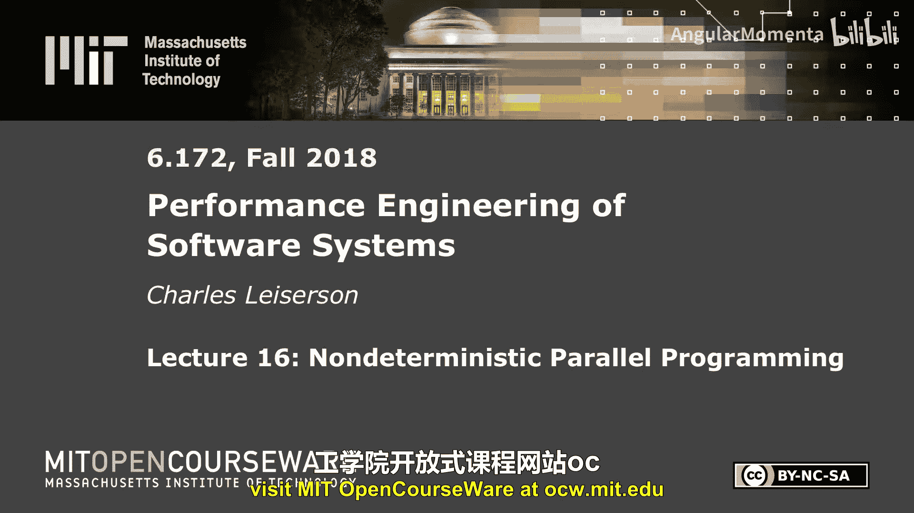
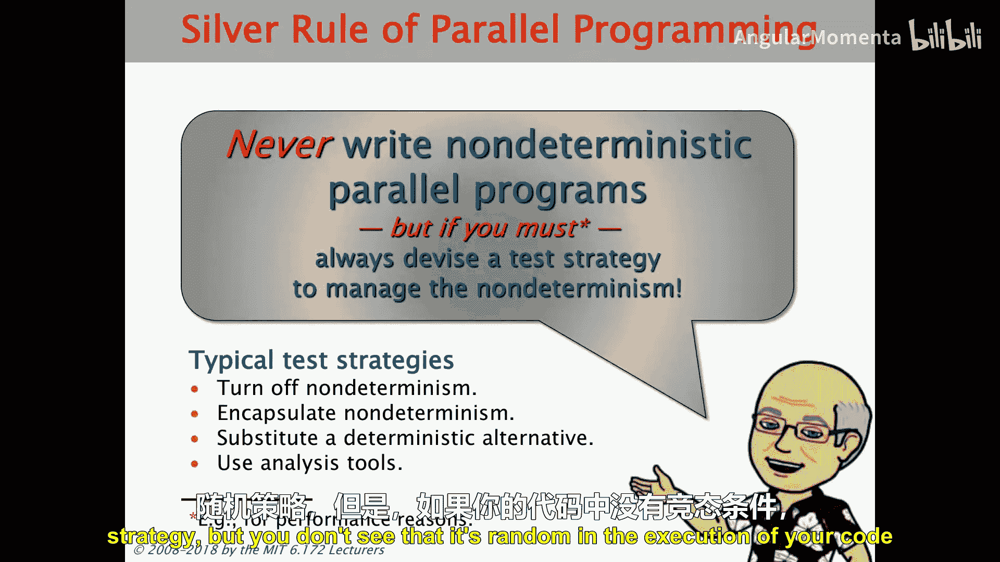
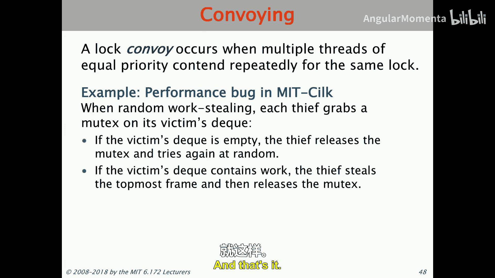

# 【麻省理工】软件系统性能工程 ｜MIT 6.172 Performance Engineering of Software Systems, Fall 2018 p16 16. 非确定性并行编程 -BV1esbLzpEFq_p16-

The following content is provided under a Creative Commons license。

 Your support will help Mi T OpenCourseware continue to offer high quality educational resources for free to make a donation or to view additional materials from hundreds of Mit courses。

 Visit Mit Opencourseseware at Ocw。 Mt Eduu。

Okay。Today we're going to do some really cool stuff。唉。

Having to do with non deterministic parallel programming。

 this is where the course starts to get hard。嗯。Because nondeminism。Is really nasty。

 we'll talk about it a little bit， it's really nasty。Parallel computing， as you know， is pretty easy。

 right， you know， it's just work in span。Easy stuff， right？啊。ItMake sense。Can measure these things。

 you can learn some skills around them and so forth。But。Nondeterminism is nasty， really nasty。

 so first let's talk about what we mean by determinism so we say that a program is deterministic on a given input。

If every memory location is updated with a sequence， the same sequence of values in every execution。

So。嗯。The program always behaves the same。And you may end up if it's a parallel program having different memory locations updated in different orders。

 I may do。A and then B。Versus updating B and then A， but if I look at a single memory location， A。

 say， I'm always updating A with the same sequence of values。Okay。

There are lots of definitions of determinism， this is not the only one。There's some where people say。

 well， it only matters if the output is always the same。And there are others where you say。

 not only does it have to be the same， but every right to a location has to be in the same order globally。

that turns out to be actually pretty hard。Because if you have parallel computing。

You're not going to get them all updated the same unless you only have one。呃。you know。

Pro or executing instructions okay， and so we'll talk about this and we'll talk a little bit more about this kind of thing so so why。

What's the big advantage？Of。Deterministic programs。

Why should we care whether it's deterministic or non deterministic？Sure。It's repeatable， okay。

 so what？Why is that？そんな？Because sometimes that's what you want， okay。

 that doesn't sound so if I mean， there's a lot of things I might sometimes want。

 how why is that important to want that？Yeah。Consistency makes it easier。Yeah。

 it makes it easier to debug， that's probably the number one reason。Debugging。Okay。

 if it does the same thing every time。Then if you have a bug。You can run it again。

 you expect to see the bug again。So every time you run through， hey， I get the same bug。

But if it's non deterministic。I get a bug。And now I go to look for it and the bug is nowhere to be found。

Makes debugging a lot harder。 There are other reasons for wanting repeatability。

 so your answer is actually。A broader correct answer。

 but the big advantage is in the specific application of repeatability to debugging。Okay。

So here's the goal and rule of parallel programming。Okay。

 never write non deterministic parallel programs。Okay。They can exhibit anomalous behaviors。

 and it's hard to debug them。So never， ever write non deterministic programs。嗯。Unfortunately。

 this is one of these things。That is kind of hard in practice。To do。嗯。

So why might you want to write a non deterterministic program even though even when famous？诶。

Masters in the area of performance engineering。Okay， with highly credentialed， you know。

Numerous awards and so forth tell you you shouldn't write。Non deterministic programs。

 why might you want to do it anyway？Yeah。😊，Yeah， you might get better performance。

That's one of the big ones。That's one of the big ones， and sometimes you can't。

The nature of the problem is maybe that it's。That it's not determin。

 you may have asynchronous inputs coming in and so forth。So。So。This is the golden rule。

 we also have a silver rule。C Rule saysNever write non deterterministic parallel programs。

But if you must。Always devise a test strategy to manage the non determinism。Okay。

 so this gets into you better have some way of handling how you're going to tell what's going on if you have a bug。

 okay so what are some of the typical test strategies that you could use that would manage the nondeterminism？

Okay， so imagine you've got a parallel program and it's。It's got races in it and so forth， you know。

 and it's operating non deterministically。What？And that's okay if everything's going right。

 how would you， you find a bug in the program， what are you going to do？

What kinds of ideas do you have yeah？对他。Yeah， you could turn off the nondeminism。Okay。

 you put a switch in there that says， well， I know the source of this nondeministic behavior。

Let me do that， let me give you an example of that。For security reasons these days。

 when you allocate memory。It's allocated to different locations on different runs of the program。

 it's allocated in random places， they want to randomize the addresses when you call Malick okay that means that。

You can end up with different。Behaviors。Okay， from one to run。

 and that can compromise your performance， but it turns out that there is a compiler switch and if you run it in debug mode。

It'll always deliver the。The I。Results of mallck in deterministic。Locations， okay。

 where the locations of the things that you're malaching are repeatable。Okay， so that's good。

 okay because there's support， they said， yes， we have to randomize。Okay。

 for security reasons so that people can't。Deterministically exploit buffer overflow areas。

 for example。I don't want to have to do that every time。Okay， so you know， I don't want to randomize。

 you know， every time I run， I want to have the option of making it so that that randomization is turned off Okay so that's a good one。

 what's another one that can be done。You're full of good ideas， this is like。

 let's try somebody else or I okay but I like that， I like that， what are some other ideas？

What else can you do to handle nondeterminism？Okay， you got a program it。Yeah， yeah， yeah。Yeah。

 if you have random numbers you use the same see， in some sense that's a kind of same thing if you're turning off nondeterminism。

 okay， but that's a great one you know there are other places for example， if you read， you know。

 if you do get time of day，You know， for something in your program， for something。

 you could have an option where it'll put in a particular fixed value there so you can make sure that it doesn't。

You know even a serial program isn't non deterministic， okay， so that's good。

 but I also consider that to be， ass another great example of turning off nondeminism。Okay。

What other things can you do？Yeah。You do。Your。Outss。Yep。

 you can do record replay for some things is that what you're saying， is that what you mean or am I？

Okay， so record replay says you run it through， you can run it through with random numbers and then。

 but it's recording those things so that when you run it again。

 you can instead of using the random numbers that you know new random numbers that uses the ones that you used to use okay。

 so that's record replay thing is that what you' were saying or you were saying something else。

 yeah okay good。Okay， so so that's using some tools there are actually a lot of strategies let me just move on and sort so another thing you can do is encapsulate the nondeterminism so that's actually done in the silk runtime system already the runtime system is using a random。

Scheduling strategy， but you don't see that it's random in the execution of your code。

don'tIf you have no race conditions in your code。It's encapsulated。so that the in the platform。

 so the platform is going to guarantee you deterministic results， even though underneath the covers。

 it's doing non deterministic things。ok。You can also substitute a deterministic alternative。

Sometimes there's a way of computing something that is non deterterministic， but in debug mode， a。

 let me not use the non deterterministic one。Okay。And you can also use analysis tools which can tell you things about your program and which you can control things。

 so there's a lot of things， so whenever you have a nondeterministic program。

 you want to find some way of controlling and often the nondeterminism is over in this corner。

 but your bug is over in this corner。So if you can turn this thing off in some way or encapsulate it or otherwise control the nondetermined zone over there。

 now you have a better chance of catching the stuff over here。Okay。

That's going to be particularly important in Project four when we get to it。

 because that's going to be actuallyre going to be doing non deterterministic programming for a game playing program。

And one of the things is that the processors are in this case， keeping the game positions together。

And so if one processor stores something into what's called the transposition table。

 which is essentially a big hash table of positions at scene。

 another one can see that value and change its behavior。

 and so one of the things you want to be able to do is turn off transposition table。

so that you don't take advantage of that performance advantage。

 but now you can debug the search code or you can debug the evaluation code and so forth。

You can also do things like unit testing so you know whether or not a particular piece is correct。

That might have， you know so that you can test this thing separately from the rest of your system which may have nondeminism anyway。

 this is a major thing。So you never write them， but if you have to。

 you always want to have some test strategy。And so for the people who are not watching this video and who are。

 you know， not in class today， they are going to be sorely hampered by not。

Knowing this lesson when they go into the fourth project。Okay，So what we're going to do。

Is now we're going to talk about how to do non deterministic programming。Okay so this is， you know。

 there's always there's always some part of your code， you know。

 which has a skull and crossbones like you know you have this abstraction。

 it's beautiful and you can design， et cetera， and then somewhere there's this really ugly thing that nobody should know and you put the skull and crossbones on that and only experts go in。

 well anyway that's the barrier we're crossing here。

ok。And we're going to start out by talking about something that you've probably seen in some of your other classes。

 mutual exclusion and aimity。So I'm going to use the example of a hash table。嗯。

So here's a typical hash table， it's got collisions resolved by chaining。

 so you have a bunch of linked lists， you hash to a particular slot in the table and then you chase down the linked list to find the value。

And so for example， if I'm going to insert x， which has a key value of 81， you know。

 what I do is figure out which slot I go to by。By hashing the key。And then in this case。

 I made it be the last one so that the animations could be easier than if it were in the middle。

And so now what do I do is I make the pointer of x go to the first element of that list。

 and then I make the slot value now point to x。And that effectively with a constant number of operations。

 inserts X into the hash table and in particular into the link list in the slot that it's supposed to be。

 okay， this is all familiar， right？Okay， so now what happens when you have multiple？啊。诶。

Parallel instructions that are accessing。The same locations， okay？嗯。So， I。

So here we have two threads， one inserting X and one inserting Y。X goes， it does its thing。

 it hashes to there and it then sets the next pointer to be。To add itself into the list。

And then there's this other thing going on in parallel which effectively says， oh， I'm going to hash。

 oh， we're going to the same slot， it doesn't know that somebody's already there。

 and so then it decides it's going to put itself in。As the first element。Of the list。

 and then it sets the value of y that sets the value the slot to point to y。

 and then along comes x finishing off what it's doing and it points the value to x and you can see that we have a race bug here。

A really nasty one because we've just destroyed the integrity of our。Of our system we now have。

 in particular， why is sort of floating， not in the list when it's supposed to be in the list。Right。

So the standard solution to this is to make some of these instructions be atomic。

 okay and what that means is the rest of the system can never view them as being partially executed。

Okay， so theyre either all have been executed or none of them have been executed at any point in time as far as。

As far as the rest of the system is concerned， okay？

And the part of code that is within the atomic region is called the critical section。

And typically a critical section of code is someplace that should not be being executed by two things at the same time。

So the standard solution to atomity is to use what's called a mutex lock or a mutual exclusion lock。

 and it's basically an object with a lock and unlock member functions and an attempt by a thread to lock and already locked Muex causes the thread to block。

Okay， that is wait until the Mutex is unlocked。Okay so if somebody grabs the lock。

 somebody else grabs the lock and it's already taken。

 then they have to wait and they sit there waiting until。Until this guy says， yes。

 I'm going to release it。Okay， so what we'll do now is we'll make each slot be astruct with a mutex。

L and a pointer head to the slot context， so it's going to be the same data structure we had before。

 but now I'm going to have not just the pointer from the slot。

 but I'll also have a lock in that position okay。And so the idea of in the code now is that before I access the lock。

 before I access the list， I'm going to lock。That。An。That list in the table by locking a slot。

Then I'll do the things that I need to do and then I'll unlock it and now anything else can go on because you know the。

What's happening is the reason we're getting into trouble is because we've got some sort of interleaving of operations and our goal is to make sure that it's either doing this or doing this and never this。

Okay， to make sure that so that each thing， each piece of code is restoring the invariant of correctness。

After it executes the pointer swaps， thevari in this case is that the elements are in a list。Okay。

 and so you want to restore that with each one， okay？So Mu Texas。

 this is one way you can use new Mu Texas to implement aimity。Okay， so now。

Let's just go back this is so who has who has seen you know New Texas before。

 is that pretty much everybody， yeah okay good， I hope that this is not brand new for too many of you if it is brand new that's great but what I'm trying to do is make it so let's go back a little bit and recall in this class our discussion of determinacy races so remember to determinacy race occurs when you have two logically parallel instructions that access the same memory location。

And at least one of them performs a right， okay？So Mutex locks can guarantee that critical sections behave atomically。

But。The resulting code is inherently non deterministic because you've got to。

 you know we had a race bug there right， we had two things trying to access the same slot。

 but that may be what I want， right， I want to have a shared hash table maybe okay for these things。

 so I want something where there is a race but I just don't want to have the anomalies that arise in this case。

 you know the race bug causes things and I can solve that with animity okay。U。You know。

If you have no determinacy races， it means that the program is deterministic on that。

Input and that it always behaves the same okay， and remember also that if a determinacy race exists in an otensibly deterministic program。

Okay， then it guarantees to find a race Now， if you put in Mu Texas。

 you still have a nondemin program， you still have a race。

Because you have two things that are logically parallel that are both accessing the lock。

That's a determinacy race。Okay， if you have two things that are in parallel。

 they're both accessing the lock， that's a determinacy race and may a safe， correct one。

But it is a determinacy race。Okay。And so any codes that use locks are non deterministic by intention。

 and they're going to invalidate the Sil sand guarantee of finding those race bugs。Okay。

 so you will end up with races in your code if you're not careful， okay。

 and so this is one reason it's important to have some way of turning off nondeterminism to detect stuff because what you don't want is that a whole rash of false positives。

Saying， oh， you raced on gathering this lock， nor do you want to ignore that and then discover that a race has popped up somewhere else。

ok。Now， some people feel that- so this is basically a talking about having a data race， okay。

 and a data race。Is similar to the definition of determinacy race， okay。

 but it says that you have two logically parallel instructions。And they don't hold locks in common。

And then it's the same definition， if they access the same memory location。

 one of them performs a right， then you have a data race bug， but if they have the locks，In common。

If they both have acquired at least one lock that's the same， then you don't have a data race。😡。

 because that means that you've now successfully protected the。Aimacy。

 but it is still nondeterministic and there is a determinacy race， just no data race。

 and that's the big distinction between data races and determinacy races and on quiz2 you better know the difference between data races and determinacy races。

 okay because they are different。So a program may have no data races that doesn't mean that it doesn't have a determinacy race。

 in fact， if it's got any locks， it probably has a determinacy race。Okay。U。Okay。

So one of the things is if I have no data races， does that mean I have no bugs。

 suppose I have no data races？In my code。Does that mean I have no bugs， this is Clalyen？

An obvious answer just by quizmanship， right？So。What might happen？Think about it a little bit。

 what might happen？How could I have？No data raises， and yet there' still be a bug。

 even though I'm assuming it's a correct piece of code otherwise。

 in other words when it runs serially or whatever it's correct。How could I end up having？

Code no data races， but still have。嗯。A bug。这。Yeah， but that doesn't mean it's bad， right？said。

So they'll order it。Might still be a different yep。Okay。Yeah。Let me give you an example， okay。

 which is more to the point here is a way of making sure。That i have no。Data race， which is。

I lock before I follow the。Table slot value。And then I unlock， and I lock again。

 and then I set the value。So I haven't prevented the atity， right now I've got an animity violation。

 but I have no data races。Okay， because I never have two things。

 any two things that are going to access things at the same time is protected by the lock。

But it didn't solve my animity。There's a。You know， theres， you know。

 you can definitely have no data races， but that doesn't mean you have no bugs。Okay。嗯。

But usually what it happens is if you have no data races。嗯。

Then usually the programmer actually got this code right。Okay。

 it's one of these things where demonstrating no data races is， in fact。

 a very positive thing in your code。Doesn't mean the program did it right。

 but most of the time the reason they're putting in the locks is to provide atity for something and they usually get it right。

 they don't always get it right， in fact， Java for example had a very famous bug early on in the way that it specified。

Locking such that， you could look at the length of it。A string， and then modify it。

 And then you would end up with a race bug because somebody else could swoop in in between。

 So they thought they were being providing animity， and they didn't。Okay。So。

Theres there's another set of issues here having to do with benign races。

 now there's some people who argue that no races are。No determinacy races are benign。嗯。

And they make academic statements that I find quite compelling actually what they say about races and whether races are benign。

 but nevertheless， the literature also continues to use the term benign race for this kind of example。

 so suppose we want to identify what are the set of digits that perform that occurred in this。

In some array， so here's an array with a bunch of values in it。Okay。

 each one being a digit from zero to nine， so I could write a little piece of code that runs through。

A digits array of length 10 and sets the number of digits I've seen so far of each value to be zero。

And now I go through， and I'm going to do this in parallel。

And I'm going to set every time I see a value A of I， suppose A of I is three， I set。

The location of A3 to be1。And otherwise， and now otherwise it's zero because that's what I had it before。

So here's the kind of thing I have。 So for example。

 I can have both of those sixes are in parallel going to access。i。The location six to set it to one。

 but they're both setting it to one， it doesn't really matter what order they do it in。

 you're going to get the same value there one。Okay， and。There's a race。

 maybe we don't too much care about that race。because they're both setting the same value。

 we're not going to get an incorrect value。Well， not exactly。

 we might get on some architecture on the Intel architectures。

 you won't get an incorrect value on X86， but there are codes where。By。The elements。

The array values are not。Set atomically。 So， for example， on the MIPS architecture。

In order to set a byte to be a particular value， you have to fetch the word， mask out， set the word。

 and then store it back in， set the byte， and then store it back into the word。

And so if there are two guys who are basically operating on that same word location。

 they will have a race， even though in the code， it looks like they're just setting bytes。

Does that make sense？Okay， so nasty。Nasty bugs， okay。

 that's why you should never do non deterministic programming。Okay， unless you have to。Okay。嗯。So。

Silk sand allows you to turn off race detection for intentional races。

So if you really meant there to be a race， as in this case， you can turn it off。This is。Dangerous。

 but practical， turns out。Usually you're not turning it off for because here's what it can happen you can turn it off and yet then there's something else which is using that same stuff and now you're running silk sand without you having turned it off for exactly what your race might be there are better solutions so in Intel's silk screen there's the notion of fake locks we just had not yet implemented it in in the open silk compiler so we will and in silk sand we'll eventually get to doing that and then。

People who take this class in the future will have an easier time with that， okay。

 because we'll be able to check for that as well。Okay， so any questions about these notions。

 so you can see the notions of races can get quite hairy。And。You know。

 make it quite difficult to do your debugging。And in fact。

 even confound your tools that are supposed to be helping you to get correct code。

All in name of performance。Okay， but we like performance。Okay， any questions？Yeah。全鉴定。

I also math addict。Yes， so how can some architectures cause some error。

 So here's the thing is that if I have a。Let's say a bite array。

It may be that this is stored in as a set of， let's say， four byte words。Okay。

And so although you may write that a of zero。Gets one。What it does is it says， let me fetch。

These four values， because there is no byte set instruction on some architectures， it can only set。

In this case， 32 bit words。So it fetches the values。It then， you know into a register。

 it then sets the value in the register。 by masking so it doesn't set the other things here。

 and then it stores it back。so that it has a one here。

 but what if somebody at the same time is storing into this location？

They will fetch it into their own。Register， set their bite， mask， et cetera。

 and now my right back is going to。We're going to have a lost update in the right backs。

 does that make sense？Okay。Good。Very good question， yeah。

 no I went through that orally a little bit quicker than maybe I should have。Okay。Great。

So let's talk a little bit about implementation， I always like to take things down one level below what you necessarily need to know in order to do things。

 but it's helpful to sort of see how these things are implemented and because then that gives you a better sense at a higher level what the。

What your capabilities are and how things are actually working underneath。

So let's talk about how Mu Texasex， so here， first of all。

 to understand there are lots of different Mutexes， if you look in an operating system。

 they may have a half a dozen or more different Mutexes。

 different locks that can provide mutual exclusion。Or parameters that can be set。

For what kind of mutexes， so the first basic difference in most things is whether the mutex is yielding or spinning。

So a yielding Mutex returns control to the operating system it。

 when a program when it tries to get access， when a thread tries to get access to a given lock。

 if it is blocked， it doesn't just sit there。And keep and spinning where you basically spinning means I just sit there checking it and checking it and checking it and checking it okay instead what it does is it says。

 oh， I'm doing useless work here。Let me go and return control of the operating system。

 maybe there's another thread that can run at the same time。

 and therefore I'll give by switching myself out by yielding my scheduling quantum。

 I will get better efficiency overall because somebody some other thread that is capable of running can run at that point。

So is that clear distinction between spinning and yielding？Okay。

 another one is whether the Mutex is reenttrant or non reentrant。

A reenttrant muttex allows a thread that is already holding a lock to acquire it again。

A non reentrant one deadlocks if the threat attempts to requirequire a mu textex that already holds。

Okay， so I grab a lock。And now I go to a piece of code and it says， grab that lock。So very simple。

 I can check to see whether I if I want it to be reenttrant， I can check。

 do I have that lock already， and if I do， then I don't actually have to acquire， I just keep going。

 but that's extra overhead。It's faster for me to have a non reenttrant lock。

 okay where I just simply grab the lock and if somebody's got it， including me， then it's a deadlock。

 but now，If there's the possibility that I could reacquire a lock， then that might not be safe。

You have to worry about the program has to worry about that now。Is that clear that one？Okay。And then。

Final。Basic property of new Texas is whether they're fair or unfair。

So here's the thing with it's easiest to think about in the context of spinning。

 I have several threads that basically came to the same lock。And we decide they're going to spin。

 they're just going to sit there continually checking， waiting for that lock to be free。Okay。So when。

 finally， the guy who has it unlocks it。You know， maybe I've got half a dozen threads sitting there。

 one of them wins。Okay。And。Which one wins， well， if they're spinning， it could be any one of them。

Then it has one。And so。The issue that could go on is you could have what's called a starvation problem。

Where some guy is sitting there for a really long time。

Waiting while everybody else is continually grabbing locks out from under。His or her knows。Okay。

 so with a fair muttex， basically what you do is you。Go for the one that's been waiting longest。

 essentially。And so therefore， you never have to wait more than for however many things were there when you got there。

Before you're able to go， question。关一份。It can be better because you may freeze out of service。

If there's something that's， you may never get to do the thing you want to do。Okay。

 because there's something else always interfering with the ability for that part of the program to make progress。

This tends to be more of an issue in。In concurrent programming。

 where you have different programs that are trying to accomplish different tasks。

 and you want to accomplish both tasks。Okay。Does not come across in parallel programming。

 mostly we deal with unfair。Often unfair spinning locks。Because they're the cheapest。And we just。

Trust that A， we're not going to have any critical regions。

 we write our code so we don't have critical regions that are really long。

 so nobody ever has to wait a very long time。But indeed。

 dealing with the contention issue as we talked about last week can make a difference。Okay。Good。

 so here's an implementation of a simple spinning mutex。In assembly language， okay？

So the first thing it does is it checks to see if the mutex is free if its value is zero。

 so it compares the value of the mutex to zero and if it is zero， it says， oh， it's free。

 let me go get it。then to get the Muex， what it does is it moves one into the。

 it basically moves one into a register， and then it exchanges the Muex with that register EAX。Okay。

 and then it compares to see whether or not it actually got the mutex。And if it didn't。

 then it goes back up to the top and starts again。And then the other branch is at the top there。

 it does this pause， and this apparently is due to a bug in X86 that they end up having to put this pause instruction in there and then otherwise you jump to where the spin Muex is and go again。

And then once you've done the critical section， when you're done。

 you free it by just setting it to zero。So the question here is， so the exchange instruction is a。诶。

Is a。It is an atomic exchange， so it takes the register and the memory value and it swaps them。

And you can't have anything come in So one of the things that might have you confusedfuse a little bit here is wait a second。

 I check to see if the Mutex is free。And then I tried to get it and to test if I was successful， why？

Why can't I just start out by essentially going to get Mutex？I mean。

 why do I need any of the code between spin Mutex and get Mutex？

So if I just started with getting new text， I would move one in， I would exchange。

 check to see if I could get it。If I have it。Fine， then I execute the internet if not。Okay。

 I would go back。Try again。So why？嗯。You know， because if somebody has it， by the way。

 the value that I'm going to get is going to be one and that's what I swapped in。

 so I haven't changed anything， I go back and I check again。So why do I need that first part？Yeah。

Can't try to。Yeah， maybe it's faster， okay， so indeed it's because it's faster。

 even though you're executing extra code， it's faster。

 tell me why it's faster and this will take you， you have to think a little bit about the cash protocols and the invalidation issue。

 so why is it going to be faster。Yeah。😊，个打。Okay， good， say more。Yes the exchange of comment。

Ma you bring it in？Yeah， so it turns out the exchange operation is like a right。

And so in order to do a right， what do I need to do for the cash line that it's on？To bring it in。

 but how does it have to be brought in， remember the cash lines have let's im imagine。

You have to invalidate it on the other ones and you have to hold it in what state。

Remember the cash lines have， you know， if we take a look at just a simplified protocol。

Right where the MSIs protocol。Yeah， you have to have it in the MSI or MESI。

 you have to bring it in in modified or at least exclusive。State right。

 so exclusive is for the MESI protocol we mentioned that， but we didn't really do it mostly we just。

 but I have to bring it in and modified where I guarantee there are no other copies。

 So if I've got two guys that are polling on this location。

They're both continually invalidating each other and you create a whole bunch of traffic on the memory network that's going to slow everything down。

 whereas if I do the first one， what state do I get it in？Then you get it in shared state。

 what does the other guy get it in？Shared state and now I keep going just having it and spinning in my own local cash。

 not generating any local traffic until。😡，Until somebody releases the lock in which case it invalidates all those and now you can actually get it a little bit of a storm after the fact。

 there are in fact locks where you don't even get a storm after the fact， called MCS locks。

 but this kind of lock is for most practical purposes is just fine。Okay。

So everybody follow that description？Of what's going on there。

 so that first code for correctness purposes is not important， for performance， it is important。Okay。

Isn't it great that you guys can read assembly language？Right？Okay。

Now suppose that this is a spinning Mutex， suppose that I want to do a yielding muttex。

 how does this code have to change？So this is spinning one， it just keeps checking。

 instead I want to return control of the operating system。so how does this code change if I do that？

said的。Like that。Yeah， exactly， okay， so instead of doing that。You know， pause instruction which。

The documentation on this is not very clear， I'd love to have the inside scoop on why they really had to do the pause there。

 but in any case you take that no op that they want to have in there and you place it with just a call to the yield。

Which allows the operating system to schedule something else， and then when it's your turn again。

 it resumes from that point。So that's the yield。U。So that's the difference in implementation essentially between a spinning mutex and a yielding muttex。

ok。Now there's another kind of mutex that is kind of cool， which is called a competitive mutex。

So think about it this way。I have competing goals， one is to I want to get the Mutex as quickly as possible after it's released。

I don' if it's unlocked， I don't want to sit there for a really long time。

Before I actually acquire it。Okay and two。Yeah， but I don't want to sit there spinning for a really long time。

And then。Because as long as I'm doing that， I'm taking up cycles and not accomplishing anything。

 let me turn it over to some other thread that can use the cycles more effectively。

So there are at those two goals。How can I get the best of both worlds here？

Something that's close to the best of both worlds， that's not absolutely the best of both worlds。

 but it's close to the best of both worlds。What strategy could I do？So I want to claim it very soon。

 so the point is that the spinning Mut achieves goal one。And the yielding Mutex achieves goal too。

So how can I， what can I do to get both goals yeah？

Maybe you could use some sort of like message passing。カ。そういう理由で。

So you're saying use message passing to inform。The waiting threads。

 I'm thinking of something a lot simpler。Okay， in this context。

 so because the message passing you're going to have to go through to do message passing properly。

 you actually need to use Mutex as to implement it， so you want to be a little bit careful。You know。

 about about that， but but interesting idea。Yeah。Using an interrupt。How would you do that？Yeah。

 so typically implement interrupt， you also need to have some musical exclusions to do it properly。

 but I mean hardware will support that that's pretty heavy handed as well actually a very。

Simple solution。Who's。Everybody'm seeing familiar hands， I want to see some unfamiliar hands。

 who's got an unfamiliar hand。I see you raised your left hand that time and instead of your right hand。

 okay， yeah。much everyone。to back the。Yeah， hard to measure that， right。

 how would you write code to measure that？Yeah。嗯， yeah。Good。Okay， good。有另。Ding personal。

Why doesn't it have a thank？你拎嗰啲。Its not that。Because if I yield， okay。

 so what's the how often does if I context switch， how often is it going to be that I。

 how long am I going to have to wait typically？Before I am scheduled again。

 when a code yields to the operating system， how often does the operating system normally do context switching？

Do you know what's the rate at which it context switches for the different multiplexing of threads that it does onto the available processors？

What's the rate at which it shifts？Oh， this is okay， that's going to be on the quiz。

Okay this is numeracy thing， do you know how frequently？Not quite， but you're。

You're not off by more than an order of magnitude。So what are the typical rates that the system does contact switching？

So from human times， it's the blink of an eye， right？So it's actually around 10 milliseconds。

 so it does 100 times a second， some of them some do 60 times a second。that's how often it switches。

Okay， now。Let's say it's 100 times a second，10 milliseconds。 so you're pretty close， Okay。

 10 milliseconds， Okay， how many orders of magnitude is that from。

The execution of a simple instruction。So we're going it more than a gigahertz。Right。

And so a gigahertz is 10 to the ninth， and we're talking 10 to minus9 and we're talking 10 to the minus2。

So that's。You know，10 million。Instruction opportunities that we miss if we switch out。

 and of course we probably only switch out for half are you where are you along the thing。

 so you're only switching out maybe for half， assuming nothing else is going on there。

 but that means you're not grabbing the lock quickly after it's released。

Because you've got 10 million instructions that are going to execute before you're going to。

Have a chance to come back in and grab it。 Okay， so that's why a yielding。One is does not grab it。

Quickly。We're spinning is like we're executing this stuff at the rate of gigahertz， right。

 checking again， checking in， checking again。So so what's the strategy here？What can I do？行く。Hey。

 what a good idea。ok。Okay，Sp for a while and then yield。 Okay， So the idea being， hey， if if the。

If the lock is released soon。Then I will。Be able to grab it immediately because I'm spinning。

And it takes a long time for the lockch。To yield， well， I will yield eventually， so yeah， but okay。

 how long to spend？How long shall I spend？Sure， somewhere close to the amount of time it takes to。

Yeah， basically as long as a context switch takes， okay， as long as it takes to go out and come back。

 okay？And if you do that， then。You never wait more than twice the optimal time。😡。

This is competitive analysis which。The theoreticians have gone off。

 there's brilliant work in competitive analysis So the idea here is that if the mutex is released while you're spinning。

Then this strategy is optimal。Right。Because。You just sat there spinning， and as soon as it was there。

 you got it on the next cycle。If the mutex is released after the yield。

 you've already spun for the equal to that， so you'll come back and get it within it most a factor of two。

Okay。This is， by the way， the way this shows up in the theory literature。

 if you're interested is it's called the ski rental problem。And here's the idea you're going to go。

 you know， your friends have persuaded you to go try skiing， okay， right， snow skiing， right？okay。

 and so you say， gee， should I buy the equipment or should I rent？After all。

 you may discovered that you rent and then you buy it and then you break your leg and never want to go back。

Okay， well then if you've bought it， it's been very expensive and if you've rented。

 well then then you're probably better off， on the other hand， if it turns out you like it。

 you're now accumulating the costs going forward。And so the question is， well。

 what's your strategy and the idea is， well， let's look at what renting costs and what buying costs。

 let me rent until it's equal to the cost of buying。And then by。

 and then I'm within a factor of two of having spent the optimal amount of。

Of money for because then if I break my leg after that， well， at least I you know。I got。

 you I didn't spend more than a factor of two， and if I get it before， I've spent optimally。Okay。

 yeah。Yeah。Yeah， 10 milliseconds。Yeah。So spin for 10 milliseconds。Okay， and then switch。

 so now the point is that when you come back in。The other job' is going to run for 10 milliseconds or whatever。

Okay。So if you get switched out， then if the lock is released。

 you're going to be done in 20 milliseconds。Right。And so you'll be within a factor of two。

 and if it happened， if the lockout released before then you're right there to grab it。

OkayNow it turns out that there's a really clever randomized algorithm， I love this algorithm。Okay。

 from 1994。That achieves a competitive ratio of e over e minus1 using a randomized strategy。

 and I'll encourage you to， you know those of you who have a theoretical。

Bent to go take a look at that is very clever。Okay。

 so basically have some probability of at every step of whether you at that point decide to yield。

Or continue spinning。Okay and by using a randomized strategy， you can actually get this。

To e over e minus1。Okay questions about this， so this is sort of some of the basics I'm glad we went over some of that because everybody should know these basic numbers about what things cost because otherwise you don't know where to spend it so context switching time is on the order of 10 milliseconds。

 how long is a disk access？Compared to， yeah， what's the disk access？150 cycles。That's a。

That would be accessing DRAM。Okay。Accessing DRAM if it wasn't in cash might be 150 cycles。Okay。

 so two orders of magnitude or so。Okay， so what about a disk access， how long does that take？Yeah。

Yes， several milliseconds， so 10 milliseconds are five milliseconds depending upon how fast your disk is。

 but once again it's on the order of milliseconds。So it's helpful to know some of these numbers because otherwise。

 you know， where are you spending your time， especially we're sort of doing。

Performance engineering in the small， basically looking within a multicore processor。

 most performance engineering is on all the stuff on the outside。

 dealing with networking and file systems and stuff where things are really costly and where you actually have a lot of time you can write fast piece of code that can figure out how you should best deal with these slow parts of your system。

Okay， so those are all sort of good numbers to know， you'll probably see some of them on quiz2。Okay。

Okay。Deadlock， I mentioned Dlock earlier， let's talk about what deadlock is and understand this。

 once again I expect some of you have seen this， but I still want to go through it because it's hugely important material。

And this is the issue that holding more than one lock at a time can be dangerous。Okay。

 so imagine that thread one says， I'm going to lock A， lock B， execute the kudos section， unlock B。

 unlock A， where A and B are Mu Texas。And thread2 does something very similar。

 it locks B and locks A， then it does the critical section， then it unlocks A， and then unlocks B。

So what can happen here， so we thread one locks A， thread two locks B。Thread。哎。

One can't go and lock B because thread two has it， thread two can't go and lock A because thread one has it。

So they sit there， blocked， I don't care if they're spinning or yielding， they're not going anywhere。

 okay， so this is the ultimate loss of performance， right？It's incorrect， okay。

 it's like you're stuck， you've deadlocked。系。Now there's three basic conditions for deadlock。

 everybody understands this， right， is there anybody who has a question because just？Okay。

's there's three conditions you need for deadlock。 The first one is mutual exclusion that you're going to have exclusive control over the resources。

 The second is non preemption。You don't release your resources that you hold until you finish using them。

And three is circular waitinging， you have a cycle of threads in which each thread is block waiting for resources held by the next one。

 in this case the resource is the lock and so if you remove any one of these constraints。

You can come up with solutions that won't deadlock， so for example。

 it could be that when I try to acquire a lock， if somebody else has them， I take it away。Okay。

You know， that could be one thing now there may get into other issues， which is like， well。

 but what if he's actually doing real work？Okay or whatever so all these things have things or you know I don't insist that it be mutual exclusion except that's the kind of problem that we're trying to solve so these are generally the three things that are necessary in order to。

In order to have a deadlock situation。Now， in any discussion of Dadlock。

 you have to talk about dining philosophers when I was an undergraduate。And I graduated in 1975。

From Yale。Humanities school。嗯。I was taught the dining philosophers， right， because after all。

Philosophy is what you find at humanities schools， I mean we have philosophy department too don't get me wrong。

 but at Yale the humanities is huge。And so。Philosophy。

 I guess they thought this was would appeal to the people who were not real techies in the background I sort of like。

I was a techie in the midst of all these non technical people。

Dining philosophers is a story of Delock told by Tony Hore。

based on an examination question by Edsgar Dyktra， okay。

 and it's been embellished over the years by many， many， many retailers， okay。

 and I like the Chinese version of this， okay there's versions where they use forks。

 but I'm going to this is going to be they're dining。

 I'm going to say that they are eating noodles with chopsticks。

And their en philosophers seated around the table and E and between every plate of noodles。

 there is a chopstick。And so。In order to eat the noodles， they need two chopsticks。Okay， which？To me。

 sounds very natural， okay？And so here's the code for philosopher I。So he's a philosopher。

 so he starts by thinking for a while， okay？And then he gets hungry， he or she gets hungry。So。啊。

The philosopher grabs the chopstick on the right， on the left， sorry。

And then it grabs the one on the right， so which is I+ one。

 but it has to do that mod in because if it's the last one。

 you got to go around and grab the first one then eats。

 and then it unlocks the two chopsticks and now they can be used by the other dining philosophers because they don't think much about sanitation and。

And so forth， right because they're too busy thinking， right？嗯。But what happens。

 what's wrong with this solution， what happens， what can happen for this， it's very simple。

 I need two chopsticks， I grab one， I grab the other， I eat。One day， what happens？Yeah。

Igras a chopick to the left。Yeah， they' they grab one to the left。And now they go to the right。

 it's not there and they starve。one day they have all the things。

 so we have the starving philosopher's problems。嗯。So。B。Motivated by this problem。

 yeah question is there any way to temporarily unlock it like Yeah， so if you're willing to preempt。

Then that would be preemption， as I say it's got to be non preemptive in order for deadlock to occur。

 In this case， yes， but you also have to worry in those cases could be， oh， well。

 if I couldn't get both， let me put them both down。

But then you can have a thing that's called Livelock。So they all pick up their left。

 they see the right ones busy so they put it down so somebody else can have it， they look around。

 oh okay， let me pick up one no okay okay and so they still starved even though they've done that so in that kind of situation you could put in a time delay。

 you could say let me let everybody pick a random number to have a randomized scheme so that we're not。

You know， so there are other solutions if you don't insist on non-preemption I'm going to give you one where we have non preemption。

 but we still avoid Delight and it's to go for that cyclic problem so here's the idea。

Suppose that we can linearly order the mu Texas。So I pick some order of the Mutex so that whenever a thread holds a mutex L sub I an attempt to unlock another Mutex L sub J。

We have that in this linear order， L sub I comes before L sub J。Then you can't have a deadlock。Okay。

 so in this case， for the dining philosophers， it would， for example， number the。

Number the chopsticks from one to n。And then or0 to n minus1， whatever。

 and then grab the smaller one and then grab the larger one。Then then it says。

 then you would never have a deadlock。ok。And so here's the proof， you know， I like proofs。

proofs are really important。I'm going to show you that if you do that you couldn't have a cycle of waiting。

 so suppose you had a cycle of waiting， we were in a situation where everybody is holding chopsticks and you know one of them is waiting for another one which is waiting for all the way around to the first one。

 that's what we need for deadlock to occur。So let me just look at what's the largest。

Mutex on the cycle， let's call that L max， okay， and suppose that it's waiting on a mutex L held by the next thread in the cycle。

Well， then we have something that's bigger than the maximum one。Okay， and so that。

Contradts the fact that I grabbed them whenever I grab them。I do it in order。Okay，So very simple。

 very simple proof。That you can't have deadlock if you grab them according to a linear order。

And so for this particular problem， what I do is instead of grabbing the one on the left and on the right。

 as I say， you grab the smaller of the two and then grab the larger of the two。

 and then you're guaranteed to have no deadlock。Does that make sense？Now if you're going to use。

Locks in silk， you have to realize that in the runtime system of silk。They're doing。

They're using locks， you can't see them。They're encapsulated as we talked about。

 the nondeterminism in silk is capsulated is still going on underneath the covers and if you start introducing your own nondeterminism through the use of locks。

 you can run into trouble if you're not careful and let me give you an example okay this is a situation you can deadlock your program in silk。

 okay with just one lock。Okay。So here's an example of a code that does that。 So Ma spawns off fo。

And food basically locks。嗯。The lock L and then unlocks it。And mean， after it spawns off food。

 the continuation goes and it locks L itself and then does a sink， and then it unlocks it。

So what happens here， we sort of have a situation like this。

Where the locking I've done with an open bracket and an unlock a release I'm doing with a close。

Bracket， so I'm spawning off fo， which is the lower part there and locking and unlocking and up above I'm locking and then unlocking so what can happen here I can go and I basically spawn off the child。

 but then I lock。And now the child goes and it says， oh。

Foo is going to wait here because it can't grab the lock because it's owned by mainine。

And now we get to the point where Maine has to wait for the sink。Okay and。

The child is never going to complete because I hold the resource that the child needs to complete。

Okay。Don't hold new Texas across silk sinks， that's the lesson there。

There are actually places you can， but if you don't hold them across that。

 then you won't run into this particular problem。A good strategy is only holding Mu Texas within strands。

so there's no perism so you have it bounded， and also that's a good idea generally because you want to hold Mutex as short amount of time as you possibly can。

So for example， if you have a big calculation and then you want to assign something atomically。

 don't put the big calculation inside the critical region。

 move the calculation outside the critical region， do the calculation you need to do。

 and then acquire locks just to do the interaction you need to set a value。

and then you'll have a lot faster code。Because you're not holding up other threads for a long time。

And always try to avoid non deterministic programming， but that's not always possible。Okay。

 I want to so any questions about that， then I want to go on a really interesting topic because it's really you know recent research level topic。

 and that's to talk about transactional memory， who's heard this term before。Anybody， okay。

 so the idea is to have database transactions， have things like database transactions。

 where the animity is happening implicitly， you don't specify locks。

 you just say this is a critical region。Okay， don't interrupt me while I do this critical region。

 the system works everything out。Okay here's a good example of where it might be useful。

 suppose we want to do a concurrent graph computation。Okay。

 and so you take people involved in parallel and distributed computing at。At MIT and you say， okay。

 I want to do Gaussian elimination on this graph， now you guys I'm sure most of you know Gaussian elimination from the matrix context。

 do you know what it means in a graph context？So if you have a sparse matrix。

 you actually have a graph。And Gaussian elimination is a way of manipulating the graph and you get exactly the same behavior as you get in the dense one。

 so I'll show you what it is， you basically pick somebody to eliminate。Okay。Okay。

 and now what you do is look at all this vertex's neighbors， okay？Those guys。

And what you do is you eliminate。That vertex， bye bye， okay。

 and you interconnect all the neighbors with all the edges that don't already exist。

And that's Gaussian elimination。AndIf you think of it in terms of matrix fashion。

 the question is if you have a sparse matrix， where are you going to get fill in。

 what are the places that you need to update when you do a pivot in Gaussian elimination and a matrix okay so that's the basic notion of graph of doing Gaussian elimination。

 but now we want to deal with the concurrency。Okay， and the problem occurs is if I want to eliminate。

Two。Nos at the same time。Okay， because now they're adjacent to each other and if I just do what I express。

 there's going to be all kinds of atimity violations， et cetera， by the way。

 the reason I'm picking these two folks is because they're going to a better place。Okay。

So how do you deal with this？In transactional memory what I want to be able to do is just simply say。

 okay， here's the thing that I need to be atomic and so if I look at this code。

 it's basically saying you know who are my neighbors and then let me identify all of the edges that need to be removed。

 the ones that I just showed you know that were removed。

 now let me get rid of the element you know V， and now for all of the neighbors of you let us let us add in the edge between the neighbor and you know between the pairs of neighbors。

 so that's basically what it's doing okay and I'd like to just say that's atomic okay？😡。

And so the idea is that if I express that as a transaction。

 then the idea is that on the transaction commit， all the memory updates in the critical region appear to take it happen at once。

However， in transaction memory， the ideas rather than。Forcing it to go forward。

 I can have the transactions abort。Okay，So if I get a conflict。

 I'll abort one and restart it and then the restarted。

Transaction may take a different code path because after all I may have restructured the graph underneath。

 and so it may do something different the second time through the first it may also abort again and so forth。

So when you study transaction， transactional memory， let me just do a couple of definitiones。

 one is a conflict， that's when you have two transactions that are。

 you know they can't both complete， one of them has to be aborted。And aboring， by the way。

 is once again， violating the the non preemptive nature here。

 we're going to preempt one of them by keeping all the states so I can roll a state back and restart it from scratch。

So contention resolution is deciding which of the two conflicting transactions to wait or to abort and restart and under what conditions you do that。

 so the resolution manager has to figure out what happens in the case of contention。

And then forward progress is avoiding deadlock， of course， but also live lock and starvation。

 you want to make sure that you're going to make because what you don't want to have happen。

 for example， is that two transactions keep aborting each other and you never make forward progress。

And throughput， well， you'd like to run as many transactions as concurrently as possible。嗯。

So I'm going to show you an algorithm for doing this， it's a really simple algorithm， okay。

 it happens to be one that I discovered just a couple years ago。

And I was surprised that it did not appear in the literature。And so I wrote a very short paper on it。

Because's what happens for a lot of people is they if they discover there's a lot of abting。

 they say， oh， well， let's grab a global lock。And then。If everybody grabs a global lock。

 you can do this sort of thing， you can't deadlock with a single lock if you're not also doing things like silk sink or whatever。

 but in any case， if you have just a single lock， everybody，Falls back to the single lock and then。

You have no concurrency in your program， no performance until everybody gets through the difficult time。

 so this is an algorithm that doesn't require global lock okay so it assumes that transactional memory system will log the reads and writes。

 that's typically true of any transaction memory you log what reads and writes you're doing so that you can either abort and roll back or you can when you abort or else you sandbox things and then atically commit them okay and so we have all the mechanisms for boarding and rolling back。

 these are all very interesting in their own right and restarting。

And this is going to basically use a lock based approach that uses two ideas。

 one is the notion of what's called a finite ownership array。

 and then another is a thing called release sort require and let me explain those two things and I'll show you really quickly how this beautiful algorithm works okay。

So you have an array of anti starvation， mutual exclusion locks。

 so these are ones that are going to be fair。Okay so that you're always going for the oldest one。

 and you can do a， but we're also going to add in a try acquire。

 tell me whether if I tried to acquire， I would get it that is if I get it， give it to me。

 if I don't get it， don't wait， just tell me that I didn't get it， okay and then release。

And there's an owner function that maps all of the function H that maps my universe of memory locations to the indexes in this finite ownership array。

 this lock array， so the lock has length array has length n， has n slots in it。

To lock a location X in the set of all possible memory equation， you actually acquire lock of H of x。

 so you can think of H as a hash function but doesn't have to be a fair hash function or whatever any function will do okay and then there yes there'll be some advantages to picking some functions or another one so and rather than actually locking the location or locking the object。

 I lock。A location that essentially I hash to from that object。

So if two guys are trying to grab the same location。

 they will both grab the same lock because they've got the same hash function。

 but I may have inadvertent locks where if I were locking the objects themselves。

I wouldn't have them both trying to acquire the same lock that might happen in this algorithm。ok。

So here's the idea， it's called the first idea is called releasease sort and reacquire。

 so that's the ownership array part that I just explained now here's the release sort reacquire。

Before you access a memory location X。Simply try to grab lock of x greedily。

 and if you have a conflict。So if you don't have a conflict， you get it。

 you just simply try to get it， and if you can， that's great， if not。

 then what I'm going to do is roll back the transaction， but don't release the locks I hold。

And then release all the locks with indexes greater than H of x。

And then I'm going to acquire the lock that I want。

 and now at that point I've released all the bigger locks。So I'm acquiring the next lock。

And then I reacquire the released locks in sorted order。

So I go through all the locks I release and I reacquire them in sorted order。

And then I start my transaction over again， I try again。

So what happens each time through this process， I'm always， whenever trying to acquire a lock。

 I'm only holding locks that are smaller。But each time that I restart。

 I have one more lock that I didn't used to have before I restart my transaction。

 which I've acquired in the linear order。😡，in that ownership array from0 to n minus1。Okay。

And so here's the algorithm， I'll let you guys look at it in more detail because I see our time is up and it's actually。

Fun to take a look at and we'll put the paper online there's one other topic that I wanted to go through here which is that you should know about is this locking anomaly called convoying and this was actually a bug that we had performance bug that we had in our original MIT silk so it's kind of a neat one to see and how we resolved it and that's it。

