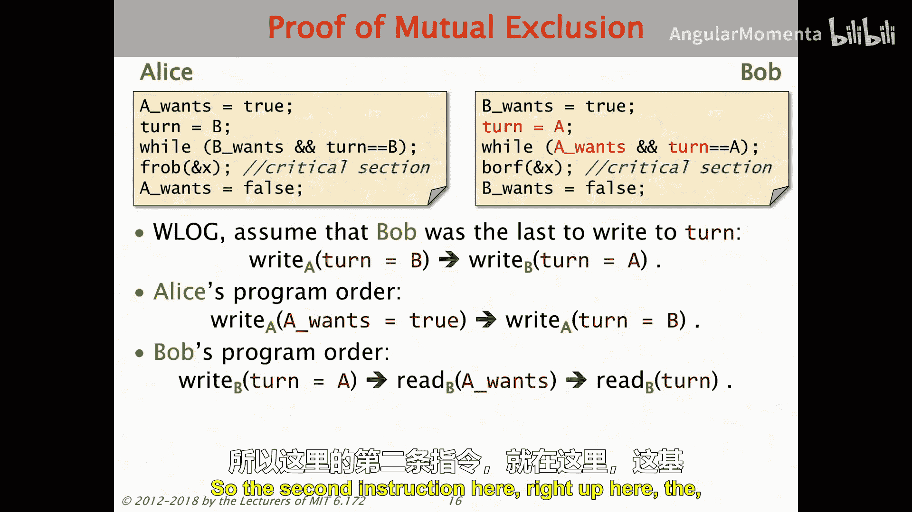
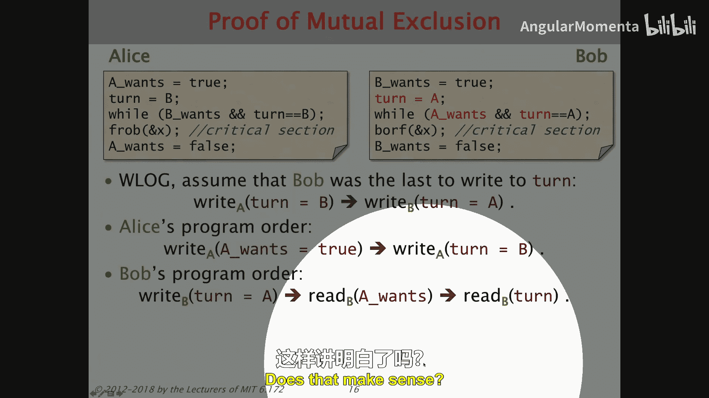
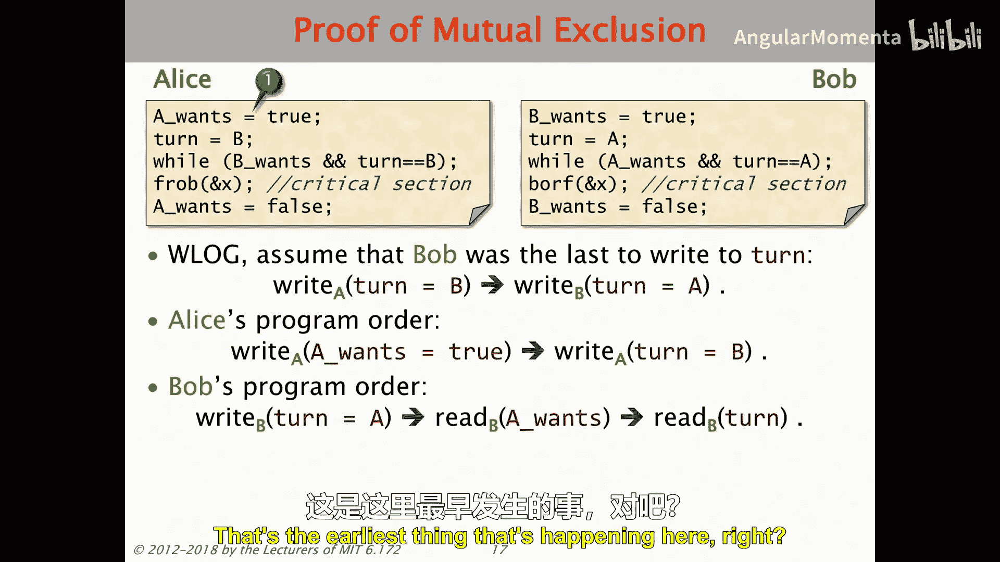
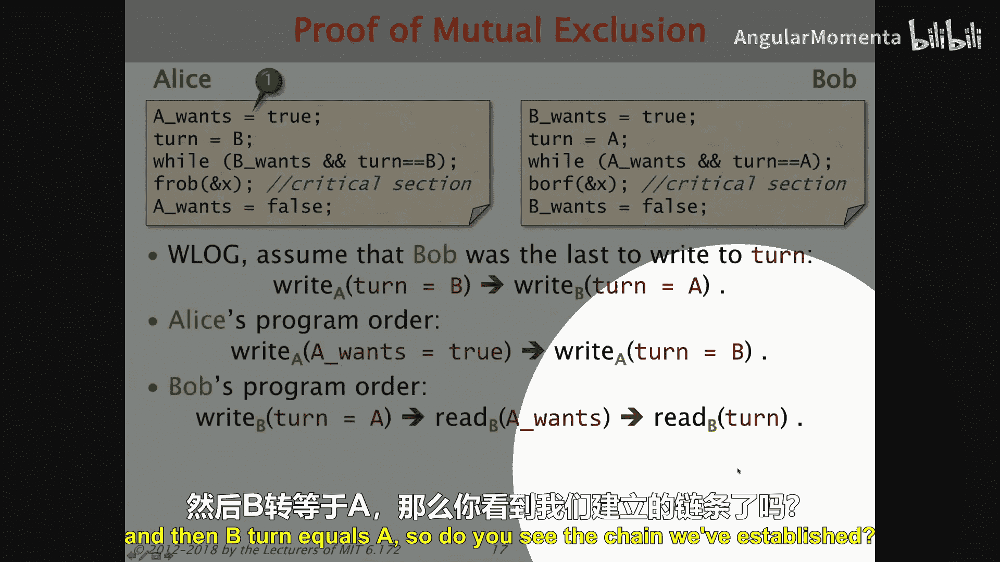
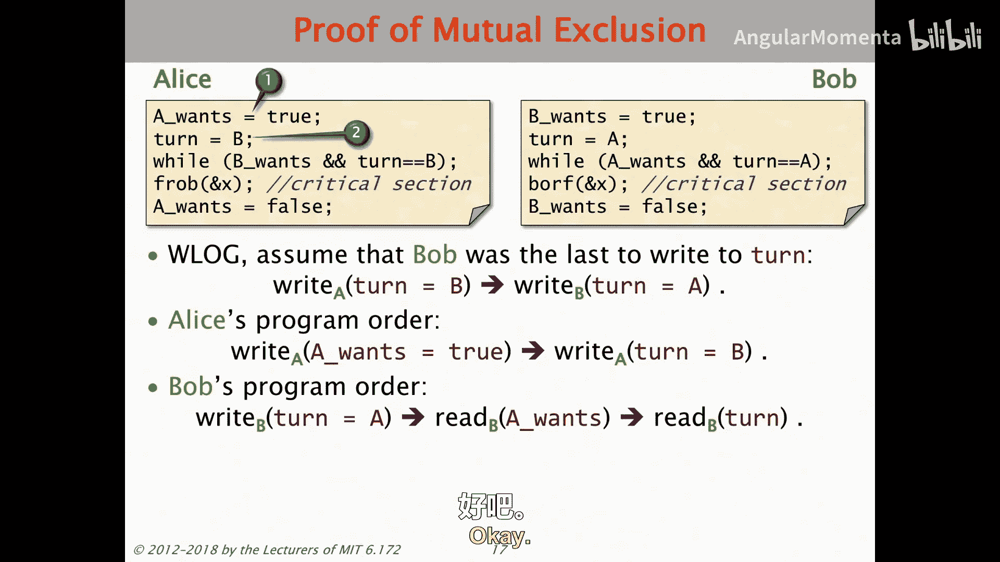
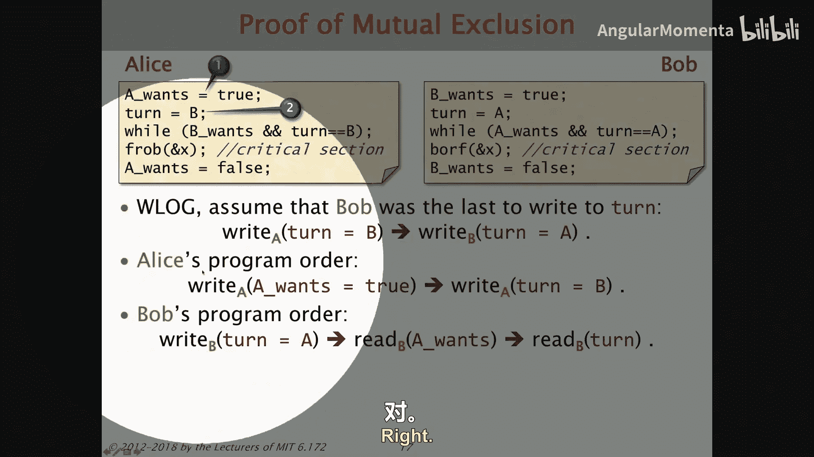
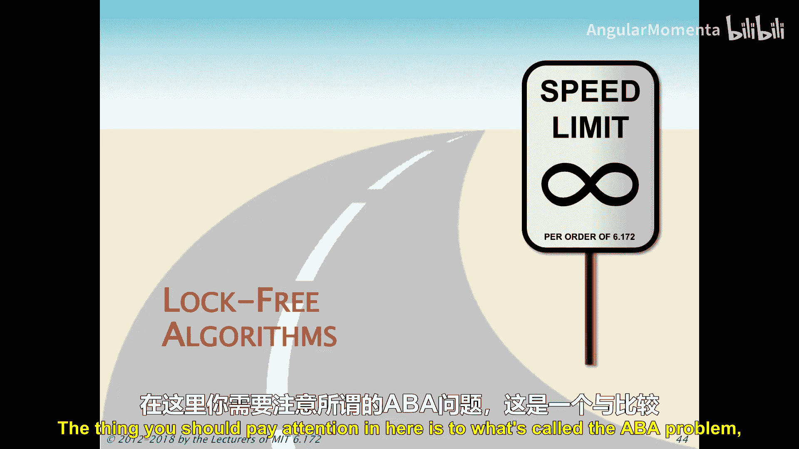

# 【麻省理工】软件系统性能工程 ｜MIT 6.172 Performance Engineering of Software Systems, Fall 2018 p17 17. 无锁同步 -BV1esbLzpEFq_p17-

The following content is provided under a Cative Commons license。

 Your support will help Mi T OpenCourseware continue to offer high quality educational resources for free to make a donation or to view additional materials from hundreds of MiT courses。

 Visit Mit Opencourseseware at Ocw。 Mt Eduu。

Hey， everybody。Let's get started here。嗯。So last time we had the skull and crossbones。

 this time we're going to have double skull and crossbones。Okay。

 this stuff is really hard and really fun。And we're going to talk about synchronization without locks。

So。And to start out， I want to talk about memory models and in particular。

 the most important memory model。From a theoretical point of view， which is sequential consistency。嗯。

And。To introduce it， I want to。Use an example to introduce the notion of a memory model。

 So suppose you have a。Two variables， A and B， which are initially zero。

 and those variables are stored in memory。And processor zero moves a 1 into a。

And then it moves the contents of EBX into B。And meanwhile， processor one。

Moves a1 into B and moves the contents of A into。Into EAX。

 I just chose different registers just so we could distinguish the two things。Okay。Now。

Let's think about this code， we have these two things going on。

 is it possible that processor zeros EBX and processor ones EAX？

Both contain the value zero after the processors have both executed their code。

They're executing in parallel。So think about a little bit。

 this is a good lecture to think about because this。This is。Well， you'll see in a minute。

 okay can they both。Have the value of zero。So you're shaking your head， explain why。So they。给一。意。

what。I important A A an EAI。They came already Tuesday needed。Okay。Good。

 and that's a correct argument。But you're making a huge assumption。Okay。Yeah， so the idea is that。

 well， if you're moving a one into it， you're not looking at it。

 it may be that one of them gets zero。And the other gets one。

It actually turns out to depend on what's called the memory model。

And that it took a long time before people realized that there was actually an issue here okay so this depends upon the memory model and what you were reasoning about was what's called sequential consistency you were doing happens before types of relationships okay and saying if this happened before that。

 then okay and so you had some global notion of time。

That you were using to say what order these things happened in， okay？

So let's take a look at the model that you were assuming。😡。

It's interesting because whenever I do this。Somebody always has the right answer and they always assume that it's sequentially consistent。

 it's the most standard one， so sequential consistency was defined by Leslie Lamport who won the Turing award a few years ago and this is part of the reason he won so what he said is the result of any execution is the same as if the operations of all the processors were executed in some sequential order。

And the operations of each individual processor appear in this sequence in the order specified by the program。

Okay。So let's just break that apart because it's a mouthful to understand。Okay。

 so the sequence of instructions as defined by a processor's program are interleaved with the corresponding sequences defined by the other processors programs to produce a global linear order of all instructions。

 so you take this processor or this processor and there's some way of interleaving them for us to understand what happened。

 that's the first part of what he say， okay。Then after you've done this interlaving。

A load instruction is going to get the value。Stored to the address of the load。That's。

That is the value of the most recent store to that same location in that linear order。

 so by most recent I mean most recent in that linear order。

 I'm going to give an example in just a second。Okay。So it doesn't fetch one from way back。

 it fetches the most recent one， the last right that occurred to that location in that interleaved order that you have picked。

Now there could be many different inter orders and you can get many different behaviors。

 after all here we're talking about programs with races， right？Okay。

 we're touching stuff that other things are， you know we're reading stuff that other things are writing。

 okay？And so。Basically， the hardware can do whatever it wants。

 but for the execution to be sequentially consistent。

 it must appear as if the loads and stores obeyed some。Global linear order。Okay。

There could be many different possible execution paths， depending upon how things get interleaved。

 but if you say here's the result of the computation。

 it better be that there exists one of those in which。

Every read was occurred to the most recent right， according to some linear order。😡。

Does that makes sense， so let's let's do it for this example， okay， so here we have。set up again。

 okay， how many interleavings of four things are there？turns out there's six interleavings。

 so those who've taken 6042 will know that， right？For choose2。U。So。So the inner leavingavings are。

 you know， you can do them in the order， one， two， three， four。One，3， two， four， one，3，4，2。

 et cetera， et cetera。But notice that in every one of these orders， one always comes before two。

And three always comes before four。So you have to respect the processor order。Okay， processor order。

You know， you have to express it， so if I execute in the first column， if that's the order。

 what's the value that I end up with for EAX and EBX？One in zero yep。Okay。

So it basically moves a1 into A， then it moves B into EBX B is currently zero， so it's got a0 in EBX。

 then processor1 moves1 into B， and then it moves A into EAX and a at that point has the value1。Okay。

 so it has。Okay， what about the second one？One， one， good， okay？

Because they are both moving one into the res then they're both storing， okay。

 what about the third one？Yeah。Same， okay， fourth one。We' try to get everybody。D。Same。啊，一。Fth one。

Same。Last one。Yeah， zero1 good， okay？Notice that so this is the total number of ways we could interleave things。

 we don't know which one of these might occur because after all the output' is going to be nondeterministic upon which it is。

 but one thing that we can say for certain is that if you have sequential consistency that's no execution that ends with them both being zero。

 which is exactly your intuition and correct rationalization， okay？嗯。But it turns out。Interestingly。

 that no computer implements of modern computers， none implements sequential consistency。Okay， why。

 because life would be too easy then。Okay， none of them do that so we'll get there。

 we'll talk about what modern machines do okay so'。Reason about sequential consistency。

So the way that you can formally reason about this to make an argument。😡，As you might have。

 for example， on a quiz， if we had a quiz coming up。Okay。

 would be to understand that an execution induces a happens before a relationship。

That we will denote as a right arrow。Okay。And the right arrow relation is linear。

 meaning that for any two instructions， either one happens before the other or the other happens before the one。

😡，For any two different instructions， this is the notion of a linear order。Okay。

The arrow relation has to respect， that happens before relation has to respect processor order。😡。

Okay， in other words， that。Within the instructions executed by a processor。

 the global order has to have those same sequence of instructions of whatever that processor thought that it was doing。

And then a load from a location in memory reads the value written by the most recent store to that location according to to happens before。

And for the memory resulting from an execution to be sequentially consistent。

 there must be a linear order that yields that memory state。Okay。

And so it's really important to understand how to reason about if you're going to write code without locks。

 it's really important to be able to reason about what happened before what。😡。

And with sequential consistency， you just have to understand what are all the possible interleavings。

So if you have n instructions here and M instructions there。

 you only have to worry about n times M possible in leavings。Okay， actually is it n times1， no。

 you got got more than that， okay， sorry。几卖啊。I used to have good math。Okay。

So one of the celebrated results early in concurrency theory was that fact that you could do mutual exclusion without locks。

Okay， or test and set or compare and swap or any of these special instructions， okay。

 really remarkable result， okay， and so I'd like to show you that because it involves thinking about mutual exclusion。

 thinking about sequential consistency。So let's recall we talked about mutual exclusion last time and how Locks could solve that problem。

 but of course Locks introduced a lot of other things like deadlock， convoying。

 and a variety of things， some of which I didn't even get a chance to talk about。

 but they're in the lecture notes。So let's recall that a critical section is a piece of code。

That accesses a shared data structure that you don't want two separate threads to be executing at the same time。

 you want it to be mutually exclusive。Most implementations use one of these special instructions。

 such as the XCH。G， the exchange instruction that we talked about to implement locks last time。

 or they may use test and set compare and swap， load link store conditional。

Are any of these familiar to people？Or is this new stuff？Who's this new for it。

 just want to make sure okay great okay so there are these special instructions in the machine that do things like an atomic exchange okay or a test and set I can set a bit and test what the prior value was of that bit as an atomic operation it's not two sections where I test it and then where I set it and then know the value changed in between or compare and swap will' talk more about compare and swap and loadlink store conditional which is even a more sophisticated one。

So in the early days of computing back in the 1960s， this problem of mutual exclusion came up。

And the question was， can mutual exclusion be implemented with only the loads and stores？

As the only memory operations， or do you need one of these？

Heavy duty instructions that does two things and cause it atomic。OkayAnd yep。

 so I forgot to animate the appearance of Edsgar。So two fellows， Decker and Dyktra show that it can。

As long as the computer system is sequentially consistent。Okay。

 and so I'm not going to give their algorithm， which was a little bit complicated。

 I'm going to give what I think is boiled down to the most simple and elegant version of you know that uses their idea。

 and it's due to Peterson and for the life of me I've not been able to find a picture of Peterson。

Okay，Otherwise I show you what Peterson looks like， okay？

So here's Peterson's algorithm and I'm going to model it with Alice and Bob who are going to。

 they have a shared widget。And what Alice wants to do to the widget is to fb it。

And Bob wants to bo it。Okay， so they're going to frob and morphfe it。

 but we don't want them to be frobbing and bfing at the same time， right naturally。

You don't frob and boarf widgets at the same time。Okay。So they're mutually exclusive， okay？

So here's Peterson's algorithm。Okay。So we have widget X。

 so I'm going to just go read through the code here， and I have a variable。

 a Boolean variable called Want。A wants， and A wants and a B wants A means Alice wants to fb the widget。

 B wants means that Bob wants to bf the widget， okay？

And we're also going to have a variable that has two values， A or B for whose turn it is。Okay。

And so we start out with that code and then we。Fork the two， Alice and Bob。

Branches of our program to execute concurrently。And what Alice does is she says， I want it。

Sa a wants to true。And I set the turn to be Bob's turn。Okay。And then。As long as。

And then the next loop has an empty body notice， okay。

 it's just a while with a semicolon that's an empty body， it's just going to sit there spinning。

 it's going to say while B wants it。And it's beast and if Bob wants it and it's Bob's turn。

 I'm going to just wait。ok。And。If it turns out that either Bob does not want it or it's not Bob's turn。

Then that's going to free me to go into the critical section and free alististic。

 go into the critical section and f X， okay， and then when she's done， she says。

I don't want it anymore。And if you look at Bob's code， it's exactly the same thing。

And when we're done with this code， we're going to。We're going to then loop， okay。

 to do it again because they just want to keep throbbing and morphing。

Until their eyes turn blue or red， whatever color eyes they have there。Okay。Yeah， question。

I didn't explain why this works yet， I'm going to explain why it works。

And youre going to ask why it works？Why are they not locks？Well。

 a lock says that if you can acquire it， then you stop the other person from acquiring it。

 there's no locking here， there's no waiting， were implementing we're implementing a mutual exclusion region。

 but a lock has a particular span， it's got going to acquire in a release。

So when you say a wants to be true， I haven't acquired the lock at that point， have I？

Or if I set the turn to be the other character， I even acquired a lock。Okay， indeed， I then do some。

Testing and so forth， and hopefully we end up with mutual exclusion。

 which is effectively what locking does， but this is a different way of getting you there。Okay。

 it's only using loads and stores。With a lock， there's an atomic， I got the lock。

And' if it wasn't available， I didn't get the luck。And then I wait。ok。Okay， so let's discuss。

 let's sort of figure out what's going on in and I'm going to do it two ways。

 first I'm going to do the intuition， and then I'm going to show you how you do a reason through it where it happens before relation。

Okay， question。No， okay。Good， so not good that there's no questions。

 it's good if there are questions。Good， we'll move on， okay。Okay， so here's the idea。

Suppose Alice and Bob both try to enter the critical section。Then whoever is going to write。

 and we have sequential consistency so we can talk about who did things in what order。

So whoever wrotes last？To who's the last one to write the value to turn？To the variable turn。Okay。

 that one can't go， that one's not going to enter。Okay。And the other one will enter。Okay。

And then if Alice tries to enter the section。Then she progresses because at that point she knows that B wants is false。

And if only Bob tries to enter it， then he's going to go because he's going to see that A wants this false。

Okay。Does that makes sense， so only one of them is going to be in there at a time。

 it's also the case that you want to verify that if you want to enter you can enter so that's that last part because otherwise a very simple protocol would be not to bother looking anything but just take turns it's Alice's turn it's Bob's turn it's Alice's turn it's Bob's turn and that we don't want a solution like that because if Bob doesn't want to turn。

 Alice can't go。She can go once and then she's stuck。Okay。

Whereasas we want to be able to have somebody if they're the only one who wants to go execute the critical section。

 you know Alice can fb， fb， fb， fb fb， okay or Bob can pour， forth， for， for a fourth。

 okay we don't want to force them to go if they don't need to go okay。

So the intuition is that only one of them is going to get in there。Because。

You need the other one either to say you want to go in or else their value for wants is going to be zero and it's going to be false and we're going to be。

You're going to go through anyway， okay？But this is not a good argument。Because this is hand waving。

Okay， we can， we're at MIT。So we can do proofs。And and this proof isn't so hard， okay。

 but I want to show it to you because it may be different from other kinds of proofs that you've seen。

Okay。So。So here's the theorem， Peterson's algorithm achieves mutual exclusion on the critical section。

The setup for the proof is assumed for the purposes of contradiction that both Alice and Bob find themselves in the critical section together。

And now we're going to look at the series of instructions that got us there。

And then argue there must be a contradiction。Okay， that's the idea okay and so let's consider the most recent time that each of them executed the code before entering the critical section。

 so we're not interested in what happened long ago， what's the very。

 very last pieces of code as they entered the critical section and will derive a contradiction？Okay。

So here we go， so without loss of generality， let's assume that Bob。

 we have some linear order and to execute， notice a be in the critical section。

 All and Bob both had to set the variable turn。So one of them had to do it first。

 I'm going to assume without loss of generality that was Bob because I can otherwise make exactly the same argument for Alice。

 so let's assume that Bob is the last one to write to turn。So therefore。If Bob was the last one。

 that means that Alice writing to turn， so she got in there， so she wrote to turn。

Okay so her writing B to turn preceded Bob writing A to turn。Okay， right。

 so we have that happens before relationship。Okay， everybody with me？

Do you understand the notation I'm using and the happens before relationship？Okay。Okay。

 now Alice's program order says that writing true to Alice to A wants comes before her writing。

Turn equals B。That's just program order。Right？So we have that， and similarly。

 we have Bob's program order。Okay， and Bob's program Mo says， well。

 I wrote turn to A and then I wrote。Let's say I so Bob wrote turn equals A， and then Bob。

 in this case， we're going to do Bob read A once。And then he reads turn， okay。

 so the second instruction here right up here。

So this is basically this is a conditional end， so we basically are doing this and then if that's true。

 then we do this。Turn equals equals a， that's reading turn and checking if it's a happens after a wants。

 so that's why I get these three things in order， does that make sense。

Any question about that？ok。Is that good so I've established these two chains？

And as well as that-- so I actually have three chains here that I'm now going to combine。Okay。So。呃。

Yeah， let's see so what's happening is I have if let me look to see what's the order of everything that happens。

 so the earliest thing that happens，Is that Alice wants to be true， right， because where's that？

So Alice wants is true。Is。Yes， is coming before。

That's the earliest thing that's happening here right so that instruction is basically this Alice wants is true。

 it comes before the A turn equals B， that comes before the A turn equals B。

 so it comes before the right turn equals a， right B turn equals a and then B turn equals a。

 so do you see the chain we've established。

Okay。You see this train yeah？Okay， good。Okay，So we have- so it says A wants this first。

A once equals true is first， then we have the turn equals B， okay。

 that's all from the second line here。

That's from this line here。

Okay，Then we have what's next？Which instructions is next？Yeah， so turn equals a。Okay。

 that comes from the top line there。What's next？B， so I read B。Bob reads A once。And then finally。

Bob reads。Tur a day。Okay。Okay， so this is all based on just the interleaving and the fact that if you saw that we have the program order and that Bob was the last to write。

That's all we're using。ok。And so why is that a contradiction？Well。We know what the linear order is。

We know that when Bob read。Okay。What did Bob read， what did Bob read when he read A once？

In state in step four。He read the last value in that chain， the most recent value。Okay。

 in that chain。Where it was stored to and what was stored there。True。Okay。Good。And then Bob read。

Turn。And what was the most recent value stored to turn in that chain？Okay。So then what？Bob。

 if that were in fact， what he read in the while loop line。What should be happening now？

He should be spinning there。He shouldn't be in the loop。

Bob didn't obey his code did not obey the logic of the code， okay， Bob should be spinning。

 that's the contradiction。Because we said Bob was in the loop。Does that make sense？Okay。Is that good？

So。When you're confronted with synchronizing through memory， as this is called。Okay。

 you really got to write down the happens before things in order to be careful about。

Reviewing things， I have seen， in many， many cases。

 engineers think they got it right by an informal argument。And in fact。

For those people who have studied model checking， anybody have any interaction with model checking？

So if you're building a， okay， what was the context？Okay。

 and while you're studying protocols and so forth？Yeah， so in 6822， what class is that？

Foral programming good yeah， so so for for things like network protocols and security protocols and for cash。

Protocols in order to implement things like MSI and MESI protocols and so forth。These days。

 they can't do it in their heads。They have programs that look at all the possible ways of executing what's called model checking。

 and it's a great technology because it helps you figure out where the bugs are。Okay。

 and essentially， you know， reason through this for simple things you can reason it through for larger things。

 you use the same kind of happens before analysis in those contexts in order to try to prove that your program is correct。

 okay， that those protocols are correct。Okay so for example。

 in all the computers you have in this room。Every one of them。

 there was a model checker checking to make sure the cash analysis was done and many of the protocols。

 security protocols that you're using as you access the website that are all been through model checking。

Okay。U。Good， the other thing is it turns out that Peterson's algorithm guarantees starvation freedom。

So while Bob wants to execute her critical session。

Bob cannot execute his critical section twice in a row and vice versa。

So it's got the property that you're not going to have， you know。

 one of the things that you might worry about is， you know， yeah。

 Alice wants to go and then Bob goes a gazillion times and Alice never gets to go。

Now that doesn't happen， as you can see from the code because。Every time you go。

 you set the turn to the other person。Okay， so if they do want to go， they get to go through。

 but proving that is a nice exercise。Okay， and it will warm you up to this kind of analysis。

Okay how you go about it yeah。This one does not。And there has been wonderful studies of what does it take to get end things to work together。

 and this is one place where locks have a big advantage because you can use a single lock to get the mutual exclusion among end things。

 so constant storage， whereas if you just use atomic read and atomic right。

It turns out the storage grows。Okay， and there's been a wonderful studies that also wonderful studies of these other operations like compare and。

 swap， and so forth， and we'll do a little bit of that。Okay we'll do a little bit of that。

 so often in order to get performance， you want to synchronize through memory， not often。

 but occasionally you want to synchronize through memory to get performance and but then you have to be able to reason。

About it。Okay， and so that happens before sequential consistency， great tools for doing it。

 the only problem with sequential consistency is what？Who is listening？Yeah。It's not real。No。

 we have had machines historically that implemented sequential consistency， today。

 no machine support sequential consistency， at least that I'm aware of。

Instead they report what's called relaxed memory consistency。

 and let's take a look at what the motivation is for why you would want to make it a nightmare for programmers to synchronize through memory。

This has also led software people to say never synchronized through memory。Okay， why。

 because it is so hard to get it correct？Because you don't even have sequential consistency at your back。

ok。So today， no modern day processor implements sequential consistency。They all implement some。

Form of relaxed consistency。And in this context， hardware actively reorders instructions。

And compilers may reorder instructions too。And that leads you not to have the property that the order of instructions that you specified in a processor is the same as the order that they get executed in。

So you say do A and then B。The computer does B and then A。So let's see instruction reordering。嗯。

So I have on the left the order that the programmer specified in an order on the right。

 what the hardware did， or it may have been that the compiler reordered them， okay？Now， if you look。

 why might the hardware or compiler decide to reorder these instructions？😡。

What's going on in these instructions you have to understand what these instructions are doing right so in the first case I'm。

Doing a store and then a load and in the second case I have。Reverse the order to do the load first。

 Now， if you think about it， if this was， if you only had one thing going on。

What's the impact here of this reordering？Is there any？

Reason I can't the compiler or somebody couldn't reorder these。Yeah。That my find。Yeah。

 and what way does it affect the pipeline？basically about the。Yeah。

 there's sort of a little bit of I think you're on the right track there's sort of a there's sort of a higher level reason why you might want to put loads before stores。

 why might you want to put loads， these are two instructions that normally if I only had，One thread。

Reordering them would be perfectly fine。Okay， because the result is， well。

 it's not necessarily perfectly fine when might I。When might there be an issue？

It's almost perfectly fine。Yeah， if A it was equal to B。But if A and B are different。

Then reordering them is just fine。A and B are the same， if that's the same location， a O。Okay。

 I can't reorder them because one is using the other。Okay。

So why might the hardware prefer to put the load earlier？😡，Yeah。Laterter instruction。

 which depends on。There might be a later instruction that depends on B。

 and so why would it put the load earlier？呃 pipeline。Yeah。

 you're basically covering over latency in the load， when I do a load。

 I have to wait for the result before I can use it。Okay，When I do a store。

 I don't have to wait for the result。 before because it's not being used， I'm storing it。

And so therefore if I do loads earlier。Okay， if I have other work to do such as doing the store。Okay。

 then the instruction that needs。The instruction that needs the value of B。

Doesn't have to necessarily wait as long， I've covered over some of the latency。

 and so the hardware will execute faster。So we get higher performance by covering load latency。

Does that make sense？It's like it's helpful to know what's going on in the hardware here。

 the reason about the software， this is like this is a really great example of that lesson is why what the compiler is doing there that it chooses to reorder and frankly。

 in the era before 2004 when we were in the era of what's called Denard scaling and we didn't worry all our computers just had one processor。

It didn't matter。Didn't have to worry about these issues。

 These issues only come up for when you have。More than one thing going on。

 okay because if you're sharing these values， oops。I change the order， so let's see。

 so when is it safe in the modern you know， in this kind of context for the hardware compiler to perform this particular reordering。

When can I do that？So there's actually two answers here。Or there's a combined accessces。

I've already talked about one of them。Yeah。Yeah， when A is not B。OkayIf A and B are equal。

 it's not safe to do the and what's the second constraint where it's safe to this reordering yeah go ahead。

Ooh， that's a nasty one， yeah， I guess that's true。I guess that's true。U。But more generally。

 when is it safe？That's a benign race in some sense， right？Yep。Good。系。GoodThat's a good one。

What's the other case that this is safe to do？Or what's the case where it's not safe？Same question。

I just told you。嗯。😊，When might this be safe？When is it safe to this reordering。

 I can't do it if a is equal to B。And also shouldn't do it when。Yeah。答有。Yeah乜。Yeah， but。Yeah。Yeah。

 if there's no concurrency。Okay， if there's no concurrency， it's fine。Okay。

 the problem is when's there concurrency？Okay。So let's take a look at why how the hardware does reorderings so that we can understand what's going on。

 because in a modern processor， there's concurrency all the time。

And yet the compiler still wants to be able to cover over load latency because usually it doesn't matter。

Okay。So。So you can view hardware as follows， so you have a processor on the left edge here and you have a network that connects it to the memory system。

Okay， a memory bus of some kind。Okay。Now it turns out that the processor can issue stores faster than the network can handle them。

So the hardware， the processor can go store， store， store， store， store。

 but getting things into the memory system that can take a while。Me system is big and it's slow。

And so， but the hardware is usually not。Doing store on every cycle， it's doing some other things。

 so there are bubbles in that。In that instruction stream， and so what it does is it says， well。

 I'm going to let you issue it because I don't want to hold you up。Okay。

 so rather than being held up， let's just put them into a buffer， okay。

 and as long as there's room in the buffer。I can issue them as fast as I need to。

 and then the memory system can suck them out of the buffer as it's going along。

 and so in critical places where there's a bunch of stores。

 it stores them in the buffer if the memory system can't handle on average。

 of course it's going to go at whatever the bottleneck is on the left or the right。

you can't go faster than whichever is those the bottleneck， usually the memory system， okay and so。

 but we would like to achieve that and we don't want to have to stall every time we try to you do two stores in a row。

 for example。By putting a little bit of a buffer， we can make it go faster，Now。Since a load。

If I try to do a load， that can stall the processor until it's satisfied。 So whenever you do a load。

If there's no more instructions to execute， if the next instruction to execute requires the value that's being loaded。

 the processor has to stall until it gets that value。

So they don't want the loads to go through the store buffer。Okay， I mean。

 one solution be just put everything into the store buffer， in some sense you'd be okay。

 but now I haven't covered over my load latency， so instead what they do is they do what's called a load bypass。

They go directly to the memory system for the load bypassing all the rights that you've done up to that point and fetch it so that you get it to the memory system and the load bypass takes priority over the store buffer。

 okay？But there's one problem with that。Hack， if you will， okay。

 what's the problem with that hack if I use if I bypass the load。

 where could I run into trouble in terms of correctness？Yeah。

If one of your stores is the thing you're trying to load， exactly。And so what happens is。

As the load bypa is going by， it does an associative check and the hardware is the value that I'm fetching one of the values that is in the store buffer。

And if so， it responds out of the store buffer directly rather than going into the memory system。

Okay， makes sense。Okay， so that's kind of how。The reordering happens within the machine。

Okay but by this token， a load can bypass a store to a different address。Okay。

 so this is how the hardware ends up reoring it because the appearance is。

That the load occurred before the store occurred if you are looking at the memory。

YetFrom the point of view of the memory。And in particular。

 the point of view of another processor that's accessing that memory。So over here I said， you know。

 store load， over here， it looks like he did load store。Okay。

And so that's why it doesn't satisfy sequential consistency。Okay。Yeah， question。Yeah。

 there's one for each processor。It's the way it gets things into the memory， right， so I'll tell you。

Computing would be so easy if we didn't worry about performance。

 because if those guys didn't worry about performance， they do the correct thing。

They just put him in in the right order。Okay， it's because we care about performance。

That we make our lives hard for ourselves。And then we have these cls to fix them up。Okay。So。

That's what's going on in the harder， and that's why things get reordered。Makes sense。Okay。So。

 but it's not as if all bets are off and in fact， X86 has a memory consistency model they call total store order。

😡，And here's the rules。嗯。So it's got it's a weaker model okay and some of it is kind of sequentially consistent type of thing you're talking about what can be ordered。

 so first of all， loads are never reorder with loads do I have。Let see here， so you never。

Reorder loads with loads， that's not okay。 always the loads。

 you can count on loads being seen by any external processor in the same order that you issued the loads within a given processor。

Okay， so that's。There is some rationale here， likewise， stores are not reordered with stores。Okay。

 that never happens。ok。嗯。And then stores are not reordered with prior loads。So you never move a。

A store earlier passed a load。you wouldn't want to do that because generally。

It's the other direction you're covering over latency。

 but in fact they guarantee it doesn't happen okay， so you never do a move a store before a load。

 it's always move a load before a store。Okay。And then。And then in general。

 load a load may be reordered。With a prior。诶。Store to a different location。

 but not with a prior load to the same location， so this is what we're just talking about that a has to be not equal to B in order for it to be reordered and at that point that you're executing this the hardware knows what the addresses are that it's that it is。

That are being loaded and stored and can tell are they the same location or not。

 and so it knows whether or not it's able to do that okay so the loads basically are。诶。

You can move loads upwards。But you don't reorder them and you only move it past a store if it's a store to a different address。

Okay。And then there are a whole bunch of yeah， so here we have a bunch of things。

 so this is basically weaker than sequential consistency。

 there are a bunch of other things so for example， if I just go back here for a second，U。呃。

The lock instructions respect a total order。You know the store respect to order。

 the lock instructions and memory ordering preserves what they call transitive visibility in other words's causality。

 which is basically the happens， says that the happens before a relation。

 you can treat as if it's a linear order， it's transitive as a relation as a binary relation。

 so the main important ones to the ones at the beginning。

 but it's helpful to know that loads sorry that locks are not going to get reordered。Right， you know。

 if you have a lock instruction， they're never going to move it before things， okay。

 so here's the impact of reordering on our Peterson's algorithm， sorry。No。

 this is not Peterson's algorithm， yet， this impact of reordering on this， okay， is that I may。爱。

Store。I may have written things in this order。Okay， but in fact。

 they execute in something like this order。Okay， and therefore， the ordering in this case。

 2413 is going to produce。The value。Zero zero， which was exactly the value that you said couldn't possibly appear。

 well on these machines， it can appear。Okay。Okay because。The hardware， and also let me say is。

 so instruction reordering violates this sequential consistency。And by the way， this can happen。

 not just in the hardware， this can happen in the compiler as well。

The compiler can decide to reorder instructions。It's like， oh my God。

 so how can we be writing correct code at all， but you've written some correct parallel code right and you didn't have to worry about this so we'll talk about how we get there yeah。

It might happen， and no， there's no requirement that it moved things earlier。U。

 it may be that there isn't enough register space because as you move things earlier。

 you have to make sure that there's， you know， you're going to have to hold the values longer before you're using them。

Okay， yeah。This8 having that road。O。That load three。嗯。In the previous- I'm sorry， I'm not falling。

Or the previous slide， not this slide。This one。Okay。Yeah， well。

 I had said there's some things that I said were no good， right？So here it was。What did I do。

 I moved the loads earlier。In that example， but there were some earlier one you were talking about even earlier than that。

Or this one， okay？Okay。So load three。So let's see， let's go okay， so this is the original thing。

 store three is before store four。And load three and load four afterwards， right？

So the stores have to be in the same order and the loads have to be in the same order。

But the loads can go before the stores if they're to a different address。Okay， so in this case。

You know we moved load three up two and we moved load four up one。

 we could have maybe moved load4 up before store3， but maybe they were to the same address。

So your story doesn't mean that they are for the same。No， no， this is just this is。This is abstract。

Okay。Got it。Okay， yeah， so this is why things can get reordering and in that case， you know。

 we can end up with a reordering that gives us something that we don't expect when we're synchronizing through memory。

 okay？Never write nondeterministic code。It's like， because you deal with this stuff， okay？Okay。

 unless you have to。And that's sort things， you know， unfortunately。

 sometimes it's not fast enough otherwise， okay。Now let's go back and look at Peterson's algorithm。

 and what happen， what can go wrong with Peterson's algorithm。

What reordering might happen here that would completely screw up Peterson's algorithm？

Okay so what we want to do is hint， we're looking for a load that might happen before a store。

What load would be really bad to happen before a store？Yeah。大重？To evaluate the Wildwood fish。嗯。

You load turn earlier。Maybe。Let me think that's not the one I chose， but maybe that could be right。

Well， you can't move the turn。You can't move it before the store to turn。Okay， yeah。Yeah。

 if Alice loads， B wants too early and if they both do。ok。Then they could be reored before the store。

Of a wants and B wants。Because that's a you know that's a load and be wants。

 well Alice isn't touching be once， so why can't it just move it earlier those are not the same locations。

Okay， so suppose it reorders those， now what happens。嗯。Yeah， it would be false too early， right？

And the same with A。And now they're both in the， they discover they're in this critical section together。

 right？And if there's one thing we don't want Alice and Bob in the same critical section。Okay。

Does that make sense？Okay， so。You got this problem， there's reordering going on。Okay。Yike。

 how could you possibly write any parallel code and any concurrent code？Well， they say， well。

 we'll put in a clluge。They introduce some new instructions。

 and this instruction is called a memory fence。Okay。So don't get me wrong。

They need to do stuff like this， okay。There is an argument to say they should still build machines with sequential consistency because it's been done in the past。

 it is hard work for the hardware designers to do that。And so as long as the software people say。

 well， you know， we can handle weak consistency models to hard， okay， you're a problem， okay。

 my view is so Mark Hill， who's a professor at University of Wisconsin has some wonderful essays。

Saying why he thinks that parallel machines should support sequential consistency and that the complaints of people。

You know， not having it supported that those people， they could support it if they really wanted to。

 and I tend to be persuaded by him， he's a very good thinker in my opinion。

 but in any case so what we have is yeah question。You know。

 so he talks about this and what he thinks the difference is。

 but it's apples and oranges because sometimes you know。

 part of it is what's the price of having bugs in your code？Okay， you know。

 because that's what happens is programmers can't deal with this。

And so we end up with bugs in our code。But they can reason about sequential consistency it's hard。

 but they can reason about it when you start having a relaxed memory consistency， very tricky。

Okay so let's talk about what the solutions are and his argument is that the performance doesn't have to be that bad。

 there was a series of machines made by a company called Silicon Gphs。

 which which were all sequentially consistent， parallel machines all sequentially consistent。

And they were fined， but they got killed in the market because they couldn't implement processors as well as Inteldo。

Okay， and so they ended up getting killed in the market。

and getting bought out and so forth and now their people are all over and those the people who are at Silicon Graphs。

 many of them really understand parallel computing well， the hardware aspects of it。Okay。

 so a memory fence is a hardware action that forces an ordering constraint between the instructions before and after the fence。

So the idea is you can put a memory fence in there。

And now that memory fence can't be reordered with things around it。

 okay it maintains its relative orderings to other things， and that way you can prevent。

 so one way you could make any code be sequentially consistent is to put a memory fence between every instruction。

Okay。Not very practical， but there's a subset of those that actually would matter okay so the idea is put in just the run one you can issue them explicitly as an instruction in the X86 it's called the M fence instruction and there is a or it can be performed implicitly so there are other things like locking。

 exchanging and other synchronizing instructions， they implicitly have a memory fence okay now the compiler that we're using implements a memory fence via the function。

 atomic thread fence。Okay， which is defined in the C header filed standardatomic dot H okay and you can take a look at the reference material on that to understand a little bit more about that the typical cost on most machines is comparable to that of an L2 cash access。

Now， one of the things that I think that is nice to see is happening is they are bringing that down。

They're making that cheaper， but it's interesting that they had a。Intel had one processor where。

Where the memory fence was actually slower than the lock instruction。Okay， and you say。

 wait a minute， the lock instruction has an implicit memory fence in it。How could they own- I mean。

 you've got a memory fence in the lock instruction， how could the memory fence be slower？Okay。

 so I don't know exactly how this happens， but here's my theory。

Okay so you've got these engineering teams that are designing the next processor。

And they of course want it to go fast， so how do they know whether it's going to go fast。

 they have a bunch of benchmark codes。And that they discover as well。

 all these- now that we're getting the age of parallelism， all these parallel codes。

 they're using locking。Okay， so they look and they say， okay。

 we're going to put our best engineer on making locks go fast。And then they see that， well。

 there's some other codes that maybe go slow because they've got fences。

 but there aren't too many codes that just need fences。Okay， explicit fences， in fact。

 most of them use things， so they put their junior engineer。Okay， on the fence code， right。

 not recognizing that， hey。You know this is， you know。

 the left hand and the right hand should know what each other is doing。And so anyway。

 you get an anomaly like that where it turned out that you know。

 it was actually fastest we discovered as we were implementing the silk runtime to do a fence by just。

Doing a lock on a location that we didn't care about the lock， we just did a lock instruction。

 and that actually went faster than the fence instruction， weird。

But that's the way these systems are all built by humans。Okay。

 so if we have this code and we want to restore consistency， where might we put？A memory fence。

After setting turn， you mean like that？Yeah。Okay， so that you can't end up reading it。Okay。

 loading it before it's stored to。Okay，That kind of works sort of。

 you also have to make sure that the compiler doesn't screw you over。Okay。

And the reason the compiler might screw you over is that it looks at be wants。And turn B， it says。

 oh， I'm in a loop here。So let me load the value and keep using the value over and I don't see anybody using this value。

So it loads the value and now it just keeps。'sCheck the value， the value has changed on the outside。

 but it's stored that in a register so that that loop will go really fast。

And so it goes really fast and you're spinning and you're dead in the water， okay？

So in addition to the memory fence， you must declare variables as volatile to prevent the compiler from optimizing them away。

 when you declare something as volatile， you say even if you read it， if the compiler reads it。

Okay when it reads it a second time， it's still got to read it a second time。Okay。

It can't from memory， it cannot assume that the value is going to be stable。

 you're saying it may change outside， okay？And then you also， it turns out。

 may need compiler fences around Frob and Bf。To prevent them reordering some of Frob and forth。

 because that stuff can also sometimes get moved。Outside the loop。

 the actual code in F and Bof because it wants to says， oh， you know。

 it doesn't realize always that there's no you know what's going on so the C11 language standard defines its own weak memory model and you can declare things as atomic and there are a bunch of things there and here's a reference where you can take a look at the atomic stuff that's available want to。

 if you want to you know do this dangerous programming。Okay。In general， for implementing。

General Mutex is， if you're going to use only load and store， there's a very nice theorem by。

Burs and Lynch， this is Nancy Lynch， who's on the faculty here that says any Nthread deadlock free mutual exclusion algorithm using only load in store requires order end space。

 the space is linear okay so this answers a question that I had answered orally before。

And then it turns out that。If you want a。哎。An NTread deadlock free mutual exclusion algorithm。

 you actually have to use some kind of expensive operation such as a memory fence or an atomic compare and swap。

 so in some sense hardware designers are justified when they implement special operations to support atimity as opposed to just doing using these clever algorithms。

 those algorithms are really at some level theoretical of theoretical interest。Okay。Okay。

 so let's take a look at one of these special instructions and the one I picked is compare and swap because it's the one that's probably most available。

There are others like test and set and so forth。And so。When you do。Lock free algorithms。

 when you want to build algorithms that are lock free and we'll talk about why you might want to do lock free algorithms。

 there's load in store and then there's this CAAS instruction compare and swap。Okay。

It is in standardAtomic。h， it is called atomic Comp exchange Str。

And it can operate on various integer types， it cannot compare and swap floating point numbers。

It can only compare and swap integers， and sometimes that's a pain。嗯。

And so here's the definition of the CAS instruction， basically what it does is it has an address。

 and then it has two values， the old value and the new value。

And what it does is it checks to see is the value that is in that memory location。

 the same as the old value， and if it is， it sets it to the new value and says I succeeded。

 in other words it says I failed。So it swaps it if the value that I'm holding。

 the old value is the same as what's in there， so I can read the value。Okay， if I want， okay。

 then douce whatever I want to do， and then before I update it。

 I can say update it only if the value hasn't changed。Okay。

 and that's what the compare and swap does， does that make sense？And it does that all autoically。

And there's an implicit fence in there。Okay so things don't get reordered around it。

It's all done as one， the hardware ensures that nothing can interfere in the middle of this。

It's actually comparing the old to the new comparing the old value to what's in there and swapping in the new all as one operation。

 or it says， nope， the value changed。Therefore， just return false and the value didn't get updated。

Okay。So it turns out that you can do an NT deadlock for your mutual exclusion algorithm with comparing swap using only constant space。

 and here's the way you do it， so the lock， and this is basically just the space for the Mutex itself。

Okay， so you take a look at the lock instruction and what you do is you spin。

 which is to say you block until you successfully。Read in the until you finally get the value true。

 so you're trying to swap in true。Okay， so true says that somebody holds the lock。Okay。

 I say the old value was false。Okay， if it's true， then the swap doesn't succeed and you just keep spinning and then otherwise you swap in the value and now you're ready to go。

And to unlock it， you just have to set it to false。Question。

Why does it dereference the point or because when you're saying what memory location are you pointing to。

 you're interested in knowing in comparing with。The value in that location。

 so it's kind of like you know it is a memory operation。So I'm naming the memory location。

 I'm saying， I want to if the value is false。Swapping the value true。Okay， and return。

True and if it's。If it's true。Then don't do anything and tell me that you didn't succeed in which case in this loop。

 it'll just keep trying again and again and again， it's a spinning lock， okay， question。生年。value。さ。

Oh， you're right。Okay。Ill bug， okay。Gotcha， yep。Gotcha。I'll fix it。Okay。And。

So let's take a look at a way that you might want to use CA， so here's a summing problem。😡。

So suppose I want to。诶。Compute on some variable of type X。

 and I've got an array that's what is that that's a million elements long。

And what I'm going to do is basically run through my array in parallel and accumulate things into the result。

Okay， and so this is actually。Incorrect code， why is this incorrect code？Yeah。We like。

Maybe let's say when we have fast math。Yeah。Yeah， which means what？You have a race， okay。

 you have a race， every race is trying to update result。

 you've got lots of gazillion strands in parallel all trying to pound on updating result， okay？

So one way you could solve this is with mutual exclusion。Okay， so I introduce a muttex L。

And I lock before I update the result and then I unlock。

 whyhy did I put that computation on my array of I， why did I put that outside the lock？方。感是。My。Yeah。

 whenever you lock， you want to lock for the minimum time possible， right。

 because otherwise you're locking everybody else out from doing anything。Okay， so don't put。

 you know， so that was a smart thing in that particular code， okay？

So that's the typical locking solution， but look at what might happen， okay。

 what if the operating system decides to swap out a lope iteration just after it acquires the Mutex。

 so you go down， it says lock， you get the lock and now the operating says， oh。

 your time quantum is up。Somebody else comes in and starts to compute what's going to happen now？

What's the problem that you might observe as yeah？嗯。Yeah。

 everybody's going to basically just sit there waiting to acquire the lock。Because。

The strand that has the lock。Is not making progress because it's sitting on the side。

 it's been these schedules， okay， that's bad。Okay， generally， you'd like。

To think that everybody who's running could continue to run， yeah。外的。ま？No。

 so this is the multiple threads are running on multiple processors， right？

What did you mean by that time？So one of these guys says， you know。

 so I'm running a thread and that thread's time quantum expires。Okay。Right。

So I've got a whole bunch of processors with a thread on each， let's say。

 and I've got a bunch of threads， the opera system has several threads that are standing by waiting for their turn。

And one of them grabs the lock and then the scheduler comes in and says， oh。

 I'm going to take you off， put somebody else in。But meanwhile。

 everybody else is there trying to make progress and this guy's holding the key to going forward。

 you thought you were only grabbing the lock for a short period of time。But instead。

The operating system came in and made you take a long time。Okay。

So this is the kind of system issue that you get into when you start using things like locks。Okay。

So all the other luiterations have to wait。So it doesn't matter if yeah， question。Okay。

 so that's one solution to this， yep， okay。How does it do it we have the paper online。

 so I had in this， I had the things for explaining how producerrs work and。

There's too much stuff right， you know always I always have way more stuff to talk about than I ever get a chance to talk about。

 okay， so that was one where I said okay you know。Yeah。Okay。So。

So all we want to do is autoically exclude a load of x followed by a store of X。

So instead of doing it with locks， I can use CAs to do the same thing。

 and I'll get much better properties。 So here's the CAS solution。

So what I do is I also compute a temp。And then I have these variables old and new。

 I store the old result。Okay， and then I add。The temporary result that I've computed to the old to get the new value。

And then while。And then， I。If it turns out that the old value is exactly the same as it used to be。

Then I can swap in the new value。Okay， which includes that increment。OkayAnd so I'm in if not。

 then I go back and I do it again， I once again load， add and try to swap in again。Okay。U。

And so now what happens if the operating system swaps out of loop iteration？Yeah。オ計た。Whatever this。

But back on。然は。到。It'll be new value it'll ignore it and all the other guys can just keep going okay so that's one of the great advantages of lock free algorithms and I have in here a bunch of other several other lock free algorithms。

 the thing you should pay attention in here is to what's called the ABA problem。

Which is an anomaly with compare and swap。That you can get into。

 this is a situation where you think you're using compare and swap， you say is it the old value。

 and turns out the value is the same， but other people have come in and done stuff。

 but happen to restore the same value， but you assume it's the same situation。

 even though the situation has changed， but the value is the same。

And that's called the ABA problem so you can take a look at it in here okay so the main thing for all this stuff is this is really interesting stuff。

 Professor Neirshavi teaches a class where this is the content of the class for the semester is all these kinds of really dangerous algorithms okay and so I encourage you if you're interested in that the world needs more people who understand these kinds of algorithms and it needs to find ways to help people program fast where people don't have to know this kind of stuff because this is really tricky stuff。

Okay， so we need both both to make it so that we have people who are talented in this way and also that we don't need their talents。

😊，Okay， thanks everybody。

