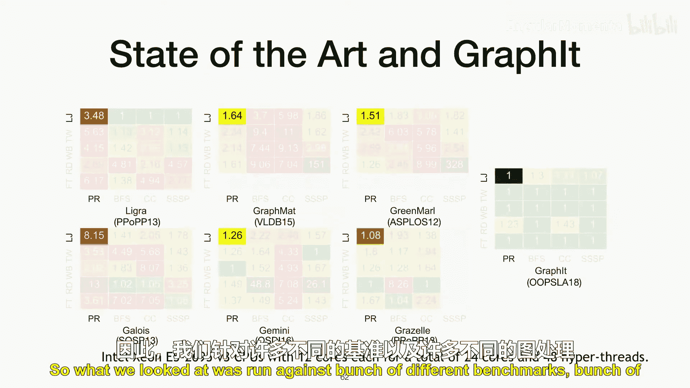
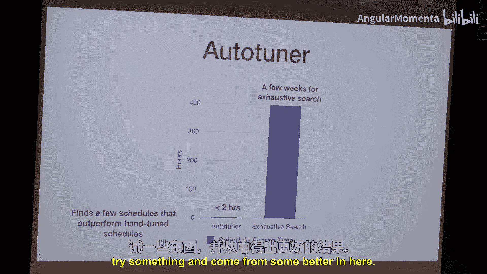

# 【麻省理工】软件系统性能工程 ｜MIT 6.172 Performance Engineering of Software Systems, Fall 2018 p18 18. 领域特定语言与自动调优 -BV1esbLzpEFq_p18-

The following content is provided under a Creative Commons license。

 Your support will help Mi T OpenCourseware continue to offer high quality educational resources for free to make a donation or to view additional materials from hundreds of Mit courses。

 Visit Mit Opencourseseware at Ocw。 Mt Eduu。

So it's my pleasure to introduce Professor Simonmana Maringhe as our guest lecturer today。

 so Simonmana Marsinghe is a professor in the EECS department at MIT and he's also the associate department head。

 he's an expert in compilers domain specific languages and auto tuning in fact he was the designer of the open tuer framework that you've been using for your homework assignments so today Simonman is going to tell us about some of his recent work on domain specific languages and also on auto tuunning so let's give Simonmana Maring。

ま。Thank you。Okay， so so I used to teach this class for many many years。

 unfortunately now I am administrator so I don't Julian and Charles get to have the fun teaching the class so hopefully you guys enjoyed now you're starting you done project  one two and three。

😊，Going into Project4， yeah， project 4 is really fun and yeah。😊。

It will look big and daunting but at then you'll enjoy it and especially all the amount of time people spend working on it so so I think I'm making you scarier more than anything okay so let's get into the talk today so I'm going to talk to you about domain specific language just a little bit about auto tuning how it leads auto tuning。

😊，Why is domain specific languageang major？😊，We are all used to general purpose languages that we use day all day。

 and those languages are set up to capture a very large sort of what people might want to do in programming。

😊，However， a lot of times there are specific area， specific domains。

 either some area in that you wantt implement or the certain patterns you want implement code that has lot of interesting properties that in a general purpose language it is very hard to describe and a lot of times it is basically very hard especially from compiler point of you take advantage because it has to work for everybody。

😊，So domainspec language basically is has this lot of engineering manifest because if you know that what you' are building has a certain shape。

 certain set of properties， if the language capture this and if youre building on that it could be much easier to build it should a lot of clarity it's very easy to maintain that kind of thingss very easy to test and also the other thing is it's very to understand because the domain is very clear it described you can build a library but somebody can go and do weird things in the library if it is if it is built into the language it set in stone you can't go and say yeah I'm going to change something here let me do some weird thing here it's built into the language so it test there it makes it much easier for program multipl but from my point of view。

😊，The domain specific language I really like are the languages where。😊。

I know I can take advantage the knowledge of the domain experts to get really good performance。😊。

So a lot of times domain expression aha in this domain I can do okay if there is a linear algebra。

 I know this kind of algebra that I can do to simplify the expression。😊。

That algebra might only work on that domain it is very hard to put some complex algebra into into C plus plus O but in that domain I can say I can code it up so you can write any expression that I can simplify。

😊，And also， there are a lot of idioms in each domain。😊。

So some domain might say okay look I am going to represent a graph that I'm going to talk about in the normal3 plus+ you bunch of classes you do this very complicated things the idiom is hidden in there first of all C++ doesn't know that I had to look for graphs but even if you had look for graphs you can try graphs in hundreds of millions of ways but if it is a first class support in the language I don't have to work heroically to extract that its there I can easily see that so most of my compiler can be doing useful things in there。

😊，And most of the time， the other thing is if you build a domain specific languagew ride。

 you can leave the complex， the lower level decision to the compiler。😊。

In if you C++ you might be tempted to say I know some optimization let me do something here or let me do some of the optimizations here so I have been working on optimization all my life and lot of times when you write a compile optimization past you spend half or for more than half of your time undoing the crazy optimization the programmer did。

😊，Like you guys are learning so this you think you know better you go do something and that might work well then but believe me that code survives 20 years later and 20 years later that looked like a really stupid thing to do and then you look at and say okay now I had to undo everything in the compiler do the right thing in the current architecture and because of that if you capture the right level I will let the compiler do do the work in here and then as architectures keep maturing as the problems keep changing I don't have to worry I don't have to undo these parts in here so。

😊，So again， I'm coming to the performance engineering class and telling you guys leave the performance to the compiler。

 but that's the nice thing that if the compiler can do most of your work，😊，Much nicer job。 So。

 so don't doubt the compiler。 So I'm going to talk about three parts in here。

 One is three different programming languages in here。

 domain specific languages graph highlightlight and then open tunena which is not just the language but a framework in here and between graph and highlightlight。

 you will see some patterns。 and then we will see whether you you found the pattern that we are working on in here。

😊，So graphra is a product that I work with Julian so if you have any questions of graph after today you can definitely as Julia he knows probably more about graphs and graph more about graph than probably anybody in this planet so hes a good resource to talk about graphs。

😊，So talking about graphs。😊，Graphs everywhere。So if you go to something like Google and do some search。

 Google has represented the entire knowledge on the internet is a big graph that a huge amount of graph processing behind you。

 that is how what guides your search in there。😊，Or if you go again， map or something like Uber。😊。

It will find your directions。 the entire road network is a graph and it' is trying to find things like shortest part in this graph to give you the map。

😊，And if you go a recommendation engine to get a recommendation for a movie。

 if you get a really cool movie you like， that's because there's a huge graph between everybody who watch movie they watch and they are likings to those movies and they are looking and comparing you to them and recommending that。

 that's all can be viewed as graphs in here。😊，And even if you go to a。

ATTM and try to do a transaction。😊，There's a very fast graph analysis back to say is this a fraudulent transaction or not so most of the transactions people have done all the connectivity in the back in there before the time that actually the money pops out of your ATM machine you test that bunch of graph processes to understand okay this seems like a good transaction so I will actually give you the money sometimes you say you get this other messages that means the graph processing decided there might be some weird thing going on there so lot of these things that some of them like maps and graphs has maps on these transactions have very file latency thing in you have to get this thing done right you have to get two directions especially if you take a wrong turn you need to get the next set of directions done very fast before you go hit some weird traffic so these things have to work for and other things like recommendations and Google search is huge graph they build the entire web or then all the recommendations that to do huge amount of processing so performance matters。

😊，A lot in these applications。So let me dive down a little bit deeper into show what graphs means。

 what graph processing means。😊，So one of the very well known graph algorithms is called page rank。

 anybody knows history of pagera， how many of you have heard of page rank？😊，Okay。

 what does page stand in page rank？😊，Larry page so the first algorithm Google did I don't think anywhere near Google at this point was this algorithm page rank so it did track these pages but it was developed by Larry page so depends on either either it web pages or Larry page we don't know but people think it's Larryrry page its page rank so if you have a graph in here so this graph algorithm what it does is it trash to some iterations either max it or onto some kernelverence in here。

😊，So what it first do is it will go around look at。😊，All its neighbors。

And calculate basically a rank new rank out of all my neighbors so that means what is how good are my neighbors what's their rank and and what's their contribution to me so it means being known to a good person and having a connection to a very well known in this case as web page means I am highly ranked so I'm more influential because I'm closer to something in there so what it does is basically it will go it's not calculate some value and propagate to all the neighbors and aggregating this so entire graph participating in that and then what happens is each node will go about calculating its new rank in there from looking at old rank it gets modified a little bit for towards a new rank and then this swap all ranks a new ranks so this is the two computations that you iterate over that and you have to for the entire graph in here。

😊，So of course you can run this this will run very very slow if you run this so if you want to get performance you write this piece of code so this piece of code basically is huge and it runs 23 times faster than what's in the previous graph in here on a2 core machine it basically had multi threadreadded so it get parallel performance it is load balance because as you know graphs are very imbal so you get load balance if you have non-uniform memory access machines。

 things like multiple socket machines it will take advantage of that it advantage of caches a lot of things happening in this piece of code。

😊，But of course you know this is hard to write this piece of code but also worse。

 you might not know what to do what the right optimize you might want to integrate。

 you might try many things and this is very hard every time you change something if you say I want to do something a little bit different that I have to write a very complicated piece of code get it all right。

 get everything working before I test in here。😊，So this is why we can use a DSL。😊，For this one。

So let me go a little bit， talk about graph algorithms and say。😊，This seems like a new set of me。

 so what do people do with graphs？So when is see graph algorithm。

 so I' am going to go a little bit deep down to show you what type of things representing graphs。😊。

There is one class of graph algorithms that are called topology driven algorithms that means the entire graph participates in the computation。

😊，For example， Google search。Before you do Google search it will do an entire basic collection of all the web links it will build this huge graph and do huge amount of processing to basically able to do the search in here recommendation engine so every probably a few weeks or whatever it takes to collect all everybody's recommendations have this huge data and you are going to process that and do this recommendation engine so this is applying for the entire graphs and sometimes billions of trillions of nodes have to go into this computation。

😊，Another set of algorithm is called data or even algorithms。

 so what that means is you start with certain nodes and then you keep going to its neighbors and its neighbors processing data right here as we do there。

😊，And。The kind of algorithms that fit in this category are things like if you have a map。

 if I had to find a shorterest path that means I have probably two parts。

 I don't have to get in from direction from here to Boston。

 I don't have to go through New York nodes in New York I just have to go through my neighbors connected India so I am basically operating on a certain area with some connections and processing that。

😊，So these are data driven algorithms， so I might have huge graph。

 but my computation might only work on a small region or a small part of the graph in these algorithms。

😊，So。When you are traversing through a graph doing that。

 there are multiple ways of doing graph reverssals and this is why optimizations hard because there are many different ways of doing things and each has different set of outcomes you can get。

😊，So I assume lot of graph algorithms， I need to get something from my neighbors。😊。

One way to get something my neighbors is I can calculate what all my neighbors might want and give it to other neighbors。

😊，And in there I can go change all the neighbors to update my value so what do you think okay you have done some programming in here what do you think about this is this a good way so if I wont update everybody I will calculate what I won't do and I'll go change everybody all my neighbors。

😊，そしなです。Not as parallel as it could be， I think you are getting to a point but why it's not that parallel。

😊，You're doing the same thing。まだそうです。interesting。Yeah， but okay that's a very good part。

 So if you are doing a data driven， if I'm doing that's not good。

 but if everybody is doing that to their neighbor so then they have a parallelism。

 So everybody might say you updating your neighbor youre updating everybody is updating their neighbors。

 So now there's another problem showing up What's the problem if everybody tried to update their neighbors back there。

😊，There's a race in there because everybody's gonna write in there so if you want to get this actually right。

 you have a bunch of issues here， you want to basically do atomic updates because you need to lock that thing so it has to get atomically updated in here and this is nice but I don't have to traverse anything because everybody I need to update I actually go and go and update that's nice way to do that especially if it is not a global thing so if I'm propagating I will update my neighbors and I can propagate that down。

😊，Another way to do that is pool schedule。😊，That means if I everybody look at ask their neighbors okay。

 do you have what do you have to give it to me and I collect everything from my neighbors and I update myself。

😊，So is there a race condition now？😊，How many people say there's a race？

How many people can there's no race？So what happens is I'm reading from all the neighbors。

 Everybody's reading from the neighbors， but I am only updating myself。

 So because of that I'm the only one who's writing me so I don't have a race So it's very nice。

 you don't have race， but。😊，I might if I' am doing a data even transformation。

 I might not know that I need to get updated because update come from that person and that means I might be task or do you have anything to send and you might say no。

 so in that sense I might basically doing lot of extra computation there necessary because I might not know that I have a data I need to get but I had to ask you whether I should do this but I don't have any basically need to do synchronization。

😊，Another interesting thing is I can take this graph。😊，And I can basically partition in the graph。😊。

And once I partition the graphs， I can basically say okay this code get this graph。

 this core get this graph， this or this processor not this this graph。

 what is advantage of partitioning a graph？😊，Why do I want to partition a graph。

 large graph into small pieces？Of course， you had to do a good partition。

 You can't do arbitrary partition。 So what happens if I do a good partitioning。😊。

I don't tell the word because then the answer comes out in there。😊，Okay。

 let me see anybody else you have anybody else want to answer。😊，Come on， Bob you had taken。

What happened if I take part and find two different groups and separate them and give this one to one and this one to another。

 what do I get？😊，I get parallelism also， but other thing if I have a lot of connected things going into you these connected things go to that person。

 what else I can I get。😊，Localality， have you heard did you do locality in the class？😊。

So that means the partition means my， the thing I am working。

 I am only working on a small amount and that might if I am lucky if it in my cash and that would be very nice that everybody has to go to every node every node in here。

😊，So if I partition is properly， I would get good lookout in here， it's actually written there， oops。

 okay。😊，So my answer was in there， so include locality。

 but of course now I might have a little bit extra overhead because now I might have to replicate some some nodes。

 stuff like that because it's in both sides。😊，And India。So。

Another interesting properties of graphs is when you look at data structures until now things like arrays。

 the size matters is different on what array fit with cache and stuff like that， graphs。

 there are some other properties of the graphs in here。😊，So if you go to social networks。😊。

Social network is a graph。What's the interesting property and social networks you have observed？

Connectedness there are people like me that probably have 20 friends in there and has very little number of connections and then there are celebrities who have millions of connections in here so the interesting thing is if you look at a social network graph you have this relationship called power law relationship that means there's exponential code there are some people here like very known well-know celebrities that might have millions and millions of users in here connector connections in a neighbors so like so whatever it is in that node and there are people like me sitting here that has very little people connected to the rest of the world so this is normally people have observed this big social network type graphs。

 you have this kind of exponential relationship in here。😊，So the web has exponential relationship。

 a social network has this kind of relationship in there。

 so those things you had to do very interesting thing when you process these graphs because there are certain connections that matter certain nodes that matter a lot has a big impact than other nodes。

😊，Then there are other graphs that have a bounded degree distribution of road networks。😊。

The maximum connection probably might have a intersection that has six roads coming to together in there。

 you don't have a million roads connecting to one place anyway in there so that doesn't happen so this is lot more flatter。

 a lot more bounded degree distribution graphs in here they have lot of excellent locality in here because of course all the roads in Cambridge might be connected but roads in Cambridge can be separated from roads in New York City so there there are separate there locality nice locality in these kind of graphs so。

😊，Even if you say the graph is the same size， the shape of the graph matters in computation a lot of times。

😊，So， what happens is now when you want to operate on these graph。

 you have to look at three interesting properties。😊。

One property is okay how much parallelism in my algorithm what I try to do to this graph is going to get。

😊，It is like a goldilock type thing you don't want too much parallelism if you say I have algorithm that a huge amount of parallelism if I cant take advantage it is not useful so you need to get a parallelism good enough that I can actually use it。

😊，Then I really like to have locality。😊，Because if I have locality， my cash has will work。

 everything will be nearby， I can get runs things fast if I every time I had to get something from main memory it can be very very slow so I want to get locality。

😊，But interesting thing about graphs is to get localities and get some of these。

 you might do some extra work。😊，So if you saw that graph got divided into two different graphs I had to add extra nodes in here。

 I might had some extra data structures so do some extra computation so I might have to do some extra work in here so in certain things I might not be that work efficient。

😊，So I might get really good per and locality， but I am doing too much work so for example。

 if I want to assume I want to find one node a neighbor。😊。

Very way to get good parents when everybody finds their neighbor。

but that's not efficient I mean most of the computation not useful so so there you can do things that you are doing extra work than necessary then that can get much faster other things but you had be careful on doing that so you have this balance in there so certain algorithms will fit in different place in here in the straightoff space so push algorithm will fit in here so for example if you go to something like a pool algorithm what you might find is you are doing less work efficient because you might do a little bit more work but it might be better in locality and parallelism because you don't have do locks in here。

😊，And then you do something like partitioning it get really good locality in partitioning but you are doing extra work and also because when youre partition you might limit your parallelism in here so you might less parallelism but you get really good locality so all days is basically a large trade off space in here and then when you keep adding one more things you can do it fits into this big trade of space。

😊，So， how do you decide what to go on the trade or space is a very important thing decision so it depends on the graphs if you have power or graphs you might want to do something if you have a more limited distributed graph you want to do something else。

😊，And power of graph sometimes you might do something different for the high connected edges versus others。

 you might not even differentiate between that。😊，It depends on the algorithm。

 so if you are doing visiting all the nodeds versus as a data driven algorithm。

 you might do something different。😊，It also depends on the hardware you're running。😊，So for example。

 if you are doing a Google search。😊，Basical indexing。

 you're running an algorithm that has operate to the entire graph in here。

And the graph is a power low graphs in that， and you are running on a cluster。

 so the right thing might be something like a pool schedule with some partitioning and something like a vertex parallel or some kind of a parallelism schemeche in here might give you the best perform。

😊，But in the other side of the Google， if you are trying to do a map and if you are trying to give you directions。

 you have a very different type of a graph。😊，You are doing a data driven algorithm in that graph and you might be running on a single machine because you order to give directions fast for each individual time。

 you might have a very different type of algorithm under run this graph。

 the push algorithm in vertex parallel in perhaps some combination in there。😊，And of course。

 if you get a bad algorithm， a bad set of way of doing it， you can be very bad。

 you can get hundreds of thousand times slower than the best you can achieve。

 so it matters to find the right thing， right way of doing things。😊。

So this is where a graphic came in。😊，Graphite is a domain specific clangage basically we developed and one thing graphic did was he said。

 okay hello。😊，The algorithm is mostly constant， but how you process the how you go about it is very different。

 so we want to separate these things。😊，So first thing we did was。😊，Come up with the algorithm。

 It is what you want to compute。Its very high level dont tell you how we are computing that so this is my algorithm I am going to process these nodes and this is the computation I want to do in there。

😊，And you separate it with optimization of schedule of how to compute so you say okay to do this algorithm you had to do a push schedule。

 do this type of parallel separately and the nice thing is that is now if the graph change or is the machine change I can give you a different sched in here。

😊，So let me show you some examples， first look at the algorithm in here。😊，So。

We show three different types of things you want do you want to do the entire graph in here have the data re。

 or I might want to just operate on the vertices in here。😊。

So this one we have the language provide a very simple way of doing that languages is function saying if there are edges all the edges of the graph apply you can give a function that function takes the basically nodes and the edges basically it will basically carry out this computation very simple way of doing that so this is the representation so the nice thing the simplicity of programming now if I write it in C it will look like a big blob of ugly code。

😊，In the domain specific language， all you right is this， make life very simple。😊。

Or if youre a derivative language I have to say okay I start with this set of vertices to compute in here and here are the vertices I' am going to in here this vertexent here and then I do some filtering because I might not go visit everybody there are some filtering of what you can do and then once you figure out exactly the things you are computing here a function to go and apply to that。

😊，So I can give you some very nice way of basically subsetting my graph with certain properties。

 select those things and now go compute there。😊，And if you are only doing vertices say okay for each vertices again I can filter saying this subset or something go to that computation So language voice is very simple。

 This is what all you have to do now。😊，If you look at pageran。

Page rank has two interesting update functions what is one is updating going looking at edges what it says is new rank I get the destination edge and it get updated using all the source edges in here this is the update function very simple update function and then once you do that for each basic vertex I go do a internal update I give these two functions and put them together into into driver and the driver says from this function on this function and I' am done。

😊，Okay so I can write this code at higher level， much simpler， much nice。

 much more elegant way it' is much easier to understand it is easier than even the simple C plus plus code to understand what is going on if you write it in this way。

😊，So， this is the first advantage of for domain specific language I can do this then the next thing you can do is now I can come up with this schedule。

😊，So schedule should be easy to use and it should be powerful enough I should be able to get the best speed up possible because I can tell you all the crazy things I can do to the code。

😊，So here's my program here for Page drag and so what I can do is for this algorithm。

 I can provide this schedule in here。😊，And this schedule basically says， okay look at this guy S1。

 I marked it there India for S1 I want to do spa push type computation。

 this is how I want to process this one。😊，And then by looking at that I can generate a pseudocode that looks like this that basically first go through the source node because I am doing push from source to destination and then I am going through all the destination nodes of that source and I am going to actually go update them so I can do this very simple updating here。

😊，But this might not you get that performance， I say aha， I want to do this in parallel parallelism。

 I want to run this parallel。😊，And then when I do that it will automatically generate say now I will make this two parallel and now I can't do simple update I have do atomic a so here is my atomic ad operation so the graph in here。

😊，Then you might think and say do I want to do the push can I do a pool so if I do do a pool chain it will basically switch the in here now I am going from destination to source I change the order in there and now I don't have to do that to make update because I am pulling everything to my order updating。

😊，And then of course if you want to do some kind of partitioning I can also say partitioning now it heres a subgraph in here and for the subgraph I am doing this partition so I can keep changing all these things。

 look I didn't touch this， my algorithm still says same I am changing my scheduling I can play with this schedule。

😊，Nice thing about that is now if you keep playing with the schedule here's the kind of performance I got the first guy was sequential pretty bad performance。

 the next guy I just paralyzed in here I got some performance in here but it had all the synchronization so I changed the order of execution and I got even better performance and now a partition got motor performance so this is the order of doing doing that but of course you can play with many。

 many different combinations and what graph it has is huge number of different combinations you can play with。

😊，So there are a lot of different optimizations you can do direction optimizations， push pull。

 doing this past then， different parallelization， cache， new optimization， and also data layout。

 things like structures of arrays， array of structure layout。😊。

Additional data structures that simplify computers， all these things I can specify in here。😊。

And then you can play with it's not clear which one wins。😊，It depends on the algorithm。

 depends on the graph shape， graph size， different on the machine you run。

 so most of the time if you are a performance engineer you' will be trying different things and look at the performance and say this doesn't get good cache behavior okay let me try different things so you won't iterate and these situationss you won't do fast and they will do that。

😊，So let me tell you little bit of results so this is I had to explain this is a little bit of a complicated graph here so what we looked at was run against bunch of different benchmarks a bunch of different frameworks that do graphs so what they says is。

😊。

Here's a program page rank ran over on a graph live general graph in here。

 One means it ran the fastest。 This ran about 8% slower。 This ran 50% slower。

 This ran 3 x lower and8 x lower for that graph。😊，The interesting thing is as you add more different graphs the performance changes so in fact。

 even though we ran fastest for this ro graph， it is a very different type of graph。😊。

This framework provide got the fastest result because the graph is different。

 so it might be doing something that's better。😊，The interesting thing is since we have because most of other frameworks will have a couple of built in things they try。

😊，They don't do give you all this ability to try all this optimization they say。

 I know this this is really good。 I will do that。 It works for certain things not for everybody。

 And so if you look at the entire different be breakfast search connected components， shortest path。

😊，Algorithms， what you find is， is。Some frameworks are good sometimes。😊。

They might be really bad in other times too either some algorithms some some type of data they can be really bad so this algorithm was really kind of good at this data set but really bad in this data and really kind of not good in this algorithm we are most of the time good all the time the reason is we don't make few decisions in graph what it will do is it to give this ability to kind try different things。

😊，And depending on the graph depending on the algorithm some optimizations might work better than the other。

 this is exactly what you guys have been doing in the class you are trying different optimizations by hand and the difference is every time you thought about optimizing you had to go change the entire program to make that work here you just change the scheduling language one right precompile run measure and you can do this fast。

😊，Any questions so far before I switch gears？Okay。So， I'm going to switch to。

Another domain specific language。😊，You will find lot of similarity。

 lot of parallels I this was intentional， I could have talked on many different domain specific languages but I took another one that you almost has kind of a mirror similarities of what is going on and you will see a pattern in here。

😊，Hopefully， and after this， I will ask you what the patterns are。😊，This language is he。😊。

It was originally developed for image processing and it focuses graph focus on this past graph data structures highlightslights focused on because images are dense regular structures。

 you do regular computation on the images and you process this thing and you have very complex pipeline like for example camera pipeline。

 do many very complex algorithms to the image before you get from the bits coming out of your CCD to the beautiful picture you see in Facebook。

😊，And the primary goal of hairite was we want to match and exceed the hand optimize performance basically this was the pa we wantt do and we want to reduce the right amount of programming that normally a performance engineer has to do to achieve this thing and we want to also increase the portability ability to take that program from different machine to different so let me give you example。

😊，Here's a three by three blur example。So what this does is this t two loops go in the x direction and do a blur in direction。

 get the three values next to each other。😊，And then it will go the result of that。

 do it in my direction and never read that。😊， very simple filter that you might want to do for image。

😊，You can run this， this is a valid C code， but if you want to get performance。

 you want to generate this guy。😊，This thing on the other hand。

 and about 11 times faster than this one。😊，This has done tile， it has fu multiple loops。

 it has vectorized， it has multisideed， it tie do some redundant computation I' will get a little bit later and it basically gives a new roof line optimum performance that means it's using the machine resources to this max because this has a bunch of floating point operations so it's basically floating point unit running at the max performance so so there's nothing much else you could do to this one。

😊，But you are right this thing。And this is not that easy。So this project started some time ago。😊。

With。One of the person who did it going to Adobi。He went to Adobe and they had this thing called a local laplaian filter in camera and Lightroom and Photoshop projects in here。

😊，The reference implementation was about 300 lines of code。😊。

But the implementation that they used was about 1500 lines of code it took three months of one of their best engineers to get to that performance。

 but it made sense because that engineer was able to get 10 x faster by trial and error for this piece of code。

😊，It's a non trivial piece of code here to do that。So the student。

 Jonathan who's now professorhes at Berkeley。😊，He basically in one day in 60 line of hairlight。

 he was able to beat two of adoomic code in some sense。😊。

And then Adoia those days didn't generate any。😊，Corode for GPUus because they decided GPUus are change too fast and they can't keep up updating for GPUs in every generation then because because of that they were not the Adoia applications for not using GPU so period Photoshop is' not going to use GP when you imagine has a GPU so Jonathan still had some time left in the day so he said okay let me try to write on GPUs so he just basically the same code he changed GPUus and got9x faster faster than the faster Adobe had ever had for this piece of code。

😊，So how do you do it？😊，Again， the key principle here is decoupling algorithm from schedule。😊，So。

 algorithm again is what is computed and the algorithm defines the pipeline of very simple P functions operating in there and execution order parallel and all those things is left for the schedule。

😊，The pipeline of helllight just looks like this for the blur filter。

It says okay get the image in X dimension and do it blur in the white dimension that all and the image sizes because it is operating on the entire image you don't have loops in here。

 that's all you have to say there。😊，Then you have to come up with a schedule again the same way when and where it' is computed。

 it has to be simple that you need to able to say that and it has to be powerful。

 you need to be able to get the hand optimize performance or better by doing this。😊。

Something looks a little bit familiar because it's all these things， lot of work you do performance。

 kind of fit into this genre。😊，You need to trade off between locality。😊，Peraraism and redundant work。

 that's what you have to look for in here。So。So， let' us look at the three things you need to do first you need to get parallelism parallelism is you need to keep the multico and vector units heavy and probe the GP BCc。

😊，But if you have too much parallelism， it's not going to help you。I mean。

 nobody is going to take advantage of penerism， so let's look at a piece of code in here。😊。

So as assume Im go to and say， I'm going to run all these things pedal and all these things paralleled afterward if you have three cores。

😊，Great， I got a lot more parallelism， I got six times parallelism， who are。

 nobody's going to use that。😊，It's not that useful to get six times parallelism in here。

On the other hand。If you run like this one at a time。You have parallelism of fun。

 That's not that good because you are going to not use the machine。

 So what you really want is something， basically。😊。

it is done that actually do parallel sums of three might be the best way of running that machine to get best performance。

 you don't want too much， you don't want too little， you want to get the exact right thing。😊。

The next interesting thing you need to guess is locality。😊，Normally when you do image processing。

 what you do is you change everything in the image。😊，In one filter。

 then the next filter is going to change everything in the image。

 So what happens if I if one filter ran to the entire image。😊。

And the next way to come and start writing at the end time is what happens basically。😊，Is that good？

I give the entire image say you do my first color correction and I will do some kind of chromat abersration correction afterwards so what happens if you do something like that？

😊，Entire image processs one filter， then the next filter takes the image and processs the entire whatever multi mega pixel image。

😊，Oh you you're train， okay， back to that。You end up on kicking。結は。Except the cache。

 because if the images are large it doesn't fit in the cache。

 it's not that great to do this this so you won't get things in the cache in here。😊。

So I assume you might go like this processing the entire first row before you go to the second row。

 so what happens now here is we need to start touch this one。😊，I need to read these two values。

And those two the last time I read them was way before I started。😊，So I thread them。

 I went through all the image， and I come back to that this distance。😊，By the time I reach here。

 these two might be out of the cash and wait I go back there， oops， it's not in the cache。

 I have a problem in there。😊，So the other right way to do that might be run it this way。😊。

If I run it like this， basically what happens is as you run。😊。

When I touch this I I want to get these three to run this thing last time I read this one was just before in the previous iteration。

😊，So to get to that I just touched it so the next guy uses it next guy and after after I go through that my window Ive never touched that again I have a really good lookout in here so I won't operate it that way so I wont get good lookout in here。

😊，So redundant work is a very interesting thing， sometimes if you want to get both locality and parallelism。

 you might have to do some extra work， a little bit of extra work。😊，So assuming this one。😊。

I have to process these elements parallel if I want to run run these three because these three。😊。

Needs all these four elements in these three need these four if I want to run these two parallel in two different cores it might be better if both calculates these two values because I don't have to synchronize and stuff like I can say the left guy calculate four values and then I can do the three the right guy calculate the four values and then I can do the three I can do that parallelly but now the middle two guys these two get calculated twice。

😊，Because both needs it， and so what did that mean is soups？😊。

You can't keep that So you sometimes to do everything I might add do some redundant work。

 So the way to look at that is I can put this into this scheduling framework。😊。

I can map by computation hardware that means co interaving with low locality that means I finish everything before I go back again here。

😊，Between two things， if I write two things， I finish this one before I go to the next one。😊。

Fine interlaving means I process one element，1， de， go back and back and forth in here。

That's my two options here。Other side is storage granularity， what that means is。😊。

Sttoric generated is very lower means， I calculate something I don't remember next time I want it I recalculate it again。

😊，Very high stage gen means once I calculate I will remember it forever anytime you need that value I have it back for you。

 so that means I had to get it to you from anywhere I calculate straight generally law means my process I calculate I use I throw it out if anybody else want it。

 they recalculate again。😊，So now you can have many different computations in different places of the space in here。

😊，So if you want to compute somewhere here， this is the scheduling language that means I run this one and I run this one。

 I have no redundant computation very cost again interaving。😊，Okay。

 that means I run the entire thing and run the next entire thing。😊。

You can go very fine case in here I'll calculate this one and Ill calculate these three again these three again so everything is calculated multiple times when you need it I recalculate every time I need something I don't storeow anything in here so it's good I have a lot of locality but I am doing a lot of recomputation。

😊，And then here you have something like a sliding window。

 basically you are not recalculating anything but you are sliding in there。

 you have a little bit less parallelism and then you can capture this entire spectrum in between in here。

😊，And you can get different levels of fusion of these styles and you can calculate。😊。

So I don't recalculate everything。 I recalculate a few things in here。 these two get recalculated。😊。

And then you can I'll go through this fast in some you can this all this operation So here's an interesting thing。

 so heres I'm showing you different schedules at different points in here so I'm going to run this game this is on time So what it says is this is two you are going to the first input in the middle one the output in here so this says all locality lot of redundant work good parallel of locality all parallel of not good locality here's some kind of intermediate things so what it shows is these are no good a good balance between locality parts of redundant work seem to do really well this guy finished fastest。

😊，So what you do is to write different schedule for these things and you keep running and we figured out what schedule works so this is kind of trial and error part you have to do in here。

😊，So。If you look at what' is going on in here what you see here is theres some example this bilateral filter help computation here。

 what it says is the original is about 102 lines of c plus plus code and you found something with good parallelism in here but we could write it in third two lines of headlight in here and we were able to get about success faster than CPU but the best algorithm was somebody handro for the paper on GPUs and what it did did was it gave up some parallel of a much better locality。

😊，And if you give us some panels a much better locality because we can optimize in that。

 we got faster than their handwritten out with them so we can change something。😊，Here's again。

 another algorithm that is doing segmenting in here。😊。

And it was written in MATLAb and MATLAab is not less lines of code of course。

 but in haide it's a little bit more line because you are not just calling library functions and haalide was 70 times faster。

😊，And if you rank in GPU versus Math Lab， it's about 100000 times faster。😊。

It's not because you are running bad maththLb loops， in fact what MatLb did does it called very。

 well hand optimized libraries。But the problem with calling libraries there's no locality I call it really fast library for first routine it runs it really fast and then you call the next routine that has to tap the entire image again and now my image is completely off the cache so what happens is between this very fast library you're bringing the image from cache and when you have something like a library you can fuse library functions together in herelight we can fuse them together and say oh I take this line of the image and I will do everything on that before I move to the next thing so I can do much faster my feeling is each function probably the math lab was faster。

😊，Because they have a hand written really fast thing， but the copying of data moving from cash。

 the cash effects was really slowing in down。😊，So here's the thing that we showed before。😊。

This is a very complicated algorithm it' is what you call a pyrameteridal algorithm so what it does is you take a image in here and you divide it into bunch of blocks in here in each level of pyramid and you do some computation you do some lookup and do some up sampling in here you do some addition computation and compute that and then you create more and more small and small images in here you basically hit image pyramid in here and so to do this right its not that simple。

😊，Well that means in each of these level， there are different balances you want to be。😊。

If you have a lot of data parallelism is not that important at that point because you have parallelism anyways you probably focus a lot more on locality but when you get to this smaller amount I think parallelism matters so you have to come up with very interesting balances between those so many many teams things to stay tune at every level there's no three things there's hundreds of different levels so nice thing about hair ideas you can play with all these things。

😊，You can play with all these different concepts and figure out which actually gives the fastest performance in there。

😊，So。Little bit of I would say bragging rights in here for haide haide left MIT about I think six years ago and right now it is everywhere in Google so its an Android phones it started to Google Glass doesn't exist anymore。

 but that。😊，And in fact， all images， all the videos uploaded to YouTube right now。

 they do front end processing and that processing pipeline is written in Hallight and they switch to Hlight because Halight code was about I think 4。

5% faster than previous version and 4，5% faster for Google。😊。

Was multimillion dollars saved for them because there's so many videos getting downloaded from that。

So recently there is a Photoshop announcement that saying they have a Ios version of Photoshop from Adoobe they just announced it I don't think it is even out it and the entire Photoshop filters are written in this new version using helight。

😊，呃。Carcomm relates this processor called Snapragon image processor so that they build that processor to do image processor in there and the program language to program that processor is basically hlight so you write the code in helight so that is the kind of assembly level that makes it available for in here and also Intel is using that so there's lot of use of this system at this point which is really fun to see academic project getting to a point it's very heavily used and part of that is because it's very useful because people realize they need to optimize this code because cameras and stuff performance matter and instead of having some poor engineer spending months in the corner just trying out eight those things you can try the same things and lot more by doing it faster。

😊，Okay， so let me ask a few questions， so now between highlightlight and graph。😊，What did you find？

The bunch of similarimities I want to figure out are there any interesting similarimities you guys found between these two projects。

😊，So part of that is also。😊，Lot of times compilers are kind of black box。

 we know everything just feed us well give you really fast code and the problem is they are never the fastest so if you really care about performance you get 90% and you get really frustrated now what do I do but this was okay I am not going to you are better judge what to do but I will make you the life simpler so we still want the performance engineer it's not the person who just don't understand performance feed you get fast code we need a performance but we won't make performance engineer life easier so both of them said okay we need performance engineer we can't automate it we don't know how to automate all these things too much complexity。

😊，But we will let your performance engineer explain what to do， but you make your life very simple。😊。

What else。Do。Which is like pretty different。1。其。Yeah。

 because I won't say you can do a lot of domain specific optimization。

 so algorithmic optimization is one level high you can say aha I have a better algorithm。😊，So okay。

 I don't want to do a quick search。 I can do insertion search because quick sort here insertion sort might be faster for certain class in there。

 So that is level change we don't do Oh verse it， I can say this happens in lot of similar machine learning。

 Yeah， if I just drop a number here， I'm okay， I don't have to get the computer exactly right away if I don't have to calculate everything。

 If I calculate for 10 people， it's good enough。😊，So that kind of changes you can't do because that's very contextual。

 like for example， a lot of time， if you are doing things like machine learning。

 there is no right answer。😊，You need to have a good answer so sometimes good means you cannot not do certain things and you need to find what things you you cannot do that you get a huge benefit but you don't lose that much that level you can't do that that the next level of part is saying okay how do you do that how do you somebody say okay look I can train it for 10 iteration was a0010 is good enough。

😊，I can't if your code is written to train for00 deeration I can't tell you1 is good enough that is decision that has to be a lot higher level than what I can make so that there's an interesting level that can still exist in top of that which which we can't automate that easily but we might be able to make still a language like a schedule language give you that option that's a cool option to give say like try some of these things that actually change algorithm but but within the algorithm that means I will still give you the same answer I will try different things。

😊，Any other things， any other？Things you guys thought that was interesting。

How about from timeya here？What are the interesting things you found？Back then。本当は。Yes。

 both ignore lot of trial and error。😊，The modern computer systems。

 everything is extremely complicated。 there's no right way of doing things when you look at this pretty large piece of code and there might be a lot of there are cache as pers locality lot of things that can go right and so you might try out many things so if you know the answer if you come up with I know exactly every time of the right answer so that's amazing but even the best performance person might not be able to look at a piece of code as a I know your solution you do a lot of trial and this kind of supports and you probably have figured that one out for most of your projects it's not like you went as yeah I know what to do。

😊，You probably did many different trials and I know from this lot of things you actually either have no impact or slow down the code and you say。

 oh that didn't work and all if depths you leave in your code shows like all the crazy things youve tried and nothing happened。

😊，So that's interestingly， what else？Anything else。

 a little bit differently that you sew on this one？😊，Are there are there。So interesting question。

 well are there any other domains that don't have something like this？😊。

People are working on similar things to machine learning these days that seem to be the domain and TensorFlow and all those people are trying to build systems like similar frameworks that you can get that。

😊，I mean， that's a very I think。The way I have operated is I go talk to people and sometimes you find this poor graduate student or postdoc who want to do some research but spending all their time basically optimizing their piece of code because they can't get their performance and that might be a good domain you find these people in physics you find these people in biology and I am actually talking to because for example in biology。

😊，Lot of this gene sequencing stuff is there are very similar things you have to do。

 but they seem to be spending all this time writing the code and mereed in like code complexity okay can you do something in that I mean the key thing is is this is a good way to Nice what MI might is there are good lot of very smart people in many different domains try to push the state of the art and who's spending all this time cursing in front of a computer program to get to a point they want to do because not because they know that they don't know the algorithm because the amount of data they had to deal with astronomy。

😊，I mean， they get this multiple telescopes that deluge of data and most of them they know what they have to do。

 they just have to can't write the program to do it fast enough so there might be domains like that if you look at that and there might be domains from application and domains from patterns like sparse matrices or graphs or patterns it's not only on a single application mean it works in multiple places there might be other patterns this is if you want to do research this might be interesting ways of doing research and I have spent my life finding different domains and then a bunch of people that spend their lifetime just hand hacking things and telling them okay let me see that we can do some nice abstraction。

😊，Anything else that you guys found， that's interesting。So to both of them。

 what's the space that they operated on？To optimize programs。D for minute。

 what I'm saying is is what are the things that you trying to optimize that theres a nice space of three different things。

 parallelism， locality and redundant work。😊，My feeling is， as you go as a performance engineer。

 that's going to be your life。If I had additional thing there might be algorithmic things that you complete to get rid of work。

 but most of the time all of you will befi performance will be working on some kind of multico vector GPU type unit you had to get parallelism so getting parallelism is important。

😊，But then if you don't have locality， it doesn't matter because most time you're waiting to get data from all the way from memory so you have to get good locality and then a lot of times you can do that really well if you do some extra computation but if you do too much extra things that's going to over that's not going to help so it's all about playing in this you go a final project that's exactly what you're going to do you might say if I can do some extra work okay I can do this fast but oops now this extra precompute pass or whatever is is not I can't amortize the cost so these three things that you're trading over that。

😊，So that's one interesting thing。Other thing is。We made it available for the programmers to do the scheduling language。

But。Can you think of a way to make it a little bit easier for programmers？

They are doing a scheduled language， what can I do？What's a nice thingigma scheduling languages？

It's very simple。It has a very simple pattern。Yeah， I mean， there's the number of options。

 it's not like you can write any program。 there' are certain things you can do in schedule So if you know that space。

😊，You sort of use doing that smart， what elses can we do with it？T them all。 That's one effort there。

我这些。We can do o evening so that switchs into the out union part of this talk。😊。

So performance engineering basically most of the time is finding right these crazy things like you start looking at。

 I think probably a child talk what these voodoo parameters like okay what's the right block size and it has a big impact at finding that。

😊，A new Memorial allocation predict， you had to find the right strategy。

 but right memorymorial allocation you search through a bunch of these things， even JCC compiler。😊。

There are， I think， about 400 different flags for GCC。😊。

And you can actually get factor of four performance by having esoteically 200 flags into GCC。😊。

It's crazy。And that 200 flags is not the same for every program and of course some programs will crash in some flags but most of the time it it will slow down or speed up so you can just give all the flags of GCC and notte on that and you can get factor of2 to four performanceers in there its just crazy and because you do weird things in there and 010203 will only do certain amount。

😊，So all3 is not always right you can try all these things so so we can tune that and schedule in headlight。

 sing graph it all these things can be auto tuneed。😊，So。Before tuning。

 when you have a large search base， what do we normally do？😊。

The thing that when we think we are smart， what we do is we build models。

 we have model for a cache and say can we understand the cache。

 we have all these nice models in here and using the model I can predict aha this is the right block size。

😊，So what's the problem when you try to a model？Exactly because most of the time when you try to a model。

 you get abstract。😊，And most of them you want to abstract out might be the most important part of the Dan thing that we didn't consider so we build a model for cache。

 but oops I could didn't figure out pages with pages made a big difference so there might be things in real life that matters that didn't fit into your model or you didn't know it need to be fit into model if you try to put everything that's too complicated of a model so you abstract something out you can say I have optimal result for this model。

😊，But that optimal results might be like way off than the simple result you can get because the thing that you didnt。

😊，Put into the model are the important ones。 So model doesn't work。

 The next thing is what you do heuristic based thing。

 This is where like this old people like come and say， I know how to do this。 You know to do this。

 You need to do this thing， this thing， this thing。

 you can come up with some kind of the the the the。😊，All grandmother solution types。

 And there are certain things that will always work。 Can you hard code them。 So you can say if the。😊。

Matrix dimension is more than thousand always good to block or some kind of。

Rules like that these rules work most of the time， but obviously there are says in certain cases that rules doesn't work worse。

 that rules might be set for a certain machine certain architecture。

 all those things I will give you the story so。😊，呃。GCC has this。Fast stable so routine。

So fast stabled road sword routine says。😊，St using a parallel quick sort and when the number hits 16。

 switch to insertion sort， it' is hard coded in GCC like wow some amazing person figure out 16 this amazing number has to switch from parallel quickword to insertion sort so we try to figure out what's the profoundness of this number。

 the profoundness of this number is somewhere around 1995。😊。

When this code was released in those machines， that was the right number。😊。

That 16 was a really good number to switch from parallelism to doing that because the cash size stuff like that。

 but that 16 survived from 1995， I think even today it's there the today that number should be like 500。

😊，But it's in that because somebody thought 16 is a right， it's hard coded in， they didn't change。😊。

So there are a lot of things in compilers code like that the day road some programmer said I know what works here which fits in there。

 you put it in there but there is no rhyme or reason because at that time they had a reason but it doesn not scare so lot of these heuristics get out of。

😊，Focus very fast， and there's no theory behind it to say now how do you update？😊。

You had to go ask why did you put that at me so yeah。

 because my machine has a 32 kilobytes of cash like， oh okay。

 that's a different machine that we have today。😊，So that's the problem in here。

 and then other thing is you can do exhaustive search。😊，You can say， okay。

 I will try every possible thing。 The problem here is sometimes my search base is 10 to the power 10。

😊，You don't have enough。Second in your lifetime to do that。 So So it to be too complicated。

 And that's where the alternative I comes in。So okay actually I have a little bit more slides here so model model bit solution is you come up with this comprehensive model like a cache model or something like that and you do that and you can exactly show what's right for the optimal solution in here but the problem is hard to build model cannot model everything and most of the time modelism is the most important thing。

😊，Heres me based things in the rule of the thumb kind of a solution that you come up and say it's hardco it in there。

And it is very simple and easy， works most of the time if you get it right。

 but the problem is too simplistic， it doesn't scare。

 it it doesnt stand the test of time most of the time in here。😊，An exhaustive search is great。

 but the problem is there way too much possibility of searching in here， too big of search space。😊。

Can do that。 So this is where。We want to prune the search space and the pruning the best way to do that is basically use autoterine so what autoterity you can do is you can define the space of acceptable values nicely。

😊，Choose a evaluate at random。 That's what system will do try it out there。

And evaluate the performance of that value n to n because n to end matters。

 because if you try to predict most of the time it might not work。😊，And if satisfies。😊。

The performance that you need you done。Otherwise choose a new value when you trade over this。

 go to three in that so this is the kind of thing and what you have to do is you need to have a system to figure out how to do is fast。

😊，Basically， what space to basically do that when to basically think you are done and how to go through the training through that。

😊，So this is the kind of cartoonish way what happens is you give a value。

 candidate you compile the program， you run it with bunch of data， you got run it with bunch。

 otherwise you are all fitting， you can't run it with one and you get the resource and you get something like average and you go through this loop in here。

😊，And what Open Tuna has done is。😊，Come up with the ensemble of techniques。

 So the idea there is when you're searching through a space。

You might be at the bottom of a hill of the space。 So what that means is theres certain value。

 if you keep improving value that you are getting good better and better and better And at that time。

 something like a hill climber。😊，Hill climbers， some like N me hill climber can actually give you the best performance you' gain very fast in。

 but made you arrive at the top of the hill for that pyraid hoops。😊，There's no place to go。

 so that if you try to give try to hear come it iss not going to be helpful。

 So at that time what you want to do is do something like a random search in here。😊。

So what this system do open to when you do it will basically test this request in there and if something is doing very well it will give it more time if not。

 what it will do is it will say okay look this technique is not working let's try something else。

 it will basically allocate at the time menu so do that this search much faster than otherwise you can do。

😊，So I want to finish this by showing what you did for total forographic。😊。

So you have algorithm and you have a schedule it's spent to write this schedule in fact there's a good interesting things psych in when you do Hide we decided okay it should be similar to write the algorithm for Hlightide and the schedule Google very fast realize many people wantt to use Hlightide and they at about two years they had about hundreds of programmers who can write the algorithm but they only had five people who could write the really good schedule who could write a really good schedule you need to understand a little bit of the algorithm you understand a little bit of the architecture。

 a little bit of everything and it does much harder for people to learn so getting the schedule right is not that easy。

😊，And same thing in here because you need to understand a lot unless you do kind of random。

 you can search a like arbitrary， but to do dry， you need to notice it a little bit more。😊。

So what we can do is we can basically give some idea about the graphs and some idea about the algorithm in there。

 we can autoune these things in there and then generate the schedule。😊。

And so what we found was to generate this schedule if you do exhaust2 search it runs for days。

 but if youre using a tunena open tunena you can find a really good schedule for in less than two hours and in fact a few cases we found schedules that was better than what we thought was the best possible schedule because it was able to because。

😊，It was able to search much better than our intuition we'd say in here and even if our intuition no it has more time to try many different combinations and try something in comes from him better in here。

😊。

That's all I have today。😊。

