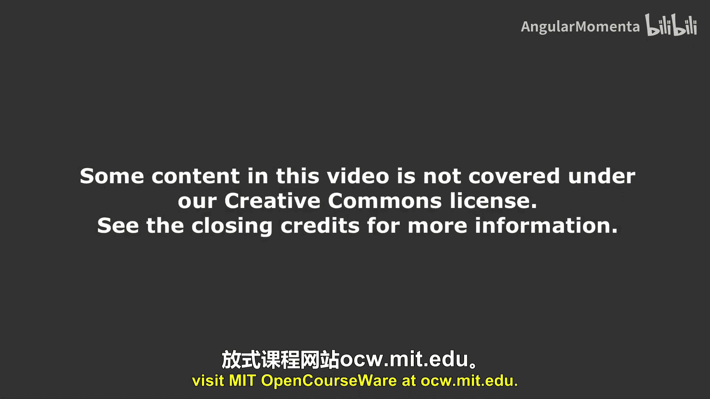
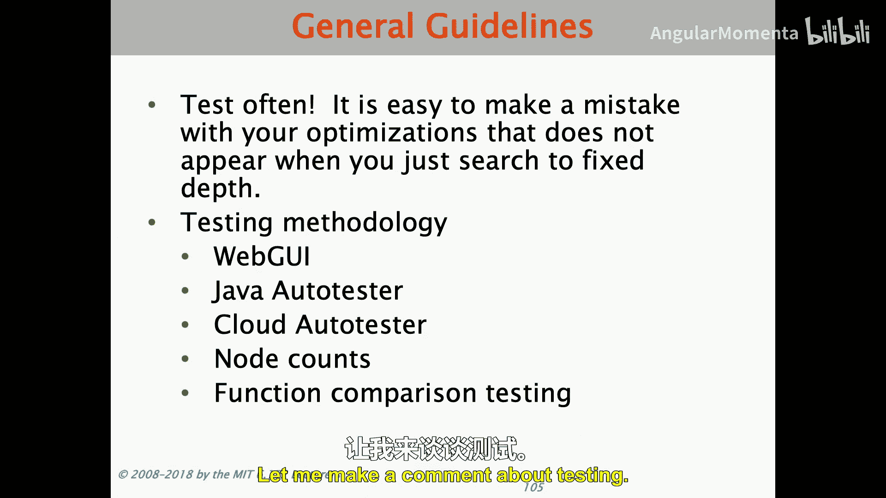
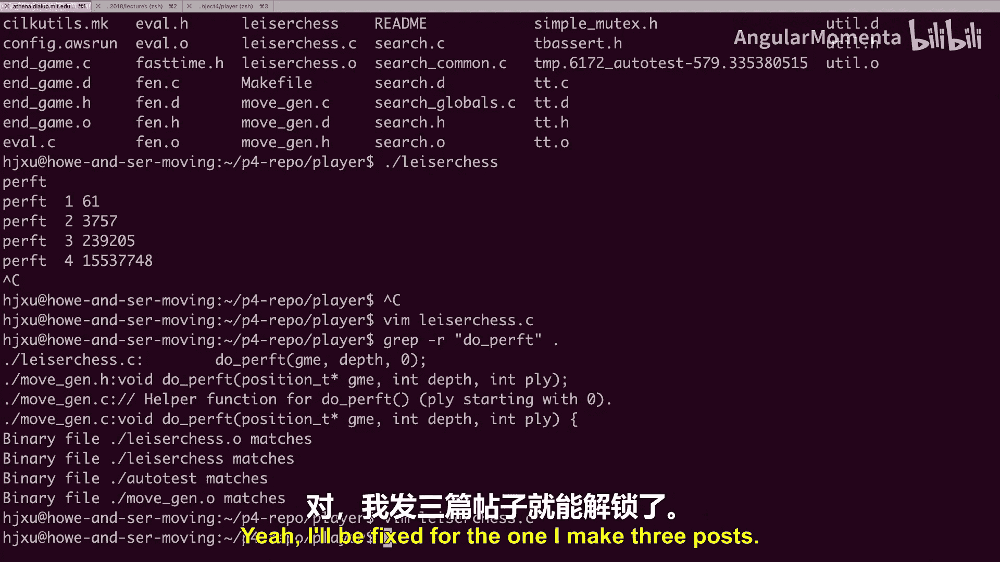
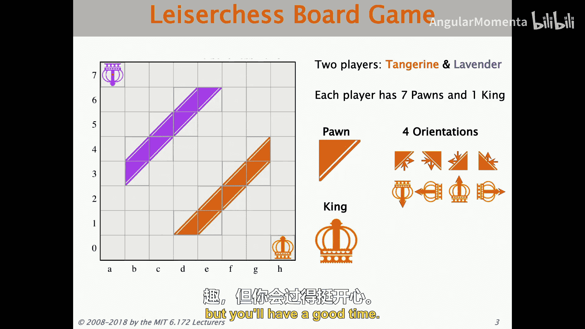
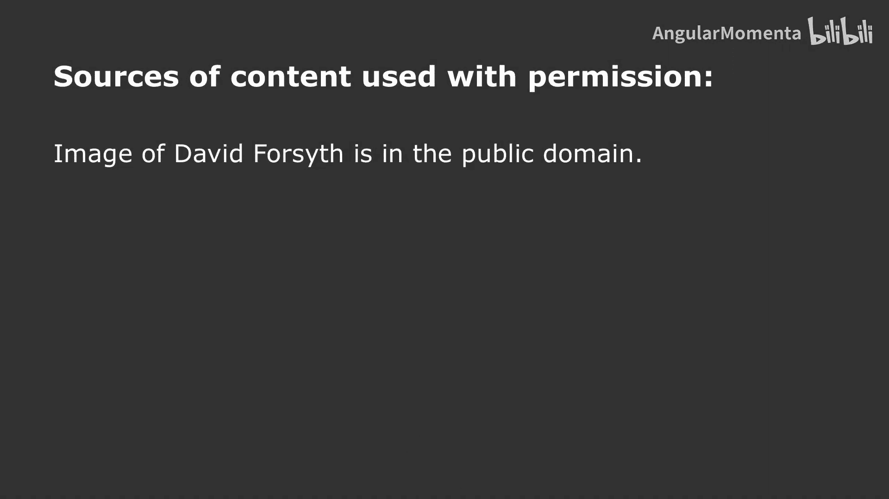

# 【麻省理工】软件系统性能工程 ｜MIT 6.172 Performance Engineering of Software Systems, Fall 2018 p19 19. 莱瑟国际象棋代码解读 -BV1esbLzpEFq_p19-

The following content is provided under a Cative Commons license。

 Your support will help Mi T OpenCourseware continue to offer high quality educational resources for free to make a donation or to view additional materials from hundreds of MiT courses。

 Visit Mit Opencourseseware at Ocw。 Mt Eduu。

So today we start on Project four。Which is as you know， the big project。And。

Helen is going to do a walkthrough of the project and the code and the organization because this is a pretty big size project it's got about 4500 lines of code and it's not code that is kind of like simple code it's quite it's all content bearing code so I think having a bit of an orientation to it more than we give for the other codes that you work on which are pretty small this will be great so Helen take it away everyone。

Can you hear me？Awesome， so today we're going to be doing the walkthrough for the final project。

 you can look at the code and clone it publicly here and please remember to fill out your teams by 7 pm today so we can populate the list and get you to repos。

😊，Yeah， and if there are any issues accessing this。

 just let me know or put it out on PN and then we can fix it。So we just had a game of Elier chess。

 but in case you missed it and we'll go into more details about what the game actually does。So first。

 we're going to go through the game rules。So you saw that there are these pieces。

 there's these triangles and there's kings， so the triangles are pawns and the kings are bi like crowns and there are two teams。

 there's orange and lavender or tanterine and lavender and each side starts out with seven ponds and one king and this is the starting position so you can see like the kings are in the corner and they're just line up。

Like in the middle， and each piece has four orientations。

 So you can see that the paw is like right down。Up down left right。

 and then the king is also like that。And。In general。

The game starts with He moving first and then the play alternates between the two players。

 each piece moves the same， whether it's king or pawn， and Eastern has two parts。

 so you saw in the demo， but you move first， you pick one your pieces and you move first and then at the end your king has to fire the laser and the laser reflects off the long edge of the paw and it'll kill the pun if it shoots the short edges and one side wins when the king gets shot or when the opposing king gets shot。

Whether by themselves or by your own king。And so I talked a little about moving。

 and at the beginning of each turn， the player to move chooses a piece to move。

And you can move your king or any of your puns， and there are two types of moves。

 there's basic moves and swap moves。And basic moves are just basically shifts or rotations。

 so in the example you can rotate 91 80 or 2 70 degrees so in the top row you just rotate this is an example of moving a paw so you rotate your pawn or you can move to an empty adjacent square。

 so those are the bottom two rows and there are eight adjacent squares in this example。

 so there are eight shifts， but there would be less than eight if you were。

 for example like at the edge of the board。And on a move， you can either shift or rotate。

 but you can't do both。There are also these swapamp loops。

 so if you're next to an adjacent or if're adjacent to an opposing piece。

 you can switch with them and then you have to make another basic move after that that is not in a swap。

 so basically you can either again， and it has to be with that same piece that you just swap with so you just either shift or rotate。

Is everyone good on the rolls？Just a couple more things， so there's this co rule which is from Go。

 which ensures that the game makes progress， so it makes a move illegal if it undoes the opponent's most recent move by just moving back to where you just were。

So this's an example， let's say you're tanine and you swapped with the purple one right next to you。

 and then you shifted like left and bottom。And so lavender can return by swapping back with your orange piece and shifting again。

But this is actually illegal because now you just got to the original position。

So you're not allowed to just keep cycling back and forth。

And so a draw occurs if there have been 15 moves by each side without upon being zapped。

 the same position repeats itself by the side on move， or the two players agree to a draw。

So just kind of like in chess， a chess clock limits the amount of time the players have to make a move so you can't just keep competing indefinitely when it's your move your clock counts down。

 when your opponents move， your clock stops so it's not counting your time and we use Fer time control that's a picture of Bobby Fisher who made it up。

Wwhich uses an initial time budget and a time increment， so in this example there's FIS 60 and 0。5。

 which means that in the beginning each player has 60 seconds and you get to use the 60 seconds however you want and when you end your move you get 0。

5 extra seconds。😊，But those 16 0。5 could be anything。It's just an example。

So we'll go into an example of how you actually play this game for a king to zap the end of a king。

 it riskss opening itself to counterattack， so look at this example and how can Tri zap the Lavender pawn and F5 by moving one of his pieces？

You see for。Tanting next slide。You're tendering in the6。And you're trying to zap the one on F5。

Theing。2。At E2 to the1， wait。ToF5。可以。Oh， sorry， by that， it means like shoot the backside。

Like that would shoot the alongside said。Good point。Yeah， so you're trying to kill the piece on F5。嗯。

Yeah， exactly。So。In this， you can move。She too， to be one， as you just said。

 and then you draw the path and。You can see that。You've just killed or if you're tining。

 you've just killed the piece at F5 Now how can lavender counter by counter。

 we mean lavender can win the game from this position。嗯。😊，Is is 84 to 83？诶。They4 a three。No。

 I don't think so。Sorry， you King like the orange one？Oh， the lavender one。

You're trying to shoot the orange king。Oh， yes， you're right。You can， actually。Yes， good。

That's not the one that we had， but apparently there are two ways。Good， yeah。

 so if you notice you could also， that's another way to get that path。

 but you could also move one in the punchs。cool。So yeah。

 so this is just pointing out one of the subtleties of the game。

 which is you should watch out for just。Niveively killing all the PCD Ken because that might open you up to the opponent。

Yes， it can be from any direction， but the ponds only die you shoot them from the knot on the long edge shoot your own block。

By block， you mean your own paw， you'll die。Yeah。や。😊，place。提供资然核。Yes。

 but only one piece can be on Asia Square， but you can have as many like near you。得。这갔 때。pass。

Like your king。Like if you surrender if you barricaded it by ponds。

 but then the opponent can come in and swap with them so your barricade。

Look could the purple can shoe upwards。If it wanted to。But then in this example。

 I just shoot off the board and nothing would happen。When you kill a pond， does the laser stop？

Where的。Itter does let go。No， it just shoots one。Good questions。Is everyone good so far？Okay， great。

 this year it shoots only one last year it kept shooting。The canink shoot itself。Yes。

You should try not to， but it can， so you should be careful。Okay。So moving on。We use edge notation。

 which is a representation of a chest position using a string。

So this is you can see an example of the starting position and the bottom includes the string that describes the starting position。

If you look at the representation， the arrow corresponds to one of the rows and that points to the substring that has a bubble over it。

 so in this row there's one purple pawn at B3 and two orange ones at F3 and G3 so this is row3 and。

Thislash should separate the rows in the string and the one represents that there's an empty space and then there's a pond facing southeast and then there's three empty spaces and one facing northwest and then one facing southeast and then an empty space。

So we。Oh， yeah。You was animated。喂我呢边。ok。Yeah， so at the end of the stream there's also a。

 it just tells you which size move it is， so this is the opening position。

 but you can use any position in this notation and this is useful for debugging because if you。

 for example， you're running your bot and it crashes at some position and you can get back to that position。

 you can start up the game and just go there without having to like make all the moves to get there。

And this is how you represent the games， so each of these is one move and the left column is。

Tenting in the right column is lavender。And in example。

 you can see E6 E7 means that you moved a piece from E6 to E7。B3L。

 so you rotated the piece on B3 left。There's D5， E4 F5， which means that you swapped。

 so you were your original piece was on D5， you swapped with the one at E4 and now you moved。

That piece to F5， so like the one that was E for is now on F5。

And their opposing piece is now in D5 because he looked。You can swap and then rotate。

 so instead of just having a third square， you would just have a rotation。And at the end。

 you can see who won， so in this one， lavender won because it was 01。

 but 10 would mean tanine winds and half and half would be a draw。

So you can look at the logs for your games。Yes。It feel like a rotate guy。嗯。

There's rotate up and rotate down。刚方是。Do a you。Oh， is that what you is？Then which。Oh okay。

 I see because there's only three rotations， Yes， sorry， so left is 90。

 then right is 270 and U is 180 because you flip it。Is everyone good on the limitation？

So this is just how you describe the games if you wanted to look at your logs and if there's some issues。

So you can test your bot with other teams in the class as well as the staff bots on the scrimmage server and we have a reference which is here。

 which is just the initial release， but we will be optimizing our bots while you are optimizing your bots and we'll release a reference plus and maybe an even better one later。

 which you can play with on the scrimmage server， so I'll just do a really quick demo。So right now。

Since we haven't done the team information yet， you are not able to log into this。

 but once you do your team information is probably by tomorrow you'll be able to log in and basically you can see the general functionality so this update your player。

 pulls your player from your repo， whatever's on the master branch。

And then right now there's only reference and reference F and reference TAs。

 and here's a team with me and Jess， but you can later on we'll populate this list with everyone in the class and then you can challenge anybody else in the class to see how you do。

 and you can also challenge us。So you would just pick， for example。

 let's say I wanted to challenge reference and then a hit send challenge。

Now you can see that there are some new matches spwn。

 and this is how I look at all the matches that I've played。So each time you hit S challengellenge。

 it spawns off two games， one where you're tanin and one where you're a lavender。And yeah。

 so that's how you can watch the matches on the scrimmage server。It everyone get？

So I'm going to move on so we don't run have out of time。You can watch them later。

And you can even play your own。Okay。And in addition to the scrimmage server so the scrimmage server you can only spawn off one game at a time。

 but you can do more and you don't have to necessarily do it on your master branch or against opposing teams in the class so there's something called the cloudad auto Tester which you can run by going to your Athena and then you type in this command you do auto test run and then you do the time control and you give it a number of games that you want to run and then you give it a list of binaries so I'll go into each of these in more detail so the time control is just what I talked about earlier which is if you use Fer time control these are some set preset things so you would type in one of the preset things so you type in blitz to do 60 and 0。

5 for example。And the number of games is just whatever you want to do and the list of binaries。

 so let's say you had a reference implant and then you made some change so I called it lieser chest with changes and then you just put those。

After the number of games separated by spaces， and then it would upload your binaries and play them in the Cloud Auto Tester。

Once you submit your job， you get a link and you follow the link in your browser and you can view the game running。

And then after these games are done， you'll get some output saying like which font one more and how many high they won and some rankings。

一。That。How fast do they run？Just like can stay and list。这。

So it depends on how many other games are cut at the same time。

 so if a lot of people are running tests it might take some time。

 but this is just how long the game itself will take and it might take longer than 60 seconds because every。

Well， if you use less than five seconds 。5 seconds in your move and then you add 0。

5 seconds at the end of the move， then you would increase your time。

But like 60 is just a time control， like it doesn't mean each side starts with 60 seconds and depending on how they use it。

 they have more or less。Good question。我。I'll keep going if there's time at the end I'll do a demo of with this one too。

 but it basically looks the same as the scrimage server。

 like you just watch the games in the same way。All right。

 so now I'm going to go into the project organization。

 which is the organization of the directories that we handed out in this repo。😊。

So there are some directories， the first one is Doc which just includes the rules and documentation for the interface。

 there's the auto tester， which is the Java local auto tester。

 so if you if the cloud auto tester like we recommend that you run test you do the cloud auto tester。

 but if there's some small change or if you think that，Like if the queue is too long。

 then you can do local tests and you can also run these like overnight。There's PGM stats。

 which just pares your statistics from the audit test results。

 like how many times you won and stuff like that？There's tests， which is how you specify tests。

 and I'll go into more detail about how you。Like define those there's the player which is what you're actually going to be optimizing so playerer is the code that actually runs the bot to play the game and the WebGI is a local upgui where you can watch the game and play it so in the webbuo you can even like play it yourself as a human。

😊，We can get a better sense of how the game works。To go into more detail。

 the Java local Auto tester is an auto tester and your bots。

 you can make your changes and then you can test your changes and the test directory。

 which is parallel， holds configuration so you can specify the number of games and the bots that you want to use and the time control and other things too。

So this is an example of the configuration file that you would use to run your autoer tester。

 so this is saying that you run around 12 CPUUs and book means that you're pointing to an opening book。

 which I'll talk about later。Sam rounds is how many games you're going to spawn off title is just the title of the test that you're running。

 And after that， you have the player definition。 So player reference is just the binary and。

Invoke is the path to the binary， and then FIS is the time control。

And the next one is just a second binary if you made a change and you want to test them。

What's the better。To interface with the Autotter Tester。

 LyISSEChs uses the universal chess interface or UCI。

 which is a communication protocol for automatic games and you pass information between the Autoer Tester and your bot and it allows the programmer or the Auto tester to enter moves to the game engine so you could use UCI to start up your bot and then you type in the moves that you want to make to see the changes in the state and you can use the cityD bug to get to a state that you want to look at。

We'll measure the box using eO ratings， so ELO is a rating system that measures relative skill level in zero sum games。

The eerrating depends on the eerrating of your opponents。And on the bottom。

 you can see an example output， so I had three binaries， and I ran about 100 games。

 and you can see that the elo of the top one。Is much higher than the other ones。

 and so higher elo is good。And we'll be comparing the performance。

 we'll be comparing the elo of Ybat against our reference and improved reference implementation。

So notice that this is not as before just a straight measure of time。

 so like before in previous projects it was if you use less time then you would get a higher grade or better performance in general。

 I'll show you a graph later that actually shows if you search the higher depth。

 which means that you are faster， you do improve but it's not an exact correlation and you can look at the nodes per second that you search using the UCI。

And just to wrap up here， the local web GuI likes to watch a game or play one without sending it to the scrimage server。

 so if you wanted to play one as a human who have used the local web GuUI and you can run it using the image and they read me。

Okay， so is everyone good so far？Then I'm going to go into more details about how you actually played the game。

So first， every player or every butt needs to generate the moves。

 which means that once you have a position， you need to look at the moves that you can do。

And to do that， you need a board representation， which is to represent what pieces are on the board and how big the board is and where the pieces are。

AndThe reference implementation uses a 16 by 16 board to store an 8 by8 board。

 so you can see that the inner square is actually the board and the outer dark square is sentinels。

 so use sententinels to keep track of when you go off the board。

And then the inner square is just the actual board。We store the position using thisstruct。

 so you can see the fields in the position which are the board and the size is just like representing the board plus the sentinels。

And there's the history of the position， which is how did we get here， and there's a key。

 which is a hash key for this position， there's ply， which tells you what side it is。

 so even means white and odd means black。😊，There's what was the last move that was made to get to this position。

 there's a victim struck， which is the pieces destroyed by when you shot the laser。

And there' is the location of the kings。The positions truck in Lyersha stores the board presentation and other things that I just went through。

听데。So I talked about this move， which means just like a move that you make for one of your pieces and I'll go into how it's represented。

 so right now we already do the packing for you so we use 28 bits and the first two are the piece type。

This is for- so there are some number there's a number of moves that you can make。

 and the first two bits represents the peace type， which is empty pond king or invalid。

The orientation of the piece， which is just how you rotated it。The from square。

 which is where your piece already started。There's the intermediate square。

 which is used when you do a swap。And there's a two square。

 which is the final position that your piece will end up in。 so if you're not doing a swap。

 then the intermediate and from should be the same。

 but if you are doing a swap then there's some skipping that happens。

At each turn you need to see what moves you could possibly make and in Mogen。

 which is one of the files in the handout， we generate all the moves given a position depending on whose turn it is。

 so depending on whose turn it is you can make different moves and in the reference implementation we iterate through the entire board and once we find a piece we generate all the moves from that piece。

You can also debug using move generation， so there's something called Per PerFT PerfT。

 which is a debugging function that enumerates all moves at a certain depth。

 so use PerfT to make sure that if you make changes to the move generation that you're generating the same number of moves。

And if you modify the move generator， just make sure that it returns the same because regardless of what optimizations you do。

 you still still see the same moves from each position that you can possibly make。S with it？Okay。

 so now that we talked about move generation， I'll talk about how you tell that a move is good。

 and for that we use something called static evaluation。

So use static evaluation to determine which positions are better than others and which moveslet we should make。

 and the function Eval， which is in EL。c， generates a score based on a position using some heuristics。

And at first， we suggest， instead of making up your own heuristics。

 we suggest focusing on optimizing the existingstructs and evaluation heuristics before coming up with new ones because it's kind of hard to come up with new ones and there's a lot of optimizations that you can make to the existing ones。

嗯。So I've just grouped these into categories， so there's a few regarding the king。

 so there's one called Kface， which is a bonus for your king facing the enemy king。

 there's K aggressive， which gives you a bonus for if your king is closer to the center of the board。

 and there's mobility which counts up basically how many squares around your king are free and want to improve。

 you want to be able to move your king。Freely。And there's some regarding ponds。

 so there's P central which gives you a bonus if your pawns are in the center of the board。

 and there's P between， which is you basically draw a bounding box with both kings out the corner and then you count how many pondns are in the center of those。

And then there's ones based on distance， so there's L coverage which means laser coverage。

 which is basically you make all the possible moves that you can make from your position and then you draw the laser path and then you do some scaling to determine how well you can possibly cover the board based on your current position。

So that's basically how you tell it if a position is good or not， by these heuristics。

So I'll just go through the high level of how you actually play the game using search。And this is。

So at the very highest level， there's something called game search trees。

 which is we've implementeded in search。C， but basically there's a representation of how you play the game。

At the top， there's an orange square， which is the orange side， which is the opening position。

 and then the arrows。So the top square and actually all the nodes are positions in the tree。

And use move generation that I just talked about to enumerate all the possible moves from a single position。

And each edge is a move， so to get from position to position， you do moves。And you can see， like the。

That circle is the position after you've made the move。And you， you do this trade to some deaf D。

 and then you do static evaluation at the leaves。So this is at a really high level how gameplay programs actually play the game。

 they enumerate all the possible moves and then they have a position and then they pick which one is best based on evaluation。

 but you can see that there's a lot of notes like if you do this naively there' would be。😊。

Number of moves raised to D， which is a huge number， and too many to generate。

So we're going to talk about how you reduce those later。

There's's something that you have to do on searchries which is called quiescent search。

 which is if you fix your depth and at the let's say you fix depth and then you go down to the leaves and and you just captured a piece but it's dangerous to just stop there at fixed depth because maybe if you searched one level deeper。

 you would see that like the opponent would capture your piece and so do your search and you see that you capture a piece at the leaves or your opponent captures the piece at the leaves。

 we say that's not quiet and you keep searching the tree until there are no more captures so that's called quiescent search because you quiet the position。

And that's implemented in search common。So this is a graph that I generated by doing the reference spot to different depths。

 and you can see that the eO increases as you increase the search depth。

So you just search the search rate and so if you optimize your bo to make it faster。

 you can search deeper， which means that you'll do better。So。Next， I'll talk about mini Maxax search。

 which ist。Next which is an optimized part， which is a more complex version of searching lead that can improve the amount of nodes you have to evaluate so at a high level there's two players Max and min and this in our example there's orange and purple and orange is a square and purple a circle and the game trees represents all moves from the current position from a given ply。

 which means depth。And at the leaves， like I said， we apply a static evaluation function and Max chooses the maximum score among its children。

 and min chooses the minimum score， so one side is trying to maximize and one side is trying to minimize。

😊，To evaluate the surgery， we first talk about an algorithm called alphapha beta。

 which is that each search from a node has a window alpha beta。

 and if the value of the search falls below alpha， the move is not good enough and you keep searching。

And if the value falls within alpha and beta， then you increase your alpha。

 which is the lower bound and you keep searching because you know you can do at least that well。

 and if the value of the search falls above beta then you generate a beta cut off in return。

 beta basically means one side is trying to maximize and one side is trying to minimize so you would beta is basically saying like the opponent would never let you do that move because it'd be too good so you don't need to keep searching there because you're not going to get there anyway。

So we'll do an example， let's say you have this tree。

 and if Max discovered a move that that men wouldn't let you do because it's too good。

 then Max's other children don't need to be searched， which is what a beta cutoff is。

So you start at the root。And then you go down to the lowest left leaf， and you see that it's three。

So you propagate three up， and then you can say that in the sub， you can do at least three。

And then you keepstruct your children， and then you see six。And then you say， okay。

 now you update your alpha value to be6。Nayarch4， but four is worse physics。

So you don't have to do anything， so you first search the leftmost sub and then you see the best move that you could possibly make there。

So you propagate six up to the root。And then you search your other subries。

 but now you have this value of six that you basically use in the other subries， so you look at two。

And you see that two is less than six， so you propagate it up。

But now you look at nine and you see that nine is greater than six。

So you say that this subre would let purple do nine， which is greater than six。

 and so that would be too good because。Because。Orange would never let purple do that well。

 so you don't have to value at five anymore。So you cut off five。Does that make sense？

So basically now you apply the same thing to the right West sub and you look at seven and you see that7 is greater than6。

 so you propagate that up and now you're done because seven is greater than six so you don't have to search the rest of the sub。

So that's how you evaluate fewer moves than the entire tree。

And there's a theorem that says tree for a green tree with branching factor B and depth D。

 an alpha beta search with move search in best first order examines exactly B raised to the D over2 plus B。

R the D over2 -1 knows App D。 So best for order means that you sort of the moves in terms of your static evaluation。

The naive algorithm examines B to the D nodes and in the example I did， you can see how you prune。

 and for the same work the search depth is doubled and for the same depth the work is square rooted。

 so this is a huge benefit over the naive evaluation。Should everyone go an alphapha beta？So。

You can the code is pretty short so I'll just go through some pseudo code for it。

 basically the main point is that at line 11 one side is trying to minimize and one side is trying to maximize。

 but if you negate then that's just the same it's minimizing and maximizing and you get。

All the possible moves that you could possibly make using gen moves and you go through the entire move list and then you make each of the children and you search for the score and then you see whether you had a beta cutoff and then you don't need to search the sub if you did。

So that was basically alpha beta and we actually implement a variation in alpha beta called Pri variation search。

 and the main idea is that you assume that the first move is the best one and you run Scout search。

 which is also called zero window search on the remaining moves to verify that they're worse。😊。

So in this example， you again search the most leftmost substrate and you see that the best you can do in the leftmost substrate is three。

And you evaluate the。Once to the right of it using ScAP search， which is not a full search。

 you're just testing that you're basically assuming that you can do no better than three and then now you're kind of like doing an initial search to see whether or not that's true。

And so you see that some of them are or the one after that is seven and the one after or the first one after that is seven and the one after that and the other sub is six。

嗯。So then you can prune them because。Those are better because you know already in those are trees that you can do better than three。

 so you don't have to keep evaluating them。And then you don't have y。

How do we know the score of exception？大理。How can we something？

So you're not actually like you actually had to find seven， like zero and eight are there。

 but you haven't found them yet。Like so you basically， if you thought about doing it serially。

 you would do the leftmost subre which has two， three， and0， and then you would find seven。

 and then that would be a cutoff because seven is bigger than three。

So you're not actually finding zero and eight。Yeah。

 because wouldn the point is that you wouldn't get to that sub because the opponent wouldn't let you get there because you can do better because you can do too well so they would just not let you go down that path。

Like， let's say you were purple。And the opponent is orange， and you want to get seven and eight。

But the opponent can also search that and see that you would get seven and eight。

 so they would prefer you to do something like two or three。자 게。Oh， then you don't。

 then you have to like basically， you're kind of。Like you're not always making the best move that you could possibly do because。

Like if you just searched without this pruning and you just picked。

 like let's say you wanted to make the best move， but if you don't take into account the opponent。

 then you're never going to get to there， so you're basically trying to find a move that the opponent would let you get to。

 that's also good for you。It like。Could you switch off？Yes。呃。I guess in this example， you're purple。

Or no， sorry， you're orange because you're cutting off。

No your purple because you're trying to maximize what you get at the leaves。Yes。Yeah。

 the main point of sorry。はは。We're trying to minimize the score。Yes。

 so orange is trying to minimize the score and purple is trying to maximize the score。So wes cutting。

声。We don't need to search this。We already know that it is seven years。sell。

We should go down this path。Does anyone have questions does that make sense， Yeah。

 it's basically exactly as you said。Like there's kind of this balance between one side trying。

 like both sides are just trying to make the opponent like you're trying to make good moves。

 but you're also trying to make the opponent make not good moves， if that makes sense。

So you're not only searching for your maximum， but you're also searching to minimize the opponent。

그 거。So。有。S。いですよ。AndWe don't want to choose either of those orange。诶 we don't want咩。す。Oh， okay。Yes。

What if you and your opponent have different reward criteria evaluate？That's okay。It's fine， I mean。

 like the search， like the actual evaluation， like what number you're assigned to each position is not exposed to the opponent like the main point is that at the end of each move you pick one。

And they can do with it what they want。Like that may not have been the one that they picked。

 but it's okay。Sorry， I think you're orange in this one。Well， because the root is orange， yes。

I to say like you were picking between like the three。O choices。

 like you're purple and you're picking one of those and then you're looking at the first choice and then you see that how orange could respond is like he gives you something with S equals three and then you know that orange won't respond to the next two because it'll give you better choices。

All right so all right， let's start over， so I think that we are orange and the purple is not so each remember that each edge is a move and each node is a position and so your orange and you start at the root and now you。

 for example， make the move left and purple now can make moves whatever three after that and now your orange again and then you can make moves after that and now you evaluate the position after that as a leaf。

😊，And so basically， youre searching past like the second level of orange。And you are cutting off。

You see that you would do better because you think that purple would never let you get to that orange note right above。

Yes。This is further。我。Yeah， I guess that's the score that you as Orange would receive。

I think has New York score。Yeah。You are。I mean， you're not trying to give。

It's not so much like you're trying to give purple zero as you think that purple would not give you seven and eight。

Because purple would have to go down the left subt to give you that。No。Any questions？Okay， anyway。

 I'm going to move on with the search then if there are no questions。So。just。So他能否会。

BasicallyIs everyone good？Can I keep going？Okay， thank you。

So just going back to principle variations pruning。

The main idea is that you execute you go down the first path on the left side thinking that that's the best subte or thinking that's the best path。

 and then you're basically doing initial passes through the tree to make sure that your subchan is correct。

 and if they're not correct， then you have to search the entire subte， but if they are correct。

 then you kind of like fill your early exit。So you search down the left substrate and you find three in the leftmost sub and you search the ones to the right of that and those are seven and eight。

 so those produce a cutoff because seven and eight is higher than three。

 so you think that purple would not let you get to that sub。

And now you do a Sc search again on the middle subre。And then you see that。

you find this first node of each one of those subries underneath the middle sub。

 and you see that they're all higher than three。So it turns out that you failed to prove that。

You fail to prove that you can do no better than three the main point of the sc search is that you assume that your first move that you is the best you can do and then you do initial passes to verify that assumption and if you search later subries and you find that for example in this one in the middle and they're all higher than three so your assumption is not true so now you have to do a full search of that entire middle sub。

I that okay， other questions？So。Once you find that you have to actually search the middle substrate and you can recursively apply Sc search。

 so you have to search the left substrate in the middle， but now you apply Sc search to the middle。

Like the lower middle and the lower right。And you do a zero Windows search there。

 and you assume again， you assume that you can do no better than six。

 and you're trying to verify that you can do better than six。

But you actually can say it since searchill。And then you apply the same thing again to the right one sub。

 and you see that you can do better than six on the left one。

 but you do worse than six on the right one。And you cut off too because the middle flip period it gave you two。

And so you don't have to search that one。So in this example， there were 13 leaves spruned。

And the point of scout search is that you can improve pruning a little bit over alpha beta and that you process most of the game tree with zero Windows searches。

 which reduce the main point is that it reduces your work because you have to process less。Questions。

So。Now we're going to talk about， so I kind of glossed over how you order the moose。

 so the ordering determines which order you explore the subtreason。

Alpha beta search and personal variation search depend on putting the best moves in the front to trigger an early cutoff。

And the main question is how do we determine moves。

 which movess are good without doing static evaluation at every level， like for example。

 we only did static evaluation at the leaves and we call getsable move list。

 which is a function in search。Sorttable move lists kind of talk about how you populate that later。

As I said before， moves are represented in 28 bits so you can use int 32 and to make them sortable and you store a short key in the upper 32 bits in an in64 and then be sort based on that key。

That makes sense。So I'll just go over some search optimizations that you can do。

That we actually implemented these already， so I'm just going to go through them。

 so it's not super confusing when you look in the code。

The most important one is called the transphy table。

The main idea in thetransposition table is that chess programs often encounter the same positions repeatedly during a search。

 and you can store those results in a transposition table to avoid unnecessary future searches。

 and I've listed where you can find those。There's something called Zbers hashing。

 which is a technique for hashing a board position。

 which you use to index the trans table and it's a table of random numbers indexed by piece orientation in square。

 so each position has a unique cache and it produces the hash by xing all of these random numbers together。

And the advantage of sober hasing is that the hash function can be updated incrementally。

 which is like， if you move a piece， you just xor it out and then you exort the new one in。

So you don't have to recompte the attached the entire time。For East。

So the transportation table saves you a lot of work。By preventing you from researching things。

And there's also something called the killer Mo table which so the trans table is like how you determine how to do sorting at things that are not the leaves and also the killer move table。

 so the killer Mo table stores moves that are really good so that the opponent wouldn't let you go down that path so you don't have to keep recomputing the same values。

And the table is indexed by play because you tend to see the same moods at the same depth。

So the killer mo table basically just stores move that triggered debate cut off before in your search。

There's a best move table would you start at the root of the search and it is the move that got the maximum score in your evaluation。

And the best move table is indexed by color， peace， square， and orientation。

And there's a history table in the code。So these are all basically just things to help you optimize your search and produce early cutoffs。

And there's something called no movementprinting which tries to reduce your search space by first not moving and then doing a shallower search to see if this sub is worth further exploring the main idea is if you don't move。

 but basically it says like don't move and then do a little bit of evaluation and if you're still doing really well even if you didn't move in the subury。

 then it's not worth exploring because the opponent would never let you go there because the position is too good。

There's futility perruning， which explores moves that only have the potential to increase alpha。

 and it calculates that possibility by adding a futility margin。

 which is the most you could possibly gain from going there and then evaluating a little bit。

 and if the result does not go higher than alpha， then you skip it because there's no point in even going that way because it wouldn't increase your alpha。

There's late move reduction， which is after you order the moves at a position。

 you explore the ones in front are likely to be better。

 so you explore those in higher depth and then you explore the ones later with shallower depth。

Because those are less likely to be good。And these some things that you can optimize。

Are implementing a better opening book？Or I think we have produced a very basic opening book in the handout。

 but this is something that you can definitely work on and make better because it doesn't have many positions in it right now。

 and the main point of an opening book is that you started the positions at the beginning of the game that you've already precomputed and that saves time in search and can store results to a higher depth。

And the CAM 75 theorem implies it's better to keep separate opening books than to keep the same opening book for both sides。

So opening books are really helpful because in the beginning。

 there's a huge number of moves that you could possibly make and searching those takes a lot of time。

 but if you precompte them， you can save them for later。

And another useful table you can keep is an end game database， which is a table for。

guuiding your Cheess program through the end game for any game position the distance from the end might be too far to search entirely so you can precompute them and then you store who will win and how far you are from the end of the game and we've given you a C file that you can implement it in。

😊，Questions。Okay so I'll just go through some guidelines， some tips for the project。

I was giving links at most of the bottom of the slides for where you can read up more on these topics。

 but there's a chess programming Wiki， the link is there。

 which has many more pages about reading about chess playing programs。Just in general。

 it's a really good idea to test your code often because it's easy to make a mistake with the optimizations and it doesn't appear when you search to fix depth so you can do if you start up your bot you can say search to depth5。

 for example， and then you can see some it'll tell you like how many node for seconds you search and then it'll tell you the best move at the end of that search。

 but you should test full games using the auto Tester and the cloud Auto Tester and the scrid server just to watch your bot and to make sure that it doesn't do anything weird。

And the testing methodology， I went through some of it， there's a webGI， there's a job audit tester。

 there's a client audit tester， and you can do node counts。

 which is basically just counting the number of nodes in the tree that you searched and there's function comparison testing。

 which is if you optimize a function， you should save the old version and then just compare the results。

Let me make a comment about。About testing。I can't tell you how often in this class we've had student groups who。

Discover that they've made a whole bunch of changes。And then there's something wrong with their bot。

And they can't get back to a stable place when things were correct， they discover the problem。

 but they've made。30 changes and now which of those 30 is responsible for the problem？

So it's really important to。To test and have a good test infrastructure for this project。

 if you have a really good test infrastructure， it's really easy to be innovative in the kinds of optimizations that you do。

 because then you know that what you're doing is right。

And then you can make forward progress otherwise you'll find yourself debugging like crazy and not being able to find the bugs some other tips are this is a。

 especially when we get to the parallel part， it's nondeterministic programming。

And the reason is because as you're executing， you're going to be looking up things in the transposition table that you're going to want to share。

So that if one branch discovers a value， then another branch can use that。

So it's really important to be able to turn that off。So that you're， for example。

 able to search without a transposition table to get all the searching stuff right。

And be able to turn that on independently， so that's another really important place to do it。

 another thing is that when you do timed searches，the time it takes to do the search will vary。

and what you'll end up exploring varies， so as much as possible you want to do fixed depth。

Searchches and others search to five ply。To test something okay rather than searching for a minute。

Or whatever the amount of time is， because when you start searching for time， that's in fact。

 what you're going to end up doing。But you can't repeat what just happened if you end up searching for that amount of time again。

Because the machines are not deterministic and there may be something else going on that causes the amount of time to be different。

And so for example， if you're making a change that doesn't affect the logic of the program。

 it's just strictly in optimization。Okay you should get exactly the same result if you do a five p search。

For example， shouldn't have changed the five p search， just the five ply search should be faster。

And so that's a good way as much as possible you want to check things that are deterministic and so forth and really as I say this is I can't emphasize this enough。

 you know how having a good test infrastructure， the ability to control。

 turn off non-determinism the ability to test you know various parts of this program。

 this is a pretty big piece of code， okay you know for project of this nature and you'll feel pretty overwhelmed by it to begin with。

 once you settle in you'll discover its like it's this wonderful thing where by the end of the project everybody feels really confident about their ability to handle a decent sizeized piece of code but when you first get into it it's like oh my goodness there's move ordering and there's static evaluation and there's the search and what's going on with that transposition table because every one of these things is got cleverness in it。

Okay， so it's really hard code to deal with okay， but you guys are going to just fine so this is the eval C file in。

The handout。So this N32 here is the evaluation score and the main function。It's called Eval。

 and it takes into a position。And。It outputs two scores， one for white and one for black。

And right now， it does。Oh yes， it doesn't material always which counts up the number of funds okay anyway。

 so I was talking before about P between and P Central。

 which are your upon heuristics and so basically right now it iterates through the entire board。

You can see for Reagan file are just rowow and column。

AndIt looks at each square in the iteration and then it looks at the piece and the color of the piece。

 and based on the type of the piece， it does some evaluation so if it's a pun。

 it does the paw heuristics， if it's a king， it does these king heuristics。And otherwise， or both or。

Not otherwise， I guess。Yeah， in both cases， it'll do。This is an old version。

 so that's not there anymore， but this is。Laser coverage， which I talked about earlier。

 which only depends。Which doesn't depend on what piece it is。

 this is after you iterate through the entire board， basically。Yeah。

 and then this isn't here anymore either。But we can look at each of these in depth， so right now。

 for example， there's P between。Whi。Goes through every single pawn in your iteration。

 And then it'll determine whether or not it's between。Both kings。And they returned church that。

So they'll add it to the score if you find that it returns true。And there's P Central。

Which takes an a rank in a file， and basically it increments something。

Or it gives you a bonus depending on how close you are to the center of the board。you look at this。

 there's a board with。And F is your file and R is your rank。And oh。

I think you have a slightly older version。Essentially。It's correct on this screen。

Is it correct in this one？Yeah。啊。Sopefully this should be okay， so this is just the。

I guess was the most updated version， the first one is PC。

 so this just counts the difference between where you are and the center of the board and it gives you some bonus depending on how far you are from the center。

And this one is between， or yeah， so this is between which is a helper for P between。

 and it tells you whether or not your paw is in the botaning box that determined by the kings。

And this one is K faced， which is。Given a king， you。You look at its orientation。

And then you give it a bonus depending on。Which way you're facing and how far you are from the center。

 I think。No， how far you are from the opponent。So FNR are where you are and。

Now it does the Dlta between you and the oppoing king。And then you do some scaling。

 depending on which direction you're facing， so this is just your orientation。

And then there's this is K aggressive， which gives you a bonus for how far you are from the edge of the board。

 so you can see here。Upqua is where the oppoing king is。And。

Delta file is and Delta rank are how far you are from the opposing king。And。Then you added the bonus。

 depending on。Like which case the deelta has fallen into？And this gives you a bonus if you're。嗯。

Farther from the edge of the board。Yeah， and I guess this one so Mark laserer path or not Mark laser path。

 there's L coverage， which is the most complicated one， probably。

Baically what laser coverage does is that if you basically it takes a position and depending on what side you are。

 it generates all the moves that you could possibly make from that position。See。

 you generate all with color， which means that given your color。

 you generate all the possible moves that you can make。

you get a list of moves and you iterate through it and then you make each of them and you draw a laser path and the laser path does is basically like it bounces off of some ponds and for each square you increment the distance basically along the path。

It takes the minimum distance over all these possible paths three square and if it doesn't touch a square。

 there's just zero and it divides it， well， I can go into this。Yeah， so it draws the path。

Through this wild true lip。 And then。It adds， or this is just changing the orientation if you need to like bounce yourself upon。

 but this one is setting the。You keep a laser evidence you keep the minimum path of a laser that would possibly touch that。

And。This is just changing the。Aientation。Yeah， so then you generate this map for all the possible moves that you could do。

And then you do some scaling。Depending on the distance from the opposing king。

 you iterate through the entire board。And。You do divide the minimum distance by the actual distance from the laser。

 so the maximum that this。Rraio can be as one。And then you。Multiply it。by。1 over the。Distance。

So this one is really complicated and it's a lotized here。For example。

 you probably don't have to iterate through the entire board each time。嗯。Because like even in Ebel。

Look here。You have to iterate through the entire board to find each。Peace。

 and if you start a better representation， you might not have to do that like if you just kept track of where the paws were。

 because you ready to keep track of the king separately。So that's one thing you can do。Yeah。

There are two basic strategies for changing the representation of the board and maybe there are more。

 but the two basic ones are you can instead of keeping the whole board，With a piece on each square。

And then having to go and search for where the pieces are。

 you can keep just a list of where the paws are。And what the locations of the kings are so that when you want to make a move。

 you can just。Go through where they are rather than having to search through all 64 squares of the board。

And then the other strategy that you can do is use what's called bitboards where you have a 64 bit。呃。

诶。Word。For which if there's a pawn in a given position。You set that bit。

And so there are different ways of representing things that could possibly be。

Definitely be more efficient。But you have some choices there and there's also one of the complexities of this is that to change the representation there's going to be places in the code。

 you need to find out where they're assuming you know that both that things are so you know you say oh。

 I'll change the board representation oh I didn't realize that over here there's another place that it's using the board representation and so forth。

 a good strategy for changing board representation is to actually keep both representations around。

Okay， while you migrate functionality from the old one to the new one。

Okay and then the advantage of that is that you can actually， you know， then use assertions to say。

 you know， the old one and the new one are the same。Okay。

 so implementing conversion functions is really good， you know， being able to take， for example。

 if you decide you're going to use a bitboard representation。

Have a function that converts the bitboard to the standard board。

So that then you can compare whether you've got the same thing。And you know。

 eventually you'll want to get rid of that， but to begin with， you know。

 and of course that'll slow down you down because you're doing more things。

 but itll allow you to get it correct with a new representation and once you've got it correct with a nu representation with the old one gone。

That's when you have a chance to make things go fast。But it kind of is taking two steps backwards。

 you know， to take five steps forward， I say not one step and two steps， but you know。

 because really you know often you you really are slowing things down you know。

 considerably in order to you know convert from one representation to another。

 the most important thing is that you maintain the invariant of correctness in your code。Okay。

 you do not want to make something that goes faster but is wrong and have to debug the correctness you'd much rather。

Ensure that things are correct， okay， are moving to the place that you want to do it。

 and then you can optimize for performance。Okay， so the most important thing is keep that invariant of correctness and that's where the testing and so forth comes in。

 having good test infrastructure and having assertions littered throughout your code and then we can。

Go through the Mo generation。Oh， actually， okay。Just as an example of how you would。

Possibly one way of。Determining whether or not you state correct。 So this is an example of。

A place where I compiled the code， see the binaryaries called Ler。And if you look at help。

 it gives you some options for what you can do。For example。

 there's display and that's the opening position， and let's say I want to search。

 so I do a fixed depth and do go depth three。And it tells me the number of nodes。

That I searched at each depth。And so if you make changes。IfOr if they're deterministic。

 these node count should stay the same。So that's one way of telling。

 so you should keep track of this and make sure that they're the same and also you can do。Perfty。

 which gives you the number of。Possible moves you can make and that。

That should be the same no matter what you do。So that's one way of testing there other ways。Yeah。

 so if you go to like higher death。You'll get more note counts。And here this is。

 wait you're doing this is this is nodes that you searched at that step。

 and this is nodes per second， so you want to make this one faster。嗯。So that's how you run the code。

And oh， I was supposed to do a demo for the outer of it。诶。So let's say I wanted to do。Oh。

 to do that thing， so when I made it， it's in a binary called laserer chest。And then you do like。

And then here you can type in command， if I do per so you basically just type in commands from this like you run your binary。

For example this is the UCI interface that we talked about， okay， and inlyerch。

c is the implementation of that and so if you want to add your commands to it，To help debug。

 you can enter if we go intolyrchesest。c， you can see the table。诶。Yeah。

 what I want to do is show the tape of all the options。

Which is a table there we go Okay this is just the heuristics so these are tables of heuristics and so forth。

 which which allow you to。To set the values of the various things， there's actually， and to say。

 you know how much is this heuristic worth to the static evaluation？

OkayAnd so you can and through these， all of these can be set。

So you don't have to recompile the binary if you want to try out things with different。

If you want to auto test with， you know， let me count this as worth a third of a paw。

 let me count this as worth you know half upon or whatever you can just enter it through the UCI interface and in the auto tester you can specify that so it'll just test those without you having to recompile binaries for every one of them。

And so there's a table here which basically says， what's the name of the heuristic。

 what's the variable that is going to be set， what the default value is。

 and paw EV value is the value of a paw。And if there's any restrictions on the range of those values。

 what's the smallest it can be， what's the largest it can be。

So you can edit this table and so forth and as I say you can set it through the UCI interface。

 so it's really a very flexible way of getting access to anything that you want to do。

 you can put your own commands in there。 including new heuristics or whatever。嗯。So。

 and there's some things in there， for example， if we go to the other part of the where they actually are parsing the UCI stuff you can。

啊。Y。Yeah， so it basically it takes it， it pars it， figures out what the command is and then implements the command。

 so all that kind of stuff you have control over。Okay so that will help you in choosing to do other things。

 so for example， if you search for perf tea or something in there， right？And。Yeah。

 so if you have Perf T， here's what the correct output should be。

 and now here's the code that it executes。And Perf T is in a different file。

 I think it's in the move generation file。You know。At the wrong output。

That may be for the older game yeah I actually noticed a couple of other bugs in there that hadn't been oh hadn't been fixed so we will we will make sure that those are basically it's just dead code is what's in there we need to clean up some of the dead code some of the code is from last year and we change the game and not all the dead code got eliminated it'll be fixed for the when I make the reos yeah。

So we're just finishing up some。Right now， I think it's all cleanliness。

But if you find any bugs like that， let us know we'll fix them and so forth， appreciate。

You know that you know， if you do see other inconsistencies or what have you？Good， so great project。

 this is like lots of fun， the next month is going to be lots of fun for all of you。

You may not think it's fun every minute of the day but。But you'll have a good time， it is fun。

