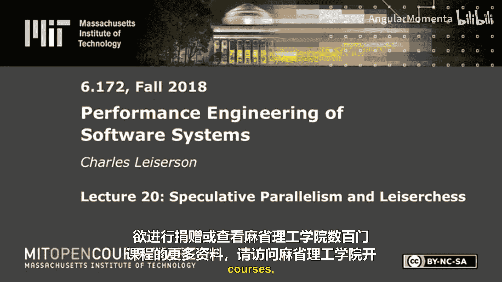
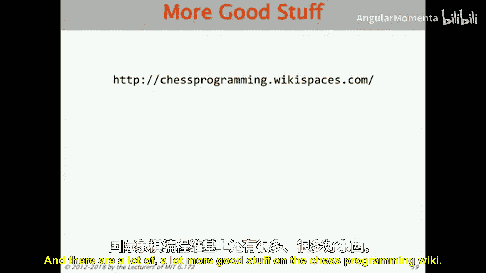
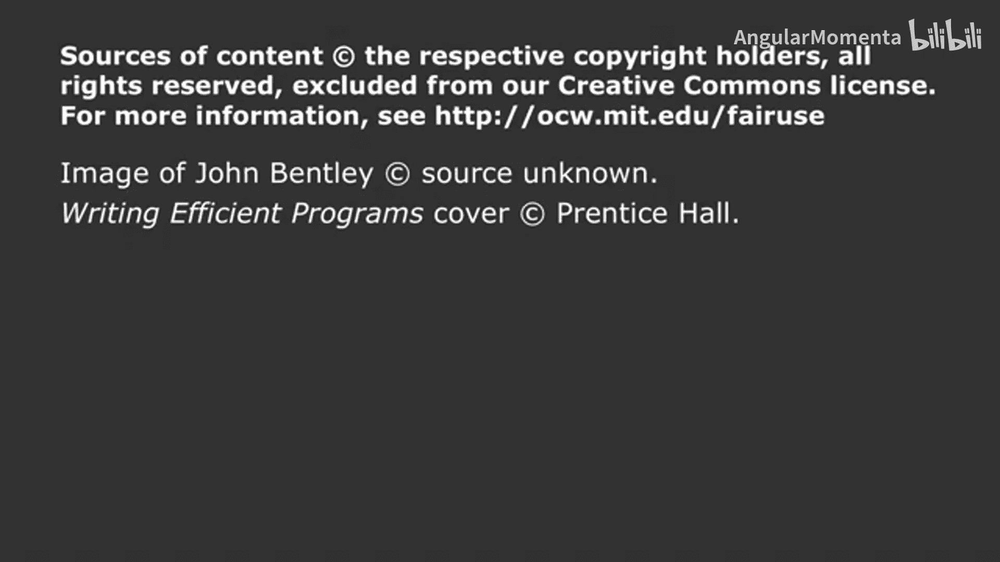

# 【麻省理工】软件系统性能工程 ｜MIT 6.172 Performance Engineering of Software Systems, Fall 2018 p20 20. 推测并行性与Leiserchess -BV1esbLzpEFq_p20-

The following content is provided under a Cative Commons license。

 Your support will help Mi T OpenCourseware continue to offer high quality educational resources for free to make a donation or to view additional materials from hundreds of MiT courses。

 Visit Mit Opencourseseware at Ocw。 Mt Eduu。

Okay， let's get started。On Thursday。We are really privileged to have John Bentley。

 who is one of the masters of performance engineering， come and give us a guest lecture in 1982。

 he wrote this wonderful little book from which we adapted the Bentley rules that you folks have seen。

And he's also famous for things like Kd trees， who' seen Kd trees。Yeah。

 so he invented KD treeses and who's ever used the master method of re current solve。

 he invented the master method of recur solving and so I mean he's just a wonderful wonderful fellow with lots and lots of insights and just like a superior performance engineer and he's going to talk give a guest lecture on Thursday and so I would encourage you to。

Bring your friends， bring friends maybe who drop the class okay because this is like this is the and others who you know if any of you have your ops other people in your research group。

 whether they're graduate students or whatever they're all welcome to come because this is really you know one of the opportunities you get to to actually meet one of the you know legends of the field if you will。

 and you have a and you'll see he's very approachable he's very approachable so anyway my advertisement for John Bentley。

Good， so let's start， I want to talk about speculative parallelism for a little bit because that's kind of what you need to make the code go fast so if you look at code like alpha beta。

It turns out that it's inherently serial。Okay， that is if you don't。

If you try to do things in parallel， then you miss the cutoffs。And if you miss the cutoffs。

 you know the beta cutoffs， then。You start doing work that you wouldn't necessarily need to do。

And so the only way to sort of make this。Type of code run fast is to use speculation， which is。

To say that you're going to guess。That you can do stuff in parallel and it'll be worthwhile。

And then occasionally you're going to be wrong。But the trick is， well。

 how do you minimize the wasted effort when things go wrong？

So let's just take a look at a very simple example of。Of。Spulative parallelism。

 which is thresholdholding a sum。So here we have a little program that is returning a Boolean。

It takes as input， an array of size n， so thresholding assumptions we have an array A of length in and a limit。

 and these are all unsigned integers say。And I start out the summit zero and what I'm going to do is add up。

All the elements of the array， and if it exceeds the limit， then I'm going to return。Okay。And so。

How might I。Optimize this code a little bit。Yeah。Weない。No， let's say on one processor。

On one processor or what might you do？と。Thank。Yeah， once you check so that once you would exceed it。

Why keep adding the other numbers？Okay， so here's a code that does that quit early if the partial product ever sees the threshold this isn't necessarily an optimization because notice that now in the optimization。

 not only do I have you know a memory reference and an addition， I also now have a。呃。

You know I also have an unpredictable branch， actually it's predictable branch。

 sorry predictable branch， but it's still more one more step because it's always going to predict that it's not exceeding until it actually does exceed。

 so that'll be pretty predictable。And but still， I've added something into the loop。

 so that maybe slower， how might I mitigate that problem？So I don't want to。

Add too much into the inner loop。Yeah。那个。Yeah， so basically I can do what's called strip mining。

I replaced the loop of in iterations with a loop of。Let's say n over four iterations。

With an inner loop of four iterations and every fourth iteration。

 I check to see whether or not I've exceeded。Okay， so that the cost of the check is going to be relatively small at that point。

Okay， so there are ways of making this sort of go fast， okay。We want to make this。

Opererate in parallel。Okay and the problem in when I operate in parallel is that。

Is that as I'm adding stuff up。I want to do it， so I'm going to do this here with a reducer。

And so basically， I'm going to add up the values in the reducer。

 but now I'd like to do the same thing of being able to quit early。And so the question is， well。

 how can we parallelize？A short circuited loop， okay。

 how can we and so the way I'm going to do this and this is sort of by hand here。

 but it's going to give you so actually as you know underneath the loop is really a divide and conquer loop。

And so you know I could write it as a parallel loop， and now it becomes。

 I think a little bit clear how I could， in this case， what I'm going to do is。

IsRe the value of the sum。 And now the question is， well。

 how can I quit early and save the work if I exceed the threshold？Okay。

Understanding that you when I'm executing this in something like silk。

 it's going to tend to go down one path and often it's going to be a serial execution。

 so I'd like if it's possible， so here's one way of doing it。

 which is that I add an abort flag to the code， and which is going to say whether I should keep going or whether I've actually exceeded at that point。

And so I'm going to use that recursively， and now I take a look at for each time through the loop or through the divide and conquer。

 I look to see whether the sum is greater than a limit and I haven't。

 you know already aborted the flag than I set the abort flag to be true。

whyhy do I bother testing the abort flag before I set it to true？

So notice that that setting the abort flag is a race， isn't it a determinacy race？Okay。Because。

I have great， thank you， it's because I have the stuff operating in parallel。

I all trying to set the abort flag whenever something aorts。

 I can have two guys who are in parallel setting in the abort flag， but if they're setting it。

 they're setting it to the same value， so it's a benign race。

 assuming your memory model is such that you can actually set the values so what happens here when why do bother checking this？

So what happens when several guys in parallel want to？Right to the same variable。This is quiz1 stuff。

Yeah。Yeah， you can have it bouncing along the cash， it will serialize it。

Because if they're all trying to write。Then they have to get exclusive access for it to write and modify it。

And so that happens boom， boom， boom one at a time。

 and so by checking it first it can be in a shared state and then only one guy has to one guy collors it and then it'll update all the other ones。

 so it makes us so we don't continually have a true sharing race。And then。

In the checking to see if it exceeds， we basically just check to see if。啊。You know。

 we basically call this function， we set the abort flag to false。

 and then we return the sum of all the values and if it aborts， then it just returns early。Okay。

 so it doesn't have to keep going through the computation， and of course。

 once again you can coar in the leaves and so forth。So this is non deterministic code。

 which we should never write unless we have to。Okay。

 because that's the only way of getting performance and you have to make sure of course。

 you reset the abort flag after the use。嗯。And then actually。

 do you need a memory fence here on the abort flag？Do you need to set， you know where？

Where would you put in aor flag to make sure that the value was？Yeah。You by。这里面是保汤。Yes。

 or what would you have to do？Okay， so indeed， it turns out you don't need a memory fence here。

 and the reason is because the code is correct。Whether it's the initial value false or whether it's become true。

So it doesn't matter when it becomes true。And so there's an issue of， if you put in the fence。

 then you know that it becomes true earlier。Okay， rather than waiting for the conut。

 but that may actually slow things down because memory fences are expensive。

 but because the transition is always from false to true during the execution。

You don't actually need a memory fence there。Okay， in order to make sure that you've got the correct value。

Does that make sense？So you don't need a memory fence。So。

So that's a classic instance of speculative parallelism。

 that occurs when a program spawns some parallel work that might not be performed in a serial execution。

So you're performing it， anticipating that you're probably going to need to do it。Okay。

 and then typically what you want to do is。Have some way of backing out if you discover that you've made it that you didn't need to do that way。

 have some way of making sure that you don't do anymore， okay？So。

Basic rule of sum of speculation is don't spawn speculative work unless there's little other opportunity for parallelism and there's a good chance it will be needed。

So one of the things I've seen in research papers， no less is。People who say， oh， I'm going to。啊。

You know， I have a calculation where I'm trying to find， say， the minimum of a bunch of values。

And so I'm going to， you know， spawn off。You know， end things。

 each of which is looking for the minimum as soon as the minimum one comes back。

I'm going to retract all the other computations， and I'm going to get super linear speed up that way。

Because。Because in the serial execution， I might have done the longer one first。

And maybe the minimum is not the first one or whatever。

And so they claim super linear speed up by doing speculative parallelism。But that's not really。呃。

That's not really a good example because there was a better serial code if that was really a good way of doing it。

 they should have been doing what's called dovetailing。

 which is they doing a little bit of this computation， a little bit of this， a little bit of this。

 a little bit of this， et cetera， and then going back， that would have been a better algorithm。

For which you would then use it and the risk they have is that they're spawning off n things of which most of them may not be needed。

And now they don't get any speed up， even though they've just used a lot more work。

And that often is a bad choice， so usually you don't want to spawn speculative work unless there's little other opportunity and there's a good chance it'll be needed。

Okay。My experience is， you know how much what kind of chance do you need。

 you need to you know have certainly less than， you know， for parallelism。

 you got to have if the chance that you're going to need the work if you have P processors。

If the chance that it could be not needed is less than actually I have a theorem at the end。

 which I'll refer you to because's a little bit hard to say because I didn't put on the slide。

 but there's a final slide for this which gives a nice little theorem about when you should do this。

So now let's talk about parallel alpha beta search because that's kind of what you're doing with your principal variation search。

And。So if you remember the analysis done by Canuth and Morris。

 they basically showed that for a Gra tree with a branching factor B and depth D。

 an alpha beta search with move searched in best first order examines it exactly B to the ceiling of D over  two plus B to the floor of d over two minus1 nodes at p D。

 so that's basically。诶。Square rooting the amount of work that you would need if you did a full depth p。

 that's with alpha beta， okay， so naive algorithm looks at B to the D nodes at depth D。

 and so for the same work， the search depth is effectively doubled or the work is square rooted。😡。

Okay， so that we saw。Last time in Helen's lecture。ok。嗯。

So the key optimization here is pruning the game tree。And。As I。

Mentioned at the beginning of this when you prune the game tree。

 you've got what's effectively a serial thing， and if you let something go ahead。

 you may be working on something that would be pruned。

So then how does the parallelism really help you there。

 you're just wasting processors that could be better spent perhaps elsewhere。

 except where else can you spend it because there's no other parallelism in the code。

 so we want to find some solution。So the solution comes from an idea。

From a very nice paper by Burrkhart Monine and some of his students in Germany。

 and they made the observation that in a best ordered tree。

The degree of every node is either either one or maximal。This is not their observation。

 this is actually the observation in the canuth paper， okay， so when you have a best ordered tree。

 if you can get all the moves ordered in their true order，Okay。

 then it turns out that either you're exploring all the children。Or。

You are refuting something and you get a cutoff from the very first one that you look at。Okay。

 and so in this case， for example， it turns out on the principal variation。

 those are all full with sorry you have to explore all the children and then from there on it alternates one level you have just a single child that needs to be explored and when you explore it if it's best ordered。

 you will get a beta cut off for the others。And then it alternates， and then it's full width。

And so their idea was to say， well， if the first child fails to generate a beta cutoff。

Speculate that in fact， you have the best one and the remaining children can be searched in parallel without wasting any work。

Okay， so if it fails， you're going to say， oh， I'm going to speculate that this is in fact a full width thing now in practice you don't necessarily get things best ordered。

But there are a bunch of heuristics in the code we've given you and in chess code to make it so that you tend to do things in the proper order。

 the most important of those is if you've seen the move before。

Okay and it's in the transposition table， you use the move that you've seen before。

 even if it's to a shallower depth， okay， you guess that that's going to be their best move still。

 even if you search deeper and that's pretty good。And then you so they call that the young siblings weight algorithm。

 they actually call it the Young Brothers weight。In the modern era， we call it young siblings wait。

 okay？And we abort subcomputations that prove to be unnecessary。

 so you're going to start out searching， but then you want to you know get rid of things that you discover oops。

 you know I did get a cutoff from searching from one of these things， I don't need to do this。

 let's not have it keep spawning and generating you know work in some of the things let's abort it。

 and here's the idea for the abort mechanism。So what you do is you， you know。

 the abort can occur at any given node saying I don't need to， you get a beta cut off。

 you want to abort all the children that wouldn't have been searched anyway。

 but they may have already been spawned off， so you have a record in each node that tells you whether or not you've aborted。

And what you do is you just simply climb up the tree。Okay， to see whether or not， you know。

 periodically， whether or not you have an ancestor who is aborted。

If you have an ancestor that's subordted says， I'm aborting the side computations， then you say，  oh。

 I'm done and I just have to return。And so you check that on a regular basis， okay？

So do people follow what that mechanism is and so that's basically what you're going to be implementing for you know for the parallelization。

 okay， is this thing of climbing up， you're going to spawn， you know。

 you're going to guess after you've searched one child that it's good， hey。

 actually some people say why don't you check too？Before you。You know， search the others， okay。

 so that you're even more sure that you don't have a cutoff because neither of the first two aborted。

Because in practice。Of course， the game treee is not best ordered。

And so you're going to waste some work。Okay， so but the idea is you're going to pull up the tree to see whether or not and of course you don't want to pull on every evaluation that you do。

 you want to just pull frequently， so you may have a counter in there that says， okay。

 every 10th time I'm going to pull up the tree or every， you know。

 you put a voodoo parameter there that says， how often it makes sense to actually check because there's cost to going up and checking。

Okay versus exploring more of the tree。Okay and so I have an example here and I think this is where i'm going to cut this short so let me there's an example which I suggest you take a look at I want to as I say spend time doing Q and A and talking about the other parts of the program and give you folks some good ideas for for things so this is sort of the。

Theory thing， and now I have some slides that will explain this with examples in more depth because I don't expect that everybody got every detail of this。

Okay， so this is the so I have some examples and so forth in here that I'm going to let you guys look at on your own。

 okay？Now， if you paralyze the spawning off loop。Okay， of the younger siblings。

 you will get a code with races， okay， and the reason you'll get races is because there are several。

 there are three data structures。Okay， that the search is employing that are kind of global。

 the first is the transposition table。Looking things up to see whether or not you've seen them before。

That's a major optimization you don't want to get rid of the transposition table。

 and so you have a choice for the transposition table， what are you going to do with it。

 are you going to lock it？So that the races become at least your data race free and updated atomically。

 or you could replicate it， for example， you could have a worker local copy of the data structure。

And each。Each worker that is working on it only accesses their own local copies。Okay。You know， or。大。

You know， you can use a。诶。You can make a copy when things are stolen or you can make just one where you just maintain it locally。

Or you can decide that， well， you know， even if there's a race there。

 the odds that it's going to affect how I play in the game are not that high。

 so I'll run with a race。Because any other solution is going to be more expensive。

Okay and then maybe you get funny answers， so one thing is for that kind of data structure。诶。

Let me just recommend is that。You have some way of turning off the data structures so that you can actually do the parallel search and get。

Deterministic， repeatable results。Okay， so even though it may be aborting some things may not be aborting。

 you want to have some way of executing and so for example。

 you want to be able to turn off even the speculation in your code so you can test all the other things in your code that don't depend on the speculation。

Okay， because if you have something that's non deterministic as I say it's a nightmare to debug。

Okay so evaluate you know you're evaluate you're going to do the evaluation function， hey。

 turn off if you're testing it， turn off the speculation that you should be able to find out whether you've got bugs in your evaluation function there's no point in discovering you have a bug and it's like well where did it come from or whatever okay so you want to have things turning off and also you want to have ways of turning off for example。

 access to the transposition table， yes I'm going to speculate。

 but no I'm not going to access the transposition table。In parallel。

 because I may get a race on the entry in the transposition table。Okay。

 I will the hint that I will give you for that is that the in the。

Code that for our program that took second prize in the World Comp chess Championship。Many years ago。

 I think it was in 1999。嗌。Where we actually almost won the tournament。And it's。And we got。

We lost in the playoff， we would have won the tournament except that we suggested our programmer suggested a rule change at the beginning of the tournament that everybody agreed to。

 and then we were on the short end of that， otherwise we would have been world champions。

 and that was the last competition against computers that deep blue。

 the IBM Comp that beat Casparrov the human challenge just a few months later。

 they performed it and we actually they placed third in the tournament， we tied for first。

Our only loss was to deep blue。And we were running on an 1。

824 node supercomputer at Sandia National Labs。A computer that probably is today less powerful than this。

Okay， so， but it was you know， it was very big type of computation， so we you know and we were。

 you know， they basically said if there's a tie， they're going to base who wins on strength of opponents。

So you take a look at your opponent's records and if you had stronger opponents。

 you'll win against somebody and we said， you know， if there's a tie just between two programs。

 we should really have them， face off。aAgainst each other as an extra round and every year that's a good idea and then wouldn't you know at the end we had the strongest opponents and we were tied with another program called Fritz。

 excellent program。we were out searching fris in the playoff game。

 and then we saw a move that in afterwards when we were able to do offline searches deeper。

 we were outsing them by like two ply。Okay， and then。

 but then there's a move that looks like it's a good move for the depth we were looking at it。

Doesn't look like a good move if you search much deeper， or frankly， if you search much shallower。

Is one of these things where it just looked like a good move for the ply we happen to be searching because there's no guarantee because you can't see the end of the game。

 there's no guarantee that if you search deeper， you're actually going to beat somebody else。Okay。

 sometimes because there's the horizon effect of you can't just simply can't see what's coming up in the future。

 you can only see sort of on average， so we made this bad move， we almost recovered， we almost tied。

 had we tied， we would have been world champions because we had the stronger。

 we won the tiebreaker and we weren't able to recover from the era and so we took second prize I like。

Anyway， in that program， we decided that we were just going to let there be a race。

And on the transposition table， and the reason was we calculate what are the odds？

That the race actually affects the value。That you would actually pick that value。

 And if it affected the value， what are the odds that affects the move that you're going to make and it affects the move you're going to make。

 What are the odds that affects。The game， and if he affects the game。

 what are the odds that affects your result in the tournament？

And when you figured all these things out， it was like， eh， we would slow the program down more。

By putting in， for example， locking。Okay。Because that would slow down every access。

 than we would if we just ran thing， because one of the things that happens in alpha beta。

 that thing is if you get an extreme value，Usually those are lapped off。

Because if it's such a good move for you， your opponent's not going to let you play it。

So if you ended up with a score that was extreme because it was based on a value that you were racing on。

 usually it's going to not even propagate up to the root of the tree。So anyway， so we just ran。

 you know。Naked， so to speak。嗯。So there are two other data structures you're going to have to worry about to make decision about another one is the killer。

诶。Data structure， so the killer data structure is a heuristic that says， you know， at a given depth。

Of code， you tend to see the same moves that are good。

And a move that is good for one thing at a given depth tends to be good for something else。

 so for example it may be that you know you play Bishop takes queen okay。

 so you've won the other players queen and then their response is。

Their response is to do something irrelevant。Okay， well now you you know。You made them。Okay， well。

 there's a lot of other moves where you know， you could make them on that move。

Okay for which they're playing things on the board that are irrelevant， okay。

 and so the same type of move tends to be a killer。

Always you're able to at that depth in that position， you're able to make the same move and it。

 if they don't address the issue， that's always a good move to check。

And so that ends up being ordered near the front， so the killer table keeps track of that。

 and I think in our code we have two killers， is that right， Helen？

I think I think it's set up to allow you to do up to four killers。

 but we only do two in the code that we gave you， I mean you can enable it and see whether four killers。

 but that's a shared data structure。And so one of the questions is。

 should you be keeping a local copy of that or should you be？You know。

 using a global one that they all share。Okay， and updating it。嗯。The third one is the best move table。

Which is used to order all of the low order things so the first thing we that's most important is did you get a move out of the transposition table that tends to be quite accurate then second is did you get a move out of。

Did you get a move out of the killer table and finally it's sort of like statistically how good are these moves？

Have you seen these a lot before and if you've seen them a lot before that's how the other moves get ordered and that's kept in the best move table and once again that's a shared table in the search you're going to have to figure out do you want to do a thread local you know worker local copy or do you want to。

Do you want to you know synchronize it or how are you going to manage that data structure okay。

 and the answer I would say is different for the compared to what you do with a transposition table。

Tranposition table， generally， it's not worth locking or whatever。

 and it is good to share because if you have seen that move before that saved you a huge amount of computation to be able to look it up and not do it。

Okay， so those are some of the tips for parallellyization， which you'll get to in the beta 2。

But now I want to talk about for most of the rest of the time。

 talk about some of the other things that you can do with the code you've currently got。U。And。

Let me take these in some。Some order， and then we can ask questions。

 so opening who's contemplating doing an opening book， anybody？For beta1。

 you can do an opening book for beta 1 or beta 2。For beta 1， let me see， okay， beta 2。

Who wants to do an opening book better for the final？Okay， yeah， okay。

You know the idea here is to pre computeute best moves at the beginning of the game。

knowSo that you know it's like well， we know what the starting position is so what don't I？

Spend 100 or whatever on Amazon。And you know compute things to some ungodly ply。

 right and see what the best moves are at the beginning of the game and put that into a book so I don't have to search those。

U。诶。So that's the idea。I think to begin with there are lower hanging fruit than。

Then the opening book， you know， if you look at it， you're going to be in opening book。You know。

 if you're lucky for。You know， six or eight moves。And the games tend to last。

 if you look to see how long games last， tend to last。Yeah。What is it？No， most games don't go 4。

096 we don't let them go that long anyway。So anybody take a look statistically to see how long games are？

I think they tend to be like 40 or 50 moves。Okay。I mean。

 this year is different from other years because we have different rules。

I think it's like 40 or 50 moves， so you're not spending。

So you're doing something that will help you in 10% of the game。

Where is there other places you could do it which's going to help you in the whole game？Nevertheless。

 we've had teams that did a great job on opening books and clobbered people by having a fantastic opening book。

 okay？It's actually cheaper to keep separate opening books for each side than to keep one opening book for both sides。

😡，And in this game， it's actually fairly easy to keep a symmetry thing and basically have an one opening book that works。

For the side on move。And that allows you to store， you don't have to store， you know。

 if I make a given move。If I have a given position， I only need in principle to store one answer。

For that position。Okay， whereas then my opponent may make any number of moves for which then I only need to know one move。

 what's my best move in that position， so you can see that you're only having to， you know。

 you have once again this property that on my move， I only need to have one move stored。

 my opponent's moves， I need to have all the move stored。Okay， and then my move。

 I have one move store and that basically means that you're effectively going twice the depth as if you kept all my moves and then all of the other opponents moves and then all of those because when I do that it's like。

 well why am I you know why do I need to know what the best moves。

 so it's better to keep them separate when you build the opening book you'll store a lot less。

 you have a lot smaller storage you'll be able to store a lot more moves if you do that？

But I would say not necessarily the best， the first thing I would go to optimize。

And but it's also the case that this is a place where one of the teams built a fabulous opening book one year。

And one of the things about the opening book is it allows you also to sort of threshold and say。

 you know， in a given move， I don't just have to have one move， let me have three moves。

And pick randomly among them so that I'm not predictable。

What the team did that used the opening book is they observed that everybody was using。

 where just searching from the beginning， so they were all finding exactly the same moves。

At the beginning of the game， and so they knew exactly what the path was that all the other programs were going to follow。

And so they could make the best move on their move。

 but if you have something that's got some randomness to it and there is a jitter in there who found the randomness。

The place we insert randomness in the code。So there was。

 I think Zach had a comment on Piazza about that， so there's a place in the code where we dither the amount so that you will get unpredictable results。

 and that way you won't always play the same move。Okay。

 just by changing things this is like you know a tenth， you know。

 hundredth of a pawn value is like not very big and like who cares whether or not you know we have you know。

 it's， you know， we're not actually these heuristics aren't measuring things so closely that we care about a tenth of a hundredth of a pawn so you can dither things and have one move be better than another and not really affect the quality of the playing。

Okay， so it is a good idea to do something to not be so predictable。Okay。

 but to build a full opening book， that's a lot of work for。Beta 1 for beta 2 in the final， yeah。

 you'll get to that point。The next thing is iterative deepening。U。

Do people understand how this part of the search code works？Yeah， no， let me go over it， okay？So。

You can imagine saying I'm going to search to depth D and in fact， instead of just searching depth D。

 we do a depth1 search， if you look at the code there， if there's a depth1 search。

 then we do a depth2 search， then we do a depth3 search。

 then we do a depth4 search and we keep doing that until our time control expires。

Why is that a good strategy？Generally， well， first of all。

 the amount of work with each depth is's growing exponentially。So you're only spending。

 in principle a constant factor more work than you would if you search to depth D right off the bat。

Okay。U。But the important thing is that you can keep move ordering information as you search deeper。

And the move ordering information， remember， this we want our searches to use best first move ordering so that we get all the cutoffs we can possibly get。

Okay， for pruning。And so by searching it easily， actually， you end up with better move ordering。

Okay because when you find the same position in the transposition table， you say， oh， well。

 I didn't search it as deep as I need to search it now。

 so I can't use the value that's in the transposition table for the position because may be say you know。

 I've searched something that's you ply eight in the transposition table but I've got to search to ply nine。

 not good enough a search， but the value the move that you found at ply eight。

 that's probably a pretty good first move。You know， pretty good best move， guess it best move。Okay。

 so by doing iterative deepening， you actually get the move ordering for all those intermediate positions。

You know， really， really， really strongly because that transposition table is the very best information you've got for what the first move is。

 what your best move is， sorry。Okay。And also， as I mentioned， it's a good mechanism for time control。

 is that clear？So that's why you bother， it's one of these things that looks like it's redundant。

 why are you searching if you're going to search to depth D， why search to depth D minus1？

You need to do that as part of depth D well no， because you're going to get move ordering information that's going to be really valuable when you search to depth D minus1。

 so when you search to depth D， you've got much better pruning than if you just went straight to depth D and had no information about the move ordering。

Does that make sense？U。End game database。So here's the idea。

 if there's a few enough pieces on the board， you can precompute the outcomes and store them in a database。

Okay，So for example， the most common database to come up with is the King versus King database。Okay。

 so if you do King versus King， that means that it's not that you expect the game will end up as king versus King。

 it's that you're going to encounter that in the search。

 it'd be nice to know who has the win if you're king versus king。Now。

 the code actually plays optimally for King versus king。The code we gave you will do。

We'll play the king versus king you know perfectly well and in fact。

 there's just two heuristics that are responsible for that one is the。

What's called K aggressiveive heuristic， and the other one is which basically makes you move towards your opponent。

And the other one is the K face heuristic， which makes you point towards your opponent。

And those two things turn out to do a pretty good job of when there's two kings in playing。

 they go through this little en， did everybody do that by hand， by the way。

 do you play King versus King？So。Really good idea if you want to understand the game is just go and do a king versus King version of the game。

 get an eight by eight chessboard and just put down two tokens that you call it kings that have orientations and then just just the two of you and a friend just try to see if one can mate the other。

 and you'll see that it goes through a very ritualistic type of behavior which ends up with one of the kings being made it。

So it's nice to know which one it's going to be， so that if you encounter that。

But here's the question is， how many games actually make it to an end game？Once again。

 you have to look at what the odds are there， because if games are ending in the middle game。

There may not be any need to search all the way to the end game。Okay so。

So that's something that you need to weigh。Okay， now， if you do an end game database。

 it doesn't suffice to just store win loss or draw for a position。And the reason is because。

You can get into a situation where you've got a winning position and then you say， okay。

 well let me move to another winning position and another winning position and another winning position。

 oh， and I'm back at my original winning position。And I just keep going around in a circle。

 always in a winning position， never moving towards the win。Okay， and that， of course。

 will end up in a draw。So you need to know which direction do you go for the winning position。

 so the typical thing you do there is you keep the distance to mate to avoid cycling。

 so you go from instead of keeping just a boolean value， you say here's my distance to winning。Okay。

 my distance to winning is six now when I'm searching。

 I don't want to go a distance to winning that's seven。Or six。

 I want to go to a distance to winning that's five when I make my move。Okay。

So it's very important to make sure that you maintain the distance in order to avoid cycling。嗯。

knowQuesescence Search， we talk about quiescence， which is to make sure that when you're doing the evaluation。

 you're not in the middle of an exchange。So use Zap。Their pawn， they're going to zap your pawn。

Or maybe even Zap your king。Okay， and you don't want to evaluate in the middle there。

 and so the idea of quiescence is that when you're done with the regular search。

 you just play off moves that involve captures。And then you evaluate the position。Okay。U。

So that's quieting the position。Okay make sense？Another heuristic there is no move pruning。

In most positions， there's always something better to do than nothing。

So sitting still is usually not as good as actually making a move， okay？And so the idea is。

 suppose that I can forfeit。My move。And search a shallower depth， and I still have the best position。

Okay， then I still am winning well then， and it generates a cutoff then why bother exploring any other moves。

 I probably am in a really good position here， okay。

And if I don't manage to get a cut off from the null move， then I do the full depth search。Okay。

So so the place this is dangerous is in Zugzwang in chess， it's called Zu Zang situations。

 so Zu Zang is a situation where，Everything is fine， but if you have to make a move， you lose。

So usually making having the advantage of a move that's called the initiative in chess。

 and that's a good thing， you want the initiative， you want to have the extra move。

Over your opponent， but there's some situations where if you move， you lose。

And so you want to make sure you don't have a zuchang situation。

 I don't actually know if there's a zuchang situation in  Lyr chest。Okay。

 so if somebody comes up with one， I'd be interested to see that， you know， where if I had to move。

 I lose， but if I sits there， so what in chess what they do is in the end game。

 that's when zs lines come up， they turn off the null move pruning。嗯。

So is this clear what null move does for you， what's going on there。

 I see some people who are quizzical， anybody want to ask a question？

I see some people with sort of quizzical looks on their faces。ok。So the idea is for no move is。

 my position is so good。Okay， that even if I do nothing， I still win。Okay。

 so I don't want to search anymore in this part of it because you' you know， I get a beta cut off。

 you're not going to let me make this move， that the move that got me here， yeah， question。

Oh did you yeah okay， that was it okay good， yeah， my move is so good I could I can do nothing and I still win okay。

 and so why bother？Let me verify that without necessarily doing as deep a search。

 so no move is fairly cheap to do and it often results in a lot of positions for cutoff and if I don't get a cutoff then I just do the normal search。

This is a pretty complicated piece of code， isn't it？Okay， you know， pretty complicated， okay？

There are other situations， we mentioned killers， okay， there's also move extensions。

 so typical move extensions that people look at is you grant an extra ply in ch if the king is in check or for certain captures or if you have a forced move。

 so suppose you have a move and it's the only move you can make。Then don't count that as a apply。

So you can search deeper along lines where their' forced moves， that's what they do in chs。

 lir chests， not quite so clear。What you do， okay， which ones you would do extensions for？ok。

Because it's rare that you have just one move in Lyrchess compared to in chest where you have by forced move。

 it's like if you don't do this， you're going to get captured or made it or what have you。Okay。

 so that may come up in lessr chest， but anyway， it's something to think about。

So the transposition table， so we talk about this as a search tree。

 but it's really a dag because I can get to the same position by transposing moves， you know。

 this guy does A， this guy does B， this guy does C， this guy does D。

I may get it to the same thing by doing A。D。C， B， I transpose those two moves and I get to exactly the same position。

Okay， and so I'd like not to search that position again if I've seen it。

And that's what the transposition does。There's a quality score that is in the transposition table that tells you how good a move you've made and the quality is essentially the depth that you had to search in order to establish the value that's stored in the transposition table。

And so you don't want to use something of too low quality when you're searching。

 if you have to search the depth D， something of quality D minus1 is not good enough。

because otherwise you'll not be searching you know， the full tree。

 but something typically that is deeper。You if I'm looking at depth D and I find something in transposition table that's D plus1 or d plus 2。

 that's great to use。That just gave me an even deeper view of what's behind that move。

OkayAnd so if you look at the logic there you'll see that that's how they do it， it's very tricky。

 one of the things that's tricky is when you find a mate how you store that in the transposition table and you'll see their special code for handling mate positions。

And the reason is because。What you're interested in doing when you find a mate is knowing your distance to mate。

 but not from that position， the distance to mate from the root of your search。Okay， so。For example。

know let's say this is the root of my search and I search down to a given point。

And now I do a look up in the transposition table and I discover that there's a mate in five here。

 okay？And this is， let's say I've searched nine ply or something， okay。Well。

 if I store that this is a matn five and I store the value for Man five。

Then if it makes it up to the top here， it thinks there's a mate in five。

But there isn't a mate in five， there's a mate in 14。Okay。

 so when you look it up and you discover there's a matn five in the table。

 you have to do a little bit of a calculation to translate that into being a mate in 14 as the value that's going to be used here rather than a maten five。

Does that make sense， so you'll see that's the logic that's in there for dealing with mates。

So mate basically takes a very large number way larger than all the material on the board。

 and then it subtracts what your number of ply is to get。To get to meet。So some big number。You know。

I don't know， 32，000 or something minus the depth to me。is how you represent a mate。

So it's some very， very big number and then minus the。

Mine is the depth and that way you can make sure that you're going for a mate in 13 instead of a mate in 14。

 for example。You know， preferferring that you take the shorter path。Makes sense。

So that's one of the things to look out in there。There's also a lot of stuff in there。

 the transposition table has， we talk about caching， it's actually a K As of cash。

 K way Asciative cash。And so you can are very k to see what's the best。

Choice of how many entries you should have， the more entries you have。

 the longer it'll take you to search them。On the other hand。

 the more likely it is that good moves stay in the cash。Okay。

 so you can decide what's the right trade off there？So there's a good tuning optimization there。Okay。

 questions， any questions about transposition table？Transposition Day is a major optimization。U。

Zbras hashing， so most of these we Helen talked about at some level。

 but I wanted to sort of give a chance to have people ask questions， nobody's asking questions。

 came here for Q&A， all you're getting is A。Okay。So let me explain Zbras hashing again a little bit。

So Zbra's hashing， very clever idea。So we have our board。Right。With。With a bunch of pieces on it。

That's probably the wrong number of squares， right， that's seven by six， okay， who cares， okay？

So the idea is that what I'm going to do is have a table of random numbers。

Then I'm going to compute in advance。And this is going to be indexed by。You know， my row， my column。

 my piece type。And my orientation。Okay。And every different combination of row column type and orientation corresponds to a different random number in the table。

Okay， so you have some sort of random number there。Okay， so。You know。So。

And what my hash function is is it's the Xor。Of all of the values。

Of all the pieces that are on this table with their orientations。Okay， so if I have a king here。

You know that's a white king， I guess I need to know who's。Not just what the type is。

 I also need to know whether it's white or black， right， so the side。Okay。

 I think actually that gets encoded somehow， but in any case， yeah。

 I think maybe in the type we actually keep whether it's a whiter pawn， black pawn， yeah。

 it's in the type I think is the way we actually implemented that。Okay， so there's white king。

 black king， white pawn， black pawn。Or。So if I have a king there。

 that corresponds to a certain value。If I end up with a pawn here， let's say a white pawn。

 then that will be another one and I exore those together and I take the black king。

And I exhort his position is and the black。Pa exor that in， and so I ex all these four values。

 that's the hash function that I use to do things like look up things in the transposition table。Now。

 if I had to compute this。Every time I change the position。You know。

 that's if I have a lot of pieces， how many pieces I've got I've got。78， 16 pieces。

Each side has seven pawns in a king。So 16 pieces， I have to do 16 x wars。

In order to compute my hash function， so Zbras hashing is really a lot clever。

 it takes advantage of that Xor trick that I taught you in the first， no。

 it wasn't the first it was in the。There was the second lecture。Yeah。You know， the Bi tricks lecture。

 okay？And that is that Xor is its own inverse。So if I want to remove a piece。

 let's say I'm going to move this pawn。Okay， from here to here。So I remove this piece。

What do I do to my hash function？To remove a peace。

I look up the value for that pawn in the hash table。And I exhorre that into my。Hash for the table。

 and I now have a hash for those three pieces left。Does that make sense？So I have my hash function。

 which is a hash of the four things。I'm not sure you guys can see very well over there。

 but and I basically simply exhort it with the hash of the paw that I removed。

You know know of the pawn that I removed in this case。And now I moved it to here， so what do I do？

I look up that one。And I exhorate that value in here for the new position。New the new paw position。

And that gives me now the。The hash for the new table with the pawn in that position。

So any move that I make， I can basically update my hash function with only two XOs and XOs are very fast。

 they're one instruction， you know they're one， and they can do lots of xOs and stuff。

 so this is actually a very， very cheap thing to do。

Okay very cheap thing to do so that's Zbras hashing that you can keep these things up to date and that's something we implemented for you。

 that's an optimization that was a freebie， we could have given you the hash function you know。

 like this and had you implement that but this is one of the ones we gave you as a freebie for optimization。

You're not all saying thank you very much， Professor Eisson。😀Yeah。Okay， now in some sense。

 I took away an opportunity for optimization， didn't I there？Okay。嗯。

And so in the transposition table， there are records for the Zris key， the score， the move。

 the quality， also a bound type， whether it's upper， lower or exact。

Cause when I return something from alpha beta， I only know a bound on it if it's greater than alpha or less than beta and in some sense。

 the age of how old is this move because as things get older。

 I also want to age them out of the table theres several aging things there and you'll see the best move table also has an aging process where。

Every time it updates， the values， gives a new value。

 it ages all the other values so that they gradually disappear and aren't relevant。

One of the ones that people have。Get confused about is the late move reductions is so called LMR。

This is the situation where I have， I'm going to do， let's say， my parallel search。To， you know。

 of all my moves and the question is， once again you're trying to prune everything you can， okay。

 and so this is the idea is which are the moves that are more important to search deeper。

 the ones near the beginning of your move list if it's sorted in best first order？

Or the ones towards the end of your move list？So where is it most important to search deeply？

For things that you think are possibly the best move or the ones that you think are。The worst moves。

Yeah。Yeah， it makes sense to search the best moves。Right。So the idea is， well。

 if something is way down on the move ordering list。Why search it as deeply。

 it's probably not as good a move。And so let me search it more shallowy。

 I probably don't lose much of an opportunity to discover that that's actually a。

You know is indeed a bad move okay there's a reason it got it ordered down there and so that's late move reduction so with a good move ordering a beta cutle either occur right away or not all so you search the first few moves normally and then you start reducing the depth for moves I believe in our code we have two numbers where we reduce by depth one after a certain number of moves and reduce by depth two after a certain number of other moves Those are things that you can tune I wouldn't tune them very much I don't think。

Just because。And once again， I could probably be wrong here and some of us discover， oh， you know。

 if you tune it like this， it's way better， okay， but are that's the idea of the late move reductions。

Probably one of the most important things to think about is the move is the representation of the board right now we represent the board as it is。

Okay， that's a terrible representation， it's very， you know time consuming there's sort of two major。

Ways you can do it Oh I didn't put the other one here Okay， well anyway， so one of them is bitboards。

Here you use a 64 bit to represent， for example， where all the pawns are on the 64 squares of the board。

And then you can use pop count and other bit tricks to do move generation and to implement other chess concepts。

So if you're looking to see what are the possible places upon can move and you want to say。

 can they move right and let's say it's stored in row major order。

 you can just do a right shift by one。And that tells you where are all the places that ponds those pawns could move。

 and now you can just pick them off one bit at a time to generate your move list and then you can do it that way if you're going to move up a thing whether then you're actually doing a shift by or down。

 you're doing a shift by how much？白 eight。To move up or down。if you're storing things in Rome major。

That makes sense， right。It's eight by eight。And you're keeping a bit for each thing。

 then if I want to generate， you know， where is this one。

 if I shift this whole thing stored in row major order by eight， if I shift it right。

 it basically puts it there。Okay， so moving it by you know，7， eight and nine that gives you。

 and then shifting it by one gives you you know or minus one gives you this or left by one and then similarly you can do by you know shifting by seven。

 eight or nine that way and I can generate all the possible moves so that's one way of doing move generations using bitboard。

 and there are a lot of things for example that you can do with bitboards in parallel because you can say did I make a capture here。

Or let me use a bitboard to represent where the laser goes。

Did I make a move that is going to affect the path of laser？Okay， because。哎。

Because one of the major optimizations you can do is in the evaluations in dealing with the laser。

Because you're spending a lot of time stroking out laser positions。

 what's the point of doing that if you made a move of something and it didn't affect where the laser goes。

Why bother doing it out， you can just cache what the value of the laser is。

And there are a lot more good stuff on the chess programming Wiiki。

Okay， so yeah， question。Shift by8。Yeah， you got to be careful there， right？

Because if I do a shift to the right， for example， so what will I do， I'll just do a mask。

To eliminate all the things that got wrapped around。Okay， right。

 so two instructions or whatever yeah。Details， yes， details are good though， good question。

Good question。嗯。Who's time to their program， where are the opportunities that you see for performance engineering for a first pass。

 what are those expensive things， what do you have as expensive thing？Sorry the。

Marking laser path yup。Good， what else is time expensive？Yeah， laser coverage， boy。

 that is really expensive， okay， that is really expensive， so where else is expensive。

What else is expensive， so I would definitely go after L cover。That's a huge one to go after。

One of the things， by the way， if you are making your changes to the code。

And you're going to change the representation， leave the old representation there。

Take it out at the end。Add the new representation and put in assertions that say that things are equivalent or whatever。

But don't get rid of the old stuff because you'll end up with broken code and definitely use things like Perf tea to tell you whether or not you you know made any。

know madeade any changes if you touch anything with move ordering， sorry not move generation。

 not move ordering， move generation， so where else is expensive？Yeah。Sure。

 how much detail do you want？How it actually works。Okay， so what it's supposed to do is。down。

What's supposed to do is figure out。How safe the idea is I want my laser to get closer to your king。

And I want your laser not to be close to my king。Right and if I can。

Move into positions where my laser is closer to your king。

 but your laser doesn't get closer to my king， that's a good sort of thing。

 but when we say get the laser close， you know what happens when I've got say，Let me do it this way。

A position like this。So here's the。U。Okay。Suppose I look at this position。

 how close does the laser get， Mike， let's say I'm black here， and I look at the laser。

 well the path of the laser is it bounces there and goes across， right？

So I didn't get very close to the king there。But I'm one move away from getting it pretty close。

Because if I just move this guy out of the way， now I've got it really quite close。Okay。

 so if I compare that to， let's say， a situation where。Instead of the paws are there。

 let's say a pawn is here。Okay。Now。The laser is actually closer to the king than it was in the first position。

But it's a much worse position， right？The first one was much better when I had the pawns here and here。

Because I was simply one move away from getting it really close。

And so if you use just the direct laser thing and we did some tests on this。

 this turns out to be not very it doesn't guide the program very well on getting into situations where my laser is getting close to your king。

Does that make sense？So then we said， well， how can we you know how should we measure how close the laser gets。

 so what we said is well， let's take a look at all the possible moves from here。Of one move。

And then look to see how close we get things and the way we did that is we said let's you know this took actually Helen and I worked on this really hard。

 because this is a new heuristic that we have not used in previous years and it works great。

 it's just slow as anything。But it works well so you have to evaluate is it worth doing something if it's really slow。

 it may be that you do better to use a simpler heuristic and get deeper search than it is spending a lot of time evaluating but anyway we gave you one that if you can make it go fast should be really good。

 so what the idea is that what we do is we look at all the different paths from moving any piece you know one piece and look at the paths of the laser。

And what we do is we go， we count one for every position that we go away， two， three， four， five。

 six， seven， et cetera， we actually add an extra value if we bounce off in opponents。

 how much do we add Helen， do we add one or two if we bounce off an opponent？I think two， yeah。

 so if this is an opponent's pawn， we would basically go from three to five。s，7。

 and we basically do that for all the moves and the way we combine them is we take the minimum number that I can get there。

What's the cheapest way I can get to every square that the laser goes？

So we take all the different moves， we stroke them out， and we take the minimum。

 so if I have another path。Let's say by turning the king。

 it will go this way and there's another one here that's my pawn。Okay， then I may get there in one。

 two， three， four， five， six， seven， and so then this would become a value of seven here。Okay。

So that's the first thing is we basically get a map of you know how closer are things。

 And the second thing we do is say， well， how valuable is it to have these。These。You know。

 to be near the particular king and what we ended up with is something where if I look at the。

If I look at the distance that I am away。Let's say this one for example。

 is one row and one column away， this is zero row zero columns， we use。

 I think it's one over the row plus one times one over the column plus one。Okay。

 as a multiplier to wait how good it is that we've been close to the king。And we invert these values。

So that there。So the closer so that it's better to have a smaller number there。

 and then we add them up。And that's basically gives we don't quite add them up， we actually know。

 I'm sorry， what we do is we look at these things as a fraction of my shortest path distance。Sorry。

 that's what we did， yes， I'm sorry that was a previous year so here， for example。

 let's say this is the nine， the shortest way of getting there is one， two， three，4， five， six。

 seven， eight。So this would actually， when we do the conversion。

 this we give a value of eight/ ninths for being in that square。so we didn't get it。

 where's this one， the shortest path distance is seven because of this path。

 and you can get there in seven， this would have a value of one。So this is better。

And so we do that for all the course， we get a fraction of how much do we do。

 and then we weight it by something like this， which falls away quickly。

But it's important in heuristics like this to have a smooth path so that you can get things closer。

 if I made all these things be zero， it wouldn't know that it could move up and get a little bit better in the second or third order digit to get closer。

And so then we add all up， and that ends up being a number we discovered that's sort of in the range of。

You know。You know， like what did we figure the range was there？

There's like you know up to like four or so， right， something something like four on average。

 you know， would be the maximum value would B， and then we said， okay。

 then we have this magic constant multiplier that you can play with。That says， okay。

 let's represent that as a fraction of a paw， how much is that worth and we multiply by that value。

Okay， so that's what we're doing。Okay， so that it makes it so that we do tend to move the laser our laser closer。

 we subtract how close。The opponent can get from us。 and then we say that's the evaluation。 Now。

 if you have a better way of determining whether a laser is getting close。

Than this one that's cheaper to compute。That's good okay， for first pass。

 I would just simply try to make this go fast。Because for many of the moves that you're going to look at。

 it's going to be moving this pawn you know to there， nothing changed。

 there's no point in stroking this out and cacking R the minimum et cetera。

 because it didn't touch the laser path， things that are going to touch a laser path or things that you move on or off the path。

So why bother？Okay， and so if there's a clever way of hashing this， you know。

 so that you are caing it so that you can。You know， do things that's good too。

any questions about other things that could be done。

 so another place I'll tell you that's a good idea to look at is。

 especially once you get this heuristic top rate a little bit faster is the sorting of moves。Okay。

 is actually pretty expensive。Okay， what's the you know， once you figure out， here are all the moves。

 there are a lot of moves， now you go through and you do a sort。And if you think about it。You know。

 in a best move order tree， sometimes you only explore one of those。

 so why did you bother sorting all of them？on the other hand。

 sometimes you do need to sort all of them。So。How you optimize that sort so that you don't waste time sorting stuff that you're not going to actually ever explore。

 that's another opportunity for optimization。Okay， yeah， question。

The moves are sorted by these things like there's a sort key in there that represents a whole bunch of things like whether it was a killer。

 if it's a killer or it's a transmissionposition table value， gets a very big value。

 if it's a statistical thing that the history table says。

 in historically this has been a pretty good move，Then you get another value and then exchanges get ordered。

And so forth， so there's a bunch of things that are you know where you end up with information and then it sorts those things okay so that's actually kind of complicated logic in terms of what the actual values are that are used there。

 but the idea is you know here are all the moves now let's figure out what's the best our best guess as to what they are most of the good moves are coming out of the transposition table。

Right， but。Sometimes transmission table。It says it's not a very good move and there may be a better move。

so the quality of what you get out transposition table is good。

 but doesn't mean that that's always the best move。Okay。Yeah， any other questions about what？

Should you worked on， let me just make sure。Okay， go ahead。Thatそ。Where does the sorting happen。

 that happens at the， I think at the move generation， is that where it is。

 is the sort in the move generation？Or is it in search， I think it's in search， I think you're right。

 search calls move generation and then sorts it。Okay， I think that's right， yeah question。So。

One of the things we did profiling。Good idea of that idea。 We have。A very tiny board implementation。

这需。Well， as I say， keep the old one around。Well， you use the old one while you're still getting the new one right。

Okay， it's also good to be able to go from old representation to new representation and having conversion functions。

Okay， but yeah， making representation changes。You know， painful。Painful and is probably， boy。

 if there was one tool I would love that would automate stuff like that， that would be it。

 you know to be able to change representations of things and still have things go well。

 I should have mentioned， by the way， the other representation besides Biboard。

 another one is just to keep a list of the pieces。And their positions。Okay。

 because that's going to be smaller than keeping this great big board。Okay。

 then you keep this list sorted or do you not keep it sorted and do you。

 but the advantage of that is particularly as the game goes on， that list gets shorter and shorter。

Okay and so you you know if you're doing less in manipulating the board position that's generally a good thing so for the board representation my recommendation is to refactor all the board access into a function and then you would still use the old representation in the function then you can validate that you refactor everything correctly and then you can easily change the board representation to whatever you want and keep changing it without having to do a lot of refactor after that so find all the board access and refactor that to a function call before you modify it。

Because the。The compiler will inline that stuff。So， you know。

 putting in a function call is not necessarily a bad idea and if it doesn't。

 you can put it in a macro and it'll be effectively the same thing。So great idea。啊。Great idea。Okay。

 yeah， question。政金に合わせたと。Testing， testing， testing。You know。

 if you can test and know that when you make a change， it's correct。You know， and that you're not。

That's probably the number one hole that people go into is they don't test adequately。

So having good test infrastructure。You know。It's good， yeah。Question about the account。I was。

As long as you're doing it deterministically， yes。Even the breakfast。Condeterministic serially。

That's because there's a randomness thing you turn off the。

 there's a little variable and you can set the variable to be not random。

 and then it will be part a set option R that。Its run Sily。I着。

Is there anything else that should be done or should it just be that？自要去。I think that's。Andre。

 can you give her the mic？确行行。Yeah， you try the things that I think you like to read？Yeah。

I got out of the opening book I set the。个原吧。course。Yeah， shouldn't be if you run serially。

 the only things that。You know， should be doing things as if you're doing。I mean。

 it should be deterministic if you turn off the。The random number generator。So as I say。

 that's put in so that it will behave notpredicably。

 but that's exactly the kind of thing you want to find right at the beginning。

 so that's exactly the thing is find out all the ways of making it deterministic and that would be really important for beta 2。

Okay， so Thursday。Okay， we have。You know， John Bentley， legend of the field。Okay。

 opportunity to meet a celebrity。Okay， bring friends， okay Hills， he's going to give a great lecture。

