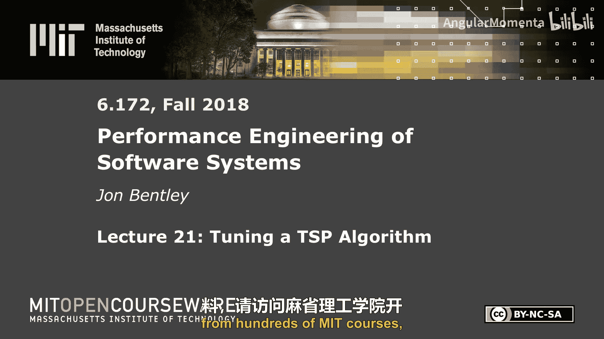
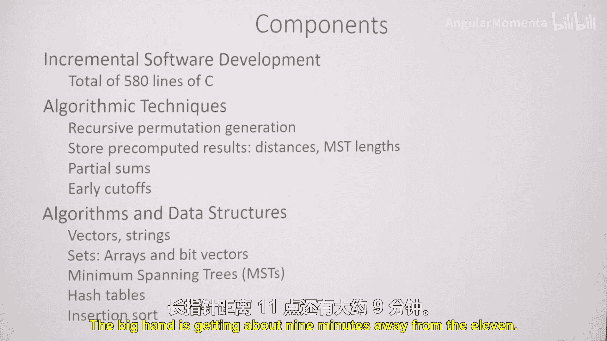

# 【麻省理工】软件系统性能工程 ｜MIT 6.172 Performance Engineering of Software Systems, Fall 2018 p21 21. 调优TSP算法 -BV1esbLzpEFq_p21-

The following content is provided under a Cative Commons license。

 Your support will help Mi T OpenCourseware continue to offer high quality educational resources for free to make a donation or to view additional materials from hundreds of MiT courses。

 Visit Mit Opencourseseware at Ocw。 Mt Eduu。

It is my great pleasure to welcome John Bentley now retired from Bell Labs。

 John was my PhD thesis supervisor at Carnegie Mellon， I actually had two supervisor。

 the other one was H Kongung who is now at Harvard。

 I guess people flee Carnegie Mellon like the plague or something，So John is， as you know。

 because you've studied some of his work， is a pioneer in software performance。engngineering。

 and he's going to talk today about a particularly neat piece of algorithmic engineering that centers around the so-called traveling salesperson problem。

 which is an NP hard problem NP complete problem in fact， and so without further ado， John。

 why don't you tell us what you got to say。As Charles mentioned。

I wanted to talk with you I wanted to tell you a story about a cool problem。

 this is a problem that I first heard when I was a young nerd。

 not much older than you this little pile of nerds in front of me in high school。

 that the traveling salesperson problem， who here has heard of the TSP at some point？

I heard about this in high school， one of the things you read about in the math books and a few years later I had a chance to work on it in 1980 I was doing some consulting and I said。

 well， what you need to do is solve a TSP that I went home and realized that all the stuff that I learned about it was sort of relevant but it didn't solve the problem so I started working on it then or our colleague Christos Papa Demetrio。

who's been at Berkeley for a long time after been in a lot of other places once told me that TSP is not a problem。

 it is an addiction， so I've been hooked for coming up on 40 years now and I want to tell you one story about a really cool program I wrote because this is one of the。

I've been paid to be a computer programmer for coming up on 50 years since I've been doing it for 48 years now。

 this is probably the most fun， the coolest program I've written over a couple day period I want to tell you a story I'll start off with what recursive generation is then the TSP what it is then I'll start with one program and will' make it faster and faster and faster again I've spent my whole life squeezing performance this is the biggest squeeze ever。

And then some principles behind that。We'll start though。

With how do you enumerate all the elements in a set？

If I want to count enumerate the guys between one and 100 I count， that's no big deal， but how can I。

 for instance， enumerate all subsets of the set from the integers from one to five？

How many subsets are there of interviews from one to five？Part of me。Two to the five， 32。

But how do you say which ones they are， how do you go through and count them？

You have to decide how you represent it， you guys know all about set representations。

 will' stick with bit vectors for the time being。An iterative solution is you just count zero，1，2，3。

4，5， up to 31， that's pretty easy。But what does it mean to count。

 what does it mean to go from one integer to the next？

How do you go from a given integer to the next one， what's the rule for that？

It's pretty easy actually， you just scan over all the zeros turning that you start at the right hand side。

 least significant digit， scan over all the zeros term to one。嗯。

All I lied to you you scan over all the ones turning them to zero until you get to the first0 and then you turn that to a1 so this one goes to10 this one goes to11 this one goes that one becomes zero that one becomes zero then it becomes00100 so a pretty easy algorithm you could do it that way just scan over all the ones turn it to zeros take that first one flip it around but that doesn't generalize nicely we're going to see a method that generalizes very nicely this is a recursive solution to enumerate all two to the n subsets of a set aside size in。

And the answer is。This all sets of size M is just put a0 at this end and nuerate all sets of size M -1。

 How many of these will there be。2 to the m minus-1， how many of those，2 to the m minus1。

 or do they add up to2 to the M， but all of these have a  zero at that end and a one at that end。

 Everyone see that recursive sketch of how that works。Here's the example。

Up here you have the zeros at this end and you fill it out。

 you have the one at that end and you fill that out， if you do that。

 you notice that in fact we're just counting backwards，0，0，0，0，01，0，1，0，3，4，5，6，7。

That's the algorithm， and the cool thing is。The code is really simple。

 I could probably write a program like that in most languages and get it correct。So if n equals 0。

 generate all subs of size M， just visit the current one you have a pointer going down the array。

 otherwise set the。White most bit to zero generate all subsets of recursively， set it to one。

 do it again recursively that's a starting program if you understand this。

 everything else is going to be pretty straightforward if you don't please speak up。One thing that。

You people have suffered the tragedy of 14 or 15 or 16 years of educational system that has sort of beaten the creativity out of you and you're afraid to speak up。

 so even something even if I'm up here stouting total bullshit。

 you'll ignore that fact and to sort of politely stare at me a nod， but this is important。

 I want you to understand this if you don't understand this， speak now or forever hold it。

Anyone have any questions？Please， please。I'm sorry， why do we set P to the。

So here first I go out to the extreme rhmost and I set it to zero， then I recursly fill those in。

 then I change it from a0 to a1 there， and I fill all those in。

 so this is a program that will go through and as it enumerates a subset。

 it will call the visit procedure a total of two to the M times when it comes down to the bottom of the recursion。

Thank you， great question， any other questions about how this works？Okay， we'll come back to this。

The traveling salesperson problem， I apologize。I will really try to say the traveling salesperson problem。

 but I will slip because I was raised with this being the traveling Salman problem， no connotations。

 no intentionality there just senility galloping along It's a cool problem Abraham Lincoln faced this very problem in the years 1847 to 1853 when he。

Everyone here has heard of circuit courts。Why do they call them circuit courts？

Because the court used to go out and ride a circuit to go to a whole bunch of cities now people in the cities come to the court but back in the day in 1847。

 1853 Lincoln and all of his homies would hop on their horses。

 judge defense lawyers prosecutors and go around and ride the circuit here and so this is the actual route that they rode where they wanted to do this effectively it would be really stupid to start here in Springfield and go over there then to come back here then to go over there back and forth what they did was try to find a circuit that minimize the total amount of distance traveled that is the traveling salesperson problem where given a set of in cities that might be a general graph these happened to be in the plane but you really。

Helicopter service was really bad in those days， so they didn't fly directlyly point to point。

 whether they stayed on roads， what really matters here is a graph embedded than here。

 I'm going to speak at this。 everything I say will be true for a graph， it'll be true for geometry。

 I'll be sloppy about that。 will'll see interfaces how you handle both but just cut me some slack for that。

 I had actually face this myself。When I worked on a system where we had a big mechanical plotter and we wanted to draw these beautiful maps where the maps could fill in dots。

 they happened to be precincts， some of them were red， some of them were blue。

 and you wanted to draw all the red dots first and go around here and in fact the plotter would draw this red dot and that red dot and this one and that one。

 the plotter took an hour to draw the map。I was consulted on this。 aha。

 you have a traveling tele person problem。 I went down。

 I reduced the length to about one1th of the original length。 if it took an hour before。

 how long would it take now。Well， it took about half an hour and the reason is that the plottter took about half of its time moving around about 30 minutes moving around and about 30 minutes just drawing the symbols。

 I didn't reduce the time of drawing the symbols at all。

 but I reduced the time of moving things around from about 30 minutes to about three minutes that was still a big difference so I faced there when I worked at be Labs we had drills that would go around laser drills。

 go around printed circuit boards to drill holes， they wanted to move it that way。

I talked to people at General Motors at one point， on any day they might have 10 cars go through an assembly line。

Some of the cars are red， some are white， some are green， some are yellow。

 you have to change the paint， some of them have V6， some of them have V8。

 some of them are two doors， some of them are four doors。

In what order do you want to build those cars， well every time you change one part of the car。

 you have to change the line and what you want to do is，Examine， as it were。

 all in factorial permutations of putting the cars through and choose the one that involves the minimum amount of change。

And that's the change one card to another is a well defined function。

 Everyone see how that weird TSP is in to TSP。So all of these are cool problems。Furthermore。

 as a computer scientist。It's。The prototypical problem is the E coli of algorithmic problems。

 it was literally one of the first problems to be proven to be N hard。

 Hecarp gave a polynomial time algorithm for it， their approximation algorithms of this。

 current handlingallu given heuristics， it's a really famous problem， it's worth studying。

But here is what really happened to me， here's why I'm standing in front of you today talking about this。

 my friend Mike Seamus in his 1978 PhD thesis。On computational geometry。

 talked about a number of problems， one of them was the TSP。

 and he shows this and he gives an example of this tour。He says， here's a set of 16 points。

 here's a tour through of them， here's a tro salesper tour through them， and then he says。

 in a footnote， in fact，I'm not sure if it's a really optimal tour。

 I apply it to heuristic several times， I'm not positive if it's the shortest tour。

If you wrote a thesis。It'd be sort of nice to know what's going on there。

Can you solve a problem that was this tiny little 16 element problem， 16 points in the plane。

 can you really figure out what the TSPS to that at the time my colleague our colleague。

 a really smart guy？Couldn't do it。 It was computationally beyond the bound for him。Well。In 1997。

 I came back to this， and I really wondered， is it possible now。

Computers are a whole lot faster in the 20 years， we were talking about that earlier today。

 20 years computers got faster， a lot of things got better。

 have things change enough so I can write a quick little program to solve this。I don't know。

 we'll see。I did that， I talked about it， I gave a talk at Lehigh University 20 years ago。

 they liked it， they incorporated it into an algorithms class。

 the same professor gave it time and time and time again， eventually he retired。

 they asked me to come over and give this talk to them。

I can't give a talk about 20 year old material the computer science doesn't work that way。Cod things。

 and I wanted to see how things changed in two years。 so this talk is about a lot of things。

 but especially it's about how has performance changed in 40 years。

 So that's one of the reasons we were one of the things we were talking about earlier today。嗯。

I could give a bunch of titles to this talk for you。

 the title I give is a sampler performance engineering It be。Next week I'll give it at Lehigh。

 this is their final class one of their final classes in algorithms and data structures。

 I'm going to try to tie everything they learned together， it could be all those other things。

 implementing the algorithms， a lot on recursive generation， applying algorithms， really。

Charles is a fancy dancing academic， he's a professor at the Massachusetts Institute of Technology。

 I'm just a poor dumb computer programmer， but boy this is a fun program what it is not is it's not state of the artTSB algorithms。

 people have studied the problem for well over a century they have beautiful algorithms。

 I am not going to tell you about any of those algorithms for the simple reason that I don't know them。

I could look them up in books， but I've never really vivid the fancy state of the art algorithms。

 and I'm also going to just show you getting pan， I could analyze it。

 I've analyzed much of these if I had another hour or three I could do the analysis but I can't。

 so I'm just going to do the show you some anecdotal speeds without reading the analysis。U。

Let's talk about some programs a simple C program Max N is a maximum number that n is going to be in the number of cities。

 I'm going to have a permutation vector where if I have the tour going from city one to seven to three to four。

 it says17，34。嗯。The distance between cities is going to be given by a distance function。

 there is this distance D of IJ， the distance from city I to cityJ here's the first algorithm。

 what I'm going to do is generate all intorial permutations， look at them and find the best one。

 it's not rocket science。The way I'm going to do this is a recursive function where I happened。

 I could have done it from。Left to right， Im a C programmer。 I always count down towards zero。

 so I'm going to count down that way where all these cities are already fixed。

 I'm going to permute these。Here's the program。To search for M。All these have already been fixed。

 what I'm going to do is if m equals1， then I check it otherwise for i equals 0 up to m for each value from 0 to minus1。

 I take the I element， I swap it， swap 3，7， takes the third and seven positions and swaps them。

 I swap that to the final thing， I call it recursively， I then swap it back。

To leave it in exactly the same state I found it。 and I continue。 So here I's going to generate。

First， put all nine digits in the last position， then for each one of those。

 I'll put all eight digits in the last position and go one down。This is really interesting。

 important and subtle。If you don't follow this part， it's going to be difficult。

 are there any questions at all about this？Have I lied to you yach about this。

 you're honest enough to tell me if I have。Thank you， anyone else。I'm sorry， please。

I'm not really understanding。The part that's fixed。Muting like W。

So so far I recur down as M moves down， all these are fixed。

 so I'm going to fix these things and then I'm going to take care of all these later。

 so originally I'm going to have the arrayray B if I have a 930TSP， it'll be 0246789。

And first I put zero in the end and do the rest and I put one in the end two up to nine in the end and recur down。

 but as the program is progressing， if you stop the program at any time and look at a glance at the program。

 you can see that given the value of M， this parameter of the recursive function。

So this is a way that I'm essentially building this tree where at the top of the tree。

 the branching factor is nine， at each of those nine nodes， branching factors eight， then seven and6。

It's going to be a big tree。If n is 10， how big is that tree going to be？What's tin Tial？

A part of me。Boy， when I was a nerd， we used to try to impress people of appropriate genders by going off。

 saying things like 3628800。You can probably guess how effective that was。So 3。

6 million is's going to be a big tree， any questions about that？Let's go。😊，When I check things。

 I just compute the sum there， I start off with the sum being the distance from0 to the n minus first。

 and I go through and add up all the pairwise things and save it。

 what doesn' it mean to save it if the sum is less than the minimum sum so far。

 I just copy those over， change the then sum and to solve the whole thing I do a search of size in。

This is a simple but powerful recursive program you should all feel very comfortable with this。

Is it correct， does it work？Is it possible to write a program for about two dozen lines of code that works？

Not the first time， but after you get rid of a few syntax errors， you check it。

 how do you make sure it works？I start with n equals three。

 and I put three and doesn't give me a tour well it worked， think about it for three。

 three factorial。They're all the same tour that part wasn't hard for now that's interesting。

That one works too， this program in fact can work。Is there going to be a fast program？

How long will it take if n equals 10？How many seconds？I'm sorry， what class have I stumbled into。

 is this， in fact Greek art 303？How long will this take for an equals 10？Part of me。About a second。

Pretty cool， pretty equal 20， how long will it take？A lot longer。

 technically speaking is going to take a boat load longer。

 So what I'm going to do here is notice that there are in fact mutationuts you do end those at each totals that on。

This。Fly fast laptop from a few years ago， but now they're all about the same。At eight seconds。

 it took that。At nine seconds， ratio what would you expect would be the ratio between it time at eight and time at nine？

Now about a factor of9 you'd hope is 0。5 times 9， about 3。34， yeah， close enough here。

Going down from 1 it's four seconds， 46 seconds， yeah it's going up by a factor so here I've run all my examples。

 I run out to one minute of the CPU time after that I estimate if this one takes three quarters of a minute。

 12 times that is 12 minutes， three quarters of that is nine minutes for 13 is two hours。

 how long should 14 take ballpark。Yeah， a day， ballpark， Helen will 15 take if 14 takes a day。

Two weeks， how long will 16 take？Eight months。You get the ID are you going to go out to 20 for this one。

 no are you going to go out to 16 with this one， can he just whip us into a thesis right now？No。

 the problem is fast for really small values of N， as it becomes bigger。

 how can you make the program faster？If you wanted to make this program faster， what would you do。

 what are some ideas， give me some ideas， please， this is performance engineering。

 you should know this ideasas for making it faster。Please。Startly。Okay， so you're saying just choose。

One start。And ignore that， ignore all the others。 you don't need to take each random started fantastic。

 A factor of N。 my friend in the gray Tshirt just got a factor of in。

 How else can you make it faster。 What ideas do you have？😊，Please。Reject。Be greedy。

Follow the pig principle if it feels good， do it to just local optimization。

 we'll get to that in a long time， but boy， would that be a powerful technique， Are ideas， please。啊。

Pallelize， I would write that out， but the first scout would have to do is remember how many Rs and hells there are in various places。

 so I'll write that much， but we'll have a comment on that at the end people tried that sir。嗯。

Unlike you， Charles and I at one point attended a real engineering school。 Carnegie Mellon。

 a formerly known CIT Carneance Technology， Charles， do you remember the tier？The cheer。3。

14159 tangent seant， cosine signine， square root cube root， log of V， water cooled sliptick， CIT。

 What's a water cooled sliptick？Part of me。It's a slide rule that you run so fast。

 it has to be water cooled。 So if you can just overclock the machine。

 just spray it with a garden hose and as long as it makes it with the finish line。

 you don't care if it dies when it collapses。 So sure you can faster machines and we'll talk about that。

How else can you make this fasterer？Other ideas？These are all great ideas， we'll try it。

Let's see some ideas。Compile their optimizations。 I just said GCC， and I ran it。

 What should I have said instead。Instead of just GCC。0， three。How much difference will that make。

I used to know the answers to all these as I was going up turn optimization 10% sometimes whoop do Frick and do 15% does turning on03 still make a 15% difference we'll see you could do that a faster hardware I did this 20 years ago I had all that number there I'll show you some of those numbers modify the C code we'll talk about all those options but let's start with compile optimizations with no opposite how much faster will it be if I turn on optimization this is a performance engineering class you should know that thing does it matter at all is it going to be 15% is it going not matter at all。

 how much will it matter to turn optimization。How much is a lot？

I know this isn't the real engineering school of CIT。

 but pretend like this is kind of a semi one of the engineering school， give me a number for this。

More than 15%， do I hear more than 16%， I was surprised if I to 03， it went from four seconds to 12。

 I couldn't even time it here， it wasn't enough to time it here， 45 seconds to 1。6 seconds。

 I could get real time down there， I observed ballpark here， about a factor of 25。

Holy Tamalli on a raspberry Pi it was only a factor of six and on other machines it was somewhere between the two。

 turn on optimization really matters， enabling that really matters from now on。

 I'm only going to show you full optimization as cheating not to。

 but just think about that a factor of 25。啊。How else can I make it better？

Two machines back in the day， I happened to have some data laying around of running it on a pentium Pro 200 meHz。

 nowadays I had this， how much faster will this machine be 20 years later？Again。

 pretend like you read a real engineering school， hope it to be。Please。20 times faster。

 how do you get 20 times faster？发。The clock seat about 10。Here's what I found on this machine。

 it went from a factor。There is about 100， these factors I found consistently were about over the 20 years。

 about a factor of 150。For Moore's law， what would it be if you had 20 years。

 if you doubled every two， that's 10 doublings， what is two to the  tenth0th？1000。

So Moore's law predicts 1000 it's more than a factor of 20 I got a factor of 150 here which is close to what Moore's law might predict。

 but there was some slowing down at the end I'm not at all traumatized by this a speed up of about a factor of 150 where does that come from my guess is you get about a factor of 12 due to a faster clock speed and another factor of 12 due to things like wider data paths you don't have to try to cram everything to a 16 bit funnel you have 64 bit data paths there deeper pipelines more appropriate instruction sets and compilers to exploit those instruction sets if03 is enabled if  O3 is not enabled sucks to be you Que about that。

Let's go。So。We have constant factor improvements， external modern machines， internal optimization。

 a factor of 150 and a factor of 25 is a lot， we're starting off with that is a good start。

Back in the day， if you change things from doubles to floats， it got way faster from floats to ends。

 it was faster yet。 Does that change make much difference nowadays。Not exactly the same runtime。

One thing that does make a difference is this is the difference definition of the geometric distance。

 since y to J is the square root of the sum of the squares of the differences。

That's doing an array access， a subtraction， a multiplication，plication。

 two array access these subtraction， a multiplication in addition， and a square root。

That used to take a long kind of how you place that with table lookup is by filling out this sort of table。

 the distance for algorithm2 is just a distance arrayse of I sub J。

That gave me a speed up factor of two and a/ half or three back in the day that was a speed up factor of 25 for you as performance engineers。

 you have all this intuition。Every piece of intuition you have that I had that was really appropriate。

10 years ago。Is。Irrelevant now， you have to go back and get models to figure out how much each thing costs。

But still， it's another speedup factor of three。Just by replacing this arithmetic with a table lookup。

Algorithm 3。What we're going to do is choose the one city to start with。So we'll start at city one。

 we'll leave nine if we have a nine element problem in that position and just search。OfAnd -1。

 it doesn't matter where you start。 You're going to go back to it。

 So you can just choose one to start with。Not a lot of code permutations are now that distance at each。

 So now you've reduced n times inductial to inductial algorithm 4。

Is I'm computing the same sun each time。Is there a way to avoid computing the same darn sum each time？

We'll carry the sum along with you instead of recomputing the same thing over and over and over。

 start off with the sum mean zero， the parameters now M and the distance so far。

 then you just add in these remaining pieces at each point。And you solve it that way and there。

It's sort of a nice piece of mathematics， I wish I had the time to analyze it。

 I did a spreadsheet where I said what's the ratio of this and it started off as three，3 and a half。

 3。6， 3。65， 3。7 3。71828，1828， what does that mean， if something if you see a constant 3。7，18281828？

It's one plus E and once I knew it the answer was even I in my mathematical frailty was able to prove that it's one plus E times in factorial。

 I'm not giving you the proof but it's very cool that you run across these things。

 so here are the four algorithms so far。On an entirely different semi fast machine， the runtime。

 here are the real clock times on this machine for 10，11，12。

13 real times and bold are measured times， these other times are approximate estimates。

 and you can see now that，For size 13， you go from taking a fraction of an hour to taking a third of a minute。

We've made some programs faster， that's pretty cool。We feel good about this， this is what we do。

Any questions at all？We got to go faster， how do we go faster？Just， to say precisely。

 for all these experiments， I took one data set。If I say that run time Ver size 15 I take the first 15 elements of that data set for 16。

 I take the first 16 elements， 17 so on and so forth， it's not great science。

 I've done the experiments where I did it on lots of random data， the trends are the same。

 it smooths out some of the curves but we'll see this the times are for initial sequence of one random set it's pretty robust。

But the problem has factorial growth， start factorial， it still factorial。What does that mean？

Each factor of B allows us to create the problem size by one in about the same time。

 faster machine and all that we can now push into the teamss， what does that mean？

You can take Abraham Lincoln's problem and they got a tour with this length。

 The optimal tour looks sort of the same on this side， but it's really different over here。嗯。Charles。

What figure is that？Ive mentioned yesterday that if you work on the troutden hill。

 when every instance you see turns into a war shock test。The first one is。帮一下。It was just。

the bunny head， everyone see that。 those are in fact， the correct answers。

 He is a psychologically sound human being。 Does anyone else want to give their Roch answers。

 a free diagnosis， I absolutely no charge。 I'll completely diagnose。

 but bunny the bunny hopping and the bunny head on are in fact the correct answers for here。

 we'll see more later。So Abraham， I'm looking to solve his problem now。

 my friend Mike Seamus could solve his problem。Did he get the optimal tour， Well。

 overhearing on a big part of it， but over here。It's really sort of a different character。

 It's a fundamental different character is it far off， yeah。

 about a third of a percent off so his approach was within a third of a percent。 I've always worked。

 I spent much of my career working on approximate solutions to TP those are often good enough this algorithm you can prove that he applied is within 50% in the real world it got within a third of a percent wow。

 but now we can go out and we can solve the whole problem in 16 hours if you were writing the thesis and you happen to do this。

 would it be worthwhile now to think 16 hours of CPU time into this。

You're going to go away for a weekend to sure， leave your machine running at the time， Charles。

 when we had one big computer for 6 or 70 people in the department。

 could we have dreamt about using 16 hours for that。On the very border。

 if you made it a really mellow background process， it might finish in a week or three。U。

All of these things change， the computers get faster， they get more available。

 you can devote a machine to dump 16 hours down this。But can we make it faster yet。

 Can we ever analyze， say， all permutations of a deck of cards。

 How many permutations are there of a deck of cards if you take out those jokers。What's that number？

one with 15 zeros after it， it's a big number， two to the  52 factorial。

 I want to teach you how big 52 factorial is。嗯。People say that problems growing exponentially。

 what does that mean it's quick is what people usually mean by it in mathematics。

 it's some constant to the end for some defined time period N， factorial growth is factorial growth。

 exponential growth。Why not， why isn't baial exponential？It's more than exponential。

 it's super exponential， we'll talk about the details here by Sterling's approximation。

You have seen in other classes that that log of intorial is in log n minus n plus O of log n for the natural log。

 the log base 2 of intetorial is about in log n minus 1。386N where have you seen，This number before。

One point in log n minus1。In an algorithms class， if you did a lower bound on a decision tree model of sorting。

 there were in factorial leaves to sort so a sort algorithm must take at least as much time。

 so that gives you that bound and bird sort is in log n minus n so you're really narrow Where else if you seen 1。

386 in。That's the runtime of quickword。 All these things are coming back together here because it's the natural log of E。

I'm sorry， the Y B2 aV。嗯。So in factorial。Is not2 to the N。 It's2 to the n login。

 It's about n to the N。 It's faster than any。Exential function。How big is 52 factorial。

 you guess 10 to the 15th？Was that you。Okay， if we see here it's going to be something like2 to the n log n。

 n is 52， log of 52 is about 6， that's 2 to the 300， but there's a minus in， maybe 2 to the 250。

It's about2 to the 225， which is 10 to the 67th， that's a big number， how big is it。

 let me put it in everyday terms。Try this after class。嗯。

Set a timer to count down 52 factorial nanoseconds。10 to the 67th stand on the equator。

 watch out for where you are and take one step forward every million years。 don't rush into this。

 I don't want you to get a little hyper about this Eventually when you circle the Earth once。

 take a drop of water from the Pacific Ocean and keep on going okay be careful about this this is an experiment your nerds。

 it's okay when the Pacific Ocean is empty at that point， lay a sheet of paper down。

 refillll the ocean and carry on。Now keep on doing that when your stack of paper reaches the moon。

 check the timer， you're almost done。This is how a big 10 to the 52 is the age of the universe so far is about 10 to the 26 nanoseconds。

It's 10 to the 502 is a long time。Can we ever solve a problem if we look at all 10 to the 50 second options？

What do we have to do instead？Part of me。Quantum computing。 Okay， that's great。

 And I have a really cool bridge across this river out here that I'll sell you after class。

 So let's talk about that。 Is there a nice quantum approach to this problem。😊。

Maybe I mean you could actually phrase this as an optimization problem where you could maybe get some mile each out of that。

 but we'll see， so one approach is quantum computing what's another approach What are we going to have to do to make our program。

Throughurmount this obstacle。Please。Part of me。We're going to have to limit our search space。

 we're going to have to prune。😡，The search space。That's the idea。Let's try it。Here's a cool problem。

 I was at a ceremony a few weeks ago， a friend of mine said。

 here's this cool problem that his daughter just brought home from high school， how do you solve it？

Find all permutations of the nine integers1 through n。

 such that each initial substr of length M is divisible by M。

 so the whole darn thing is divisible by 9 is any permutation of the ingers1 to9 divisible by 9。Well。

 they all sum up to numberumb Mo hold9。You work that as are the first eight characters divisible by eight？

Now， let's start with an easy one， if you were doing it for size three。3，2，1 works is 3。

2 one divisible by three。It's 32 divisible by two， is's3 divisible by one， thinking it works， is 1，3。

2 divisible by3。Yeah， it's 13 div of Hawaii2。え？That doesn't work。

So we're going to try to solve this problem， my friend Greg Conti。

 a really great computer security guy， gave me this problem， how do you solve it？

How would you solve this problem if this high school kid says。

 here's a problem I brought home from school， how do I solve it？What would you do？Ideas。I'm sorry。

 please。Yeah你。て。Actually， just wait。Great， so there are two main approaches。

 one is write a program so you could either think or you can compute。

Who in this room enjoys fighting programs？Who enjoys thinking？Well that's an easy call。

 What's the right approach here。 Well， yes the right answer is you think for a while。

 if you solve it in the first three minutes， don't write a program。

 You spend much more than five minutes on it。 Let's write a program， see learn from the program。

 We'll go back and forth。 never think when you should compute。

 never compute when you should think how to know which one to do， try each。

 see which one gets further faster。If you write a program for this。

 what are the basic structures you have to deal with？

You have to deal with nine digit strings that are also nine digit numbers。

What's a good language for dealing with that？If you had to write a program to do this。

 what language would you choose？We'll see。How do you generate all inorial imations of the string？

Well， I hope you can see this。 Here's the way that I chose to do it。

 I chose to have a recursive procedure search， and I've been。

C right be the part that's already fixed， left be the part that you're going to varyy。

 I couldt have done it the other way but I'll choose to do it this way。

 I start with left equals that right equals that I end when the left is empty so I just recur down just like we've been doing so far but I'm going to do that with strings instead and if I get to the call search of five6 of 356 with 421978 these are all fixed。

 I'll take each one of these in turn 35 and6 put it into here。So I'll call search of 56 with that。

 search of 36 with that， search of 35 with that。Everyone see how that works。

How long will the code be？In your favorite language？Here's the code in my favorite language。

 Ha anyone here ever used the O programming language written by Ajo Weinberger and Kernahan。

 they observe that naming。A language after the initials of the authors shows a certain paucity of imagination。

 but it works。 So a function， search of left right that。 If left equals 0 is null， I'll check it。

 Otherwise， what will I do here。The details don't matter for I equals one up to the length of the left hand side of the string。

 search the substring of the left， starting at one going for I minus1 with concatenated with the substr of the left starting at I plus one and then take the substr in the middle put it out in front of the right。

 do that for alli values any questions about that， the details don't matter it's not a big program。

If I do this and at the end par equal1 to length， if the substr of the right mod I is nonze。

 then return， if it's not that you've put it out， if I run this program。

 how long ballpark will this program take for nine factorial？Bullpark。What was your answer before？

A second， great， we'll recycle that， reduce re use， recycle。

 we'll recycle the answers if I called it originally with that string。It takes about three seconds。

And it found that there was it searched all nine factorial 362880， 362，000 strings。

 and found only one string there that matches thatops。Are these divisible by nine。

 well they sum to a multiple of nine， sure is this thing that ends in 72 divisible by eight？

Yeah that works， a seven that I'm not going to bother with all the way down is 38 divisible by two。

 is 381 divisible by3， this one works。That's a pretty cool problem for a high school afternoon。

Is three seconds fast enough？Yeah， in the trade off of thinking and programming。

 right the Darn program， you're done， it's cool。If you wanted to make it faster。

 how could you make it faster？That's what this course is all about。

Always think about how you can make things faster， please。Well， if you just stop searching。

 let's you know。One number is。How early can you stop searching that's great。

 So you could get constant factor speed ups like。Don't check for divisibility by one at the end。

 you can change language all that， but those are never going to matter the big win is going to come from pruning the search。

 how can you prune the search， what any winning string must have some properties of this string？

What are some properties that that string has that you can check for early？Please。

The eighth position has to be a multiple of two。Furthermore， if you really think about it。

 you could get more than that because that to be a visible by four。

An even number has to be in the eighthth position。 Anywhere else going to need an even number。

This position has to be even， that has to be even， that has to be even。 that has to be even。

In general， what's the general rule？因为不是。Every even position has to contain an even number。

There are four even numbers， there are five odd numbers， what other rule might you come up with？

The fifth positionOkay， every odd position has to be。A nod number， and in particular。

 the fifth position has to be a five。So those are a few rules， even digits and even positions。

 are digits and opposition positions， digit5 and position 5。Three simple rules。

 you can test those easily， the code is pretty straightforward。

 will that shrink the size of the search space must at all really？

How big was the search space before？Nine for the first one。

 now how big is a search space for the first， if you just have the five rule， the three rules。

 evens going evens odds and odds and five in the middle。

How many choices do you have for the first one？Four choices for the second one you have。

It can't be a five， it has to be an odd number， not a five， you have a four。

So it's four by four times three times three times1， times two times two times1 times。

 everyone see that， we've reduced the size of the search space from a third of a million to half a000。

Isn't there going to be a lot of hassle to code that I mean is it going to take like a major software development effort to code that well yeah。

 if you define that as a major software development effort the parity of the string length is equal to the parity of the digit and then you can continue。

 if you don't have these things， you can't continue。Three vines of code。Allow you to do this。

That's the story， factorial grows quickly， you can never visit the entire search space。

 the key to speed is pruning the search， we're doing just a baby branch and bound it's called some fancy algorithms can be implemented little code that's our break。

 we've learned a couple things we're ready to go back to the fray。

Any questions about this diversion before we go back to the TSP？

These are important lessons we'll try to apply them now。嗯。I got great advice yesterday from。

People about。How to do this， and I seem to have skipped。Okay， here it is， I've got it。嗯。

How do we prune our search here we had these conditions？How can we prune this search。

 How can I make the program faster？What was the way I can stop doing the search？Simplest way。

 don't keep doing what doesn't work if the sum that you have so far is greater than the minimum sum by adding more to it。

 are you ever going to make it less？What can you do？You can stop the search right there。

Is the resulting algorithm going to be faster？Maybe as a tradeoff， I'm doing more work。

 which takes some time， but I might be able to prune the search space。 The question is。

 is this benefit worth this cost？What do you think？On the。The same machine。

Algorithm 4 as high 12 took 0。6 seconds now it's a factor of 60 faster， factor of 40 faster。

 a factor of 100 faster。Just by if it doesn't work， if you've already screwed up， don't doing。

 it doesn't work， that makes the thing a whole lot faster。 Everyone see that。

That's the first big win。Can we do even better than that？

Is there any way of stopping a search with more information other than oops。

 I've already gone too far？Please。Wait， command voice， speak loudly。

That's a really powerful idea that Hdden Carp used to reduce it from n factorial time to n squared2 to the end time we'll get to that that that's really powerful。

 but now we're looking for something not quite that sophisticated。

 but that's a great idea can I somehow prune the search if a sum plus a lower bound on the remaining cities is greater than the minimum sum because。

What kind of lower bound could I get， Well， I could compute a TSP path to them。

 That's really powerful。 That would give me a really good bound。

 but it's really expensive to compute。So I could， if this is a city I've been so far。

I could compute a TSP path through the rest， which might in this case look like。This and hook it up。

That's going to be a really powerful heuristic， but it's going to be really expensive to compute。

On the other hand， I could take just the distance between two random points。

I'm going to choose this point。And。This point， I happened。To get the diameter of the set。

And that's the lower bound。 It's going to be at least that long， and it's really cheap to compute。

 but is it very effective。And yeah。The first choice is effective but too expensive。

 the second point is really inexpensive， but not very effective。

 I could also compute the nearest neighbor of each city from this city。

 if I just compute its nearest neighbor among here， say it's that， this one is that。

 that one has its own nearest neighbor。I could compute these distances。

And that's pretty inexpensive to compute， and it's a pretty good lower bound that would work。

Who here knows what a minimum spanning tree is？Good。

What I'll do here is I'll take here a minimum spanning tree of in cities， a tree is n minus1 edges。

This tree is in minus1 edges， this is a spanning tree because it it connects all cities and furthermore。

 it is a minimum spanning tree， because of all spanning trees。

 this one has the minimum total distance。Now， the tour is going to be less。

Are greater in distance than the minimum spanning tree。 Why is that if I get a tour of this。

I can just knock out the longest edge。And that now becomes a minimum spanning tree。

 so the minimum spanning tree is a pretty good bound， a lower bound。

 it's cheap to compute who here has ever seen in the algorithm for computing minimum spanning trees。

Good， good， some of you are awake in some of their classes。What are the odds of that。

 I what are the amazing confidence。 So what we'll do。

Is say now that a better or lower bound is to add the minimum spanning to the remaining points。

 So I change this program to if some plus the MST distance。And now I'm going to do a trick。

 I'm going to use word parallelism， I'm going to have the representation of the subset of the cities as a mask。

 a bit mask in which if the appropriate city is all and the bid is turned on。

 if otherwise it's turned off， and I just or bits into it。

And say if I compute the minimum standing tree of this s。I can cut the search and return。

And then I just compute the MST and bring this along with me of turning things off and on in the bit mask as I go down。

Pretty straightforward how much code will it cost to compute minimum spanning tree？Ballpark。Yeah。

About that many lines of code。This is a prim diictra method。

 it takes quadratic time for computing an MST of endpoints， it takes n squared time。

 it's quite simple， you can do it in E vlog log V edge time， but this is a simple code。

 it's pretty straightforward。Will this make the program run slower or faster？

What would the argument be that it might run slower？Holy Moly at every node on computing an MST。

 that takes a lot of time and I run slower。 Whats the argument to be that it might run fasteror。Yeah。

 but I'm getting the much more powerful pruning， is it worth it？😊。

I should point out that I'm only showing the winds here to you when I really did this myself。

 I went down a few wrong paths， I wish I would have documented them better now。

 but I might go back and see if I can find them， that would be a good thing， but here it is。

It used to take 17 seconds， now it takes or four seconds， now it takes zero。

Youd like algorithms that take zero seconds that you like to live in the rounding error，4。40 to 0。

2 down here， this program is not only faster， it's a boat load faster。

And so now we can go out and notice here that as you go out， the times usually get bigger。

 but they were bumpy from 2。4 seconds to 0。7 seconds to 1。8 seconds。

 it's because you're doing that one thing， it's just the matter of the geometry。

 the times that were originally really smooth， now turn bumpy。

 I've done experiments where I do 10 different data sets randomly drawn at each one。

 and it's a nice smooth line， but I miss doing it here to be easy。Before we can go out to size 17。

 now we can go out to size 30。Wow， how cool is that， that's pretty powerful。嗯。Can I make this please？

こ輸休。Ssn in such a way that this thing doesn't actually。

That's absolutely true and I've tried this both on random point sets。

 I've tried it on distance matrices， I've tried it on points where they're randomly distributed around the perimeter of a circle。

And so this could be a lot of time， almost always it's pretty effective again if I had more time I'd talk about it。

 but in fact we're going to go until3 45 Charles。355 when the big hand is on the 11。Oh。

 sucks to be you。I profile this bad boy， and it shows that most of the time is in building minimum spanning trees。

 your fear that it might take a long time， that might make it it has a basis。

 that's where all the time is going， how can I reduce the time spent in building minimum spanning trees？

As I searched this place。I could do some incremental minimum spatting trees because they change a lot and so there are several responses one is whenever you're building something over again rather than building it from scratch。

 see if you can do an incremental algorithm where you just change one bit of the minimum spatting tree if I just add one edge into the graph always try an incremental algorithm that's cool that's one sophisticated approach。

 what is one what was another pretty idiot simple approach whenever you compute something over and over again。

 what can you do to reduce the time spent computing it。Store it。

Do I ever compute the same MST over and over again， I don't know， I think maybe it's worth a try。

So what I'll do is return of caching， store rather than recompute cache MST distances rather than recomputing them。

 the code looks like this， the new mask is that if the MST distance array is less than zero。

 initialize everything to zero here I'm just going to store the all in the table is size two to the end。

 I can just do direct indexing， if it's less than zero computer fill in the value。

 if some plus that return not much code。But do you really want to store？

To blast it out and to use this lazy， I'm using lazy evaluation of this table here。

 only when I need it do I fill in a value。That's not critically effective。

 rather than storing all two to the end tables， what can I do instead？

What's our favorite data structure restoring stuff？Hash table， a cash via hash。

 It's the key to happiness。 You can write that down to store them in a hash table。

 if some plus the MT distance look up。😊，Oh I have to implement a hash table now。

 how much code is that going to be。Bllpark。What does it cost to build a hash table？Boughly， come on。

Yeah， about that many lines。So just。嗯。Go down the hash table if you find it， return it otherwise。

 make a new node， compute the distance put it in there settle the values and you're done Is it going to be faster。

 or we'll see who reads XKCD on a regular basis。The rest of you are bad， bad， bad people。

 and you should feel very guilty until you go to xkcd。com and start reading this on a regular basis。

I mean like， wow， this is two deep psychological insights in one lecture for no additional fee。

 sir you collisions by chaining， yes。Just for the。latest town。

The key that makes sure that it's the value associated with the one。That is a great question。

 and the answer is left is an exercise for the listener。You got about 20 minutes， Charles。

It would be， yeah， and it's well worth a try。All of these things are empirical questions。

 one thing that's really important to learn as a performance engineer is that your intuition is almost always wrong。

 always tried the experiment to see。It's a great question when I get home I'll actually when I leave here I'm going to go up to try to climb Mount Madaddnock who yearss ever climb Mount Madadnock Yeah I finished climbing all 115 4000 foot peaks in the northeastern U last year I've never climbed Madadadnock I'm really eager to give it a try tomorrow XKCD brute force。

In factorial， the held carp thena programming algorithm uses the grown up version of dynamic programming for n squared2 to the n but。

Even better。Algorithm 6 looks like that。 If I cache the TSP， does it have to be faster， No。

 is it faster？By about a factor of 15 there， by about a factor of 25 there。26 there。

 you can go out now much further。Six and eight， so we've done that。

Is there any other way to make this program faster， we've pruned the search light crazy。

Any other way to make it faster， please？他们这里。U。I forget what happens at 39， let's see。At 39。

 it went over a minute。like I said this thing goes up and down because it just hit some weird bumps in the search space that's something else the first algorithm is completely predictable。

 the other algorithms you have to get more and more into analysis and now the times go up and down。

 there's a trend and basically I'm taking an exponent and I'm lowering。

 I turned it from super exponential to exponential and that I'm beating down on the exponent right now。

Can you make this run faster， what we're going to do is take this idea of a greedy search。

I've been having smarter searching。Better than a random order。

 I'm going to do a better staring tour and what I'm going to do is always at each point sort the points to look at the nearest one to the current one first start with a random one。

 then for the next one always look at the nearest point first than the second nearest the third nearest etc。

 so I'll go in that order that should make the search smarter and that should guide me rather quickly to the initial staring tour rather than just a random tour。

 I'll have a good one that will give me a better pruning of the search space。

Well that may make a difference when I have to include a sort。

 I'll get two birds with one modification by a really dumb insertion sort。

 which takes about that many lines of code， I'll visit the nearest 30 city first and others in order。

 if I do that。Here it's a factor of two， there it's a factor of eight， factor of four。

 but it seems to work， it gives you some as you go out especially I can now。Go out further。

Oop I lied， I didn't stop my search at 60 seconds there， but I can now go up further。

 and it seems to be a lot faster， so in 1997 and 20 years ago， I was really happy to get out to 30。

The question now is in 20 more years， how much bigger can I go if I just depend on Moore's law alone in 20 years a factor of  a000。

At 30，30 times 31 times 32， that's the fact I could go up by Moore's law with a dumb in algorithm would give me two more cities at this size in 20 years can I get？

From 30 on to anything interesting by combining moore's law and compiler technology and all the algorithms。

 how far can I go well I was going to give a talk at Lehigh and so I could go out and under a minute I could go to the 45 city tour cha answered this yesterday so he is completely clear。

Roarsh test， who's willing to go， what do you see there？Dancing doggy that that was my dancing Doggy。

 I like that a lot。 That's the obvious answer。 But Charles， and this shows a profoundly。😊。

Profound mind， Professor Lyissson， what is this？啊。s a dorm。Doing his business at a hydr。Okay， so I。

Any Freudians， you feel free to go to town on that one。45 city tour is pretty cool。 Dan doggy。

 How far can it go， I got out to 45 and under a minute。😊，46。I broke my rule of this。

 I went over the minute boundary， this was my Thanksgiving 2016 cycle test。

 I was just going hog wildild， I was willing to spend the I was doing this Wednesday night。

 I had to give a lecture on Monday。100 hours of CPU time， how far can I go？47。Yikes factor 5。

 when do I think when do I run should I go back and work 50。

 wouldnn't it be sweet to be able to go out to 52 factorial wouldnn't that be cool， 48。

 that's not bad， that's looking pretty good they're actually for oh ouch ouch。

 that's going to take a so that's about two hours right there， but 50。The edge of my seat。

 you know the turkey was smelling good， but 51， and can I get the 52 willow make it。

 well I have to go back to？Oh。Three hours and seven minutes by combining all these things。

 we're able to go out to something that is just obsne 52 is obscenely huge。

 we're able to get out there by a combination of all these things of some really simple performance engineering techniques if you're going to work on a real TSP。

 read the literature study that I hope we can come across some things that I've written about approximation algorithms。

 but if you really need to，Forget the approximation algorithm's get a true tour there's a huge literature I haven't told you any of that everything that I've done here are things that you as a person who has completed this class should be able to do all of these things are well within your scope of practice as we say you will not be su from malp how much code is the final thing about that much you build an MST。

 you have a hash table， Charles points out you you could nuke three or four of those lines。

 you have to sort here all together about 160 lines。Where have we been， we started。

 we could get out to 11。Store the distances。At the 12 Dick historian City that was a big one。

 accumulate distances along the way， these were all good but then by pruning the search we started making the big things。

 add the MST， store the distance on a hash table， visit the cities in a greedy algorithm。

 each one of these gave us more and more and more power as we went out there who were finally able to go out pretty far。

There are a lot of things you can do， parallelism， faster machines， more code tuning， better hashing。

 that malik is just begging to be removed。Better pruning， a better startinging tour， better bounds。

 I can take the MST length plus the nearest why I do this MST plus the nearest neighbor to each of the ends I can get that would that make a big difference empirical question easy to find out can I move my pruning test earlier better sorting this is really cool can I maybe just sort once for each city to get that sorted list then go through that precomputed sort and select the things in order。

Is that going to be a win in this context？The main ideas here are caching， precomputing。

 storing this， avoiding the work， could I change that n squared algorithm to just a linear time selection。

 all of these things are really fun to look at。嗯。I've tried to tell you about incremental software development。

 I started off with around 30， 40 lines of code， it grew to 160。

 but altogether all the versions come to about 600 lines of code。

You've now seen more than you need for one life about recursive generation。

 It's a surprisingly powerful technique， if you ever need to use it。

 no excuses now you're obligated to build it immediately， the storying precomp results， partial sums。

 early cutoffs。Algorithms and data structures， these are things that sound fancy in your algorithms class。

 but you just pull them out when you need them， vectors， strings， arrays and bit vectors。

 minimum spanning trees， hash tables insert search and sort。It's easy。

 It's a dozen lines of code here， two dozen lines of code there。嗯。

I believe that Charles they had mentioned earlier that I wrote a book in 1982 about code tuning at the time。

 you did these in the small loan programs now compilers do that for you， but these ideas。

 some of these ideas still apply store precomp results rather than。

Common self- expressionion elimination and expression you now put interpoint distances in a matrix or tabled MST length。

 lazy evaluation， you compute the n square distances eagerly but only the MSTs that you need don't bother computing them all that's essentially what He carp does short circuit monotone functions regarding tests word parallelism these are the things that you as performance engineers can do quite readily。

I had a lot of tools behind the scenes， I wish I could come back and give you another hour about how I really did this with the analysis and the tools that I used。

 I had a driver to make the experiments easy， a whole bunch of profilers。

 where is the time we'd be going here， what should I focus on cost models that allowed me to estimate those。

 how much does an MST cost？A spreadsheet was my lab notebook for grass to performance。

 all sorts of cur fittingting。But。These are the main things I wanted to tell you about。

 the big hand is getting about nine minutes away from the 11 Professor Leersson。

 is there anything else that these fine young semihumanoids need to know about this material？

Does anybody happen to see any？Alls with。Project。Maybe people could chat a little bit about where they see analogies。

I don't know what part。One of my first exposures to MIT was when I had Donovan as a software systems book and it was dedicated to 6。

51 graduate students。I saw that and I thought that bastard。

 I'm sure that the six students really worked hard in it。

 but to say that the seventh student worked only a little much more over halfway and then to be so precise that's just cool what would of a son of which that guy might be so I don't know what project for is but is it Lier Ch byy。

え。Oh， great。 I know what that is。 So what things have you used any of these techniques to do。

 ever prune searches， did you ever store results， What did you do in Project 4。

You're delegating this。 That's a natural leader right there。Okay。That's a lot about social recruit。

But speak up so all of them， can hear it please？ice show we are。In this room。Since we're going。

Sout search。I don't know how many teams are。Already working on search buts。

At least my team is working on changing。Presentation person， so we haven't。You。

 gotten into printing search yet， but that's definitely on the horizon。

Is there anyone here from the state of California， I was born in California。

 when you hear alpha beta apart from the search， what do you think of？

There's a grocery store there called Alpha beta and when Kanuth wrote a paper on that topic。

 he went out and bought a box of alpha beta prunes that he had in his desks。

 so he was an expert in two senses on alphabeta pruning so good。Other techniques。Please。

Itsnu coverage。Its just。Could somehow。Keep track of what a laser path is， and cash table。Great you。

Weol collisions at all， or did you just have one element there with a key。

 how did you address the problem that Charles mentioned of what kind of passion did you use？

Other techniques， yeah， that's a classic example of the fastest way to compute is not to compute at all。

呃。In general， in life， no problem is so big that it can't be run away from。

 but these things about avoiding work and being lazy are certainly models for organizing your own life。

 that lazy evaluation。嗯。Really works in the real world。Other questions？

Without a question or a random head seen hand gesture？Please。How big can state of the art of GSP？

Oh that's a great question I work in this problem a lot in the early 1990s with my colleague David Johnson who literally wrote the book on invy completeleness。

 an MIT PhD guy we were really happy at the time in a couple of hours of CPU time。

 we could solve1 hundred thousand city problems to within a few percent。

 we were able to solve million city problems in a day of CPU time to within a few percent and we were ecstatic that that was really big so we could go out that big to within a few percent if we worked really。

 really hard we could get。10，000 problems down within half percent。

 but if you want to go all the way to have not only the optimal solution but a proof that is optimal。

 for a while people bragged about， we finally solved a problem。

 this will let you see about when it was done， we solved a problem of all 48 state capitals。

So for a while that was the state of the art and then that number is crped over time and now you can get exact solutions to some famous problems into the tens of thousands by using lots and lots of really clever searching the branching bound with really clever lower bounds to guide it up and you at one point get a tour and you can make it like that tour。

 but then you get a proof of a lower bound along with it to do that Hecko man I want to let you know that there're actually now 50 states in the Union no。

Yeah。What time did this happen？嗯。You can tell that I am much， much。

 much older than Charles and he never lets me hear the end of it， I trust that the rest of you。

 this is like the third free deep psychology insight isBe kind to old people ignore the example that the kid over their sets and show some classes of respect to me and my fellow geezers。

Yeah， we were both born in 1953， but I was born in the good part of 1952。In particular。

 I was born before Her Majesty， the Queen of England assumed the throne。Can you make the same claim？

 I cannot make the same claim。 I'm sorry he can， But only because he's a sneaky bastard。

 can you make it truththfully。 It's the question that I should have asked。Other questions？

This class can be very important， like I said I spent the past almost half century as a working computer programmer。

 the majority of that the thing I've done most is performance engineering it's allowed me to do a number of really interesting things I've been able to dabble in all sorts of computational systems ranging from automated gerrymandering。

 every time you make a telephone call in this country if it's a。

A call inside an institution like a hospital or a university uses some code that I wrote some performance things if you make a long distance call uses code that I wrote。

 if you've ever used something called Google internet search or match or maps or stocks or anything else that uses some algorithms I've done。

 it's incredibly satisfying， it's been a very， very fulfilling way for me to spend a big chunk of my life I am grateful。

 it's allowed me to make friends whom I've known for almost half a century and to are wonderful dear people and it's been a great way to spend my life。

 I hope that performance engineering is as good to you as it has been to me anything else professor。

Thank you very much， John， thank you。

