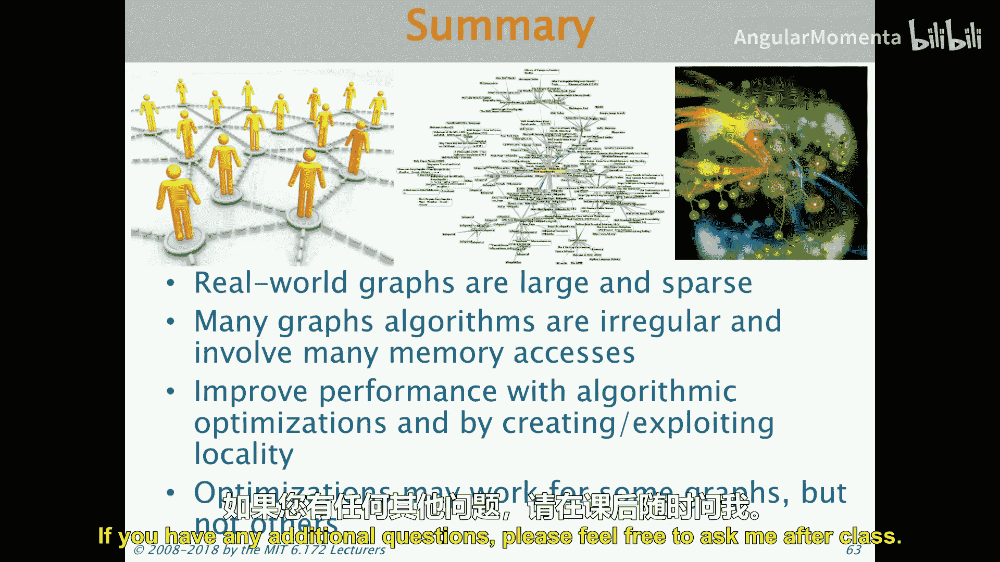
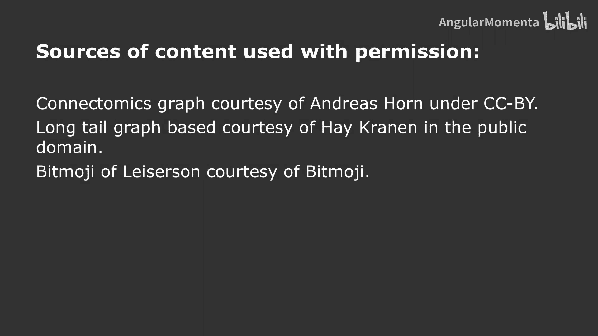

# 【麻省理工】软件系统性能工程 ｜MIT 6.172 Performance Engineering of Software Systems, Fall 2018 p22 22. 图优化 -BV1esbLzpEFq_p22-

The following content is provided under a Cative Commons license。

 Your support will help Mi T OpenCourseware continue to offer high quality educational resources for free to make a donation or to view additional materials from hundreds of MiT courses。

 Visit Mit Opencourseseware at Ocw。 Mt Eduu。

Hi， good afternoon， everyone。So today we're going to be talking about graph optimizations。

And as a reminder， on Thursday， we're going to have a guest lecture by Professor Johnson of the MIT mathth department。

 and he'll be talking about performance of high levell languages。

 so please be sure to attend the guest lecture on Thursday。

So here's an outline of what I'm going to be talking about today。

 So we're first going to remind ourselves what a graph is。

And then we're going to talk about various ways to represent a graph in memory。

And then we'll talk about how to implement an efficient breakfast search algorithm。

 both serially and also in parallel。And then I'll talk about how to use graph compression and graph reordering to improve the locality of graph algorithms。

So first of all， what is a graph？So a graph contains vertices and edges where vertices represent certain objects of interest and edges between objects。

 model relationships between the two objects。For example。

 you can have a social network where the people are represented as vertices and edges between people means that they're friends with each other。

The edges in this graph don't have to be bidirectional， so you could have a one way relationship。

 for example， if you're looking at the Twitter network， Alice could follow Bob。

 but Bob doesn't necessarily have to follow Alice back。The graph also doesn't have to be connected。

 so here this graph here is connected， but for example。

 there could be some people who don't like to talk to other people and then they're just off in their own component。

You can also use graphs to model protein networks where the vertices are proteins and edges between vertices means that there's some sort of interaction between the proteins。

 so this is useful in computational biology。As I said。

 edges can be directed so the relationship can go one way or both ways。In this graph here。

 we have some directed edges and then also some edges that are directed in both directions。

 so here John follows Alice， Alice follows Peter， and then Alice follows Bob and Bob also follows Alice。

If you use a graph to represent the worldwide web， then the vertices would be websites and then the edges would denote that there's a hyperlink from one website to another and again。

 the edges here don't have to be bidirectional because website A could have a link to website B。

 but website B doesn't necessarily have to have a link back。

Addges can also be weighted so you can have a weight on the edge that denotes the strength of the relationship or some sort of distance measure corresponding to that relationship。

So here I have an example where I'm using a graph to represent cities and the edges between cities have a weight that corresponds to a distance between the two cities。

 and if I want to find the quickest way to get from city A to city B。

 then I would be interested in finding the shortest path from A to B in this graph here。

Here's another example where the edge weights now are the cost of a direct flight from city A to city B。

 and here the edges are directed， so for example， this says that there's a flight from San Francisco to LA for $45 and if I want to find the cheapest way to get from one city to another city。

Then again， I would try to find the shortest path in this graph from city A to city B。

Vertices and edges can also have metadata on them。And they can also have types， so for example。

 here's the Google knowledgege graph which represents all the knowledge on the internet that Google knows about and here the nodes have metadata on them。

 so for example， the node corresponding to Da Vinci is labeled with his date of birth and date of death。

And the vertices also have a color corresponding to the type of knowledge that they refer to。

So you can see that some of these nodes are blue， some of them are red， some of them are green。

 and some of them have other things on them。So in general。

 graphs can have types and metadata on both the vertices as well as the edges。

Let's look at some more applications of graphs。So graphs are very useful for implementing queries on social networks。

So here are some examples of queries that you might want to ask on a social network， so for example。

 you might be interested in finding all of your friends who went to the same high school as you on Facebook。

 so that can be implemented using a graph algorithm。

You might also be interested in finding all the common friends you have with somebody else， again。

 a graph algorithm。And a social network service might run a graph algorithm to recommend people that you might know and want to become friends with。

And I might use a graph algorithm to recommend certain products that you might be interested in。

So these are all examples of social network queries。

 and there are many other queries that you might be interested in running on a social network。

 and many of them can be implemented using graph algorithms。

Another important application is clustering， so here the goal is to find groups of vertices in a graph that are well connected internally and poorly connected externally。

 so in this image here each blob of vertices of the same color correspond to a cluster and you can see that inside a cluster there are a lot of edges going among the vertices and between clusters there are relatively fewer edges。

And some applications of clustering include community detection and social networks。

 so here you might be interested in finding groups of people with similar interests or hobbies。

 you can also use clustering to detect fraudulent websites on your internet。

 you can use it for clustering documents， so you would cluster documents that have similar text together and clustering is often used for unsupervised learning and machine learning applications。

Another application is connectectomics， so connectectomics is the study of the structure of the network structure of the brain and here the vertices correspond to neurons and edges between two vertices means that there's some sort of interaction between the two neurons and recently there's been a lot of work on trying to do highperform connectomics and some of this work has been going on here at MIT by Professor Charles Lysson and Professor Ne Shavit's research groups so recently this has been a very hot area。

Grafts also used in computer vision， for example， an image segmentation。

 so here you want to segment your image into the distinct objects that appear in the image and you can construct a graph by representing the pixels as vertices and then you would place an edge between every pair of neighboring pixels with a weight that corresponds to their similarity。

And then you would run some sort of minimum cost cut algorithm to partition your graph into the different objects that appear in the image。

So there are many other applications， and I'm not going to have time to go through all of them today。

 but here's just a flavor of some of the applications of graphs。So any questions so far？Okay。

 so next let's look at how we can represent a graph in memory。So for the rest of this lecture。

 I'm going to assume that my vertices are labeled in the range from 0 to n minus1。

 so they have an integer in this range。Sometimes your graph might be given to you where the vertices are already labeled in this range。

 sometimes not but you can always get these labels by mapping each of the identifiers to a unique integer in this range。

 so for the rest of the electron I'm just going to assume that we have these labels from0 to n minus1 for the vertices。

One way to represent a graph is to use an adjacency matrix。So this is going to be an n by n matrix。

 and there's a one bit in the I throw and JV column if there's an edge that goes from vertex I to vertex J and0 otherwise。

Another way to represent a graph is the edgeless representation。

 where we just store a list of the edges that appear in the graph。

 so we have one pair for each edge where the pair contains the two coordinates of that edge。

So what is a space requirement for each of these two representations in terms of the number of edges M and the number of vertices n in the graph？

So it should be pretty easy。Yes。Yeah， so the space for the AJC matrix is order n squared because you have n squared cells in this matrix and you have one bit for each of the cells for the edge list it's going to be order M because you have M edges and for each edge you're storing a constant amount of data in the edge list。

So here's another way to represent a graph， this is known as the aJ list format。

And the idea here is that we're going to have an array of pointers， one per vertex。

 and each pointer points to a linked list storing the edges for that vertex。

 and the linked list is unordered in this example。So what's the space requirement of this representation？

Yeah， so it's going to be order n plus M， and this is because we have n pointers and the sum of the number of entries across all the linked lists is just equal to the number of edges in the graph。

 which is M。What's one potential issue with this sort of representation。

 if you think in terms of cash performance？Does anyone see a potential performance issue here？

Yeah that。それが？Right， so the issue here is that if you're trying to loop over all the neighbors of a vertex。

 you're going to have to dereference the pointer in every linkedless node because these are not contiguous in memory and every time you dereference linkedless node that's going to be a random access into memory so that can be bad for cache performance。

One way you can improve cache performance is instead of using linked to lists for each of these neighbor lists you can use an array。

 so now you can store the neighbors just in this array and they'll be contiguous in memory。

 one drawback of this approach is that it becomes more expensive if you're trying to update the graph and we'll talk more about that later。

So I new questions so far。So what's another way to represent the graph that we've seen in a previous lecture？

What's a more compressed or compact way to represent a graph？Especially a sparse graph。

So does anybody remember the compressed sparse row format？

So we looked at this in one of the early lectures and in that lecture。

 we used it to store a sparse matrix， but you can also use it to store a sparse graph。

And as a reminder， we have two arrays in the compressed Barrsse row or CSR format。

 we have the offsets array and the edges array。The offsets array stores an offset for each vertex into the edges array。

 telling us where the edges for that particular vertex begins in the edges array。

So offsets of I stores the offset of where vertex I's edges start in the edges array。

 so in this example， vertex 0 has an offset of0， so its edges start at position zero in the edges array。

 vertex 1 has an offset of 4， so it starts at index4 in this offsets array。

So with this representation， how can we get the degree of a vertex。

 so we're not storing the degree explicitly here， can we get the degree efficiently？Yes。Yeah。

 so you can get the degree of a vertex just by looking at the difference between the next offset and its own offset。

 so for vertex0， you can see that as degree is 4 because vertex1's offset is 4 and vertex zero is offset as0 and similarly you can do that for all of the other vertices。

So what's the space usage of this representation？Sorry，Yeah， so again。

 it's going to be order M plus n because you need order n space for the offsets array and order M space for the edges array。

You can also store values or weights on the edges， one way to do this is to create an additional array of size M。

 and then for edge I， you just store the weight or the value in the ifh index of this additional array that you created。

If you're always accessing the weight when you act as an edge。

 then it's actually better for casuality to interleave the weights with the edge targets。

 so instead of creating two arrays of size M， you have one array of size2M。

And every other entry is the weight。And this improves cash locality because every time you access an edge。

 its weight is going to be right next to it in memory and it's going to likely be on the same cache line。

 so that's one way to improve cash locality。Any questions so far？

So let's look at some of the tradeoffs and these different graph representations that we've looked at so far。

So here I'm listing the storage costs for each of these representations， which we already discussed。

 this is also the cost for just scanning the whole graph in one of these representations。

What's the cost of adding an edge in each of these representations， So for a JCC matrix。

 what's the cost of adding an edge？Yeah， so for a JC matrix。

 it's just order one to add an edge because you have random access into this matrix。

 so you just have to access the I comma J entry and flip a bit from a 0 to1。

What about for the edge list？So we're assuming that the edge list is unordered。

 so you don't have to keep the list in any sorted order。Yeah。Yeah， so again。

 it's just o of1 because you can just add it to the end of the edge list， so that's constant time。

What about for that JC list， so actually this depends on whether we're using linked list or a for the neighbor list of the vertices。

If we're using a linked list， adding an s just takes constant time because we can just put it at the beginning of the linked list。

If we're using an array， then we actually need to create a new array to make space for this edge that we add。

 and that's going to cost us degree of V work to do that because we have to copy all of the existing edges over to this new array and then add this new edge to the end of that array。

Of course， you could amortize this cost across multiple updates， so if you run out of memory。

 you can double the size you so you don't have to create these new arrays too often。

 but the cost for any individual addition is still relatively expensive compared to say an edgeless or a JC matrix。

And then finally， for the compressed sparse row format， if you add an edge。

 in the worst case it's going to cost us order M plus and work because we're going to have to reconstruct the entire offset array and the entire edges array in the worst case because we have to put something in and then shift in the edges array you have to put something in and then shift all of the values to right of that over by one location and then for the offsets array we have to modify the offset for the particular vertex。

 we're adding an edge2 and then the offsets for all of the vertices after that。

So the compressed barse row representation is not particularly friendly to edge updates。

What about for deleting an edge from some vertex v？So for our JC matrix again。

 it's going to be constant time because you just randomly access the correct entry and flipped a bit from a 1 to zero。

What about for an alist？No then you could。Yeah， so for an edge list， in the worst case。

 it's going to cause us order M work because the edges are not in any sorted order。

 so we have to scan through the whole thing in the worst case to find the edge that we're trying to delete。

For a JC list， it's going to take order degree of V work because the neighbors are not sorted。

 so we have to scan through the whole thing to find this edge that we're trying to delete and then finally for a compressed barrsse row it's going to be order M+ n because we're going to have to reconstruct the whole thing in the worst case。

What about finding all of the neighbors of a particular vertex V？

What's the cost of doing this in the JSC matrix？Yes。

 so it's going to cause us order n work to find all the neighbors of a particular vertex because we just scan the correct row in this matrix。

 the row corresponding to vertex v。For the edge list。

 we're going to have to scan the entire edge list because it's not sorted。 So in the worst case。

 that's going to be order M。For a JC list， that's going to take order degree of V because we can just find the pointer to the linked list for that vertex in constant time。

 and then we just traverse over the linked list and that takes order degree of V time。

And then finally， for the compressed Barrsse row format。

 it's also ordered degree of V because we have Conheim access into the appropriate location in the edges array。

 and then we can just read off the edges which are consecutive in memory。

So what about finding if a vertex W is a neighbor of V？So I'll just give you the answers。

 so for that JC matrix is going to take constant time because again。

 we just have to check the V row and the W column and check if the bit is set there。For edge list。

 we have the traverse the entire list to see if the edge is there。

 and then for a JC list and compressed sparse row， it's going to be order degree of V because we just have to scan the neighbor list for that vertex。

So these are some graph representations， but there are actually many other graph representations including variants of the ones that I've talked about here。

 so for example for that JCL list I said you can either use a linked list or an array to store the neighbor list。

 but you can actually use a hybrid approach where you still have a linked list。

 but each linked list node actually stores more than one vertex so you can store maybe 16 vertices in each linked list node and that gives us better cache locality。

So for the rest of this lecture， I'm going to talk about algorithms that are best implemented using the compressed Sprse row format。

And this is because we're going to be dealing with sparse graphs。

 we're going to be looking at static algorithms where we don't have to update the graph if we do have to update the graph。

 then CSR isn't a good choice， but we're just going to be looking at static algorithms today。

And then for all of the algorithms that we'll be looking at。

 we're going to need to scan over all the neighbors of a vertex that we visit。

 and CSR is very good for that because all the neighbors for a particular vertex are stored contiguously in memory。

So any questions so far？Okay， I do want to talk about some properties of real world graphs。So first。

 we're seeing graphs that are quite large today， but actually they're not too large。

So here are the size of some of the real world graphs out， there's a Twitter network。

 this is actually a snapshot of the Twitter network from a couple years ago。

 has 41 million vertices and 1。5 billion edges and you can store this graph in about 6。

3 gigabytes of memories， you can probably store it in the main memory of your laptop。

The largest Pupp play available graph out there now is this common crawl web graph， it has 3。

5 billion vertices and 128 billion edges。So storing this graph requires little over half a terabyte of memory。

So it is quite a bit of memory， but it's actually not too big because there are machines out there with main memory sizes in the order of terabytes of memory nowadays。

So for example， you can rent a two terabyte or four terabyte memory instance on AWS。

 which you're using for your homework assignments。See if you have any leftover credits at the end of the semester。

 and if you want to play around with this graph， you can rent one of these terabyte machines。

 just remember to turn it off when you're done because it's kind of expensive。

Another property of real world graphs is that they're quite sparse。

 so M tends to be much less than n squared， so the most of the possible edges are not actually there。

And finally， the degree distributions of the vertices can be highly skewed in many real world graphs。

 see here I'm plotting the degree on the x axis and the number of vertices with that particular degree on the Y axis and we can see that it's highly skewed and for example。

 in a social network most of the people would be on the lefthand side so their degree is not that high。

 and then we have some very popular people on the right hand side where their degree is very high but we don't have too many of those。

So this is what's known as a power law degree distribution。

And there have been various studies that have shown that many real graphs have approximately a power allowed degree distribution。

 and mathematically this means that the number of vertices with degree D is proportional to D to the negative p。

 so negative p is the exponent， and for many graphs， the value of p lies between 2 and 3。

And this parallel degree distribution does have implications when we're trying to implement parallel algorithms to processes graphs。

 because with graphs that have a skewed degree distribution。

 you could run into load imbalance issues if you just parallellyze across the vertices。

 the number of edges they have can vary significantly。Any questions？Okay。

 so now let's talk about how we can implement a graph algorithm。

 and I'm going to talk about the Bre search algorithm。So how many of you have seen Ra search before？

Okay， so about half of you。I did talk about Bre Search in the previous lecture。

 so I was hoping everybody would raise their hands。Okay， so as a reminder， in the BFS algorithm。

 we're given a source vertex S， and we want to visit the vertices in order of their distance from the source S。

And there are many possible outputs that we might care about。

 one possible output is we just want to report the vertices in the order that they were visited by the Bre Search traversal。

So let's say we have this graph here and our source vertexas D。

So what's one possible order in which we can traverse these vertices？Now。

 I should specify that we should traverse this graph in a breath first search manner。

So what's the first vertex we're going to explore？D。

So we're first going to look at D because that's our source vertex。The second vertex。

 we can actually choose between B C and E， because all we care about is that we're visiting these vertices in order of their distance from the source。

 but these three vertices all at the same distance， so let's just pick B， C and then E。

 and then finally I'm going to visit vertex A， which has a distance of 2 from the source。

So this is one possible solution， there are other possible solutions because we could have visited E before we visited B and so on。

Another possible output that we might care about is we might want to report the distance from each vertex to the source vertex S。

😡，So in this example， here are the distances， so D as a distance of 0。

 B C and E all have a distance of1， and A as a distance of  two。

We might also want to generate a breakfast search tree where each vertex in the tree has a parent which is a neighbor in the previous level of the breakfastre search。

 or in other words， the parent should have a distance of one less than that vertex itself。

So here's an example of a breath search tree， and we can see that each of the vertices has a parent whose breath research distance is one less than itself。

So the algorithms that I'm going to be talking about today will generate the distances as well as the BFS tree。

And BFS actually has many applications。So it's used as a subroutine in between a centrality。

 which has a very popular graph mining algorithm used to rank the importance of nodes in a network。

 and the importance of nodes here corresponds to how many shortest paths go through that node。

Other applications include eccentricity estimation， maximum flows。

 so some maximumflow algorithms use BFS as a subroutine， you can use BFS to crawl the web。

 do cycle detection， garbage collection， and so on。

So let's now look at a serial BFS algorithm and here I'm just going to show the pseudocode。So first。

 we're going to initialize the distances to all infinity。

 and we're going to initialize the parents to be nil。

And then we're going to create a Q data structure。We're going to set the distance of the root to be zero。

Because the root has a distance of  zero to itself。

 and then we're going to place the root onto this queue。And then while the queue is not empty。

 we're going to deq the first thing in the queue。😡。

We're going to look at all of the neighbors of the current vertex that we de queueed and for each neighbor we're going to check if its distance is infinity。

 if the distance is infinity， that means we haven't explored that neighbor yet。

 so we're going to go ahead and explore it， and we do so by setting its distance value to be the current vertex's distance plus one。

 we're going to set the parent of that neighbor to be the current vertex and then we'll place the neighbor onto the queue。

So this's a pretty simple algorithm， and we're just going to keep iterating in this while loop until there are no more vertices left in the queue。

So what's the work of this algorithm in terms of N and M？So how much work are we doing per edge？Yes。

Yeah， so assuming that the NQ and DQ operators operators are constant time。

 then we're doing constant amount of work per edge。

 so sum across all edges that's going to be order M。

 and then we're also doing a constant amount of work per vertex because we have to basically place it onto the Q and then take it off the Q and then also initialized their value so the overall work is going to be order M plus n。

Okay， so let's now look at some actual code to implement the serial BFS algorithm using the compressed Sprse row format。

So first I'm going to initialize two arrays， parent and Q。

 and these are going to be integer arrays of size n。

I'm going to initialize all of the parent entries to be negative1。

 I'm going to place a source vertex onto the Q， so it's going to appear at Q of 0。

 that's the beginning of the Q， and then I'll set the parent of the source vertex to be the source itself。

And then I also have two integers that point to the front and the back of the Q。

 so initially the front of the Q is at position zero and the back is at position one。

And then while the Q is not empty， and I can check that by checking if Q front is not equal to Q back。

 then I'm going to deque the first vertex in my Q， I'm going to set current to be that vertex and then I'll increment Q front。

And then I'll compute the degree of that vertex， which I can do by looking at the difference between consecutive offsets。

 and I also assume that offsets of n is equal to M just to deal with the last vertex。

And then I'm going to loop through all of the neighbors for the current vertex and to access each neighbor。

 what I do is I go into the edges array， and I know that my neighbors start at offsets of current。

And therefore， to get the I neighbor， I just do offsets of current plus I。

 That's my index into the edges array。Now I'm going to check if my neighbor has been explored yet and I can check that by checking a parent of neighbors equal to negative1。

 if it is， that means I haven't explored it yet， and then I'll set a parent of neighbor to be current。

 and then I'll place the neighbor onto the back of the Q and increment Q back。

And I'm just going to keep repeating this while loop until it becomes empty。

 and here I'm only generating the parent pointers， but I could also generate the distances if I wanted to with just a slight modification of this code。

So any questions on how this code works？Okay， so here's a question。

 what's the most expensive part of the code， can you point to one particular line here that is the most expensive？

Yes。place。是。Okay， so actually turns out that that's not the most expensive part of this code。

 but you're close。Does anyone have any other？Ideas。Yes。Yeah。

 so it turns out that this line here where we're accessing parent of neighbor。

 that turns out to be the most expensive because whenever we access this parent array。

 the neighbor can appear anywhere in memory， so that's going to be a random access。

And if the parent array doesn't fit in our cache， then that's going to cost us a cash miss almost every time。

This edges array is actually mostly accessed sequentially because for each vertex。

 all of its edges are stored contiguously in memory。

 we do have one random access into the edges array per vertex because we have to look up the starting location for that vertex。

 but it's not one per edge unlike this check of the parent array that occurs for every edge。

So does that make sense？So let's do a back of the envelope calculation to figure out how many cash misses we would incur。

 assuming that we started with a cold cache， and we also assume that n is much larger than the size of a cache。

 so we can't fit any of these arrays into cache， we'll assume that a cache line has 64 bytes and integers are four bytes each。

So let's try to analyze this。The initialization will cost us n over 16 cash misses。

And the reason here is that we're initializing this array sequentially。

 so we're accessing contiguous locations and this can take advantage of spatial locality on each cache line we can fit 16 of the integers。

 so overall we're going to need and over 16 cache misses just to initialize this array。

We also need n over 16 cache misses across the entire algorithm to DQ the vertex from in the front of the Q。

 because again， this is going to be a sequential axis into this Q array and across all vertices that's going to be n over 16 cache misses because we can fit 16。

Verus 16 integers on a cache line。To compute the degree here。

That's going to take n cache misses overall because each of these access the offsets array is going to be a random access because we have no idea what the value of current here is。

 it could be anything。 So across the entire algorithm we're going to need n cache misses to access this offsets array。

嗯。And then。To access this edges array， I claim that we're going to need at most 2 n plus M over 16 cache misses。

 Does anyone see where that bound comes from？So where does the M over 16 come from？Yeah。

 you have to access that least。Right， so you have to pay M' over 16 because you're accessing every edge once and you're accessing the edges contiguously。

So therefore， across all edges that's going to take M over 16 cache misses。

 but we also have to add to n because whenever we access the edges for a particular vertex。

 the first cache line，Might not only contain that vertex's edges， and similarly。

 the last cache line that we access might also not just contain that vertex's edges。So therefore。

 we're going to waste the first cache line in the last cache line in the worst case for each vertex and summed across all vertices that's going to be 2 n so this is an upper bound 2 n plus M over 16。

Accessing this parent array， that's going to be a random access every time。

 so we're going to incur a cache miss in the worst case every time。

 so summed across all edge accesses that's going to be mc misses。And then finally。

 we're going to pay N over 16 cash misses and queuee the neighbor onto the queue because these are sequential aes。

So in total， we're going to incur at most 51 over 16 n plus 17 over 16 m cache misses。

 and if M is greater than 3N， then the second term here is going to dominate and M is usually greater than 3N in most real world graphs。

 and the second term here is dominated by this random axis into the apparent array。😡。

So let's see if we can optimize this code so that we get better cash performance。

So let's say we could fit a bit vector of size n into cash。

 but we couldn't fit the entire parent array into cash。

 what could we do to reduce the number of cash misses？Does anyone have any ideas？有。Yeah。

 so that's exactly correct， so we're going to。Use a bit vector to store whether the vertex has been explored yet or not。

 so we only need one bit for that， we're not storing the parent ID in this bit vector。

 we're just storing a bit to say whether that vertex hasnt been explored yet or not。

And then before we check this parent array， we're going to first check a bit vector to see if that vertex has been explored yet。

 and if it has been explored yet， we don't even need to access this parent array。

If it hasn't been explored， then we will go ahead and access the parent entry of the neighbor。

 but we only have to do this one time for each vertex in the graph because we can only visit each vertex once。

 and therefore we can reduce the number of cache misses from M down to N。

So overall this might improve the number of cache misses。

 in fact it does if the number of edges is large enough relative to the number of vertices。However。

 you do have to do a little bit more computation because you have to do bit vector manipulation to check this bit vector and then also to set the bit vector when you explore a neighbor。

So here's the code using the bit vector optimization。

So here I'm initializing this bit vector called visited， it's of size approximately n over 32。

And then I'm setting all of the bits to zero。😡，Except for the source vertex where I'm going to set its bit to one。

 and I'm doing this bit calculation here to figure out the bit for the source vertex。And then now。

When I'm trying to visit a neighbor I'm first going to check if the neighbor is visited by checking this bit array and I can do this using this computation here so and visited of neighbor over 32 by this mask。

 one left shifted by neighbor mod 32， and if that's false。

 that means the neighbor hasn't been visited yet， so I'll go inside this if clause and then I'll set the visited bit to be true using this statement here and then I do the same operations as I did before。

😡，It turns out that this version is faster for large enough values of M relative to n because you reduce the number of cache misses overall。

 you still have to do this extra computation here， this bit manipulation， but if M is large enough。

 then the reduction in number of cache misses outweighs the additional computation that you have to do。

Any questions？Okay， so that was serial implementation at Bre Search。

 now let's look at a parallel implementation。So I'm first going to do an animation of how a parallel breath search algorithm would work。

The parallel B search algorithm is going to operate on frontiers。

Where the initial frontier contains just a source vertex。

 and on every iteration I'm going to explore all of the vertices on the frontier and then place any unexplored neighbors onto the next frontier。

 and then I move on to the next frontier。So in the first iteration I'm going to mark the source vertex size explored。

 set its distance to be0， and then place the neighbors of that source vertex onto the next frontier。

In the next iteration I'm going to do the same thing， set these distances to one。

 I also am going to generate a parent pointer for each of these vertices and this parent should come from the previous frontier and it should be a neighbor of the vertex and here there's only one option which is the source vertex so I'll just pick that as the parent and then I'm going to place the neighbors onto the next frontier again。

Mark those as explored， set their distances， and generate a parent pointer again。

And notice here when I'm generating these parent pointers。

 there's actually more than one choice for some of these vertices。

 and this is because there are multiple vertices on the previous frontier and some of them explore the same neighbor on the current frontier。

So parallel implementation has to be aware of this potential race。

 here I'm just picking an arbitrary parent。So as we see here。

 you can process each of these frontiers in parallels。

 you can parallelze over all of the vertices on the frontier as well as all of their outgoing edges。

 however， you do need to process one frontier before you move on to the next one in this BFS algorithm。

And a parallel implementation has to be aware of potential races， so as I said earlier。

 we could have multiple vertices on the frontier trying to visit the same neighbor。

 so somehow that has to be resolved。And also the amount of work on each frontier is changing throughout the course of the algorithm。

 so you have to be careful with load balancing because you have to make sure that the amount of work each processor has to do is about the same。

 if you use silk to implement this， then load balancing doesn't really become a problem。

So any questions on the BFS algorithm before I go over the code？Okay， so here's the actual code。

And here I'm going to initialize these four arrays， so the parent array， which is the same as before。

 I'm going to have an array called frontronier， which stores the current frontier。

And then I'm going to have a array called Frontier next。

 which is a temporary array that I use to storear the next frontier of the BFS。

 and then also have an array called degrees。I'm going to initialize all of the parent entries to be negative 1。

 I do that using a Silk 4 loop。I'm going to place the source vertex at the zeroth index of the frontier。

 I'll set the frontier size be1， and then I set the parent of the source be the source itself。

While the frontier size is greater than zero， that means I still have more work to do。

I'm going to first iterate over all of the vertices on my frontier in parallel using a silk4 loop。

 and then I'll set the Ih entry of the degrees array to be the degree of the Ih vertex on the frontier。

 and I can do this just using the difference between consecutive offsets。😡。

And then I'm going to perform a prefix sum on this degrees array。

 and we'll see in a minute why I'm doing this prefix sum， but first of all。

 does anybody recall what prefix sum is？😡，So who knows what prefix on this？

Do you want to tell us what it is？em。Index size the sum。Yeah， so prefix sum。

So here I'm going to demonstrate this with an example。So let's say this is our input array。

 the output of this array would store for each location。

 the sum of everything before that location in the input array。

 so here we see that the first position has a value of 0 because the sum of everything before it is0。

 there's nothing before it in the input。😡，The second position has a value of two because the sum of everything before it is just the first location。

 the third location has a value of six because the sum of everything before it is 2 plus4。

 which is6 and so on。So I believe this was on one of your homework assignments。

 so hopefully everyone knows what prefix sum is， and later on we'll see how we use this to do the parallel reference search。

Okay， so I'm going to do a prefix sum on this degrees array。

 and then I'm going to loop over my frontier again in parallel。

I'm going to let V be the if vertex on the frontier。Index is going to be equal to degrees of I。

 And then my degree is going to be offsets of v plus1 minus offsets of V。

Now I'm going to loop through all these neighbors and here I just have a serial for loop。

 but you could actually parallelze this for loop， turns out that if the number of iterations in the for loop is small enough there's additional overhead to making this parallel。

 so I just made it serial for now， but you could make it parallel。To get the neighbor。

 I just index into this edges array， I look at offsets of V plus J。

Then now I'm going to check if the neighbor has been explored yet。

 and I can check if parent of neighbors equal to negative1。If so。

 that means it hasn't been explored yet， so I'm going to try to explore it。

 and I do so using a comparing swap， I'm going to try to swap in the value of V with the original value of negative1 in parent of neighbor。

the compare swapwab is going to return true if it was successful and false otherwise。

 and if it returns true， that means this vertex becomes the parent of this neighbor。

 and then I'll place the neighbor onto frontier next at this particular index index plus J。

 and otherwise I'll set a negative1 at that location。Okay。

 so let's see why I'm using index plus J here。So here's how frontier next is organized。

 so each vertex on the frontier owns a subset of these locations in the frontier next array。

 and these are all contiguous memory locations。And it turns out that the starting location for each of these vertices in this frontier next array is exactly the value in this prefix sum array up here。

 so vertex 1 has its first location at index 0， vertex 2 has its first location at index 2。

 vertex 3 has its first location at index 6 and so on。So by using a prefix sum。

 I can guarantee that all of these vertices have a disjoint sub array in this frontier next array。

 and then they can all write to this frontier next array in parallel without any races。

And index plus J just gives us the right location， the right to in this array。

 so index is the starting location， and then J is for the J neighbor。

So here's one potential output after we write to this frontier next array。

 so we have some non-negative values and these are vertices that we explored in this iteration。

 we also have some negative one values and the negative one here means that either the vertex has already been explored in a previous iteration or we tried to explore in the current iteration but somebody else got there before us because somebody else is doing the compare swap at the same time and they could have finished before we did so we failed on the compare swap。

So we don't actually want these negative one values。

 so we're going to filter them out and we can filter them out using a prefix sum again。

 and this is going to give us a new frontier and we'll set the frontier size equal to the sides of this new frontier and then we repeat this while loop until there are no more vertices on the frontier。

So any questions on this parallel BFS algorithm？Yeah。Can you be over？Do you mean the filter out？Yeah。

What you can do is you can create another array。Which stores a one in location I if that location is not a negative one and the zero。

 if it is a negative one， then you do a prefix sum on that array。

 which gives us unique offsets into an output array。

 so then everybody just looks at the prefix sum array there and then it writes to the output array so might be easier if I try to draw this on the board。

Okay， so let's say we have。An array of size 5 here。

 So what I'm going to do is I'm going to generate another array which stores a one。

If the value in the corresponding location is not a negative one in0 otherwise。

And then I do a prefix sum on this。Aray here， and this gives me zero。Zero。1，1。Two and two。

And now each of these values that are not negative one。

 they can just look up the corresponding index in this output array。

 and this gives us a unique index into an output array， so this element would write position zero。

 this element would write to position one and this element would write to position two in my final output。

So this would be my final frontier。Does that make sense？Okay。

Soeless now analyze the work and span of this parallel BFS algorithm。

So the number of iterations required by the BFS algorithm is upper bounded by the diameter D of the graph。

 and the diameter of a graph is just the maximum shortest path between any pair of vertices in the graph。

 and that's an upper bound on the number of iterations we need to do。

Each iteration is going to take a logM span for the silk4 loops， the prefix sum， and the filter。

 and this is also assuming that the inner loop is paralyzed to inner loop over the neighbors of a vertex。

So to get the span， we just multiply these two terms， so we get a theta D Hes logm span。

What about the work？So compute the work， we have to figure out how much work we're doing per vertex and per edge。

 so first notice that the sum of the frontier sizes across in entire algorithm is going to be n because each vertex can be on the frontier at most once。

Also， each edge is going to be traversed exactly once， so that leads to M total edge visits。

On each iteration of the algorithm， we're doing a prefix sum and the cost of this prefix sum is going to be proportional to the frontier size。

 so summed across all iterations， the cost of the prefix sum is going to be theta of n。

We also have to do this filter， but the work of the filter is proportional to the number of edges traversed in that iteration。

 and summed across all iterations that's going to give us the of M total。

So overall the work is going to be theta of n plus M for this parallel BFS algorithm。

 so this is a work efficient algorithm， the work matches out of the serial algorithm。

Any questions on the analysis？Okay， so let's look at how this parallel BFS algorithm runs in practice。

So here I ran some experiments on a random graph。With 10 million vertices and 100 million edges。

 and the edges were randomly generated， and I made sure that each vertex had 10 edges。

E experiments on a 40 core machine with two way hyperthreading。

 does anyone know what hyperthreading is？Yeah， what is it？Then you have like one C where it can。

It' a instruction screen。台ず。Yeah， so that's a great answer。

 so hyperthreading is an Intel technology where for each physical core the operating system actually sees as as two logical cores。

 they share many of the same resources but they have their own registers。

 so if one of the logical core stalls on a long latency operation。

 the other logical core can use the shared resources and hide some of the latency。Okay。

 so here I'm plotting the speed up over the single thread at time of the parallel algorithm versus the number of threads。

 so we see that on 40 threads we get a speed up of about 22 or 23x and when we turn on hybridthreading and use all 80 threads。

 the speed up is about 32 times on 40 cores and this is actually pretty good for parallel graph algorithm。

 it's very hard to get very good speedups on these irregular graph algorithms so 32 x on 40 cores is pretty good。

I also compared this to the serial BFS algorithm because that's what we ultimately want to compare against。

 so we see that on 80 threads， the speed up over the serial BFS is about 21-22x and the serial BFS is 54% faster than the parallel BFS on one thread。

This is because it's doing less work than the parallel version。

 the parallel version has to do extra work with the prefix sum in the filter whereas the serial version doesn't have to do that。

But overall， the parallel implementation is still pretty good。Any questions？So。A couple lectures ago。

 we saw this slide here， so Charles told us never to write nondeterministic parallel programs because it's very hard to debug these programs and hard to reason about them。

So is there nondeterminism in this BFS code that we looked at？Yeah。

 so there's non deterterminism in the comparison swap。So let's go back to the code。

So this compare swap here， there's a race there because we can have multiple vertices trying to write to the parent entry of the neighbor at the same time and the one that wins is nondeterministic。

 so the BFS tree that you get at the end is nondeterministic。Okay。

 so let's see how we can try to fix this nondeterminism。Okay， so as we said。

 this is a line that causes the nondeterminism。It turns out that we can actually make the output BFS3 be deterministic by going over the outgoing edges in each iteration in two phases。

So how this works is that in the first phase， the vertices on the frontier are not actually going to write to the parent array of the or they are going to write。

 but they're going to be using this right min operator。

And the right Min operator is an atomic operation that guarantees that when we have concurrent rights to the same location。

 the smallest value gets written there。So the value that gets written there is going to be deterministic。

 it's always going to be the smallest one that tries to write there。Then in the second phase。

Each vertex is going to check for each neighbor whether parent of neighbor is equal to V， if it is。

 that means it was the vertex that successfully wrote to parent of neighbor in the first phase。

 and therefore it's going to be responsible for placing this neighbor onto the next frontier。😡。

And we're also according to set parent of neighbor to be negative V， this is just a minor detail。

 and this is because when we're doing this right min operator。

 we could have a future iteration where a lower vertex tries to visit the same vertex that we already explored。

 but if we set this to a negative value， we're only going to be writing non-ne values to this location。

 so the right min on a neighbor that has already been explored would never succeed。Okay。

 so the final BFS final BFS tree that's generated by this code is always going to be the same every time you run it。

 I want to point out that this code is still not deterministic with respect to the order in which individual memory locations get updated。

 so you still have a determinacy race here in the right min operator。

 but it's still better than an non-deterministic code and that you always get the same BFS tree。

So how do you actually implement the rightmin operation so it turns out you can implement this using a loop with a compare swap。

 so rightM takes as input to arguments to memory address that we're trying to update and the new value that we want to write to that address。

We're first going to set old value equal to the value at that memory address。

And we're going to check if new vow is less than old Val， if it is。

 then we're going to attempt to do a comparison swap at that location。

 writing new Val into that address if its initial value was old Val， and if that succeeds。

 then we return otherwise we failed and that means that somebody else came in in the meantime and changed the value there。

 and therefore we have to reread the old value at the memory address and then we repeat。

And there are two ways that this rightmin operator could finish。

 one is if the Comp swap was successful， the other one is if new value is greater than or equal to old value。

 in that case we no longer have to try to write anymore because the value that that's there is already smaller than what we're trying to write。

So I implemented an optimized version of this deterministic parallel BFS code and compared it to the nondeterministic version and it turns out on 32 coreds。

 it's only a little bit slower than the non-deterministic versions so it's about 5 to 20% slower on a range of different input graphs。

 so this is a pretty small price to pay for determinism and you get many nice benefits such as ease of debugging and of reasoning about the performance of your code。

Any questions？Okay， so。Let me talk about another optimization for breakfast search。

And this is called the direction optimization。And ideas motivated by how the sizes of the frontiers change in a typical BFS algorithm over time。

 see here I'm plotting the frontier size on the y axis in log scale and the x axis is the iteration number。

And on the left we have a random graph on the right， we have a power law graph。

 and we see that the frontier size actually grows pretty rapidly， especially for the power law graph。

 and then it drops pretty rapidly。So this is true for many of the real world graphs that we see because many of them look like power law graphs。

And in the PFS algorithm， most of the work is done when the frontier is relatively large。

 so most of the work is going to be done in these middle iterations where the frontier is very large。

And it turns out that there are two ways to do breakfast search。

One way is the traditional way which I'm going to refer to as the top down method。

 and this is just what we did before， we look at the frontier vertices and explore all of their outcouring neighbors and mark any of the unexplored ones as explored and place them onto the next frontier。

But there's actually another way to do breakfast search and this is known as the bottom up method。

 and in the bottom up method I'm going to look at all of the vertices in the graph that haven't been explored yet and I'm going to look at their incoming edges。

And if I find an incoming edge that's on the current frontier。

 I can just say that that incoming neighbor is my parent。

 and I don't even need to look at the rest of my incoming neighbors。So in this example here。

 vertices 9 through 12， when they loop through their incoming edges。

 they found an incoming neighbor on the frontier and they chose that neighbor as their parent and they get marked as explored。

And we can actually save some edge traversals here because， for example。

 if you look at vertex 9 and you imagine the edges being traversed in a top to bottom manner。

 then vertex 9 is only going to look at its first incoming edge and find that the incoming neighbors on the frontier。

 so it doesn't even need to inspect the rest of the incoming edges because all we care about finding is just one parent in the BFS tree。

 we don't need to find all of the possible parents。In this example here。

 vertices 13 through 15 actually ended up wasting work because they looked at all of their incoming edges and none of the incoming neighbors are on the frontier so they don't actually find a neighbor。

So the bottom up approach turns out to work pretty well when the frontier is large and many vertices have been already explored because in this case you don't have to look at many vertices and for the ones that you do look at when you scan over their incoming edges。

 it's very likely that early on you'll find a neighbor that is on the current frontier and you can skip a bunch of edge traversals。

The top down approach is better when the frontier is relatively small。

And in a paper by Scott Beamer in 2012 he actually studied the performance of these two approaches in BFS and this plot here plots the running time versus the iteration number for a power law graph and compares to performance of the top down and bottom up approach。

 so we see that for the first two steps the top down approach is faster than the bottom up approach。

 but then for the next couple steps， the bottom up approach is faster than the top down approach and then when we get to the end the top down approach becomes faster again。

So the top down approach， as I said， is more efficient for small frontiers。

 whereas the bottom up approach is more efficient for large frontiers。

Also I want to point out that in the top down approach。

 when we update the parent array that actually has to be atomic because we could have multiple vertices trying to update the same neighbor。

 but in the bottom up approach to update to the parent array doesn't have to be atomic because we're scanning over the incoming neighbors of any particular vertex V serially and therefore there can only be one processor that's writing to parent a V。

So we choose between these two approaches based on the size of the frontier。

 we found that a threshold of a frontier size of about n over 20 works pretty well in practice。

 so if the frontier has more than n over 20 vertices we use the bottom up approach and otherwise we use the top down approach。

You can also use more sophisticated thresholds such as also considering the sum of out degrees since the actual work is dependent on the sum of out degrees of the vertices on the frontier。

 you can also use different thresholds for going from top to bottom top down to bottom up and then another threshold for going from bottom up back to top down and in fact that's what the original paper did。

 they had two different thresholds。We also need to generate the inverse graph or the trans post graph if we're using this method if the graph is directed。

 because if the graph is directed in the bottom up approach。

 we actually need to look at the incoming neighbors。

 not the outgoing neighbors so if the graph wasn't already symmetized。

 then we have to generate both the incoming neighbors and the outgoing neighbors for each vertex so we can do that as a preprocessing step。

Any questions？Okay， so how do we actually represent the frontier？

So one way to represent the frontier is just to use a sparse energyteger array。

 which is what we did before。Another way to do this is to use a dense array。

 so for example here I have an array of bytes， the array is of size n where ns number veres。

 and then I have a one in position I if vertex I is on the frontier and0 otherwise。

I can also use a bit vector to further compress this and then use additional bit level operations to access it。

So for the top down approach a sparse representation is better because the top down approach usually deals with small frontiers and if we use a sparse array we only have to do work proportional to the number of vertices on the frontier and then in the bottom up approach it turns out that dense representation is better because we're looking at most of the vertices anyways。

And then we need to switch between these two methods based on the approach that we're using。

So here' are some performance numbers comparing the three different modes of traversals。

 we have bottom up， top down， and then the direction optimizing approach using a threshold of n over 20。

First of all， we see that the bottom up approach is the slowest for both of these graphs。

 and this is because it's doing a lot of wasted work in the early iterations。

We also see that the direction optimizing approach is always faster than both the top down and a bottom up approach。

 this is because if we switch to the bottom up approach at an appropriate time then we can save a lot of edge traversals and for example。

 you can see for the paragraph the direction optimizing approach is almost three times faster than the top down approach。

The benefits of this approach is highly dependent on the input graph。

 so it works very well for power law graphs and random graphs。

 but if you have graphs where the frontier size is always small such as a grid graph or a road network。

 then you would never use the bottom up approach， so this wouldn't actually give you any performance gains。

Any questions？So it turns out that this direction optimizing idea is more general than just Bre search。

 so a couple years ago I developed this framework called LIGRA where I generalized the direction optimizing idea to other graph algorithms such as between a centrality。

 connected components， sparse page rank shortest paths and so on and in the LIGRA framework we have an edgemap operator that chooses between a sparse implementation and a dense implementation based on the size of the frontier。

 so the sparse here corresponds to the topdown approach and dense corresponds to the bottom up approach and it turns out that using this direction optimizing idea for these other applications also gives you performance gains and practice。

Okay， so let me now talk about another optimization， which is graph compression。

And the goal here is to reduce the amount of mam usage in the graph algorithm。

So recall this was our CSR representation， and in the edges array。

 we just stored the values of the target edges。Instead of storing the actual targets。

 we can actually do better by first sorting the edges so that they appear in non- decreasingecreasing order and then just storing the differences between consecutive edges。

 and then for the first edge for any particular vertex we'll store the difference between the target and the source of that edge。

So for example， here for vertex 0， the first edge is going to have a value of 2 because we're going to take the difference between the target and the source。

 so 2 minus 0 is 2。Then for the next edge， we're going to take the difference between the second edge and the first edge。

 so that's minus57 minus2， which is 5， and then similarly we do that for all the remaining edges。

Notice that there are some negative values here and this is because the target is smaller than the source。

 so in this example one is smaller than two， so if you do1 minus2 you get a negative。Negative one。

And this can only happen for the first edge for any particular vertex because for all of the other edges。

 we're encoding the difference between that edge and the previous edge。

 and we already sorted these edges so that they appear in non decreasingecreasing order。

Okay so this compressed edges array will typically contain smaller values than this original edges array。

Now we want to be able to use fewer bits to represent these values。

 We don't want to use 32 or 64 bits like we did before， otherwise we wouldn't be saving any space。

 So one way to reduce the space usage is to store these values using what's called a variable length code or a K bit code。

And the idea is to encode each value in chunks of k bits， where for each chunk。

 we use k minus1 bits for the data and one bit as the continue bit。So for example。

 let's encode the integer 401 using 8 bit or byte codes。

So first we're going to write this value out in binary and then we're going to take the bottom7 bits and we're going to place that into the data field of the first chunk and then in the last bit of this chunk we're going to check if we still have any more bits that we need to encode and if we do。

 then we're going to set a one in the continue bit position and then we create another chunk where'll replace the next seven bits into the data field of that chunk and then now we're actually done encoding this integer value so we can place a zero in the continue bit。

So that's how the encoding works and decoding is just doing this process backwards。

 so you read chunks until you find a chunk with a zero continue bit。

And then you shift all of the data values left accordingly and sum them together to reconstruct the integer value that you encoded。

One performance issue that might occur here is that when you're decoding。

 you have to check this continue bit for every chunk and decide what to do based on that continue bit。

 and this is actually unpredictable branch so you can suffer from branch mispredictions from checking this continue bit。

So one way you can optimize this is to get rid of these con bits and the idea here is to first figure out how many bytes you need to encode each integer in the sequence。

 and then you group together integers that require the same number of bytes to encode。

Use a run length encoding idea to encode all of these integers together by using a headerbyte where in the headerbyte you use a lower six bits to store the size of the group and the highest two bits to store the number of bytes each of these integers needs to decode and now all of the integers in this group will just be stored after this headerbyte and we know exactly how many bytes they need to decodes。

 we don't need to store continue bit in these chunks。This does slightly increase the space usage。

 but it makes decoding cheaper because we no longer have to suffer from branch mispredictions from checking this con bit。

Okay， so now we have to decode these edge lists on the fly as we're running our algorithm。

 if we decoded everything at the beginning， we wouldn't actually be saving any space。

 we need to decode these edges as we access them in our algorithm。

Since we encoded all of these as separately for each vertex， we can decode all of them in parallel。嗯。

And each vertex just decodes its as sequentially。 But what about high degree vertices。

 If you have a high degree vertex， you stop to decode its as sequentially。

 And if you're running this in parallel， this could lead to load imbalance。

So one way to fix this is instead of just encoding the whole thing sequentially。

 you can chunk it up into chunks of size T， and then for each chunk。

 you encode it like you did before where you store the first value relative to the source vertex and then all the other values relative to the previous edge。

 and now you can actually decode the first value here for each of these chunks all in parallel without having to wait for the previous edge to be decoded and then this gives us much more parallelism because all of these chunks can be decoded in parallel。

And we found that a value of T where T is a chunk size。Between 110，000 works pretty well in practice。

Okay， so not going to have time to go over the experiments。

 but at a high level experiments show that the compression schemes do save space and serial it's only slightly slower than the uncompressed version。

 but surprisingly when you run it in parallel， it actually becomes faster than the uncompressed version。

 and this is because these graph algorithms are memory bound and if you're using less memory。

 you can alleviate this memory subsystem bottleneck and get better scalability。

And the decoding part of these compressed algorithms actually get very good parallel speed up because they're just doing local operations。

Okay。Okay， so let me summarize now， so we saw some properties of real world graphs。

 we saw that they're quite large， but they can still fit on a multico server and they're relatively sparse。

 they also have a parallel law degree distribution。

Many graph algorithms are irregular in that they involve many random memory aes。

 so that becomes a bottleneck of the performance of these algorithms and you can improve performance withic algorithmic optimization such as using this direction optimization and also by creating and exploiting locality。

 for example， by using this bit vector optimization。And finally。

 optimizations for graphs might work well for certain graphs。

 but they might not work well for other graphs， for example。

 the direction optimization idea works well for parallel graphs， but not for road graphs。

 so when you're trying to optimize your graph algorithm you should definitely test it on different types of graphs and see where it works well and where it doesn't work。

So that's all I have， if you have any additional questions。

 please feel free to ask me after class and as a reminder we have a guest lecture on Thursday by Professor Johnson of the MIT Ma department and hope you talked about high levelvel languages so please be sure to attend。

