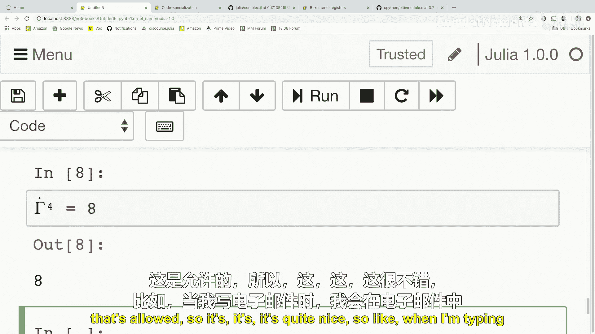

# 【麻省理工】软件系统性能工程 ｜MIT 6.172 Performance Engineering of Software Systems, Fall 2018 p23 23. 动态语言中的高性能 -BV1esbLzpEFq_p23-

The following content is provided under a Cative Commons license。

 Your support will help Mi T OpenCourseware continue to offer high quality educational resources for free to make a donation or to view additional materials from hundreds of MiT courses。

 Visit Mit Opencourseseware at Ocw。 Mt Eduu。

Hey everybody， let's get going。Who here has heard of the FFT？That's most of you。U。

So I first met Steve Johnson when he worked with one of my graduate students。

 now former graduate student， mateteo Frigo， and they came up with a really spectacular piece of performance engineering for the FFT system they call FFTW for the fastest Fourier transform in the West。

And it has over years and years been a staple of anybody doing signal processing we'll know FFTW。

 so anyway it's a great pleasure to welcome Steve Johnson who is going to talk about some of the work that he's been doing on dynamic languages such as Julia and Python。

Yeah so I'm going to talk as I said about highlevel dynamic languages and how you get performance in these and so most of you have probably used Python or R or MATlab and so these are really popular for people doing technical computing statistics and anything where you want interactive exploration you'd like to have a dynamically type language where you can just type x equals3 and then three lines later and said oh X is an array because you're doing things interactively you don't want to have to be stuck with a particular set of types and there's a lot of choices for these but usually hit a wall when it comes to writing performance critical code in these languages and so traditionally people doing somewhat serious computing in these languages have a two language solution so they do highlevel exploration and productivityivity and so forth in Python or whatever。

 but when they need to write performance critical code then you drop down to a lower level language for trans or C or Python or one of these things and use Python as the glue。

For these low level kernels。And the problem and this was workable know I've done this myself。

 many of you have probably done this， but when you drop down from Python to C or even to Python。

 there's a huge discontinuous jump in the complexity of the coding。

 and there's usually a loss of generality like when you write code in C or something like that it's specific to a very small set of types。

 whereas the nice thing about high levelvel languages is you can write generic code that works for a lot of different types。

So at this point there's often someone at pops up and says。

 oh well I do performance programming in Python and everyone knows you just need to vectorize your code so basically what they mean is you rely on mature external libraries that you pass them a big block of data it does a huge amount of computation and comes back and so you never write your own loops and this is great。

 if if there's someone who's already written the code that you need。

 you should try and leverage that as much as possible but somebody has to write those and eventually that person will be you and because eventually if you do scientific computing went into a problem inevitably that you just can't express in terms of existing libraries very easily or at all。

😊，So this was the state of affairs for a long time and a few years ago。

 starting in Alan Aelman's group at MIT。There was a proposal for a new language called Julia。

Whi tries to be as high level and interactive as it's a dynamically type language know as my MALb or Python and so forth。

 but general purpose language like Python very productive for technical works to really oriented towards scientific numerical computing but you can write a loop and you write lowle code in that that's as fast as C that was the goal。

 the first release was in 2013 it's pretty young language， the 1。

0 release was in August of this year so before that point every year there was a new release， 0。1。2。

3 and every year would breakke all your old old code and you have to update everything to keep it working so now they said okay it's stable。

 we'll add new features will make it faster but from this point onwards for at least until 2。

0 many years in the future it'll be backwards compatible。😊，So there's lots of， in my experience。

 this pretty much holds up， I haven't found any problem I could where there was a nice highly optimized C or forran code where I couldn't write equivalent code or equivalent performance equivalently performing code in Julia given enough time obviously if something is there's a library with 100。

000 lines of code， it takes quite a long time to rewrite that in any other language。

So there are lots of benchmarks that illustrate this。

 the goal of Julie is usually to stay within a factor of2 of C and my experience is usually within a factor of few percent that you can get if you know what you're doing。

 so there's a very simple example。😊，That I like to use which is generating a v demon matrix。

 so you given a vector of value is alpha 1 alphaitude alpha alpha M and you want to make an m by n matrix whose columns are just those entries to zero power first power squared。

 cubed and so forth， element wise so this kind of matrix shows up in a lot of problems so most matrix and vector libraries have a built-in function to do this and Python in nuy there' is a function called numppyy。

 vander to do this。😊，And if you look at and it's generating a big matrix。

 it could be performance critical so they can implement it in Pythonons。

 if you look at the N implementation， it's a little Python shim that calls immediately to see。😊。

And then if you look at the C code I won't scroll through it， but it several hundred lines of code。

 it's quite long and complicated and all about several hundred lines of code is doing is just figuring out what types and to work with what kernels to dispatch to and at the end of that it dispatches to a kernel that does the actual work and that kernel is also C code but that C code is generated by a special purpose cogen。

 so it's quite involved to get good performance for this while still being somewhat type generic。

 so their goal is to have something that works for basically any nuy array and any nuy type which is like there's a handful like maybe a dozen scalar types that it should work with so if you're implementing this and C it's really trivial to write 20 lines of code that implements this but only for double precision a point or to double position array。

😊，So the difficulty is getting type generic in C in Julia。Here is the implementation in Julia。

It looks at first glance， much like what roughly what a C or fortune implementation would look like。

 iss just just implemented the most simple way， it's just two ased loops。

So for basically you loop across and as you go across。

 you accumulate powers by multiplying repeatedly by x。

 that's all it is and it just fills in the array。😊。

The performance of the graph here is the time for the NPI implementation divided by the time for the Julie implementation as a function of n for an n by N matrix。

 the first data point I think that there's something funny going on that's not 10，000 times slower。

 but for like a 10 by 10， 20 by 20 array， the NI version is actually 10 times slower。

Because it's basically the overhead that's imposed by all going through all those layers once you get to like 100 by00 matrix the overhead doesn't matter。

 and then it's all this optimizeized C code code generation and so forth is pretty much the same speed as the Julie code except the Julie code there。

As I said， it looks much like C code would， except there's no types。 its Van or X。

 there's no type declaration， X can be anything。And in fact。

 this works with any container type as long as it has an indexing operation。

And any numeric type could be real numbers could be complex numbers could be Crternians。

 anything that supports the timess operation， and there's also a call to one。

 so one returns the multiplicative identity for so whatever group you're in you need to have a one。

 that's the first column that might be a different type of one for a different object might be an array of matrices。

 for example， and then the one is the identity matrix。So。In fact。

 there are even cases where you can do get significantly faster and then optimize the4 trend codes。

 So I found this when I was implementing special functions。

 So things like the error function or polygamma function or the inverse of the error function。

 I've consistently found that I can get。😊，Often two to three times faster than optimized seeing Fort libraries out there。

 partly because I'm just smarter than the people who wrote those libraries。

 but mainly because in Julia， I'm using basically the same expansions。

 the same series rational functions that everyone else is using。

 the difference is that in Julia has built in techniques for what's called metaprogramm or cogeneration so usually the special functions involve lots of polynomial evaluations。

 that's the way they bowl down to， and you can basically write co-generation that generates very optimize inline evaluation of the specific polynomials for these functions that would be really awkward to write in Fortrann。

 you either have to write it all by hand or write a separate routine。

 separate program that wrote Fortran code for you。😊。

So you can do this so high level languages allow you to do tricks for performance that it would be really hard to do in low level languages。

 So mainly what I wanted to talk about is give some idea of why。Julia can be fast。

And to understand this， you also need to understand why is Python slow and in general what's going on in determining the performance in a language like this。

 what do you need in a language to enable you to compile it to fast code while still。

Still being completely generic like this vendor function， which works on any type。

 even user defined numeric type， user defined container type will be just as fast as there's no privileged。

 In fact， if you look at， almost all of Julias implemented in Julia。

Integer operations and things like the really basic types。

 most of that is implemented in Julia right obviously if you're multiplying two third2it integers at some point。

 it's calling a assembly language instruction but。😊，But even that。

 calling out to this assembly is actually in Julia。So。So at this point， I want to switch over。To。

Sort of a alive。Calculation。So this is from a notebook that I developed as part of a short course with Alan Aelman who's sitting over there。

 18096 on performance optimization， high level languages。And。

So I want to go through this's a very simple calculation， of course you would never。

 I mean in any language usually you would have often have a built in function for this。

 but it's just a sum function it's just written up there so we just have a list an array of n numbers。

 we're just going to add them up。😊，And if we can't make this fast。

 then we have real problems and we're not going to be able to do anything in this list so this is the simplest sort of thing where if someone doesn't provide this for you。

 you're going to have to write a loop。To do this。So I want to look at it not just in Julia but also in Python in C and set in Python with NmppyI and so forth。

 so this document that I'm showing you here is a Jupiter notebook some of you may have seen this kind of things to Jupiter is this really nice they provide this really nice browser based front end where I can put in equations and text and code and results and graphs sell in like one sort of Mathematica notebook like document and they can plug in different languages so initially was for Python but we plugged in Julia and now there's R and there's 30 different100 different languages that you can plug into to the same front end Okay so I'll start with the C implementation of this。

😊，So this is a Julian notebook but I can easily compile and call out to see。

 so I just made a string that has just， you know there's a 10 lines implementation。

 it's just the most obvious function that just takes in a pointer to an array of doubles and its length and it just loops over them and sums them up。

just what you would do， and then I'll compile it with GCCS3 and link it to a shared library and load that shared library in Julia and just call it。

 so there's a function called C call in Julia where I can just call out to a C library with zero overhead basically。

😊，So it is nice because you have lots of existing C libraries out there， you don't want to lose them。

 so I just say C callll， I' recall this C sum function in my library， it returns a flow 64。

 it takes two parameters， a size T to flow 64 and I'm going to pass the length of my array and the array and it'll automatically a Julia array of course is just a bunch of numbers and it'll pass a point to that under the hood。

 so do that and we're a little function call rail error that computes the relative error between the fractional difference between x and Y。

😊，And， I'll just generate 10 to the seventh random numbers in 01 and compare that to the Julia because Julia has a built in function calleds。

That sums an array and it's giving the same answer to 13 deal places。

 you know so not quite machine precision， but there's 1 of the seventh numbers of the air kind of accumulated when you add it across。

 okay so as I'm calling it， it's giving the right answer and now I want to just benchmark the seation news that is kind of a baseline for this should be pretty fast。

😊，For an array of floating point values， so there's Julia package called benchmarkch tools。

 as you probably know from this class， benchmarking is a little bit tricky。

 so this will take something， run it lots of times， collect some statistics。

 return the minimum time or you can also get the variance and other other things。😊，So。

So I'm going to that number， B time is something called a macro in Julia， so it takes an expression。

 rewrites it into something that basically，Has a loop and times it and does all that stuff。Okay。

 so it takes 11 milliseconds to some 10 to the seventh numbers。

 just with a straight sea loop compiled with GCC。3， no special tricks。😊，Okay。

And so that's one gigapop， basically a billion operations per second。

So it's not hitting the peak rate of the CPU， but of course's additional calculations。

 this rate doesn't fit in cash and so forth。😊，So now let's before I do anything Julia。

 let's do some Python， but I'll do a trick I can call Python from Julia。

 so that way I can just do all everything from one notebook using a package called I wrote called Py call and Pyol just calls directly out to Lib Python virtually no overheads it's just like calling Python from within Python I'm calling directly out to Lib Python functions to and I can pass any type I want and call any function and do conversions back and forth。

I'm going to take that array， I'll convert it to a Python list object。

 so I don't want to time the overhead of converting that my array to a Python array。

 so I'll just convert it ahead of time get and just start with the Python has a builtin function called sum。

 so I'll use the builtin sum function。And I'll get this pi object for it。I'll call it。

 pie some on this list and make sure it's giving the right answer。

 okay to is the difference to the my 13s again。And now let's benchmark it。Oops， there we go。

So it takes a few seconds because it has to run it a few times in customs with statistics。Okay。

 so take 40 milliseconds， that's not bad， it's four to five times slower than C。

 but it's pretty good，So why is it five times slower than C is it because the glib answer is， oh。

 well， Python is slow because it's interpreted？But the sum function is actually written in C。

Here's the C implementation of the sum function that I'm calling。

 and I'm just linking to the GiHub code。There's a whole bunch of boilerplate that just checks with the type of the object。

And then has some loops and so forth， and so if you look carefully。

 it turns out it's actually doing really well， and the reason it does really well is it has a fast path。

If you have a list where everything is a number type。

 so then it has an optimized implementation for that case， but it's still five times slower than C。

And they've spent a lot of work on。 It used to be 10 times slower than C。 So a couple years ago。

 So they do a lot of work on optimizing this。 And so why aren't they able to get seape since they have a seaation of a sum。

Are they just dumb， no， it's because the semantics of the data type prevent them from getting anything faster than that。

And this is one of the things when you learn when you do performance in highlevel languages。

 you have to think about data types， you have to think about what the semantics are and that greatly constrains what any conceivable compiler can do。

 and if the language doesn't provide you with the ability to express the semantics you want。

 then you're dead， and that's one of the basic things that Julia does， so what is the Python list？

So you can have three， four。Right。Python list is a bunch of objects， Python objects。

 but the Python objects can be anything， they can be any type。So it's completely heterogeneous types。

So of course， a particular list like in this case can be homogeneous， but the data structure。

It has to be heterogeneous because in fact， I can take that homogeneous thing at any point I could assign the third element to a string and it has to support that。

So think about what that means for how it has to be implemented in memory。So。So what this has to be。

 so this is a list of。In this case。Three items。But what are those items？

So if they can be an item of any type， could be things， it could be another array。

 it could be of different sizes and so forth。You don't want to have an array where everything is a different size。

 first of all， so it has to be this an array of pointers。Where the first pointer is。

Three to object three， the next one is four， the next one is two。But it can't just be that。

 it can't just be pointer to like this is a you know 64 bit numbers， it can't just be pointer to 1。

64 bit value in memory because it has to，No， it has to somehow store what type this subject is。

 So has there has to be a type tag that says this is an integer。

And this one has to have a type tag that says it's a string。So this is sometimes called the box。

So you have a value， you have a type tag。Pss of value。

And so imagine what even the most optimized seek implementation has to do。

 given this kind of data structure。 Okay here's the first element it has to chase the pointer and then ask what type of object is it then depending on what type of object is it is initial this size my sum to that then I read the next object。

 I have to chase the second pointer， read the type tag。

 figure out the type this all then at runtime and then oh this is another integer that tells me I want to use the plus function for two integers and then I read the next value。

 which maybe it's a so the which plus function is's using depends upon the type of the object。

 It's an object language I can define my own type it which has its own plus function it should work with some So it's looking at the types the object at runtime。

 it's looking at the plus function at runtime and not only that but each time it does a loop iteration。

 it has to add two things and allocate a result that result in general might be another has to be a box because it type my change as you're summing through。

😊，With integers， and then you get a flow point value， and then you get an array， the tyal change。

 So each time you do a loopit iteration， it allocates another box。😊。

So what happens is the C implementation is a fast path if they're all like integer types。

 I think it doesn't reallocate that box for the sum it's aumulating all the time and it cachees the value of the plus function it's using。

 so it's a little bit faster， but still it has to inspect every type tag and chase all these pointers for every element of the array。

 whereas the C implementation of sum。If you imagine what is this compiles down to right each loop iteration was a do。

 it increments a pointer to the next element fetches it knows that at compile time the types are all  flow64。

 so it fetches a flow64 value into a register and then it has a has a running sum in another register calls one machine instruction to add that running sun some and then goes it checks to see if we're done has an if statement there and then goes on right so just a few instructions in a very tight loop here whereas。

😊，Each loop iteration here has to be lots and lots of instructions to chase all these pointers to get the type tag and that's in the fast case where they're all the same type and it's optimized for that。

So。Oh， where was I？W thing so that's the Python sum function now most many of you use Python know that there's another type of array and there's a whole library called nuumpI if I' working with Emmers。

😊，So。What problem is that addressing， so the basic problem is this data structure？

This data structure， as soon as you have a list of items that can be any type， you're dead。

 there's no way to make this as fast as a sea loop over a double pointer。So to make it fast。

What you need have is a way to say， oh， every element of this array is the same type。

 so I don't need to store type tags for every element。

 I just to store a type tag once for the whole array。So there is a tag。😊，For there's a type。

Which is say float 64。Okay， there's maybe a length。Of the array。

And then there's just a bunch of values， one up the other。 So this is just， you know，1。0，3。7，8。9。

 And each of these are just8 bys。An eight byte double in Cnotation， right？

So it just one after the other， so it reads this once， reads the length。

 and then it dispatches to code that says， okay， now it basically dispatches the equivalent of myC code。

So now once it knows the type and the length， then okay， says it runs this。Okay。

And that can be quite fast， and the only problem is you cannot implement this in Python。

So Python doesn't provide you a way to have that semantics。

 to have a list of objects where you say they all have to be the same type。

 there's no way to enforce that or to inform the language of that in Python and then to tell it， oh。

 for this test and these are all the same type， you can throw away the boxes。

 like every Python object looks like this， there's no way to tell Python oh well these are all the same types。

 you don't need to store the type tags， you don't need to have pointers。

 you don't need to have reference counting， you can just slam the values into memory one after the other。

It doesn't provide you with that facility and so there's no way to like you can make a fast Python compiler that will do this。

 so nupI is implemented in C， even with some of you are familiar with P pie。

 which is an attempt to make a fast like tracing Jit for Python when they poureded to nuumppI to pipe pie or they attempted to even then they could implement more of it in Python。

 but they had to implement the core in C。Okay， but given that I can do this。

 I can import the Numpy module into Julia， get its some function。

And benchmark the nuumpy some function。And。again， it takes a few seconds to run。Okay。It takes 3。

8 milliseconds， so the C was 10 milliseconds， so it's actually doing faster than the C code。

 almost a little over twice as fast， actually， and what's going on is their C code is better than my C code。

 their C code is using assemblysemite instructions。😊，嗯。SoAnd to this point。

 I'm sure you guys all know about these things where you can read in two numbers or four numbers into like one giant register and one instruction at all four numbers at once。

Okay，What about if we go in the other direction， we write our own Python sum function。

 so we don't use the Python sum implemented in C。 I write our own in Python。

 So here's a little my sum function in Python。Only works for floating point I initialize s to 0。0。

 so it really only accumulates floating point values， but that's okay。

 and then I just loop for x and a， S equals s plus x return S this is the most obvious thing you would write in Python。

😊，Okay， check that it works， yet air is 10 to minus 13th， it's giving the right answer。

And now let's time it。So remember C was 10 milliseconds。

 NI was like five milliseconds and then built in Python was like sum was 50 milliseconds operating on this list now so now we have this C code operating on this list with 50 milliseconds and now we have Python code operating on this list。

😊，And that is。230 milliseconds。So it's quite a bit slower and it's because basically in Python in the pure Python code there's no way to implement this fast path that checks。

 oh， they're all the same types so I can cache the plus function and so forth。

 I don't think it's feasible to implement that。And so basically then on every luiteration has to look up the plus function dynamically and allocate a new box for the result and do that 10 to the seventh times。

😊，Because now。So there's a built in some function in Julia。

So all this to benchmark that as it's actually implemented in Julie， it's not implemented in C。

I won't show you the code for the built in one because it's a little messy because it's actually computing the sun more accurately than the loop that I've done uses。

3。9 milliseconds。So it's scable to the Numpy code。Okay， so it's also using SD。

 but so this is also fast。嗯。So now。And so why can Julie do this。

 so it has to be that the array type first of all， has the type attached to so you can see the type of the array is an array of flow 64。

 so there's a type tag attached to the array itself， so somehow that's involved。😊。

So it looks more like a numpy array in memory than a Python list。

You can make the equivalent of a Python list that's called an array of any。

So if I convert this to an array of any。So an array of any is something where the elements types can be any Juliat type。

 and so then it has to be stored as something like this as an array of pointers to boxes。

 and when I do that，Let's see。There it is then it's 355 milliseconds so it's actually it's actually even worse than Python so Julia Python they spend a lot of time optimizing their code passs for things that had to allocate lots of boxes all the time So Julia it's usually understood that if you're writing optimized code。

 you're going to do it not on as of pointers to boxes like if you going to write it on homogeneous arrays or things where the types are known at compile time。

😊，Okay。So let's write our own Juliali sum function， This is the Julialius sum function。

 there's no type declaration， it works on any container type。😊。

I initialize S to this function called zero for the al type of variance。

 it initializes it to the additive identity so it'll work on any container of anything that supports a plus function that has an additive identity。

 so it's completely generic， looks a lot like the Python code except for there's no zero function in Python。

Let let's make sure you give you the right answer， it does。And that's benchmark。はい。

So this is a code you'd like to be able to write， you'd like to be able to write high level code。

 that's a straight loop， unlike the C code， it's completely generic。

 it works on any container to anything you can loop over and anything that has a plus function so an array of Ctturnians or whatever。

😊，And a benchmark， it's 11 milliseconds， it's the same as the C code I wrote in the beginning。

It's not using SMD， so instructions side that's where the additional factors of two come。

 but it's the same as the non SD C code， and in fact， if I want to use SMD，😊。

There is a little tag you can put on the loop to tell- it says components this with LOVM。

 you can say tell LLVM to try and vectorize the loop， sometimes it can， sometimes it can't。😊。

With something like this， it should be able to vectorize it simple enough。You don't need a hand code。

 send many instructions for a loop is simple。I'll see why isnt into the default because most of the code most code compiler cannot auto vectorize。

 so it increases the compation time and it often bs the code size for no benefit。

 so it's really only relatively simple loops on doing simple operations and arrays that benefit from SID。

😊，you don't want it to be there yeah， so now it's 4。3 milliseconds。

 so it's about the same as the Numpy and so forth， it's a little slower than the NumpI it's interesting a year ago when I tried this it was almost exactly the same speed as the Ny and then since then both the NumpI and the Julia have gotten better but the NumpI got better more so there's something going on with basically how well the compiler can use AVX instructions by it seems like where we're still investigating what that is。

 but an LVM limitation looks like。😊，So and is that it's still completely type generic。

 so if I make a random array of complex numbers。And then I sum them。啊。

which one am I calling now am I calling the my sum is the vectorized one right so complex numbers each complex number is two floatinging point numbers so it should take about twice the time to naively think right so twice the number of operations to add the same number of complex numbers is the number of real numbers yeah and it does it takes about 11 milliseconds so。

😊，For 10 to the  seventh， which is about twice the5 milliseconds it took。

 for the same number of real numbers。 and the code works for everything。 So why。Okay。

 so what's going on here？啊。So。Okay， so we saw this my sum function， I'll just take out the S for now。

嗯。And we did all that， okay。And that。Okay so and it works for any type。

 it doesn't even have to be an array， so for example there's another container type called a set in Julia。

 which is just an unordered collection of unique elements。

 but you can also loop over it if it's a set of integers。😊，You can also summit。

And I'm waiting for the benchmarks to complete。So let me allocate a set。嗯。是。

So there's no type declarations here like my sum A。

 there was no A has to be an array of particular type or even it doesn't even have to be an array。

 so set as a different data structure。And it's。And so it's a set of integers sets are unique。

 if I add something to already the set that's in there it won't add it twice and it supports sleep fast checking is two in the set is three in the set doesn't have to look through all the elements。

 it's a hash internally。But I can call my my sum function on it， and it sums up 2 plus 17 plus 6。 24。

 which is hopefully 49。😊，Right。Okay， so what's going on here so suppose you define one of the keys theres several things that are going on to make Julia F。

 so one key thing is that when you have a function like this my sum。

 or even here's a simpler function， f of x equals x plus1。

When I call it with a particular type of argument。Like an integer or an array of integers or whatever。

Then。ItIt compiles a specialized version of that for that type， so here's f of x equals x plus1。

 it works on any type supporting plus。So if I call F of three。So here I'm passing a 64 bit integer。

 when it did that， it says okay， x is a 64 bit integer。

 I'm going to compile a specialized version of F with that knowledge。

And then when I call it with a different type。3。1。Oh， now x as a floating point number。

 it'll compile a specialized version。With that value， if I call it with another integer。It says， oh。

 that version was already compiled that while we use it。

 so it only compiles it the first time you call it with a particular type。

 if I call it with a string， it'll give an error because it doesn't know how to add plus to a string。

So in particular。Okay so what is going on so we can actually look at the compiled code。

 sos something called there's the function called code。

 these macros called code LOVM and code native， they say okay when I call F of1。

 what's the people know what LOVM is so you guys so LVM right compiles to bytecode first and then it goes to machine code so you can see the LOVM bit code or bytecode or whatever it's called。

And you can see the native machine code， so here's the LVM Bte code that it compiles to if everyone。

So it's called add I64 is0 which cause one， basically one LVM instruction。

 which turns into one machine instruction，E load effective address is actually a 64 bed addition function instruction。

😊，So let's think about what had to happen there。So if you have M of x equals x plus1。Now。

Compile don't compile for。X is a int 64。So a 64 bit integer， or Julie， we'd say x， colon， colon。

In64So colon call means this is of this type。So this is a 64 be inger type。

 so what does it have to do？It first has to figure out what plus function to call a plus。

It of different there's a plus for two matrices， a plus for lots of different things。

 and so depending on the types of the arguments it decides on which plus function to call。😊。

So it first realizes， oh， this is an integer， oh， this is an integer， this is also a 64bit integer。😊。

So that means I sound a call。The plus function for two integers。

So I'm going to look into that function。And then， oh， that one returns。And in 64。

 so that's the return value for my function。😊，And oh， by the way。

 this function is so simple that I'm going to inline it。So it's type specializing and this process。

Of going from x as an integer to that to figure out the type of the output is called type inference。

Okay。And general， for type inference。Is given the types。Of the inputs。It tries to infer。The types。

Of the outputs。And in fact， all intermediate values as well。

Now what makes it a dynamic language is this can fail。

 so in some languages like ML or some of the languages you don't really declare types。

 but they're designed so that you give the types of the inputs you configure everything。

And if it can't figure out everything， it gives an error， basically it has to infer everything。

 so Julia is a dynamic language， this can fail and have a fallback of if it doesn't know the type it can stick things in a box。

But obviously the fast path is when it succeeds and one of the key things is you have to try to make this kind of thing work in a language。

 you have to design the language so that，at least for all the built in constructs。

 the standard library， or in general in the culture for people designing packages and so forth。

 that to design things so that this type inference can succeed。嗯。

And I'll give a counter example to that in a minute，And this works recursively。

 so it's now suppose I define a function G of x equals f of x times 2。and then I call G of 1。

 so it's going to say， okay， x here is an integer。😊，Okay。

 I'm going to call F with an integer argument， oh， I should compile F for an integer argument。

 figure out its return type， use its return type to figure out what times function to call and do all this at compile time not at runtime ideally so we can look at the LM code for this and in fact。

😊，So this is， remember f of x adds1 to x， and then we're telling you multiply by two。

So the result computes 2 x plus 2。And LLVM is smart enough， so F is so simple that it inlines it。

 and then LLVM is smart enough that I don't have to- well。

 I know it does it by one shift instruction to multiplay x by2。

 and then it adds two so it actually combines the times  two in the plus1。

 so it does constant folding。and you continue on， if you look at h of x equals g of x times 2。

 then that compiles to one shift instruction to multip x by 4， and then adding 4。

So you so this process cascades。So and you can even do it for a recursive function。

 so here's a stupid implementation of a Fibonachiome calculation of recursive implementation。

 right so this is given n， must be that's an integer。😊，Okay， if n is less than three， returns one。

 otherwise it adds the previous two numbers。I can compute the first call this in the first 10 integers。

 Here's the first 10 fibacci numbers。 There's also an acute notation in Julie， it can say fib dot。

 So if you do F dot arguments， it calls the function element wise on a collection and returns a collection So F dot 1 to 10。

Returns the first 10 feminology numbers and I can call there's a function called code1 type tell me what it'll tell me the output of type。

 type inference n is a one and it goes through this is kind of a hard to read format。

 but this is like after one of the compiler passes called lowering。But yeah。

 it's figured out out the types of every intermediate call， so here is it's invoking main do fib。

 it's recursively， and it's figured out that the return type is Austin in '64 so it knows everything。

Okay。So。You'll notice that here I declared a type， I'd said that this is an integer。Okay。

I don't have to do that for type inference inference this doesn't help compiler at all because it does type inference depending on what I pass so what this is is's more like a filter it says that if I pass this function only accepts integers if you pass something else it should throw an error because I don't want this function because if I pass 3。

7 if I fill out any number if you look at 3。7 I can check whether it's less than three it can call it recursively I mean the function would run it would just give nonsense so I want to prevent someone from passing nonsense for this so that's one reason to do a type declaration。

But another reason is to do something called dispatch。

So what we can do is we can define different versions of a function for different arguments。

 so for example， another nicer version of that is a factorial function。

 so here is a stupid recursive implementation of a factorial function that takes an integer argument and just recursively calls itself on n minus1。

😊，So you can call it on 10 factorial。 if I want 100 factorial， I need to use a different type。

 not 64 bit integers， I need some arbitrary precision integer。And。And since I said it was an integer。

 if I call it 3。7， it'll give an error， because that's good。

 but now I can define a different version of this， so actually there is a generalization of factorial to arbitrary real in fact even complex numbers。

😊，Called the gamma function。 and so I can define。A fallback that works for any type of number。

That calls a gamma function from someplace else， and then if I can pass it to floatinging point value。

 if you take the factorial of minus a half， it turns out that's actually square root of pi。

 so if I square it。😊，It gives pie， right？So now I have one function。And I have two methods。Right， so。

So these types here， So there's a hierarchy of types。 So this is what's called an abstract type。

 which most of you probably have seen so there's a type called number。

And underneath there's a class of subtypes called integer。And underneath， there was， for example。

 in 64。Or in eight for or 64 bit integers underneath number。

There's actually another subtype called real， and underneath that there's a couple subtypes and then there's this's say flow 64。

Or float 32 for a single precision， 32 bit floating point number and so forth。

 so there's a hierarchy of these things。😊，When I specify something can take integer。

 I'm just saying so this type is not helped the compiler it's to provide a filter。

 says this method only works for these types， and this other method works my second method works for any number type。

So I have one Martha that works for any number type series。

One method that works for any number type and one method that only works for integers so when I call it for three。

 which ones does it call because I actually call both methods and what it does is it calls the most specific one it calls the one that's sort of farthest down the tree so if I have a method that's defined for a number and one defined forteger if I pass an integer it'll do this if I have one that's defined for number one that's defined for integer and one that's defined specifically for ant8 and I call it pass an apiid integer it'll call that version so it gives you a filter。

But in general， you can do this on multiple arguments， so this is like the key abstraction in Julia。

 something called multiple dispatch。So this was not invented by Julie。

 I guess it was present in small talk in Dylan， it's been in a bunch of languages。

 it's been floating around for a while， but it's not been in a lot of mainstream languages。

 not in a high performance way。And you can think of it as a generalization of auditative programming。

So。I'm sure all of you have done Obian programming in Python or C++ or something like this。

 so in Obittorian programming。Typically the way you think of it as you say of an object。

It's usually spelled like object dot method。Now， X， Y， for example， right？

And what it does is this type。The object type。Determines。The method， right？

So you could have a method called plus but I would actually call a different plus function for a complex number or a real number or something like that。

 or a method called length， which for a Python list would call a different function than for a nuy array。

😊，系。And Julia。ithThe way you would spell the same thing。Would you say method？

you wouldn't say objectt method， right， so you don't think here you think of the object as sort of owning the method。

Right。And Julia， the object would just be maybe the first argument， in fact， in fact， under the hood。

 if you look in Python， for example， the object is passed as a implicit first argument called self so actually is doing this。

 It's just spelling different spelling of the same thing。But as soon as you read it this way。

 you realize。What Python and what OO languages are doing is they're looking at the type of the first argument determine the method。

But why just the first argument？So in a multiple dispatch language you look at。All the types。

So this is sometimes in Julia， this sometimes we called single dispatch。

Because this determining the method is called dispatch。Right。

 figuring out which function is that spell length， Which function actually are you calling this dispatching to the right function。

 So this is called multiple dispatch。And it's clearest if you look at something like a plus function。

So a plus function。If you do A plus B。whichhi plus you do really should depend on both A and B it shouldn't depend on just A or just B。

 and so it's actually quite awkward in languages in OopP languages like Python or especially C+ plus to overload a plus operation that operates on sort of mixed types as a consequence for example in C+ there's a built-in complex number type so you can have a complex float or complex double complex and complex with different real types。

 but you can't add a complex float to a complex double。

You can't add a single position complex number to a double position complex number or any mixed operation any mixed complex operation because you can't figure out who owns the method。

 it doesn't have a way of doing that kind of promotion， right。😊，AndAnd Julia。

 so now you can have a method for adding。A floatat 32 to a F 32， but also a method for adding a。

 I don't know， let's see here's adding a complex number to a real number， for example。

 right you want to specialize or a real number to a complex number， you want to special thing。

 in fact we can click on the link here and see the code。😊，So the complex number to a real number。

In Julia looks like this， it's the most obvious thing it's implemented in Julia。

 plus complex to real， creates a new complex number， but you only have to add the real part。

 you can leave the imaginary part alone。And this works on any complex type。Okay，A。

 there's too many methods for。Okay， I can shrink that and see。So。

I can talk about there's another type inference thing called I'll just mention it briefly。

 so one of the things you have to do to make this type inference process work is given the types of the arguments you have to figure out the type of the return value。

So that means when you define a function， has to be what's called typetable。

 that the type of the results should depend on the types of the arguments and not on the values of the arguments because the types are known at compile time。

 the values are only known at runtime。And it turns out if you don't have this in mind。

 in C of no choice， but to obey this， but in something like Python。

 a dynamic language like Python or MALb， if you're not thinking about this。

 it's really easy to design things so that doesn't work so that's not true。

 So a classic example is a square root function。I said，Supp I pass。An integer to it， Okay。

 so the square root of this is this square root of five。Right？

The result has to be floating point number， right？It's 2。23 whatever。 So if I do scrub root of4。

 of course， that scrub root as an integer。😊，But if I return an integer for that type。

 then it wouldn't be typetable anymore， then the return value type would depend on the value of the input。

 whether it was a perfect square or not so it returned to floating point value even if the input is an integer if you have enough methods defined find for bunch different types to look for the right function really。

Well， since the lookup comes it comes at compile times so it's really kind of irrelevant。

 at least if T inference forensics succeed， T inference fails and it's runtime。

 it's slower but like I mean it's like a tree search so it's not as slow as you might think。

 but most of the time you don't worry about that because if you care about performance。

 you want to arrange your codes so that type in forensic succeed。

So you prototype maybe is this something that you do in performance optimizationization like when you' prototype and you don't care about types。

 you say x equals3 and the next line you say x equals an array， whatever。

 but when you're optimizing your code then you you tweak it a little bit to make sure that things don't change types willilly and that the types of a function depend on the types of the arguments not on the values so as I mentioned square root is what really confuses people at first。

 if if you take square root of minus1， you might think you should get a complex value and instead it gives you an error。

And。Because thats basically what are the choices here， it could give you an error。

 it could give you a complex value， but if it gave you a complex value。

 then the return type of square root would depend upon the value of the input， not just the type。

So MALb， for example， if it takes square root to minus1， it'll happily give you a complex number。

But as a result， if you have MatLB has a compiler and has many， many challenges。

 but one simple thing to understand is if the MatLub compiler squeeze sees a square root function anywhere in your function。

Even if it knows the inputs that are real， it doesn't know if the outputs are complex or real unless it can prove that the inputs were positive or non negative and that means it could then compile two code passs for the output but then suppose it call a Scd again or some other function right you quickly get an combinatorial explosion of possible code passs because there's a possible types and so at some point you just give up and just put things in a box but as soon as you put things in a box and you're looking at types that run time you're dead from a performance perspective。

So Python actually if you want a complex result from square root。

 you have to give it a complex input。😊，In Julia a complex number， I is actually M。

 they decided I is too useful for loop variables， so I and J so M is the complex unit。

 and if it takes greater of a complex input it gives you a complex output。😊。

So Python actually does the same thing， so in Python， if it takes screw root of a negative value。

 it gives an error unless you give it a complex input。But Python made other mistakes， so for example。

 in Python。An integer is guaranteed never to overflow if you add  one。

1 plus1 plus one over and over again and Python eventually overflow the size of 64 bit integer and Python will just switch under the hood to an arbitrary position in an integer？

whichch seemed like a nice idea， probably at the time。

 and the rest of Python is so slow that the performance cost of of this test makes no difference in a typical Python code。

 but it makes it very difficult to compile because that means if you have integer inputs and you see x plus1 in Python。

😊，The compiler can't just compile that to one instruction because unless it can somehow prove that x is sufficiently small。

So in Julia you integer arithmetic will overflow but the default inarthtic is integer arithmetic is 64 bits。

 so in practice that never overflows unless you're doing number theory and you usually know if you're doing number theory and then you use arbitrary precision integers it was much worse in the days like this is something people worried a lot before you were born when there were 16 bit machines and integer it's really。

 really easy to overflow 16 bits because the biggest sine value is then 32767 so it's really easy to overflow so you're constantly worrying about overflow and even 32 bits。

 the biggest sign value is2 billion it's really easy to overflow that even just counting bytes files that are bigger than 2 gigabytes easily nowadays so people worried about this all the time but with 64 bit integers basically 64 bit integer will never overflow if it's counting objects that exist in the real universe like bytes。

Or luit iterations or something like that。 So you then you just say， okay。

's either 64 bit or you're doing number3， you should use bigins。So， okay， so let me talk。

The final thing I want to talk about， let's see how many you doing time， good。

Is defining our own types。So this is where like this is the real test of the language right so it's easy to make a language where there's a certain built in set of functions and built in types and that are those things are fast。

 so for example for Python，There actually is a compiler called Numbba that does exactly what Julia does。

 It looks at the arguments， types specializes things and then calls LVM and compiles it to fast code。

 but it only works if your only container type is a NI array and your only scalar type is one of the 12 scalar types that NMI supports。

 If you have your own user defined number type or your own user defined container type。

 then it doesn't work。😊，And user to find container types it's probably easy to understand why that's useful。

 user defined number types are extremely useful as well， so for example。

 there's a package in Julia that provides a number type called dual numbers。

And those have the property that if you pass them into the function。

 they compute the function and its derivative。😊，And it's just a slightly different。

 it basically carries around function and derivative values and as a slightly different plus in times and so forth。

 it just through the product rule and so forth and it just propagates derivatives and then if you have Julia code like that vandermon function。

 it'll just compute this derivative as well。😊，Okay， so I want to be able to find my own type。

 So a very simple type that might want to add would be points。

2 d vectors in two space right so of course I can have an array of two values。

 but an array is a really heavyweight object for just two values if I know it compile time this two values that I don't need to have a point or I can actually store the registers I can unroll the loop over these everything should be faster you can get an order of magnitude and speed by specializing on the number of elements for small arrays compared to just a general array data structure So let's make a point。

😊，Okay， so this is。😊，I'm going to go through several iterations。

 start starting with a slow iteration， I'm going to define a mutable struct。

 so this will be a mutable object where I can add a call point that has two values x and y。

 it can be of any type， I'll define a plus function。😊，That can add them。

 and it does the most obvious thing， it adds the x components， adds the y components。

I'll define a zero function that's the additive identities that just returns the 0。00。

 and then I can construct an object 0。34， I can say 0。34 plus 0。56， it works。😊。

It can hold actually right now it's very generic and probably too generic。

 so like the real part can be a floating point number and the x can be a floating point number here and the y is a complex number of two integers or even I could make a string and an array that if it in anything makes sense。

 I probably should have restricted the types of x and y a little bit just to prevent the user from putting in something that makes no sense at all。

😊，Okay so these things， they can be anything， so this type is not ideal in several ways。

So let's think about how this has to be stored in memories。 This is a 。1。啊。P say 0。113。7。

So in memory。It's。There is an X。And there's a Y， but X and y can be of any type。

 so that means they have to be pointers to boxes。There's an pointer to ant one。

 and there's a pointer to a。A float 64 in this case。3。7 said， oh。

 this already we know this is not going to be good news for performance， right。And it's mutable。

 so that mutablestruct meant if I take p equals point a point， I can then say p dot x equals7。

 I can change the value。Which seems like a harmless thing to do， but actually is a big problem。

Because for example， if I make an array of。Of three piece。

and then I say p do y equals8 and a look at that array， it has to change the y component。系。

So if I have a P or in general， if I have a P that's looking at that object。

If this is an object you can mutate， it means that if I have another element， a Q。

 it's also pointing the same object。 and I say P P dot x equals4， then。Q。

X had better also before at that point。So so to have mutable semantics。

 to have the semantics of something you can change and reference other references can see that change。

 that means that this object has to be stored in memory on the heap as a pointer to two objects。

 So that you other pointers， the same object。 And I mutate it And in the other references， see it。

 It can't just be stuck in a register or something like that。

 it has to be something that other references can see。 So this is bad。 So if I have。 So I can call。😊。

Po1 dot A A calls the constructor element wise。 and A is this array of 10 to the seventh random numbers as benchmarking on before that was taking 10 milliseconds。

Okay， and。If I I can sumit， I can call the built-in sum function on this。

 I can even call my sum function on this because it supports a zero function， so supports a plus。

 so here I have an array， if I could scroll back up。

 I have an array here of 10 to the seventh values of type 。1 so that the type of 0。

1 is attached to the array。😊，So the array in memory， so if I have an array。Of point1。

The one here means it's a one dimensional array， there's also 2D。

 3D and so forth that looks like a 0。1 value， a 0。1 value， a  point。1 value， but each one of those。

But each one of those now， sorry， has to be a pointer to。An X and a Y。

 which themselves are pointers to boxes。 right， So operating something this is going to be really slow because there's a lot of pointer chasing。

 It has to at runtime check， what's the type of X。 What's the type of Y。 And in fact， it was It took。

😊，Instead of 10 milliseconds， it took five or 600 milliseconds。So to do better。

We need to do two things。 So first of all， X and Y。

They have to we have to be able to say what type they are。

It can't be just any arbitrary thing that has to be pointed to a box。

and the point object has to be immable has to be something where if I have p equals something Q equals something I can't change p and expect Q to see it otherwise if it's mutable。

 they have to be stored as those semantics have to be implemented as some point to an object in place and're then you're dead。

 so I can just say struck。Substruct now is not mutable， it doesn't have the mutable keyword。

 and I can give the arguments types， I can say they' both flow 64。

And then x and y are both the same type， the're both the 64。

 but filling point numbers I'll define plus the same way，0 the same way now。😊。

I can add them and so forth， but now if I make an array of these things。And if I say p。 x equals6。

 it will give an error it says， oh you can't don't even try to mutate it because we can't support those semantics on this type。

But that means that type。Its actually。If you look at thatt in memory。

What the compiler is allowed to do and what it does do for this is if you have an array。Of point。2。

One。Then it looks like just you know。The x value， the y value， the x value， the y value。

 and so forth where each of these are exactly one，8 bytes。😊，Flolow 64。

And all the types are known at compile time， and so if I sum them。

 it should take about probably 20 milliseconds right because summing in real numbers was 10 milliseconds and this is twice as many because it has to sum the Xs sum them wise and let's benchmark it。

😊，And let's see。Oh， actually sorry something of the real numbers took five milliseconds so something should do it。

 take about 10， let's see， is that still true， Yeah， took about 10。So actually。

 the compiler is smart enough it stores。 So first of all， it stores this in line。

As one big block consecutive block of memory， and then when you sum them， remember a sum function。

 well， this is built in sum， but our sum function will work the same way。

The compiler LVM will be smart enough to say， oh， I can load this into a register。

 load y into a register， have a tight loop where I basically call one instruction to sum the x's。

 one instruction to sum the Y's， and then repeat。So it's about as good as you could get。

You paid a big price。 We've lost all generality， right。

 These can only be two 64 B floating point numbers。

 I can't have two single precision numbers or this is like a struct of two floating float two doubles in C。

 right。So if I have to do this to get performance in Julia。

 then I would suck basically maybe I'm basically writing C code in a slightly higher level syntax。

 I'm losing that benefit of using a high level language。So the way you get around this is you define。

What you want is to define something like this 0。2 type。But you don't want to define just one type。

 you wanted to define a whole family of types， you wanted to define this for 2464s， 2432s， in fact。

 you wanted to define find an infinite family of types for at two things of any type you want。

 as long as there are two real numbers， two real types。

And so the way you do that in Julia is a parameterized type。

 this is called parametric polymorphism is similar to what you see in C++ templates。😊。

So now I have astruct it's not mutable03， but the curly braces T says it's parameterized by type T。

 So x and y I've restricted it slightly here， I've said x and y had to be the same type。

 I didn't have to do that， but I could have had two parameters one for the type of x1 is a type of y。

 but most of the time you'd be doing something like this you'd want them both be the same type。

 but they could be both flow 64 is both float 32s， both integers。

 whatever So T is any type that less than colon means is a subtype of So t is any subtype of real could be flow 64 it could be in 64 it could be int8 could be big float it could be a user defined type it doesn't care。

So this is really not it's a 0。3 here。Is a whole hierarch is not I'm not defining one type。

 I'm defining a whole set of types。So point3 is a set of types， there's a point。in3 in 64。There's a 。

3。Float 32。For full of 64 and so on infinitely many types， you know as many as you want。

 and basically it'll create more types on the fly just by just by instantiating。 So for example。

 otherwise it looks the same。 The plus function is basically the same。 I add the X components。

 the Y components。 The zero function is the same。😊，I now I make sure there's zeros of type T。

Whatever that type is。And now if I say 0。34， now I'm instantiating a particular instance of this and now that particular instance of 0。

3 will have this is an abstract type， we'll have one of these concrete types。

 and the concrete type it has in this case is a 0。3 of 2 in 64s2 is 64 bit integers。😊，Okay。

 and I can add them。And actually adding mixed types will already work because they plus。😊。

The addition function here。It works for any 2。3s， I didn't say they had to be 0。3s of the same type。

So any two of these， they don't have to be two of these， they could be one of these and one of these。

And then it determines the type of the result by the type of return mean it does type inference。

 so if you have an0。3 of 2 in64s and 0。3 of 2 432s， it says， oh， p dot x is an in64。

 Q dot x is a flow464， oh， which plus function would I call。

 oh there's a plus function for that mixing and it promotes the result of  flow64 so that means that that sum is 464。

 the other sum is  flow64， oh， then I'm creating a 0。3 of flow 64？😊，So this kind of mixed。

Promotion is done automatically， you can actually define your own promotion rules in Julia as well。

And I can make an array。And so。Now， if I have an array of03。Float 64。

So this type is attached to the whole array。And。This is not an arbitrary 。3， it's a 0。3 of 264s。

 so it gets storeded again as just 10 to the seventh elements of x Y， X Y where each one is8 bytes。

8 bytes， eight bytes， one after the other， the compiler knows all the types when you summit。

 it knows everything a compile time and it will sum two of these things by loaded this into a register load this into a register called one instruction。

 add them and so the sum function should be fast。So we can call the built in sum function。

 We can call our own sum function。 Our own sum function。 I didn't put S here。

 So that's going to be twice as slow， but。Yeah， yeah。We just work with Cindy。Yeah。Yeah in fact。

 if you look at the built in sum function， the built in sum function is implemented in Julia it just has an atID on the sum。

 yes， so LOVM is smart enough that if you give it astruct of two values and load them if you tell it I mean adding these two values to these two values。

 these two values to these two values， it will actually use SMD instructions。😊，I think， oh。

 maybe not。No way， did my son use Cindy？Confused， I thought it did。I thought I removed it， yeah。

 so maybe it's not smart enough to use Cdy。I've seen in some cases where it's smart enough to use yeah。

 okay， so they're the same speed okay now I take it back so maybe L ofVM is not smart enough in this case to use Sdy automatically。

 we could try putting the S annotation there。And try it again。But I thought it was， but maybe not。

Let's see， let's put Cdy。So redefine that and then just rerun this。

So it'll notice that I've changed the definition， it'll recompile it。But the B times。

 since it times it multiple times， the first time it calls it， it's slow because it's compiling it。

 but it takes the minimum over several times。你事。I mean。

 this is a problem in general with vectorizing compilers because they're not that smart if you're using anything other than just an array of an elementary data type。

😊，Yeah， no， it didn't make any difference， so I take it back so for more complicated data structures you often have to use SIMD structures explicitly and there is a way to do that in Julia and there's a higher level library on top of that you can basically create a tuple and then add things and it'll and it'll do SID accelerationlar。

😊，Yeah， so anyway， so that's the abstract here， there's a whole bunch of like the story of why Julie can be compiled of fastcode。

 it's like a combination of lots of little things， but there are a few big things。

 one is that its specialized thing as a compiled times。

 but of course you could do that in any language， so that relies on designing the language so that you can do type inference。

It relies on having these kinds of parameterized types and giving you a way to talk about types and attach types to other types。

 so the array you notice probably see。And now you understand what these little braces mean。

 and you can see that the array is defined Julia as another parameterized type。

 it's parameterized by the type of the element and also by the dimensionality。

So that uses the same mechanism to attach types to an array and you can have your own the array type in Julia is implemented mostly in Julia and there are other packages that implement their own types of arrays that have the same performance one of the goals of Julia is to build in as little as possible so that there's not like a some set of privileged types that the compiler knows about and everything else a second class it's like know user code is just as good as the builtin code and in fact built-in code is mostly just implemented in Julia there's a small core that's implemented in C for bootstrapping basically。

Yeah， so having parameterized types having。Another technicality is having all concrete types are final in Julia。

So that means you can't a concrete type is something you can actually store memory。

 So like 033864 is something you can actually have right an object of two inger is that types。

 it's concrete right as opposed to this thing。 This is an abstract type you can't actually have one of these。

 you can only have one of the instances of the concrete types but there are no this is final it's not possible to have a subtype of this because if you could。

 then you'd be dead because。This is an array of these things if the Kaalo has to know it's actually these things and not some subtype of this。

 right。Whereas in other language of the Python， you can have subtypes of concrete types。

 and so then even if you said this is an array of a particular python type。

 you wouldn't really know it's that type or might be some subtype of that。

 that's one of the reasons why you can't implement nuI in Python。There's no way to say， though。

 this is really that type of nothing else in the language level。Yeah。This compilation to Julia。

Oh yeah， and it's calling LVM， so basically the stage you call。So there's a few passes。Okay。

And one of the fun things is you can actually inspect all of the passes and almost intercept all of them practically。

 so of course， typing code like this first it gets parsed。Okay， and you can a macro。

 those things that I'm calling with at actually are functions that are called at right after parsing they can just take the parssecode and rewrite it arbitrarily so that they can extend the language that way。

 so it's first but then it's parsed maybe rewritten by a macro and then you get an abstract syntax tree。

😊，And then when you call it， I say F of3。Then it says， oh， x is an integer in 64。

 then it runs a type inference pass， it tries to figure out what's the type of everything and which version of plus to call and so forth。

 then it decides whether to inline some things。😊，And then- once it's done all that。

 it spits out LVM bytecode and then it calls LVM and compiles it to machine code。

 and then it caches that someplace， so for the next time you call F of4， with another integer， this。

 it doesn't repeat the same process notice it's cached。So that's at the lowest level， it's just LVM。

So there's tons of things I haven't showed this， so I haven't showed you。

 I mentioned meta programminggram， so it has this macro facility so you can basically write syntax that rewrites other syntax。

 which is really cool for cogeneration， you can also intercept it after the type inference face。

 you can write something called the generated function that basically takes because at part time it knows how things are spelled and you can rewrite how they're spelled。

 but it doesn't know what anything actually means。 it just knows x is a symbol。

 it doesn't know x is an integer， whatever knows the spelling So when you actually compile of a x at that point it knows x is an integer。

😊，And so you can write something called a generator a stage function that basically runs at that time and says oh。

 you told me X as an integer， now I'll rewrite the code based on that so this is really useful for there's some cool facilities for multidimensional arrays because the dimensionality of the array is actually part of the type。

😊，So you can say， oh， this is a three dimensional array， I'll write three loops。

 oh you have a four dimensional array， all'll write four loops and it can rewrite the code depending on the dimensionality with co generations。

 you can have code that basically generates any number of nested loops depending on the types of the argument and all the generation is done at compile time after type inference so it knows the dimensionality of the array。

😊，U。And。Yeah， so there's lots of。F things like that of course it has parallel facilities and they're not quite as advanced as silk at this point but that's sort of the direction they're heading there's no global interpreter lock like in Python there's no interpreter so there's a threading facility and there's a pool of workers and and you can thread a loop and the garbage collection is threading aware so that's safe and they're gradually having more and more powerful runtimes hopefully eventually hooking into some of Professor Lyson's advanced threading compiler or whatever it is。

😊，And there's also， you know for most of what I do in my research is more coar-grained distributed memory parallelism。

 so running on supercomputers and stuff like that and there's MPI。

 there's a remote procedure call library， there's different flavors of that。But。Yeah。

 so any other questions？Yeah。In the big numbers。The big nu type in Julia is actually calling Gimp。

So they。So you know， that's one of those things let me just。So made me create a new notebook。

 so if I say， I know。Bigantt， three。3000 okay， and then I'd say that to the let's say factorial。

I think this's built in factorial of that。Right。So this is called a bign type is' something where the number of digits change is at runtime。

 so of course these are orders are magnitude slower than know hardware things because basically it has to implement it as a loop of digits in some base when you add or multiply you have to just loop over those at runtime。

😊，So。These big number libraries， they're quite large and heavily optimized。

 and so nobody's reimplemented one in Julia， they're just calling out to a C library called the Gnu Multiprecision Library and for floating point values。

 there's something called Big floatat。It's a big float of pie is that I can actually resist。

 let's set precision。诶。Big float。To。That's 1 thousand00 binary digits， and then say big float。Of pie。

And in just now it' more， by the way， yeah， you might have so I can have a variable alpha。

 oops alpha hat， sub 2 equals 17， that's allowed。😊。

All that's happening here is that Julie allows almost arbitraryrbiter uniccode things for identifiers so I can have me make it bigger。

😊，It's like you can have an identifier， koala。呃。Right。

So there's two issues so one is just to have to have a language that allows those things as identifiers。

 so Python3 also allows UniIcode identifiers， although I think Julia out of all the existing the common languages is probably has the widest UniIcode support。

 most languages only have allow a very narrow range of Unicode characters for identifiers。

 so Python would not would allow the koala， but Python3 would not allow。😊，With Alpha Ha sub2。

 because the numeric subscript Unicode characters doesn't allow。

The other thing is how do you type these things and that's more of an editor thing and so Julie we implemented initially in the repple in Jupyter and now all the editor's support you can just do tab completion of latex I can type。

 I can type gamma。Tab and a tab completes with the innercode character。

 I can say dot and it puts a dot over it and backslash superscript for and it puts a four and that's。

And that's allowed it's quite nice， so like when I'm typing emails and I put equations and emails I go to the Julia Reple and tab complete all my latex characters so that I can put equations and emails because it's the easiest way to type these Unicode math characters but yeah so iPython borrowed this so so you can now do the same thing in the iPython notebooks as well so be it's really fun when you're finally know because if if you read old math codes。

 especially old fourran codes or things you see lots of variables that are named Alpha hat or something like the Alpha hat underscore3。

 it's so much nice to have a variable it's actually the Alpha hat sub3 so it's cute Steve thanks very much this was great。

😊。

We are， as Steve mentioned， looking actually at a project to merge the Julia technology with a Sil technology。

 and so we're right now in the process of putting together grant proposal and if that gets funded。

 there may be some euroups。

