# 使用-Rust-和-C-模拟-6502-CPU--BV1VdM4zuE1X-

Hello everyone and welcome to yet another recreation programming session with Amistta Z。

 So today we continue working on our compiler for B programming language。

 B is a predecessor to C right So before creating C Ken Thompson and then it's rich a they created B right so and it kind of looks like C right so it it's a previous situation of C and we're trying to kind of recreate this language It's kind of a fun language honestly I think it has a huge potential for recreational programming because。

😊，It feels like an actual highleve assembly people call C highlevel assembly， but in my opinion。

 B is the actual highle assembly because it doesn't have any types except word so you operating only on words any word can be interpreted as a point so it's basically like an assembly but crossplat and crossplness is something that is cool about this specific project right so we're trying to make it super easy to add more platforms in here right so and here as a the 64 submitted a pull request that adds 6502 platform for our compiler we' already looked at it on one of the previous streams right so but there was nothing particularly interesting in there so the entire of the stream I was just like exploring different emulators for 6502 because I want to be able to test the output of the compiler right so today I'm thinking we're going actually look deeper into these pull request and。

😊，So I want them。Write an emulator， nott really write an emimulator I want to take one of the existing emimulator and kind of em it into the compilers。

 So once you compile the application for 6502 CPU you can instantly emulate it and they have a very good candidate for that it's actually kind of cool right so for those who us know 6502 is a very old CPU right so apparently not that many people know about this CPU I'm not sure if I actually put it in the description。

So I think I need to put it in the description So there you go。 So it's a 6502 It's used for many。

 many things。 let me actually switch to English because Google isn'tcap of comprehending that people speak several languages multibillion dollar corporation by the way so it's used for many things so it's used for Atari for Apple2 and also Apple1 by the way Commodore 64 N it used for N right so there's so many sort of like a retro hardware actually run on this CPU So I would argue 6502 is basically the X8664 of 70s so it was like launched 50 years ago So it's x8664 or 64 of 70s So it was super fucking common as far as no they even still make it to this days so there's some companies that still kind of make a variation of the design of this CPU because。

So freaking simple right So it's a 8 beat CPU right so but with 16 B addressing right it's kind of interesting right。

 So it's like the memory you can have 64 kilobys which because it's addressed by 16 Bs。

 but it has registers that are 8 beats right so and I don't remember how exactly you read and right is you probably stored the point in two registers right So that's probably the common thing in here。

So yeah， and soon we're gonna support these specific processors。

 the problem with this specific processor as we explore it in the previous stream is that so there's too much hardware was created with this specific processor and they all are different because they contain not only the 6502 they may contain additional things right So they may continue like as far as the NAS。

 I looked into like data sheets of NAS and it contains。

 I think PPU for like floating point or whatever maybe not floating point I don't remember it had additional like things that you have to account for right so and when you're writing stuff for 6502。

 you're not really writing for 6502 in the vacuum you writing for something very specific and I think this is going to be our main。

Difficulty with supporting with this specific target because， okay。

 we can generate 6502 machine code。 and this is precisely what this project can already do。

 this this pull request can already do。 It generates 6502 machine code。But how do I run it。

 What does it mean， How do I out anything out of that。 So it its。

 it's really a lot of big questions that kind of difficult to address， kind of difficult to address。

 So， and even the pull request itself doesn't really try to address it too much。 So essentially。

 it provides a hello world。That basically calls very specific addresses。

 very specific addresses as an implementation of put character right so here is the print F implementation right so we can even zoom in a little bit heres the print F it accepts the string way to rating this entire string and for each character of that specific string we are essentially calling in these specific address So in B you can just take a number and call it as a function right so when I said that the B programming language doesn't have any types I really meant it so it only has numbers and the number is interpreted depending on the context how you use it。

 you use it as a function its going to be used as an address of a function。

 you use it as a pointer it's going to be used as an address on the pointer you try to do referenceence it it's going to read something from it so it only has numbers because of that it's very close to assembly in that regard and it just calls the specific address and as far as know a conden for。

right so and Wosman is basically a monitor for Apple 1。

 Apple 1 also used 65 or2 and it had a additional sort of monitor。

 which is kind of an operating system and it provided some subroutines so for convenience and stuff like that。

 So and it's using that。 So that means if you want to run hello world and with this specific print app。

 you also need to load Wassmon into your emulator into your virtual machine to actually test this entire example So but I've got an interesting idea right So I've got an interesting idea where we can embed。

An emulator。Into the compiler and let the developers decide how to map certain addresses of the memory range of a 6502 to different functionality。

 And I have an idea to not really load Wassmon into the memory。

 but kind of emulated on the level of the emulation。 let me show you something。

 So as we were exploring the landscape of 6502。 We found a very cool emulator on this official pages。

 I'm not sure if it's official page of 6502， but maybe it's a sort of like a fan page of 6502 right。

 It's a very old processor right， I think it's primarily used by enthusiasts。

 but does anybody use a 6502 in still in production。

 I'm not really sure if it feels like it's still used like it's used by enthusiasts。😊，Right。

So and we found a very cool emulator in here So the author of this pull request also used their own emulator right so but their own emulator is kind of kind of too complex and too big for what I'm trying to actually do today we could have used that one right we could have embed that code but what I liked when I explored different emulators is this thing I'm sorry it was too loud it's called fake 6502 and what's interesting is that I found references to these specific implementation of the 6502 emulator in different places like so it's kind of relatively famous 6502 implementation and it's actually super freaking cool because it's a single C file。

😊，It's it's literally a single C file and it's actually very cross platform right So it uses like a standard C。

 So it's so cross platform that it doesn't even assume the Io right So the main difficulty with writing across platform C is like how do you do input output。

 it doesn't even assume Io So let's actually look into that。

 Well already kind of look into it like briefly。 But today when I look a little bit deeper into this specific cimmulator because I think it is freaking cool。

 I really really like it。 So let's actually double get this into I think。😊。

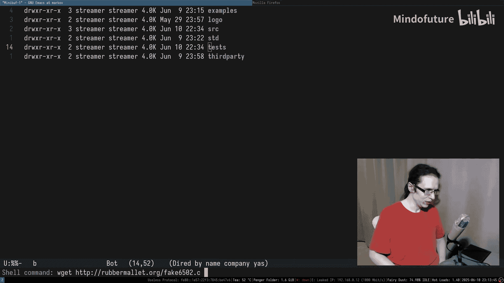

Right， so here read this。 and it's it's even under thousand lines of code。 That's how simple it is。

 So for the comparison， the size of our compiler right。

 So if I take a look at the size of our compiler， I think it's yeah。

 it's it's 4000 lines of rust code。

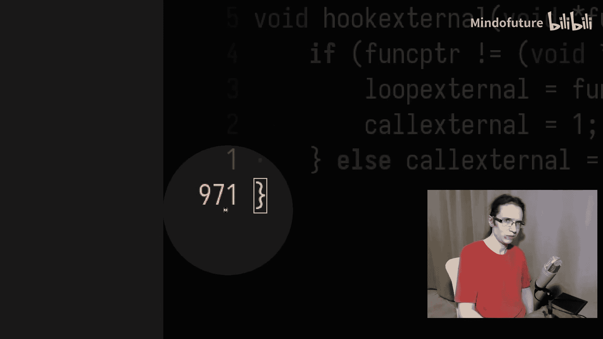

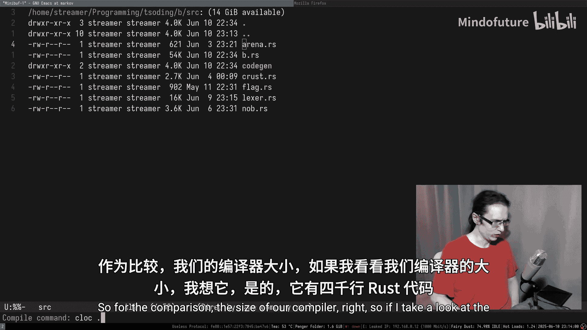

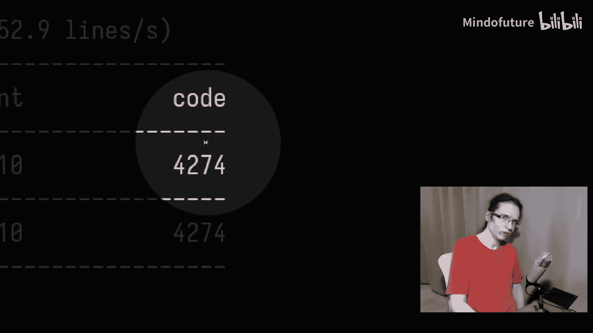

Right so this is the size of our compiler， so this includes the pull request as well right so it has a lot of lines and the imulator is just under a thousand0 lines of code right in terms of complexity。

So and the cool thing is that if you try to compile this entire thing， right。

 if you try to compile it， it's not going to compile because it doesn't。😊。

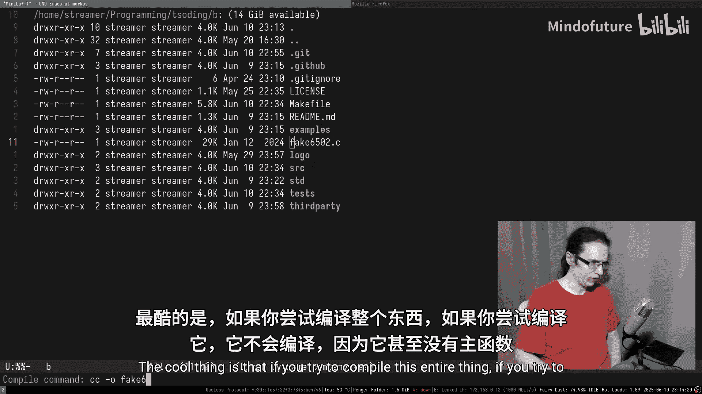

Even have a main。It's a library。It is a library， but on top of that it also expects to have functions such as write 6502 and also read 6502 So essentially it's missing three functions main write 6502 and read 6502 and you are the one who's supposed to provide these three functions。

 it's up to you to decide how all of that is going to work So and it even documents like what's the signatures of these functions right so read 6502 right so essentially it accepts 16 beats address and you supposed to return what is written at that specific address in the memory of 6502 since 6502 is addressed with 16 beats you can only have 64 kilobytes of the memory so essentially if you take to and write it to the power of 16。

 you get essentially 64， 65 kiloBtes or whatnot so you can can。

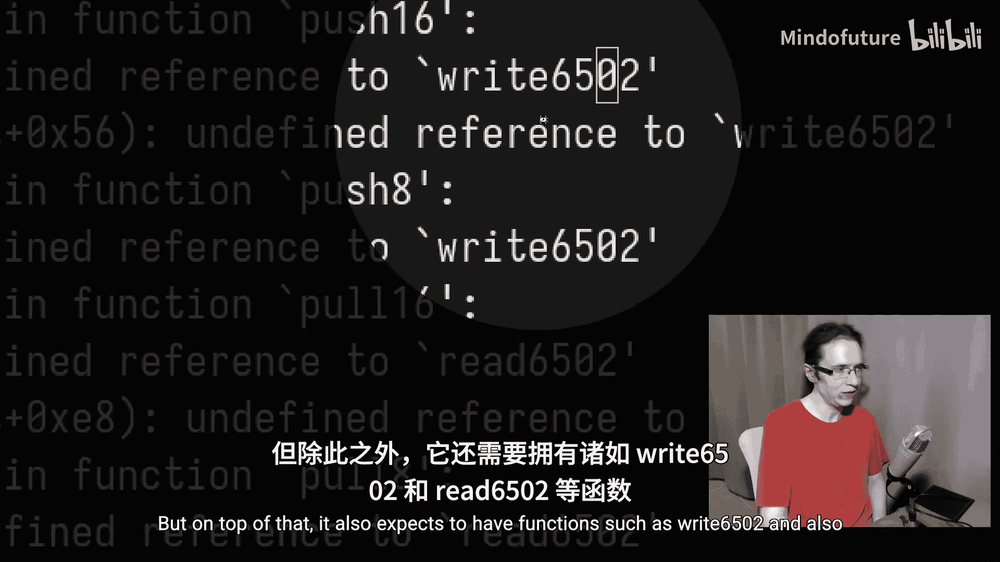

Predeef an array of 65 like k。Bys and just read and write into that array。

 or you can even catch a specific address and make it like maybe read only right so you'll always return the same thing in there or you can map particular range to for example。

 a display of some sort you can do a lot of things right So like what I like about this thing is the simplicity and flexibility of this entire stuff。

So3 652 and re65 would to add boss connection。 Yeah。

 you can think about it like that right so you can think about it like that So yeah。

 and essentially you have to provide everything else like for this emulator so you just provide these three functions and there you go you have a basically complete emulator which is also very easy to embed in different other application So it's an emable emulator and this is exactly what we need because I want to have an embedded emulator into the compiler So after compiling the binary you can also as well emulated just to see what it does because it's kind of difficult to develop things without know short feedback loop so you wrote something like you want to instantly see how it works。

😊，So false president， this is not fake。 Well， I mean it is fake， right， So it's not it's a code。

 like a real 6502 is is a chip， right， So it's just a C code。 So it is， in fact， kind of fake 6502。

 So allright， So let's actually try to maybe embedded into our compiler。

 So in the pull request itself， there is even to do for the emulation。

 And I think what I want to do on today's stream。 I want to actually implement that emulation with a fake 6502。

 So let me see if a run， there should be something like this Yeah there ago。

 So essentially in the compiler when you compile something。 let's actually do something like this。

 let me recompile the compiler by the way。 So let's recompile the compiler。😊，And if you try to。

 for example， build a hello world。So on top of just building you can always provide a round flag and after building it it's going to run it instantaneously so for the 6502 we don't have emulation implemented yet but it has to do right so if you try to compile something to 6502。

Right so let's actually see so the yeah it's still 65 or2 maybe you should rename it to something else。

 but let's keep it 65 or1 right it also needs print e。

 let's provide the print e from the standard library 6502 right so it fails at not yet implemented emulated。

So and in here what I want to do， I want to feed the data。

 the binary data that we generated during the compilation into fake 650 and just see what can happen there。

 so I think it's kind of interesting。Alright， let's we and go so let's first try to compile fake 6502 dot C as an object file。

 We already have a mechanism of sort of like an infrastructure for compiling object files in here as you can see we' compileing Noob right so we're usingno in the compiler we're using flag library which par command lines and stuff like that leap C we have arena implementation and C So as you can see we already have a little bit of an infrastructure for all of that but this infrastructure as far as I know it expects all of the C code to be located in the third party of folder So probably the first thing we want to do in here is to move fake 6502 into the third party folder make files in 2025 Yeah that's a good point right so I actually kind of thinking to write a custom built。

A system for this specific project also in CRRAS or AK crust。

But for bootstrapping this kind of thing bootstrapping is kind of difficult this kind of project。

 so I think we're still going to use makeFile for bootstrapping but the role of the makeF is going to be reduced dramatically in the future so we're going to have like a whole testing system which is also written in rust right so because we have a lot of tests in here。

Believe it or not so here are all of the tests， not that many tests but still so and we have to have these metrics right so where you on one axis you have the test on the other axis you have the target right so and we need to know at which particular target and which particular test to work or doesn't work and we need a relatively complex system to facilitate that right so we have a lot of logistics involved in testing now and we don't use carva right so because of we're programming across so and I have a couple of ideas on how to you know make it a little bit easier for us I even plan to stream that I even plan to stream that。

So anyways。Okay， so I added fake 6502 into the third party and let's actually add all of that in obgs baba Gs。

 So fake 6502。 So this is for the Linux object file and we it has have Minja W object file。

 So let me try to rebuild the whole thing and see if it actually reveals a fake 6502。Okay。

 so it built it for Linux and finally enough it just linked with the compiler。

 even though when we were trying to link it with a C code。

 it actually said that it cannot find moreK functions。Well。

 main is already provided by the compiler okay and then we probably didn't use any of the functions in fake 6502 that use read and write。

 so maybe they were eliminated right so maybe there was some sort of LT or link time optimization that kind of remove them Rus probably nuked them Yeah so Ra probably look it I'm pretty sure that as soon could start using them that is going to complain that we wouldn't have these functions。

So anyways， we can even test maybe Bxz， which is MinjiWia。

 it probably has to be sort of like a build。B dot X okay， and it's consider downloading core。 yeah。

 I don't have like X H 6，54 PC Windows Gu， right， so our compiler is compileable for Windows。

 by the way， through MinjiW。 I have this target already installed on my other account。

 I don't have it installed on a streaming account。 So let me actually Google to install that。So yeah。

 our compiler works on Windows by we theoretically， I haven't tried it on the real Windows。

 but I tried it on wine and thank you youi， by the way for implementing that so it's not me who implemented that it's U。

😊，Um so。G collaborating with Microsoft to Real She。 Well。

 I'm not sure I didn't think MinjiW is actually written by Gnu， right。

 So Gnu just provides the platform。 So it's not like Gnu works on that Gnu is a platform。 So right。

 So there's a platform windows and there platform Gnu。 So okay。

 so it's actually trying to rebuild this into I think。 And oh yeah， it complains about。

It complains about a lot of shed， and all of that shed seems to be from。Yeah。

 so on Windows it does complain about the lack of these entire things right so but on Linux it doesn't right it's kind of interesting but anyway。

 so we're going to be focusing on Linux right now right so for Windows we're going implement all that a little bit later。

So what I want to do， I maybe want to。Just call some functions。

 I want to be able to call some functions from fake 6502 So because if I remember correctly。

 first thing you have to do you have to do reset 6502 right so you have to call this function once before executing so I suppose it resets the state of the virtual machine。

So PC okay， so there's these variables and there seem to be global variables right So yeah here they are。

 So they are basically the registers of the CPU。 So 65 or2 has this registers and they are just global variables there just available to you so and what reset does according to this code it actually reads the entry point from from these specific address。

 that's kind of interesting right So from the memory So it expect entry points somewhere in the memory and it sets this thing there and then it resets the you know I suppose it's a general purpose registers like acculator X and y or whatever。

 So sp is probably a stack and status is probably a collection of flags so there is a flag constant So here are all of the flags so there is a carry flag zero flag interrupt flag decimal not really sure what it is break also not sure what it is but yeah you can。

A bunch of flags and the status is probably a byte right is it a single byte it immediately seems to be a single byte right so that's the entire the state of the CPU blueuteuttonant so it's insanely simple actuallyuring。

It's kind to insane how simple it is。So FFFC is start point on 65 auto， okay， it's nice to know。

 it's nice to know。Anyways， so let me see what we need to do。

 we need to have like bindings written in rust right similar to how we have them in Knob dot or right so for example here is the binding for the Knob stuff so to be able to use the fake 6502 from rust。

We also have to create like a similar thing in here， F 65 O2， right， so we have to have external C。

And let's just have something like reset， it's going to be public 6502。

And it doesn't accept anything and it doesn't return anything。

 so that's what we're going to have in here。But on top of that you can't just like define it like that。

 you have to say that this particular module is part of the root module right so I'm in B dot Rs which is the root module right and now I'm declaring that a submodule of that is a fake 6502 like so。

So hopefully after that it's going to compile so as far as I know I probably have to also add fake 6502 to the list my of my Rs files like in here。

 so fake 6502 let click go。So let's try to re compile and it seems to be a compile。

 So now if I do emulate it， let's actually keep it like that and then I'm going to do fake 6502 reset 6502 So what is going to happen and now link your complains about the lack of right 6502 read okay so essentially you know the rust compiler nuked all the functions that we're using this kind of stuff and that's why the link here was not complaining。

 but since we're using it now the link here is in fact complaining So let's go ahead and maybe let's just declare all this function right so we can do。

Let me take a look at the signatures of all of these things。

 so read 65 or2 might as well copy praise the mother fliplipus， How about that， How about that？

So as far as I know， as far as I know to be able to。Send and return you you int 8。

 you can just say that this thing returns you8。 so you8 maps to you int8 and U 16 maps to you in 16 and so on and so forth right Sos all of that is kind of equivalent right so this is the functions that we have in here might as well also declare them unsafe right so they are definitely unsafe。

And this is the function that we're going to implement ourselves by the way。

 right so we need to implement them ourselves and they probably go in to operate on a global array right some sort of a global array value or whatnot so we can put it to do in here read 6502 like so and in here we're going to have something like write 6502 write 6502。

All right， so let me see it if it go in components， okay？So what is it saying。 So addresses unused。

 Okay， so all of these variables are unused or whatever， this is just warnings。

 but then linker still complains。 I feel like what we have to do is to disable mangling right？

 So yeah， probably as far as no exency is specifically for declaring things that you expect not for expert in them。

I didn't think it is for experts。 And so to export this kind of stuff， what we have to do。

 we have to use this thing， right， So we have to say。

 do not mangle these functions because rust applies some mangling。For this kind of stuff。

 pub external， but like okay， so let's actually test mandin， Mandin works by the wing。

So let me try to do this kind of thing if stern。Exterern sea。Exteracy。So probably unsafe。

 you have to put unsafe in front。All this intense stuff。Okay。

This is unsafe and it doesn't really work look at that。But I mean maybe you need to use both。

 maybe you need to say that do not mangle this stuff and also use exterernency and that works as well So I think saying that is exterernency is still useful right in a sense that like we're saying we're expecting you to use the SQL convention right so I I think we need to use both in here。

Always mangle you sheets for comfort， yeah exactly sure。Okay。

So what I want to do is maybe now try to execute right so I need to load you know the binary into memory。

 so how are we going to actually maintain the memory so it probably has to be like a global array right and usually global you can only have constant and if I remember correctly if you want to have mutable array in like in globally you have to use static right。

So it's kind of interesting。 So we need to define it as an array and it's going to be a fixed array。

 So we have 16 bits。 So let's actually allocate for the entirety of the 16 bit。

 I don't remember whether the first size comes and then the type or vice versa。

 but the compiler is going to tell me on top of that I expect this entire thing to be zero initialized So for that we probably need core0 yet0 yet something like that。

 So and essentially like what I expect is that we can do memory address。

 So we're just basically reading this entire thing and returning it like that。

 And when we're writing。We're just writing that value into that global thing， right。

 so it's going to be addressed and this is going to be value。Like this。Alright。

 so what do we have here。 So expect type， Okay， so type comes first and only then the size cool。

So what else do we have here slide synthesis are u size instead of okay， so as u size look at that。

 look at that， okay， and this one is also as u size。And what does it say， zero yet isn't save？

Can I just say that this thing is insane？All right， this thing isn'tsafe。Okay。

 how do I use unsafe function。As initialization for the memory， do we have to use a below？Yeah。

 so probably some cool。Yeah， and is semico in here。And save， remove this semico and return。Oh。

我 can yeah yeah so。Yeah， so。ThisThis language is not real swear。This is like this is a fakeling。嗯嗯。

Zeros are unsafe， apparently， by the way， zero initializing is absolutely fucking and safe anyway。

 so cannot assign。对。Do I on top of making it like these also have to say that it's mutable？

Do I have to put mutable in here？So this is basically what you have to do to have a global mutable array in rust。

I understand that it is unsafe， Global variables is bad right so multi threadging our compiler by the way。

 is not multith at all， so it's not a huge problem。

 but I mean that you have to do that anyway because think about the children think about so because of that you have to do that。

ほ。messaging message。So we get that。So and you know what I need to do。

 I actually need to load the room。In the memory， into the memory， so as far as I know。😊。

You also load at different addresses， right， so if I take a look at the 6502。

So here's the entry point into the code generator right so code generator accepts the state of the compiler and its job is to generate 6502 machine code into the output from the state of the compiler right so that's basically how it goes compiler it just like gives you the entire of the state of the compilation it has intermediate representation for the functions。

 it has list of globals and so on and so forth everything that you need。So this is where we start。

 so as far as I can see， so 65 U2 code Gen also defines its own asemler。😊，So let's take a look at it。

 So it's probably strict as， Right， So it keeps track of real looks。

 I suppose this is needed for jumps， right， So because sometimes youre jumping somewhere。

 the address of which you don't know yet because you haven't generated stuff。 So you kind of need to。

Collect all of these sort of like labels and then go back and back patch them， patch them。

 So I suspect that's what of these。 Maybe I'm not sure， but that's my suspicion。

 So relocation and you have different kinds of relocations。 So maybe it's something else， right。

 So because you have data of sets， labels and stuff like that。

 But it's just like it doesn't really matter in the grand scheme of things。

 And this is a load of set， right， so essentially we have a function code starts where the code starts right。

 we take。The size of the outputs。And add load of set。 But the output is empty。You assume。

 you assume that output may have something。 so you can actually run a January programme several times appending several results of the compilation。

 Is that what it。That's， that's kind of funny。 Or Or okay， that's， that's interesting。

 That's interesting。嗯。So and load I said is probably where the program is expected to start right So and it's probably this function used throughout the assembly。

 No， it is not used throughout the assembly， but maybe code start is used throughout the assembly right So okay it is passed okay so it is used to compute data start and also to do relocations and it's also passed to generate functions。

 So functions when you generate them they are aware of the code start right so and each individual function right。

 so they do have a code start。 They know where the code starts and they actively use it Well。

 not really actively at least。During the function calls， I see this is very interesting。

 So every time the generated code wants to call a function。

 they need to know where the code of the program starts。

 otherwise they won't be able to jump anywhere。 So in the JSR。

 I suppose it's it's a relative jump of some sort right。 So okay so that makes sense。

 So code start is very freaking important。 So which means that we probably have to load thegene binary。

 this generated binary at that specific address。That's what we have to do。Right。

So what we need to do in fake 6502 is probably create some sort of a helper function。

 which is basically like load ro at right and then here we're gonna to supply the ro which is going to be string builder actually yeah string builder by itself is a very lightweight structure it's actually a dynamic array and dynamic array is literally364 beat integers right so and by itself it acts like a point anyway。

 so we might as well just pass the whole structure in here and we probably need to accept the offset at which we want to you know load this entire thing So in the idea here is that。

So I'm going to put this stuff in here is that after the compilation in the compiler in here。

 whereas is my compiler， I can't find my compiler right， So after we compiled and we said， okay。

 let's emulate this entire thing and I'm going to reset the state of 6502 and then I'm going to say load ro at and I'm going to use this output as the ro that I'm going to load and I'm going to load it at you know0 x E we may actually use load offset set directly。

 Okay， it is public So which means I can do something like code gen most 6502 load of set just like load this thing at that specific of set and inside of this entire thing inside of the fake 6502。

 we can just iterate so iterate。Through 0 to count， right， So0 to count。

 And then for the memory I plus offset set。We're going to basically load all of these bytes in here。

 so this is the pointer， we add I as an offset and we dereference it so we're just basically copying byte by byte。

先ばいばいばい。I but。All right， so that's how we're going to be loading this and， right。

 and after we loaded the whole thing。We can just try to maybe execute a single instruction of some sort of like so as far as I know。

 fakeake 6502 had something like step 6502 right so we can execute a single instruction。Okay。

 I really like this actually thing。Right， so essentially it takes program counter right so program counter points in the memory at the current instruction that we' are executing。

 it reads that through our function that we implemented and it also increments it looks at op code sets some flag or whatever and I suppose it just like executes the op code right so let's see how it uses so there's an address table right so it's a table of some functions if I understand correctly right so it's table of some functions of some sort this is freak。

😊，It's a table of functions， So index， the op code acts like an index in this table into Ars font。

Each in individual op code maps to a function that implements the behavior of that specific op code。

So it's basically like a virtual virtual table。 This is actually so cool。😊，Look at that。

 This is so fucking also like yeah， and I like this simplicity of it。

 it uses C plus plus keywords because it's written and seen。

 it doesn't give a shit about barney sour soup， right， so and I do approve of that。

 Just keep using the C+ plus keywords Fox C++。😊，Alright。

 so there's also a tick table and stuff like that。 And suppose this is just like a tables that map all of that stuff。

 all of that stuff。But to be fair， what if I were to compile this using S+ compile， like for real？

For example， on Windows， MSVC， as far as know MSVC is a simple postcode。

 how do I compile that with MSVC？Or is that a neat part？That's that's a problem actually。

 like I mean， you can say Fox C++ as much as you want， but if you want to compile this with MSVC。

 like MSVC doesn't have I C compiler so you won't be able to。

 So and I suppose this is a neat part right， so you just don't。Rober in exs， a， okay。

Does it have external Yeah， so it doesn't even mention C plus plus Yeah。

 I feel like if I were to compile it with MSVC。 Well， that means okay， use clang。

 sometimes you just have no choice right So sometimes you just have no choice and you kind of have to use aV And what this thing to be compileilable with SV But on the other hand。

 if I were to ever compile this with MSV， I think it's not that difficult to fix to just go to all of these keywords and just replace like put underscore in there whatever。

Um right。So there's also sguin again， so it's cool， but sometimes you simply have no choice， right。

 so。It depends on the situation right， so I want you want your code to work even in such a weird situations when you have nothing except them as PC。

ううん。So does support C 11 though， I don't quite remember。

 so I remember as somebody was saying that it's a pure++ compile。

 there is nothing you can do about it。So anyways， but it's just a hypothetical。

 just a hypothetical thing。Right， so it's a step 65，02， step 65，02。 It does that。

 Then it queries the opt opop table， Bel sugar opop。Right， so there's two tables and。Yeah。

 so it's an address table and op table。 And depending on the operator， it just does different things。

 Okay， that's understandable。 So it also has a oh， it even emulates the ticks。Yeah。

 it even emulates the ticks， so each instruction usually takes like different amount of ticks and it kind of takes that into account。

This is kind of cool。Dn。Right， so you can even slow down it and and everything right So it's probably important for such thing as NeS right。

 so because NAs NS games are probably designed around a specific you know clock tick time or whatever。

 So it's kind of important co external So there's a coex loop external So you can call external stuff in here。

external。 that's kind of bizarre。 But I mean， overall， it's kind of understandable。

 I do not fully understand what it's doing， but on a high level。

 roughly I kind of understand it fetch the op code and then it just dispatches that op code to one of the functions that implement those op codes。

 right？ So， for example， I remember there was an instruction GSR。

 right So relative jump or whatever GSR， do you have a GSR function。 Okay， so what it does。

It takes point counter -1， right， So pushes it onto the stack and then jumps to E A and E A。

 I'm not really sure what is E A， right， So it's probably some sort of。Global variable， right。

 So there is a E A account。 I know there is a a， but I can't find E A。I can't find this。

So PC is probably somewhere way here， oh here it is。

 so it's a helper variable it's a helper variable， I see。

So it's not really part of the state of the CPU。 It's a helper variable。

 So suppose maybe push 16 sets。EA to something， so not quite sure what's what's up with all of that。

 right， so JSR。Yeah， that's a bit bizarre。 That's a bit bizarre， but anyway。So all right。

 so what we were doing。I want you to do step， right， so I need to step the whole thing。

 So let's do step 6502。 and now after that， let's do fake 6502。Step 65 or2。

 It's kind of weird that I have to write 6502 twice。

I wonder if you can do a little bit of a hackkiwaki and for example， say， okay。

 this is that and this is that right and then we can use a little bit of a link name magic like so and just say that this function is actually in C is reset 6502 and this one is actually step 65 or2 So that way when you actually use it in rust code。

 you only have to write 6502 once。I think this is actually kind of cool right so the only reason why I put 6502 in the name of this function is because C is dumb fucking language from 70s that doesn't have name spacing。

 but we're using modern language which is rust， which does have name spacing so we can do this kind of shit。

 it kind of a similar tool。What is it called Rali situation Rali like uses Yeah so there is a lot of problem with the naming and Rali because it doesn't use namespaces right so but if we wrap in with the proper language we can actually do that。

 So it also raised the question what to do with this kind of stuff。

 but I mean this is external functions， we're not going to be calling them out of this entire thing so I think there's no need to do anything in here but。

If we were to name the expert name of this function。

 I think we would have used something like like an expert name Oh we even use it somewhere just a second I don't I completely forgot that we even use it。

So， expert name。Exportt name， So where do we use it， We use it in crust。Yeah。

 so I defined my own crust entry point and I export it for the linker for the cliner as the main function。

 So we could have done something like that。 So if you wanted to in effect 65 or to get rid of this thing。

 we could have just say， okay， so it's it's that， but export it as a different name so you can actually configure this kind of stuff and this。

😊，So it has a lot of configuration option to interact with C because a lot of actually useful code is still written in C。

うんうん。God that syntax is ugly， but it's not supposed to face normies。

 That's the thing right So this is a functionality for real software engineers who write actually useful crates and libraries for the normies right。

 who don't face all of that shit So it doesn't affect the marketing of the language whatsoever。

 right so because norms never see any of this kind of shit。 In fact。

 they are not even aware of any of that So yeah so real software engineering exactly exactly So it's for real software engineers。

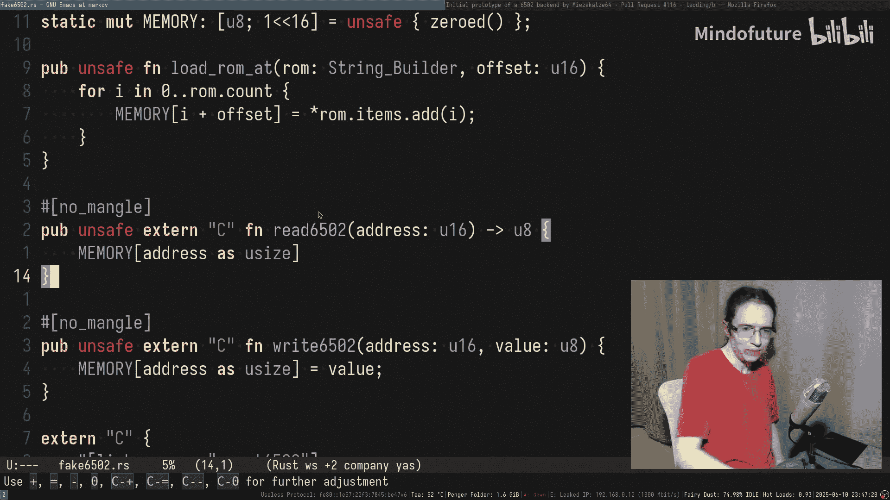

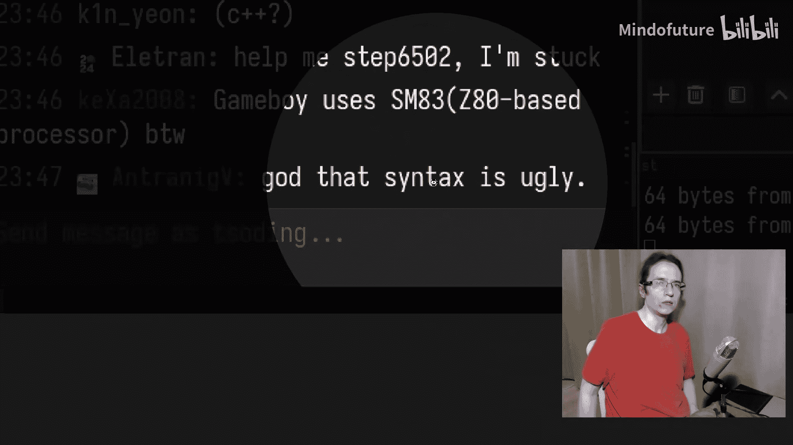

So。That's why it's ugly because it's not enormous。Anyways， so what do we have So we yeah。Now。

 let me try to maybe rebuild the whole thing。Just see okay， it's complaining about try Zung。

 it doesn't know any string builder。 This is because it's coming from a No use。Great。No。

 so Cate basically points at the root of the crate， right， so who knows what is a crreate and rust？

Right。Who knows what is a crate， it's a kind of an interesting question， right？😊。

So any restrictions in chat know what is a great。 No one knows a lot of people may say that it it's a package in crust。

 Oh， somebody， Okay， codeca 69 knows。 Yeah， codeca 69 knows， it's actually translationing。い。

So it's kind of funny that the crs are usually called just packages that you install from cr or。

 but in reality， originally， if I understood correctly。

 C actually means completely different thing and it is in fact。

 a translation unit right and the modules right， So for example， root module。Alright。

 and you have a tree of modules。 They is still treated as a single translation unit。 So， in fact。

 it actually kind of inherits a lot of。Like a model of modules from C and C++ anyway， right。

 but it kind of integrates them together。it still feels like just includes right and then they include together into a single translation in AK cr。

 but at the same time it's not done through a separate preprocessor that is not aware of the language。

 it's done through the compile itself which is aware of the whole language right so that's the main difference。

suppose， suppose。Yeah， so rust is a logical continuation of C++。

It's just like a lot of newer rust developers don't really know C++。

 so that's why they don't notice that， right？But rust is literally is a logical continuation of C++。

 So if the C plus+ developers were not。Basically， limited by the standard and backward compatibility with a lot of legacy code base。

 they would have created rust。Seriously， they would have just createdes rusted basically simple parts。

 but without the chains of the standard and legacy。Right， so because like a lot of the ideas of rice。

 it's just like logical next logical step after what C++ came up with。嗯。🤧。I ran another water bike。

Anyways， so we need to import the string builder。Build that。 Okay， so of offset set is U 16。 So。

 and we really have to say it's a U 16 or something。 Allright， What else do we have here。

So the strings and string builder actually I8， right， so， but here we use U 8。

 So let's actually explicitly say that it's a U8。 Let's transmute that。Okay。

 so that seems to be working， that seems to be at working， by the way。Okay。

 so let's try to maybe compile。AHello world， right， so I'm going to do example10 hello world。

 this is not what I went， I went to do。ルンティ。So65，02。It once print app was do STD a 6502 B All right。

 so on top of it generated the binary which contains hello world and stuff like that。

 it even contains hello world the the string and everything right hello world the string。Okay。

 so the thing I want to say in here is run this choice and yeah， so it hit this to do。

So that means it performed a single step， but it's kind of difficult to tell like what exactly happened in here。

 so we can in fact， maybe perform several steps in here。 Let's actually perform 10。

 I it going to do anything is it going to do anything at all。 Yeah。

 so we have no side effects in here。The thing about step is that it modifies PC。

 So what I want to be able to do， I want to be able to print that PC。 So I want to do U。

So let's actually say PC fake 6502 PC and can you actually external global variables。

 This is a very good question I'm not quite sure fake 6502 PC I want to ex this model flippan all right somehow I suspect it's possible right。

 otherwise the rust will have been absolutely fucking useless language。

So let's go to S or C fake 6502， maybe I have to put it in here。ピーシパブ。うんいえ。U 16， Okay。

 let's freaking go。 Alright， so it didn't really work。嗯。So P is not allowed by an item。

Do I have to say it is static because it's kind of a global variable， Right。

 So when global variables are through the static。 Okay， so it's kind of a global variable。

 What else do we have in here。 So okay， it managed to actually read that。

 So it just complains that it's U 16 because you have to actually use C U in。 All， Otherwise。

 you can't pass it to very adequate C。 And this one has to be C literal Aka colal And it works。

 And PC is actually kind of。😊，Stack at 0。So it's kinda stuck in zero。 and this is probably because。

 by the way。When I reset 6502， do you store the entry point in here， Q Cat 69。

 I have a feeling that you actually don't。So at FFC C is a reset vector。 Yes， oh， that's bizarre， so。

That's kind of interesting。 So if I take a look at the code。Jen。Okay， so write the word。

But you just writing in word F，FC。 you do that at entry。 So that means。

You expect that the emulator is going to run。At 0。Right， and that's why you jump into the entry。

But I mean， it doesn't matter， right， so the emulator is going to do that anyway for you。

So it's kind of weird。What if we， okay， I have an idea。

 what if what if we do something like BRS or whatever？So no， I don't do it。 Wassman has a dress in I。

 it's the Wassman who has an address at that。You know what I havent a dream。 I haven't a dream。

 What if we。After resetting this center， I think we do 6502。PC and just。I I mean。

 this is't that fair。 I I think this fair。 but I suppose we also need to mark。This thing as mutable。

So somebody is not okay， so Ben。Alright。So let's continue。Okay， so， but what wed want to do actually。

 we want to display it as a hexadeadecimal， right， So we want to display it as a hexadeadeimmal because of that we want to do X。

 It's a 16 B，0 tour， right， So let's actually see okay。Isn't that beautiful， Look at it Schu。 So。

 and it's just execution shit。 Its just like， look at that。

 It's Ab a fucking in that shootinging girl。So it's going， it's freaking going。

 so let's actually you at maybe hundreds of them and let's take a good hundred of them。Right。

 it's doing think。 It is doing think。 not really sure what exactly。 I'm really curious。 Okay。

 so what about 200。 Oh ship。Okay， so it failed， look at that。

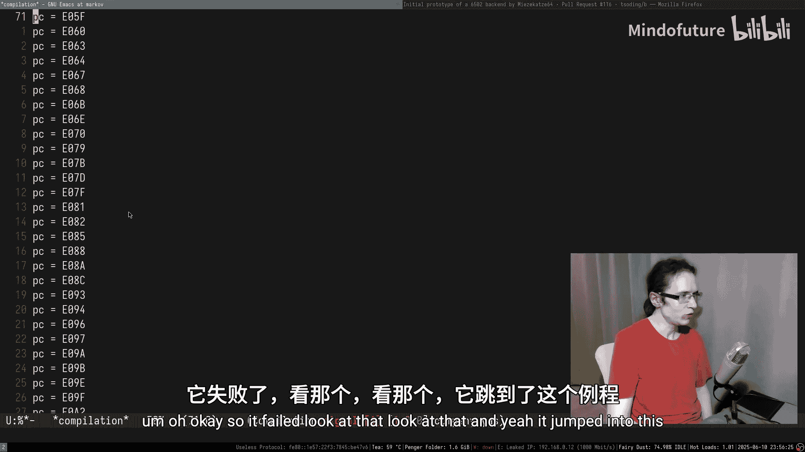

Look at fucking that。 and yeah， it jumped into this routine where Wassman actually implements like P char。

 right， and we don't have Wassmon loaded anywhere。

We don't have wasman loaded anywhere， so I have an idea what if we。

Do some absolute fucking chargingdging。Where we just。嗯。ああ、させ。😊。

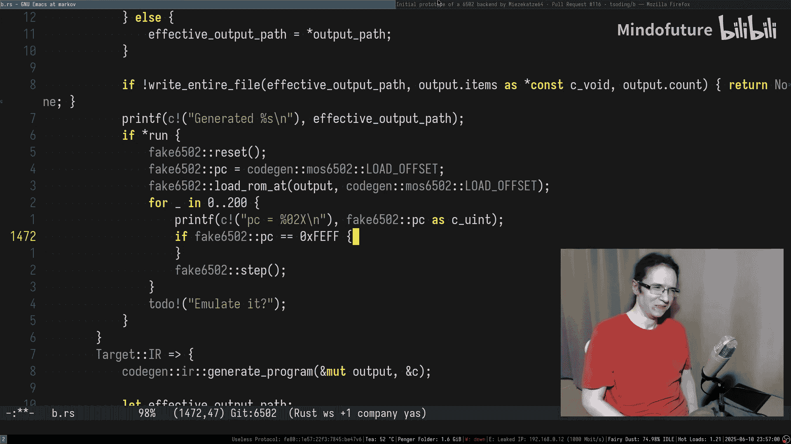

So let me take a look at the Wassmon data sheet or description or something like that。

 I wonder if I can still open this kind of thing。😊。

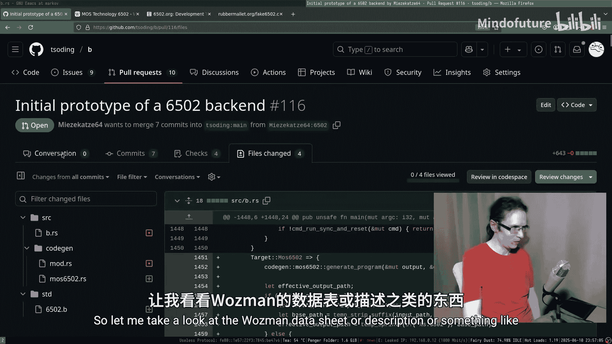

So it doesn't open because I didn't have a VPN turned on and I have a VPN。

 but so the cool convention in here is that you store the first argument in a pair of registers A and U and you store the lower bit in a because that's a common sort of like argument passing and stuff like that。

 What we can do， by the way。

We can export in here another register a， which is 8 bit if I'm not correctly right so it's a8 bit so in in here we can literally do print F C and let's just print it as a character so fake 6502 a right。

 let's just print that might as well maybe just put new line in here。So。

So it didn't work because it has to be as C， as C you int as C you int。 And so let me see。

 let me see。 Didn't see shines in this mist， maybe I'm。Maybe it's after this step。

It's kind of difficult to tell。 So it didn't print Shiis。呃。うんふん。So F F， F。

 So we expect it to at least print something， but it doesn't print anything。

 So there's nothing in there。 So I want to do the following thing。 So print F。

 because I want to be able to see。 maybe I'm missing it some。 You wrote it's。Yeah， it's fair。

 actually。 Thank you。 Thank you。 Good catch。 Good catch， my friend。 Good catch。72。

 what's the 72 who remembers what's the 72， I don't fucking remember hell， hell yeah。

 hell fucking yeah， so we're going， we're going places， we're going places Actually， look at that。

 look at it。Okay， so what if I disable this kind of thing and let's actually print that Okay。

 so with the new lines and shed， right， so here's the 200 things。😊，What about another 200？Okay。

 so you want let's do thousands。ああ。Wait a second。We have to return oh fuck。Okay。

 how do you return out of the shed， How do you return out of the shed， So Mo is 65。

 So when you generate function Fun fun。 So at the end of the funion。

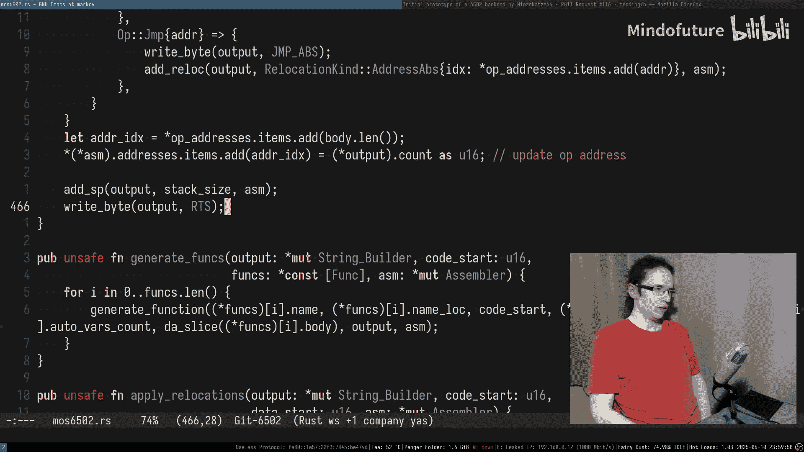

You just call it RtS。6502 R T S instruction。 Does it get that stuff from。

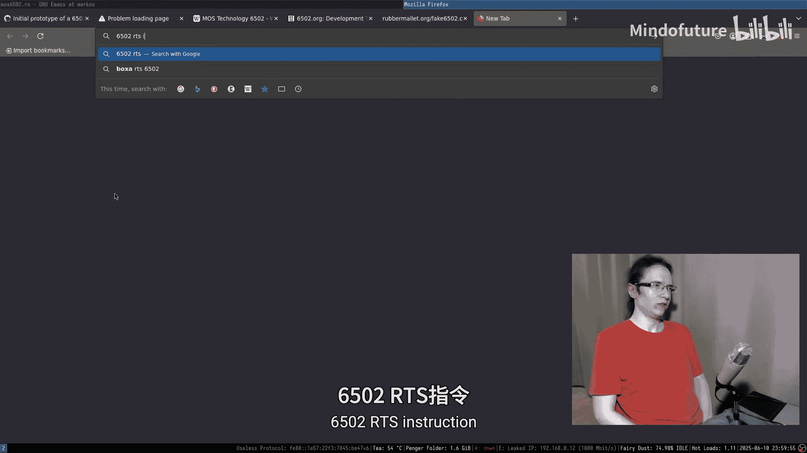

From the stack or where that's actually a pretty cool website， so I kind of like it。

So RtS returns from subrout pool PC， PC plus1 doesn't really tell me where it gets the return address。

What is the return address， But anyway， so fake。R T S， O， Okay， so yeah。

 it pulls it out of the stack。 So it's basically two bys on the stack。

 and then it jumps to that value plus  one。But the fucker， it's static。I I want to quote from Ru。

By the fact， would you put the static？Okay fuck you。There is no static anymore， so fake 6502 and RtS。

Yeah， and then I'm going to go to here and I'm going to simply do fake 6502 R T S。

 We can write subroutines in。Oh， we fuck。This is actually kind of cool。

 What the fuck I kind of enjoy this idea。😊，So what about， actually you know。

 no new line where it doesn't really print properly， but I suppose what we have to do。

 we have to put like a 20010 kilogram。We got hello world out of this thing。

That's actually super cool， so yeah。And you know， what's interesting is that now we can even define even more different routines like that。

We can since we control the entire of the virtual machine。

 we can again map certain range all right so we can go into fake R acid like fake 6502 and when you try to read or write into a specific range。

 we can map it into some sort of a beatm that we display through relib or something like that there is a lot of cool she we can do here。

So and just using the code like phase 6502， lets us bootstraraple of that very quickly。

 We don't have to implement it ourselves。 So it's a pretty cool third party dependency， which。😊。

Doesn't depend on anything at all， right， So the cool thing about this thing doesn't even include anything。

 Okay， so it clones SDIO for whatever reason， I'm not even sure why it needs you know SDIo。

 Does't even print anything。 bro， Are you okay。So that's， that's bizarre。

 So you can actually not include6 like to Do。AhIt needs to bro， bra， bro， bra。

 who wrote that Mike Chambers。You don't need SD I O for null。 You can just have， I think， SD de。

 right， So it's like a very lean thing， which also contains a null definition。 And there you go。

 You don't even depend on SD I O。 So this is basically embedded level C。No LipsC。

 you can compile the she without any Li C and it's a full implementation of 6502 this is actually super cool。

I really like fake 6502 if it was on Gitthub， I would have given it a star。

 but fortunately it is implemented by a very based individual who just uploaduded it on internet as a single file。

😊，So what's the license the source code is released into the pub and the public domain。 look at this。

 look at this she。 didnn't upload it to Gitthub， just upload it to internet for everybody and the public domain。

Absolute cho。 Thank you。 Thank you so much， Mike Chambers。 I really appreciate that。

 This are actually super cool。This is the hacking culture we lost。In 2011。That's where we lost it。

Nobody does shit like that because everyone will write code only for the fame and for the money。

 so obviously because of that you have to plot it to Gitth， you need to have a lot of stars。Oh。

So yeah， and that's true small， look at that。So' pretty cool。

 so there's some small bug fixes and stuff like that。

 but overall I didn't think it requires a little bug fixes because 6502 is actually super simple honestly。

And actually super simple。 So I think I want to make a small break。

 I think I want to make a small break。 And after the small break， I want to。

Explore what other examples we can make work。Right so because only hello world works with a little bit of a Wassman routines and stuff like that using this approach right and it's a kind of a cool approach right so we may even have several flags like like emulate Wassman emulate something else we can actually emulate all these machines ourselves right so what are the examples we can make work or maybe even some tests right so and that will allow us to explore 6502 assembly right so I kind of want to also generate some 6502 assembly So anyway right。

So let's make a some break and were back。 So by the way， I。

 I just realized on the on the break that the the reason why the you know。

The entry point didn't work iss probably because I first have to load ro into the memory and then try to reset because otherwise there is nothing in the memory。

 but then quote Kaaz then said that I still have to do some additional stuff。

 but let's give it a try。Let's give it a try so I'm going to do load ro at and then I'm going to try to reset it and let's see what is it going to do。

 Is it going to work at all。 Yeah， it didn't work alright。

 so because I still have to do some stuff okay。So fake 6902 reset 6502， right？Yeah。

 I suppose I still have to。Maybe do this kind of thing right， So you only set F FFC。

 right so you only set F FFC。 And if you take a look at the most 6502， here is F FFC。

And you kind of jump。Into that。 but F F of D。Right。

 so I feel like maybe the easiest thing to do in here would be to just do what it is。That's the exit。

 Okay， so allright， whatever works， let's actually stick with whatever works， right， so but I mean。

 it probably makes sense to maybe load the room， then reset and then just you know。

 jump into the load of set。Right， let's just keep doing whatever works and this particular thing works。

So another interesting thing in here is that like， how do I know when to stop， right， So right now。

 we're just doing 2000 durations and it would be better to maybe do them。Up until certain point。

 right， maybe some sort of a like flag is set or what not。In case of the main function， right。

 So do you do anything with main or maybe with start， do you even。

Talk about the start right So the holding problem， yeah， we need to solve the holding problem。

So this is the。Genrate entry。So add reallock label main am。

I jump to the reset vector address at exit aha。Oh， that's what the exit is。Okay。

 so that's what you meant when you said that。 So all right al right。

 so let me actually try the following thing， let's keep printing PCs。

 let's actually disable this kind of stuff and let's just keep printing PCs。

And this is a really weird PC， I suppose， I think it。Where did it。

So iterated a couple of times and aha， and then it stopped somewhere here。And it kind of， yeah。

 I didn't see it being jumped because there is nothing at FFCc， it will jump to zero。Okay。

 so I was hoping。That it will have a dress of F， FFC。 So you said you jump in at F FFC。

 So that means I expect。That F FFC is going to be PC is a function pointer。 Does't matter because。

 for example， this kind of thing is also a function point。So。All right。That's really bizarre。

Can you just jump somewhere where it makes sense， so using jump in？Right。

 so jump in and I don't see such instructions。 So that means your naming convention is a little bit off。

What is a jump in So 6 c right， so that's basically the thing。 and can I find 60。

 So it's a jump aha in probably stands for indirect。

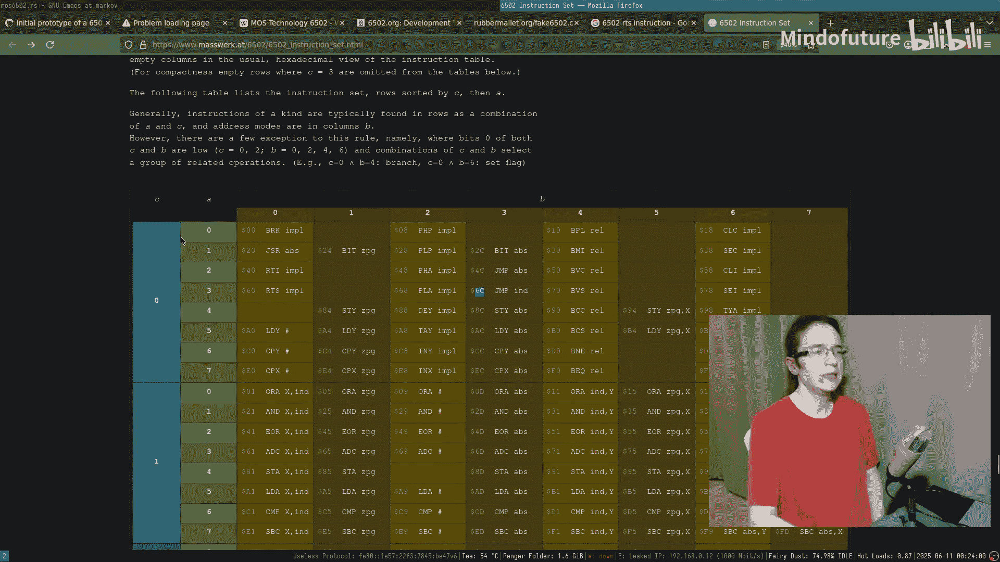

That's what this stands for。 And you also have jump absolute。

 So if instead of doing this kind of thing。

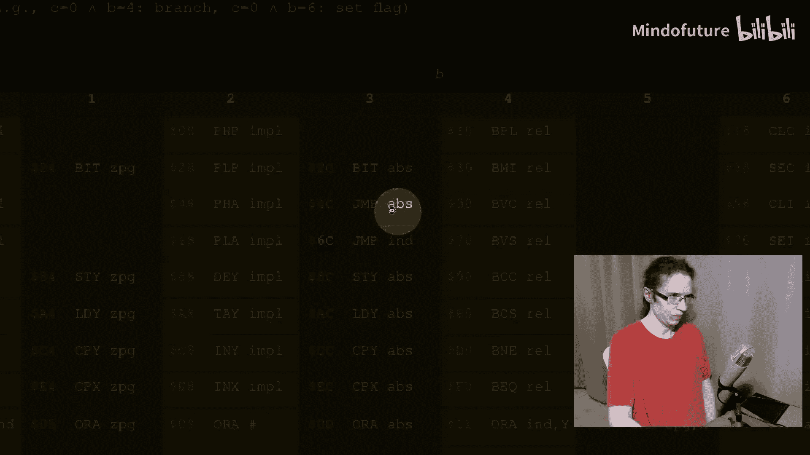

You just jump directly。 you just jump directly。 We could have actually detected that So it's not the jump。

 so you have a jump in the oh you call them jump absolute and jump in to distinguish them Okay so and there we go here is the thing and then that means after that in here I can actually do the following thing while fake PC is not equal to FFFC or whatever So and because of that it will literally probably stop in here there we go。

 So and then it goes to emulate it let's not emulate it and let's not trace the PC let's not trace the PC and let's do something like this and it actually stops which actually enables us to do some interesting things for example。

 we can put several times this thing and it actually will print them several times。

 So we kind of know how to solve that but obviously this is not a way to do。で。So。Obviously。

 this is not a way to do that。 How like when you did GM E and D。

Was that a some sort of a well known convention？Or did you just come up with that on whm， Right。

 So what is this jump P， F FFC， So where is that coming from。That's the most important question。

So where is that coming from？It contains reset which contains Wmon again，Reset vector。

So and since Wassman doesn't exist， it contains the zero in there。

And we can essentially use zero to indicate that， by the way。

 I just realized that I have something weird in my tracing， it's supposed to be actually four。Okay。

 so let's say that while PC not equals 0， right and。We can just continue using the indirect one。

 indirect jump， allright， so that's basically our approaching here and it stops at some point right so let's not do any tracing。

Also something like that， I think that's a fair implementation。

 I think that's a fair implementation right just like。We expect that thing there。Interesting。

 interesting， interesting。 And we can even， maybe。Can figure what is even located in that specific reset vector through fake 6502。

 we can do that actually right so because you read that address。

 we can always do something like a address FF F so what was the FFFCc write on if something here。

 we may just we may even an abort right？Let's go do it right now。

 right so this is just different ideas I'm exploring what's possible for us。So yeah。

So that's actually pretty cool。 That's actually pretty cool now。What I want to do。

 I want to test some other examples because I think that's kind of important and it's kind of cool。

 The second example that we have in here is actually a name look at that。

 look at that thing So it asks what is your name All right it uses print f and stuff like that and then it gets the name from the standard input whatever that's supposed to mean and prints that name back we can even test it on X 664 on X 664 it does in fact work。

So let's actually set the target to the default one and in fact。

 let's not run it through the compiler mode， but run it through the shell mode with a sink so it can have input。

Okay， so this is a hello world。😊，So let's replace it with。11 name。Okay。嗯。😊。

So one more time chat one more time。 It's kind it's kind of difficult so。Yeah。嗯。11 name。Finally。

 it asks my name， Alexi。 Hello， Alexi。 That's what we're trying to do。K of difficult。

Right so it's kind of the problem is that the compilation mode of emX for some freaking reason it doesn't accept input。

 so if you accidentally write like execute a program through the compilation mode that accepts an input。

 it's simply not going to work it's the stupidest fucking feature of emX and it's like so fucking annoying because compilation mode is so convenient that you want to run everything through it but you can't run everything but that accept input you can't fucking write it and of course of course of course the most beautiful UX on planet Earth or bro just do this perfect shit。

😊。

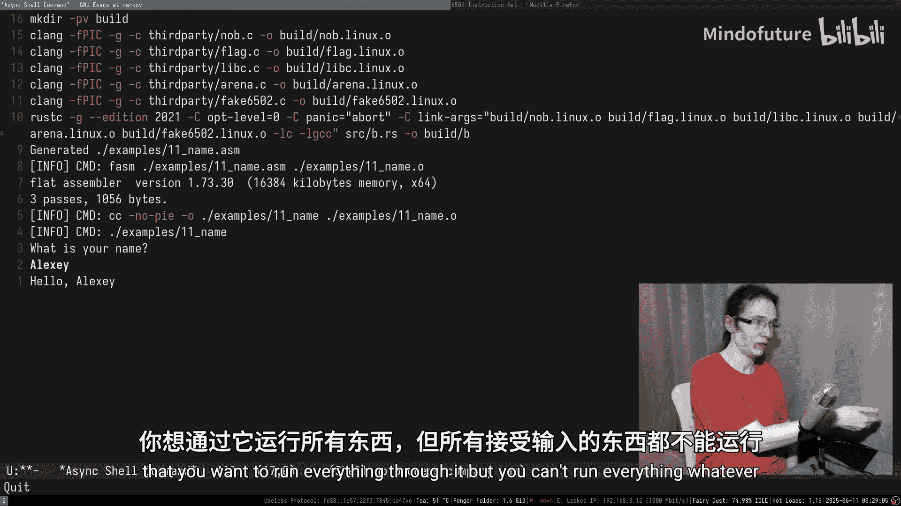

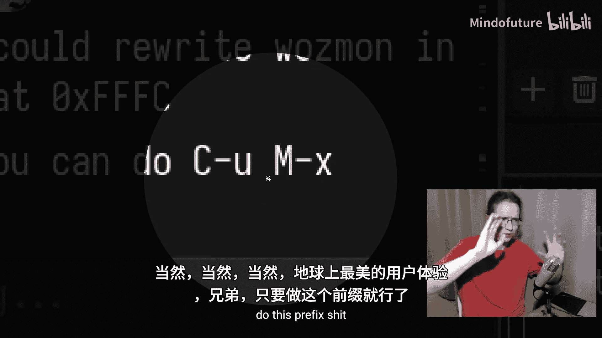

Anyways， that solves everything that makes it more convenient so especially when you develop like reflexes to just like rerun it super quickly right and it only works one time it's just like no。

 this is not how you solve you X problems， this is not how you fucking solve them。😊，Anyways， anyways。

 so let's try to run this entire thing through 6502。65 blue2。So what is going to be saying。

 not implemented external， that is rather interesting， so because we did have external functions。

 which is print and stuff。So， let's go into。Sr C code Gen， a mouse 65 to 172。Yeah， is that because。

AhI think I know because it is literally external。

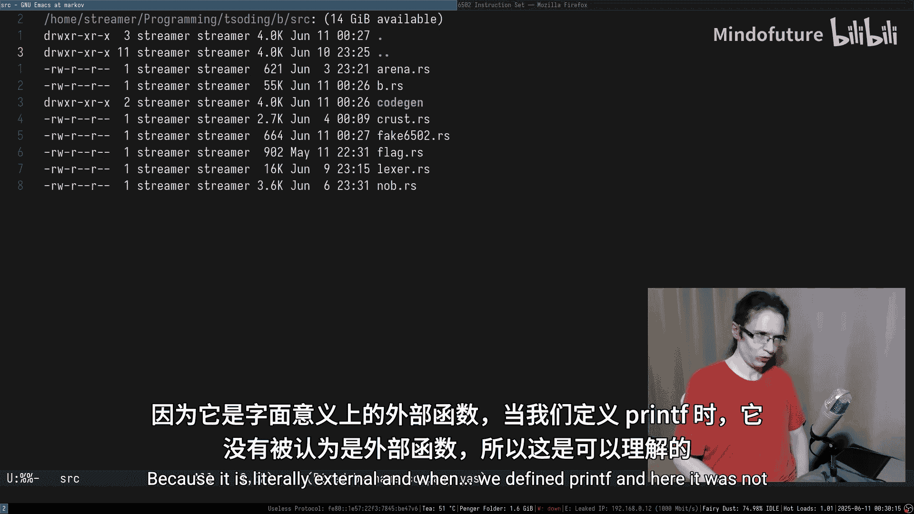

And when。We defined print T and here it was not considered an external， so that's understandable。

 So that means what we have to do here is essentially just implement F getsS。

 so we have F gets implementation and you say we don't have that okay。

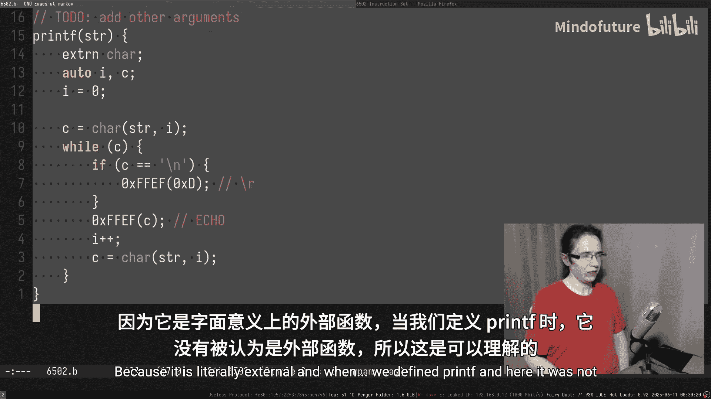

So examples name B。 So here is F gets。 So it accepts name right。

 and this size actually it accepts the buffer and the size of the buffer and from where you want to read all of that。

 In fact， maybe for now， we just don't want to care about the string。

 like which we're reading that from。 maybe it doesn't really matter。All right。

I want to take a look at the F getss manual page， so。Yeah。

 so we can call this maybe S size and then stream， which we kind of ignore。

 but let's accept it just in case， let's accept it why not。So I guess that's that's going to be fine。

 So this is F gets。 and I kind of wna maybe say like not implement it yet， right。

 So is there any way for me to say not implement it， for example， I want to。Do print F。

It it gets not implemented， and then I want to kind of abort。

Right and a board is another sort of like a standard function that we have in all of the platforms and stuff like that。

 so which raises the question， how do you implement an a board on X x？6502。We can。Zero， yeah。

 that's a good idea。は。But I mean， we can actually cut the middleman and just do something that。

 right， So if gets not implemented。So we can even say something like a board。

 This is actually been cool。嗯有。It's insane that all that works。

Right so this is a wasman and stuff like that， we could have just like put that like a reset vector。

 but anyway， it's not an indirect jump。Okay， so I'm going to try to run the whole thing。

 so is it going to panic， it still complains about external， which is rather weird。You know why。

 you know why it is weird because you are not using missing。Don't you。

I'm pretty sure you just forget about missing。My gut。

 how many times do I have to tell you guys use freaking missing instead of uned？😮。

Use freaking missing right So what it allows you to do。

 it allows you to do something like this missing。 and so there should be a of where you you don't even pass location in here。

 So now we have to actually pass location。So I use it everywhere else well。

 I mean you have to use it like literally everywhere。

 instead of to do as much as possible because it gives you more context， let's quickly do that。

Alright， and it's kind of difficult to like we use this function in a lot of places。

 It's a very well known problem。So that means now I'll have to go to all these places and just pass the location in there。

 but that's fine right so we can probably use some sort of a macro。

So this is a location external and mine as well missing the photo。Look， all right。

 so let's try to maybe rebuild the whole thing。Let's go to the completions。 So this one， yeah。

 so this has to be。See something like that and something like that， something like that。Right。

 so here is the load arg。 and I'm thinking， can I。Actually。Craft。

 some sort of a regular expression where。I'm just capturing this specific argument。

 which is basically a bunch of like these things， right。

And I want to essentially replace it with load orgs。Then that argument and then just O look。Right。

With a coma as well。 So that way。All right， so we're just calling all of that with locations and stuff。

So it still kind of fucks up。Because。I don't quite get what's the problem here。

 So what do you say similar function load a function load arc with a similar name as arg C， I see。

 So let's actually remove args I accident to put S in here。 that happens。

That may happen to anybody All right， what else do we have in here？So okay。

 so our regular expression didn't take that into account。 that's understandable as well。So O P look。

 let's pass it in there and that seems to be working so now if I try to run this entire thing like that。

 well I forgot to put a new line so that happens as well， so you have to put a new line with。

Allright， so one more time。 what else do we have here。 Okay， external and it complains about。

This thing， which， which is name at 7。Aha S the in。 Alright， that's very interesting。嗯嗯。😊。

that's very interesting So STD in and。I'm not even sure how we can work about that。 so。

 but we can just。Do the following thing。 Let's say you have a st right， So now you have it right。

 So let's put 69 in here， it doesn't matter。And so let's try to recomple this entire thing。

 let's try to rerun it。So it still complains about external， but it's probably a different one。

 which is seven。And still complains about it。U what， what else do you want for me。

 like I don't really know？We so it also complains about malet， but this is a7， right so。

We can also define Maoc， All right， so let's just go ahead and define Maloc when Maloc is going to accept the size。

And probably not going to allocate anything， we may return something。

 but it's not going to be useful。So SDD in is there。

 but external variable loading is not implemented why doesn't it crash though。

 because of that or something？嗯m。So we found a book， apparently， and we found a book。

So let me see generate externals and generate externals。嗯。Yeah。

 so you check in whether to skip function or global。 So that's totally fine。 But why。

 what does it say even。Implementation， why does it say external， then so 72。

Why doesn't it say correct thing， Excuse me。 I don't get it。

 I'm only to do external functions for now。嗯。I would expect to have like a correct name。

 at least that's bizarre， but anyway。That is a little bit annoying right。

 so maybe we one of the things we could do is to just change how this thing works。

So we could just change how this thing works and that raises the question。

What's in the standard library of B right， let's take a look at the standard library of B。

So here is the KB man， and I do remember that there was a section about the standard library。

Do you have anything in that section that allows you to read from some sort of a standard input？

So we can get cha。 Okay， so the next character from the standard input file is returned。

 The character is returned from the end of file。 Okay， so we do have putchar。

 we do have putchar and we probably need to have some sort of a get cha。So， let's try to reimple。

The whole thing， in a。So in the vein of using Git chart。

 I think that's going to be a little bit better allright， so but that will require working with 6502。

 but that's totally fine。so。And let's do something like that。So。嗯。Man。

 like I'm a little bit annoyed about the compilation mode that it's so get them convenient。But。

As soon as you need to work with programs that accept something from static output。

The entire of the compilation mode in terms of UX goes out of the window。

 it's so frustrating because it's such a killer feature of EmX。It is insane killer feature of EmX。

But standard input is simply not well thought out， and it kills the entirety of freaking extension。

 It just annoys me to no and that I have to now break my flow and switch to a completely different program to a completely different terminal just to test that program。

 And I have to do that only once。 It's just like it's such a tragedy。 No。

 when this kind of shed happens。 it's literally a tragedy。

 So it's just like it's not really well thought out for that small little case。 And it's just like。

I don't know。Anyways， so it's just such as life， or maybe I have to spend some time figuring out how to work it properly。

 I know about the prefix。 I know the pre it's even worse in terms of UX， right， so it's like na。

So anyways。No name。 So let me see， right， So let's okay， so Alexi and Sa hello world。Okay。

 so what we want to do in here， we probably want to simply do an iteration， right。

 so the iteration may require so this is gi chart right so this is a gi chart。

Lieration may require something like this。 On top of that， I feel like we have to。

Define name as a vector。 but it's a little bit of annoying in a sense that。

We can't perform single bite rights。That is annoying。The well， okay， okay， we can we have L， right。

 so we do have L。So we can just do that。So， because of that。That means we still need to have Maoc。

Allright， so let's actually spend some time maybe implementing all of these functions right so we need a mailoc。

 we need print F， we need get the cha， so I think we can kind of get that working to some extent。

Alright， so this is equal to 0 initially， and we're going do just less than 0， right， And then if。

So we can do gi chart。So this is going to be name plus plus get cha， so this is a get cha。

And after that， by the way。We probably want to take a look at the internal thing。

 So if I try to do a。I actually want to save that。Into the variable A。

 and I'm going to put it in here。 And if a is equal to the new line。

 I want to break out of the while。 But as far as I know， there is no break keyword in B。 Yeah。

 so you have to use go2。Very interesting。 So we can do something go to out。So this is go to out。

Might as well we have something like a read name。 So in here we provide n， we provide n。

Name and N media we can even。 Yeah， that sounds like a cool idea。

In a sense that we can just allocate I in here。And when we encounter only line。

 we just return on something like this， right， so that's what we return。On top of that。

 I kind of holds the size of of the string and this is probably exactly what we want to do in here。

 we're going to return I so this is the size of the string。And here we just return1。

It's kind of of gets， it's kind of of gets， but it's specifically for reading a name， I suppose。Yeah。

 read name。 So here's the name。 And we don't have to do S D in。

 and it uses getchar and so on and so forth。 Allright， Furthermore， by the way， we can even go。

Further and beyond， just do print have。Oho， this is dangerous， right， so because。Yeah。

 you can make print F continue reading the argument， so this is a classic of vulnerability。

So this is a kind of a classical vulnerability， yeah。But anyway。

 so I probably will still have to support dollar S。 But I mean， so well already have。

Print have implemented in UXN， we can steal some UXN code to implement at least S in here。

 so to implement at least S。Okay， so if I try to run the whole thing， it complains about5 and here。

 so this is a。Doesn't have get chart right so because it's not available in here。 By the way。

 have you noticed something interesting， So it doesn't stop compiling at the first error。

 This is something that I introduced recently， right， It doesn't stop here。

 It tries to continue compiling for as long as possible until it encounter something that it cannot recover from right so actually used to didn't like this kind of behavior。

But kind of over time， it grew on me。 It's kind of nice to have like as many errors as possible first so you can just iterate them in batches and fix them in batches。

 So I think it's kind of convenient。 So the way I achieve that is that basically if it encounters an error。

 it doesn't crash but basically generates a bogus intermediateter presentation Gene bogus intermter presentation and it commits the counter of errors So at the end of the compilation it looks at the counter of errors If the count of errors is greater than zero。

 it knows that there was an error at least one during the compilation and the result of the compilation is bogus and it just exits with non-zero exit code。

 So that's what it does and at the end you have a list of like several errors that you can go through in batches。

So that's basically how it does that I recently implemented that that's pretty cool so and it says that on top of that we missed semicolon somewhere just kind of weird。

 doesn't look like we missed the semicolon anywhere。Doesn't work exactly as expected。So anyways。

 so let's see what we have right， so couldn in the fine name get the Char because we need to do external and get the cha。

So that's what it wants。 What else do we want at 10。 Yeah， so oh。

 I forgot we have to put this kind of stuff in here， Right， So in B。You have to。Hello a。Yeah。

 so in B， you have to。Rap expression， return expression in parenthesis。 A return is a function。 Yeah。

 return is a function。Okay， so this one is rather interesting。

 So we don't take into account like a new line or anything。 Oh， and by the way。

We can actually use Pchar in that regard。 So let's just use putchar。Hello。And let's just iterate。嗯。😊。

プリントなに。Andbo this。I want to keep this example easy to port to weird platforms。

 so that's what I'm trying to achieve in here， just like make it easy to port to weird platforms。

And to do that。 So that's basically the only functions you need to implement， right， Maoc。

 print have， get the cha， put chart and so on and so forth。Okay， so here's going the I and。

Essentially， put Char name I plus plus， and we can just get rid of all that stuff。

 So that's a little bit easier。A little bit easier to achieve， right， So read name， hello， print。

 name， name and。Yeah。So that's pretty cool。So let's re compileile。

 I don't probably have to recompile the compiler， but Alexing。

 and it put a at the end for whatever freaking reason。That's bizarre。 I'm not gonna learn。

 I'm not really sure what's up with that， probably because I forgot to。Assign N in here。

 That makes sense。 Allright， So pile。Lets see and。An example doesn't use fancy features of print F。

 doesn't use F getss， which is very much postticy think。Absolute chargingdging。 Yeah it is， in fact。

 an absolute charging right， And just the only thing you need is a get char put char and malloc malloc is kind of weird。

 but I think we can work with that。 So that's totally fine。That is totally fine。Let me。

 maybe first of all。Do a committeeon here。 So here's the modificationification for color world。

 I then't want to do this modificationification。 So make。11 name example。

 easier to port to weird platforms。Like most 65 or2， we just reduced。It's。

We just made it depend only on。Pンテ。Put print depth without。Without formatting。Foot chair。 get chair。

And my。Right。So this is basically what。 Okay， I'm going push that right into your re。

 I'm pushing that right into your re。 So after that， let's try to compile that to 6502， right。

 So what is it going to say if we do 6502。 implementmplement less。 This is actually pretty cool。

 Let's go ahead and implement less， And we're probably gonna get stuck in there for a long time。😊，嗯。

So yeah， three， five， five， three， five， five。Okay， so what kind of operations we even have in here。

 So if I want to do plus。Usually I load arguments RHS。I load a richches。Like this。

Then I do a bunch of mamba jumba。And then I load LHS。I save stuff in a zero page。

 What is a zero page？What is a zero pitch， what does that even mean？嗯。It's a certain。

It's a certain range。First，256 by。 Okay， so。0ero page。

Does it have some sort of a special meaning from the point of view of the CPU itself？

 Does CPU treat it somehow differently。With addressing modes to better address since stop like this doesn't ask for my question。

 does CPU treat the first 256 bits somehow differently from the rest of short jumps？Short jumps。

It's a separate addressing mode with different op codes， finally okay。Okay， thank you。

 so this actually kind of makes sense。So。嗯哼。Let's take a look at SJA ZP。

And suppose Zp means zero pinch， right？So you store a。Into0 page。

But then you probably provide this thing。 So what is this， zero page address， aha。

So zero page addresses， do we really have to use zero page for indirect function calls or directs。

 so that's a good question actually I have no idea。Okay， so you have two temporary variables in here。

 So essentially， you allocated first7 byte of 0 page， first0 bytes of 0 page for different。

A temporary variable。 So basically， you treat all of that as additional registers。

 So this is your additional registers。 That's what it is。Okay， so that that explains it。

 that explains it all。Can I just jump here， okay？So essentially， what you do。

 you just store a into first temporary variable and store y into the second temporary variable。

 right？And then， you load。Argument， the left hand side argument into a and y。

 So I suppose since the registers of 6502 are 8 beats。

The way you store 16 these is basically pair A Y and you actually hinted at that convention in here right so first argument is Y a right the lower byte is an a and the higher byte isn't Y。

 By the way， I would like to maybe this sort of convention has to be documented somewhere in the code itself。

Do we have that documented somewhere in the code itself， call convention， right。

 so I literally won't。Take this text and copy paste it。 So this is use 65。 Okay。

 so I'm going to literally copy paste it at the top end here。

Because I think this is like this is a very useful like important information right so if you don't know any of this convention you might get lost in the code so is it fine that I'm going to post it in here because I think it it's kind of important。

Right。So， anyways。It's going to be plus。 allright， so that's pretty cool。음。

That's how you load two arguments in here。 And then you just， you know。

Do some stuff with these arguments。 I want to take a look at how you load the arguments。 Okay。

 let's take a look。So depending on what you have in here right so you also have yeah for dereence and stuff like that。

 right， if it's just an otoer， you have a special way of loading of otoverses， okay？

specially of loading autotaverse ho shit。 Okay， save current stack pointum So TSX， right。

 so TSX is probably saving the stack pointer somewhere。 So TS X。Yeah。Something like this。And I。

 whatever the fuck is， we can actually always， by the way。

 look into the implementation of a fake 65 o1。So third part of fake 6502 Gsx， there we go。

 so you put a stack point into that。And then zero coke， signine coke， whatever the fuck it is。

Flack Coish high， it just like sets flags in a particular way。

 so it basically transfers the spon max， okay。So this is the best documentation look at it。

 like how is that not a documentation how 6502 works？😊，How is that not？静。这个。So， anyway， this how。

This is how you load that。 So LG X， then you load lower byte X and this is， yeah。

 so this is just some stack arithmetics。This just stack is make transfer y to a。 Yeah。

 I think that's what it is， I think that's what it is yeah。Well， it transfers y。To a。

It's kind of cool that yeah。 so if a is0， right， let's double check。A， this takes N。A。

 so it looks at the lower by of a。And if it's not zero， it clears the zero。

 but then it sets the zero。Okay， so essentially， if you transfer like zero value into a。

 the flag zero is going to be set automatically。Theres only one byte。

 I suppose it is used for both 16 bits and for PC and A， right？So clear zero。😔，Clear zero。

 clear zero， so zero cullk， right？So sometimes， yeah， so resulting here is probably 16。

 so that's why it takes the what is it called the mask right so because it's supposed to be used with 8 B and 160 and B。

So it's a reusable code essentially right， it's a reusable code。Anyway， okay。

 so here's a little Ota R。 And okay， so I have a feeling that if we want to implement less。

 if we want to implement less， we have to implement it in a similar manner as。嗯。😊，As plus。

Do you ever have jumps or anything， You have function calls， You have jump， If not， you have jumps。

 So it means you cant facilitate。The loops， okay， you load argument。

And loading arguments is basically into Y and A。That's pretty cool。Okay。

 so let's actually try to tackle that。So this is what we're doing。

 so this is how we load the pair of the arguments right that's the loadion of the pair of the arguments。

Might as well actually keep missing。So we've got these two things。

So then you do a lot of things in here， so CLC。So maybe copy from equals。 that's more similar。 Okay。

 let's take a look。 Okay， so this is the loging of the first two things in here， ho shit。Right。

 so you load X immediate C Z P。 So I see C。あ。

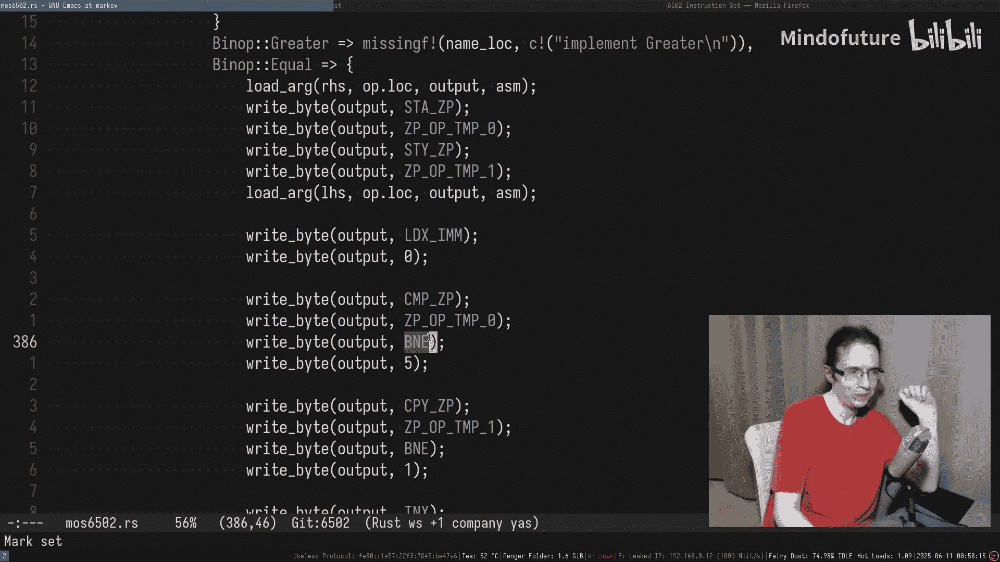

This is basically it， isn't it， This is basically it。

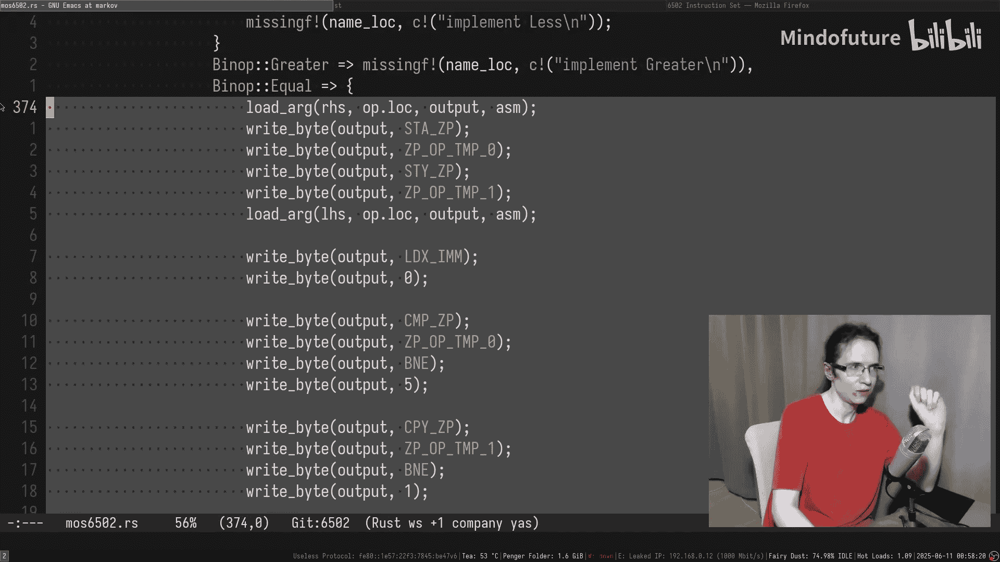

less。You。嗯。不你。So not equal， but the implementation was。The implementation was equal。Okay。

 so wait a second。 we have these two times。Which means if I want to have less， I have to do。

Great equal。It's a branch of equal， right， a branch of equal。But I mean， this is just an。明白了。

So I'm going to make a wild assumption。And there is no BGE， obviously， right， so B and E。

 but is there BG official， no， and that means I misinterpret thisent that of stuff。

That is third gear。 So B and E。 So what is B and O。Branch on not equal， clear 0。H。😊。

How can we do that？ So is there even less in here。It think so。I didn't see less。So， compare。

So there is this compare thing here， which is compare memory with a kind term。

But this compare low bys before high bys。 So if low bys from first low bys， it's negative， okay。

 so none of that is going to work。Okay， so we have to。

 like I was hoping that I'm going to copypy paste。I could modify a couple of instructions and be done with it。

 apparently I have to use my brain unfortunately， I didn't expect that I'll have to use my brain。嗯。

That is sad， honestly。Okay， so B and E， all right， so this is branch not equal and I just want to confirm that there's no BGE。

 okay， cool。Right， so let's take a look at。Les。BMI is less。Okay， so let me see。BMI， BMI。

 So it checks the sign O PC。Branch， if， if minus， okay， that's very interesting。

 So it checks the status， right， so and it branches only。

But I suppose since you you basically check them in chunks， don't you？But on the other hand。

 maybe that doesn't matter。嗯。So。Do I have to understand what this code does or can I just replace this thing with BMI？

So here's the thing。Like I do not understand code starting from here。

Do I need to go ahead and start understanding this code or can I just replace B&E with BMs and continue？

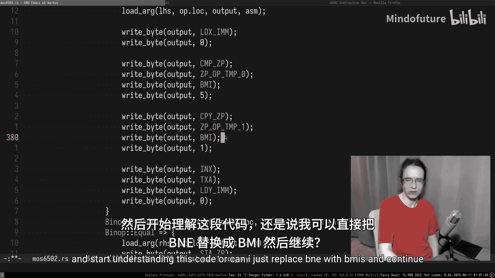

Right， so what what's the answer do I have to go in to try to understand it or I can just it probably needs to fuck okay？

So let me see if it compiles and BMI， by the way， is not even found， right， so let me see。

Where is it？BMI。嗯，哭。嗯。What's the。This thing doesn't show me。The location unfortunately。

Doesn't show me they la can't see。So BMI， can I find the address of BMI somehow。Allright。Yep， so。

Fuck， I'm not sure。Is that the first one or is that the last one。

So BMI is obviously this is annoying。I don't see。Bro， can you just give me the， Okay， so this is 30。

Okay， it's 13。Op code， right， so I think it's just 13。 I think it's just 13。Allright， so B and E。

 and it calls BM。I need to double check， by the way。So it's a D0 right， so and it is， in fact a D0。

 Okay， so you ate and a3， I'm not sure how good of an idea to do it like that， but。Yeah， okay。

 so it does compile and it's probably not going to work。 So we can try to compile the whole thing。

 right， So now we need multiplication。 So， and with multiplication it's kind of gonna go。

Not really well。 I wonder where exactly do we need notification。 So let me see。Is that something。

So it says one， it's probably because of the indexing I say。This is because of the indexing。Ha。

 that's very funny。嗯ん。But we can kind of avoid avoid that。 So indexing requires multiplication。

 By the way， I am planning in the future to add。En up code in here in op。

Wwhich is something like index， so you don't have to rely on multiplication just to index things because it's kind of a wasteful right multiplication is kind of expensive operation special on such platform like 65。

Right， so and the multiplication can be done on compile time。

 So there is a lot of waste involved with this kind of stuff。 So it has to be its own on O。

 but we're going to do that a little bit later。 So essentially， what we want to do here is probably。

I have a pointer， right， so start with some sort of a pointer。😔，So we can do P。

You have to multiply by routine。One if fuck is talking about it。 This is not what I'm talking about。

 Anyway， right， so this is something like that。 And that's annoying， Right。

 So I still need to have multiplication， at least to get the name the。The end of the name。So yeah。

 there's a we need to implement a lot of things just to get a name going。

 So I feel like it's not worth it。 It's actually not worth it。

 right So but at least at least we started this and I think， right， So at least we study。

 So's just like you have to implement a lot。 Let's not go there。 Let's not go there。Right。

 so for here I added BMI， so I edit this thing。So let's remove the less implementation right。

 because I didn't think it's needed。Let's maybe try to make something else working or maybe not。

It's kind of hard to tell， do you want to go there， so this is the standard library。うんうん。

So this is the emulator itself。And by the way， you had a lot of trailing white spaces。

 which my editor automatically removed。I really a lot of them just like a couple of them in here。

Yeah， freak。Okay。So okay， I suppose clean up more 6502 called G A。Ill clean it up a little bit。

So I think another thing that we need to maybe comemeten here is this one。

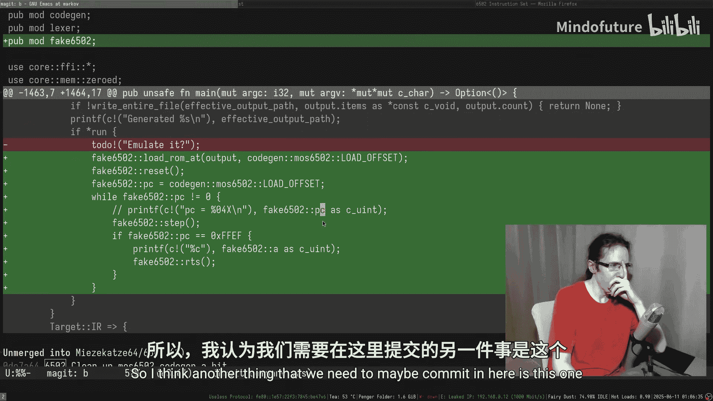

So full the emulation and stuff like debts。うん。😊，For the emulation and stuff like that。

 So load offset， we can actually specify it。The load offset。Through linker flags。

 because there is one interesting functionality in the compile is that you can。

Specify the linker flags。Through dash L。And in case of X 664。

 they're simply passed to the linker of the corresponding point platform。But in case of 6502。

 we can just collect them and pass them to codegen and let the code gen parse them。

 And through these arguments， we can actually tell the code gen。The load of certain and stuff。

 like them。So that could be one way to customize the the load of set you know what I mean， In fact。

 we can even try to maybe use the same library that we use for parsing flags。

 but for parsing these kind of flags in here。Isn't that interesting。

 I think it is kind of interesting。 So I'm gonna show you what I mean super quick。

So when I called Gen， most 65 or 2。 So we get to the generate program and。The linker flags。嗯， link。

Yeah， so here is the linker。And how do we pass them yeah。And the link of flags。

 if I remember correctly。Their flag least， which is a dynamic array。嗯嗯。

And so there's an easy way to convert dynamic array to a slice。

 so essentially we can accept link flags。As a slice。オ腐？Conci chart， This is what we can do in here。

This is Wo Kingdom。And now I can even do something like this print F scene。

So it's kind of like sort of like I'm outlining the functionality in here。

 I'm outlining the functionality。So and I'm going to be iterating all of that stuff like this。

 So link flags。0 link flex lens。 And so here is might as well just print tab。

Sometimes this link flags。弯。嗯哼。S new one。あリンク。Flaags， we're going to do reference this entire thing。

 I'm going to take it by I and the。Right， so now let's try to。Do hello world。

Just fill world like this。It doesn't compile because of。This stuff。What else do we want？

It wants' now look at that。 It wants now the linker flags。 the link flags allocated in link。

All right， so that thing。We need to dereence it because it's by reference if I remember correctly。

But let me double check Yeah， I think yeah， so we need to reference and we need to take it as a slice。

 so there is a special function， very convenient function。

 which just takes a dynamic array and gives you a slice。Here it is。

 So there's different variances in here。呃。That's yeah， so it takes it as immable though。

 but I mean it's probably gonna get， you know， decayed into the constant or not really decay。

 but whatever。 so k， I don't remember the the proper term for this kind of stuff。And yeah。

 so you can see here there is no linker flag into。 So we haven't used stuff a necessary parenthses。

 So that's what it's saying。 Can you see she okay。Yeah， and this Burn this is in here。Al right。

 what else we have here and here is the link flag。 So what I'm trying to say is that now。

You can do something like load offset 69。Alright， so here are your flags and you getting them。

 you're getting them in here。In the code gen， so you can configure things。

You can actually configure things。 What's funny is that this is precisely the place where you want to configure things。

嗯。Alright， so because。Yeah。We can just like parse this into stuff somehow。We can iterate the flags。

 the flags and。Jm。How can I do that so I can just check if a particular flag like starts。Starts with。

Like this。Load of set equal， right， So it starts with this specific prefix。

And then I can cut out this prefix and parse the the hexadeadeimal or something like that and just set it as the load offset set or as the。

You know， as this code start， in fact。Weend。So this is a load of set I accident not every accidentally。

 but I removed this thing， let's bring it back。Let's bring back。

 let's actually call it something like default。Default load of set。And in here。

We can put it at the top。And it's going to be mutable。Alright。

 and this is going to be default load of set so initially it is that this is default load set and as we passse the linker flags。

 if we encounter like load of set， we can say okay。

 so set that to code start and this is how you can customize that。So it's pretty cool。

 Remember we had to do for that。 So can we do better， consider， Okay， I think it was not to do。

 I think it was in here， offset set or。Where did you say the Lord of set。嗯。Yeah， loaded it。

 but can be configured。 Okay， so I saw this thing and I thought it was a to do。

 It was actually not to do。 You just like said it like that。Okay。So， machine is。Logged it at。

By default， but can be configured via load of set equal。Offet。Liiner flag。So。

We're going to put it in quotes。So the linker flag that we need to implement the machine。

The question is， how we're going to be freaking implementing that。 So here is the flag， right。

 So here's the flag， but it's actually。Cea flag， I do it or not， it's a freaking sea flag。So it's an。

 which doesn't make it easy to work with or anything。We probably need to convert that to string view。

 So let me see in noob dot Ar。 So Sv from S， that's the function we want to utilize in here。

That's the function we want to utilize。So this is one。 And I convert that to string view。

 That is pretty cool。 So string view enables me to maybe check starts with。Yeah， there me go。

 so I can check whether that specific thing， that specific flag。Starts with a particular prex。

 and the prefix also has to be string view， unfortunately， but I mean， I can do something like this。

 So this is the perfect load offset equals Ram。And in fact。

We can maybe do something like a load offset set pres。 Just save that load offset set pres like this。

This is the perfect we have。And if it， in fact， starts with that。

It should be relatively easy to now take the flag and just chop off that prefix。Shrop itov。

 simply chop itov。 So it's going to be items。I don't remember， so I think it was a。Something like Ed。

And this is going to be the size of that specific purpose。

 and I feel like we have to reassign this entire thing to make it work。 I don't quite remember。

So what is this shit。O看。So we do this kind of stuff， right， so flag。Count。

 and we're gonna add this kind of thing。 So it cuts off all of that stuff。 So now flag。

Contains only the value that we now have to parse the hexadeadeimal。

 right so that's what we have to do。So on top of that elsewhere， so this is something like elsewhere。

 if you encounter something that it doesn't meet the perfect or anything like that。

 we have to probably throw some sort of an error in here。

That's just kind of interesting because Generate program doesn't allow you to report errors， right。

 that's not something that you can do。But maybe we should actually do something like option。In fact。

 in the future， I feel like generators may throw some errors。Right。

 so I think we should start right now， so return none。Like that and at the end。

 we probably want to do some。Some like this。Alright， so yeah， in in the future。

 we probably need to have like a several ofs like different prefixes in here。

 So it's a little bit clanunky because it we have not figured out how exactly we want to do that。

 We haven't。Fact the without all of the necessary machinery to make it look nice。

 so it doesn't matter that it's a little bit clunky， don't worry about it too much。Okay， so yeah。

 let me， let me try to maybe do something like this。 So it was a semiical in here。

So load offset is equal to this value， and we can just do。We can just probably flag， right？You know。

 in fact， we can do some this so in be items。And then here， we'll probably have to say F print F。

 SDD error， C。Un， unknown flag。Liinnker flag， and we can specify something like。

So this one known because I want to use this thing。But it's not factored out。

 So I should probably factored out into the flag。But flag is already taken。So it's annoying。

 so I probably now have to call flagsv。W whichhich means that in all the places where I used Flag now I have to rename it to flag stream。

So。Hopefully。That will works at hell。But here I want to use flag original C flag。Okay。

 so are we good are we Gucci Are we Tamaguci now， can you recomple this into I think let's go to a caper。

 So this is Fls。And this is a link flags somebody yeah， so it's just this thing。Alright。

 what else do we have in here， load of set。 Yeah， So this is the default load of set。

 but here is an interesting thing okay。😊，So that means。

We need to know that start point in the emulator as well。 and that's a good point。 Actually。

 believe it or not， that is actually a good point， which means that maybe we need to factor out。

We need to factor out parsing this link in configuration thinking。

 so we're developing like a configuration system。Right so then the driver。

 I think that's what it's called in the compiler industry， the driver。

 the code that is responsible for running the compiler then taking the result passing to colgen and stuff like that I think it's like a controller in the enterprise world。

 but in a compiler world is calledD for whatever fucking reason right so because the different programmers in different industries are incapable of communicating with each other and coming up with a consistent terminology so they just call this kind of shitd different names。

So in in the compatible world is's called driver， right。

 so the driver is going to be responsible for。Pasing and getting out the load of set flag and then passing into the codegen and then passing it into the emulator。

So that's how it has to be。That is how it has to be。So yeah。嗯嗯。😊，嗯 응 응。Let me， let me see so。

Do I want to go do it right now？That's a very good question。 So flag， this is Fl a3。

And this is Flag of stream。So， and we S。 so it has to be。So it's not called items， it's called data。

those over here。Do we have scroll be？On the behalf， it's a powerful。So else and it's mutable。

 it doesn't have to be mutable。So what you want， it wants to be mutable。 thats freaking。 Yeah。

 finally comps， finally comps。 So something like this。

 but we still miss the point where we parse the hexadeadecial in here。

 Is there any easy way to parse hexadeadecial in rust。

 Is there just a single function that I can call in rust。

 and it will actually do the right thing for me， or is it separate crate package like a left patch sheet。

Right， so its there's no way to just parse a hex in rust， right， so rust parse hex。

Exad decimal string to decimal string。Oh wow， it has a holy shit。😮，Oh， you just can。

 but it's it's a STR unfortunately， right， so we're talking about， yeah。🤢。

It's a little bit annoying that little。Is there something like that maybe in？C。

 so I remember there was like something S to L or whatever。

S to R to LL or to ULL or something like that。 Yeah， so and it accepts the base。Booze。Bs。B。

 and this is what we can try to do， in fact， believe it or not。

So we're going to assign that code start。 were starting from。Flag SV data。

We don't really care about the end of this entire thing， so I'm going to put a nu in here。

 but you are a nu。And as a base， I'm going to say 16。

 right so that's how we're going to have a code start。Andや。い。😊，And here we can maybe okay。

 let's not print anything。うん。And I'm going to probably remove all of that stuff。Print F。See。

Can code load。Offset， or we call it。 Yeah， load offset is equal to。X， maybe' something like eight。

A new line called start。Like so。なくだ。Code start， code for。Okay， so that we have it here。

Doesn't like something。 So P TR， if I remember correctly， it's coming from。

I don't remember why Pto come from rust up。Rus up du。Let's go。 opening and browse it。

 Do open it and browse。 Oh no， Oh， no， Oh， fucking no。 can you okay。

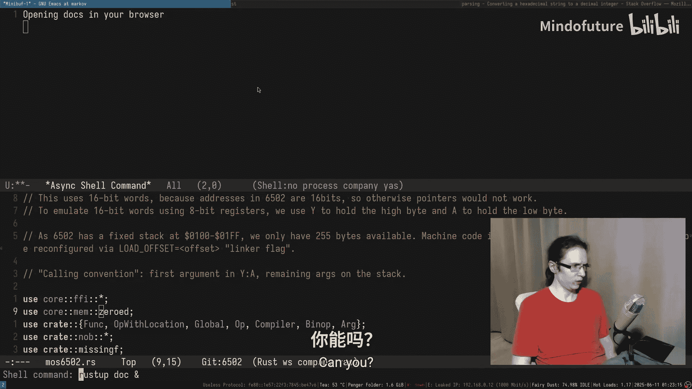

Okay， so I was thinking maybe just couldn't recognize which browsers that I use。PTR， where is PTTR。

So it's a， it's a core PTTR， right， So okay， I' see。

It's a corpi to R。Something like that， so core PTR， core PR， Yeah。

 so this is what we need doing here。SCR to L， let me bring that sheet to maybe crust。

Where is lip sea， So here is the bunch of functions。We already have a bunch of STR functions。

 which is understandable。

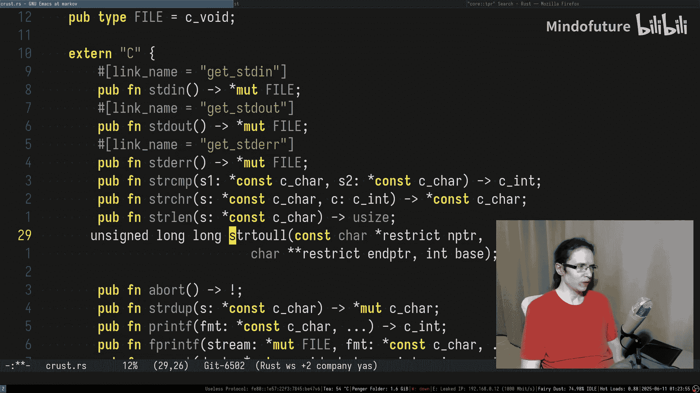

And which right is a question， how do you denote uns signedigned long， long， Right？

 So there is a long， long or just long long。So there is a C U longong goong。

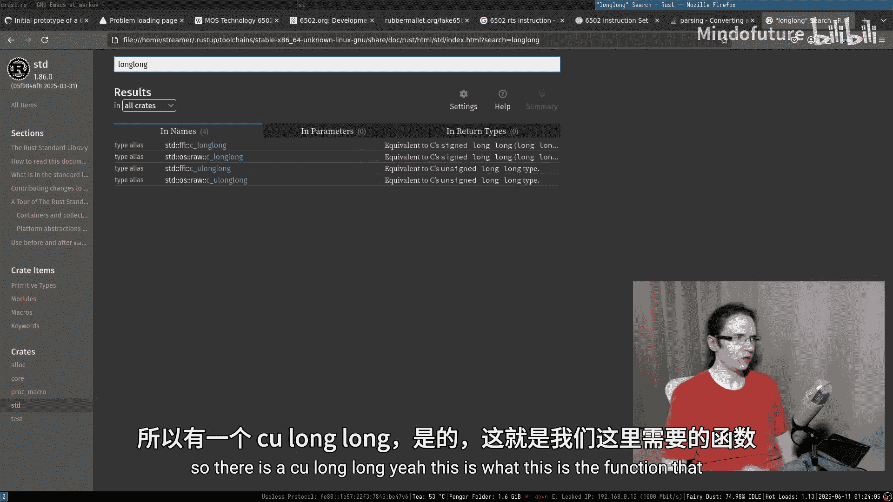

Yeah， this is what this is the function that we need here。 See you， Hongong。The pub a fan。 Okay。

 and this is C U long。5。So in here we have NPptTR and of course， there is no restrict in rust。

 peasant rust doesn't even have restrict。 Look at it， Look at it chat。 laugh at it。

 laugh at this language。 It doesn't have restrict。 Absute fucking laughable anyway。😊，😀ははははは。😊，はは。

It's an infeor， inferior language to see。So this one is a C int and yeah。

 that's what we need to do here。So that's what we need to do in here。 So pointer mutability， Okay。

 so let's actually make it mutable。Right， what else do we have here？ So yeah， we need to have。

まバ good。두두두두두。Okay， let's as U 16， let's fucking go。どル。ドググ。🎼噔噔噔。It worked look at that。

 so this is a lot of satisfactionism。嗯。This is basically blown of set。And honestly。

Absolute badjuing badjuing， we need to do the parsing of this configuration。Actually。

 outside of this syn， I think。 So let's actually factor it out。 We may have。I like I confi。And it's。

Load of set， I want to keep it load of set， right， so because it kind of makes sense to me。

 it makes more sense to me。And let's introduce something likeB Unsafe E。Pase canfi from a link flags。

And here we're going to accept the link flags like so。Here is the link flags。

And we also going to accept the mutable config， so this thing may also return the failure。

 so that's totally fine。And we're going to move all of that stuff in here。Next song。In fact。

So here is the config might as well。Maybe just return conflict like that。Yeah。

 because we we can do that。So this one has to be derived。A clonelogne and a copy copium。

So let's mute Confi。Can we just do something like him。Load offset set。 default load offset set。

And could start。こし。Load offset sets like so。That's what we got。 And yeah， in here。

 instead of code starts， we accept config， which is also config。Like this。It's public。

 This one also has to be public。 This has to be public。

い、 par confi from thatソ an in B or S in B or S。Before generating this entire stuff。

 we have to grab this entire thing。And call this function。Like so it may fail by the way。

And it's fine。So this gives us the config， which we then pass to here， and then which we also use。

To load。Confi load offset set， like so look at that。Isn't that beautiful。

 I think it's pretty cool so you can customize load of set and even emulator is going to take that into account。

So that's conclude of cool。Nothing， I think thiss going to cool。

Or we can also nice to print that kind of， but' already kind of print it though。

So heres the semicolon and stuff like that。So this is the defaultle thing。So let's go theers。

 let's go the compositioners and what do we have in here， so yeah it has to be coa。

Has to become a so quote start this is not a quote start， by the way。

 this is a config a load offset set。 and maybe in the future， by the way。

 we're going to be passing this config instead of the this unusual thing because it feel like。

This kind of in the future may have more parameters because for example。

 C 65 has an entire configuration system right so C 65， there is no what this， it's a C65， I'm sorry。

It's essentially like a whole two chain compiler for 6502， right， and it has。

Like a configuration system that allows you to。Set up the linker where all of the different like ros go and stuff like that。

 And I have a feeling that me。Like it's kind of like a glimpse into what we will have to deal with at some point。

 right， so it basically provides you this kind of language configuration language。Right。

 so and I feel like our cong is kind of like a first glimpse of that。

you want to be able to set a load of set， but maybe in the future you want to be able to set all sorts of things who fucking knows right。

 so it's better create infrastructure for that。At least。To some extent。Alright， so and by the way。

 I might want to actually put that in a deion into the de owner。

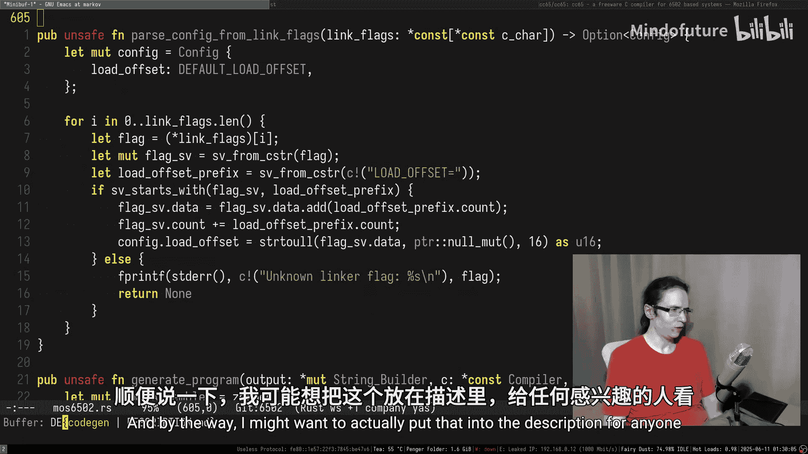

For anyone question say， this is actually kind of cool a compiler， compiler chain。

嗯うSo耶稣耶稣耶稣。Okay。So this allows us to set the load offset set right。

 so let's go to the rest of the calculation here， so this is a quote start， confi quote start。うふん。

And think it's not really it's a load of set of set。F load of sets。あん哼ん。So option， it doesn't。 yeah。

 it doesn't like that I didn't return the config。 So that's totally understandable。

 So we have some other things。 So this is unused。 What's actually， do I want to remove it。 Yeah。

 So it's it's it's not used。 Let's remove。So here is a mute tomture， no Ffi is save。Mm。

This is fascinating。Why even this is because it's a sea chart I explain。 Alright， alright。

 that's cool。 And yeah， that seems to be working。 So， yeah， I right away， said 69 and。😊。

We didn't see like much effect from changing the load of set。But it changed the load of set。

 and it still worked， right， so。One thing I wanted to test is basically to test like different things like yeah unknown link of like load of 6 net night so we don't know what it is。

 so one of them is a load offset。All right， so one of the things that we want to have in here。うん。

So one thing that we want to have here is probably。So。Some sort of help。Flag to list or。

 to list all this。The linker flags for more 65 or。

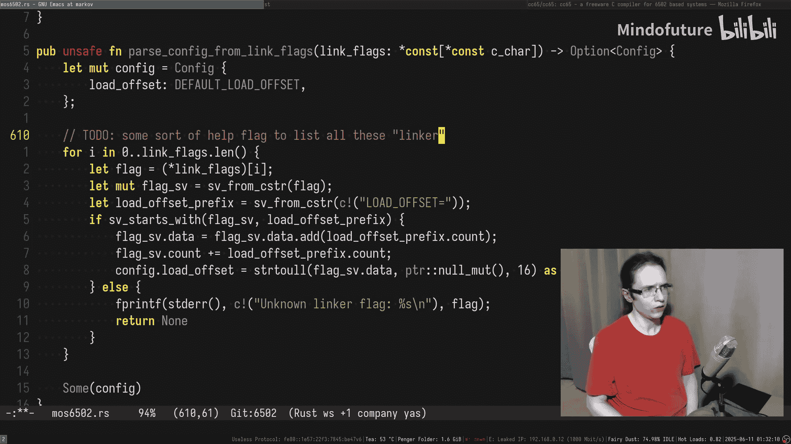

Something like that。 So yep。

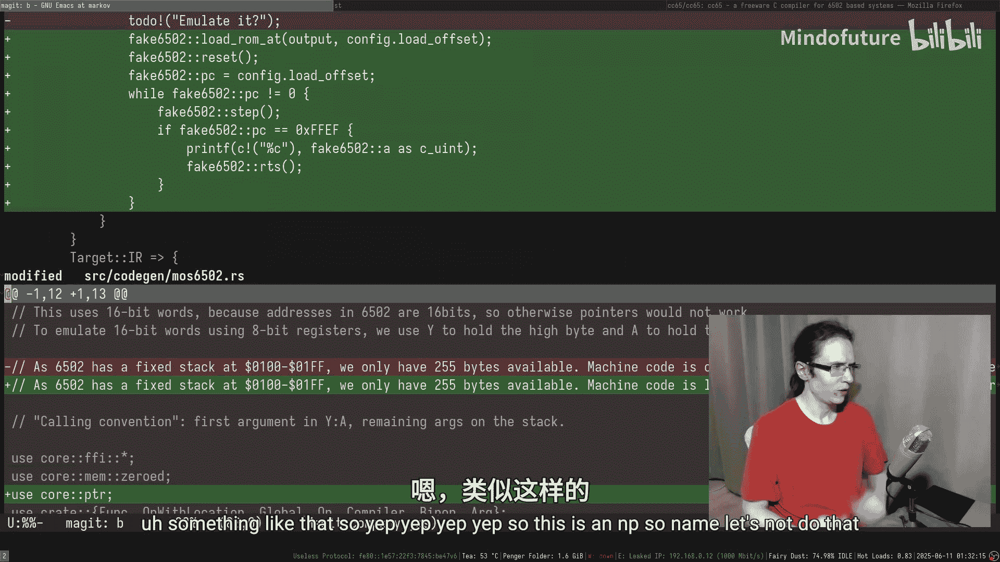

Yep， yep， yep。 So this is name P。 so name， let's not do that。

So I think I'm ready to commit this entire stuff。It's still unclear what's the platform we're developing this entire thing for。

🤢，But I feel like， as we develop。This particular target more and more。

 maybe it can become more clear。Right。So what I want you to have at least is an ability to compile something and then verify that it compiled into something reasonable。

 so we have a way to compile hellello world and instantly run it and see that it is in fact hellello world right so and I think at this point this pull request is mergergable at least for me right so everything else can be then implemented later incrementally。

😊，So one of the things I probably wanted to say in here is that。Just basically， this is from Wassman。

 right， So Wassman。AWas an echo routine， like emulating was an echo routine。 So the convention。Is。

Stop executing， executing when PC is equal 0。So something maybe something。

So that's the convention that we have on here so and I think I'm ready to commit fake 65 atn。Right。

 so。We're committing that。Implement emulation for 6502 via fake。65 U。All right。

 and I'm going to push that right into your ribbon。I'm going to push that right into Europe。

 So in terms of tests， it's kind of difficult to tell how we're going to test all that。 Anyway。

 so I think this pull request is mergeable。 This pull request is mergeable。Oh， and。Yeah。

 everything else again can be implemented later in separate pull requests slowly incrementally。

 it's better not to implement everything at once right away。

 otherwise you can very easily overwhelm yourself。So。

I think today was a pretty cool stream right I really like fake 6502。

 I think fake 6502 is a really great way to learn this CPU right。

 just by reading this code right so just read this code and it's a very small file again。

 and1000 lines of code and for any serious programmer， this is a laughable amount of codeHonestly。

 it's a laughable amount of code Our compiler is very simple compiler is very simple compiler bigger than that right。

 it's a 4000 lines of code。😊。

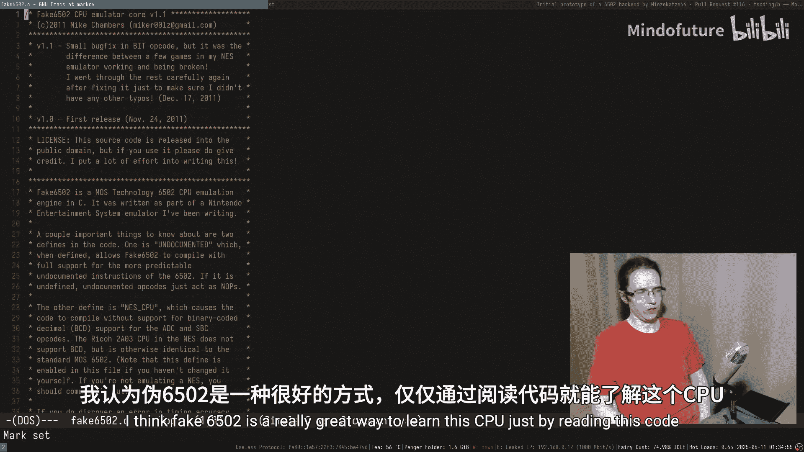

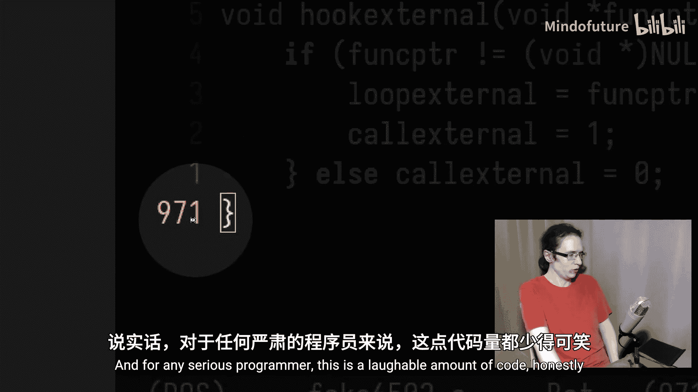

That's a friend name。So。And it's not that big。 So in the actual industry。

 you have to work with much bigger code but it's much， much bigger code base。

So I'm just waiting for this thing to pass， right， so we have a little bit of VciI， by the way。

 so we are serious project now， we are serious project now。So again。

 it's not really clear what we mean by 6502 targets， right。

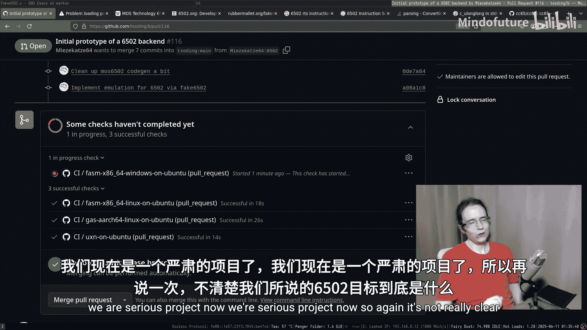

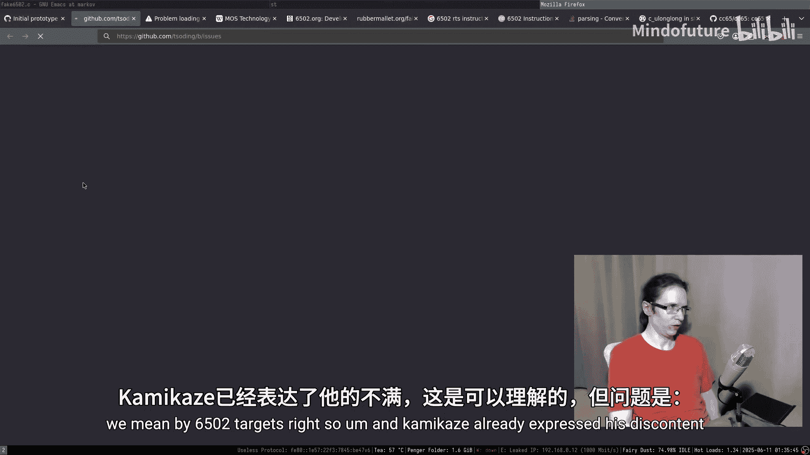

And Comikas already expressed his discontent with that。Which is understandable。

 but the problem is that。😊，We just can't name it properly because we don't know what it is yet。

 We need to continue experimenting with this target。

 We need to continue playing with it until it becomes more clear。

So it will be kind of nice to have some sort of like a beautiful system of triples where every target fits into that。

But the reality is usually very， very messy。 The reality is usually very， very messy。

 and we don't really know what this targetgget is about yet。 Let's continue implementing things。

Luckily， it is like the direction where you have to move is pretty clear。 you have lots of examples。

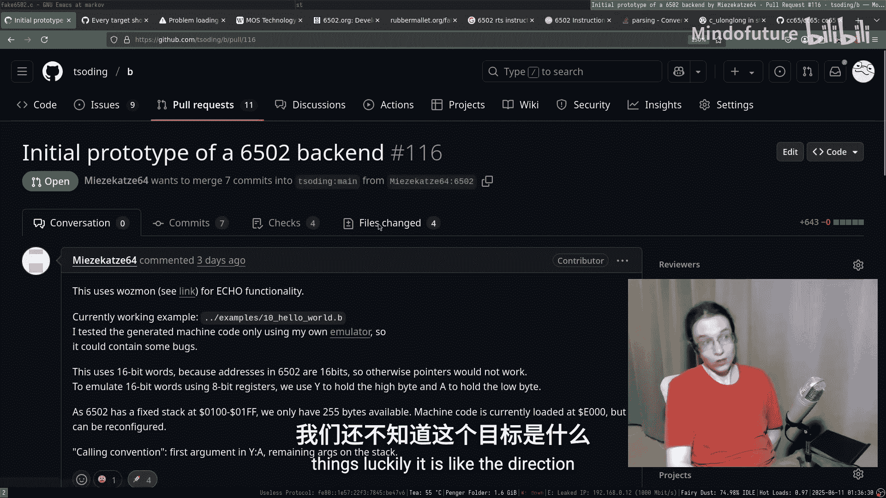

To to make compileilable in 6502 to some extent， you have lots of tests right So if you want to contribute to this project and specifically in like for the 6502 target。

 just grab some testing in here right grab one of them or grab one of the examples try to make it compileilable and runnable with 6502 and submit the pull request so there's a lot of work for everybody right soon and a lot of people as you can see submit pull requests I kind of review them relatively slowly it usually take me two to three days but I review them eventually I actually review them eventually。

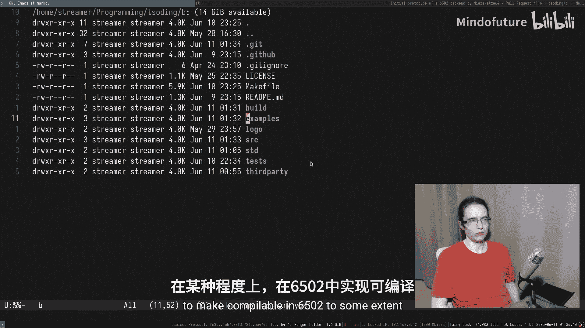

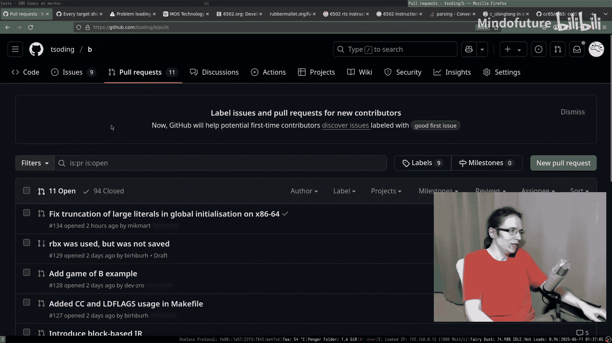

Right 6502 is kind of cool， like it gives me a lot of ideas。

 I want to try to maybe even take 6502 like fake 6502 and as already said， hook it up to Rali。Right。

 hook it up to Rali and maybe write some game for this processor with displaying something。

So that sounds extra cool。 this is your language No not really。

 it's a language by Ken Thompson right So Ken Thompson， the creator of C also created B first。

 So this was before C。 and then they fixed some problems with this language in the next release。

 which was the C programming language。 What we're doing We're just you know recreating it So were recreating that original language。

So。But the design is not ours， the design is not ours。

 but we implemented it from scratch essentially。嗯嗯嗯。So。I never heard of B， but heard of B， B PL。

 That's kind of weird Like if you've heard about B CPL， you must have heard about B， right。

 It's kind of weird。It's kind of weird。 But anyway， okay， so let me do the following thing。

 lookss good to me for now。嗯。Thank you。For your簡 be。So everything is meable， everything is mergeable。

65-6502 is officiallyly supported。To some extent， we don't really know what that means。

 but now at least you can compile and run hello world。 So absolute charging chat， chat， tell me。

 tell me， is that an absolute chargingd moment， I think it is， in fact， an absolute chargingd moment。

So let me see， let me see who we got， thank you so much wellow year2written04， not that Georgia。

 thank you so much for all of the sips， thank you so much for all the up。All right。

 that says for today， thanks everyone who's watching me now。

 really appreciate it have a good one and you on the next recreation program session with Ahu and Mr。

 Azin。I love you。

