# 使用Rust完成分布式系统挑战--BV1vNLwzQEGP-

Hey， folks， this time it's， we're gonna try something a little bit different。

 It'll be in sort of rust implementation stream。 But this time。

 we're not implementing an algorithm or， or， you know， some kind of useful crat or anything。 Instead。

 we're gonna take on。A set of basically programming challenges。

 So this particular set is one I was linked to not too long ago。

 and it's a set of distributed systems challenges。That use a platform called Maelstrom。

 that is basically a sort of。Distributed systems， testing framework or exercise framework that can basically orchestrate message passing between nodes in a distributed system and emulate things like delayed messages or reordered messages or drop messages nodes coming and going that kind of stuff。

 and you know it's written by or it's written alongside the author of Jepsen。

 And if you havent look at Jeepen， it's a really cool effort it's basically they're doing correctness research forow my browser plugins or messing with the site。

 So they're doing correctness research for distributed systems So they have this framework for exercising a lot of the interesting corner cases of distributed systems and they found like a bunch of bugs in real systems like real distributed systems like Redis raft Postgres。

 I think they did something with at CD sos like they're studying real systems and finding real。

Diserive system bugs。Now， this is， I assume I haven't actually looked through all the exercises yet。

 but this is going to be a sort of， let's build up an increasingly more sophisticated distributed system and run it through Maelstr and see whether what we implemented it is actually correct or what kind of additional mechanisms we might need to introduce in order to make it correct。

 Now the I'll link the website in chat so that you can you can take a look。

嗯。Now， this one is。You know， the， the， the exercises that they give here or in the documentation for them is going to be in go。

 because I assume that's what fly I O uses or something。 And I took a look at the Maelstrom repo。

And in the Mastrom repo， they have this。 why does it not， know， I want。This， there we go。

In the Maelstrom repo， they have demo implementations of like the node code。

 and when I say node I mean node in a disruptive system， not like node Js。

They have demo implementations of that node stuff in Ruby， go， JavaScript。Java。And Python。

 there isn't one in Ru as far as I can tell。 So we're gonna have to write a little bit of the sort of connecting code to get all this to work。

 Now， looking at it it let's see， I think its an echo challenge。 Yeah。

 so Mastorm basically requires that each node is just a binary and all the all the nodes are running the same binary。

 and they receive Json messages from standard in and send Json messages to standard out。

 And these messages are basically just like the stuff these Json objects that you send and receive。

 sort of correspond to network messages。 like if we look at the protocol spec。

 which we're going to have to implement here。呃，88888。Yeah， so the messages are of the form source。

 destination and body， where source is the sort of identifying string of the node that sent the message。

 And the other one is an identifying string for the node that is the target of the message。

 And I assume these are going to be like， you could think of these like I P addresses。

 But because we're using a thing that essentially emulates the network here。

 they're they're going to be node names。Like and one and 2 and  three， et ceter。嗯。The message bodies。

Have the following reserved keys。Message Is should be unique。呃。Each message has additional keys。

 depending on what kind of message it is。I see。 So these are fields that can be set on any mess or reserved keywords。

 And then you can set other stuff in the message too。They can be have any body structure you like。

 So we're gonna basically have to implement this， this protocol。

 But it seems like a pretty straightforward protocol here。

That we're going to have to build on top of。Type error。Interesting， okay， so。

 we'll have to think about exactly how we want to model this and how accurate we want to do it。

 I kind of want to just sort of get started with the， the real distributed systems part of things。

 rather than spend too much time on implementing the protocol。 But we're gonna have to do that just。

 to get sort of set up。

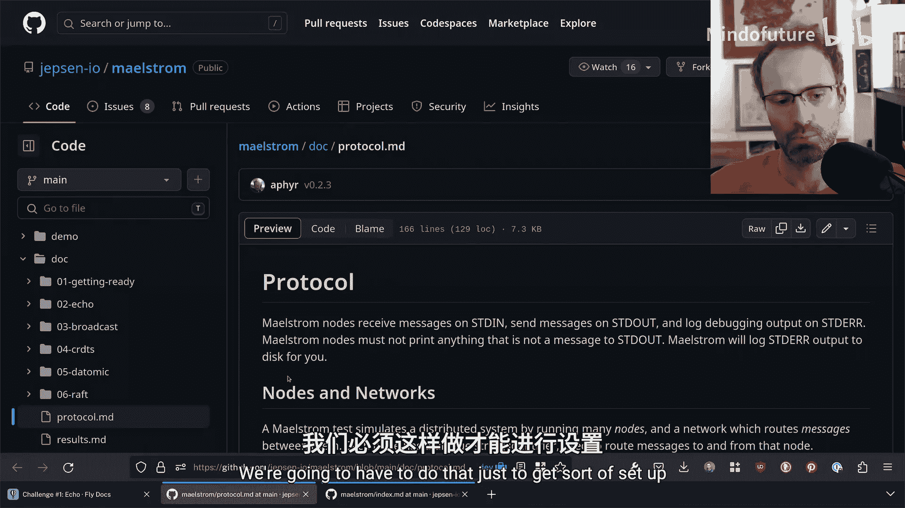

In fact， how about we just do the， the echo example here。

 So this is just like to see that it works like you get an echo message in from the the。

 this orchestration system Maelstrom and your job is to send a message with the same body back to the client。

 but with a message type of echo， okay。

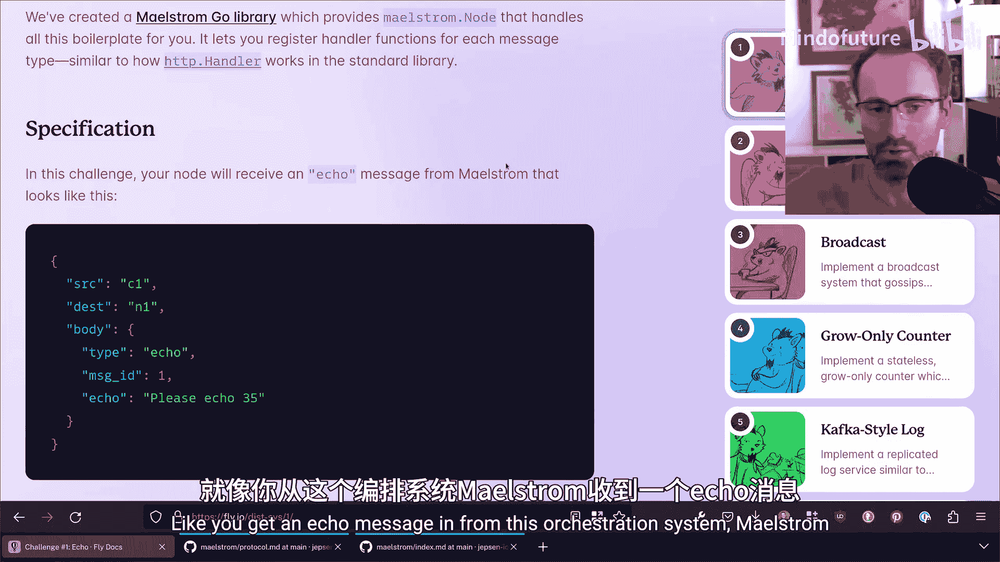

So I guess we're just gonna， we're just gonna start writing some code。 I already grabbed Maelstrom。

 Maelstrom， Mastrom。So I have that over here。So once we want to test this， we。

 we can actually do that。 Great， So let's do Cargo new。Bary and what are we going to call it。

 What's a fun name for a distributed system that runs on top of Maelstrom。What is the。

Center of a maelstrom， called。

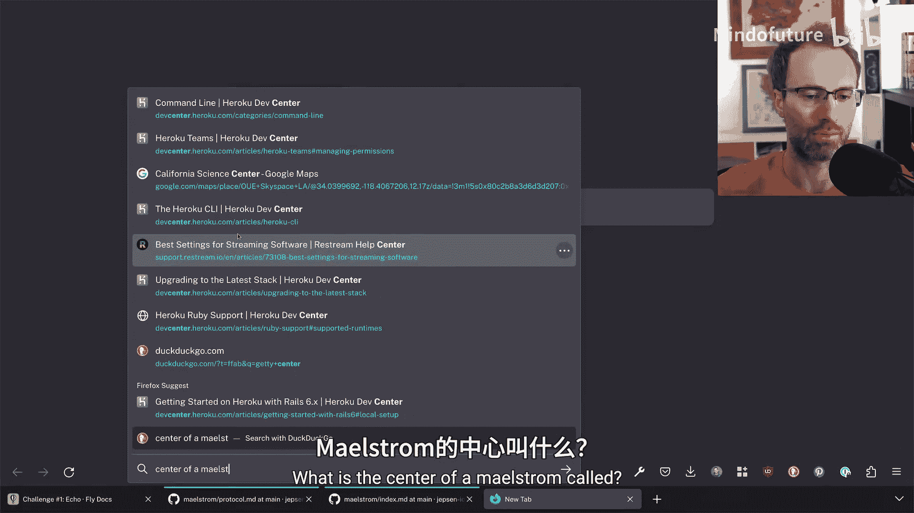

Vortex is the proper term。 Yeah， but I want something that has to do with rust ideally。

 But let's look at vortex here and see if there's a。Turrbulence is pretty cool。Vorticity。

It's a cool word。嗯。嗯。The Naarddo whirlhirpools。 That's fantastic。😊，Alternatively， I'm thinking like。

Ship。Right like something that might navigate a whirlpool。嗯。H。Eddie eases are cool。

Mch， it's a name of a huge ship in a story about the 13。5 lives of a blue bear。Ringgu is fantastic。

Yes， let's do。Rusting gun。啊。😮，Yeah， yeah。 Rosthangen。Nice。Great， I love this already。

My girlfriend would be very proud。Okay。So Rosengen is a。I'm gonna call it a battle spell。

 even though that's not actually really what it is from the anime Naruto， where it。

You create like a swirl of wind essentially in your palm of your hand。

 And so it's kind of like a whirlpool。 but also it's rusting gun because we're doing it a rust。Okay。

 so what are we going to need， Well， we're going to need。We're going to need survey。

And we're going to need30 Jason。And we're going to need those because the protocol here is。

The protocol here is in Jason。We're going to define something like a。Sted message。

These are going to be passed everywhere。 So I'm tempted to make it short， but I'm not going to。

 And I'm probably gonna make this generic。 But we's do that down the line。

 So there's going to be source。 There's going to be destination。Which they call dust。

 But I want this to be。Actually called dust so that they're the same length。

And I guess I will sort of derive notepe。No。Theive， serialize， desealize。

 and I also here want probably debug and clone。Which means I'm going to use serialize and decsealize。

And I want body。 and body is going to be one of these things。And。So what is body， body here is a。

I actually think maybe this is a。H。Let's at this in a second。 So there's type， which we can't have。

 So because that's a reserved keyword。 So we'll rename that to type and we'll have it be。

There are a couple of ways to get around this。 either you call it type or TY， or you call it kind。

 I'm going to go with TY。Because why not， it is mandatory and it's a string identifying the type of messagesses that this is。

It would be nice if that was an enum， but let's make it keep it simple。 Then there is the I。Which。

Is called message ID in the protocol。A unique integer identifier。

 This is going to be an option use size。And there's。In reply 2。Which is option you size。

And then they say it can also be arbitrary other key value types。So we have two options here。

 We could either do something like。You know， rest。And say that is a hash map of string to like30 J value。

U。So that's one option。 The other option is to make this generic over B and then use like 30 flatten。

Rest B。I don't think we want to do this， because。It's tempting。

 but it requires that you know the type of the message ahead of time， like at the time of desization。

 which we're not generally going to know because the type is going that type is going to depend on the type up here。

 Now， there's a， we could make this an enum。Actually。

 and then say that it is internally tagged by the type here。 That's also kind of tempting。

 although that means that we're going to have to explicitly list out all of the enum types。

 But that's a little， actually， I kind of like that。U。The only thing that's weird about it。

 Maybe we do that， actually。 So maybe we do this。 And then we say。I don't know if this works。

So here's what I want to do。 I don't know whether C to support this， but I want to do enum。I guess。

 payload。And the payload is going to be。呃。

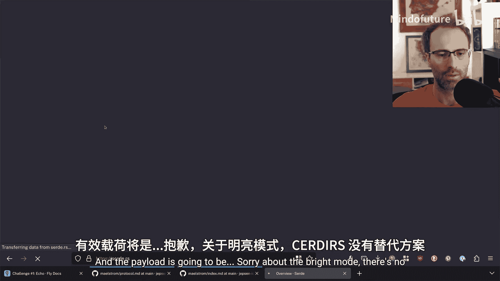

Sorry about the bright mode， there's no alternative for 30RS。

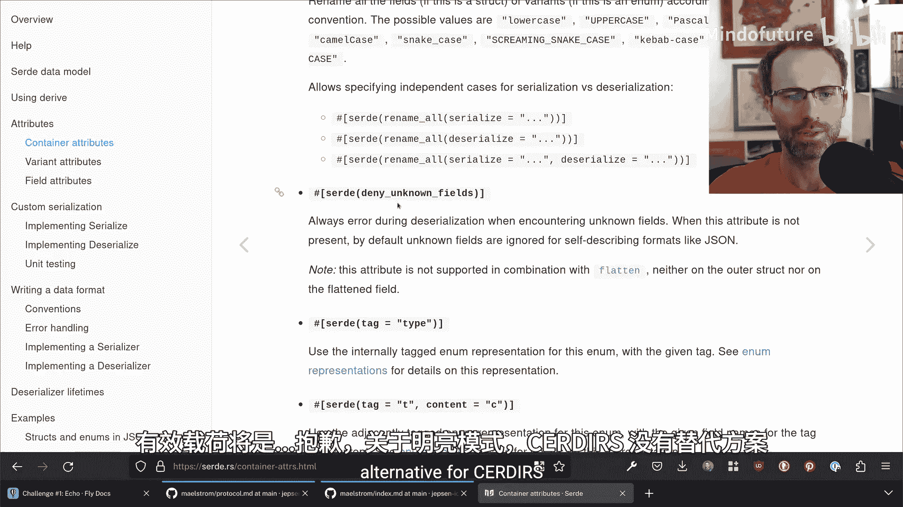

30 tag equals。Type。And then。Now， in theory， at least。

 we should be able to just explicitly e them out these。And say。The message types here are。

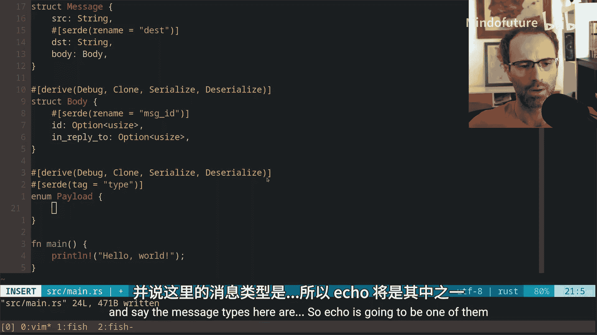

So E is going to be one of them。And this is going to be one of those serday。Rename。

There's like a ser， there we go， rename all。

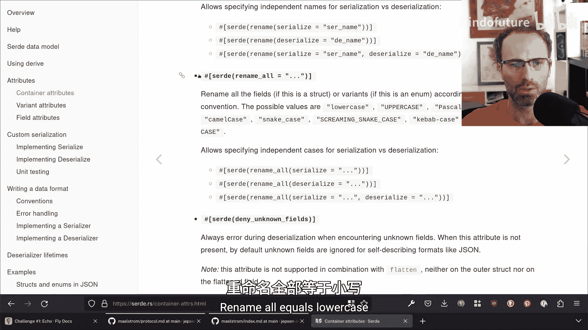

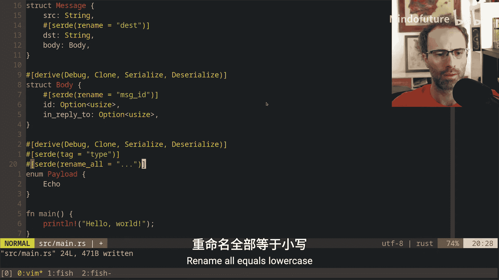

Equals lowercase。And I think it's probably not even。Lowercase， I guess we'll see this soon。

 It's going to be echo underscore O K。 So they're using snake case。

 So we're going to turn all enums into snakecase for us。

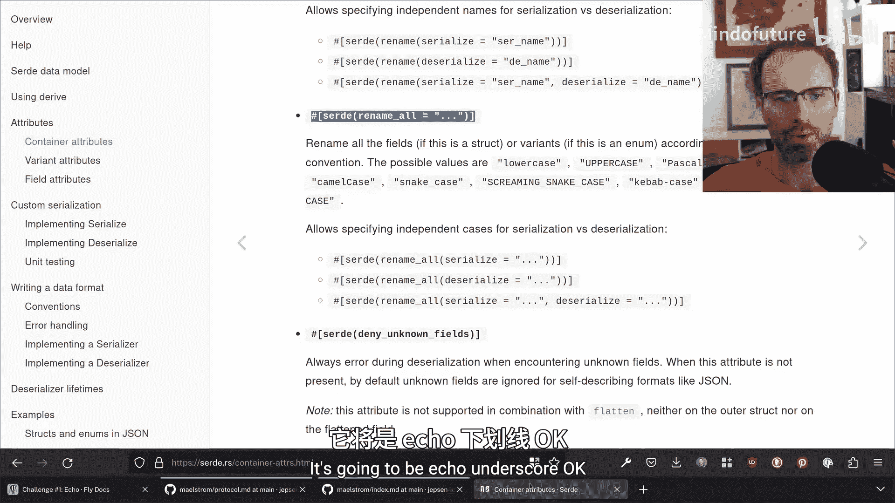

U。And then now we should be able to have these be types。A。So if we go back here， you know for echo。

 the field is going to bes going to be a field called echocho， which is a string。Now。

 the thing I don't know whether is supported is this business， which is， I want to flatten in here。

Payload。Payload。被啊。L。I guess we'll see。So the flatten bitier is like the body has the type。

 which is the tag， but it also has these fields which are shared across all the possible enamvaris。

 and I don't know whether flatten works in this regard。 we'll find out。嗯。All right。So let's see now。

 let's just write the， the logic here for。Actually， doing the decentization of inputs。

 like we're basically constructing the， the state machine driver here， right。

 So we're going to say stood in is standard I O St in dot lock。And we lose it out。

The idea here is that we really want the inner state machine to just deal with messages in and out and not have to deal with things like IO。

So we'll say here now that。Actually， I kind of want to make some of this a library。

 We might do that down the line。So， here we'll do。

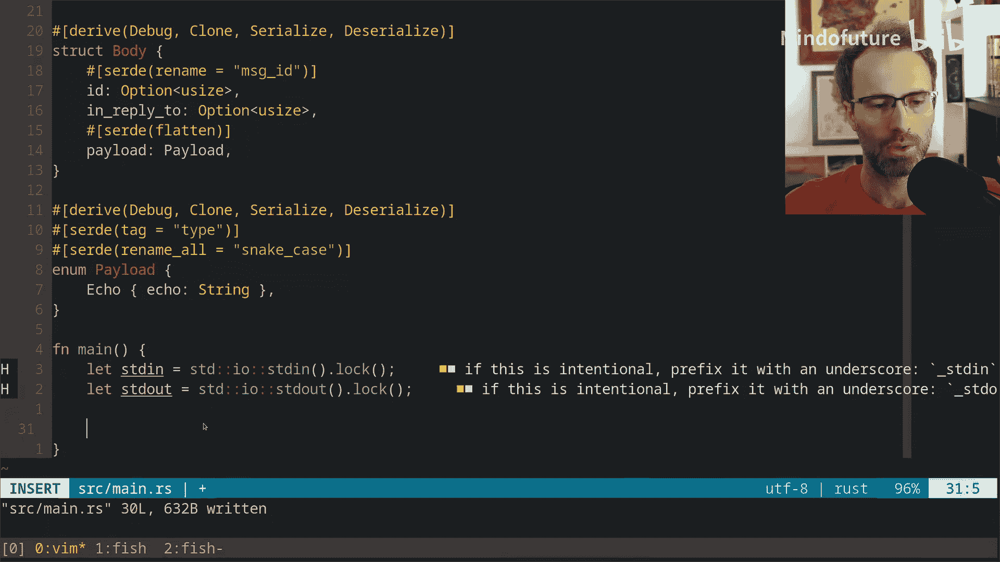

We want standard in to be a stream DCerizer。 So in ser。

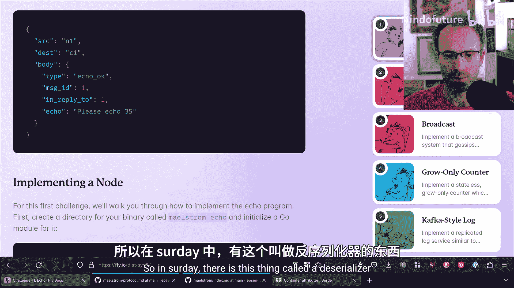

There is this thing called a deilizer。Nope， that's not what I want。 I want the Docs dot S 30 Jason。

 DC C Elir。DC Realizer。So you can construct a decentizer。

 And what's neat about it is that it can be turned into an iterator if you know that there are going to be multiple things that you're going to deize。

 So what we can do here is we do。Inputs is 30 Jason。From reader。Standard in。Dot。

I guess we can do question mark here。 I don't love it， but it's fine。Yeah。

Result we probably do anyhow result here。Feels fine to bring in anyhow for this。

So we do from Read question mark， and then we do dot into itter。Just to make the compiler happy。嗯。

And what is the complaining about here， it wants R and T Rs we're going to let it infer and T is going to be message。

What。Why。Oh， I actually do need to do a decializer foruter intor。And now， we don't need this。

And we don't need this。But into iter is now the thing that gives message。Okay。

 so now we should be able to do like while。 okay， input is inputs。Oh alternative， we can just do。

 I guess。4 input in inputs。And then the the way that this decralization works is that if you get an error during decralization。

 it'll， it's still an iterator overall， but the items that it yields are results in and what would happen if there was a decentralization error is it would propagate up an error through the item that the iterator yields。

 So that's why we， we sort of do this unwrap over here。 I also want to use anyhow context。

To give some context to this thing， which is gonna be。呃。Mailstrum input could not be decialized。

Input from。Standard in could not be decentized。 And then this is where we get to sort of the。

 the state machine。 So we'll do something like， you know，struct。Echo service。

 or I guess we could call it echo。Echo node。hy not。And initially， echoode is going be nothing。

 And on echoode， we're gonna to have。This is a pretty common way to model safe machines。 There are。

 there are crates that let you write safe machines， too。

 but I'm gonna assume that we don't need that， at least not quite yet。

 And we're gonna do something like a handle。It's going to get a mutable reference to the state of the。

 the node in the distributed system。 and it's going get the input， which is gonna be message。

And the expectation is that this returns。Actually， no。

 And then it's also gonna get a mutable reference to。And。I think there's a stream serializer， too。

The idea here being that。As the node is executing， it might want to send messages as well。 right。

 It seems pretty reasonable。 that might be things like responses， but it can also be。

 it triggers messages to other nodes。 And so the， the sort of state step function here。

Let's call it step needs a way to send messages。嗯。Now， arguably。

 it actually also needs a way to wait for a message before it replies to the current message。

 So that there's like a， there's a tricky interlaving of things that can happen here。

 It's not clear we actually want to model the it quite in the the full state machine here。

 Well we'll see how it turns out。So here what we'll want is a mute。3ur0 Jason。Seralizer。Over。

And it returns say anyhow result。So that it has the ability to just fully error。

The Maelstone protocol new line separates Jason objects so you don't need to use the fancy C thing for streams。

 That's true。 But this gives a nice interface anyway。 I don't， I don't think this is all that much。

Additional complexity， really。G。Yeah， so I， I don't know whether we're gonna want to express this through a step function。

 But for now， this seems probably fine at the moment， or actually， we can。

 we can just implement the logic right herecause the the logic they want is pretty straightforward。

 right， They want the。

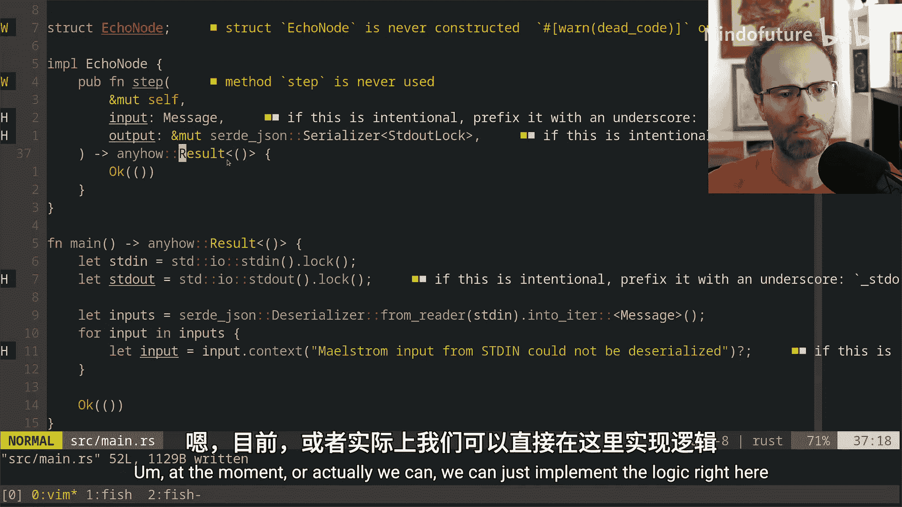

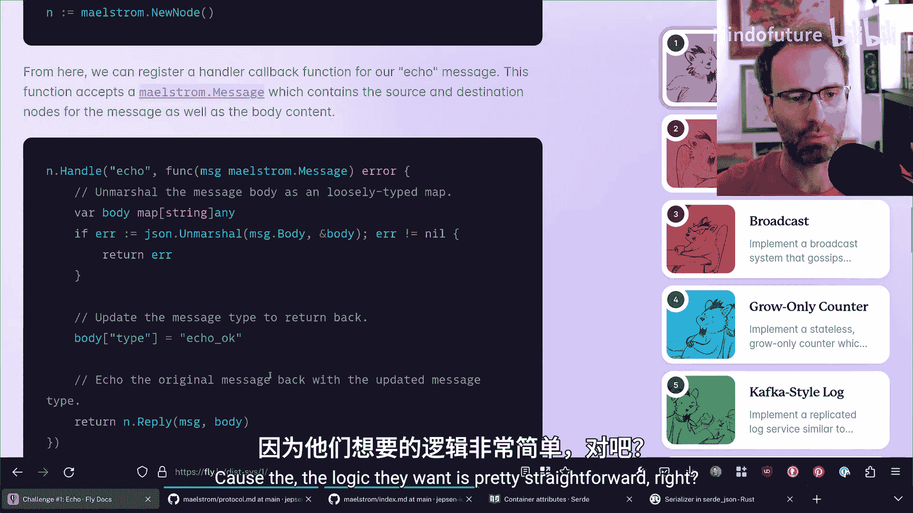

The the reply is going to be a message。And the message is going to have a source。

 which is the input dot destination and it's going to have a destination that is the input source。

 It's going to have a body that's going to be a body。嗯。

And the Id of the response we're going to have to generate。

 So that's the one bit that's going to be in here for now。Is I。So we're going to do self dot ID。

And then we'll do self dot ID plus equals  one down here。The idea is gonna be some。

 It's in reply to the I of the input。Here， I D。And the payload is going to be payload。Echo。

 it's not going to be echo。 The payload is going to be an echo。

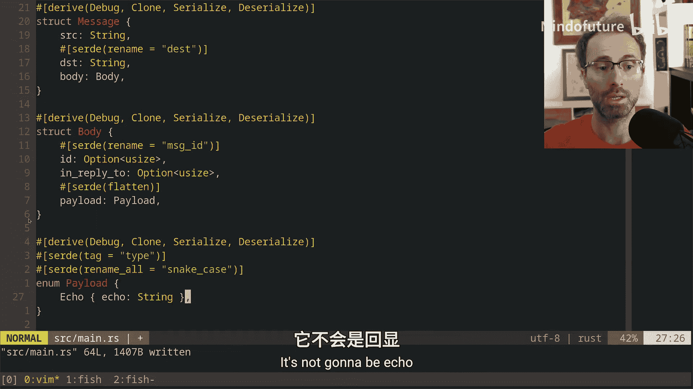

Was the response they wanted okay。呃。Yeah， so here you see they've been built a library that does the reply mechanism for you。

 We haven't done that yet。 so we we manually swap the source and destination here。

 So this is going to be an echo okay。

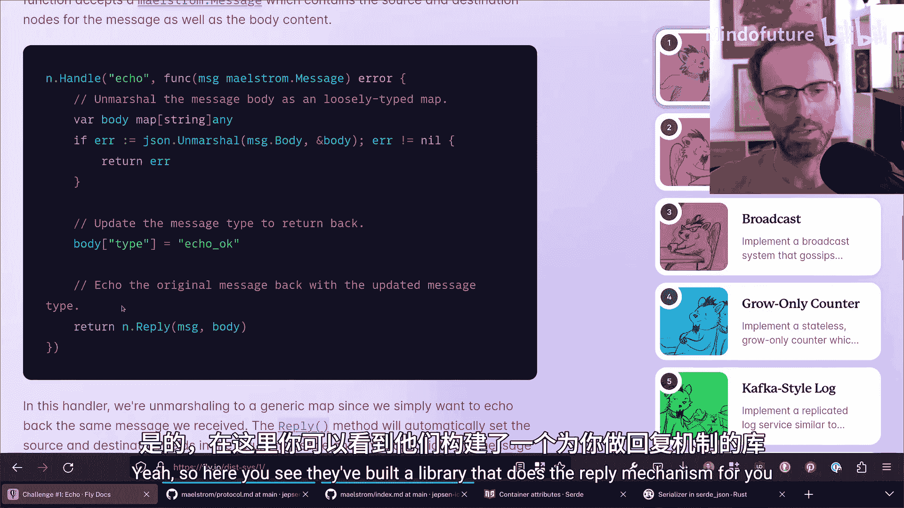

嗯。And the echo is gonna be echo， which we haven't extracted yet。 So this is one of those。

We're going to do a match on input。Actually， we're going to do a match on input dot body dot payload。

嗯。This is going to be not okay。Unexpected。Actually， we're gonna do nothing。

 if we receive an echo okay， then we just do nothing。And if we get an echo。

 that's when we want to send this echo reply。And this is gonna be。In reply 2。😔。

I thought the ID was required。

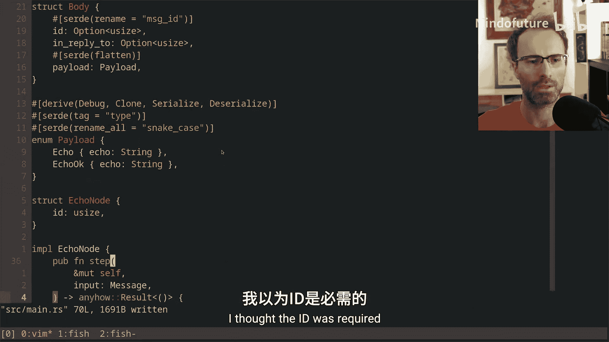

Am I mis remembering？

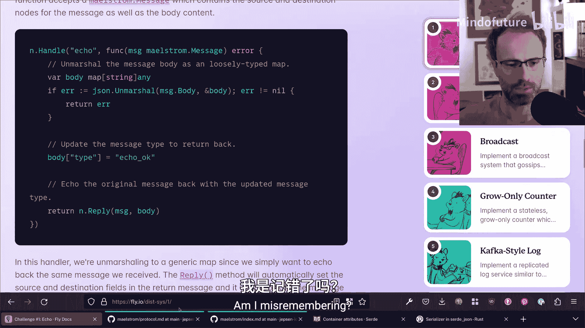

In the protocol。Only the type is required。 Okay， so we generate one of these only if it had one of these。

And so this reply， we're then going to do output dot。Oh， what's the way you use the serializer again？

嗯。Right。I thought there was a up dot serialize。 Can I use serialize any here。Reply。Faaiil to。U。

Serialize response to echo。Oh， right。 It's reply， dot serialize。And you give in the serializer。Great。

 so this is then gonna do。Down here， I guess we're going to do a。

Let's construct this output channel as well。30 Jason serializer， new standard out。

And we're going to do state is echo node。So we have to construct this echo node。

 It starts it or it's the state for the echo node。 It starts at 0。

 And then we're going to do state step。 give it the input。And then this is going to be context。

Noode step function failed。And we need to pass in the output serializer。

There's obviously a lot more framework we could do here， but this is the basic motion of the system。

 right you get messages in and those messages are going to cause other messages to be sent and you need to deal with those as a result。

So I think now we have a binary that in theory does what they ask for。

 I'm sure there's going to be stuff that breaks here。great。So if I now run cargo R。Great。

It's runningca it's just waiting for messages。 And so if I now do。This。Except。

This and the binary we're going to use is。Target。Debug rusting gun。Sil happens。Well。

 it's doing something。Oh it crashed。呃。Unknown variant variant in it， right。

 So it says this in somewhere initialization At the start of a test。

 Maelom issues a single init message to each node。 like so。

 the node I D field indicates the idea of the node， which is receiving this message。

The node IDs fields list all nodes in the cluster， including the recipient。

In response to the in message， each node must respond with a message of type in it okay。Great。

So in other words， there are two more here。In it and in it。 Okay。

 this is one of those where it would be nice to split this enum between。Like replies， like responses。

 no messages， requests and responses， so that we don't have to list them together。

 but it doesn't really matter here， at least not at this stage。

 So node ID is going to be a string and also node IDs， which is a V of string。And in response。

 we have to respond with a message type of in it O， which has no fields。Great。

So now we should be able to say。For in it， we don't actually care about any of the fields。

But what we're going to do is respond with。The required message， which is。呃 here。In it， O。And in it。

 okay。If we receive an in okay message， that should never happen。

We might receive an echo okay because remember， if if some node sends us an echo。

 then we're gonna to send it an echo okay back。 And so we might receive an echo okay back。

 The in it okay， I assume goes to the Maelstrom servers。 So if you saw up appear somewhere。 Yeah。

 so there are nodes and one and 2 and3， etc cetera， that are our nodes。

 And then there are the C nodes which are the Maelstrom internal clients that sort of trigger these to be sent in the first place。

So the in it， O， our nodes should never receive because we never send one to one of ours。

 So this is received。In it， O， message。Should never happen。And I guess here we can do。

I want to baille in here too。Great， let's try that。 I need to build it。So it does。

What do you mean by split the enum， have two unrelated enums。

 or is there a way to specify the two enum types are somehow related。

 It was the former I was thinking， like split the enums。

 but then have them sort of flatten into the same actual enum that gets used by Surge。

 And I think there is a way to do that， but。I don't know。

 Seems probably unnecessary to do expected node and 0 to respond to an init message。

 but the node did not respond。That's interesting。 It might be a matter of flushing here。呃。Oh， really。

 can I not get at the underlying type？啊。That's going to be annoying。

I think the problem here is that standard out is buffered。 So when we write out here。

 we're not flushing standard out as well， which means that the message isn't actually getting out to the out to the server。

 It might be enough to just print a new line。Because I think this is a line buffered writer。

 the challenge is that in order to print a new line。

 we need to get at the inner part of this output stream。Which serializer doesn't let us， right。

 All we can do here is we can。Unrap it， and then put it back together。But， that feels。

Feills unfortunate to have to do that， but it might just be what we have to do here。Actually。

 I wonder if we could do this with pretty。Like， if we made this a pretty serializer。

 it's going to print new lines for us。呃。Oh， I need to do pretty。

The protocol itself also requires you print a new line because' new line separate adjacent objects makes sense。

嗯。Wait， why is it？Oh， it's a pretty formatter。Fine， fine， fine。W。Where's the tick A here。

This comes from。Sur0 Jason， Sir this。Can you explain again， when would the node receive echo O。

So if we， if one of our nodes sends an echo request to another one of our nodes。

 then that node is going to respond with an echo OK to R node。

 So it's reasonable for us to receive an echo OK。 In this particular case。

 I don't think it would happen because I think the initial echo messages come from the C servers or the C nodes。

Let's see if Pre safes is here。Did you mean to encode this line as Json。Okay。

 so it actually requires them to be one per line。啊。Now there is technically a way to do this。

 which is a and a new line writer。Where anything that gets written to it， it depends on new line too。

But I think the way we're going to do that then， is to。Not construct the serializer here。

Which is a little sad， but it is what it is。 And then instead， say。

 this is gonna get the standard out。 and we're going do。😔，Reply dot serialize。😔，No。

 we're going to do 30 Jason to writer。Output。And reply。And then we're going to do output dot， right。

All。Right， drillinging。See if it's happy about that。Right， and we need to do the same down here。

And this should be standard out。没有。Great。No。Borrowed value output。Why。

Does it not want to be helpful to me here。Do I really need to do a rebrow here， That's pretty stupid。

Okay。So this is just saying when I do this， what happens is。The mutable reference。

 the ownership of the mutable reference gets transferred to to writer。

 which means that I'm not allowed to use it anymore here。

 Where what I really want is just the mutable reference。To be sort of reborrowed。

 like I want a mutable reference again to to writer。

 but I don't want that to mean that I no longer have it。

 So I do a reborrow here where I dereence and create a mutable reference。

 which I'm allowed to because I have a mutable reference。 And then at the end of this call。

 that is no longer mutably borrowed and said I can reuse it again up here。

I think what I'll do is actually once we get to the next challenge。

 what we'll do is we'll move some of the stuff into Lib。

 and then we'll have each binary justify the bits of the protocol that it uses。

Why can't the step function return a message and have the surrounding code serialize it andprint。

 It could the reason why I haven't done that is because in this particular exercise。

 it's just request response。 But you can imagine that when given a node receives a particular kind of message。

 it actually sends a bunch of messages。 It's like， for example， it might send a message to all nodes。

 in which case it's not sufficient for it to return one message。 Furthermore。

 it might be that when I receive a message。 I have to send messages like three hosts and wait for them to respond before I can respond to mine。

 So that there actually has to be a mechanism here for sending messages that is separate from returning from the function。

嗯。Yeah， so that's the reason why it doesn't return a message。 We。

 we can have a return a message for convenience。But that's sort of separate ease。 So here we go。

That seems promising。Everything looks good。 Wow， it's not so good at printing。 Well。

 my terminal is not that good at printing Uniicode symbols， it seems。Okay。So now we have we。

 we basically pass the first exercise， right， So we now have this working。We。

 we can look at Maelstrom Ser， too。 So there's a mechanism in Maelstrom that lets you basically look at all the stuff that was sent。

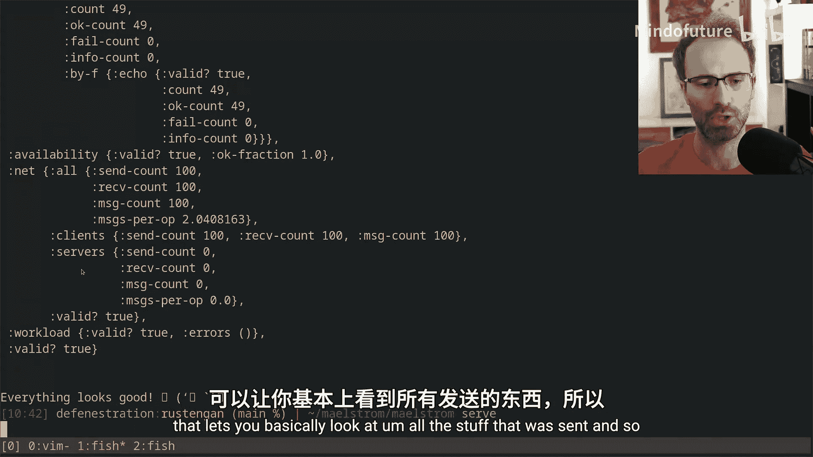

And so we can look at here this execution of echo， and we can look at all the messages that were sent。

 We can look at the latency for echo。The rate， the throughput rate。

 we could look at all the messages that were exchanged in between which nodes。

 So this is going to be handy for debugging and stuff later。 but for this echo server。

 is's not all that interesting。Okay， so now we have distributed system one done next is unique Is。

We need to implement a globally unique I generation system that runs again Maelstrom's unique Is workload。

 Your service should be totally available， meaning that it can continue to operate even in the face of network partitions。

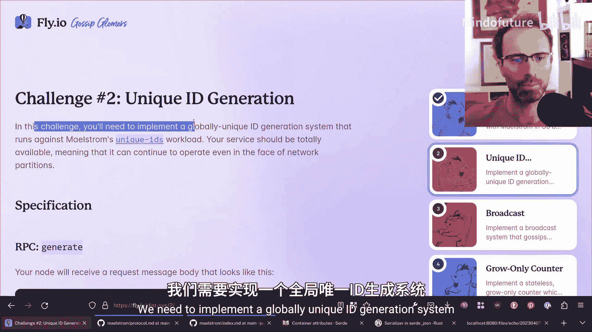

Okay， so here now comes to the next question of， do we want to tidy this up a little bit before we start generalizing。

 And I think we do。 So I think what we're going to do here is。Lpped Rs。

 and we're going to take all this stuff and move it over here。

And we're going to say that the payload here。Is going to be。 I， I wish there was a nice way to。嗯。😊。

I think the way that I want to do this， I want to see if this works。

I want to see whether I can do this。Yeah。That was where that might not be the case。嗯。

So this means that the payload needs to be fully defined by the。By the call。

 which is a little unfortunate， but it's okay。 So the payload here。Is going to be generic。

 And the reason it's okay to make the payload generic here is because the payload is entirely based on what node service youre you're implementing。

I'll commit the code。right， fine， fine。 I'll commit the code first。 That's fine。嗯。Get at。Actually。

 I want to get to ignore store as well， which is Maelstrom's thing get ignore the cargo files and source main。

嗯。So the reason it's okay to make message generic over payload here。

 remember I mentioned earlier that the problem with doing this is you need to know the generic type at the time of decralization。

 Now， if we， if we do that to all of if we say the payload here is all of the message types that are used by a given service。

 then we do know that a decentralization time， like the echo service knows that only echo messages should be exchanged in this particular messaging network。

So this should be okay。 What we can do is say。Strt。In it， just because we know what these fields are。

So this is going to be pub。This is gonna be pub。It's going to be pub。

 These fields are going to be pub。And this and this。 And this。

And same with the node Id and the node Is。And。Now， there are some things we could do here that are kind of interesting。

 which is we could。We could do something like， have a。Like pububstruct node。

That we implement on behalf of the the user， basically， which would have the I management。

 for example。The message ID management that is and would have mechanisms like reply。

I kind of wantan to avoid doing that yet。 I want to build a second service to see what it is going to need。

 first， the main loop here， though。I think is kind of tempting to expose。 I think what we'll do is。

And。So we could have a pub tray tier called something like node。Instead。

 and it is going to define the step function。黑ello。Baly。

And we're going to say that in order to implement main。And this main is maybe not。

 it's like main loop。U。And it is going to take a state。And it's going to take。

 it's not going to take a payload。And S needs to implement。Where S implements node。do。

And payload needs to implement DCize。The serialized owned。So that's going to be the main loop here。

And we're not using baille anymore， we're not using right。

So now we have a main loop that echo can reuse and。

 and we can make changes here so that it doesn't use a step function， for example。

 But if we now go back to。Cargo Tommel， what I want to do here is to say there is now a bin。

 Actually， it doesn't。 We don't even need to do this。 We could do get move actually。

 we can do make their source bin， and then we can get move source main to source。Ben E dot Rs。

And then we can go over here and say this is going to use Rutgan star。So now， 17。呃。Imple state。

 no I node for echo node。People node payload。Freco。This can mostly stay the same。

 and our main is going to be just a main loop。And pass in。This。

So now we've split this up a little bit。And at least in theory， this， if we now run Mielstrom again。

And instead of Rostgan， this is not now going to be echo。And hopefully， this should still just work。

 We haven't really changed anything。Will the in it and echo bit still be required to challenge two No in it I think will be required。

 In it is a global setup step， but echo is not。So now we have split out。Split out。Sharable parts。

And so now we should be able to copy echo to unique。Unique Is。And for unique IDs。

 we need to support a generate message。Generate。And we need to return a。

Generate O message with an I D。

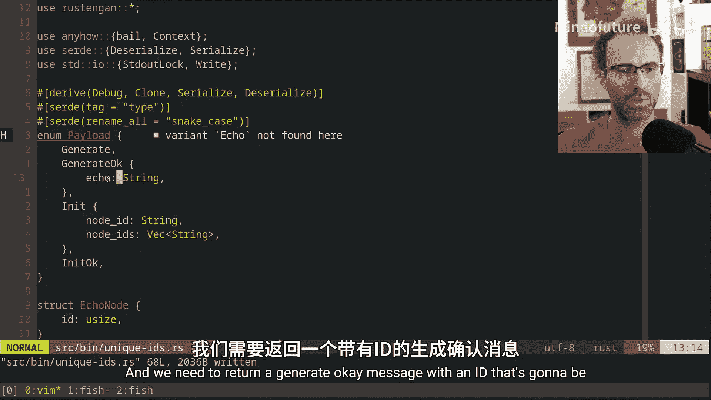

It's gonna be。

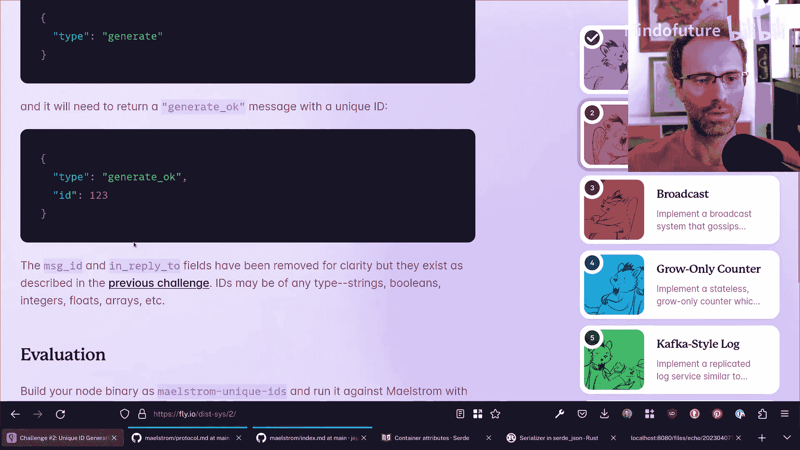

Oh， I Ds may be of any type strings， Boolean integers floats ors。 Okay， so realistically。

 it's going to be a string。ThatThere are a bunch of ways to do this， right。

 So you could run the full like consensus algorithm to decide what I D to generate to ensure that like you could run Paos basically to。

For everyone in the network， like for consensus in the network to or a quorum。

 really of the network to agree on what the next I that should be generated is。

 and then it could actually be an integer。The other way to do this is you generate a unique string and you make it unique enough that there just aren't collisions。

1 is very easy。 One is very slow and hard， but the very easy one is also more costly in terms of the Ids are going to be longer。

 There is also a somewhat higher risk of。Of collisions。

 but that all depends on how you generate the IDs。um。But let's。

 let's see if we can get by with the unique generation here。 So this is gonna be unique node。

Unique note。It's going to for the init message， we still have to respond。For the generate。

Message and then。Generate， okay。We actually want this here as well。

Or this is another one of those where I don't think our nodes will actually receive any of these because we're not sending any of the generate messages。

 but it doesn't seem like a problem if we get one。Okay， so if we're told to generate。

 we need to respond with a generate okay， which is going to need to have an ID。Which is really like。

 I D is not really the right word here。 I actually want this to be G U I D。

Because it makes it a little clearer in our code that we don't have to refer to the ID everywhere。

And so when we generate this back。We're going to have a GUI。And now the question is， okay。

 how do we generate this G I D， This is server response to generate。So that's the missing part here。

And then this is going to be。Unique node。Okay， so how do we generate the GUI， Well。

 there are a bunch of different ways if you go look at something like。The U ID crate。

U U I is sort of the the standard way to do it。 The U I is a little nicer because it's lexographically sortable。

 which doesn't really matter most of the time。 but it has the nice property that the the the identifiers that you generate。

Have the time field appear earlier in the struct。 So if you sort them。

 they end up sorted by the roughly the time they were generated。And the， the the U L ID。

 I wish they had an example of this in the docks。 but it looks like this。

Where part of it is a sort of header， if you will， part of it is a a times stampamp in milliseconds that gets turned into a string。

 and then part of it is。The is like randomness at the end。Now， the question is。

 is it random enough unclear。 Yeah， see here randomness bits。 So you see。

 it's a timestamp that's encoded using letters and then randomness。And so at least in theory。

 we could use this。 It is true that like this is not guaranteed to be globally unique。

 but it's close enough。Aren't we supposed to use the info in the init message to set the node ID， No。

 let me do the U ID thing first， and then I'll explain。嗯。So you will ID new。t2 stream。

So the question was， shouldn't we use the info in the init message to set sell the ID inside thestruct。

 And the answer is know that this I is really the message I， not the node I。

 We could arguably have named it as such， but its it's the I that we assigned to each outgoing message and the requirement from Maelstrom is that the message I is locally unique。

 so it has to be unique for any node that's sent from this node。

 for any message that's sent from this node， it does not need to be globally unique。

Think of it as a sequence number。And so this is something that we just have worked locally for the node。

 and then we increment it every time we send a message。嗯。

You're guaranteed that the message IDs are unique so you could use those。嗯。That's also true。

 We do know that the it's not even the message Ids。

 It's the combination of the node I and the message I is guaranteed to be globally unique。

 So that's the other thing we can do here。 if if if we assume that the overall system never reuses a node identifier。

 then let me let me do this first so we can test it。 And then I agree with you。

 We could just do this much easier。 But let's let's try this first。

I just want to see the U ID actually passes。So， this is gonna be。the。This big。

And this is going to be。Target， debug。Unique。It is。Yeah。

 so here you can see all the unique ID that are being generated。

You see there's a bunch of randomness， and you can see the time stampamp at the beginning here keeps clocking up。

And I would be surprised to learn that these weren't actually unique。

The proposal that came in chat is a good one。 Like what I just said was the message I is guaranteed or we need to guarantee that it is unique per message from a given node。

 So within a node， you never generate the same I twice。And separately。

 we know our own global node I D， right， N1， N2， N3， et cetera。

 And that combination necessarily has to be globally unique。嗯。And so when we respond to that message。

 right？This generated Id could just be the combination of our。Our node， node I D and our message I D。

 because like that combination is always guaranteed to be unique。

 So let's first see that this looks good。 Okay， everything looks good。

 And then instead now of using U I D。We say this is going to be format。嗯。

Self dot node and self dot I D and self dot node， we haven't stored yet， but we're gonna say here。

Noe is going to be a string。Now， really， the state here should be constructed from in it。

 if we wanted to make this。A little bit more reasonable。U。From in it。

So this is going to take an in it， and it's going to return a self。

I can return and anyhow result self， that's fine。嗯。

So where self is sized tiers is saying that this method cannot be called with dynamic dispatch。

 which is fine。We're not expecting to use dynamic dispatch here anyway。

 And so now the state here is actually not going to be passed in。Now， the downside of this is。

The downside of a constructor like this is that its it gets pretty annoying to write code where you want to construct parts of the state in advance。

 And then the rest of it when you get to from in it。

 because from in it does now in a trade definition。 So or your your impulse of the trade definition。

 And so it doesn't have access to any state that might have been set of previously。

 there is a way around this， which is to say that this is generic over some S。And you say that。呃。

爸爸ババ宝。嗯。So this would have to be S。And then you say here。That。N implements node of S and payload。

 And then you do like， this is the in it state， which is going be S。And when we construct it。

 we do let mute node is going to be。Noode from in it。But we can't use the step function for that。

 It gets a little annoying。 Alright， fine， let's， let's leave this the way it was the。

 the thing I was about to say was constructing this node from in it here。

 you can then pass in the in it state， right。And then you would also pass in the data that you get from input。

The place where this gets annoying is， first of all， you。

 you can't reuse the step function because the step function is called on a node and you haven't constructed the node yet。

 But you need to call the。You need to Oh actually， no， you don't。You can just get the input。

We need to get at the input message， but in order to get to the input message。

 we need to deconstruct the message， which is generic over payload。

 and the in it is inside of that payload， But payload here as a generic。

 So we don't know how to get at the init variant。 This is one of the reasons why it would be nice to have payload be a sort of combination inum where we define some of the variance in the library。

 And the remaining ones are defined by the caller through generics。um。But。嗯。I guess。

One way we could do this is， we could say。嗯。Extract in it。And say， here。This has to return。And in it。

So the node needs to tell us。Actually， we could do this on payload now that I think about it。

 we could have a a separate trait， which is。Payload。And what that has to define is extract in it。

Message self。 And it has to return an in it。And I guess we could say option。

And then we panic in our code when we know that it should be。嗯。

And this is also going require to be sized， because it names self。嗯。Because now， if we require that。

I guess I'll make this P so that we don't have overloading here。 So P has to implement payload。

And so now we should be able to say， well。We know that the very first thing that's going to happen is in it。

Inputs dot next， dot unwrap。Or expect， I guess， I suppose， saying。No init message received。

I guess we could really say init message should always be present。m。And then we can now say。

P extract in it。There should be no self here。Extract in it。From that init message。

 So this is really the init message。So extract in it and expect。First message should be in it。

And then， we can call。From in it。With that in it。 and now we have a node and now for all the remaining ones。

 we can call the state machine。No， next exists。This also has to have a this might fail decization in it。

Message could not be deized。And this should be P。呃。And this from minute it we allowed to fail。

 node initialization failed。And then I guess we don't actually need to pass that message on。

 We can send the init response here now， too。So the in it O。嗯爸爸爸爸爸。

So that's the other thing that we want from payload is in it okay。Which should generate a payload。

Should generate a self， I suppose。嗯。And this again。

 is the reason we need these two is because we don't have insight into the enum variance of the payload and we need the the in it and in it okay ones。

 And this is why I wish we could pull it out。 So now we what we should be able to do is in it okay is P again in it okay。

And we should now be able to construct a reply message。Oh。

 we're going to have to increment the ID too。It's pretty annoying， isn't it。

This is actually going to take a self。And we're going to pull out just the payload because the other fields we're going to want to use here。

In it。到。Destination source。 swap those。Right， fine。This is the in message。

So this is just us generating the init reply on behalf of the。Dundererline no。 Now。

 this idea is going to be a little bit annoying。Because。I guess we could just say。

These should always start from one。And this is definitely going to come back to bite us。

 but we're going to do it anyway and say that the zero is reserved for this in okay response。

In it message， body I D。 And this is the in。G ended it okay。

And we're going to require here the P is payload and also serialize。Great。And it doesn't like this。

 because。Cannot borrow inputs as mutable。 That's fine。Okay， so to talk through what we just did。

 So we changed the main loop so that it will now also handle the input message by reading the first message from standard in。

嗯。Pasing it as a message payload and payload here is a P， like it's a generic。

 Then we use the implementation of the payload trait on P to extract the just the init information from the payload from through the sort of variant inside of payload that the consumer of the library is using。

And then we pass that initialization into the node initialization step。😊，Which gives us back and end。

 which is the the node implementation that the user of the library is using。

 Then we generate the input okay。 And there too， we need to。

Rely on the implementer of the payload trait to tell us what that variant is。 We write that out。

 and then we do the normal operations。um。So now if we go back to echocho， for example。

 this should make it so that we can implement。Payload for payload。This is probably gonna yell at me。

 right， This is gonna be。Rting gun payload。And extract in it here is going to be。We can use let else。

 let payload。In it。And now this， I guess， can be rusttone in it。Equals input。elselse。Return none。

And there would do some。And we could do this even nicer， actually。I suppose we could do iflet。

 I like the let else。 We could do this as an iflet， instead。And gen in it， okay。

 is gonna be payload in it。 Okay。 So it's a pretty easy trait to implement。

 This is what the implementation is going to look like for basically every。Every case。Oh。

 my chat did not catch up， Let'sy。뽀뽀뽀뽀뽀뽀뽀。You can just set up the state on step when you receive the in it。

 Yeah， so， so the whole reason why I got into this business is for unique Is。

We want the node ID to be a part of the state， but this field we only have access to once we receive the init message。

 And so if we wanted to set up the state before we get the init message。

 the node now has to be an option。Because we don't know whether or not it's been set yet。

 But in practice， the way the system works is we know we get the init message first。 So in practice。

 node should never be none by the time we get to handling any message that's not in it。

 And so that hence， all of this setup up is specifically to avoid that option。um。

I don't know why my interview with Prigens no longer on YouTube。 That's weird。嗯。

Does the node need to know about the ended message at all。

 It could be handled by the message loop entirely。 This is where it gets tricky， because。In theory。

 it could。 In theory， we could deialize out without using the message type at first or with with using our own message type。

 And in fact， that's not a bad idea。 It's a little weird， but it is doable。So if we go to Lib here。

 right， currently， we construct this， this stream decizer and the type of the things that yields include this generic parameter。

 What we could do instead is first decalize a single thing from standard in。

Which where we use our own concrete enum type instead of P that just holds in it。 In fact。

 maybe that's the way we should do it。 It's not a bad idea。 And then we construct this。

 this stream desizer only after we've handled in it。I like that。 We can do that instead。

 Give me a second。 I'll I'll do that。 I'm just catching up a chat。呃。In case of restarting the node。

 you will generate the same I。 It means the idea is not unique anymore。

That is the downside here that if nodes can be restarted and when they restart。

 they have the same node I。 Then， yes， it's a problem。

 That's already a problem with the way that we generate Is here， though。

 So the assumption here in this system is that if a node were to restart。

 it gets assigned a new node I， it doesn't reuse it its existing one。嗯。Okay， let's。

 let's ti the this up some more。 So instead of doing this。

 we're not going to construct inputs until down here。 And instead， what we're going to do is。U。

We're gonna do。In it。Message is going to be30 Jason。From reader。Standard in。

And then we're gonna do in it message。This。And this is now going to be a message。

 and it's going to be。And in it。 And now in it doesn't even need to be pub。

What we're instead going have to do is。Do this。In it to payload。

And now I don't I actually even think we need in it to be its own type。

 We could just have it be like this。We're not going to need the payload trait anymore。Oh， actually。

 I think we do want in it as its own type just so we can pass it to the constructor here。

But we aren't going to need the pillowed trait。And instead。

 what we're going to say is and we don't need to implement serialize either。嗯。

So we're going to say is we're going to construct a message where the payload is in it payload。嗯。

And then we're gonna to say。And here we can do the left else， let。In it。Payload knitt。In it。

Is equal to this。Es。Pnic。And this response now can be in it payload。And it' okay。

And then down at this point now， P no longer needs to include in it because we've handled in it previously。

 So this means we're decsalizing using two different types。

 but I think that's fine here because for the first one， we know it should be in it。

This now should indeed be pub， but it doesn't need to be serialized。Oh fine。Great。And now。

 if we go back to echo， these can go away。This implementation of the trait can go away。

This doesn't need any state。 So we can do from in it of。State and in it。

Which returns an anyhow result。Self， and that's just going to be okay。

This is going to be one of those。And it doesn't use the state。And it doesn't use in it。

And now this can't possibly receive an in it message or an in it okay。

So it doesn't need to think about them。And main loop now is just going be。呃。Echo node。

And no initial state。That does look a lot nicer。And if we go to unique IDs。

 it should have the same property that we can get rid of the init bit here。

The initial state that we care about is just going is going to be empty。 There's no。

 there's no context from the surrounding environment we want to bring in。From in it。

Is going to take an in it， And it's going to return a unique node。Where the ID is one。See。

 it almost bits already and the node is in it dot node。Or node I。There's no longer an in payload。

 There's no longer an in O variant。 Main loop is going be。Nothing followed by unique node， nothing。

And no initial state。And I messed up my。Thing here。And this is going to be always okay。

And we don't use state。And we don't need bail。 That is a lot nicer。Right。

 so now the the way we got here right is that we want the unique I generator to use the node ID and the message I combined and now it knows the node ID。

 and a notice there's no unwrap here。 the node I is always set because it's set as part of in it。嗯。

We're still inverting the source destination， no IDs in the response。

Inverting the source destination node Is in the response。Yeah， I mean， that's。

 that's what we want to do， right， because it's a response。嗯。Okay， so let's see if this builds。

 Let's see that echo still works， too。嗯。That doesn't seem very promising。Well， we broke something。

Expected node and 0 to respond an init message， but the node did not respond。嗯。

What do you mean it did not respond。Why。Why didn't crash with anything as far as I can tell。

I guess we can do cargo arb and echocho。And just send in。That's fine。 Show me one of these。In it。

 messages。So I can copy paste it。Oh， okay， fine。This is going to be source。 Its going to be。

 I don't know。 C1 destination is going to be N1。 body is going to be。This thing。

Source is going to be C1。Destest is going to be N1。Body is going to be this。

It doesn't print the response。 That is certainly true。Oh， I know why It is because。This from reader。

Weaiits for standard in to be finished。 It went for end of end of file， not for new lines。

 So we're actually going to want to construct a。呃。Stream deserilizer here。嗯。Into iter。Message， knit。

 payload。呃。Dot next。Don't expect。No， first。No innate message received。

So the difference here is that when you use the stream decizer。

 then it stops it checks whether it can decalize at the end of new lines rather than just at the end of the file。

It is true that we could like someone's made the point。

 I think Gals made the point in chat here that like。

Since we know that the format is new line separated。

 we could do better here than the sort of guessing decr， which is what the stream decilizer here is。

 because it doesn't know until it's parsed， whether this new line is the termination of the object or just something in the middle of the adjacent object。

 So this one's a little bit more costly， when we know that the format is actually stream based。

 you know， So so one way that we could do this instead is。Standard in is standard in dot lines。Right。

 and then we could。De serialialize each line at the time instead。 And maybe we should just do that。

 It's not a bad suggestion。So in that case， what we do is standard in。Dot next， Dot expect。And。

And then， we do。From， I forget what lines gives you。I think it's I think it gives you a stir。嗯。

And this would then be message in it payload。Cont， because here。Faaiil to read from Stan。

Faied to read in it message。From standard in。Consider borrowing here because this gives me a string。

That's fine。So what we're doing here instead we're splitting by lines and then we're just straight decalizing the entire string of a line。

 which we know is going to be exactly one message。 and then we can do the same thing here or we can continue to use the decilizer。

 but let's do four line in standard in。That line is line on context。

 and I guess we can reuse most of the same context here。It could not be red。And。And then， we do。

30 Jason， from string line。And this now is going to be message P。And we don't need this mute。

 That's true。So the code difference is fairly minimal here。

And now it's going to yell at me if I do this。 so I'm going to。Make it all online line。Yeah。

 and now we get the response straight away。All right， let's see that echo still works。啊。

That looks promising。Great， everything looks good。 And if we now go to the unique I one。

Make sure we build all the binaries。See what it does。That seems promising， I mean it's you know this。

It is generating exactly the string we wanted it to generate。And those will be globally unique。Again。

 as someone pointed out， though， only assuming that node Ids are not reused when nodes restart。

Amazing， everything looks good， okay。嗯。Actually， I want to。Move in it logic into main。Into lip。

And then， add。Add solution to unique Is challenge。Okay， next challenge， please。

Continue on to the broadcast challenge。 Okay， single node broadcast。In this challenge。

 you'll need to implement a broadcast system。 The gossip's messages between all nodes and the cluster。

 gossiping is a common way to propagate information across a cluster when you don't need strong consistency guarantees。

 This challenge is broken up in multiple sections so that you can build out your system incrementally。

 First， we'll start with a single node broadcast system。 That may sound like oxymoron。

 But this lets us get our message handlers working correctly in isolation before trying to share messages between nodes。

Your node will need to handle the broadcast workload which has three Rps message types。 broadcast。

 read and topology。 Okay， let's let's start encoding this so。

We're going to say unique Is into broadcast。Broadcast， that's fine。And this is going to be。

Broadcast node and the payloads we'll get to in a second。So broadcast node， broadcast node。

 this can just be self。嗯。Great， so there's no longer a generate。 There is now a broadcast。

There is a read。And there is a topology。

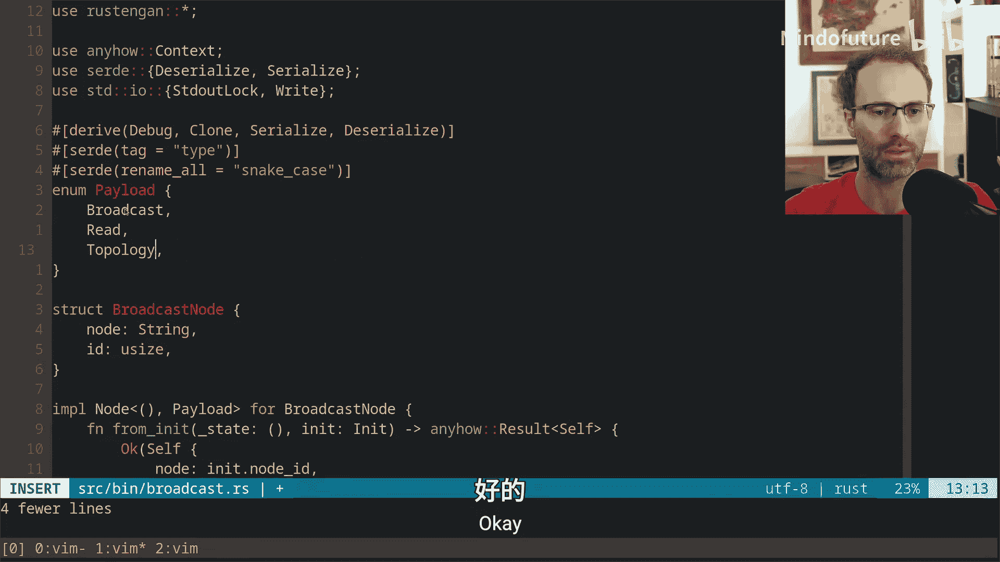

Okay， your node will need to store the set of integer values that it sees from broadcast messages so that they can be returned later via the read message R PCC。

The goal library has two methods for sending messages。

 Ss a fire and forget message and doesn't expect a response As such it doesn' it does not attach a message。

 I D。 R PCC sends a message and accepts a response handler。

 The message will be decorated with a message I D。 So the handler can be invoked with a response messages received。

 Okay， so this is starting to look more like a sort of。Service。

 like we actually want an abstraction where I can send a message and attach attach a closure to it and that closure gets called when we get a response to that message。

Which is interesting。 I mean， that requires a little bit more mechanism in our library。

 If we actually want to support that kind of callback mechanism。Basically。

 there are two ways to handle systems like this。 One of them is。

You have an interface for doing I get sending a request and attaching a response handler。

 The other is to say it's just a flat state machine。 So when you send a message。

 you might record in the state machine that you've sent that message and then you need to do something。

 but really you're just updating the state machine to now be in a state where it expects a response。

 And then when the response comes in， it's just handle by your step function saying， well。

 I got this response， what do you want to do with it。

 And so there's no there's no closure being called。

 you don't register at the time of sending the request what to do in the response。

 you just encode it as another step in your in your state machine。And these both have merits。

 they're a little bit of a different programming model。

 I want to try to see if we can stick with the state machine here。

 but we'll see if it gets too annoying。It might also be that we need to turn all of this async。

 we'll see a little bit how it pans out， it might not be necessary。

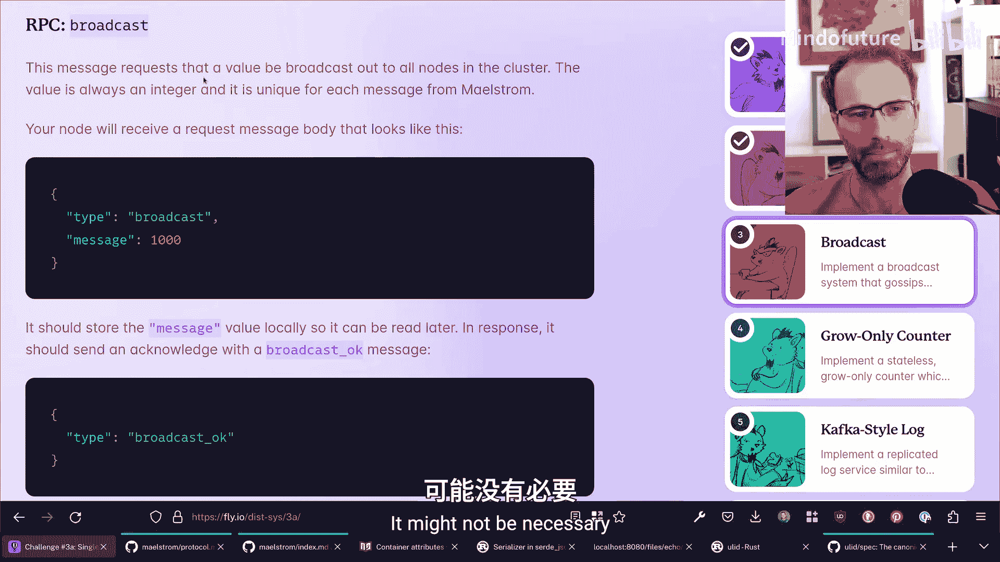

嗯。This message requests that a value be broadcast out to all nodes in the cluster。

 The value is always an integer， and is unique for each message from Maelstrom。

 Your node will receive a message body that looks like this。Okay， so a broadcast。Has a message。

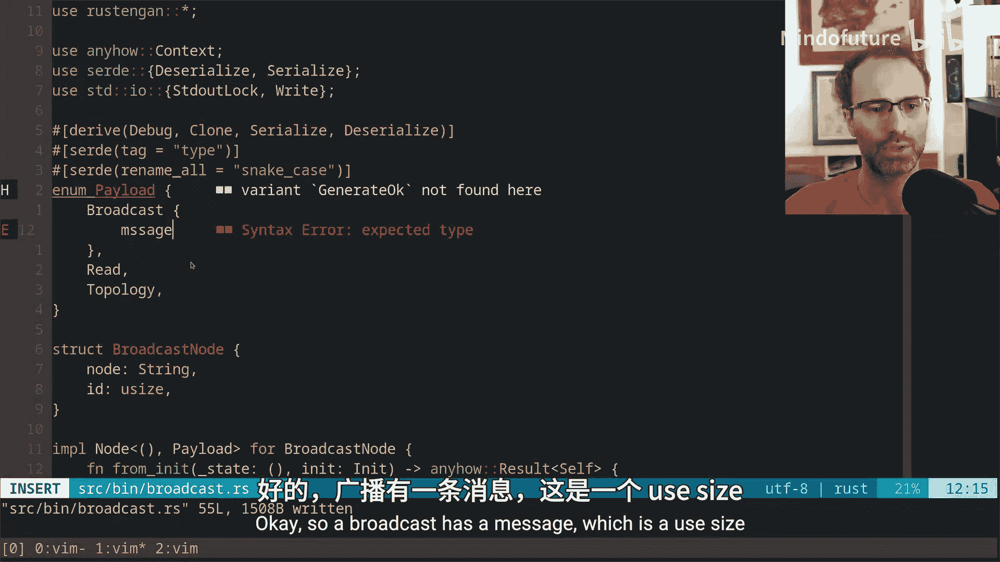

Which is a u。It should store the message value locally， so it can be read later in response。

 it should send an acknowledgecment with a broadcast O message。 Okay， so there's a broadcast， okay。

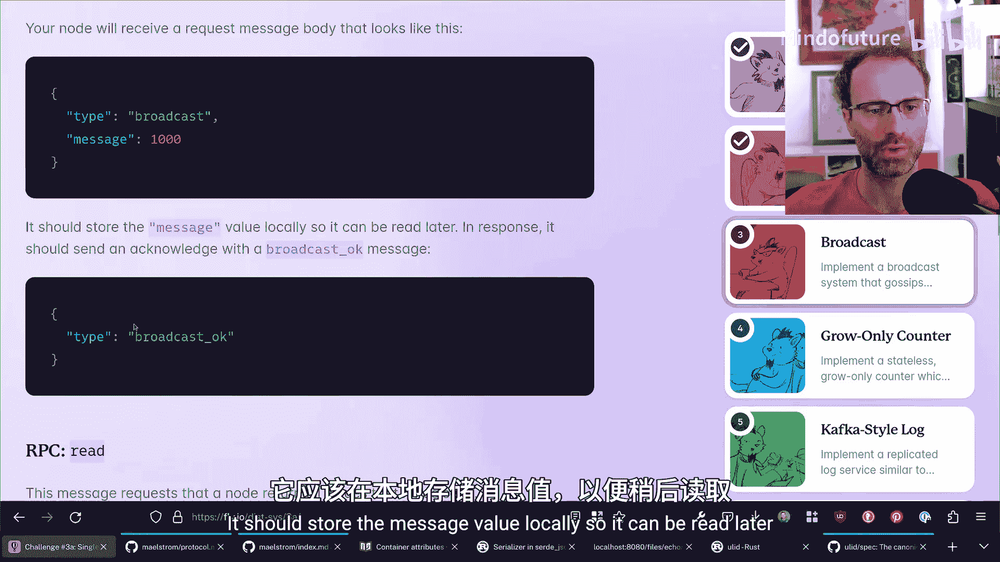

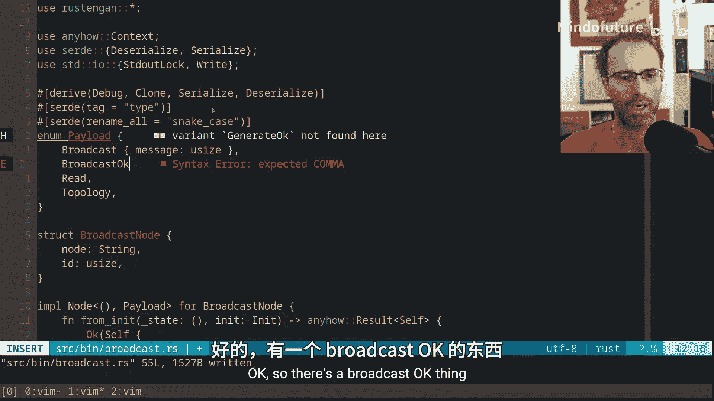

Thing。Read this message request a node return all values that it is seen。 Okay， so theres a read。

 and then there is a read O， and the read doesn't actually include any data。 The read。

 O returns all the messages。

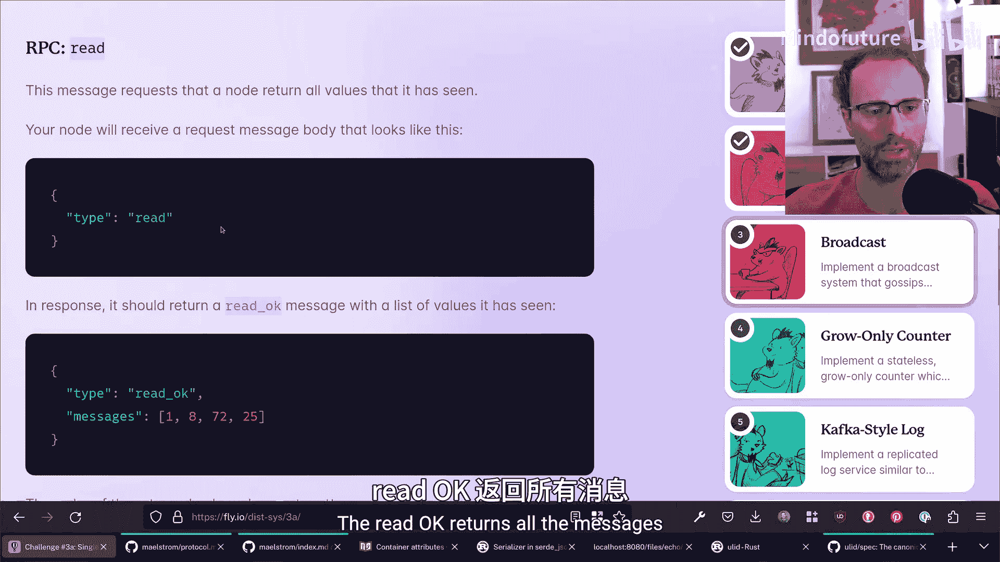

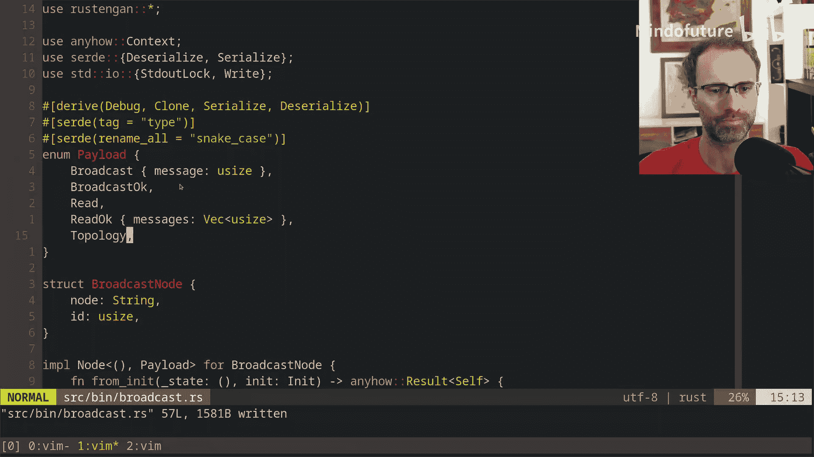

The order of the return values does not matter，It could be a set， I guess。

 given that we're guaranteed that the messages are unique。

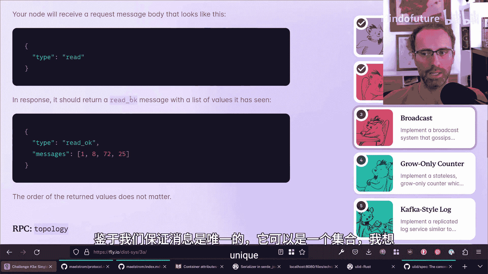

嗯。Tology， this message informs the node of who its neighboring nodes are。

 Mailster has multiple toppologies available， and you can ignore this message and make your own topology from the list of nodes in the node ID method。

 All nodes can communicate with each other， regardless of the topology passed in。Lu。Interesting。

 okay， so topology。Informs us of the topology。 and it is a hash map。From node。To a V of nodes。

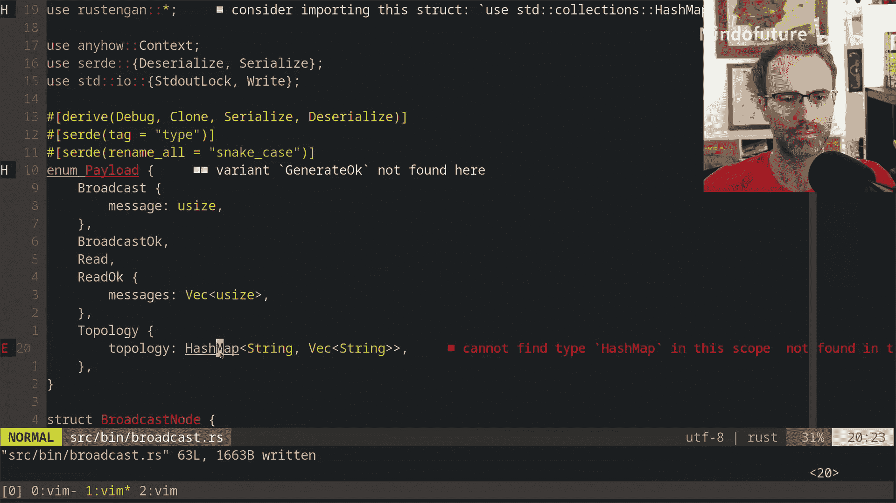

In response， you should return a topology okay。

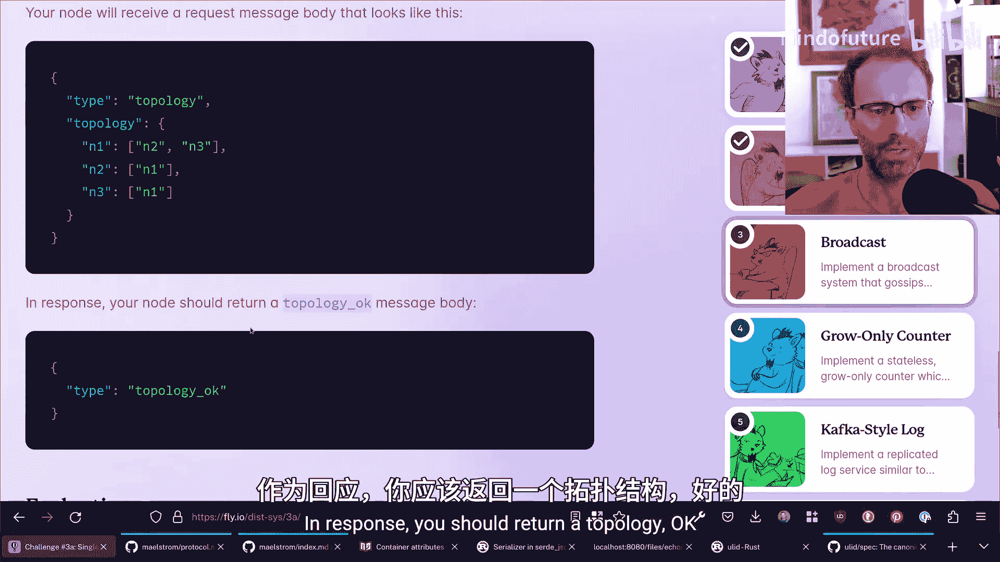

Tology， okay。

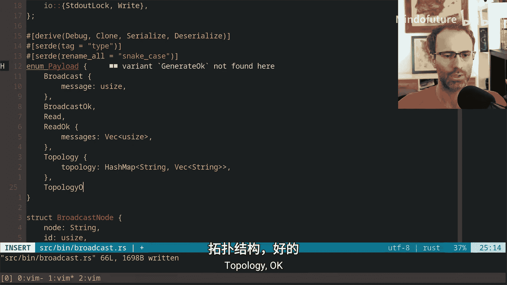

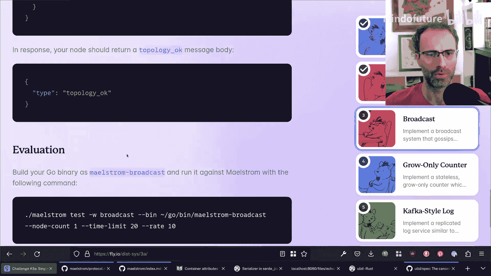

Alright， so， I mean， the， the setup for this is pretty straightforward。 but。

 we don't E we might need the note I D。 We're gonna need the message I D。

And then we're going to want a messages。Which is a v of u size。嗯。And so， initially。Messages is empty。

When we get a broadcast。With a message。Then we're going to send a。Broadcast， okay。And here， you know。

 we could easily say， we want to make it easier to construct something like this。 right。

 So one of the ways to do that would be to say we have a。We had an associated method on message。

 which is like prepare reply， which does， just does these bits。In particular， it inverts these。

 It sets the I D to one that's passed in if you have one。And it sets in reply to as necessary。

 So let's， let's go ahead and do that。 That seems like a potentially useful thing here in oops。

In Lib， over on message。Imple message for any payload。 This should be payload diagnostic。

There is now a reply。Which consumes the message。I want to say it consumes the message。It。Well。

 unclear whether that's what I want， actually。Into reply is nicer。

The Id is going to be an option to a mutable reference to a use size。

Because we want to increment the ID whenever we prep this reply。And。I think that's all we want。

We could say that like， this also takes a closure that maps the payload。嗯。

But I don't think I want that here。 and it returns itself。And what it does is exactly this。嗯。Now。

 it doesn't actually need to construct a new self。 Techically， we。

 we could just set the fields instead。um。But I actually feel like this looks nicer。嗯。Edi Donnatiif。

Fine I D map。MID。M ID。And the response payload。The question is whether it should leave the payload in place。

I guess maybe you can just take the payload。But I think what I want here is I wanted to return。

What I'm thinking here is I kind of want to be able to take the old payload out。And return it。

 like I sort of want to be a swap of the payload。U。And the way to do that would be something like。

Actually， no， I think this is actually what I want。 I want to not take the payload in。

 set the same payload for the reply。And so now this is going to be no， that's not what I want。

 I want bin。Broadcast。You drinking？You're very loud drinker。The cat was drinking。 She was very loud。

嗯。So when we get a broadcast here， we should be able to say input dot into reply。嗯。

And we should be able to say。So this is why that won't work it's because。

We're already consuming the payload here。 So I think what I want is。嗯。I guess in some sense。

 what I want is like memory replace。The payload。With a payload that is going to be empty。嗯。

But I kind of want what I replace it with to depend on what's in there。嗯。😊，唉。

There's a couple of ways we could go about this， right， like we could say。Rely payload。

I don't want to do that either。The other way to do this is actually。 now here's what we do。

 We do let。Reply is input dot into reply。Soft type。And then we match on the reply payload。

And then we say， reply， dot body， dot payload。Sこ doです。Boom。Beautiful。That's pretty nice。

And then we have to do the same thing for。Read， although read doesn't take any arguments。

 and we have to do the same for topology。Chs a topology and。We ignore anything That is。Broadcast， O。

Read， okay。And topology， okay。An topology O case also this。 and we can just。

 they have the same handler。Oops。Okay， so here what we want is self。Self dot2 do to to do messages。

 dot push message。嗯。For this， we want to read O。Where messages is self dot messages dot clone。

And topology， I guess we're doing nothing with at the moment。

Except responding with a topology okay message。And we can ignore this field for now。

And we're not using the node at the moment。 That's fine。

 I I suspect we're going to start using it once we need to know what our neighborhood is， right。

 This is single node for now。 And so there's no need to know yourself or your neighborhood。

But I think we're going to need it next。Alright， let's see what you get here。So I want maelstrom。

And I want。Target， debug broadcast。Why is the I optional， I D is optional because。

For messages where you don't expect to get a reply。

 there's no need to put an idea on the message in the first place。

Because there's no need for the other node to identify the message it is responding to， that said。

Usually in these systems， it's valuable to put an ID on messages regardless of whether you expect a reply because it can help with things like item potency。

 So the recipient， let's say you end up retrying a request。

 The recipient can tell whether a message is one that it's already seen by looking for two messages that have the same ID。

So usually even for broadcast messages in a real distributed system。

 you would often assign the IDese regardless of whether or not you expect a response。Okay。

 that seems to have worked。So， get di。I guess actually we could also now go back and。

Make these a little nicer， so let。Reply is input dot。And to reply。Some mute self ID。

And then we say here。Ply dot body dot payload。Is equal to。Yes。Does make things a lot nicer， isn't it？

And I guess we'll do the same here。Reply。Reply dot body dot payload。He squs this。Right。

 and this needs to be replied。Beautiful。And I guess just as a sanity check， if we go back and run。

Echo， which should still do fine。 Why don't you use。Match all， but list。The other variance。

 explicitly。Where？Oh， you mean here for the Os。 So I don't love doing this because I want to know if there are variants that I've forgotten to list。

Does that answer your question？I think that's what you're asking。So in theory。

 I could do this and just say， do nothing for those。 But if I， for example。

 added another payload variant， I want a compile error telling me I'm not handling that variant。

 which I wouldn't get if I had to underscore there。Everything looks good。 You're probably right。

 I am。 I don't need to increment it here because inter replyly does that for me。Totally correct。

ItDoesn't matter。 There's no requirement that they increment by one， but it is unnecessary。

 That is true。诶 okay。Let's do。Actually， what do I want to do here？Add message into reply。Helper。O。

So this is solve。Single node broadcast。

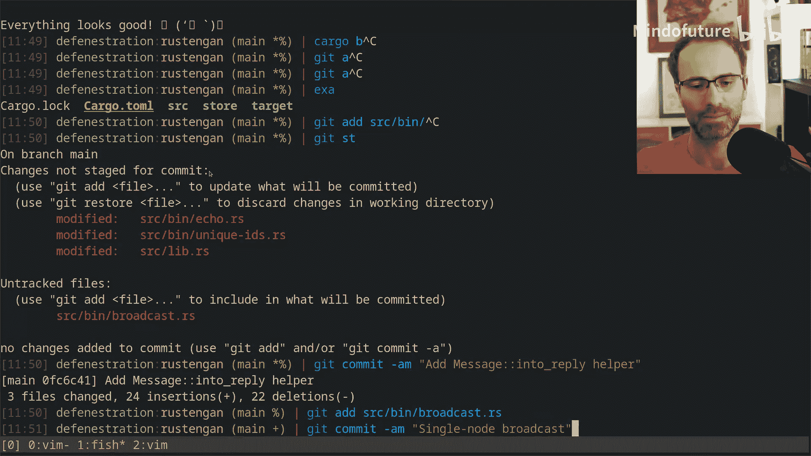

Okay。Bring multiode。Your node should propagate values it sees from broadcast messages to the other nodes in the cluster。

It can use the topology past to your node in the topology message or you can build your own topology。

The simplest approach is to simply send a node's entire data set on every message。 However。

 this is not practical in a real world system。 Instead。

 try to send data more efficiently as if you are building a real broadcast system。

Values should propagate to all of nodes within a few seconds。Okay， so the idea。

 the idea here is that every every node， every node in the system should know about every broadcast message。

 as what we're going to do is we're going to gossip them around。嗯。

If you're not familiar with gossip protocols。The basic premise of what we're setting up today is。

 let's say we have three nodes。And let's say that a an operation comes in here saying broadcast 34。

What we want is for 34 to be known to this node and for 34 to be known to this node。

 And the question is， how do we get there， Like， what messages do we have to exchange in order for 34 to to make their way over there。

 And one answer， of course， is that this node is going。

 it knows about all the other nodes in the system。 So it sends two messages。

1 to lets let's name these and one。And2。And， and3， it could send this message to every node in the system。

 The challenge with this is that it doesn't really scale。 Well。 Like。

 imagine you have lots and lots and lots of nodes。 You really don't want a system in which every node sends a sends a message to every other node anytime it gets a broadcast。

 So instead， there's this notion of a broadcast of gossip。

 The idea with gossip is that rather than every node。Sending a message to every other node。

 What you do is。And see if I can make this。that's all much。嗯。So instead， the idea is that you take。

I don't want that。You take your node and you have every node。

 have a topology that tells it about its neighborhood。

 and the neighborhood you can define however you want。 It could just be pick two random nodes。

 That's a valid neighborhood。 The neighborhood could be the nodes that are closest to you in terms of network。

 right， Like the ones you have direct network links to， for example。

 There are all sorts of valid ways to define a topology。 But let's say that we， you know， this one。

 that was that's very big。 Let's make that smaller。Let's say that the， the topology of。

This node is this and this and this。Now note that topologies do not have to be symmetrical。

 so it doesn't have to be the case that just because N let's say this is N6。

 it doesn't have to be the case that just because N6 is in N1's topology。

 that n1 is in N6 is topology， it doesn't have to be symmetrical and so instead it could be that N6's neighborhood is actually you know includes N2 for example。

What happens， though， is。When you do gossip is that you send the message to everyone that you gossip to。

But you don't send it to anyone else。 They are going to gossip to their topology。

 So N 6 might send it to this one。 So it might send it to a node that's already received it。

 but it might also send it outside of the previous set of the topology。

 And then this node is going to send it to here and here。

 Maybe this node is going to send it to here and here。

 this node is going to send it to here and here。 And as a result， that 34 that came in over here。

 is actually going to end up propagating throughout the system。 right。

 because it's going this 34 is going to first go here。 Then it's going to go here。

Then it's going to go from there to here and to here and from here to here and from here to here to here。

 So this note is going to hear about it last。 General。

 if we assume all these hops are roughly the same latency。

 But they will all eventually hear about it。 And， of course， this is。

 this is true for any set of any set of toppologies。

 as long as you always have at least one link from one node to another one through transitive closures。

And it should also be the case that no matter which message you send the broadcast to。

 the broadcast will eventually make it to every node。

And so that's the basic essence of the gossip protocols。

 you regularly talk to all of the nodes in your topology to learn about messages that or in this case。

 messages to learn about data that they have that you do not。嗯ん。

So you can think of this more as a sink。What I drew here was essentially a sort of limited broadcast。

 like when I hear about a message， I immediately tell my neighborhood。

You don't have to implement broadcast or you don't have to implement gossip that way。 Instead。

 what you could say is you regularly gossip with the rest of your network。 So， for example。

 N 6 and N 2， every now and again， they're just going to talk together。

 It doesn't have to be the case that they do it immediately when someone has a new value。

 that might lead to a lot of messages。 Instead， you say every 500 milliseconds。

 nodes are going to talk to their topology and do a sync and a sync could be something like。Hey。

 I have these values。 Which values do you have。 And so you do a two way sync rather than a one way sink。

And you do it in a sort of batched fashion rather than do it in terms of single messages that you send。

And so when they sort of give this specification here。

 you'll note that they say values should propagate to all other nodes within a few seconds。

 And the reason why they say that， I presume is because you might choose to do scheduled gossip。

But once you do scheduled gossip， you run into this weird problem where once you have many hops。

 the time it takes for the 34 here to reach the note all the way on the right can take a really long time。

 right so。N1。Let's say that it receives the broadcast message。

 And then its next gossip window with N6 isn't for 500 milliseconds because it just did it。Okay。

 so it waits 500 milliseconds， and then it gossips with N6。 and N 6 just gossiped with its network。

 So N 6 is going wait another 500 milliseconds before it gossips again。

 And then you have the same for N 2。And that means that the time it's going to take for the value to get from n1 all the way to the node on the right。

 this one over here right is going to be 500 plus 500 plus 500 plus like the link distances of each one。

 So the latency of doing the sync itself。 So suddenly now you you're adding up to a bunch of seconds before the nodes at the edges of the graph actually have all the information necessary。

You don't usually run into loops here because， again， this isn't actually forwarding。

 What you do with gossip is you exchange information with your neighbors about data that one has。

 but the other does not。 So it's not as though like what's really going to happen is N 6 and N 2 every nowun and again are going to talk together and compare notes。

But it's not a blind forwarding。Blind forwarding is where you run into trouble with loops， right。

 where I get the message。 So I send it to you。 I'm in your network。 So you send it to me。

 and then I send it to you， and then you send it to me。

 That's where you need like T T Ls or something like that。 But a gossip protocol。

 that's's that doesn't really happen。 What happens is when I get a message。

 I contact you and or at some point later， I contact you。 and I say I have these messages。

 and it includes the one that I just got。 And you say， oh， I don't have that one。

 Please send it to me。And then our sync is done。 So there's no。

 I don't take any action as a result of learning this new value。

 except I'm going to gossip in the future at some point too and compare notes with my neighbors。

 So there's not actually a a forwarding in in the way that you might think。嗯。

And now there are a bunch of questions here like。When you do the sink。

 how do you do it in a minimal fashion， Right， So as they point out here。

The simplest approach is to simply send a node's entire data set on every message。 However。

 this is not practical in a real world system。 And， and， in fact， even in a non real world system。

 this gets problematic pretty quickly。 So let's imagine that we have。Let's imagine that we have。

Just two nodes。And there's all sorts of network that they have on either side。

 they get new messages over time。And now， let's say that。This note over here has the messages 24， 36。

 and 48。This one has 12， 13 and 24。Now， let's say that they have to do a sink。

 One of them decides that it's about time to do a gossip。And。This note， let's call them A and B。

So A contacts B and says， hey， I want to do a sink。So it's sending a message。

 What does it include in that message well。It can include all of them。 What am I doing。

 It can include all of the messages， right， So could say 24，36 and 48。And then B goes， okay。

 that's great。 Let me tell you about the ones I have。 I have 12。13。

 or let me tell you about all of the ones that I have that are not the ones that you have。

 So it knows to eliminate 24 because it's， it sees that a already knows 24。

So let's say that this is already an optimization， right， If we didn't have this optimization。

 it would say 12，13，24，36，48， those are all of the messages of Bhab。 but。

 but it can do at least this sort of obvious optimization of。

 I'm not going to tell you back the things that you have told me。So it sends 12 and 13。 Okay。

 that's pretty good。Now， imagine that， you know， let's again。

 let's assume that our our time here is 500 milliseconds。 So 500 milliseconds pass。

 and then they decide to do another sink。Or at this point， let's say B initializes a sink。

 So it doesn't have to be 50 millisecons。 It's just another sink happens。 And this time。

 B sends a message。 What does B send。Well， there's no message for it to reply to。 so it doesn't。

On paper， know what a has。 So the only message it can send is。12。1324，36，48。

 Those are all of the messages that B knows about。And then when a now responds， its。

 its response here is going to be， well， I don't know of any values that you don't have。

Because it sees all of these messages。 So it is now in the same position as B was previously of being able to eliminate anything that it was already sent。

But they just talk together。 So there's no need for B to send any of these because it knows that A already has them。

Right， because it knows that a sent these here and it knows that it sent a these here。 So there。

 there shouldn't be any need。 And so as a result， you run into this weird situation where B could remember what it has synced with a in the past and just not send any of those either。

 So now B needs to remember not just which messages does it have， but also which messages has。

 does it know that A has。And now we get into the sort of really wonky world of distributed systems。

So you might say， well。B here knows that all of these messages here。

 that all of these numbers are known to a， because a told it that it knows 24，36 and 48。

 And B previously told a that it has 12 and 13。 So all of these can be can be removed。

 B doesn't have to send anything。That's not true， though， because in a distributed system。

 what if this whole message got lost。So A send 24，36 and 48 to B， and B responds with 12 and 13。

 but a never gets that message。A doesn't know。 It could， in theory， detect that。 oh。

 I never got a reply to this message and then sort of tell B again。Alternativelyly， could just like。

 go， maybe it didn't have anything to tell me It's not going to send a message。 That's also fine。

 We don't even need acknowledgments here。The challenge is B can't assume that A knows 12 and 13 until it hears 12 and 13 from a。

RightAnd so therefore the only safe thing for B to send to A here is actually 24， 36 and 48。

Is the only thing to eliminate is these。 It still has to send 12 and 13。The question then， of course。

 becomes， well， how will B ever realize that A now knows 12 and 13？Right， and the answer to that is。

 well， a， when it does the next sink to B。It's going to say。You know， naively 1213。24，36，48。Quest is。

 what does it know that B knows。Well， it knows that。呃。It knows that B knows，12 and 13。

So it doesn't need to send 12 and 13。But。It doesn't know that B got this message。

 It only knows that B got this message if it gets B's reply。

So whether it can eliminate these depends on whether it solve this。

 So there's an implication here between these two。It is the two generals problem， right。

 like this is the problem of consensus is it is really hard to know whether someone else knows something if arbitrary messages can be dropped。

And to be clear， there is no solution to this problem。

 There is no finite set of messages you can send that ensures that these two are in consensus。

 If you allow for arbitrarily dropped messages， you cannot solve this problem， like does a。

There's a mathematical proof saying you cannot solve this with a finite number of messages。And。

The moment we know the messages are received。 you're fine。

 So you know when you're done or if there are no drops， you know when you're done。

The challenge is you don't know that there are no drops。m。So the question is， well。

 what do we do and the answer is really， this is all an optimization。Right。

 what we're doing here is saying we want it to be the case that if messages aren't dropped。

 then we're able to eliminate messages from the sync。 That's all。

And so it's O for this to be imperfect。 It's okay for us to send some extra values if some messages happen to be dropped as long as。

The recipient has a way to detect that it already knows something。 And in this case。

 that's fine because。The messages are all have unique ideas。All the messages in the system。

 like all the 12，13， 24，36 are guaranteed to be globally unique， and so as a result。

 we can just keep a set and so when we hear things from a neighbor。

 we just add it to the set and if it's already there， it doesn't matter it's a set。

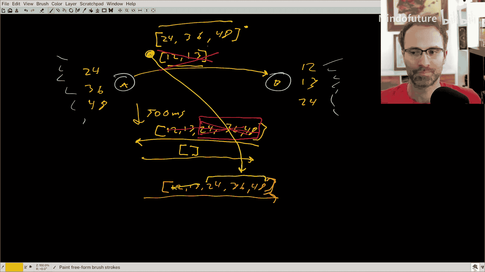

Okay， so how are we going to do this Well， What we're going to want here is messages is going to be a hash set instead。

And we're also going to need to keep some state about。嗯。Kown， let's see it known。

 This is gonna be a hash map。From a node， a node identifier to the things that we know that they know。

Right so this is going to be the set of， I know that N1 knows these values。

And the hope is that this makes things。This makes the gossip protocol be more efficient。And the。

 the real question is going to be， when can we add something to known。Okay。

 and one of the things that I suspect we're gonna have to keep here。Is。Something like a。Message。

Communicated。And I'll， I'll talk about what this means in a second。

You'll see why we need this a little bit later。Okay， so messages here is going to be a hashet new。

Known is going to be a hash mapap new。And in fact， in in it here。

 there's the assumption that we know all of the node IDs。

 that's not always true in distributed systems， right。

 it could be that new nodes are going to be added and removed。

 And currentlyly there's no support mechanism for that here。

 but we can actually do a little bit better here by saying we're going to do in it。Noode Is。

Intoter map。Into NID and hashet。And sort of pre allocatecate the hashets here。Coect。

And then message communicated is going to be a hashmap new for now。OK。

So now let's get to this step function。 broadcastadcast is gonna to be easy enough。

 We're just going insert the message。 Read is gonna be fine。

 We're just going to do self dot messages dot。呃。Actually， I think a set gets printed as a vector。

Let's just work under the assumption that it does。 I think it gets encoded as a sequence for Jason。

 So let's keep it a hash that。 And if it ends up with the wrong encoding， that's fine。

 we'll fix that later。um。Okay， so the topology is going to tell us about what nodes we want to communicate with。

 We know the total set of nodes， right， it's known to us by virtue of the the init field here that tells us all the nodes in the network。

 But realistically， we want something like a neighborhood。

And the neighborhood is going to be a e of U sizes， no a e of strings。

 which are going to be the nodes that we should gossip with。So when we get a topology。

We're going to say self。Dot。Neighborhood is equal to topology dot remove。Ourself。呃。Unwrap or else。呃。

No topology， given for node。Right so the topology here is basically a suggested topology of what our neighborhood should be from Maelstrom。

 If we weren't given one， we could pick randomly in this case。

 like we don't actually know the network topology， So we just pick some random subset of the nodes in the network of size。

 let's say two or three the challenge with doing it randomly is you don't actually know that you end up with a connected graph you could。

 if you pick randomly end up in a state where。

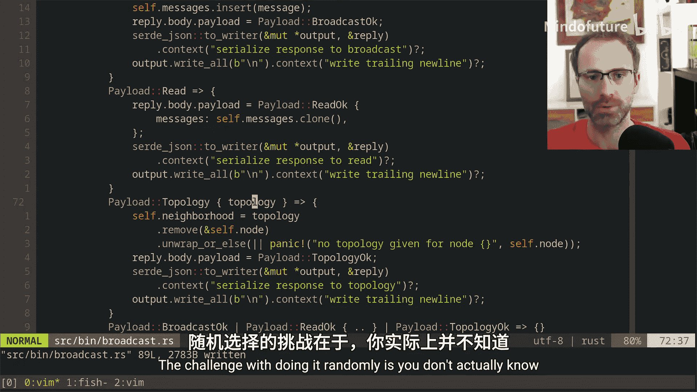

Purple。Let's say that these are the nodes in the system。

 and let's say all of them choose their neighborhood randomly。

 but they all choose at least two nodes。Okay， so this one picks a neighborhood that's here。 right。

 So one picks this one。Two picks the same one。3 picks the same one。

I need one more node in the system for the problem to be apparent。Whereas these。This is4， this is5。

 and this is 6， and 4，5 and 6。 I'll pick this neighborhood。Well。

 now there's no way for the gossip to disseminate broadcasts from the left to the right or right to the left partition。

 This is what a network partition ends up being。 In this case。

 it's really more of a node partition because the network there are network links here we're not just not using them and this is where you get into like there are solutions to this problem。

 such as the number of nodes that you choose is one more than half of the number of nodes。

 So if you required every neighborhood size to be of at least four including yourself。

 So three additional nodes， then there must be an overlap here。

Now the overlap might only be in one direction because depending on how we do sync。

 so if sync is just I send you my stuff and not a bidirectional sync。

 then you still end up with partitions here， but if it's a bidirectional sync。

 then one of like the nodes in 456 have to include one more node。

 which means there's no way for you to end up with a partition。

 because there's always going to be overlap between the circles。Because here there are six nodes。

 So if every partition contains four nodes， you can't partition the network。

 There's always going to be overlap。 So here you end up with two clusters。

 But if you change the rule for gossiping to be a broader topology， you don't have that problem。 Now。

 I'm going to assume that the topology that we're given from Maelstrom is one that's guaranteed to be connected if that if that's not the case。

 then we have to basically compute the topology ourselvesse in a smarter way。

 but let's assume that it is for now。

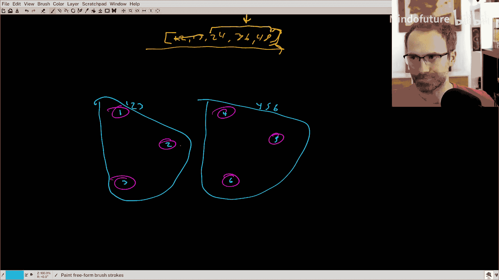

嗯。Okay。So the neighborhood is going to tell us that the topology， read and broadcast are easy enough。

But there's obviously the actual gossip part。 that's where we get into trouble next。

 and the question becomes， well， how are we going to do that？Oh right， a neighborhood。

And this is where our current model of a step function becomes a little weird because the gossip isn't really a step function。

 There， there's no message that we receive that tells us。嗯。To do a gossip。

 there are ways to model this， right， So you can start up a separate thread。

 And that thread generates input events every like 500 milliseconds that say you should go gossip now。

 that's totally a thing that that can happen。The other way would be to make this main loop be。

Know about the outer loop over standard in and say that the outer loop is actually going to be a select over a timer and reading from Standard In。

 So this would be a sort of like you， you modify the input loop instead to say it knows how to select over multiple input sources。

 And for that， you。You don't quite need Async， but you're going to want to do it in Async。Now， the。

This is where we can get into either the sort of go down the the route of just write all this code in asynchronous style。

 The other way we could do it is that we could do this with essentially an actor system。

 So we said every and this is basically how we've modeled it now with with a a state machine is to say every node is an actor and it is not going to be internally concurrent at all。

 It's going to handle one event at a time。 and we're going to generate the inputs to that event and they're all going to be handled synchronously。

I don't know which one I prefer here， actually。I think I want to avoid making this async for now。

 and if we're going to avoid making this async， that means that the the outer loop needs to have a way to inject additional input messages。

H。And how do you do that well？In synchronous programming。You don't have a lot of ways to do select。

Like if you want to say， I want to wait for whichever comes first of another network message or a timeout。

You can do a read from Standard In with a timeout。 It's not super pretty。

 and it's annoying to do it through libraries like Sury， but it is possible。

The other way you do it is you introduce the channel and then you clone the the sender side of the channel and you give one clone to each thread。

 And that thread is going to be blocking and doing the operation that you want to select over。

 This is going to be a little clearer。 if I demonstrate。

 So rather than have this loop be for line and in stood in。

 what we're going to do is we're going to do。T X， R X is standard sync。NPC。Channel。

What a syncnc channel。Oh， it's with a bound。Do I want this to have a bound？

 I don't think I want this to have a bound for now。And did I get the sender order right， Yes， okay。

 great。And then what we're going to do is。Four line Nrx。呃。And then， we're gonna do。AndActually。

 that's not what we' gonna do。 We're gonna to do a。Thread spawn。

So we're going to have one clone of the sender for standard in。Like so。

So this is going to be for input in Rx， This is just receiving from the channel。

We're going to do the step function。And then， in this thread。

Is where we're going to do the standard in work。That's probably not going work because I'm locking standard in here。

That might become a little annoying， but it's going to loop over standard in。

It's going to parse out the messages。And then it is going to instead of do the step it's going to do St it in tus。

 send input。And if that fails。 So if， for example， the channel has been closed。

 then we want to return。From this thread。Hello。And we now need P。To be sent。

 that is true because it's going to be sent along with the message。嗯。Yeah。

 the Muicix card can't be sent。 That is true。That's a good question。

What I'm worried about here is if I drop this and drop the standard inlock and take it again in inside of this thread。

For we're going get into a weird position of there might be buffered lines inside of lines。

Qu is whether that is true。 Buff is self。Whats self here。Standard in lock。

Is just a lock over the inner one。The b reader is inside the muttex。 Okay， great。

 that makes a lot of sense。 So， so dropping this lines and dropping the lock is not going to mean that any buffer data from standard in is going to be dropped。

 That's the thing I wanted to check。So this means we can now do。Just reconstruct this in here。

 drop standard in。呃。We're going to have to drop all the standards and it' is going to be annoying。

So this is going to be standard in lines。And this is gonna be。Anyhow， error。

And P also has to be static。 That's fine because it needs to live in a different thread。Oh， actually。

 if this consumes self， then I don't need to worry about that， great。That is even better。

St in dot lines。There we go。And once this channel closes and the node has nowhere else to go。

 I guess we can be nice and we can wait for this thread。Time unwrap。呃。So when you join a thread。

 the first unwrap， or the first layer of result is if the thread panicked， thread panicked。And then。

 the second layer。Is whether it returned an error。Okay。So now we have this main loop。Great， now。

 the reason why this matters， like currently， I haven't actually fixed the problem we were talking about。

 which is we want the ability to generate additional input events。

And I think what we'll want here is actually the ability to say。嗯。嗯。It's going to be annoying。

 isn't it， is I want to give away this Tx handle to the node。So over here。

 I actually want to construct this first。 And when I initialize the node。

 I want to give it the T X handle。Which lets it inject its own messages。

 And so now inside of from in it， for example， we could just choose to spawn a thread that generates you know messages or events every so and so often。

 like on a time schedule， and then those would end up being surfaced in this main read loop that calls no dot step。

AndSo this is now gonna be just。Tx。And then we go to node from in it。

 That's now also going to be past a sort of inject handle， which is going to be a sync MPC sender。

 And the question becomes， what does it send， We could say it send messages of payload。

 It's a little misleading， though， because the。The payload messages are know source destination things。

 which is not actually what we generate here because there's no source of destination for a generated event。

We could say that there should be。you could imagine。

 you want to generate an event for saying specifically， you should now send a message to this node。

 but I don't think we want to represent it as message。 Instead， I think what we want to do here is。

Something like。一能。Event。And the event is either going to be。诶 a。Message， in which case。

 it's a message payload。Or it's going to be a body。Or it's just going to be a direct payload。

W is pilot。This isn't going to be serialized or deseralized。

And what we'll do now is say that this is going to be an event。

And we're going to say that step is going to take an event to payload。

 So it may be an injected message， or it may be actually， let's call this injected， I guess。

Or it may be an actual message。Like that we got from standard in or from the network。

And so this is now going to be an event message。Here。

And so now we can differentiate between injected events or injected payloads and actual messages we got from that network。

And now we're going to have to go fix echo。It doesn't care about the sender。呃。Sender of payload。

Right prevent pillowed。Which is， then。And the input here is an event payload。呃。

And we can actually hear say， let event message input。Equals input。Else。Bale。

Or this is really a panic。Got injected event。When there's no event injection。

And we should be able to do the same up here。So this is going to be an event。诶。

This is also going to be handed。One of these。But it's not going to use it。And crucially。

 for our broadcast， we will use it。 So this。Tx business over here。Is， in fact。

Something we're going to use。嗯。We're gonna to say something like inject。I is going to be this。

It's going to be awkward about this is is's actually never going。Exit。Because we're in the state。

 if you， if you go back to look at the lib。We keep looping over our inputs for as long as there are messages in the channel or might be messages in the channel。

 which means that we keep going until all of the transmit handles have been closed。

And one of the transmit handles is held by standard in and will be dropped when standard in is closed。

 But the other transmit handle in the case of broadcast is held by the broadcast node。

 So it's held by this node right here， which we know still exists because we're holding on to it because we're going to call it in the loop。

 And so this loop will never terminate for broadcast。

 So there's arguably a sort of when standard in ends。

 we might actually want to send a message saying standard in ended。 And we can do that down here。

By saying that there's a sort of。There's an additional event here。Which is end of file。

And we don't actually care about that result。And so this now there's at least a way for the node to learn that it should exit。

嗯。Great。😔，And inject T is going be T X。This is going to be event。

And we're going to now match on input。 And if it is a message。

Then we do what we were doing previously。嗯。But if it is end of file。

 then we're going to do something different。And if it is injected。

Then we're also going to do something different and we'll figure out what this is。Now。

 currently we're using the same enum for injected events and for messages。

 and it might be that we want these to be different enums。

 It's not clear that you're always going to inject a payload。Might be a thing that we want to do。

 I haven't decided yet。More certainly， certainly， we're gonna need to do that。Okay， so in that case。

The question becomes， how do we inject the message in the first place， What do we do。Oh。

 why can't I right。TologyWell， what we're going to have to do here is when we construct。From in it。

 we're actually going to start。A new thread。And this thread is just gonna， this is gonna generate。

Gossip events。And we'll do something like。It's going to be a loop。 It's going to be a forever loop。

And it will do， actually， we can do a。Gosip Tx is Tx do clone。And， in fact。

 we don't even need to hold the injection in the note itself， I think。嗯。

Cause we're not going to inject anything except for through this separate thread。And， and this is。

We're going to have to want to find a way to make this loop terminate when the node itself gets the end of file event。

 and we can do that with an atomic bull or something， but it's not super important right now。

 So this is just going to loop。 It's going do sleep。Is going to sleep。From millly's，300 milliseconds。

And then it is going to T X， send。Event injected。Gosip。And if sending fails。

Then it is going to break。And duration needs to be imported。So currently。

 this has to be now a variant of the payload。 And that sounds nice because it means that all of our payloads are gathered in one place。

 But the downside of it is a， it now needs to be serialized and decalized as well。

 which seems unfortunate， right， Like we there's no actual requirement because it never gets serialized or decalized。

 And the other reason this is unfortunate is because down here in our in our match。

 when we match on an event message input， we match on the payload in here。

 we now also need to match on payload gossip， even though that can never come in as a message。

 And all this makes me think that we should actually have。And。

Injected payload to be a separate thing。And we can give them a default here。

Just so that for things that don't need to inject payloads， they don't need to specify it。嗯。

Forget whether you can set。This ins， you can。A lot of nice generics here。And。

So it should now be the case that here。Found IP P expected this。 That's because then。

This should be N。 That's fine。From in it。This should be。Injected pillow。And。

Injected payloads need to be sent。And they need to be static。Actually， do they。

 they they need to be send because they they need send a static because they're going over a channel。

 right， like the injected payloads， even though they're not necessarily going over over over or across thread boundaries。

 they are going over a channel and the channel requires that the types you send over there asend。嗯。

Okay。Great， so if we now go back to echo。Echo shouldn't need to change because we have injected payload is。

ItHas a default value of the unit type。But it will be needed here。

And unique Is similarly should only need to change because we use the turbofish down here。

But broadcast now。We can have it。Infer that to。 but we're gonna have a。You know。Injected payload。

She's going to have gossip and nothing else。So this is now going to be an injected payload gossip。

Injected pillowloaded。And this is going to have。Injected payload。

And so now we should be able to hear match on payload and the only injected payload is gossip。

And we don't need to change anything about the。The matching on message further down。

 because we know that message will never include these。Okay。

 so what do we do when one of these gossips trigger？Well， at least in theory。

 all we should need to do is for。And in self dot neighborhood。And。

We really want to do something like a actually， here's another helper we can have on message。呃。

Is this business。Where's our message helper right here。Pub offend send。Preference to self。And a。W。

 which is an imp writer。Or Iple rip， I suppose。Like so， like so。And like， so。Where。

Pload is si advice。呃。There we go。 And so now this over here， we should be able to do reply。

 Don't send。To up。And this is gonna be。Reply to broadcast， so that's suddenly now a lot nicer。

And this is replied to read。And this is reply to topology。And I guess we could also do this。

Serialize response message， and this is right Traing new line。Right， so back to gossip now。

 what we can do is for end in neighborhood。We should be able to do message。Dot send。2 mute output。

Gosssome， and we could hear do with context。Gossip to N。Quest becomes。

 how do we fill out the message and the message is easy enough here？The source is self dot node。

The destination is N。We're going to have to clone these。This is a little sad， but it's fine。

 The I D here is going be self dot I D。 And so that means。

We're going to have to increment the ID be nice if that wasn't as as an error prone。

 if we forgot this， it is not in reply to anything。And the payload。Is going to be。Paload gossip。

 So actually， this， there's a good idea， a good thing that we split up this event。

 because we are going to want。Gosip and gossip。 O messages。

And those messages are actually going to have whole total whole data， right， So remember。

 we're exchanging with which messages we've seen so。This is seen。And this is seen。

 So these are messages that I have seen。 These are messages that you have seen in the response。

So what we're going to generate here。Is and let's do the sort of stupid version first。

 self dot messages， dot clone。Which is I'm going to just to send everything that I have and what you're going to send me in response is everything that you have。

嗯。And what's also interesting here about gossips is we don't actually need to have responses。

 Currently， the way that we've set this up is that。

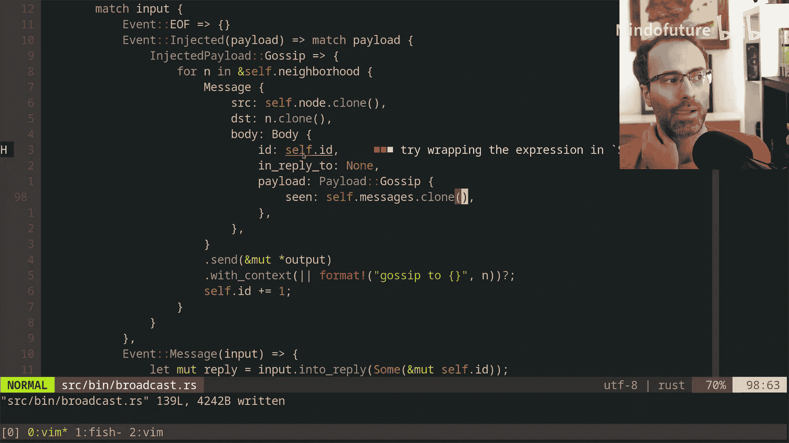

U。You know， when， when we were drawing this was。That when A And B gossip， they do a sink。

 like A sends a bunch of messages and B responds with。

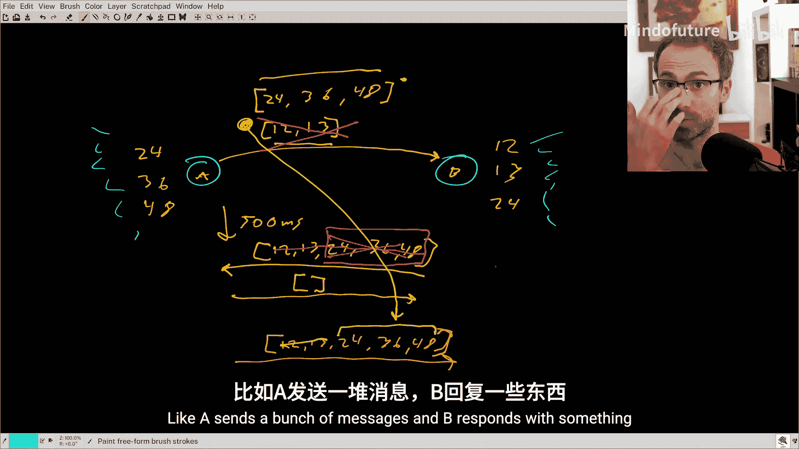

Something， but it doesn't actually need to be a reply。 In fact。

 maybe we should just get rid of the response here。

Because it's sufficient to just sort of fire and forget them。

 which also means they don't even need IDs。This can be none。

Because't no one needs to identify the response。 if it gets dropped， it doesn't really matter。

And so here we could probably prune out anything that we know that the other side has。 In fact。

 we can write this right now so we could do it。u。copiied。😔，Collect。Eer filter。

I want to do that after the copied。Filter N。And。And knows is going to be self thought。Kown。Of N。

Filter only things that are not where not and knows。We could do this better。 We could say known to n。

Not known to N。Dot。Contains。This is M。For the message。

So we're going to take all the messages that we know about， and we're going to filter it out so that。

Only the ones that are not known to end。Only the ones that are not known to N are sent。

And now the question is， how do we gonna how are we going to update known to N and we can leave that for later。

 Like， it's fine for it to always be empty for now。And just to check my logic here。

 it's always weird with Boolean operators。 So known to end。

 we're expecting that we're going to send all of the messages。 Let's double check that that's true。

 known to N is empty。Therefore， for any given message。The filter closure here is going to return。

 So empty contains is false。 This' is going to turn to true。 So the filter is going to return true。

And filter removes anything where it's false。And therefore， all messages will be sent， great。

So whenever it's gossip time， we're going to send a message to everyone in our neighborhood。

 telling them about all the messages that we have。And over here。When we get a message。Gosip。

Seem we're just going to do。And。Extend。Sin。And we're not going to reply。So that's all we have to do。

 whenever someone tells us about it， we just add it to the set that we have。

So let's see if this works。And we might actually not need message communicated anymore。

 I was adding that， because。Over in this space， right， when I。

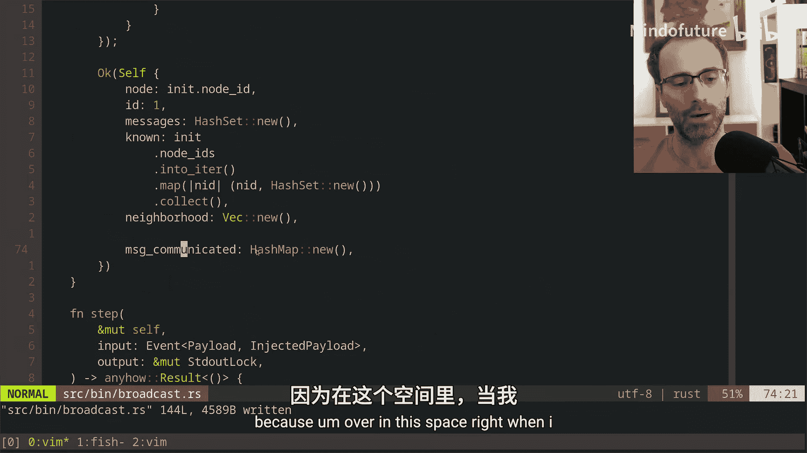

Get a response from you。 Then I know that you have seen these。

 But that means I need to remember those for when I see this response。

 But if we're not doing responses， then this doesn't matter any more。

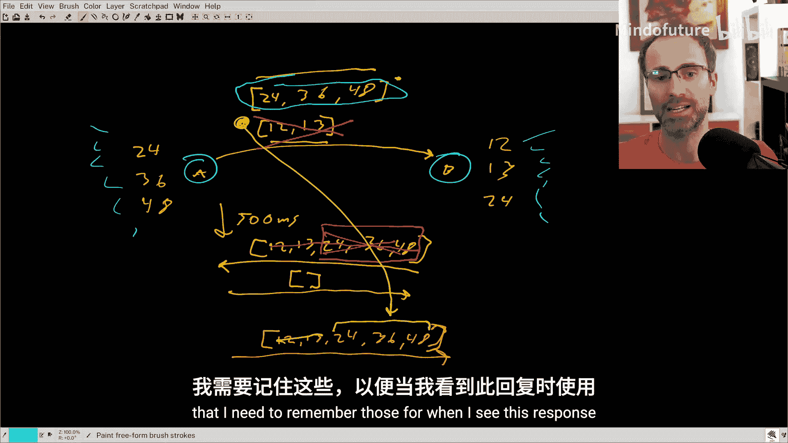

um。And we'll see how well that works。Okay。So if I now run， what's the message they want to use here。

This。Maelstrom。Target， debug broadcasts。See if it all fails。Notice that it only prints here。

The gossips only the messages that get exchanged between the。The Jepsen。

 like the maelstrom clients and our clients and not what our nodes are telling each other。

tearearing down。 everything looks good。I'm curious here to see。What this actually looked like？

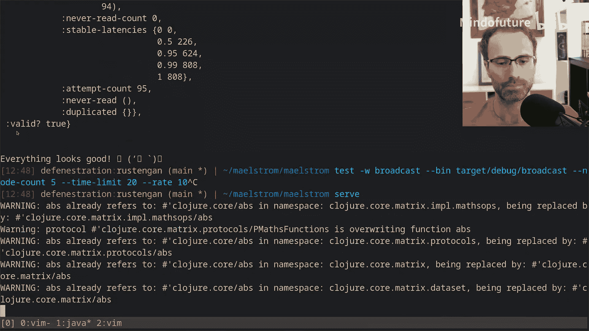

So let's head over here to R。Local host business。

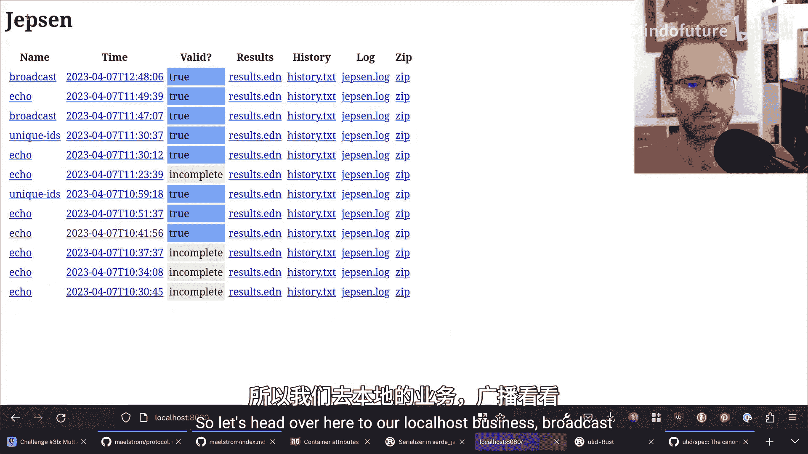

Broadcast。Let's see the message history here。

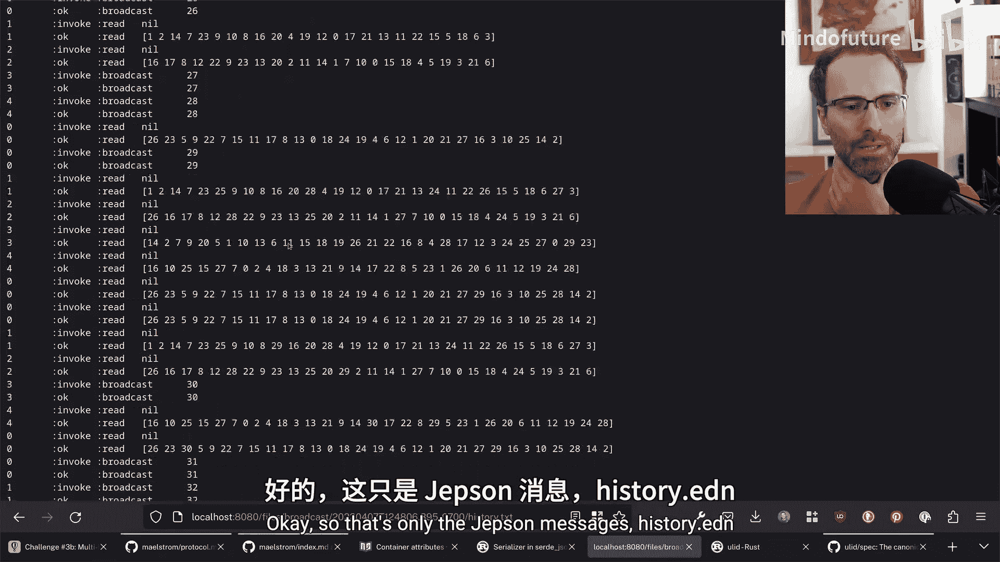

Okay， so that's only the Jeps and messages。History out E DN。

I wanted to see if the if our gossip messages showed up here， but it doesn't look like they did。

Which is interesting。嗯。TheBadad messages are very fast。

The reads are slower because they need to transfer data that seems reasonable。

a bunch of topology messages。 yeah。 So here we see the gossip messages， Okay， so。Initially。

 we sent all the topology got sent， and we responded with topology， O。 Then there was a broadcast。

 broadcast， broadcast broadcast broadcast。 And then you see all of our nodes started gossiping。

And you see the sort of seemingly weird interactions between them because they're just sending to basically random other nodes in the network。

 you see these gossip messages start to get pretty long。Right like down here。

 we're sending giant and chunks， and they just keep growing。 And we should see that。

 Then if we look at the timeline。 No， I don't want the timeline。 I want the。And。Latency， raw。

That's not really what I want either。 There's sort of a view here that I'm looking for。

 which is the performance of。what I really want to see is like， the delay。

Between when a message is broadcast and when it's visible to all peers。

 which it doesn't look like it's。Recording here。😔，This is the rate of broadcast， but I want like the。

Visibility delay， which doesn't seem to。

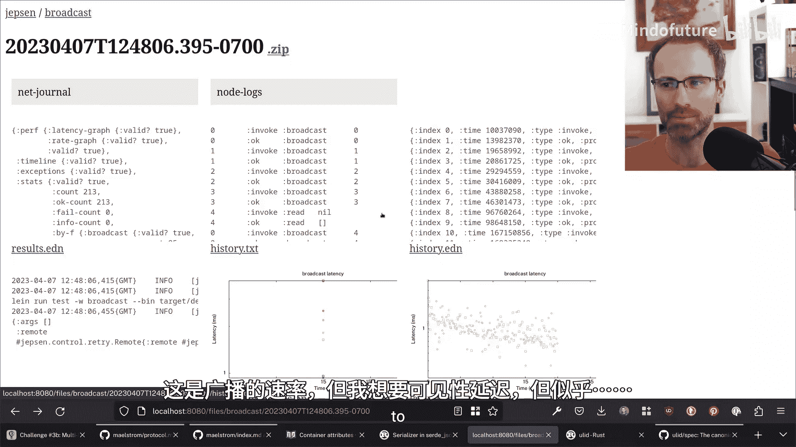

It doesn't seem to surface here， which is too bad because what we should see is when the gossip messages become longer and longer。

 that means that the send between two node， the gossip between nu node gets slower。 and as a result。

 it takes longer for any given message to propagate across the network。 And as a result。

 the propagation delay for messages is going to be longer。So let's stop this one and say。呃。Implement。

呃。Nive gossip。And so now let's see if we can do a little bit better。 And actually。

 this should be really easy。 It's just when we receive a gossip message。Then， we know。

That the messages。That the sender knows about。Include all of the ones that they sent us。

If a told me about three， then I know that A knows about3， and I never need to send it 3 again。

get mute。Of this。God gossip from unknown node。And that's， in theory。

 all it takes for this to be smarter。So if we now run this。At what point will？

I's not the broadcast rate。 I think the broadcast rate is the。

Rate at which the broadcast operation succeeds。 And broadcast is a trivial operation because it doesn't trigger any work。

 We trigger all the work in gossip。So broadcast won't actually get slower。At what point will copied。

 produce copies of values being iterated on。 Will it copy those that end up filtered out。

 It depends on whether you put dot copied before or after the filter。

 If you put it before the filter， then every value will be copied。

Regardless of whether they match the filter， because the copy happens before the filter。

 If you put the copied after the filter， then only the ones that aren't filtered out get copied。

 The reason I put it before is because。Filter operates on references to the items being iterated over and so just makes it more annoying to write。

 And in this case， the copy is basically free because the references are to numbers。

 So there's not a huge clone。 That' succeeded。 Let's go ahead and look at this and just verify that the gossip messages are。

 in fact， shorter。 Now， this broadcast。

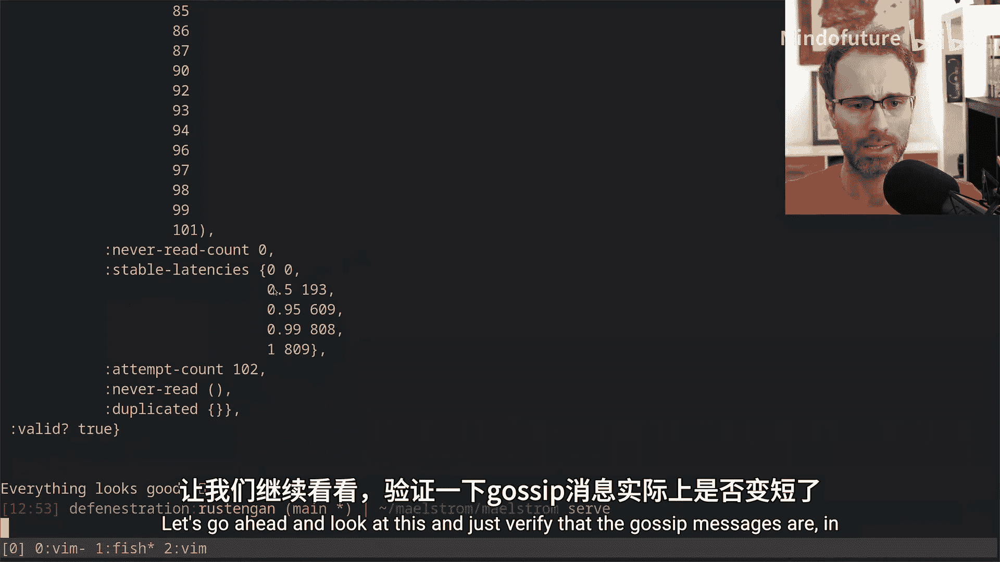

Messages。If we scroll down pretty far。So， there's still。K of along。

I'm just trying to gauge whether they're getting shorter。Like， you know， we're。

 we're pretty far down the tree here。 And you see this， this list of messages， for example。

 there aren't that many。 Like， it's not all the messages that have been sent up to this point。 Like。

 let's go maybe to the end here。呃。These are still pretty long。

It's hard to tell whether this is because there are so many messages to exchange。

Or whether it's basically the logic isn't working。

What we can do here is actually give ourselves a little bit more data and say。And。嗯，宝宝宝宝。What。

Notify of。This is a hashet。I just want to print to see whether it's whether it ends up eliminating any。

Because that's really what we're after here。Right。So there should be a store。呃。Latest。

Noode logs and0。

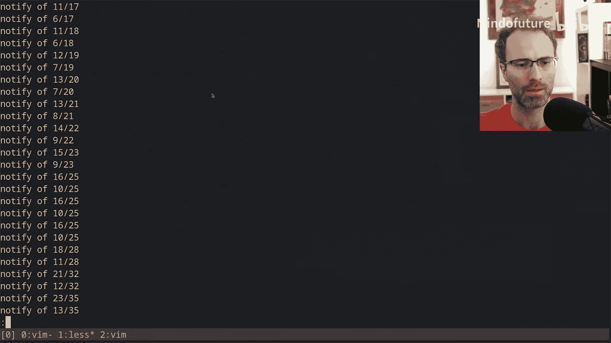

Yeah， so it is only notifying of a subset of them。Let's let it run for a little bit longer and see how much it reduces。

Stable latencies in the results EDN link has the time to propagate。 All right， let's go look at that。

I'm let this run first。The reason it's destination not source is because this is after calling In to reply。

 which swaps them。So if we go to the end here。Yes， it's definitely subsetting them。Right。

 I guess the， the observation here is that。U。You will only eliminate messages that that other node has told you about in the past。

And they won't tell you about ones that you already have told them that， you know。 So this is the。

 the problem we had that we described in the。

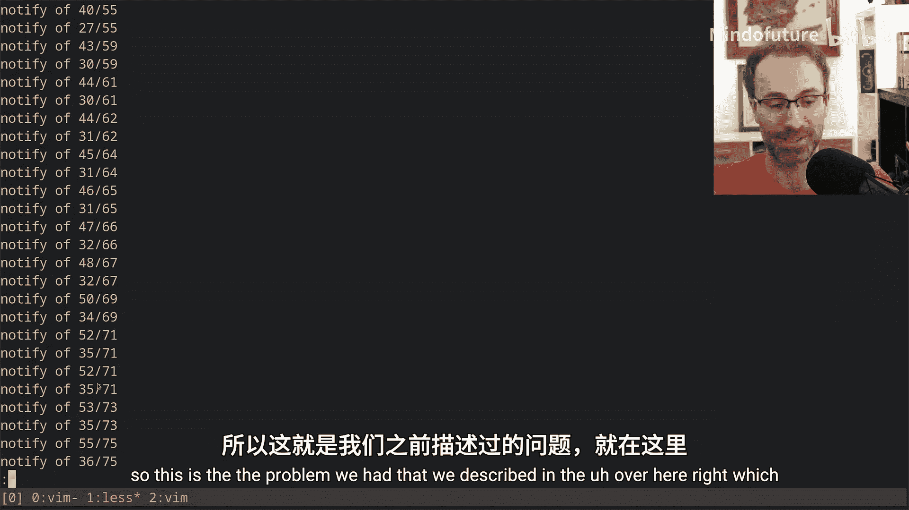

Over here， right， which is。If I know that you know these values。

 I won't tell you that I know those values。 So I think actually the thing we need to do here is we need to be a little bit smarter。

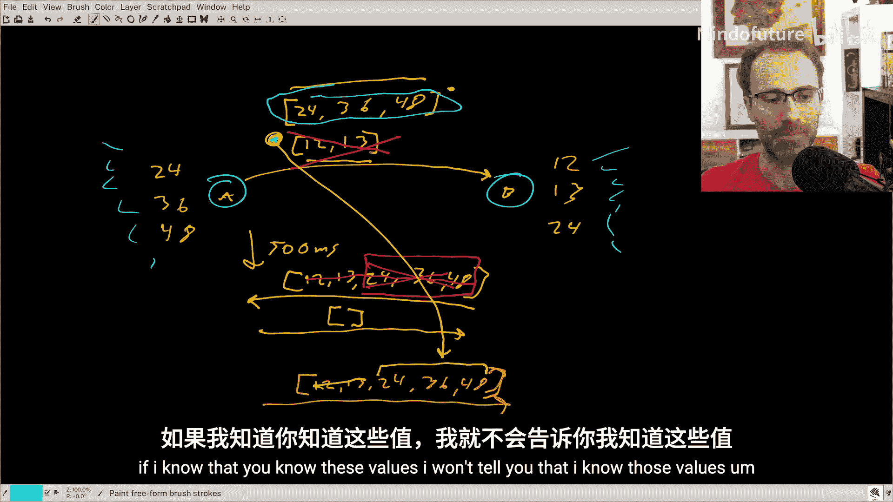

And we need to say。I think we want to add to notify of。Include a couple of。呃。Extra。Messages。To。

Let them know that。 We know them。And so， we're going to say。Notify of。Extend。Self do messages。

inner dot copied。Trying to decide how I kind of want to pick these randomly。

But then I need actual randomness。Stup partition。Already known。And notify of。Wu。Hh that。

And then what I want here is extend with。Already known。

But I only want some of them and the weight that I'm going to pick only some of them。Yeah， exactly。

 If a tells B 1，2，3， B will know that A knows 1，2，3 and will not tell a that it knows 1，2，3。

 And theres therefore， a doesn't know that B knows them。

 which is exactly the the problem I'm trying to solve。

 And the way we're going to solve it is essentially with like more of this gossip idea。

 sort of I'm also going tell you a couple of extra ones。 not too many。

 but just enough that over time， you're going to learn more about the ones that I have。

 And so we're going bring in here， Rand。

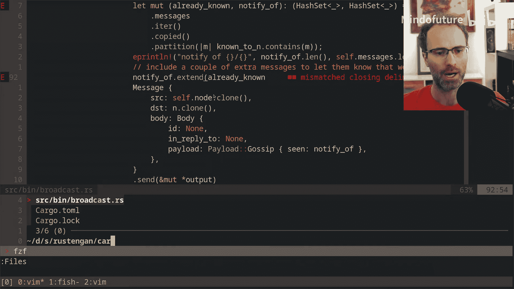

嗯。

And Rand is version 08 now。And what we're going to do is。

Iterating a hashet could be seen as semi random。 The problem is it's。

 it's not actually random enough because we want it to be different every time we send messages to someone。

 And the hashet randomness only changes。 It is random。

 but it only changes between iterations if the hash mapap gets resized。

 which doesn't happen that often。 So I want。Prelude。I don't care too much about the performance here。

 Do filter。And I don't actually care about the value。 And instead， what I'm going to say is ran。

Random。呃。What is the。I want this。I want an orange G。And what I want is R N G dot Genbu。

But I forget what the。Return a bull with the probability P of being true。0 point。

There's another argument here， which is instead of this being a fixed percentage of the total number of things that are already known。

 it should actually be。U。Like， we always send an extra 10。So what we'll do here is。Jen ratioio。

And I want to Jen Ra。嗯。10 out of。Already known， Dalin。As U 32。And actually， this shouldn't be 10。

 This should be。10 dot。Min。Oops。Because if there are fewer than 10 that are already known。

 I don't want this to fail。Okay。Let's see how that does。

I assume it passes be weird if including additional things in the gossip made a difference。

 but what I really want to see here is。Yes， and now you see the gossips at the end here。

 There's basically nothing to exchange。That's more like it。And so if I now go up and do serve。

Let go over here。And we go back， back。Fresh this one。And we go to messages。

Then now the gossips as we go down should still stay pretty short。

There's a point in the middle where there's a lot of gossips。

 but if we go farther down like around here。Like see here， these gossips。

 even another far at the end， are relatively small。Some of them are longer， but it's random， right？

Beautiful， okay。And then someone said， if you go to the。

Results， EDN。Stable latencies。Worst stale， okay。Stats。What I really want is， like， a。Yeah。

 I guess maybe it's just in text form。Sttable latency 8，61，7，71。 So the worst ones are like。

Stable agencies。The 99th percentile of stable latencies is 7，71 for this one。

 If you go to our first implementation。

Stable latencies。😔，Was 800。So we didn't actually reduce it by that much。 I'm not terribly surprised。

 actually， because these executions are pretty small anyway。

It only matters once the gossip gets very long。

So the 99th percentile was about 800。 And then as we started to make our gossip smarter。

It went down a little bit when we made gossip， we made the gossip without the randomness。

 it went down to 7，77。 And when we added the randomness。

It went down，2。7，71。 So statistically irrelevant。 Okay， yeah， I， I think I'm happy with that。

Interesting， okay， I think that's actually where I want to stop for today。

 so that them know that we know them。呃。Let's make this a little bit more clear and we don't actually need the notify here。

If we tell N that， we know。If we know that N。Noose M。We don't tell N that。 we know M。So。N will。

Send us M in。For all eternity。So we include a couple of extra message， extra Ms。

So they gradually know all the things that we know。Without sending lots of extra stuff each time。

 And you could tune the 10 here， right， Like it doesn't have to be 10。

You could say that we're willing to always include a sort of overhead of the message of at least 10%。

 So instead of 10， this could be notify of。Dotlin。As U 32。It could be like。For example， whoa。

 that's not what I wanted to do。嗯。Like this is one way to do it， right to say oops。

 actually that's not what I want， I want， well that is what I want， but I just don't want it there。

Let。Additional。Cap is， I don't want the message size to grow by more than。10%， right。

 So the message size is going to be basically the number of things we have to tell them about。

 And I'm saying 10% of that is as many of many additional things I'm willing to tell tell them about。

 So this caps the It doesn't hard cap at a 10， but it hard caps it as a ratio of how much I'm already telling them about。

And this is 10%。 And we could， of course， do something like。

We could do this in floating point instead， I think it's fine this way。

The rounding isn't really going to matter。嗯。We。呃。Cap the number of。Extraneous。Ms。

We include to be at most 10% of the number of。Mms， we have to include。To avoid excessive overhead。

Now I kind of want the print line back。That's fine。It doesn't matter。And so the idea is like。

 you know， if you have to gossip 100 things to them。

 then you're going to send 10% of 10 so 10 extra bits if you're telling them about five things。

I guess now it's going to end up being0，That's not great， either。So maybe 10% is too low。u。

So go back here and look。What。Messages， show me the end。Some them were still pretty short。

So I think this is probably okay。 You don't want the over to be a lot more than 10% anyway。

So it still means that if you send 10， you're going to send one extra。A。

Okay， I think I'm happy with that。 Let's stop it there。嗯。Make gossip。呃。Make gossip smarter。Sweet。

 I think that's all I wanted to touch on today。 There are more exercises。 right， So if you go here。

 there's like fall tolerant broadcast， which actually。😊，I wonder。Just， just to see。

Whether we already。Do this。Debug broadcast。Are we already resilient to network partitions。

So this is basically it's going to make it so that certain nodes can't talk to each other for some period of time。

And to see whether it still works。See what it says。Everything looks good。 Okay， great。

 So the gossip protocol we have actually works even if there are network partitions， right。

 if there's a permanent network partition， it won't work。 But as long as there's some path。

 the values will eventually make it there as long as the topologies are updated so that you。

 you end up sort of bridging that gap。😊，Nice， so we actually do 3C as well。

 and there's going to be broadcast efficiency， which we can get to later。

Are there any questions about what we've done so far before I sort of end the stream here？Like。

 I think you could build on this and do the later challenges， too。 I just。

 I think this is a good place to And I think we got to something pretty interesting。

And I'll push this to Gitub too so people can can build on top of it。No questions。

 Everyone thinks everything made perfect sense。It's amazing。All right， in that case。

 thank you all for showing up or for watching if you're sitting there at home afterwards。

 I hope this was useful。 We'll see I might do a part two of this with the later challenges。

 Don't know yet。 but this was fun so far at least。 and know I like thinking about distributedive systems problems。

😊，嗯。Alright， have a good rest of your Friday or Saturday if you're on the in Australia and such。

 and I'll see you all later， bye folks。😊。

