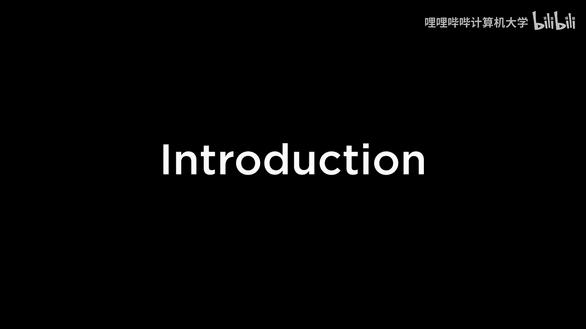
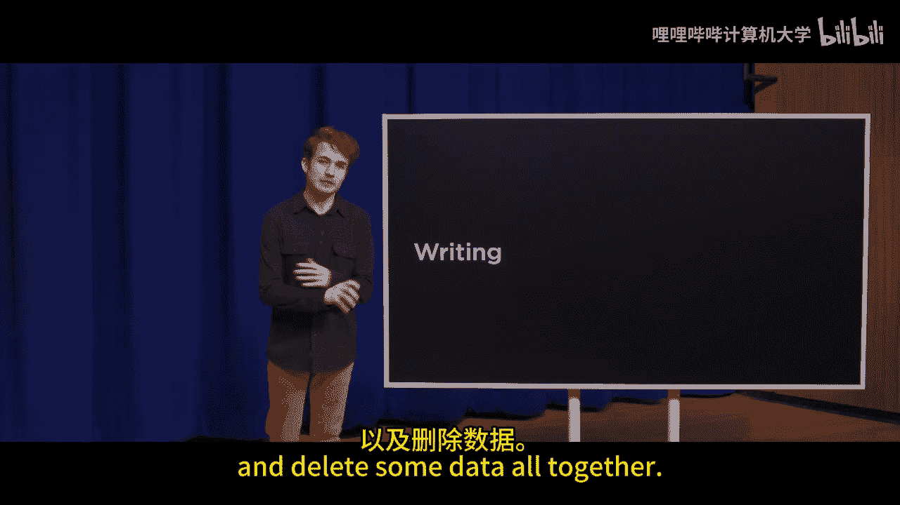
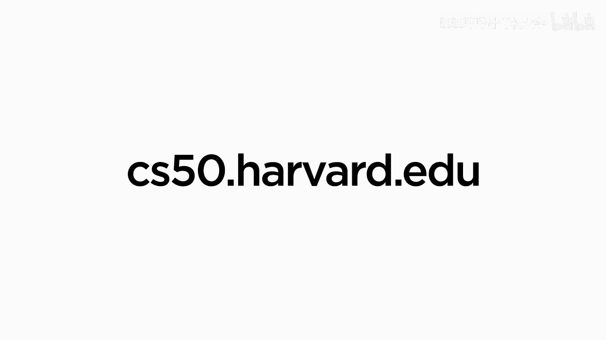

# 哈佛大学CS50 & SQL【速成版】 课程已全部上传，中英双字幕(人工核对翻译），课程附完整课件(视频支持杜比音效，Hi-Res无损音质)。 p01 课程介绍 -BV1iKCwBuE2d_p1-

Hello world。 This is C S 50's introduction at databases with SQL or SQL。 My name is David Main。

 and my name is Carteranki。 C50 itself is an introduction to computer science and along the way。

 you learn about SQL and more This course dives all the more deeply into SQL specifically。

 and you can take it before， during or after C50 itself， whether you're a computer scientist。

 data scientist， programmer， or simply someone who's interested in databases。

 Now we'll begin with software called SQL light， which you can use to query a table of data。

 maybe a table of books， for instance， You will then graduate and work not just with one table but multiple and see how to define relationships among them。

 afterwards， you'll figure out how to design your very own database from scratch。

 learning about schemas and data types。 And then you'll see how to add data to that database。

 how to insert， update and delete some data all together。 So after。

 you'll see how to write alternate views for your data new ways。😊。

Simplifying your data for yourself and for others。 and then towards the end of the course。

 you will see how to optimize your queries， how to reduce the time that they take。

 although at the cost of some space and then finally to cap it all off you'll learn other DBMSss。

 database management systems like MySqL and Postgres that you can use to all of this and more at a much bigger scale Now this is CSs 50。

