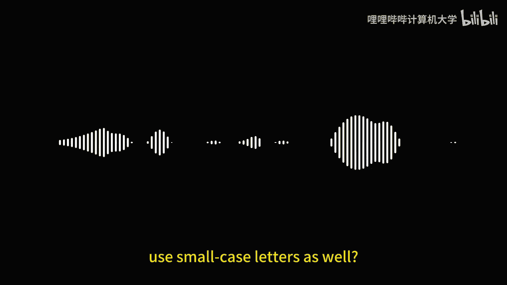
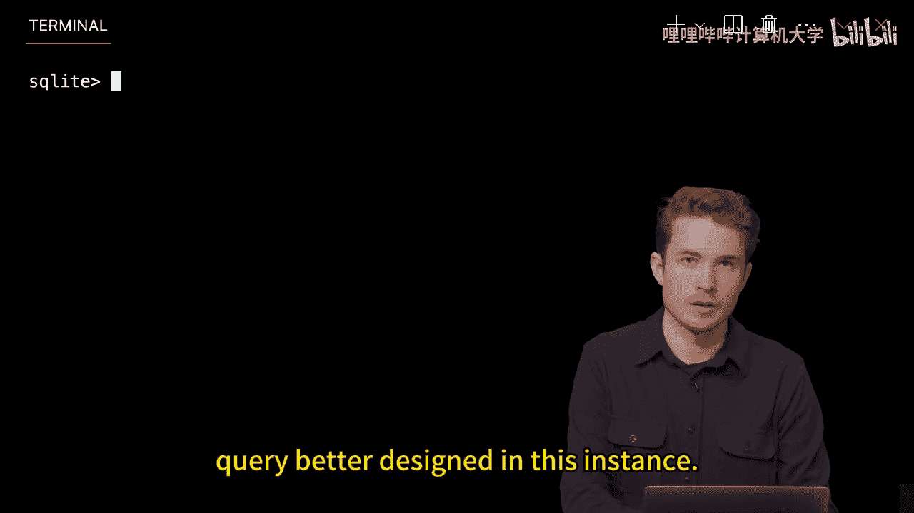
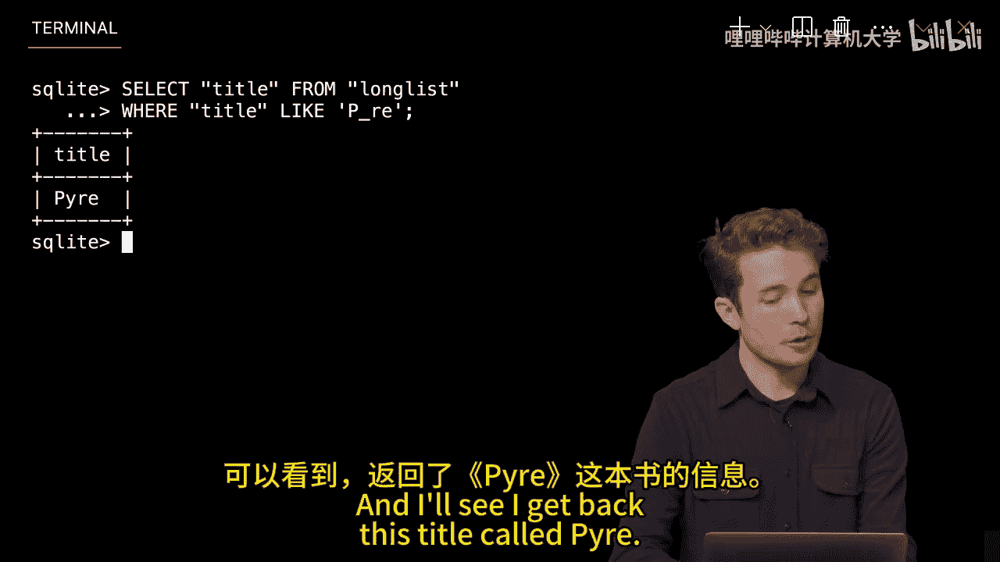
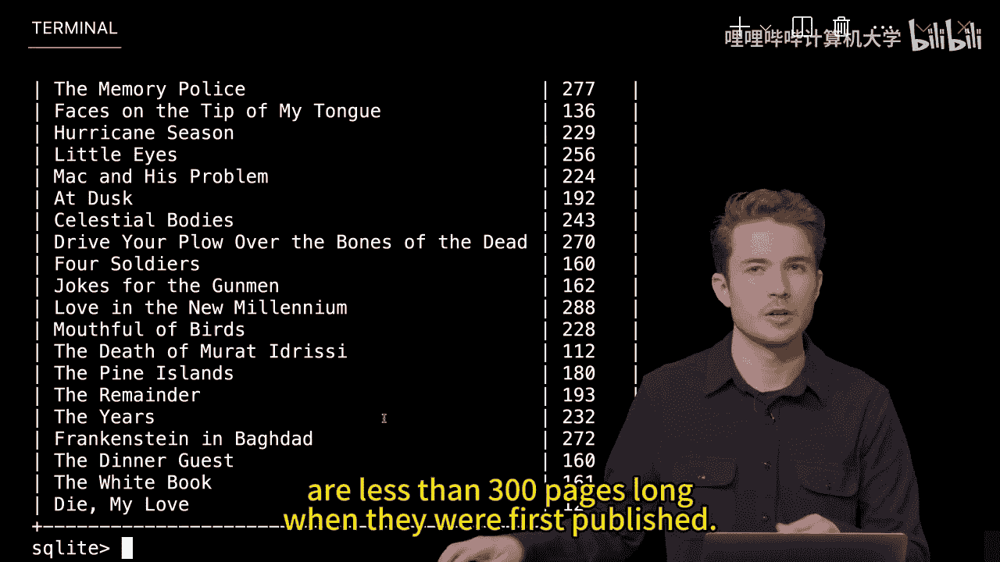
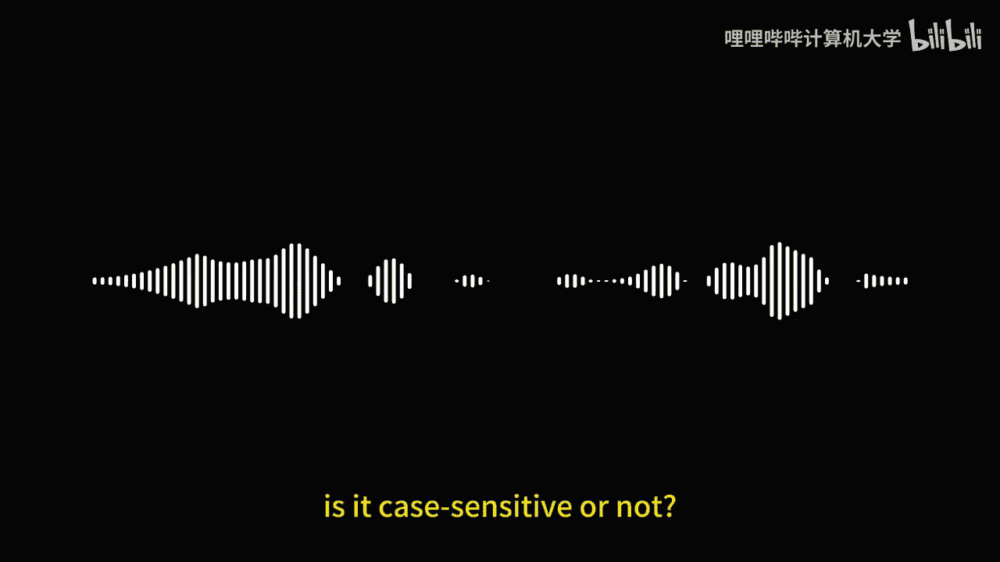
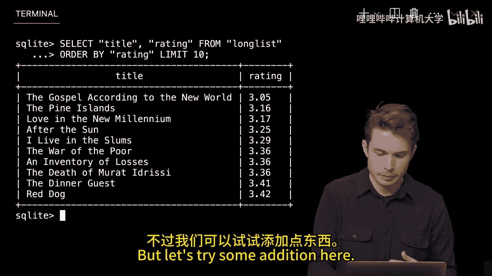
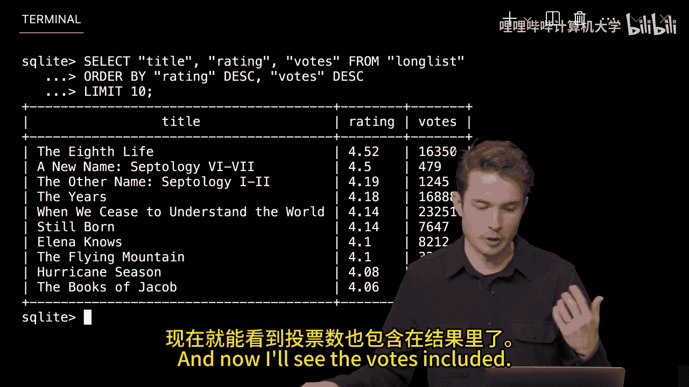
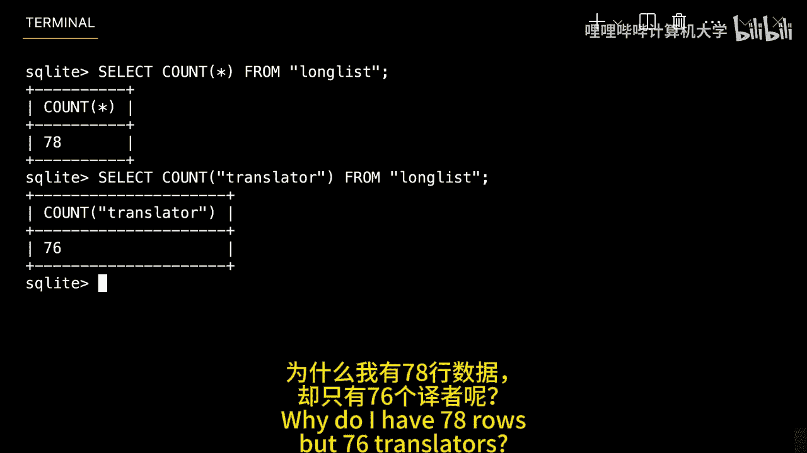
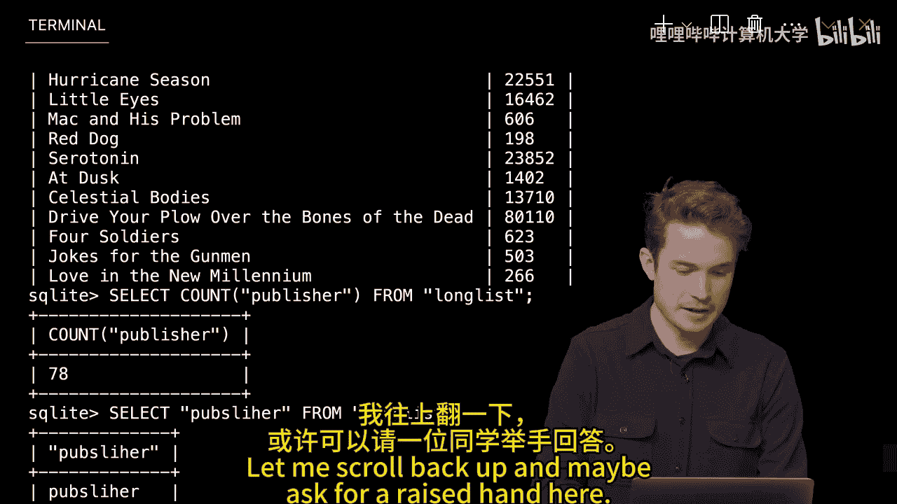
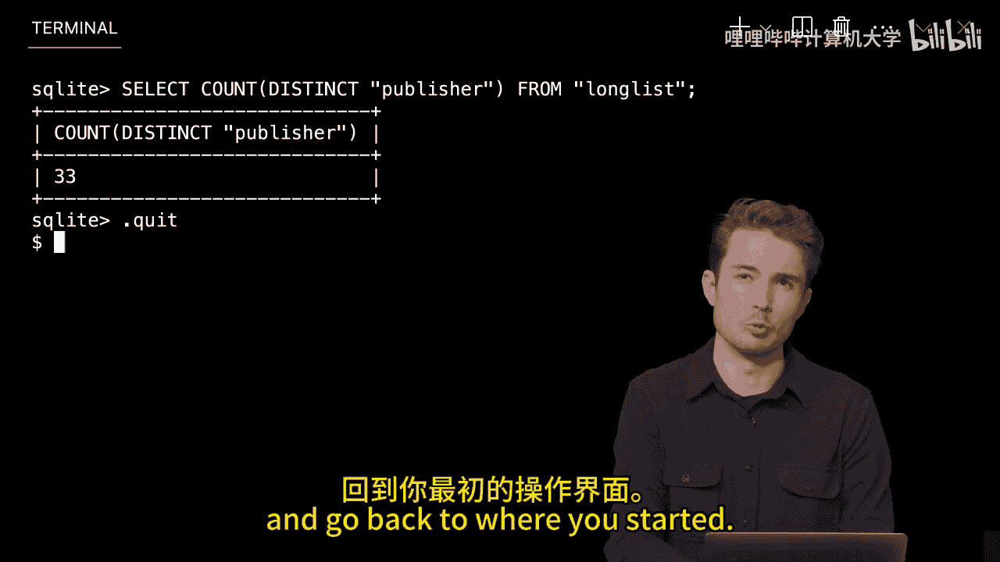

# 哈佛大学CS50 & SQL【速成版】 课程已全部上传，中英双字幕(人工核对翻译），课程附完整课件(视频支持杜比音效，Hi-Res无损音质)。 p02 Lecture 0 - 查询 -BV1iKCwBuE2d_p2-

Well， hello one and all， and welcome to CSAT2's introduction to databases with SQL。

 My name is Cartersanki。 And in this course， you'll learn how to represent how to organize and manage and how to ask questions of the data that's around you in your everyday life。

 But why learn those skills。 Well you may have heard So we're living in the information age where we generate so much information。

 so much data by virtue of interaction with computers and with each other over the Internet。

 you might think of， let's say， Google， keeping track of the sites you click on or the sites you search for。

 you could think of maybe the smart in your pocket or the smartwat on your risk。

 keeping track of health information， emails， text messages and so on。

 you might even think of YouTube， where you might watching this same video。

 keeping track of all the videos on their platform。

 the creators of those videos and even the comment you might leave on this video。

 So although we're living in this information age where there is so much data， so much information。😊。

We can use these new tools like databasease and SQL to interact with that information to store it and manage it。

And although we were using this one of these new tools。

 some of the other concepts we'll learn aren't actually so new。

 So here is a diagram from literally a few thousand years ago。

 and notice how this diagram has rows and columns。 and this seems to store the stipends for workers at a temple some few thousand years ago。

So given what you know， based on your prior knowledge。

 what kind of name might you give this diagram with rows and with columns。

What could we give a name to for this。So I'm seeing some ideas of a table。

 perhaps a spreadsheet as well， for our purposes says。

 we'll call this a table where a table stores some set of information and every row in that table stores one item in that set where every column has some piece of information about that item some attribute of that item So here for example。

 we do have a table of workers at a temple， every row is one worker and every column is their stipend for a particular month。

😡，So I could take this idea of a table， this very ancient idea and apply it to a more modern context。

 So let's say I'm a librarian， for instance， and I want to organize my library Well here I have book titles and authors。

 and I could certainly use a table to store this information， but how might you propose。

 I store this information， What could I do with my rows and with my columns if I have book titles and book authors。

I see one thing I could do is probably organize my titles and my authors kind of connect to each other like this。

I could take my titles to my authors， put them right next together。

 So I have song of Solomon by Tony Morrison， Goodn Moonon by Margaret Wise Brown。

 and notice here how each book is one row， But every row has two columns where two pieces of information for each book I have a title for one column and an author for the other。

 And so together I have a table of books where every column tells me one piece of information and every row tells me one book in this data set。

😊，So thankfully， now that we're living in this information age。

 we no longer have to use no longer have to use like stone tablets or perhaps pencil and paper to store our tables。

 We have software now like Apple numbers， Google sheetets and Microsoft Excel。

 But this isn't a course on Apple numbers or Microsoft Excel or so on。

 It's actually a course on databases and on SQL。 So feel free to raise your hand if you'd like。

 But why would we decide to move along from these spreadsheet softwares towards a database。

 What might that database give us that a spreadsheet might not give us So I'm seeing a few ideas here。

 And among them are some simplicity， some ability to organize some data。

 But there are a few other ideas we think about too for why beyond spreadsheets and go towards databases。

 Now one of these is this idea of scale。 So let's say you are a Google or Instagram you're trying to store not just tens of thousands of users or hundreds of。

😊，ThousandBut literally millions of users or billions of users。 And with that kind of scale。

 you might be better served by a database to store that much information。

Another reason to move from spreadsheets to databases is this idea of being able to update data more frequently。

 Maybe you're a Twitter of the world。 you're trying to have others tweet multiple times per second。

 Well， a database can handle that kind of capacity much better than a spreadsheet could alone。

 And a third reason to move beyond this might be speed。

 let's say I'm trying to look up some piece of information in my database。 Well。

 I could do that much faster with a database than I could with a spreadsheet you could think of yourself using command F for control I have to find a piece of information。

 your spreadsheet kind of going one by one through the rows。

 A database gives you access to more kinds of algorithms you could use is search this data much faster ultimately。

 So these three reasons among others are those you might want to move beyond spreadsheets and start using databases。

😊，Now， it's worth thinking first， what is a database。

 Well we talk about databases throughout this course。 So what is a database， Well。

 a database is simply some way to organize your data such that you can actually create data。

Update data。Read data and delete data。 And often， these are our four interactions that we'll do with a database。

 like adding some data， looking at data， deleting data， and even updating it along the way。

But the database isn't the only thing in our picture here。

 We also have a database management system way to interact with our database。

 So you might think of perhaps writing a program on your computer。

 you have some interface which to write that program like yes code， for instance。

 or you might think of your own desktop on your own computer。

 you have icons such to interact with the underlying operating system in the same way we can use this software called a database management system or a DBMS for short to interact with a database。

 perhaps using a graphical interface or using a textual language too。😊，Now。

 there are a few varieties of database management softwares， and these are a few of them here。 MysQL。

 Oracle， PostgressqL and SQLL， but this is a non- exhausthausive list， and me also ask again。

 what kinds of other database management systems have you perhaps heard of in this case。

 seeing one for Microsoft access， perhaps Mongo Db。 there are other kinds of software。

 other companies out there that make these ways to interact with a database， and this is again。

 a non-exhausive list。 Now， if you are a database administrator。

 or maybe you're somebody who's making a choice of which software to use。

 you have a few tradeoff to consider。 let's say you might think of one being proprietary。

 for instance， costing money to work with， what you get for that money is additional support to actually implement your own database。

On the other hand， you might have open source software or free software to use such like PostgresSQL。

 MySQL and SQLL， but the downside is you are then responsible for actually implementing that database。

Another thing to consider， too， is that maybe some are going to be heavier weight than others。

 more fully featured as a consequence， but perhaps heavier weight， requiring more computation to run。

 You can think of those like my SQl， postgre SQl being a little bit heavier weight。

 but being more fully featured。Whereas SQLite down below will be a little lighter weight。

 as the name might imply， but allow you to do most of the same work that these other softwares could allow you to do as well。

 And in this course， we'll actually be using SQLite for you to work with your own databases。

 but gradually we'll move on to MySQL and Postgres SqL2。So。

Let me go ahead and talk about then SQL in this case。 You might notice that in each of these。

 My SQL and Postgre SqL and SQL light， each of them have this idea of SQL in them。

 And SQL is that language that we'll use to interact with our database。 Now， let me ask。

 what does SQL stand for， Perhaps we talk about S QL or SQL。 But what might SQL stand for。

So I'm seeing what stands for structured query language， which is good。 if you already know this。

 but not to worry if you don't。 So SQL does stand for structured query language。

 as we'll see in this course。 it is structured。 It does have some keywords you can use to interact with the database。

 And it is a query language It can be used to ask questions of data inside a database。

 We'll see that this is the language we can use to create data to read data to update data and delete data all with SQL in this case。

 And our next thing will be to talk about this idea ofqueing。 So SQL is a query language。

 But what can we do with SQL。 the first thing we can do。

 We'll focus on first in this course is writing queries， trying to ask questions of data using SQL。

 Well， what kinds of questions could we ask。 Well， you might imagine perhaps working at an Instagram or a Facebook。

 trying to work as an engineer to figure out what kinds of。😊。

star are the most liked on your platform。 That's a question you can answer with databases and with SQL。

 You might also think of whether your numbers of data users are growing or shrink if you're looking at a startup。

 for instance。Even maybe you might be working for something a company like Spotify that could ask。

 how could we play songs that are like those a user just played。 This too。

 is a question you can answer with databases and with SQL。Now， today。

 we'll be focusing on this database of books and in particular。

 books that have been longlisted quote unquote for the international Booker Prize。

 The International Booker Pri， if you're not familiar。

 is a award given to books written around the world by authors from many countries and it's designed to be award books of fiction theyre particularly good in some cases。

 and every year， the committee selects 13 books to include on a long list for consideration for this prize。

 and our database then has five years worth of long lists for the international Booker Pri inside of it。

 we could use this database， perhaps if we were a librarian trying to find books for our library or even as a book reader。

 an avid reader myself trying to find books to read that I could put on my own shelf overall。😊。

So we'll look at this database， but we need a few tools in our toolkit metaphorically to actually interact with this database。

 and one of them is going to be visual studio code。

 Visual Studio code is an IDE integrated development environment to write code and to edit files with It's also often called V S code。

Now， in VS code will also be able to use SQLL， this database management system or a DBMS for short to actually interact with that database。

 So we'll be using these two tools combined to work with the database of longlisted books for the International Booker Prize。

And although I'll be using it here， SQL light is not just used in this course。

 it's used in a variety of applications， you could think too of phone applications or SQLite is often used on those devices that have much lower memory。

You could think too of it being used on desktop applications to simplify the process of storing data there too。

You could even think of it being used on websites to help store information that user submits via a form。

 for example。So we'll jump into using SQL light， but keep in mind that not just in this course。

 you'll use it， but also it's used in a variety of applications here too。

So why don't we just jump right into things， start using our environment and start using SQL light。

 So I'll go over here to my computer and it will open up， let's say， V S code。We are here。

 You can see I have my terminal environment。 And if you're familiar。

 you can type things like L S to see the files that are in your current folder。

 So I'll type L S right here， and I'll see this database called long list dot DB。 again。

 working with books that have been longlist or considered for the international Booker Pri。😊。

So if I want to open up this file， I can use this command。

 then this command is going to be called sQelite 3。

 or I can take some file that I have like long list do Db and open it using this program called SQelite 3。

 what's called SQLite3 because this is the third version of the SQLite software。

 So let's try this in our terminal。 I'll go back over here， and I'll say sQelite 3。SQL 83， long list。

db， and now I'll hit enter。And notice how my terminal prompt changes， it's no longer a dollar sign。

 it now says SQL light in front， this means an inside of my SQL light environment。

So to clear things up， let me just clear my terminal， I can use controlr L for this。

 And now I have just that prompt up top。 And now a question I want to answer in this case first is what data do I actually have in my database。

 What data is actually here for me to look at and to ask questions about Now， for this question。

 I can use my very first SQL keyword， which will be called select。

 So select is a way for me to select some rows in a table inside of my database using select。

 I can get back certain rows or in this case， perhaps all of them just to get a taste of what's inside。

 So let's try using select on this database to understand what rows we have in our table here。😊。

Let me go back to my computer and to my SQLite environment。

 and I will try this very first SQL keyword。 I'll say select。

 and I can use this star operator here to say select everything。

 I want every row and every column from this table。

Now it's not enough for me to simply say select star and end my query。

 I had to tell SQL which table do I want to select rows from In this case。

 I know a table was called long list， so I'll say select star from long list unqu and to end my query。

 I'll say semicolon and then finally I can hit enter。😡，And notice how I get a lot of data back。

 This is a lot of data all at once。 But it's because my terminal is a little bit small。

 There's a lot of rows and columns here。 So I could probably simplify this just a little bit。

Instead of saying select star， I could also select a particular column from my table， I could say。

 for instance， select， let's say， just the title column from my database， from my table like this。

 I just know already that there is a column called title。 So now I'll try this instead。

 not select star but select title instead， I'll hit enter。 and now this looks a little bit better。

 I can see the titles inside of this table from top to bottom。Now。

 the neat thing here is I can select more than one column too。 let's say I don't want just the title。

 I want titles and authors in my search。 Well， I could do that as well。 let me try this， select。

 not just title unqu， but then I'll say comma and some new column to select。

I'll select also the authors from this table and I'll select them from the long list table like this Now I'll hit semicolon to end my query。

 hit enter， and now I'll see a variety of columns here。

 in particular the title and the author column。Now， this has going back all of my columns so far。

 And there is a way for me to get back just to some of them later on that we'll see。 But for now。

 let's ask， what questions do you have on。This SQL select statement and how we're getting back these rows。

Do I need to use the quotes around the words like you are？Yeah， great question。

 Do you have to use quotes around the words like I am。 In general。

 It's a good practice to use these double quotes around your table names and your column names。

 These are called SQL identifiers。 Later on， we'll see you will also have strings in SQL strings being collections of characters we can use for those。

 we'll simply single quote them to note the difference between a string in an actual column names。

 So good style convention here to use double quotes for column names and single quotes for string names。

😊，Other questions too。Okay， I wanted to know， where did we take all this information from。

 like this data， I don't know this list of， where did we take all this information from。

Yeah， great question。 Where do we take this information from？

 So some of this data is publicly available。 In fact， if you look at the Booker Prize website。

 you can find a set of longlisted books over the years。 In this case。

 we have books from 2018 to 2023。 We'll also see later on。

 this table has data on the ratings of those books and the number of votes that were given to those books。

 That data is from goodreads， this site that aggregates reviews from people like you。

 people like me who rate books online。 So we've taken data from a variety of sources combined it into one here。

😊，Let's take one more question too from Vinyac。Yeah。

 so I wanted to ask regarding the syntax of what you used in the terminal。

 so is the whole SQL light tree is case sensitive because while using the syntax you use capital letters whereas can we use like small case letter as well。

A great question。 So here I used capital letters for SQL keywords and lowercase for my table names and column names。

 Do I have to do that， I， in some cases， do， some cases don't。

 I think I could use lowercase for these SQL keywords， but it's not very good style。 For instance。

 So let me just show you an example of this。 while I go back to my computer。😊。

So the question again was can I use lowercase for SQL keywords， I think I could。

 but the question is should I and probably not， let me try this， I'll say select。

 let's say title from in a habit of uppercasing it， so I'll say from in lowercase。

Long list like this， semicolon， hit Enter， and that still works。

 but the problem you might run into is someone who's reading your query。

 particularly a long one might want to know what are the SQL keywords and what are your column names and other identifiers here。

By capitalizing your SQL keywords， you can make it clear that this is a SQL keyword and not some other name overall。

Okay， so let's keep going and we saw just a little bit ago that we could select title from Long list and we would get back a whole list of titles。

 literally all the titles that are in this database。

 but it's often maybe good practice for me to not look at all the data。

 like imagine if we had millions of rows in in this column。

 but only to get back some take like a peak of what's inside this database。 and for that。

 I could use this other SQL keyword， this one called limit。So limit as its name might imply。

 limit the number of queries or the number of rows I get back from my query， I could say limit3。

 for instance， or limit 5 to get back only the top three or the top five rows from my table and let me ask folks if I wanted to peak in this data set。

 how many rows should I try to limit it to。😡，I could say select title from let's say long list。

 but limit to what number。I'm seeing 10。 So let's try 10 first。 I'll go back to my computer。

 I'll come back over here， and I'll say， why don't I select title。It's like title from long list。

 but now， instead of hitting semicolon， I will instead say limit 10 semicolon and I'll hit enter。

Now I see only the first 10 rows in my dataset。😡，Handy for peeking in at the top of my dataset here。

 too。Let me try not just 10， but five， so I'll say select。Title from long list， limit5， semicolon。

This then gives me just the top five titles in my database。

 just in whatever order they were added to my table， I'll see them in that order here too。

So using limit， we can actually try to get back a certain number of rows but this isn't quite that interesting。

 It's good for peeking in your data。 I think we've answered that question of what data do we have。

 but let's say we want to make more advanced queries。

 We want to find the books that were nominated in 2023 or perhaps books by a certain author。

 Well for that we could use this next SQL keyword， this one called where。

So where allows me to get back not all rows， but only some rows where some condition is true。

So where is often combined with other conditions to make sure I only get back some rows where that condition is true。

 Let's try looking at that in SQL light to get a feel for what it can do for us here。

 so I'll go back to my where and I will then go back to SQL light here。

 hit controlrl L to query my terminal and I'll then try this query。 I'll say select title。

Select title， and why don't we also select author along the way， two columns here。

And I'll select them from my long list table。But I don't want all rows。 I only want。

 let's say those titles and authors that were long listed in 2023。 So I'll do this。

 I'll say where the year column is equal to 2023。And notice here how 2023 is not in quotes because it is an actual number an integer。

 so I don't need to quote it like I would a string。

 some collection of characters or a table or column name。So I'll hit enter here。

And what do I see while I see only those books that were nominated in 2023， Let's try this again。

 I might try not just 2023。I might try 2022。Like this， hit semico。

 Now I'll see those books nominated in 2022。 I could keep going， I could say one not 2022。

 why not 2021。Now I have all those books nominated in 2021。So this is handy。

 we can set things equal to or not equal to to make some condition here。

 and we also have others we could use。 we saw equals just now， but we similarly have not equals。

 and we have this kind of obscure operator down here。

 this one being also equivalent to not equals as we'll see in just a minute。Let me first ask now。

 what questions do we have on how to use where or using select so far， What are the subsets of SL。

A good question there subsets of S QL。 So there are， in fact， S QL or SQL was defined by the。

 I believe， it's the AnZ like Standard Corporation。

 They have a whole set of the SQL language that is like the official version of it。

 you might be able to use some subset of that version with the database management system they actually use。

 So for SQL light， we're using a subset of SQL that works with SQLite。 Similarlyly。

 if you were using another software like Postgres SqL or MysqL， you could use another subset there。

 too。😊，Let's take another question from Taos， perhaps。Well， I want to know that can we add 2022。

 2021 in a terminal？

Yeah， good question， could I perhaps try to filter both by 2021 and 2022？I could do that。

 And we'll see that in just a moment here。 So let's keep going and exploring some other options with not equals。

 and then we'll see how we can combine conditions using where to。

 So let's go back and let's focus first on trying to use these not equal operators。

 We saw the excation point equals。 And this greater than less than sign put together。😊。

So let's try a few of those。 Let's say I want to find books that are written by a certain author。

 I could use equals for that。 But let's say I also want to find books that are not written in a hardcover format。

 They tend to be more expensive and so on。 So I don't want hardcover books。 Well。

 I could try a query like this。 I could say select title。

And format where format is either hardcover or paperback from my long list table。

And now I'll say where the format is not equal to hard cover。

 So notice here I'm using single quotes for hard cover。 This is a string。

 It's not a table name or each column name。 It is just a string。 I'm using single quotes here。

Everything else， though， like format， long list， title， etc ceter。

 Those are all table names or column names。 So again， I'll hit enter。

 And now I'll see that these are all in paperback according to my table。

 I've omitted those that are hardcover。What could also use in this case the kind of greater than or less ten sign put together to say not equals as well。

 Let me just hit the up arrow on my computer to sort of reveal what I just previously typed all then tab back over and say not exclamation point equals。

 but less than and then greater then hit enter now and I should see the very same results。

 but all I did was change its operator from exclamation point equals to less than and greater than it tends to be that the exclamation point equals is the more common operator in this case。

 but they do the very same thing。😊，Now， one more keyword I could use here that's worth mentioning is this keyword called not。

 So here I was able to use exclamation point equals or the less than or greater than sign to say not equals。

 but I could also negate a condition using not。 so let's try using this one in R equalqLite terminal2。

I'll go back over here and I'll bring back my SQL lightte terminal。 I'll say。

 let's do not this operator here， but instead use not。

 so I might in front of where say where not format equals hardcover。😡，So I have a condition。

 format equals hardcover， but now I'm going to negate it， take the opposite of it。

 and get back the very same results here too。Okay。So to the question earlier how we can combine these conditionals。

 let's try that here in just a minute， so let's say I wanted to find the books that were not just written in 2022 or 2023 alone。

 but all the books together Well for this I could use a few other SQL keywords I might be a little familiar to you too。

Let's try looking at some of these over here。So here we have these called and。

Or these parentheses here too， so using and and or I can change I can change conditionals。

 I can put them together to make a more complex conditional， a compound condition。😡。

And I could also use these parentheses to symbolize that this condition should come first and then some condition should come afterwards as well。

 so let's try these in SQLite as well。 I'll go back to my computer and again our goal is to find not just books in 2022 or 2023。

 but books that work across those years as well。 So while in this case say select let's go for title and author from my long list table。

Now I'll say where the year is 2022 as we did before， or perhaps the year is 2023。

 and notice how my query is kind of wrapping around my terminal， I could leave it like this。

 or if I back pastse just a little bit。I could hit enter。

 and now I'm on a new line to continue my query， so here I'll say or the year is 2023。

 and now my query is done， so I'll hit semicolon， and I should see those books published in or nominated in 2022 or 2023。

Let's try a few more here。 Let's try using our parentheses as well。

 Maybe I want not just these books， but also those that are formatted in a hardcover format。

 So I'll say our clear my terminal， control L again。And select title。As well as let's say， format。

From my long list table。And now I'll hit my new line to sort of extend my query without wrapping it out on my terminal。

 I'll hit enter， and I'll say where the year is 2022。Or the year is 2023。 That's one condition。

 and I can denote that with a single set of parentheses here。

I also want it to be true that the format is not hardcover。

So now I'm adding another condition in here， now I'll say semicolon， hit enter。

 and I'll get back only those books are published in the paperback format in 2022 and 2023。Okay。

So let me pause again and ask if there are any questions so far on how we've been using where and select。

Other conditions as well I would like to know about the。

We can able to list out the topic titles available database like you have mentioned the title author where we can know about it。

 what are the titles available in the database using command tool。

Yeah， so here I've been using these column names called title and author。

 And I think the question is， how would I know that I have these columns， Well。

 as we'll see in future times together， I'll be able to actually look at the schema of my database。

 what columns are inside of it for now， just take it on you know my own word that I knew what was inside this database before I actually started querying it。

 We'll see later on how you can take a database， understand the columns you have there too。

 a good question。 Let's jump in some more queries then I'll go back to my computer and let's do what else we could do with these conditions。

 Well， not only could I try to make compound conditions。

 I could also try to find let's say which data is missing， So I know in this table。

 I have not just authors of books but translators of those books often books for the international Booker Pri were translated from some other language into English。

 but some weren't， or at least they didn't have a translator that was separate from the author。😊。

So to think about what data is missing from our table， we should introduce this new idea。

 This one called null。 So I'll walk over here and we'll see that we have this type called null where this means that this value doesn't exist。

 It's not in our database。 We can actually put together a condition around this idea of null。

 something not being there。 we could use is null to figure out if a value is null， It's not there。

 It's missing from our database or is not null， meaning that it actually is there。

 So I'll go back to SQL light and show you what we could do with some of these concepts here。

Let me go back to my terminal and let's say I do want to find those translators that don't exist in my database。

 Well I could use select， let's say title。And translator from my long list。

 And I want to make sure that these translators are no。 They don't exist。

 So I'll say where translator is no semi。 Now， I'll hit enter。 and I should see two books。

 Tiles are the perfect 9 and the Enlightment of the Green G tree。

 But notice how over here this value is null， It doesn't exist in my table。

I could conversely find those books that do have translators using is not nu。

 and I will try this one again， but in this case I'll say。Where。Translator。Is not null。

 some I call it， and I'll hit enter。And now let me just zoom out just a little bit。

I can see that I have both titles。On left hand side and translators on the right hand side。

 all of these actually exists。 these are books that did have translators in this case。

 so a good way to find data that's missing in your table using null or is not null。

So let's come back over here and figure out what more we could do with some of these queries。

 We've kind of exhausted our work with some of our you know。

 conditions like chain them together and using no and so on。 But one more thing we could do。

Is trying to use this idea of matching some kind of pattern in my database。

 So maybe I'm a you know book reader。 and I want to find a book with the word love somewhere in the title。

 Well， for this， I could use another keyword。 This one called like。 So like is a good keyword to use。

 when I want to roughly match some string in my database。

 Let's say I want to look at book titles and find if some word exists in that title。

 I could use like for that。😊，And like becomes powerful when you combine it with these other operators。

 namely this percent sign and as underscore， the percent sign can match any character around a string I give it。

 and the underscore can match any single character that I pass in with my string。😊。

It's probably best shown with an example， so let me show you some in my terminal here。

I'll walk back and again， we'll try to find these books that have love somewhere in the title。

 so I'll say in this case， select， let's say title from long list， but I don't want all titles。

 I only want those that have love somewhere in this title。

 So I'll say where title like let's say percent love percent semi call it。 Now before I run this。

 let me explain what this is doing。I have here。A select query asking for the title column from my long list table。

 but I'll only get back those rows where title is like percent love percent。 Well。

 what does that mean Well， the percent， remember， matches any string of characters。

 It could match ABC 1，2，3， as long as it some any string of characters comes after and has love I could match that value here。

 Similarlyly， the percent sign after says anything can come after love。

 as long as love is somewhere in the middle。 So anything before anything after。

 but so long as love is just somewhere in there， I'll get it back。

 So let me try to running this query then and come back over here。😊，I will hit enter on my query。

 and I'll see。 I get back four books， love in the big city more than of my life and so on。

 So notice how if I come back over here that each of these titles has love somewhere in it。

 For this one， I match love up front and then had any string of characters coming after it like this。

😊，For this one， I had more than I live my life， some string before it， and then afterwards。

 any string after it， love is somewhere in the middle。Let me show you another example， too。

 where we use percent in a different way。Let's say I want to find only those books that have the at the very beginning of the title。

 Let me try this。 I'll say a select title from long list。Then where， let's say the title is like。

The percent， some I call it。Now I've changed something up。 I have not percent in front and behind。

 but only after the the。 So in this case， I'll get back not anything that has the in the title wherever。

 but now the at the very beginning of this string and I see perhaps say a style mistake when me asked the audience what style mistake did I just make when I typed in this query。

😡，So I'm seeing maybe I used double quotes when I should have used single quotes。

 So let me come back and fix that first。 I'll come back over here。And again， by convention。

 we tend to use single quotes for our strings。 So me fix that right here。

 And now let me run this query to see what we get back。 I'll enter。

 And I'll see only those books to begin with the。Now let me show this query again， though。

This was our query here。Knowing what we know about the percent sign。

What other titles might I accidentally get back by running this query？I have the percent。

But what other words I actually begin these book titles。 If I were to run this query here。

 we saw only those with the， but if I had other book titles， what might I get back。

So I might get back those book titles that have not just the at the beginning。

 but also let's say there or they or so on， there are many words that begin with THE and if I have the percent signed right after it。

 I might match one of those words like Y or R or so on。

 so I didn't have any of those title in this database。

 but you can imagine a different database where I have that kind of data。Let's fix this then。

 I say I want to match not just the， but the in a space and match any characters after that to make this query better designed in this instance。

Okay， so let me pause here then and ask what questions we have on using percent along with like。

And we use two percent size for between two words。

Yeah， I think so。 Let me go back to my Ch here。 and let me try to answer this question。

 So can we use 2% signs to say somethings between two words。 So let me say this。 I'll go with select。

 let's say title from long list where。Maybe the title has something like， maybe it begins with the。

 So I'll say we're title like。Title like the， And then I'll take any set of characters afterwards。

 but I want to have love also in here too。 So I'll say love。

 and then I'll take any other characters after it， present again。Single quote。Smicolon。Now。

 I don't know if I have any books that actually fit this search。

 but I could say the percent love percent to mean give me back any title that has the at the beginning。

 then any words or characters， then love than any words or characters after that。

I'll hit enter and I see， I don't have any books that fit that kind of description， but I if I did。

 I would see them here with the at the beginning and love somewhere in the title。Alright。

 so let's keep going。 Let's focus not just on this percent sign， but also on this underscore。

 So if I want to find， let's say I don't know what a particular character is in my title。

 I could use this underscore to match any particular character。

 any string of character but any single character to。 So let's try this in our terminal。

 And there is a book this one called pire。 And I'd actually keep forgetting how it's spelled。

 I don't know whether it's P I， R E or P Y， R E。 It could be either one。

 but I want to find it in my database。 So let me try this。

 I'll say select let's say title from long list where in this case title is like， well。

 I know that it starts with a P。 and I don't know if this is an I or a Y。

 but I'll at least leave it as an underscore now to say it could be any character here。Then I'll say。

 R， E。Some single quote， semi colon， and now I could try hitting enter。

And I'll see I get back this title calledPyre。

So notice in this case that the underscore is matching literally any single character。

 this could be a Y， it could be an I， but in this case I have this Y here。Okay。

 let me go back and let's actually ask in this case what questions we have on using like with these single underscores。

 if any Yeah， so Carter， I wanted to ask you that as you use the underscore sign here。

 so can we for multiple characters， can we use multiple underscore in order to find something in the database。

A great question。 Could we use more than one underscore to try to find some characters in our database。

 You absolutely could。 So let me try that myself。 I'll go back to my terminal and let me try to find a book title this could work with。

 I'll say maybe select title from long list to get back all the books in this table。

 I'll hit semicolon and maybe I will go with。😊，Let's try this one called Ti。 Well。

 maybe I want to just find the titles that have a Y or an I in here。

 but I also don't know if it's 1 L or maybe 2 Ls， for instance， let me go back and try this。

 I'll say select let's say title from long list。Where my title is like， I know it begins with a T。

 I don't know if this is a Y or an I。 and maybe I know it has maybe one or two characters after it。

 So I'll try this one。 Now I have three underscores， single underscores。

 So match any book title that has T。 and then any three individual characters after it。

 I'll hit enter。 and I'll see I get back till。 This is the only title that has T and then three characters after it。

 I could try to get better with this。 I could say maybe I'll accept five or six characters like that hit enter。

 and I'll see， whoops， I didn't put my query here。 I me just try it from the top again。

 I'll say select title from long list where title is like。

 let's say T Y underscore underscore underscore underscore hit。😊，Sit corn。And now I get no matches。

 so there is no book in the database that has TY， and then let's say three or four underscores for any character after it。

Okay， so this covers our use of like， but let's keep going and building more complex conditions to find even more answers to questions that I have about this data over here。

Let me。Think of what we should show next。 we've seen like。 we've seen some compound conditionals。

 Well， let's go back to trying to find books that are in a certain year。 So we saw earlier。

 we had this kind of query。 We could say select title and year from， let's say our long list。 Now。

 I could try to find those books that are written or nominated in 2022 and 2023。

 But let's say I want to go further。 I want those from 2019 to 2022， a span of multiple years here。😊。

So I could try it like this， where year equals， let's go ahead and say 2019。Or year is 2020。

Or year is 2021。And let me make a new line again。Or year is 2022。Some I call。

And before I run this query。Let me ask our audience what strikes you as being not very well designed about this query？

What could I be doing better here？So I'm seeing maybe one improvement is that I don't need to write out or year is this or year is that I could probably do better with this and let's introduce some new keywords for working with ranges in terms of our conditions。

So here we can see some new operators to use。 We have this greater than s， this less than s。

 greater than or equal to and less than or equal to。

 and we can use these to build ranges inside of our queries to say。

 I want something to be greater than this number or less than this number2。😊。

And we can combine these with our and and our ore we saw before to get back in this case。

 some set of rows that match are what we intend to find。 So let me go back and try some of these out。

I'll try to improve the design of this query， let me first run it。

 and we'll see we do get back 2019 to 2022。But I could probably do better。

 So let's try using our new operators here that can give us some range capabilities。

 I'll say select title and also select year from long list。But now I want those rows where the year。

Is greater than or equal to 2019， and the year is less than or equal to 2022 semi I'll enter。

Notice how I get the very same results， so I get all those same rows。

 but now my query is much smaller。 It's making use of these range operators I've seen so far。

I could even further improve this。 I could make this a little better design too。

 I me go back to some slides and show you we could use these keywords between blank and blank where this can be some condition or some number in this case。

 I could say between， let's say 2019 and 2022。 This is inclusive。 So if I say 2019 and 2022。

 I'll get back a query that includes 2ine and 2022。Let me try this one。I'll go back over here。

 and I will now try select title。Front and year from long list， where the year is between。

Between 2019 and 2022。Same results now， buts a different way of writing this same query。Now。

 what else we do with these ranges。 Well， as we've said before。

 these books actually have some ratings involved。 These ratings are crowdsourced from Goodreads。

 a site you can review books online， and I want to find maybe the books I have a rating of 4。

0 or higher Well I could do that now with my ranges。

 I could say select title and rating from my long list and I could say where the rating is greater than 4。

0 semicolon I'll hit enter and I'll see now only those books that have a rating of 4。0 or higher。

Like this。I could even combine conditions。 so I know that these books have a certain rating。

 but how many votes do they really get。 Well， let's take a peek。 I'll come back over here。

 and let me try this one。I could say select title。Oops。

 let me clear my terminal again so it's back up top， select title。And rating。

And the number of votes that these books got from， let's say， our long list table。Now。

 I want to find those that have a rating of greater than 4。0。And let's say， a number of votes。

A number of votes is greater than at least。 Let's go with 10000。

So at least we know a good number of folks actually voted on these books to find the best among them I'll hit enter and now I'll see we're only down to a few books for。

 in fact， where each one has a rating higher than 4。

0 and indeed every the vote every vote row has a vote total greater than 10000 in this case。

 so a good way to try to find the top books in our data set here。

Let's keep going with these ranges and let's think about one more thing we could do。

 Maybe I want to find books that are less than a certain length， so I'll try that as well。

 I'll say select， let's say title and pages from my long list and now I can make a condition based on pages。

 I'll say where pages is less than 300 hit enter， and now I should see that I have all these books that are less than 300 pages long when they were first published。

So let's pause here and ask what questions we have on these range conditions。

I just wanted to check if for a proper query in this case to be able to run operations。

 they have to be integers in the database and my second question is for when we're matching a string。

 is it case sensitive or not？

Yeah， two great questions。 So the first one here is going to be。

 do I have to use integers in this case and what types maybe should I use and the second one being could I match strings like case insensitively So for the first one in this case。

 they'll depend on the design of your database。 So we'll see later on in the course how we can choose the types for our columns and how that might impact the types we actually use in our queries for now。

 I made this database， So I just know that my year column is an integer。

 my ratings column is a real number or a float if you're familiar and my votes is an integer。

 So I just know to use those numbers there。To the question of matching things case insensitively。

 let's actually revisit like just briefly here to show you what that can do。

 So I'll go back to my terminal and let's say I want to find just a book title and I want to type it in kind of slopply I don't want to capitalize it like capital books R so I'll say select let's say title from long list and maybe I'll want to find that book pre again。

 so I could say where title is like pire but all in lowercase now I'll hit enter。

And I'll see I do get back pi。 So even though I said where title is like lowercase P， Y R E。

 I got back capital P， Y， R E。 Now this is in contrast to saying where title equals lowercase pi。

 let's try that。I'll come back over here， and I'll say， again， select。Title from long list。

 but now where title equals quote unquote， pi。Semicolon， I'll hit enter， and now I see no results。

 So in this case， the equal is going to be case sensitive。 case matters in this case。

 but like is case insensitive。Okay。Why don't we keep going then？

 And let's take a look at a few other things we can do with these SQL keywords for querying。 Well。

 earlier， we were trying to find a way to find the best books in our data set。

 And we did that by filtering them based on some ranges。

 But we could probably do that a little bit more methodically in this case， using a new keyword。

 This one called order by。 So order by allows us to take the results of our query， and order them。

 as it suggests， by some column itself。 So we could put them in alphabetical order or an order by number of votes or an order by number of ratings。

 and let's just try an example of this to see how order by works for us。 But in the end。

 we'll see it can arrange columns arrange rows for us in a resulting query。

 So I'll go back to my computer。😊，And let's try this question here。

 I want to try to find the top 10 books in my table。 So I'll say select。Title。And rating from Long L。

Enter。Not on my  query yet， though。Now I'll say order by the rating。And let's only take the top 10。

 So I'll say limit 10 in this instance。 semi I call it。

 So now I've combined some of my prior keywords。 I'm using select， and I'm using order by。

 and I'm still using our old friend limit。 So let me hit enter here。And I'll get back。Well。

Not quite the top 10。 I see rating of 3。05 here and rating of 3。42 down here。 So based on this。

What do you think。The default ordering of order by is seeing it might be from least to greatest。

 So we saw here that we have rating being pretty small， but we said order by rating。

 So it starts from small and goes down to large。 So we need to fix this in some way。

 And let's introduce a new addition to order by to have fix this query overall。

 So let me show you that order by does by default sort from least to greatest。

 but let's try some addition here。 we have not just order by， but order by some column。

 and then ascing or descending。 So ascing is the default。 It means from least to greatest descending。

 we can specify meaning from greatest to smallest。 So let's try using order by。

 but now with this other keyword called D E S E for descending here。 I'll go back to my terminal。😊。

And let's rewrite this query to include DSC。 I'll say select title and rating from long list。

 and let me before I run this query， let me just clear my terminal So it's back up at the top。

 I'll backspace this。And then a moment here， I'll press Crl L。 now I'm back at the top。

I'll say select title， select title， and rating from long list。Where。

 actually not where we're not filtering yet， I'll say order by rating。

But not by ascending by default， going from least to greatest， I want greatest to least。

 so I'll say DESC here。Now I can say limit 10， semicolon hit enter。

 and now I'll see the top 10 books here I have the eighth Glythe coming in at 4。

52 and the books of Jacob coming in at 4。06， so now we're going from greatest to smallest。Well。

 I could order by not just these ratings， but also by the number of votes。

 like it seems there's a tie to break here if I look at Stillborn and when we cease to understand the world。

 those both have a rating of 4。14， but presumably one book has maybe more votes than the other。

 so I could try to break this tie by ordering not just by rating but also buy votes and votes this book actually received on Goodreads。

 so let's try that than to break this tie。I'll come back over here and I'll try this query now。

 I'll say again， select title and rating from long list。

 Now I'll order by first the rating column in descending order。

But I also want to order by the number of votes after I order by rating。

 So I'm saying first order by rating。 But afterwards， followed by a comma。

 let's order by the number of votes。 Also in descending order from greatest to smallest。 Now。

 I'll just continue my query on the next line。 And I'll say limit 10 semi。 This then gives me。😊。

Let's see the books， but now they're going to be in the order that allows us to see the number of votes。

 me just actually refine this。 let me say not just select title and rating。

 let's make sure we can see the votes here too so select title and rating and votes from long list hit enter on my query now I'll say order by rating and votes then I'll say limit 10 and here I'm just getting the up arrow on my computer I'll hit enter。

And now I'll see the votes included， so let me show you this on the big screen。

Here we see that the tie is broken， so when we cease to understand the world， these both have 4。14。

 along with stillborn。But here， this book has more votes and so is higher in our order now that we've ordered by multiple columns。

So let me pause here and ask what questions we have on ordering with data。

Orordering by one column or multiple and how we can sort data like this。

So I want to know that can be rating to 4。932 4。9。

Yeah， good question。 So I think if I'm understanding correctly。

 how can we select a rating or try to find a rating that's like equal to 4。 you know。

92 or things like that。 Let's try that here。 So if I want to find a particular rating。

I could simply use my where friend from before。 I could say select， let's say title and rating。

 and maybe I could try to find a particular rating for a book from long list。

 I could say then where this rating is equal to let's say 4。932 semicolon if this book exists。

 it will get it back here。 So I'll hit enter， and I see there's no book with particular rating，4。392。

But good question of how to find particular ratings for our books here。

Okay。Okay， other questions too， on how we've been able to sort our data and use order by will thiscent work on nesting on an alphabetic basis or do we need to have special conditions for alphabeic characters。

Yeah， great question。 So how could we use order by with some characters or strings or some text in our database。

 Let's try that one out too and see how that worked with ASc for uscending and Dc for descending。

 So I'll go back to my terminal and I'll demonstrate here how we can use this for some text。

 So let's try just simply be sorting our books alphabetically for let's say our library I'll say select the title from long list enter。

 and I want to order by title， just plain and simple and then hit semicolon。 let's see what happens。

 I'll hit enter。 and now I'll see that these books are ordered。

 but they seem to be ordered alphabetically。 So here we have some titles lower in the alphabet and up here we have titles earlier in the alphabet。

 So by default， order by seems to order alphabetically。😊，If I change that default though。

 from us sendingending to descendending， let's see what happens。 I'll go back over here。

 and I'll try the same query， but now using DESC， select title from long list。

 order by title now in descend sendingending order。Hit enter。

And now I'll see these titles in reverse alphabetical order。

 so notice how earlier on we have titles that are lower in the alphabet。

 but down below we have titles that are earlier in the alphabet here。

 so you can use order by with these texts， but you then have to specify whether you want it in alphabetical order or in reverse alphabetical order。

Yeah。Okay， so let's show a few other concepts here that we can use alongside of these orderings。

 One thing we could also do is try to find more information about the ratings of these books。

 So let's say I want not just to order these books but try to find the average rating or should try to find the number of books or try to find let's say maybe the sum of my total votes on each of my books。

 Well， for this， we we could introduce some new concepts， these ones called sels aggregate functions。

 These allow us to take a whole set of rows and return not each of those rows individually but instead in this case。

 one number based on the values in those rows， you can imagine trying to count the number of rows you have or take the average of the number of rows or take the average of let's say a rating。

 for instance， finding the minimum rating of the maximum rating or find the sum。Of some votes。

 and we'll see each of these in action here。 Let's go back to our terminal， try some of these out。

I will try in this case first trying to find the average rating from my long list。

 well I know just from experience and as you now know too。

 I can try to find the average of some column by using the AVG aggregate function。

 so I'll say select not just rating in this case， but select the average rating from long list。

Notice how in this case， I'm using this kind of syntax where I take rating my column I want to aggregate or to sum up or to average like this。

 And I apply the function by saying it' name followed by some parentheses around that column name。

 So this will return to me not all of the rating rows。

 but the average of the rating rows in one single cell。 Let me try this。

I'll come back and I will then hit enter and I'll see， this is the average rating， we have 3。

7537179471795。 So average rating for all of these books。But of course， this isn't great。

 what might I want to do if I was going to show this to somebody else？

I could probably improve the presentation of this in some way。So I could probably round this result。

 Like I have 3。75，3，71。 We could probably stop after two decimal points， right， just simply like 3。

75。 So I could introduce some new keyword here。 This one to round the results。

 Let me show you this one in action。😊，I'll come back and I'll try not just select average rating。

 but select the rounded average rating。 So I'll say select round。And then take average of rating。

And round to two decimal points from long list。Some I call it。

 So now this query decides to first find the average of the rating column。

 then take the result and round it using two decimal points。

 Notice how round takes two inputs or two arguments。 The first one being the rating。

 the average rating。 The second one being number of decimal points to round2。

 and we complete our query and the way we usually do by saying from this table。

 So let's try this one to figure this out。I'll come back and I'll enter and now we'll see。

 we do get back 3。75， but there is still one thing to improve here。 When I write this query。

 I see this ugly title name round average rating comma to I wouldn't send this to my boss or somebody else who I work for maybe even a friend right I want to make sure it's pretty so they can read it correctly So what could I do then to try to make this prettier。

I could maybe rename this column。 I could try to take this and make it not just this ugly mess of SQL keywords。

 but to give it some name I could use instead。 So for this， we'll introduce a brand new one。

 new brand new keyword called as。 Let's try this one， too。I'll come back and I'll say select again。

Round。Average rating comma 2， but now I'll select it as let's say average rating。And now。

 before I actually finish this query， let me try to bring it to the top of my terminal。

 we can see it all in one go。 I'll backspace this， and I'll say select。

Select the rounded version of the average rating。Round it to two decimal points。

 as let's go ahead and call this one average rating。Now enter， and I'll say from my long list table。

 some I call Now I see it's much prettier overall， I have no longer these SQL keywords。

 but instead just average rating as my column name。Okay。

So let me pause here and ask questions then on using average or using round or using as in these cases。

I wondering do these sort commands have like a function。

 right are these commands code something like data types I code something do are these commands also to have a name？

Yeah， and kind of ask are youre referring to like the AVG like count like some those kinds of things。

 or yeah， so these functions do have a name。 They are called aggregate functions。

 and aggregate means to combine to bring together。 So they're called aggregate functions because I take some number of rows。

 like all my ratings， for instance， and bring it down to one single cell。

 like the average or the sum or the count。 So if you look up or read more about SQL aggregate functions。

 you'll see all of these and perhaps some more depending on the software you're using。😊，Okay。

 so let's keep going then and try to start counting some other rows and use our other aggregate functions here。

 I'll go back to my terminal and so far we've seen average as well as we have seen round and so on。

 but why don't I try to find the maximum or the minimum rating in my table I'll say select let's say the max rating from my long list semicolon hit enter now I see the highest rated book was had a rating of 4。

52 well what at the minimum rating I can use min here too I could say select let's say min。

Of my rating column from my long list table， I'll hit semi colonlon。And I'll see 3。05。

 That is the lowest rated book I have in this， in this set。 Well， so we've seen。

 let me try to view this for you all。 I could say select title and votes from my long list。

It's like title and votes for my long list here。 I have many books with many user generated votes。

 Maybe people on the internet decided to rate this book out of five and maybe go went gone。

 Got about， let's say，592 votes。 So I'm curious then， how many total votes do I have in my data set。

 Well， for that， I could use the sum aggregate function。

 try to count up each one of these rows and return it back to me in a single cell。

So I'll use sum here， I'll come back and I'll say， I want to find the sum of my votes column。

 I'll say select， let's say the sum。Of my votes column from my long list table。

 and then I'll just hit enter， semi my call enter， and I'll see over 600。

000 people offered a vote for each of these books that were longlist for International Booker Prize。

Now that'll be a few more here， let's check out what else we have left to do in our aggregate functions。

We could also try to count up just the number of books in our dataset。

 So why don't I try to find the number of rows I have for that。

 I could use count and often define the number of rows in your data。 You might use count and stars。

 as we saw a little earlier。 I could say select count star from long list。 And this means again。

 star means give me every row and every column， give me basically my whole table right。

 And if I say count star。 that means count up the number of rows that I have in my database。

 So I'll say countstar from long list and I get back 78 books in this database。Well。

 let me try counting up the number of translators here。 I'll say， select， let's say。

 count of translators from long list。 semi I call， hit enter。And now I see 76。So I have 78 books。

But if I count。Translators have 76 of them。 So why might that be free to raise your hand and。

Try to guess at this。 Why do I have 78 rows， but 76 translators。

Hello I actually had to raised my hand for a question go ahead Also I wanted to know whether the max and the men function can be used for finding the longest or the shortest string as well。

 or do you have a different command for that？

Good question。 Could we use max and min to find the longest or shortest string。

 That's a good question。 So let's actually pause on this counting here and try that out real quick。

 So I'll come back to my terminal。😊，And let me try to use Mac and min with some book titles so I'll say select let's select the Mac title and at the same time。

 why don't we select the min title as well， and I'll select these from my long list table I'll hit semicolon and now let me try this out。

I'll get back wretchedness and a new name，sology 6 through7。Now， there's a few hypotheses here。

 It does seem that our max title is shorter than our min title。

 So it's probably not that max gives us the length of the string， but what do you notice。

 Well I see min is really early on and the alphabet， it has an A here。

 whereas max has a W pretty low in the alphabet， and I would bet if we ordered these book titles。

 we would see a new name up at the very top and a wretchedness， the book here down at the bottom。

 So Max seems to give us the lowest alphabetically。

 which is kind of contradictory with titles here or strings and min gives us the earliest in the alphabet using this A as well。

Okay， so a good question。 Let's come back to our counting here。

 Let's go back to my terminal and again， we had in this case， 78 rows， but only 76 translators。

 So again， if I did select count star from， let's say long list， then semicolon。I go back 78。

 but if I do select count of translators， translator from long list， I get back 76。

 And let me ask again， why do we have 78 rows， but 76 translators， if' free to。Say it。Okay。

 so I'm seeing maybe we have some number of rows，78。 but for our translators。

 you remember two of those were null values。 They didn't exist in our table。

 So it seems like if we use count star， we're counting all the rows， But if we use count translator。

 some column that has null values or're only getting back those rows or those values that aren't null。

 So count when given a column counts only those that are not null that exist in our table。Okay。

 let's look at one more example here for counting。 and let's try this。

 Let's say I want to find all of the publishers in this database。

 I'll say select count of publisher from my long list， and I'll hit semi colonlon。

So you might think that I have 78 publishers in this long list。

 but would it be accurate if I were to say I have 78 different publishers in this long list？

Could I say that？I'm seeing， no， right， I couldn't try to count up these publishers and then said I have 78 different ones。

 I might double count a publisher along the way。 And let me show you what we mean here。

 So I go back to my table。And let me try to select from publishers or select the publisher column from Longlist。

 I'll select Publisher from Long L， hit semicolon。Oops， and now I see something a little odd。

 Let me scroll back up。😊，And maybe ask for a raised hand here。

Why。Might I get this odd。Result。Because of the goods。

Yeah， so I think I mistyped to my query here。 I said it looks like pub slir instead of publisherer。

 And in this case， SQL will give me kind of what I asked for。 I said。

 select pub slier from long list and says， okay， here it is。 But that column doesn't exist。

 It kind of creates this data for me。 So Let me try this again。 I'll go back。

 and I'll hopefully type this correctly now。 I'll say select， let's say publisher。😊。

This one from long list， some I call in。And now I'll see all the publishers that I have in my table。

 But what do you see， Well， some repeat， right， I have Harville Seer multiple times here。

 I have similarly Macelhose press multiple times as well。 So if I counted up these publishers。

 I would get each one counted one time。But I want to find the distinct ones， the different ones。

 I need a new keyword for this。 And for this， we'll use this keyword， indeed called distinct。

 trying to find unique values from our column。 So let's try this。 I'll go back over here。

 and I will now select not just publishers， but distinct publishers。 I'll say select distinct。

Publisher。From long L， some I call it。Now， if I scroll through here。

 I should see each publisher in here only one time， if they have the same name。

 they've been filtered out and now they're only the same publisher here too。

So I will then try to say select， let's say count a publisher。Select Count Publisher。

From a count of distinct publisher， for instance， count。Distinct。Publisher。Typo publisher。

From long list， semico。 and I'll see I have 33 distinct publishers。Okay。

So this just about brings us to the conclusion of all of these new SQL keywords here we've seen so far that we have several here to use。

 but let's figure out how to actually exit this prompt。

 so you might it be in your SQLite prompt right now if you want to leave it。

 you could also use this command dotqui dotqui is not a SQL keyword as SQL light keyword to leave your terminal and go back to where you started。

So just to review then， what we've seen so far is how to select data from our table。

 we can use select column to take some column from our table and give us back all of those rows from that table for that column we've seen we can apply some aggregate functions to take maybe the count of our columns or the average or so on。

 and we can get back not just all of our rows， but only some of them using our where clauses here along with a condition。

We could have multiple conditions， having not just one， but perhaps two， like like let's say here。

 condition 0 and condition 1。 And we could also use we saw before。

 this idea of equals and like to match some pattern or to make something exactly equal over here。

 We could again use and and or。 and we saw later on how we could order our data and use our limit function that we would get back only some number of rows。

😊，Now， this then is our interaction to querying and so far we've seen this world of books and the table we've had so far really just has books inside of it。

 but next time what we'll see is how to take this world of books and split it into multiple tables。

 how do we find information on publishers or books or authors too and how do we try to put that in a table that can represent the relationships among all of these different entities We'll talk about all that and more when we come back next time and we'll see you there。

Yeah。

。