# 哈佛大学CS50 & SQL【速成版】 课程已全部上传，中英双字幕(人工核对翻译），课程附完整课件(视频支持杜比音效，Hi-Res无损音质)。 p03 Lecture 1 - 相关 -BV1iKCwBuE2d_p3-

Well， hello one and all， and welcome back to CSAT's introduction to databases with SQL。

 My name is Cartertersanki。 And last we left off。 we learned all about querying how to ask questions of data in a single table today。

 though will take one step forward and we have a databases that have not just one table inside of them。

 but actually multiple tables， tables for authors， tables for books and for publishers and so on to represent all these people who are part of the book industry。

 and you two can apply these same skills， whatever you want to represent as well。

 So let's pick up where we last left off， which was with this database of books。

 and I'll come back to my computer over here。 And if you recall。

 we had this data set that was the books that were longlisted for the international Booker prize to be longlisted means to be nominated for some prize in a given year and the international Booker prizes awarded every year to one book。

 but 13 are。😊，So in this dataset， we have 13 books the past five years that were nominated for this prize。

 Now， I'll go ahead and open up this database once more。 And if you remember。

 we use this command last time to open this data， SQLite 3 space， the file name。

 where our file name was long list dot DB。 And this is one example of our database management system。

 This one called SQLite and this one being the third version of SQLite。

 So let's reopen this database。 And let me show you what we have now in store。😊，I'll type sQLite，ops。

 I'll type SQLite S Q light 3， and then long list dot Db， and I'll hit enter。Now， my prompt changes。

 I no longer have this dollar sign。 I now have this SQL light prompt。

 And here's what we saw last time I could write my SQL queries。 Well， before we start。

 let's see the changes to this database。 So if I want to get a feel for the tables that are inside of this database。

 I can use a command。 This one called dot tables。Notice this is not a SQL keyword。 This is a command。

 particular to SQL light to show me what tables are inside this database。 So I'll type enter here。

 And now I see I have more than one table， I have a table for authors。

 a table for books for publishers and even more。 And now that we're working with not just one table。

 but multiple。 we're actually moving into this idea of a relational database。

 So no longer do we have a database， or only one table inside of it。 We now have multiple。

 and these tables， presumably have some kind of relationship among them。 You could think。

 for instance， of an author writing a book or a publisher publishing a book。

 or even a translator translating a book。 So we'll have these tables and these relationship among them。

😊。

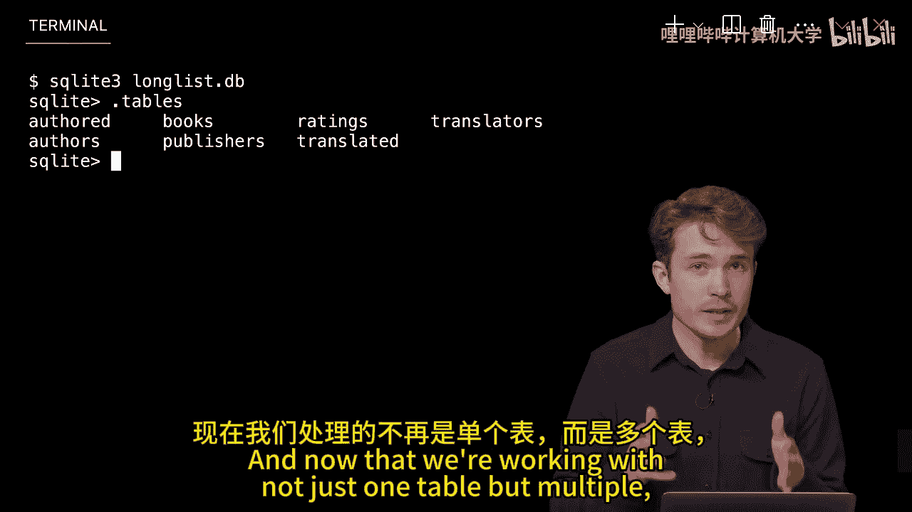

So let's look at one example of this kind of relationship among tables。

 I could have a table of authors and a table of books。

 This simplified for now to one column in every table。 Well， my authors's table。 I have names。

 and I booked a table。 I have titles。 and we seem be moving in the right direction。

 I could store more information about authors and books， but I've also created some problem。

 Like how do I know now， who wrote which book， like earlier we saw that you know。

 maybe Eva is right next to boulder in a single table for authors and books。

 and we know that Eva wrote Boulder that way。 But now if I look at authors。

 I only see Eva and no information about books。 So we seem to have this problem here。Well。

 one solution might be something like the honor system。 I mean， I'm honest。 and so are you。

 We could say that， well， maybe the first row in authors will always correspond to the first row in books。

 So we always know Eva wrote boldulder because Eva's first in the author's table and Boulder is first in the books table。

 Similarlyly， let's say Han wrote the white book。 because Han is in the second row。

 and the white book is in the second row in books。But I have to imagine， I mean。

 as good as I am at being honest and transparent， maybe I make a mistake。 Maybe I add a row to books。

 but not to authors or maybe I add a row to authors and not to books。

 I could change data and not update it to adhere to that standard。

 So let's actually take a step back and maybe think， well。

 is it better then to have this kind of situation or we did have one table with authors and books。

It might be， but let's think。 I mean， this could work for a while。

 but let's say Olga is a prolific author。 They like to write not just one book， but two。

 they wrote not just flights， but also the books of Jacob。 Well， let's say Olga writes another book。

 or another one， too， What might be the problem with this arrangement now。

 feel free to raise your hand， two of your ideas， Why in some issues here。

 if we only have one table of authors and books。There is some redundancy， some repetition。Yeah。

 good idea。 So you might notice there's some redundancy here。 I mean， Olga isn' in here twice。

 which is maybe okay if Olga wrote two books， but again， let's say Olga wrote three or four or five。

 Olga would begin here that many times。 And so we could probably do a bit better than this。

 And let's actually just say this is going to be the most efficient idea for us。

 Let's go back to these multiple tables here and think about how we could relate these two tables one to the other。

Now， before we get into the details of how we might do this technically。

 let's think about the kinds of relationships we could have between authors and books。 Well。

 maybe in our world， we have one author that writes one book。

 and maybe we could say every author only writes one book。 and similarly。

 one book is always written by one author。 This could be true for some books and some author。

 but arguably， it's not the best assumption， right。

 We probably have authors writing more than one book， or books being written by more than one author。

 So as it stands now， we could call this kind of relationship， A one to one relationship。

 If this is our idea of authors and books， one author writes one book and one book is written by one author。

 This is a one to one relationship。Well， as we know， authors can write more than one book。 Olga。

 for example， didn't write just flights。 They also wrote another book。 and so we could say， well。

 Olga wrote not just this book up top。 they also wrote this book down below。

 and now we're moving from a one to one relationship to what we'll call a one to many relationship。

 there are many books that one author could write。But， of course， is this the full picture， too。

 I mean， some books are only written by one author， but presumably。

 some books are written by multiple authors。 So we need to enhance our picture even further。

 Let's try that。Let me add another author into the mix here。 This author wrote this book。

 along with Olga， let's say。 So notice how here we have one author writing more than one book。

 And we also have one book being written by more than one author。 Well。

 this is called a many to many relationship。 And it's called that because we have many books that could be written by many authors。

 So these in general， are the kinds of relationships we have amongst our tables in a relational database。

 one to one， one to many and many to many。Now， thankfully。

 there are some tools we can use to visualize these kinds of relationships we have at our disposal。

 something called an entity relationship diagram， something a bit like this。

 It's also called an ER diagram for short。 And let me propose just for now that this is the diagram for our database。

 We have authors and publishers and translators， books and ratings。

 These are our entities in our database。 The things we're trying to represent。😊，Now， you'll notice。

 though， that there's something more than just these boxes that have author， publisher。

 translator and so on。 There are all these lines among them。

 And they have verbs like wrote and published and translated。 And maybe that makes sense to you。

 But at first glance， like there's one line here that has three lines coming off of it。

 One line going across。 This one has a circle on。 I mean， what does all that mean， right。

 This is kind of confusing at first glance。 Well， this actually has some order to it。

 some rules that we can use。 And let me show you what those rules are。

So here we have what's called a crows foot notation， a way of trying to represent one to one。

1 to many， or many many relationships using just lines and in some cases， circles。 So here。

 if you ever see this line with a circle on， you could think of 0。

 This doesn't have to have anything related to it。You could think of this one with a bar going perpendicular as one。

 something with this arrow has to have at least one thing that relates to it in some other table。

And this one down below， the one that looks like a crow's foot。 Well。

 this one means that some entity has many that could be related to it in some other table。

So let's try this with an example。 Here we have again our authors and our books。

 and here we can say that an author wrote one book。 We read this left to right。 in this case。

 One author can have one book associated with them。

 We know it's one because we see this bar over our line here。Now we know too， that books。

 at least in our world， could be written by one author。 they must be written by at least one author。

 so let's try this。 I'll include that arrow on the other side too， and I'll read this right to left。

 A book has to have at least one author。Now， I could add in more symbols， too。

 We know that books could have more than one author， and an author could write more than one book。

 So let's try enhancing our diagram even further。I could say adding in these crows foot notation with the multiple lines here。

 Now I could read it like this。 an author going from left to right can write at least one book。

 but they could write many books。 They could write one or many books。 and similarly。

 a book could be written by at least one author， but certainly also multiple two。

So this is one example of an ER diagram for our database and hopefully now you can see a bit more of this making sense to you。

 so we see that authors here could write many books。

 book could be written by many authors books actually don't need to have a translator。

 they could have zero to many translators for their book here， but in general。

 a translator write or should translate at least one book or possibly many of them too。

So let me pause here and ask， what questions do you have on these table relationships and these diagrams。

 that we call ER entity relationship diagrams。Yeah， so K I want to ask that for any given database。

 how can we predetermine how the relationship between the tables are going to be because here we know that the authortter has some relationship to the books。

 but how can we determine whether those relationships are existent in the first place？

A great question。 If we have some database， how do we know the relationships among those entities or those things that are stored inside of it？

 Well， part of this is really up to you。 I mean， when you're designing a database。

 as we'll see in a future week of this course， you have decisions to make。

 Do you want an author to be able to write only one book or multiple， for instance。😊，Often。

 when I design a database， I might write a diagram like this。

 so I could show this as somebody else who can know what tables I have and how theyre related to one another。

 So if you're designing， you have the choice。 But if you're taking database from someone else。

 you could ask for a diagram like this that could show you those relationships among those tables。😊。

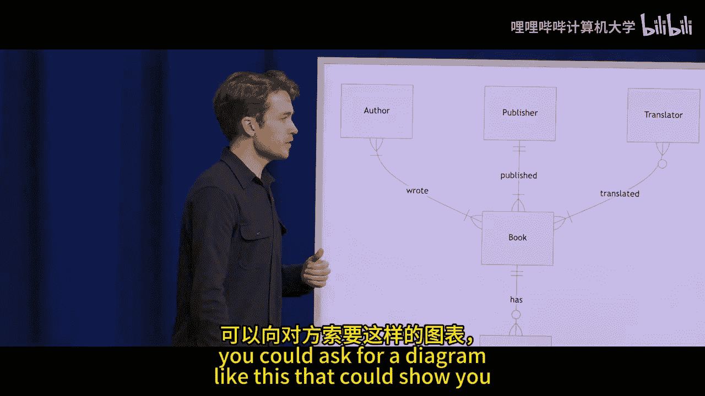

Let's see。 What other questions do we have too on。These tables and their relationships。

How do we determine that relationship， I mean， we know that it exist。

 but how we assign which author wrote which book or multiple books or which book were written by what authors Yeah。

 great question。 So how do we try to assign then these relationships， perhaps in our database。

 Like we know that an author could write multiple books。 But how do we represent that in our table。

 Let's say well for this， let me just transition to the next part of what we'll talk about。

 which is going to be this idea of a key。 So keys are this fundamental idea in databases that can help us relate tables one to the other。

 And for this， let's actually do a bit of an example， a bit of a role play here。

 So I will be your librarian today。 And let's say that you're looking for a book。

 This one is called the birthday party。 And I say， okay， I'll find you this book。

 I good by computer here。 And I will try to find you the birthday party。😊，Here， though。

 I have two options。 I seem to have the birthday party by Wendy Dranfield and the birthday party by Lawreent Mouvenier。

 So let me ask you if we're on the phone。 perhaps， which one do you want。😊，Hearing， feel free to。

 to vote。 Which books should we search for， The one by Wendy or the one by Lawrence。

I'm hearing maybe going for Laurnce。 So let's try Lareent over here。

 We'll search for the one by Larence。 So the birthday party by Laurent Moveigner。 Okayk， Ok。

 let me find you that book。😊，But。Well， now there are still two books I could choose from。

 do you want in hardcover or paperback？ And so I could ask you again， well， which one do you want。

 Do you want it in hardcover or paperback？ And again， feel free to vote。 Which book do you want。Okay。

 I'm hearing。We're going for a thing closer to paperback。 Let's try that one。

 So we'll search for the birthday party by Laent Moveigner in paperback。

 And there are still two of them。 Like， which one do you want， We have first edition。

 And we have second edition。 So I would ask you again， which book do you really want。

 And you could keep voting here。 But for the sake of just keeping this going， I mean。

 let's pause here and think of a better way to do this， right。

 my life as a librarian would be much easier。 if you had given me a simple number。

 this number is called an I S B N。 And it turns out that every book has a unique identifier called an I S B N。

😊，Now， what is an ISBN really， Well， if it's the case that every book has a unique ISBN and I can only find one book。

 if I have an ISBN， this what we call in database terms， a primary key。

 something that is going to be unique for our book or for any item that we have in our table。

 Now here's one example of an ISBN。 notice how we have 978180，40， whatever it is。

 we could use this to uniquely identify at least our books。

 but we could extract this away and use this in more than one place， not just for books。

 but for publishers for translators for authors as well。

 giving them each some I that uniquely identifies them。So here's one example of our table。

 Let's say that I have a table of books， and I used to only have titles。

 But now I actually have more than a title。 I have an I SB。

 N to uniquely identify each of these books。 And this is handy for me。

 If I wanted to look up some book and know exactly which one I was talking about。Now。

 these are all fine and good in tables， they're very helpful。

 but we could do a little more with them。 We could get to this question of how do we actually relate these tables together。

 We could use these primary keys for that。Now， a primary key becomes useful for that kind of work when we treat it as a foreign key。

 let's call it。 Well， what is a foreign key。Well， a foreign n key is simply taking a primary key from one table and including it in the the column of some other table。

 So here we have in the ratings table， the ISBN column still。

This is the primary key for the books table， but now it notice how it's inside the ratings table。

 This is now a foreign key because it is outside of this books table and inside the ratings table and what could I do with this。

 Well， I now see if I want to find all of the individual users' ratings for for Boulder。

 I could look， what is the ISBN of Boulder。 And then which ratings correspond to that ISBN in some other table。

So this is an example of how we could represent these one too many relationships I have here a table that has an ISBN or a list of ISPNs。

 and I have another table that can tell me which ratings correspond to this ISBN。

 this primary key in this other table here。Well， that solves one picture here。

 how we can represent these one to many relationships。

 But we could also think about how we do the many to many relationships as well。 And for this。

 we'll need to think about how we can improve our primary key here。😊，So let me ask， this is an ISBN。

But if I want to put this inside of a computer， like over and over and over again as a primary key。

 its the unique identifier， what problems do you think I might run into here if any？

What problems do I get by using this ISBN as my primary key。 You would run out memory。

 run out memory。 It's a good guess。 Like if I had a lot of IBns， let's say I had not just 78 books。

 but I had literally millions of books。 I mean， this is a lot of data to store。

 If you treated each of these as an individual character。 that's about1 B 8 B per character。

 That's let's say 13 plus 4 dashes，17 Bs per ISBN， which takes up a lot a lot of space。

 So what if I instead said， I'll remove the dashes like we did before。 And I'll treat it as a number。

 Well， in that case， I might also have a problem。 Like， let's say an IBn beacons with0。

 And if I convert that to a number。 I'll lose that beginning 0。

 because it doesn't really mean anything in the context of being a number。

 now I've lost my unique identifier。😊，So we could improve this even further。

 and we could actually construct our very own primary key。 This one， let's just say。

 will be called one for this book。 And some other book we could call it2。Some other book， maybe 3。

 And it doesn't quite matter what number we choose so long as this number uniquely identifies the book that we choose and we don't use that number for any other book as well。

 So let's actually rethink this relationship of one to many here。 Let's say， let's not just use IPN。

 This is a lot of space to use to someone point earlier。 Let's go ahead and use the I D。

 Let's make our own primary key in our books table and use that as the foreign key in ratings。

 So we freed up a good amount of space here。😊，And notice， too。

 that maybe Boulder has the primary key。 The I D of one。 The white book has the I D of 74。 Well。

 doesn't matter if it's 1，2，3 or 4。 It doesn't。 as long as 74 uniquely identifies the white book。

We're okay。 So here we have an example of a one to many relationship， but now improved。

And with this improvement， we could then think about many too many relationships as well。

 I could take the same idea and use it to relate authors and books。

 So let's think about this relationship now here， too。😊。

Let's say I have a table of authors and a table of books and notably each has a primary key。

 So I could use that primary key for authors and for books and perhaps put it in some new table。

 this one let's say， is called authored and I'll have one column for author I and one column for book I And based on the context clues here。

 what might it mean if I looked at the authored table and saw 23 next to one where 23 is in the author ID column and one is in the book I column for raise your hand。

 what would it mean for me to see those two numbers next to each other。Yeah。

 it would mean that the author that that has the idea of 21 23 has authored the book one。Yeah。

 great instinct here。 So if I look at author ID， I see 23。 Well。

 I could consider that maybe the author with the Id of 23 wrote the book with the Id of one and I'll concede。

 there's some extra work here。 like I have to figure out now who has this author I of 23。 Well。

 turns out if look in the author's table， it's Eva。😊，Similarly， for the book Id。

 I now have to go through the process of figuring out， okay， well， the book Id is one。

 what then is the book title， And I'll look for that in my books table over here。

 So it brings in a bit more work for me。 But ultimately。

 I think we've solved our problem from the very beginning of lecture trying to relate authors and books。

 We can now do that using both primary keys and foreign keys。So let me ask then。

 what questions do we have on these keys and how to use them。

So if can the ID of the author and the book ID be the same， for example。

 can there be a author ID of one and a book ID of one or will they be mixed together a really good question and good thinking here so let's consider that maybe an author ID matches a book's ID like both authors。

 both the author and the book have this I of one That's actually I would say okay in our case。

 because we know that at least one refers to authors and one refers to books and as we'll see in future lectures too。

 when I make this joint table also called a joint table or junction table and Associative entity。

 I could claim that this column called author ID references the primary key column in authors and that primary key only I could do the same thing for the book side。

 I could say the numbers in here reference the primary keys in the book table。And those Is only。

 So I could actually have authors and books with the same I so long as my tables know that if I have this column。

 I'm looking for author Is， this column， I'm looking for book Is。 Great question。

 Let's go to one more here。😊，I was wondering it feels like having more and more tables。

 because once you do this on a big scale， it adds up would use up a lot of space as well。

 How does it， How do you deal with the tediousness of it adding up。Yeah， good question here。

 So if we had a lot of these kinds of tables， wouldn't that take more space。

 And I think your answer the answer to that question is it would。

 but we do gain some things like being able to do it this way。 So for example。

 let me go back to my authors and books table in our database。

 we'll see we have not just author names， but also the year they were born。

 the city they were born in the place that they were living in certain peers of their life and so on。

 so we could have much more information in these tables that we couldn't store as one table earlier because of these redundancies we saw a little bit earlier。

 So I think although this might take up a little more space use a little more tables。

 we can get around that as we'll see later on with some creativeness with our queries too to address that downside。

 but a good question a good thought for tradeoffs here。Let's go to one more here。

So my question is that can the ID be updated and if so does it automatically get updated in the one that has both the IDs together？

Yeah， good question。 So maybe we want to change the ID of some book or author。 Could we do that？

 I would say you could， but it's kind of a dangerous game。 I mean， if I changed Eva from 23。

 let's say to so we changed 27。 Well， I could get Eva confused with ga。

 And I need to be doubly sure that when I'm changing these Is。

 I'm making sure that I'm not making an I nonunique。

 I'm not making it an I that somebody else already has。 And so for that reason。

 we very rarely change Is。 In fact， we tend to just abstract them away。

 So we don't actually know the I of any particular author or the I in a particular book。

 we just use them in our queries， as we'll see in just a moment。

So wonderful questions here we'll do take a very short break and come back to see how we can use these same tools of keys to not just relate tables。

 but to query them to and find answers to our questions across these tables。

 We'll be back in just a minute。😊，Well， we're back and what we saw before was how to relate our tables using keys。

 We saw that we could have tables of authors and translators and books related to each other using primary keys and foreign keys。

 So what we'll do now is figure out how we can query these tables using different techniques in this case might actually use primary keys and foreign keys within those same queries。

 Now one technique we could use this one called subqueries。

 also called nested queries to that basically put one sQL query inside of another。

 and they're useful in a few different cases。 but let's say I have one case of a one to many relationships。

 maybe I have publishers that are publishing many books， for instance， Well。

 I could use subqueries to help me answer questions about these kinds of relationships in my table to make it more concrete。

 Let's say I have a table of books and I want to figure out。

Of these books were published by Fitzgeraldo Eds。 My favorite publisher， let's say。

What's the problem here？I want to find the books published by Fitzker Auto Editions。

But what am I missing， Feel free to raise your hand and answer。Well。

 we don't have the name of the publisher in the same table。

 and we haven't made the relationship with the other people to know the name of publisher。Yeah。

 good observation。 So I want to find the books that are published by Fitzgeraldo editions。

 And as you noted， well， there's no publisher name。 There's just the Id。

 So I need to have some way of knowing what these Is correspond to and thankfully。

 I do have a way of knowing that。 I have a table called publisherlishs and this has a column called I at a column called publisherublish and what do I notice。

 Well， I notice that Fitz Caraldo editions has the I of five， So I could probably solve this problem。

 but let me ask again， what queries might I need to answer this question。

 There are two queries that I need to do to answer the question of which books were published by Fitzgeraldo editions。

 What two queries are they。😊，I think it's select and where。Did you mean keywords or queries。Yeah。

 so keywords would be great。 So I need to have some kind of select involved。

 I need to probably select something from publishers and something from books。 So could I ask you。

 what would I select from publishers and what would I select from books then。😊。

Let's take either another hand or。Following up here。Okay， so we would take the publisher。

 So select publisher I from where publisher equals the publisher name we're looking for it。

 And then we would nest this query inside the other one。

 So we can find the name of the book published by this publisher。 So we found the I。 Yeah。

 some good ideas here and let me propose to do it visually here first。 So I want to figure out first。

 What is the I of fititz Carrado editions。 Well， I could write a query to find that。

 And I'll say get back5 for fititz Caraldo editions。 Well let's one step。

 But my next step is then to say what books fit that publisher I D。 So I'll write another query。

 this one to determine which titles have a publisher I of5 and I'll get back。

 let's say minor detail and Paradus。 So let's make this more concrete as you were doing yourself。

 John Paul， let's write these queries out。 Let's say I have this first one to determine。

What is the Id of Fitz Caraldo editions， I could say。

 select Id from publishers where the publisher is Fitz Caraldo editions。

And I'll get back from this query， the number5。Well。

 I could use that number in my next query as we saw visually here。

 I could then say select title from books where the publisher ID is5。

 and I would get them back many titles here。😡，Here's another question。

Why is this not very well designed， at least in the query I have here。

 what could I improve about it or what kind of smell is wrong about it for you。

They are not connected。Yeah， so John Pauls， you said too， they're not connected。

 and here I have this I of five， but I mean， I don't want to remember this number。 I mean。

 I don't want to have to keep it in my mind and like use it later on in my queries。

 I ideally could use some other query to find this number for me more dynamically。

 And so SQL supports this idea of writing a sub query， a query within a query。 For example。

 I'll take this and I'll convert it to the query we had before。

 I'll select title from books where the publisher I is equal to well， the result of this query here。

 and notice how I have parentheses。 This means the query furthest inside the parentheses will be run first。

 So first， this query is run。 I'd get back 5。 then I could finish out my query and say select title from books where publisher I is equal to 5。

So let me pause here before we do some practice in our SQLite terminal。

 what questions do we have on these kinds of subqueries so far？

I was wondering what would happen with those records that don' matched in the subry。

Yeah， good question。 So if the I D doesn't match， is that what you're asking。Yeah， I'm hearing yes。

 so if I0 doesn't match， that's a good question。 So we can treat it as we would a regular old SQL query that we learned about in last week。

 So we said select title from books where publisher I is equal to let's say some value and we'll then filter out all of those that don't have that particular value。

 So if we have a publisher I of6 or of three， those won't be included anymore because we said where publisher I is equal to5。

 And now looking at this query to， Well， let's say I might write select I from publishers where publisher is or equal to fits Caraldo editions。

 maybe that publisher doesn't exist。 there's no publisher with that name。 in that case。

 this query would return nothing。 and therefore the next query also return nothing。

 So we have que is dependent on the results of the other queries here。😊。

So let's actually try this using our sQL light terminal to get a better feel of what we can do with this kind of structure for our queries。

 I'll go back to my computer。😊，And I'll hop into my SQlite environment。 Let's say here。

 I want to do a similar query， but I want to find those books that were published by Maclehoe's editions。

 or Maclaho's press rather， So let me try to attempt this one by one， going one step of the way。

 and then finally combining my queries into1 I could use more dynamically。 So to our point earlier。

 We have to first find the I D of Maclaho's press。 Let me try to find that。

 I'll say select let's say I D from publisher where the publisher is equal to none other than Macleho's press like this。

 and my quotes， shall I call hit enter。 and hopefully， oh， I will see，ll see an error。😊。

And based on this error， let me ask our group here， what did I do wrong？Judging by the error。

 I think you just mist the table name。

Yeah， so I probably mistyped the table name and we could probably parse this if I look at the error itself so it says parse error。

 no such table publisher and that's true。 There is no table called publisherlishs。

 Let me fix this and run it again。I'll say select， let's say ID from the publishers table plural。

 and we'll say where the publisher is equal to Maclehose press like this and I'll hit a semicolon here and now fingers crossed this should work。

 I do see an ID of 12 Okay， so Maclehose press， the ID is 12。

 now I want to find the books that were published by this ID。 So let me go to my book table。

I will say select title from books in this case where the publisher IDd is equal to 12。

 as we saw before， semicolon。 Now I'll hit enter。 and I'll see these are the books that Maclaho press has published。

 But again， as we saw before， I could improve this。 I could make this better。

 more dynamic by nesting my queries， having a subquery， a query inside of a query。

 So let's redo this。 I'll start at the end， essentially， I'll say select title。

Select title from my books table， where the publisher ID is or is equal to。What， Well。

 let's say I don't know it's 12。 I have to write another query here。

 so to do that I could open up some parentheses is equal to app parentheses。

 and then I'll hit enter to continue my query。😡，All indent， four spaces， space， space， space， space。

 just a style convention to keep things clean for me to show this query is inside of this other query。

What I'll then do is finish out this query。 I want to select。

I want to select the ID from the publishers table where let me just indent again where the publisher is equal to not Fitchcra audits is equal to Mac Leho's press and quote and now let me close my parentheses。

 I have an open one here that I should close to show this subquery is done。😡，I'll hit enter。

 close my parentheses， and now my entire query is done， I can hit semicolon， hit enter again。

 and now I'll see the very same results， but more dynamic， no longer I have to hard code the ID。

 I can make it more dynamic and I can actually find it using my very own query here。

Let's try a different context too， maybe I want to find all of the ratings for this book calledIn Memory of Memory。

Well， maybe I'll try it step by step。 And what I'll first do is try to find the ID for in memory of memory。

 I'll say select I D from。 let's go from the books table。

And let's say where the title is in memory of memory。Memory of memory。And quote， semicolon。

 hit enter。And we'll see 33， so this book has the ID 33。Okay。

 let's now look in our ratings table for this IDd。 I'll say select。

 let's go for select rating from my ratings table where the book IDd is equal to 33。

 I believe it was。 So now I'll hit enter， and now I should see all of the ratings for this book。

 and there are quite a few that people have left on this book on the Goodreads website。

So let me again， try to improve this and make it just a little bit better。

 I'll be more dynamic about it and try to nest these queries。 I'll say select rating from ratings。

 We'll start at the beginning。 We ultimately want ratings。 Well。

 I want those ratings where the book Id is equal to some number， but I don't know what number yet。

 So I have to write my own nested query。 I'll pray I'll create parentheses like this。Enter。

 I'll indent four spaces， space， space， space， space。 And then I'll say。

 I want to find the I D from the books table， from the book table where this title is equal to in。

It's equal to in memory of memory。And that is my sub queryry now。 So I'll close this out。

 I'll hit enter， close my parentheses， now have a semi colon and hit enter。

 and I see those very same ratings。Well， I could probably not get back the individual ratings。

 I want to kind of average them over time。 So let's try that too。 I'll say the same thing。

 Select rating from ratings。 But now no longer would I want to select all the ratings。

 I want to average them。 So I'll say select the average rating of this book from ratings。

 And now let me go back over to minus query， and I will hit enter again。

 and I will hit the up arrow to get back access to my earlier parts of my my SQL8 environment。

 I'll hit enter here， close it out semicolon。 and now I should see the average rating for this book。

O。So this is very handy for us。 We're able to kind of replicate those queries we would have done with a single table。

 but now using subqueries。 And so far， we've seen this working for a relationship that is one to many。

 We could also use subqueries with many to many relationships。

 these tables that have many items over here and many items over there that relate in some way。

 Let's try it， let's say with authors and books。 And I want to figure out。

 let's say which author wrote flights， which author wrote flights。 So let me ask。😊。

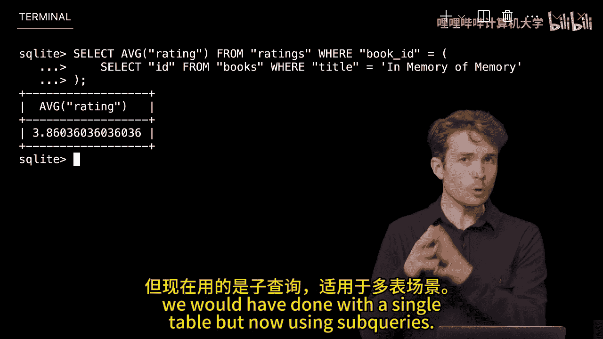

What should I figure out along the way to get to the author who wrote flights because you walk me through what I might need to know for that query。

You need to know idea of author and of that book。And they。Based on that relation。

 you had to join all three tables together。

Yeah， I have to know Is。 and I have to kind of walk across the three tables， as you're saying。

 So let's go back to our tables。 and I want to know who wrote flights。 Well。

 a good place to start to your point is to say， let's start it。 Fs and find the I D。 Well。

 the I of this seems to be 78。 Okay， let me then look in our authored table。

 And let me try to find the author I that corresponds with 78。 Well， I find 78 here。

 What's next to it。 Well，58。 Okay， so the author I who wrote flights is 58。 Well， who is 58。

 I'll look in the author's table。 and I'll see this is not other than Olga。😊，Okay。

 so let's walk through trying to make this query happen。 But now using SQL keywords。

 I'll start first with trying to find the Id of flights。

 I'll select the Id from the book table where the title is equal to flights。 Okay。

 that's fair enough。 Now I could nest this query。 Put it inside another query to find the author I of the person who wrote flights。

 I'll do a bit like this。I'll select author IDd from authored where the book Id is equal to。

My prior query， select Id from flights where title is equal to or from books where title is equal to flights。

 And now I could go one step further。 I could say I want to find the name of the person who has this author I。

 Let me nest again。 Let me put this query。 Select name from authors where Id equals and put all the rest of it inside of the nested query here。

 So to be clear， I'll start from the middle， find the Id of flights。

 then find the author I for that book I and then I'll find the name of the author who wrote that book。

Okay， so a good number of steps here。 But let's try it out ourselves in our SQLite terminal。

 I'll come back to my computer。 And here， maybe I want to find all of those books or maybe not all those books。

 I want to find the author of a particular book you might be familiar with called the birthdayday party from our Librarian conversationvers a little earlier。

😊，Let me say， I want to first find the I D of the birthday party。

 I'll say select I D from books where title is equal to the。Birthday party， semi Collon， enter。

Now the ID is eight， okay， let me keep that in mind and actually I don't quite need to know this。

 let me just try to nest this query inside some other query to keep going towards my goal of finding the author of the birthday party。

So the next thing to figure out， as we saw before is finding the author I。 I'll say select。

 let's say the author I。From the authored table， that table of authors who have written books。

 and I'll say where the book Id or the book Id is none other than the 1 I got back from this prior period。

 Let me indent and say select Id from books where title is equal to the birthday party quote not a semi colon yet。

 and my parentheses semilon hit enter， and now I see 44。So we're getting there。

 but now to figure out who has the ID of 44 in my author's table， let's keep going。

Let's clear our terminal using Ctrl L， and I will then say select the name from the author's table。

 we're going to start at the beginning or we're going to start at the beginning。

 the place we want to actually get to， then I'll say where the ID or the ID of that author is equal to the result of this query。

What is the author ID associated with the book I want to find so I'll select author ID from author。

From authored， and I'll say where the book Id。Is equal to？Another subquery here。

 I'll indent four times and four again。 Now I'm nesting twice right。

 So I'll then say select Id from books and I'll hit enter just to kind of keep me on some good style here。

 I'll indent eight times total or and then I'll say where。Where。

 let me make sure I'm doing the right thing， where the title is the birthday party。Okay。

That was a lot。 Now， we'll close out our queries。 I'll hit enter space face，face again。

 semicolon or parentheses， enter again， parentheses， semicolon。 and hopefully after all this typing。

 we'll get back what we want。😊，We see our friend Laurent Moveer。

 So this is an example of trying to find the author who wrote a particular book。

 although it's a bit long winded using these kinds of subqueries。

So let me pose questions then， we've seen how to use these subqueries for one to many relationships and also many to many。

 what questions do you have about how to use these queries？

I remember talking about books of the same name， and in fact。

 they can have different versions and etc cetera。 How would you get the I D for the different versions if they are titled the same as I'm guessing you wouldn't。

I'm guessing you would set， you wouldn't set the forum key to the title is that it' would be for primary or is it done differently？

A good question here。 So you could imagine a database that has more than one edition of a book inside of it。

 like maybe I have two editions of the birthday party or the hardcover and the paperback and all these other editions。

 right？ Well in that case， what I might do is try to this is a good segue。

I might have multiple Is that I'm searching for。 Like。

 let's say I don't care if it's the hardcover or paperback version。

 Well I could look for the I D of like 55 and 56 and try to find the author of both of those。

 So let's actually keep going here。 Let me show you a new keyword to use for those kinds of questions。

 if you don't mind。 Let me come back to my computer。

And let's introduce this new keyword that can help us find the author of not just one book。

 but perhaps multiple books or different versions of the same book。 Let me introduce this one。

 This one is called in very simple， just I N。 and I can use in to say well。

 maybe some key or some column is in some set of values。

 not just equal to one but in some set of values。 So let's see an example here。

 We're back at our authors， books and authored tables。

 And maybe I want to find the books written by these two authors， Gauze and Olga。 Well。

 I could select their ideas。 I could say get back 27 and 58。 Now I have two Is。

 So I could look in author。 And I could say give me back all of the book Is that have an author I of 27 and 58。

 Okay， I'll look here。 and I'll get back both for and。😊，So notice how earlier I was asking。

 show me the book Is where author I is equal to some single value。 Here I'm asking。

 find me the book Is where book I has where the author I is in some set of values more than one now。

And similarly， let me look at my books table。 let me say， okay。

 I want to find the titles for these books。 Well I'll find the titles that have book IDs in this set of Is 4 and 78。

 So let's see this in action in our SQL terminal。 I'll come back over here。And all right。

 this query to find all of the books by a particular author named Fernandnda Melour。

 So I'll go back to my terminal。 and Fernandnda is more prolific than most。

 She's written actually two books that are on the long list for the Booker prize。

 So I'll say select I D。From authors where the name is equal to Ferand， Ferand Melcor。Some I call it。

And this now is Fernandez's ID 24。Okay， let me find the I Ds of books that Fernandnda has written。

 I will now say， select。Book I D。 Select book I D。Fcon types like book ID from the authored table where the author ID is equal to the result of this query。

1，2，3，4 spaces here， and I'll say select ID from authors where the name is equal to Fernandnda Melco。

parenttheses is semi callant， and I'll hit enter， and I'll get back not one book I but two。

 So if I want to find these titles， I should say find me the titles where the book I is not equal to。

 but is in this set of Is。 So let's try that。 Let me say select title。

From books where the Id is in some set of values is in those two Is we saw earlier。

 So I'll say in enter 1，2，3，4 spaces， and then I'll say select the book。Id from author。

 where me actually space this again where the author ID is equal to the result of this sub query。

 We can use equals here because there's only one author ID we care about。I'll hit enter。

 then I'll do space， space， space， space， four spaces for one indentation， and now four more spaces。

1，2，3，4 to indent again to my next nested query。 I'll then say， select。

 let's say the IDd from authors from authors where the name is equal to Ferandnda Malco。And now。

 let me close out my queries。 I'll hit enter space， space， space again。

 and now I'll use parentheses to close out my middle subquery。I'll do this thing。 I'll hit enter。

 and then I'll do another parentheses， and then semi I colon here， hit enter。

 And now I should see finally， Fernandez two books。😊。

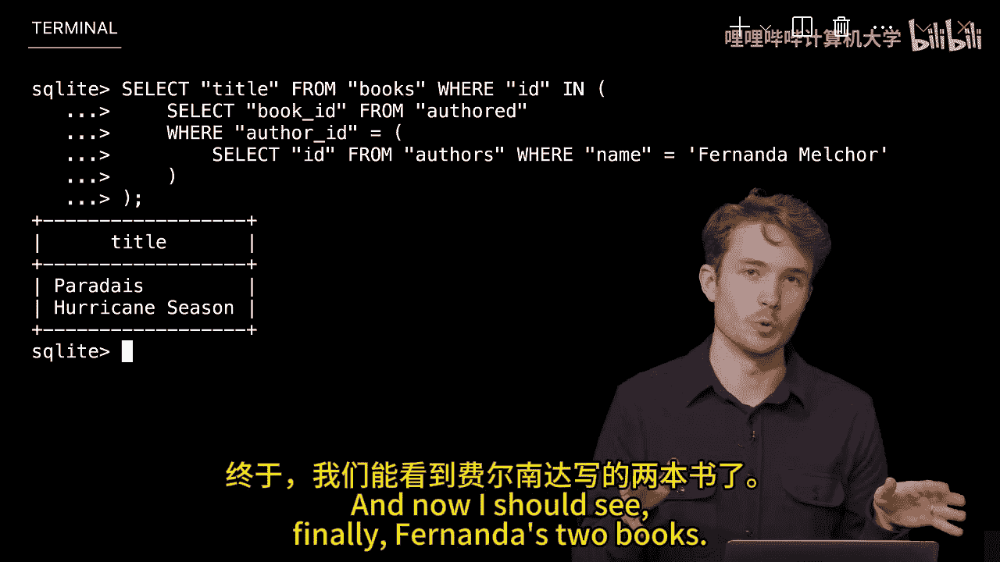

Okay。So this is one example of using in。What questions do you have on how to use this syntax。

Actually， my question was not regarding n， but actually the indentation you use regarding the subqueries because while you were using the subqueries。

 you mentioned that you were giving four spaces， is there any necessity of using like such kind of indentation while we are using subqueries？

Yeah， I a good question about style here。 and let me try to pull up some slides that have an example of that style。

 so we're can talk about it， let me try to find an example of our nested query。I'll pull this one up。

And as you might remember， we had three queries here。

 and I tried to keep track of them by indenting them more and more and more。 This isn't required。

 You could I mean don't do this， but you could put it all on one line。

 which will just be crazy long to read what we do instead is we'll often try to hit enter when it feels nice to have a break in the reading length。

 And then indent some space is to show that this query is a subquery of the prior one。

 The exact amount to indent might vary。 but the idea of trying to break up your lines and trying to indent is going to be a good one for your own sake and for those who read your code。

😊，Let's take one more or too。When do we need to use in in work when we are doing， you know。

 sub querying， I suppose that we can also use subqueing without in as well。😡，You're right。

 So we saw an example using equals， and we all saw an example using in in general。

 if you want just a rule of thumb to follow， if you're looking to see if some ID is part of a list of Is or part of a set of IDs that is more than one。

 you should use in in is good for checking， if something is inside of more than one item， let's say。

Equals， though， is good if you know you have only one Id。

 let's say I have an Id equal to 23 or equal to 25。 That's a good place for equals。

 If though I had 23 or 25， I might use in to match either or of those in that set。 A good question。

Let's take one more here， too。 We have seen many to one one too many relationships。

 one to one relationships and many， too many relationships。

 So how would many to1 relationships be tackled， Suppose one book has three authors。

 Then how would that be represented in the table。

Yeah， let's look at the example of one book having three authors， for instance。

 let's look at our authored table。 So let me pull up that slide for you and we'll talk about it in just a minute。

I'll come back over here， and I will pull up our example of having authors and books and the authored table in the middle。

 And to your question of how could I have， let's say a book written by three authors。 Well。

 we could imagine that this table。 Let's say let's talk about boldulder， for instance。

 So Boulder has the I of one。 Let's say three people wrote Boulder。 Well， in this case。

 we could adjust this， I could say this is no longer 74。 This is one and same thing here。

 This is not four。 This is one。 We have the book I D1 in here more than once。 It's in here，12。

 three times。But what we're saying each time is that well 23 was an author of1。

 31 was an author of one as well， and so was 27， so I would not be afraid to have multiple instances of your foreign key inside of this table。

 what I wouldn't do is have it more than once in your primary key here。

Here it actually has some information who authored which book。

 here it is strictly a unique ID that should be only a one to one relationship。

 Every key has to be unique for the items in that table。Good questions。Okay。

 so we've seen subqueries， but there is one more technique we could use to solve from these problems of  querying across tables。

 And this one is going to be called a join。 So let's dive into joins。

 and the whole idea behind joins is trying to take a table and combine it with some other table。

 and actually for this， we have some， I don't know， maybe guests for our class。

 we have these very cute sea lions。 and we'll use a database of sea lions to understand how joins actually work。

 So if you're not familiar。 sea lions are sometimes native to the coast of California。

 and they like to travel， They like travel really far。

 They go from these southern part of California all the way up to Washington state。 This is many。

 many miles of traveling for these adorable sea lions。

 So there are datas that involve sea lions and their migration patterns。 Here's one， for example。😊。

Here we have a table of sea lions。 And here we have a table of their migrations。

 A distance column tells us how far they went in miles。

 and a day's column tells us how long it took them to travel， of course， in days。Well， here。

 if we're researchers， maybe we're keeping track of some number of sea lions。

 We're keeping track of Aya and S and Tiger， Mabel， Rick and Jolie。

 but we have data on many sea lions， perhaps some we aren't even tracking anymore。

 This would be our migrations table。Now， it could come to pass that I want to figure out。

 how far did spot travel And how far did ti travel。

 And what I could do is I could use nested queries for this， but perhaps better yet。

 I could try to join these tables to see the data all in one table。 Now to do that。

How could I try to take a row from this side and kind of attach it to or extend the row here？

Idea could I use。To put the right rows together， in this case。Could you use the prim key。

 the Id to kind of join them together using the prim key in the foreign key。

Yeah， a good idea， so you might notice that we actually have two columns here。Both called IDd。

 which is handy for us。 And notice how we have them kind of sort of matching and matching in the sense that some of these Is are actually inside of this column too。

 so we could use the primary key in really both tables here and try to match it together to figure out how these rows could be extended to add more columns。

 We could join these tables together to make this table ultimately showing us where Iya has traveled and how long it took them to get there。

😊，So the key word for doing these kinds of manipulations with data in SQL is called join kind of straightforward。

 but let's take a peek at what join can do for us inside of this database。

 So I'll go to my computer here and I'll pull up this database of sea lion that I prepared for us today。

I will clear my terminal， I'll type control L and I'll get out of my long list database to do that。

 I can type dot to quit a SQL light command to leave this environment I'll hit enter and then what I can do is I can type SQLL 3。

Space C underscore Lions dot D B。 That is just the name of this database。 Okay， I'll hit enter。Now。

 to make sure I'm in the right place， I could type dot tables to see what tables are inside of this environment。

 dot tables enter， I see both tables， migrations and sea lion， which is promising for me here。

 so we could see what data is inside of these tables。

 I could say select star from C underscore lines。😡，Secolon hit enter。

 Now I see all of these adorable sea lions inside of this lovely table。

 What I wanted to find migrations。 Well， I could do that too。

 I could say select star from migrations。 semi colonlon enter。 Now I see my data on migrations。

 And notice how， again， some sea lions are in the sea lions table。

 And we have some I in our migration table that actually aren't in our sea lions table。

 So we're keeping track of only a subset of sea lions and the state might have some sea lions we keep track of in the past。

 So not all of them as well。😊，Okay。So let's try joining these tables to determine where have our sea lions been in our sea lions table。

 I'll say select star from C lions， but now I don't want to end this query here。

 I want to expand this table with the data inside of the migrations table So what could I do。😡。

I'll hit enter just as a style thing here to now consider how can I queryry a bit longer。

 I want to join the migrations table to the C lions table and to do that。 I can type join。

 I'll say join。 then space。 and I want to say the table I want to join In this case。

 the table is called migrations。 I'll say migrations。 and I have to tell it one more thing。

 I have to tell it what we saw visually earlier， which is that the Id column in C lions matches the I column in migrations。

 I have to tell SQL which two columns to try to join these tables by。So I'm going to do that。

 I'll say join migrations on， which is a SQL keyword。 what two columns should correspond。

 I'll now say migrations dot I。 This means the ID column inside of migrations table is equal to or is going to be joined with this C lions table and the IDd column within that。

Again， these two columns should have some matching values that we could use to make these rows longer with more columns。

Let me then hit sign colon here， and hopefully we'll see。All of our data now combined。

 I can tell you how far Tiger went and how many days it took them to do it because I've joined these two tables together。

So in doing this kind of join， regular old join， what we're really doing is part of this family of joins are called an inner join。

 You may have seen this idea of an inner join or an outer join。 The usual join。

 at least in sQL light。 It's going to be an inner join。 And what do we mean by inner join。 Well。

 let's visualize it a little more slowly here and see the process of which we might use to understand this join。

😊。

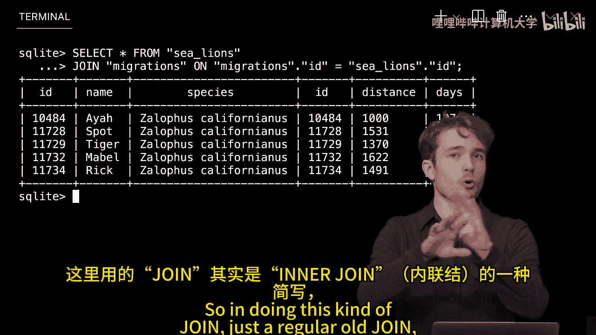

I'll have again my two tables， but now simplified， I have name and ID and just distance and ID and to join these。

 I could literally kind of nudge them together and draw a line down the middle a bit like this。

 but what do you notice， I mean， this one seems to match this ID and this I seems to match this ID。

 but these two well they don't match， I mean， pour Jolie down here。 we don't know how far Jolie went。

😡，And if we don't know this data， if these Is don't match as if we can't find a match for this I or for this Id。

 Well， let's sadly just get rid of the row。 Like it's not part of our join table anymore。

 It's gone from our memory。 We now have only these tables or these rows that we could actually join together with the row in the other table here。

So。This is our example， then， of an inner join。 Let me ask。

 what questions do you have on these joins so far。So the confusion problem me right now is where where the I is generated。

 Was it on the sea lion table or on the migration table and what kind of program can that post like maybe in real world So that's the question I have maybe not directly joins itself No。

 that's a great question and good to clarify。 So we have sea lions with some I and we see here that one idea is 104。

84 another I is 117 to 8 and to your good question which is how do we get these I Well is actually came to us from researchers perhaps we're researching sea lions And if you're not familiar and they go back to our slide with sea lion migrations on it。

 researchers might often want to keep track of where sea lions have been and to do so they will a noninvaively apply some tag to this animal that has some unique I on it and they'll track where that tag goes to understand where particular sea lion went So they will make up their very own primary keys。

 they very own unique Is。To identify these sea lions。

 we can then use those same Is in our table to understand where these sea lions are going。

 And just to be clear， too， let me find our full data set here。Here。

 we have those sea lions that we're now interested in。 Those we're now tracking。

 But you could imagine that we also have some sea lions that， you know， we no longer track and。

 you know， maybe they've you know， gone on。 They're doing something else。 Now。

 They're not part of our data set。 So that's why we might see some over here， but not over here。

 I hope that amps answer your question about the sources of this data。 So let's take one more。

When we join together the two migration and C cell， the I D table is repeating。

 So I just want there and travel distance。 I don't want to repeat the table of I D。 Is that possible。

Yeah， and I think if I'm understanding correctly， we want to try to not just join these tables。

 but maybe remove the duplicate Id in them。 like if I showed you this joins table right here。

 I D appears in here twice。 There is a way to do this。

 and we'll see it towards the end of our exploration of joins。

 We'll come back to that in just a minute。Okay， so we've seen inner joins so far。

 this way of combining tables and only keeping the data that actually matches between them。

 But let's try a new way of joining this one that might not be so strict。 We have a few options here。

 We have what we're going to call a left join。 a right join and a full join。

 And you could imagine based on the names here， what each one might do。

 you could think of our tables， one being on the left。

 one being on the right and trying to join them prioritizing either the left table or the right table or maybe even both per a full join。

 So let's get a feel for what kinds of tables we get back from these different commands。

 and we'll talk about， we'll visualize how this is actually happening underneath the hood。😊。

Let's go back to our computer here。 and let's try to do a left join using R2 data sets。 Now。

 a left join will prioritize。 so to speak， the data on my left table， left being quote unquote。

 because there is no left or right in a database， but left here means the first table that I start with。

So let's try this。 I'll say select star， select star。

 Let me just make sure I'm typing the right things here。

 Let me try select star from the sea lions table。And now I don't want to just do a regular old join。

 I want to do a left join， I want to， no matter what， always have the data on my left table。

 this sea lions table here。😡，Left join， and I'll join migrations。 I have to say the same thing。

 which column in migrations corresponds to which column in sea lions。

 I'll say left join migrations on migrations dot ID equals C lions dot ID as well。

Now I think it's just about it for my joint， so I'll say semicolon enter and notice the difference here let me walk to this board we can see it in its entirety。

 I have all of my sea lions now in this table where we left off Joli earlier we've now kept Joli in even though Jolie doesn't have a distance or number of days we actually haven't tracked that data yet for Jolie。

 but we still see them in this table。Let's now try a right join to see the difference between this and the right join。

 I'll come back over here and let's try prioritizing our right most table。

 This one perhaps being the migrations table So I'll say select star from C lions。

 This will again be our left quote unquote table just because it comes first Now I'll say join not just join。

 I'll say right join migrations on again migrations do ID equals let's say C lions do I。S I call it。

Now let's see the difference here。Well， what have we done。

 We've actually left off a few sea lions now。 We only have those whose Is were in the right table。

 again， the right table being that second one we used。

 And even if we don't have any names for these sea lions， we'll still include them in our data set。

 we can see， though， that this data is missing。 And that， as we'll see。

 it has some social value called no。So we have a left join and a right join。 A full join， though。

 allows us to see the entirety of both tables and which values are missing。 Let's try that now。

I'll come back over here and I'll do a full join， I'll say select star from sea lions。

Full join migrations on full join migrations， on migrations。Oh， migration dot I D。

Is equal to C lions。id， semicolon， enter， and now what do we see well we see both tables in their entirety。

😡。

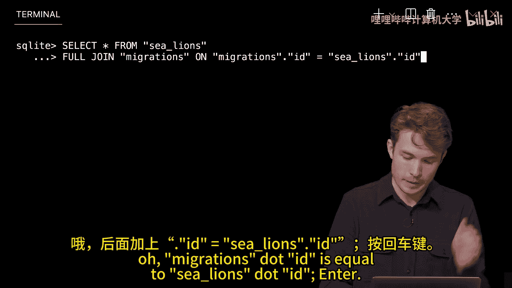

We have Jo Li in here。 So， even though Joe Lee doesn't have a distance or the number of days。

 we also have our sea lions， our mystery sea lions down below who don't have any name。

 but are still included in our migration table， too。So left join， full join， and right join。

So let's then visualize this to understand what's happening along the way。

 I'll go back to some slides here。 And let's look first at these left joins as well。

So really all of these left join， right join and full join。

 These are all part of this family called an outer join。 An outer join lets you keep some data。

 even if the join is not going quite work out for you as much as you would want to in an inner join。

 by that。 I mean， you might have some null or empty values in this join after you run it。

 So let's visualize it here I have a left outer join。

 And I want to combine this left table with this right table。I a left outer join。

 I'll put them together and notice how these two don't match。 Well， because they don't match。

 allll fill in these values with the value that signifies empty or null， in this case。

 it is literally null， there's nothing here。😡，So because I did a left join。

 what I should do is prioritize this left table's data， even if this doesn't have any match here。

 I'll still keep this row。😡，But notice down below that this ID has no match in the left table。

 I'll omit that， and in the end， I'll delete this bottom row。

 but be left with Jolie who might or may not have data in the right table。Let's try the right join。

 right outer join。 I'll do the same thing， combine them。

 and they'll do the same exact kind of orientation。

 I have some null values here that I don't quite know how to match up。What I can do instead is say。

 well， I want to prioritize the data on this rightmost table， even though this ID has no match。

 I want to keep it because it's inside this right table。 Okay。

 let me delete this row because it has no match in my right table and I'll be back to this type of join。

 keeping every I in the right table。😡，A full join a bit more simple。 I'll take the same data。

 join it together。 and I'll simply say， I don't care if there are no values involved。

 I'll leave them B。Okay， so this is a lot of visualizing。 Let me ask。

 what questions do we have on these joints。Could I somehow how work with multiple tables， Is there。

 you know， if I have like three tables， which one is the left one。

 which one is the right one and what's the third one。 Yeah， good question。

 So we've seen two tables so far。 And this was deliberate kind of pedagogically It be a lot to see three joins all at once。

 If you're thinking about joining three tables， though。

And you're asking which one is your left table， which one is your right table。

 Always it will be that the table it comes first before your join command。

 your keyword will be the left table and the table that's involved in your join keyword。

 like join migrations， let's say that will be your right table。 And so you can imagine three tables。

 where for like the first two， the first ones on the left。

 the first ones on the right for the next two， though。

 the middle ones on the left and the next ones on the right。

 if that helps you visualize without having much on the board here。Good question。Let's take one more。

When we perform the join function， do we get under the hood。

 do we have like a separate table that's created， which we can reference later down in the code or like do we need to write that entire join command again？

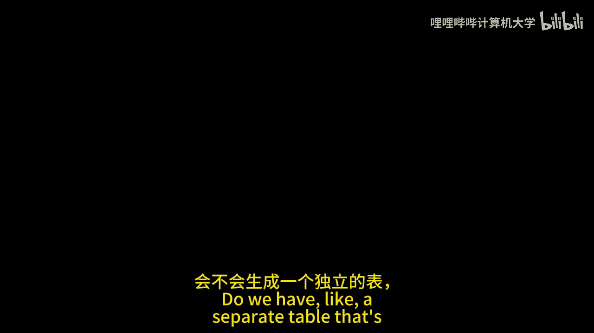

Yeah， good question。 And so I believe you're asking。

 do we get back a separate table that we could use for this， I might want to double check myself。

 but just to kind of show you what we've been doing so far， Ill go back to my sQlite terminal here。

 and I will ask like select star from let's say C lions and let's do a full join with migrations on migrations do I is equal to C lions dot I。

 And I think what you' were asking is do we get back like a separate kind of table here we could。

Consider it as a kind of separate table， like if I hit enter here。😡。

This is kind of we're going to call a temporary table， which you could also call a result set。

 We can use this table for the duration of our query。 What we haven't done， though。

 is made this table accessible in our database itself。

 Like this is only there for the duration of this query。

 So hopefully that helps answer it with a bit of fact checking if you need to as well。Okay。

 let's show one final type of join here。 This one called a natural join。

 A natural join kind of allows me to omit the part of my previous joins where I was saying migrations do I equals sea lions do ID like natural join says both these columns are called ID。

 I could just assume that I want you to join by these two columns。

 So let's try a natural join and see what we get back。

I'll come back over here and we'll try a natural join with our sea lions table and our migrations table。

 I'll say select， let's say star from sea lions， then I'll natural join migrations here。

 and I no longer need to say migrations。id equals sea lions。id。I can just hit semi Collon。

 and now I can hit enter。So we'll see that the join worked， just we wanted to。

And we didn't even specify which ID column corresponded to which other ID column because these were named the same column name ID Not two。

 we don't get a duplicate ID column in some prior joins we had an ID column here and an ID column here now we've just combined them into one single column or we've only kept one column among this join。

So。Many kinds of joins to use many ways to query our tables。

 What we've seen so far is how to organize our data， build connections between them。

 and now how to query this data using both subqueries and joins We'll take a quick break here and come back to see how we can use sets and groups to again。

 kind of refine our queries and ask more interesting questions too well we're back and now we're going to focus on this idea of sets in SQL。

 So when you run a query， you get back some results and those results are often called a result set。

 some set of values you've gotten back from your table So let's take a look at what sets are and how we could use them to refine our queries and to find relationships among different groups of people。

 places or even things。 So let me ask a question of you。 maybe in this world。

 we have authors and we have translators， at least in the publishing industry right。In this set。

 you are an author。 If you are in this set， then you're a translator。

 But what would it be then if you were in this set。😡，What does this set mean？

It means that you are both the third and the other one trans。 Yeah， you're right。

 So this means you are both an author and a translator。

 You're in the middle of these two overlapping circles。

In SQL， we could represent this kind of relationship using our intersect operator。

 which we'll see in just a moment。 We'll take authors。

 perhaps and intersect them with those who are translators and find those who are both authors and translators。

 Let's do another one。 Then。 Let's think of this set。Who are you。

 or at least what does the set represent as a whole。

It means that you're either an author or a translator。Nice， you're either an author or a translator。

 You could be both too， but you're in either camp。 you're either an author or a translator。

 And for this， we could use a SQL keyword called union。

 I'll take my set of authors and combine them with my set of translators and get back in this case。

 the entirety of these two sets。 Let's look at this one too。 If you are in this set。😡。

Who's included there？on啊他 will be的哦，他 which are他展示一个是。

Yeah， good， so here only authors are included。We see that those who are also translators aren't included。

 in fact， if you are an author in only an author then you are in this set and to get this kind of result。

 we would use our SQL keyword called accept I'll take my set of authors but subtract or remove or accept my set of translators Similarlyly。

 I could say take my set of translators， and accept the set of authors， subtract them， remove them。

 and I could do that with translators， accept authors we'll see these keywords in just a moment。😡。

Now， I'll have one final question here， which is， how could you represent this， One， I mean。

 who are you if you are in either this set or this set and how would you get that kind of set。

 I actually save that one for you to do as homework。

 if I may before we move on to seeing these in our actual terminal environment。

 So let's take this idea of sets and apply it to authors and translators this time in our database。

I'll come back over to our SQLite terminal and let me now leave our database of sea lion。 Saly。

 I'll type dot quit and go back to my regular old terminal。

Now I want to open back up our long list dot Db database， long list dot Db hit enter。

 and now I'm back in the place where I have authors and books and publishers inside of this database。

 I'll type controltr L to clear my terminal， and let's first try to find all of those who are either translators or authors。

 Well， what could I do， I could try this。 Let me try select。

Select name from translators like this or my translator's table， semi colon， enter。

 These are all of my translators。Now I want to find authors。

 I could then say select name from select name from authors， semi call， hit enter。

 Now I have all of my authors。 If I wanted， though， to combine these results， these result sets。

 I could do so using union。 So let's try it。 I'll say select name。Select name from translators。

And not finish my query yet。 I'll hit enter just for style takeake。

 and I'll say union union with some other result。 I'll get back from some separate query。

 I'll hit enter。 Now， I'll say select。 let's say name from， let's go for authors now。And quote。

 semico， hit enter。And now I'll see both authors and translators。

 And we should see here that every author and every translator is in here only once。

 We can assume that we have unique names for these authors and translators。

 And I could scroll through and figure out who is。Either an author or a translator actually see them both in the same set。

If I wanted， I could distinguish between authors and translators by adjusting my queries a little bit。

 I could say， select， let's go for select author。The string as profession。

And also select name from the author's table， semicolon。

This will give me back not just one column of names but also another column called profession that has just author inside of it。

 I'll hit enter， and I'll see I indeed have this column if I scroll all the way up called Pro。

 and I have the value being author。😡，Okay， let's combine these。

 Let's union this set with the set of translators and give them their profession， too。

I'll say select。Author as profession。And also， name from。The author's table， and now I'll hit enter。

 and I'll say union that set with the set of translators。 I'll say select Translator， the string。

As the column profession， then I'll say name from the translators， name from the translator's table。

 quote unquote semicolon hit enter， and now I could actually see who is a translator and who is an author if I scroll through here。

 I'll see translators and now I'll also see author。 So I've combined these two sets。

Into one that works for me here。Okay， so this is how to union or combine our sets。

 But what if we wanted to find only those who are authors and translators。

 kind of a unique niche group of folks。 But who is part of this set。 Well， let's try to find out。

 I could select names from the author's table， as I did before。Now， instead of union。

 let me intersect these names with those that will be in the translators's column。

 I'll say intersect。Interssect。And select name from translators。And now I'll hit semicolon En。

Now I'll see one， the same as Gogi， who is an Oath author and a translator。

 they translated their own book into English for the International Booker Prize。Okay。

So let's try now to find those who aren't just translators and authors。

 but only those who are perhaps translators are only those who are authors。 So let's try this。

 I'll say， select name。From authors， hit enter。 And now I want to exclude those who are also translators。

 I'll say， except in this case， select name from。Select name from translators， hit semicolon。

 and now I should see if I pay close enough attention that Gogi is not in this list。

 they are an author and they were in the author set of names， but because they're also a translator。

 they're not inside this set of list。So this is finding good for finding who's in one list。

 who's in some other list and who's in between them。

 but it's also nice for trying to find books people have collaborated on， let's say。

 maybe I want to find the books that both Sophie Hughes and Margaret Costa have written together jointly。

😊，So I could try to find first the book that Sophie Hughes has translated， let's say select book ID。

From the translated table， this table that has translate has translators and books inside of it。

 And then I'll say where the translator。Where the translator ID is equal to。This subquery。

 I'll find Sophie uses I D as a translator。 I'll say， select I D from translators。From trans。

Laterters。😊，Where the name is Sophie Hughes。Okay， semi call to end。

 And these are the book Is that Sophie Hughes has translated because Soph Hughes is a translator。

Well， let's see。 maybe they have translated some books with Margaret Costa as well。

 I could try to find out， I'll say select。Say select book I D。

 We'll try to find Sophie's books again。 I'll say select book I D from trans， from trans。

Where the translator。Id is equal to， again， Sophie Hugheses translator ID。

 select ID from translators where， let's say the name is Sophie Hughes like this。

Now I'll close out this part of my query， but I want to find the intersection。

 the set of book IDs that are the same between Sophie Hughes's translated works and Margaret Costto's translated works too。

😡，So I'll continue。 I'll say intersect， intersect this result with some other query All right now。

 Let me select the book Is from the translated table。Where the translator。

The translator Id is equal to a different kind of query。

 This one will get back the Id for Margaret Costa。 I'll say a sucked I D from translators and where the name is equal to。

 and I believe in this particular case， they go by Margaret Eul Costa like this。Now， I'll hit enter。

 close out this sub query。 And finally， I can hit semico。 This is the end of my query。😊。

So I call in here and now I'll see the book ID they have collaborated on。

 you could imagine going beyond this to find the title of this book ID using another nest query。

 but I won't spend time on that at least for now because I have to write all this text back out for you。

So we've seen union， we've seen accept， we've seen intersect。

 what questions do you have on these sets and how they work？

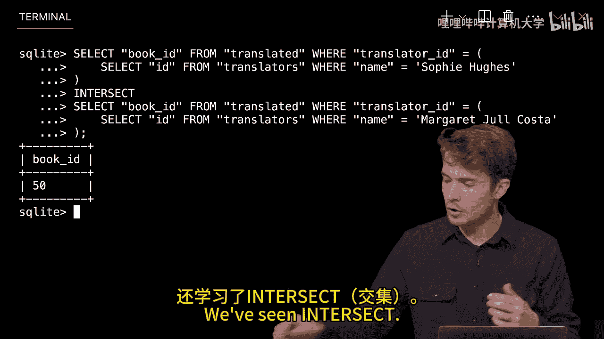

You've got three joints。 I just wonder if there was a default that you chose if you didn't know what the situation was。

 like which one to use。Yeah， so we saw different kinds of joins and we saw we saw left join。

 right join， full join， right， and the default， as we saw a little before， is just the simple join。

 And that join is an example of an inner join。 or only take those rows where the Is actually match up。

 you could get more specific and have a left or right join or full join。

 but believe that for you to try out on your own and see the results of as we did before too。

 great question。 you mentioned that the Is from both tables where used automatically to match two tables and we didn't to whatever would duplicate duplicate column for I。

 So I was wondering in a situation where by the primary key， actually like foreign key。

 let's say you're trying to join that table where your Is actually like foreign key。

 How would you go about doing that because it seems within specify the Is where wanted to like make the joins on with the natural。

 So I just wanted to need some interpretation on that front。😊，Yeah。

 and let me make sure I'm understanding correctly so I think you're trying to think about how you would join a table that has a different kind of column name from the other one and for that。

 you could use the equals there and you could say we said migrations do ID equals sea lions do ID。

 but let's say the C lions ID was actually called C lions underscore ID like that full thing spelled out。

 I could say join migrations on migrations do ID equals C lions do sea lions underscore ID to spell out the column name for SQL。

😊，Good question， Tim。Can I use intersect and z union together between more than two tables。

 three tables or four tables。

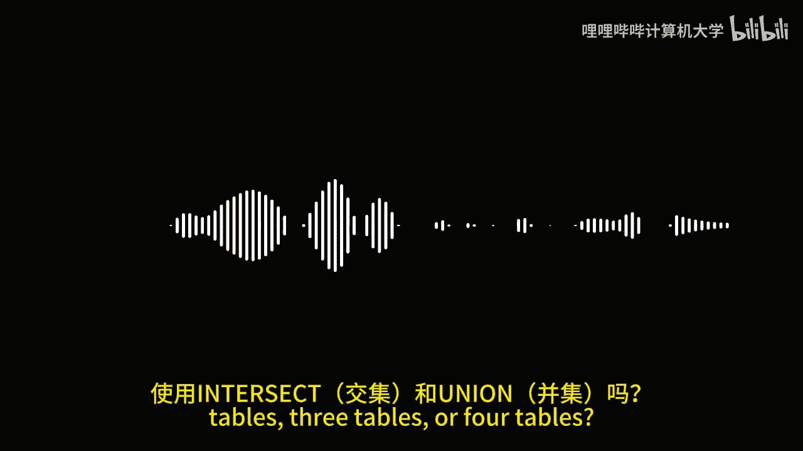

Yeah， could you use intersect more than once， let's say， to intersect more than one set。

 you absolutely could。Here， I don't have a good example planned for this。

 but you could have one query that does one thing， gives you some set。

 and you type intersect after it， then you get back the next query and you find the intersection of that。

 You could then type intersect again to get the intersection of all of these three sets。

 you can keep going going as you'd like to。😡，The key thing here， though。

 is that in your intersect or in your unions or in your accept。

 you always have to have the same number and the same type of columns。 So if I was trying to combine。

 let's say author names with book titles， I can't intersect or union those quite well。

 because they have different kinds of meanings， They're different kinds of things。

 So if you're trying to join multiple thing trying to join multiple tables or inter， multiple tables。

 make sure you always have those same column names and those same column types。

 the type of data that's stored inside。Okay， so we've seen sets now。

 and we're going to conclude by looking at this idea of groups。 Well。

 groups will allow us to recreate some of what we tried to do a little bit of last week trying to understand the average rating of some books。

 Let's take a look at groups now。 Well you can imagine that I have my ratings table。

 and in this ratings table。 I have book Is。 and I also have ratings。

Here I see that the book I of one has several ratings for people who gave the book a rating。 It has4。

3 and 4。 and similarly， book Id with two has two ratings from folks2 and3。

 Now I want to find the average rating across these ratings for each book Id。

 So let me try that in my terminal。 Come back over here。

And let me first try to find the average rating for each of these books。

 So I'll go back and I'll say， why don't I select the average average rating。

 It's like the average rating from my ratings table。 And I think this should be good enough。

 So I'll hit semicolon。 and I'll see， well， 3。83644 and。This seems to be an average。

 but I wanted the average of each book。 So what did I do wrong here。

 What am I actually seeing in this case。

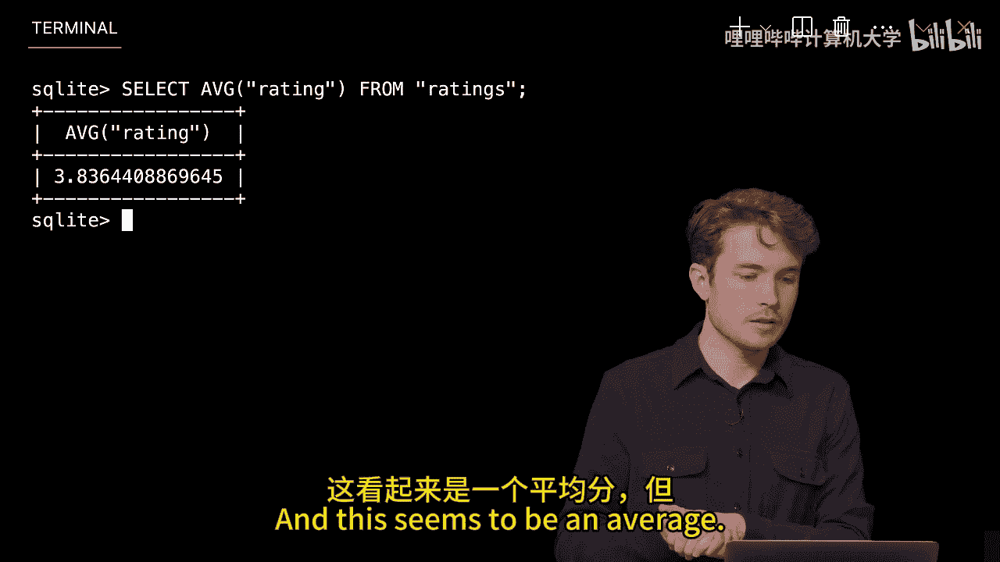

I that an average of all books in the entire table。

Yeah， good instincts。 so let me try to put back our table here we can see what's actually going on。

 I'll come back over here and I will show us again this table so we had a table of ratings right and we had the rating column that has individual ratings inside of it。

😊，When I say select the average rating from this table， well what am I getting。

 I'm getting the average of all of these ratings， not grouped by book ID。

So if I want to find the average rating for each book， I need to employ this idea of groups。

 And I mean， wouldn't it be nice if I could do something like this。

 I could kind of highlight the rows that are part of each group and then try to average those。

 I could say take all the books with IDd1 and all the books with ID2 and just collapse their ratings like this And once you do that。

 find the average for me and give me that back as a table and be kind of nice and luckily we actually have the capacity to do that with SQL using this group by keyword。

 So we'll see this in action。😊，I'll come back over here。

 and let's try to redo this query to find the right answer。 I'll come back， and I'll say lets select。

 let's select， in this case， the book Is。And also their average rating， I'll select a book ID。

 that's one column I want， and I also want the average rating from this column。😡，From this table。

Now I'll say， let me title this perhaps as average rating。

 so I'll get the average rating and just title that column average rating exactly。

 and I want to select this from the ratings table。Okay。But now I don't want to simply hit enter。

 I'll get back the same thing I did before， which is the average of all the ratings in the ratings table。

 What I want is for these ratings， the average ratings to be grouped by the book I D。

 So I'll say group by book I D， semicolon， hit enter。😡。

And now I should be able to see the results I wanted。

 Let me scroll to the top and notice how using group by I was able to take H each book Id collapse the rows。

 The ratings were associated with this book and find the average of that rating， 3。77，3。97，3。

04 for each book。 So kind of handy here。😊，Let me try to improve this and show you one additional thing we could do as well。

 I'll come back。 and why don't I try to replicate what we did last time。

 which was find the books that have a certain rating or hire。 Let's try that。 I'll say select。

 let's say the book I D。And let's get now the rounded rating， the rounded average rating。

 I'll round the average rating to two decimal places， and I'll call this average rating as a column。

Okay， I'm going to select this from my books table。From my rating table， sorry。

 and now I want to group by the book ID to find the average rating for each book ID。Now though。

 let's say I only want those books that are pretty well rated greater than 4。

0 out of five stars to include a where clause， I could try following up on this group by。

 and you might think I could say， well where the average and where average rating。

 that new column I created is greater than equal to 4。0。

But I can't because these are now not individual rows。 They are groups。

 SQL uses a different keyword for conditions on groups than for conditions on individual rows。

 And this keyword is called having H A V， I， N G。 Let me try that H A V I N G。

 I want to group by the book I D and only keep those that have an average rating of greater than 4。0。

😡，I will scroll over here and I'll hit enter， and now I should see a much smaller list。

 I see book ID 5 has a 4。06， 10 has a 4。04， and so on。😊。

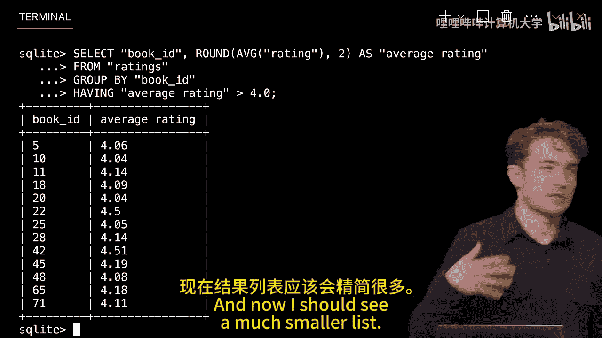

AndNow the next step is you can imagine me perhaps joining these book IDs with another table that has titles inside of it too to find the average rating given some title as well。

So groups allow us to take these columns， collapse， some rows。

 and find aggregate statistics across each of those groups。

Let me ask then what questions we have on groups。What if I don't want to see the average rating of a book。

 but how many ratings does it have？

Oh， good one。 So I want to know not the average rating， but the number of reviews。

 let's say the number of ratings it was given in my table。 Well， for that。

 I could just modify my query a little bit。 I could change average to count because count counts up the number of rows that I have。

 So let me try that here。 I'll come back to my laptop and let me try this one。

 I will select book Id and I will also select the count of book Id in my also select the count of ratings。

 how many ratings there are inside ratings table count of rating。😊，From， let's say。

 the ratings table like this。Now I want to group this data， group the count by book ID。

 so I'll say group by book ID， give me a count of the ratings for each book ID。

 and now I could just hit on my colon and enter。And now I'll see how many ratings each book actually has。

 Let me go to the top here， and I'll see book I D 1 has 2779 ratings。

 Book I D 2 has 175 ratings and so on。 a good question。

Let's take one more or two。So considering this new having syntax。

 how could we couple that with they order by。

Yeah， where does it fit in with order by。 Like， let's say I want to sort this data to at the end of the day。

 Well I could do that as well。 Let me show you one example。 I'll come back to my terminal。

And I could try this， let me come back to find the average ratings。

 so I'll say select book ID and the rounded average rating。To two dec places。

 calling that column average rating。And I'll select this from the ratings table。

Well now we want not just to find the average rating。

 we also want to sort by that column too and in fact。

 use having to only find those books that have 4。0 or higher， well let's try this。

 I'll say from ratings and I'll still group by book ID。Now。

 I'll say I only want to filter to those groups that have a average rating of greater than 4。0。

 And finally， after Ive filtered out all of these rows。 I want to order them。 I want to sort them。

 so I'll order them by average rating。 this column I made up top and I'll say order them descending order。

 I want biggest to smallest and fingers crossed， I'll enter。And we'll see our ratings sorted for us。

So great question here to reimple much of what we did last time。

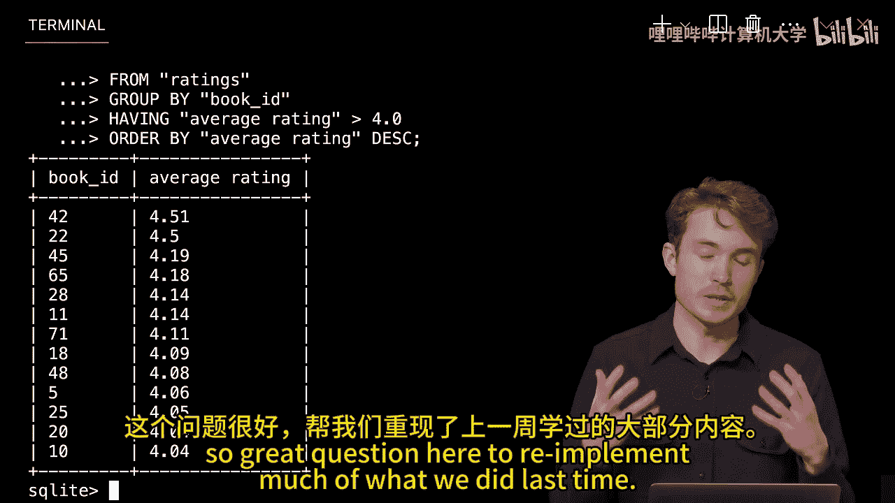

And now， indeed， we've kind of come full circle here。 We've taken these ideas。

 and we've seen them in SL tables， as we did last week。 We。

 this week took our tables and expanded them into multiple tables， different authors。

 different publishers， different ratings and so on。 And we learn how to query those tables。

 using subqueries and using joins。 What we'll see next time。 is' putting you in the driver's seat。

 having you actually create your own tables， to your own relationships and build a database to your own liking。

 So all that and more next time， We'll see you there。😊。

。