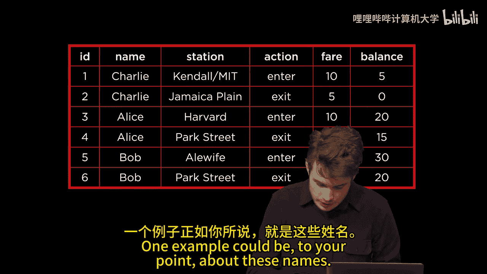
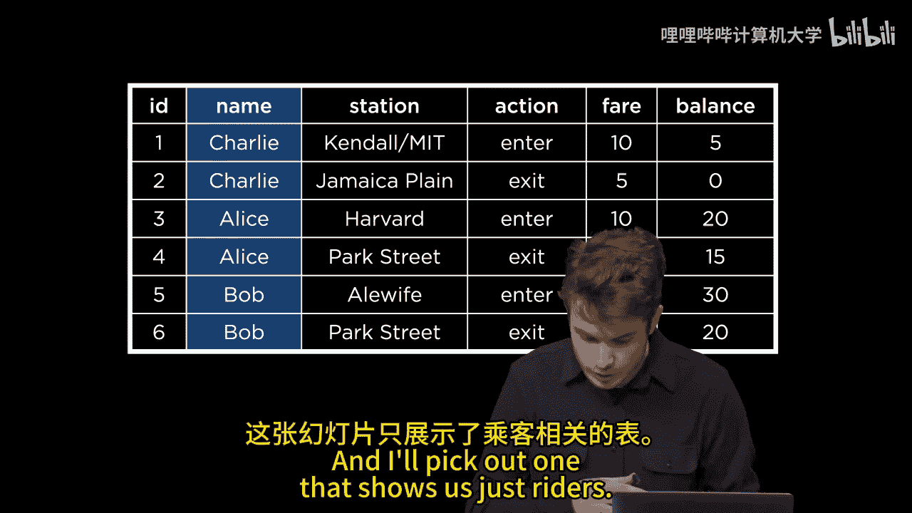
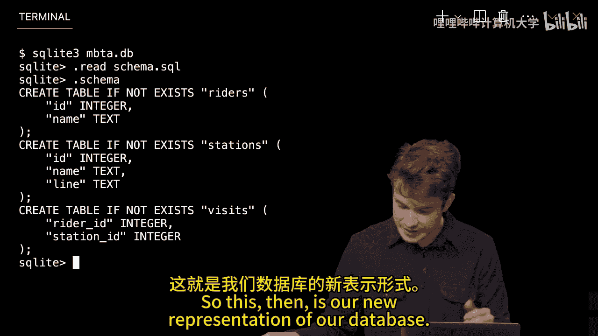
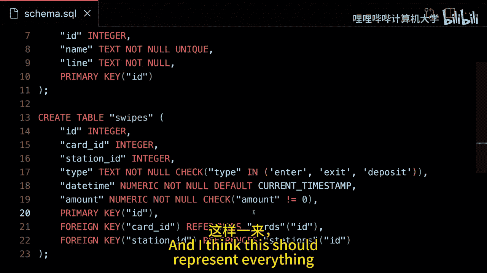
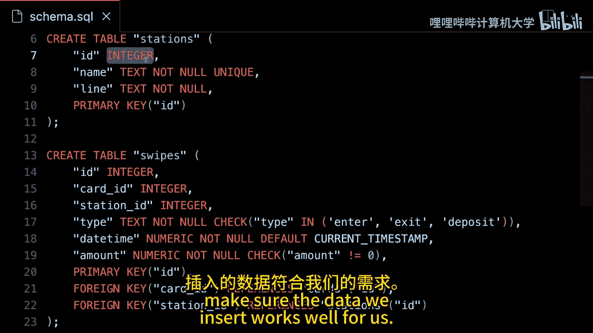

# 哈佛大学CS50 & SQL【速成版】 课程已全部上传，中英双字幕(人工核对翻译），课程附完整课件(视频支持杜比音效，Hi-Res无损音质)。 p04 Lecture 2 - 设计 -BV1iKCwBuE2d_p4-

Well， hello one and all。 and welcome back to C5's introduction to databases with SQL。

 My name is Caranki。 And last we left off， we learned about relating。

 That is how to have multiple tables in our database for people。

 places and things and how to have them relate to one other。 And the we might do in the real world。

 Now， today， we'll take a step forward and we'll talk about how to put you in the driver's seat designing your very own database schemas to organize your database。

 Now we'll pick up where we last left off， which with this database of books。

 So we had this database that was full of books that have been longlisted for the international booker prize to be longlist means to be nominated for some prize。

 let's say So we had the past five years of books in this database and we worked on improving this database over time from week 0 to week 1。

 Now， this week， we'll actually take a look underneath the hood and see what commands we had used to create these very。

😊，Databases， so let's reveal now what we had done all along。I'll go back to my terminal here。

 and if you remember， I could use a command to open up a database file， which was this command here。

 SQLite3， and then the name of the file I want to open。

 So let's try this I'll go back to week zero to my week0 folder like this and I'll open up my long list database week0 slash long list do DB okay I'll hit enter。

😡，Now I'm in my SQL like prompt， so I could work on typing some SQL commands。

 SQL statements or queries inside of this terminal prompt here。

So if I want to get a feel for what's inside this database。

 we saw I could use a command called select。 So I'll select now some rows from this table。

 I'll say select let's say the title and also the author columns from my long list table semicolon and enter。

😡，Now， I'll see all the titles and all the authors that were inside of this long list table。

 but I only want to peek here。 I only want to see roughly what kind of data is inside。

 so I could probably improve this command here。 I could instead say select the author and title columns from long list from long list but limit now to the first five rows。

 if you saw before semi colonlon and I'll enter on this query。

 and now I'll see only the top five rows。 So I'm able now to see roughly what kind of data is inside my database。

😡，But what I can't yet see is what command was used to create this table and what kind of data could be stored inside of it。

 So let's reveal now what was going on underneath the hood all this time。 I'll say this new command。

 a SQLite command， not a SQL keyword， but a SQLite command called dot schema， dot schema。 Now。

 if I hit enter， I'll see the following。The command， the statement。

 the query that was used to create this long list table。

 and notice how I have many columns inside this table。 I have an ISB N column。

 a title column an author column and so on。 and each column seems to have some kind of data that could be stored inside of it。

 like text or integers or real for floating point values or decimals， if you're familiar。

So this is how we created the very first version of long list dot DB。

 But let's also see how we created the second S type dot quit to leave this version of long list do DB。

 And now let me open up the next version we had created， which more relational。

 It had tables inside of it that could relate to one another。 So let me type sQLite3。

 then long sQite 3 and go to week1， and then type long list dot DB。I'll hit enter。Now。

 then my next version of long list dot DB。 Well， what could I do。

 I could type select and look at some of the tables in here to see what kind of data is inside。

 I could perhaps say select maybe the names from the author's table here from the author's table and hit semicolon。

Now， I'll see all the names of authors that are inside of the author's table。

I could do the same thing for books。 I could maybe look at the titles of books。

 I could say select title from the books table， semicolon and enter。

Now I see all of the titles that are inside my books table。

But what I haven't seen yet is the schema of this database。

 It is the way it is organized and the commands that were used to create these tables。

 So let me work on that now。 I'll clear my terminal using control L。

 and now let me type dot schema again。 I'll type dot schema to see what commands were used to create this database。

 hit enter。 and I can see I think there are quite a lot of commands here。 this shows overwhelming。

 I mean， I'd be right there with you， right， This is a lot of commands to parse through and read。

 So there's probably a better way to do this。 And one way to try is to type dot schema and then give it some table name。

 let's say I want to understand the schema for just the books table like just that for now。

 So I'll say dot schema and then the table name books in this case。 Then I can hit enter。

 Now I'll see the schema。The organization， the command that we use to create the books table in this case。

 And notice， again， we have several columns， I D， I SB N， title， publisher I D and so on。

 Each one has their own kind of data they could support or take into this column， like integers。

 text and so on。So again， what we'll do today is have you all learn how to write your very own create table commands to build your very own databases that represent what you want to represent in the real world。

So let me exit this prompt here。 and let me propose that we'll have a bit of a design challenge today to actually try to represent a real world entity with some database here。

 And if you're not already familiar。 Boston is perhaps famous for being among the first cities to have a subway system in the United States。

 So here is a picture from the late 180s of a subway being built in Boston's city streets underneath the streets here。

 there would be trolley cars would go and transfer people across Boston。

Here's another picture of a trolley actually working underneath the street。

 so people would go down underneath。 They would hop on a trolley。

 They'd be able to go to different parts of Boston。

 perhaps from Harvard to the MIt or downtown up to， let's say， Braintree or down to Braintre。

 which is more south of Boston， for example， One of the famous stops， is the Park Street stop。

 which is right down in the middle of Boston。 one of the central hubs of this subway system。And now。

 these photos are all from， let's say， the early 1900s， late 1800s and so on。

 But the subway has gotten a lot more modern since then。 And actually。

 now we have several lines that span the entire city and beyond。

 So here we have the red line of which Harvard and MI T are part。 We have the green line。

 which brings you kind of west to east， the blue line， the orange line and so on。

 So many more lines and stations have been added to this system。

 It's a big design challenge to represent all of these stations。

 all of these lines and all these people who might ride this subway too。😊。

So the question then becomes， how can we create a schema for this data？ And again， by schema。

 we mean what kinds of tables should we have。What kinds of columns might those tables have and what kind of data should we put in each of those columns。

 for instance。So let me propose this。 Let's let me start just first with names and stations。

 So Charlie here， our very first rider on this system is going to be at the Kendall and M I T station。

 So this is what this table represents now。But what more could we have。

 Well we might also want to have， maybe what Charlie is doing at that station。

 Maybe he's entering the station， for instance。And if you're familiar with the subway system。

 you often have to pay to get on a train or get onto the station itself。

 So let's say Charlie pays some fare to enter into the Kendall M T station。 Well。

 back in the mid 190s。 The fare was only about a dime。 It was 10 cents。

 So we'll say Charlie paid 10 cents to enter the Kendall MI T station。And now。

 this seems pretty good。 But if I am the transit authority， the person who runs the subway system。

 I probably want to know， does Charlie have enough money to get on the train。 And if so。

 I want to make sure that， okay， well Charlie actually could get on this train。

 So let's say not only Charlie pay a fare。 he has some remaining balance afterwards。

 So Charlie here has gotten on the Kendall MT stop。

 He's paid the fare of 10 cents and has 5 cents left。Okay， so here's a bit of a table。

 We could probably add more information to it。 Let's say Charlie then leaves at the Jamaica planein stop。

 and the fair to leave is about a nickel，5 cents。 And now Charlie has no cents left over。 So again。

 Charlie paid 10 cents to get on， had 5 cents left。

 paid 5 cents to get off and now has no remaining balance here anymore。Okay。

 so that's Charlie's story。 Let's look at Alice， though。 Let's say Alice gets on at the Harvard stop。

 They， too， pay 10 cents to get on at the Harvard stop。

 and they have a remaining balance of 20 cents。 Alice will go， let's say， to Park Street。

 get off at Park Street， pay the nickel to leave。 And now they'll have a balance of 15 cents at the end。

Let's go to Bob， Bob enters the Alewife station， they pay 10 cents。

 they have a remaining balance of 30 cents， and let's say they leave at Park Street and have a fare of 10 cents to leave because it's a further distance now they'll have a remaining balance of 20 cents overall。

So this table。Is okay， I might admit， I mean， last time we learned about having we called primary keys and foreign keys。

 So seems like that's missing here。 Let's go ahead and add that here。

 I'll give each row a unique I D so I can know who entered。

 who exit and so on and give that a unique I D here。But I might even say that this table。

Could really be improved substantially。 And I want to ask you。

What redundancies or inefficiencies do you see here。We're trying to represent riders and stations。

What could we improve about this design。Hello， so probably the redundancy will be the names。😊。

And the stations too， for example， Charlie will go to the daily。

 then it will become most of the names in the data。 Yeah， good point。

 if I'm hearing what you're saying， Laura， and let me show you some examples is that I highlighted here。

 you know， one example could be to your point about these names like these names seem to be telling us the name of a person But here we have only three names。

 Charlie， Alice and Bob。 Well， my name is Carter and what if somebody else named Carter also tried to get on and leave at some stop。

 Well， I wouldn't be able to know which Carter was which or which Charlie was which。

 which Alice was which and so on。 So we probably need a way to represent people and their names a little better here too。

What other ideas do we have for how to improve the design of this table。Yes。

 I think we can have a singular I for a singular person that way would be better able to track their activities。

 Nice， so we could probably have an Id for each person a bit of what we learned about last week right。

 putting people in their own table and giving them their own unique I， a primary key。

 Let's show that here。 I'll go to some slides and I'll pick out one that shows us just rid So to your point to Conny。

 we could try to have maybe a table for just rid and maybe simplify this table has only two columns。

 It has a column for Id and a column for names。 So here we have Charlie。

 Alice and Bob all in their own table。😊。

Well， pro2， we could do the same thing for stations。 Like， let's say we have a table of stations now。

 And we give each one their very own I D as well。 our own primary key for this table。

 We have Harvard， Kendall and Park Street。 We can differentiate shape between them using their Ids here。

😊，So a few improvements could be made。 And as we're making these improvements。

 splitting one table into many and debating what kind of data to store in each table。

 the process we're going through is one called normalizing。

 We're normalizing our data to normalize means to reduce redundancies effectively to take a table take one table。

 for instance， split up into multiple and have each entity be part of its very own table。

Some academics in the world have named different normal forms， quote unquote。

 there's like first normal form， second normal form， third normal form。

 this progression of making your data more and more efficient。 you can use those as heuristic。

 the end of the day， a few principles might apply。 First， take your entities， like in this case。

 stations and riders， and put them each in their own table。 And if you add more data。

 make sure that if I were to add a column， let's say to writers。

 it is only a data point about writersers， not about stations， not about fares。

 only about writersers。 And that process can help us make a data that is more dynamic。

 more easy to reproduce and more easy to write queries on。 So that is a process here of normalizing。

Okay， so if we have now riders and stations， we want to represent them in our table。 Well。

 we could use what we learned about relating last week to ask。

 how could we actually represent these riders and these stations。So let's say here， I again。

 have riders and stations。 I want to make sure that I have the right relationship between them。 Well。

 if you're familiar with subways， we might say that a rider goes to one station。

 And this big T here is the symbol for a station here in Boston for the T's that we call it for the subway。

So right I'm might go to one station。But， of course， that might not be the full picture。

 A rider also gets off at some station later on。 so a rider could be associated with not just one station。

 but multiple。And if you're familiar， at least with any subway system， really the Boston one too。

 it can often get pretty busy。 And so riders might not just go to， of course。

 one station or two stations could also have multiple riders that are on a particular station here。

 So to recap one rider might be associated with more than one station。

 They might get on at this first one and get off at this later one。

But each station could presumably have more than one rider。

 each station here could have rider A or rider B， the rider up here or the rider down below。

 and even many more than that as well。So to put it in the language of our E diagrams。

 our entity relation diagrams from last week， we could look at a bit like this。

 we have riders and stations， riders， visit stations。 and they're associated like this。

 A rider must have at least one station associated with them。 That's what this horizontal line means。

 If they aren't at a station， they aren't really a rider， right A rider， though。

 could have many stations associated with them。 That's what this three prongs down here means。

 They could have one，2，3，4， they could have many stations， they get on and get off of。😊。

Now a station could have anywhere between zero riders if it's maybe out of commission or isn't very popular。

 upwards to many， it could have two，3，4，5， even hundreds of riders associated with this particular station。

 So here is our entity relation diagram for these particular riders and these stations here。

So let me ask what questions do we have on these relationship between riders and stations and how to design this table so far So I want to ask that you have used a safe ID for stations and riders so that maybe give us problem in coding。

Yeah， a good observation。 So you might have noticed that in the rid table。 And in the stations table。

 I gave the same kind of I like I had one，2，3 for each of them。

 And let me just show you that again here。 I'll come back to some slides。 and I'll show you again。

 the rids table where we had Charlie， Alice and Bob， Id 1，2，3。 Sam for the stations， we had stations。

 Harvard， Kendall Park Street Id1，2，3 and to your question， isn't that a problem。 Well。

 I would argue in this case， it's not so long as we keep clear that these Is are for stations and these Is are for riders。

 And we'll see how to do that using our SQL keywords later on But again。

 so long as we have an Id just for our riders and an I just for our stations。

 we can keep these separate even if they might have the same values。 but a great question here。😊。

Let's take just one more。Regarding the NC relationship diagram。

 how is it possible for stations to have a possibility of zero riders。

 but writersers must compulsor really have at least one station。 Yeah， good question。

 So this might be up to you and how you formulate it。 But for me， let me show the diagram again。

 I'll go back to。

Over here。In my mind， to be a rider， you have to havevis a station。 if you aren't visiting a station。

 you aren't really a rider， right Now， presumably， there are stations that were built。

 but aren't really being used right now aren't really in service yet。

 that could be a station that has no visitors。 So you could argue let's make sure every station has at least one rider and every rider may or not have to visit a station For that。

 I would say let's kind of we can probably reasonably disagree there and talk about how we could represent the diagram here too。

 but a great observation and a good other critique of this this system here。All right。

So let's now turn to representing this in our database。

 I'll go back to my computer and we'll learn about this new SQL keyword， SQL statement。

 This one called create table create table allows us to， as the name suggests。

 create a brand new table。 So let's do just that in our new database represent riders and stations。

 I'll go into my terminal， and I want to make a brand new database。

 I'll call this one MBT do Db because MBT stands for the Massachusetts Bay Transportation Authority。

 the people who run the subway essentially， So I'll do SQLite 3 MBT do Db hit enter and I'll type y to say。

 yes， I want to create this brand new database。

Okay， now， if I type dot schema。I see nothing， but that's expected。 I don't have any tables yet。

 I have nothing inside this database。 It's up to me to create these tables， myself。

So what I'll do is clear my terminal and let's start first with riders。

 I might create a table for riders。 I'll say create table。And now I have to get that table some name。

 I might call it riders here。And then in parentheses like this。

 I can specify what columns should be part of this table。 So let's start first。

 I'll hit enter here and continue this query。 Now， I'll by convention， just indent  four spaces，1，2。

3，4， and I'll give an Id to each of these riders， as we saw before。

 I'll say Id here is one of my columns。Now， to create a new column。

 I'll follow this up with a comma and hit enter all again， by convention for style。

 just indent four spaces。 And whats my next column， perhaps a name for these riders。

 I'll give this column the name， name， and I'll leave it at that。Once I'm done adding columns。

 I no longer need to have a comma。 I could simply close out this query this statement I could hit enter here。

 say close app parentheses to close the top parentheses here， semi colonlon hit enter。

 and now nothing seems to happen。But that's actually a good sign。 Let me type dot schema。 hit enter。

 and I'll see the result of that statement before。 Great table。 If it doesn't already exist。

 writers and writers has inside of it， two columns， I D and name。Okay， let's keep going。

 Let's make one for stations， too。I'll clear my terminal and I'll say。

 create me a table called stations and include， actually， not station。 if you ever want to。

 let's say。Fix this kind of table here。 Let me try closing closing the parentheses， hit semi colon。

 enter。 I'll get a syntax error。 I can restart。 I'll do control L。

 Now I'll do create table stations plural。Open parentheses enter。 I'll indent by four paces，1，2，3，4。

 And now I'll similarly include an I D for each of these stations。 I'll say I D comma。

 And then what else should I have， Well， stations tend to have a name like the Kendall M T station。

 the Harvard station， the Park Street station。 So I'll say， I'll give each of these。

 the very own name。What else do stations have， Well， they might also have a line that they're on。

 Let's say it's the red line or the blue line or the green line and so on。

 I'll have a space for them to write in their line that they're a part of。Okay。

 and maybe I'll leave it at that to keep it simple。 I'll say stations have an I D， a name and a line。

 Now I'll close this out。 I'll say end parentheses， semi colon， hit enter。

 and nothing seems to happen。 But if I type dot schema。

 I'll now see my riders and my stations tables inside of my database。Now， one more step here。

 we have riders。 We have stations， but we have to relate them。

 We have to relate them using this many to many relationships。 we saw last week。

 So let me try making a table to implement this many to many relationship。 And if you remember。

 we might call this kind of table， a junction table， an associative entity。

 a join table has a lot of names， but it looks a bit like this。

 Ill create this new table which represents， let's say visits， a rider visits， a station。

So I'll call this table visits。And inside， I'll make sure it has two columns。

 one for a rider ID to represent a rider。And one， let's say for a station Id represent a station。

 Now， when I see a rider Id next to a station Id in this table。

 all'll know the rider with that certain I visited the station with that certain I。

 So I'll close this out。 I'll say end parenthees here， semi call enter。 And finally。

 clear my terminal type dot schema。 And I can see I have riders stations and visits between riders and stations in this associative entity。

 this junction table or a join table up to you what you might want to call it。 in this case。😊。

Now， what questions do we have？Why we have not used the primary key and z key in this statement。

 good question。 So we're gonna get there in just a minute。 But if I look back at my terminal here。

 my schema， all see， I really just have column names。

 And we saw before when we type dot schema on our long list dot D B。

 We had more than just column names。 We had column names。 We had perhaps data types。

 We had primary keys and foreign keys。 So we'll get to that in just a minute。

 but suffice to say for now， We're gonna keep improving this over time。

Let's take one more。Is it required to put spaces the four spaces in denses or that's just for the visual look Yeah。

 great questions。 I it required to have these four spaces before each column name and in fact， no。

 it's not。 but it makes the code more readable。 So if I I I could put this all on one line。

 I shouldn't， but I could And if I have instead， this new line followed by four spaces。

 I can make this more readable for myself and for my colleagues too。

Good question。Okay， so to our earlier point， there are things that are missing from this schema。

 like we have column names。But as we saw before， we should ideally specify what kind of data should be able to go into each of these columns。

 and for that， we'll need some new ideas to talk about here。

So let's focus now on this idea of data types and storage classes。

 Data types and storage classes are two very similar but distinct ideas。

 And there're distinct in a way we'll talk about in just a minute。 Now。

 SQL light has five storage classes。5 kind of storage pie kind of types。

 so to speak of values that can values that can hold。 So let's talk about the first one。 null。

 for instance， null in this case means nothing。 There's nothing that actually is inside of this value。

 It's kind of a central value to mean nothing is here。Integer means a whole number like 1，2，3，45。

 Rio talks about decimals， like floating points， like 1。2 or 2。4 and so on。

 text is used for characters and blob kind of a funny one。 blob stands for binary。

 large object and it represents the data exactly as I give it to this value。

 If I tell it to store 10，10，10。 It'll store exactly 10，10，10 in binary。

 So useful for storing in this case， like images and video files and audio files。

 things that have some structure， we don't want to mess around with。Now。

 let's focus on this idea of a storage class。 These， I'll say。

 are storage classes and not data types in SQLite。Now， a storage class like integer can comprise。

 can hold several data types。 noticeice how there are seven different data types that could be stored under this integer storage class。

 we have a 6 byte integer，2 byte integer8 and0 and so on， it could be any of these particular types。

 but each of these types under the umbrella of this integer storage class and SQLite itself will take care of making sure it uses the appropriate data type。

 like if I give a very large number， like let's say4 billion or 6 billion or even bigger than that。

 it'll probably use a longer， that is a bigger byte integer to store that kind of value。

If I give it a smaller  one， like 1，2，3 or 4， it'll probably use a 1 by or a 2 by integer for that。

 But SQL lights idea is that I， as a programmer， shouldn't have to care if I use an 8 B or a 1 by or a 2 byte integer。

 I just care that I'm using integers。 whole numbers。

 And they give me a storage class to use any of these up to their choice here as well。Now。

 let' look at a few examples of values in SQL light that we could store。 Well。

 we have perhaps the red line as some tech。 And because this is characters， it's quoted。

 we could use the text storage class to represent this particular value here。

We could have maybe an image。 and to the earlier point， we could say， well。

 this image might be best represented using a blob， a binary。

 large object to keep all of these pixels exactly as they are in this image。

 but we do get some choice， some interesting design challenges。 We look at the idea of fairs。

 So let's say to our point earlier， fairs are 10 cents back in the 1950s or so。Well。

10 cents we could store as an integer， which seems just fine。But this could get confused。

 I'm talking about dollars here or cents。 Maybe it would be better， let's say， if I did this。

 a dollar sign 0。10。And what might that be stored as， Well， probably text， right。

 I could say this dollar sign isn't really a number。 but now I have to include it。

 So I'll say this will be quoted essentially as dollar sign 0。10。Now， there's some downsides here。

 too。 Like， let's say I have， I want to add these up。 Well， I can't add up tech。 Like。

 what does it mean to say dollar sign 。10 plus dollar sign。20。 I can't do math with tech。

 So maybe it would be better after all， if I used a real or a decimal like this，0。10。But I mean。

 even here， you're into some problems。 If you are familiar with how this representative binary area。

 you might know that decimal values or floating point values can't be perfectly precisely represented。

 And if I talk about 0。10， the computer might store 0。10，0，0，0，0，5，6，79。

 It could get very wonky out to the many， many decimal digits down below here。

 So trade offs and challenges overall。Let's look at these three， though。

 I have the first one to store as an integer， I'm trying to store faires here。

Second one as text and the third one as a floating point or a real in this case。

Let me ask for some opinions here。 Which one would you use and why for trying to represent fares in this case。

 Thank you people using integers because of course I need to get the calculation very accurately。

 that's my point of view。 Well， sometimes I can use fluids。 but you know。

 like you said before it can get very wonky if I get you know if I really need that kind of position。

 I don't really recommend using fluids。 Yeah， a good point。

 So if they go back to some slides here you might argue for the integer because you know you can precisely represent integers and let's say I want to add up fares over a lot。

 a lot of riders this might be useful for me because I know that each number will be perfectly precisely represented。

 I can do lots of big kind of math with this number here to your point， this decimal might kind of。

 as you should， get wonky later on towards later decimal points。 like。

Some unexpected results。 If we add up these overall。 Let me ask， though， are there any proponents of。

This。Floating point value or a real value。I so I think they啊。I think is in the number of。

 for example for each pair probably suggest of the comments then Yeah a good point So if you talk about using this float value I mean one thing we could say for it is that this decimal could be know it's more accurate to say like we're working with dollars now and we could have maybe 10 cents which is only 0。

1 of a dollar I totally hear that point as well and the point we're making here is that they're really just tradeoffs among these data storage classes to use。

 whether you're using integers or real values it just depends on your use case and what you're designing for so be sure to read up on tradeoffs among these data types and determine for yourself which one should you best use。

Okay， so we have now these storage classes to store values。

 and it turns out that columns can be made to store certain storage classes or prioritize certain classes。

 And the key distinction here is that columns in SQL light don't always store one particular type。

 Instead， they have type affinities， meaning that they'll try to convert some value you insert into a given cell or given row2。

 the type they have the affinity for。 Now， there are。

 let's say five type affinities in SQL light text。 columns can be of the type affinity text。

 meaning they store just characters at the end of the day。There's also numeric。

 which stores either integer values or real values， depending on which one seems best to convert to。

You have into your type offfinity， which means to store whole numbers real to store floating points or decimal values。

 And we have blob here again。 Our old friend to store binary exactly as we get it。

 So whereas before we were talking about storage classes。

 those are associated with individual values。 typey affinities are now associated with individual columns。

 So let's see some example of how this might work in SQL light。😊。

Let's say I have this table of fairs， and we've decided to store fairs as integers。 Well。

 if I said that this column called a mount has the affinity for the text storage class。

 What would happen is if I insert this integer 10， it would look a bit like this later on。

 it would be converted to text。 be quoted in a sense to present is now been converted to some sort of characters。

Let's say I insert this value 25。 Well 25 has a storage class right now of an integer。

 it is a whole number， but if I insert this into a column that has the text affinity。

 it'll be converted into in this case， text at the end of the day。Let's do the opposite。

 Let's say I have my fair as a string， some text。 in this case。

 I want to insert it into this column called a mount。 but now a amount has the integer type affinity。

😡，Or if I insert 10， quote unquote， into the column amount， I'll get back not 10 the text。

 but 10 the integer， because again， amount this column here has an affinity for the integer storage class。

Let's try this，25， some text again。 I'll insert it into this table。 Now I'll have 25 as an integer。

So this is how SQL light allows us to give certain columns an affinity for certain types that they'll try to store values of that type so long as we insert values。

 it could be feely converted to that type here。So let's go back to our schema and try to improve it now to use not just column names。

 but also type affinities store certain data of a certain type。

 go back to my computer here let's improve this once more。 So I'll go over to my table。

 And now I probably want to improve the design here。 and often if I want to improve this。

 I might just need to erase what I've already done。 So let me introduce this new keyword。

 this new statement called drop table to drop a table means to delete it to remove it。

 this subject delete。 So let me try doing this for riders， stations and visits。

 I'll type drop table rid。Se I call， enter。 Nothing seems to happen。 but if I type dot schema。

 rids is gone。I'll try drop table stations， then semicolon hit enter and type let's see dot schema again。

 no more stations， I'll try drop table visits， semicolon enter。

 and then dot schema and our table our database is really gone。

 there are no more tables inside of it。So。Let me propose that instead of working inside of the SQLite prompt。

 like typing out again and again and again， create table riders， create table stations。

 create table visits， let me be more efficient about this and create myself a schema file that I could reuse throughout this lesson and also wait on while I'm working on this database on my own to do that let me quit my SQLite prompt here and let me type something like code schema dotsQL I'm just creating this file called schema dotsQL Now a dotsQL file allows me to type in SQL keywords and have them be syntax highlighted so I know what's going on inside of this file So let's just try this once more I'll type create table riders and inside I'll say it has the ID column of what type affinity IDs or whole numbers。

 so perhaps integer in this case。I could say ID has the integer type of energyity。Now。

 let me say the writers also have a name and how could names be best represented。 maybe text， right。

 characters here。 So I'll say name and text。 Now I'll include a semi column to say this is the end of my create table statement。

 And before， remember how I had to kind of air out or I had to like backspace and so on to improve the design here。

 I can literally just point and click and edit this file to improve my schema。

 And I'll later on apply this in my database using a command that we'll see a bit later。

So let's keep going here， I'll say create table stations and inside of this stations table。

 I'll make sure it has an ID column of type integer。

 a name column that probably stores some text and a line column that also stores some text where name is the name of the station like Kendall MI IT。

 Harvard and line is blue line or green line， What line is part of in our subway。

Let me try now visits。 I'll say create table visits and then I'll do rider I。

 which has what type of entityity， probably integer， and then I'll do station I。

 which has this same type of inity。 It's applying my integer's whole numbers here for Is So my colon in to finish this statement。

 Now this is my schema as a whole I have rids stations and visits。

 But now I want to apply this schema to my database。 So what could I do I could reopen it。

 let's say I'll do sQLite3 MBt do Db in my terminal。 And now I want to read in this schema sqL file。

 It is run the commands that are inside of this file。

 So what could I do I could say dot read schema dot sQL where dot read is a command that says take whatever file you give me like schema sqL and read it into this database running。

😊，Any equalQL keywords you come across there。 I'll hit enter。 And now nothing seems to happen。

 But if I type dot schema， I now see my schema improved。

And this is helpful for me because what I could do now is I could just edit my schema that SQL file and rerun it and rerun it to make sure I now have these tables being improved over time。

Okay， so this then is our new representation of our database。 We have riders， of course。

 their own entity and stations。 They have an I and a name and stations have an I， a name and a line。

 We've also now included these type affinities， integer， text， integer text to tell SQL。

 What kinds of storage classes could be put inside of each of these columns。

And before we keep improving this， let me ask what questions we have on。

These storage classes and type affinities。So， you were use when you were creating the table。

 the table was not in the line。 So when we searched for the authors or books。

 So it comes with a perfect table。 So how can we make a perfect table in the SQ Yeah。

 you might clarifying what we mean by like the the perfect table So I mean that it was arranged in something like in box boxes。

 good question。 So before were able to see the results of our queries inside some boxes in our terminal And that is actually a mode of SQL light I think you type like dot mode table to see your results in that version here。

 though， we have no data inside of our tables。 So we can't only select anything from them。

 Like if I go to my terminal here， and I try to select some data from this rids table let me say select star from riders。

 So might call in I won't get anything back。

Next week， though， we'll see how to insert and add and update and delete data inside of these tables at which point you could write。

 select star from ridrs and see some data you've inserted yourself。😡。

Great question。Let's take one more here。Yes， I would like to know if you have a column that the type Boolean。

 Yeah， do we have a boolean type of fnerity， Let's see。 So here we don't， at least in SQL light。

 some other DBMSs database management systems might have bo or boolean， true or false right。

 Let me show you this instead， if I go to my terminal， I can see if I type dot schema。

 I haven't used Boolean， there's no need for me in this case， but I have used integer。

 and integer for SQL。 it can kind of for sort of the same purpose。

 I could have the integer 0 or the integer1 to be true or should be false or true respectively。

0 being false and true being one I believe in this case。 like good question。

Okay， so to the earlier question， like we've improved our tables。

 we now have type offfinities for our columns， but we don't yet have this idea we talked about last week。

 which was primary keys and foreign keys。 this idea of trying to uniquely represent each item in our own table using primary keys and trying to reference that primary key from some other table using foreign keys。

 So let's try to work on that now。And for this， we'll need this new idea called a table constraint in SQL light。

 you can apply what's called a constraint to your entire table。

 A constraint means that some values have to be a certain way。 Like， let's say for a primary key。

 primary keys must be unique， they can't repeat。 and they must be。

 at least in our case it going to be integers to be able to quickly like add onto them over time。

 Similarlyly， for foreign keys。 Well， a constraint is that if you have a foreign key。

 you better find that value in some other table。 Otherwise。

 you violated this constraint to having a foreign key。

 So we have two kinds of table cons among others。 But two of these are primary key and foreign key。

 and we can apply these to our table by applying them underneath the columns we tend to say will be inside of our table。

 Let's try these to here now。So let we come back to my terminal here so we can implement our very own primary key and foreign key constraints。

 We'll go back to my SQLite terminal and clear my screen and let's then pull up our schema do sQL file so we can keep modifying our schema I can now see I have the rid' table stations and visits and I have some columns that could be primary keys or foreign keys。

 but I need to declare them as such So here in the rider's table What was our primary key Well。

 it was Id every rider should have their own unique I that should not be duplicated across any two riders So to ensure that constraint is applied I could follow this up with a comma and then say primary key I just like this Now Id is the primary key of this rid's table。

I could go down to stations and ask， what was my primary key。 Well， similarly， it was Id。

 this Id column on line 8。 So I'll type a comma followed up with primary key， I D。

 And now that I D column is a primary key。 It has that constraint applied in stations。But now。

 if I get down to visits， I'll have a few more options。

 Visits here actually doesn't have its own Id column that I created。

 I instead have a rider Id and a station Id column。 So a few options here。

 one option is actually to make a joint primary key。

 I could have a primary key composed of two columns， both rider Id and station Id。

 If I applied that constraint， that would mean that if I were to ever insert a row that had the same rider I and the same station Id as another row。

 I would trigger a constraint violation。 Every row that has a rider Id and a station I has to be unique in their combination of those two values。

😊，To write that kind of scenario， I could follow this up。 And I could say similarly。

 the primary key of this table is not just rider I D like this， but it's also station I D。 Now。

 this is a joint primary key constraint。But if we think about this logically， I mean。

 it kind of stands to reason that somebody would visit a station more than once。

 And I don't want to make sure that every combination of rideer and station I D should be unique。

 I want people to be able to visit a station more than once。

 So maybe not the best design for this table， but I could certainly use it in other cases or other contexts。

One other option would be to do before and to have maybe the ID column here of type integer and then down below。

 make that our primary key a bit like this。 And now visits has its own I column。

 but actually SQL light by default will give me It's a very own primary key， one called row I。

 It's implicit。 I can't see it， but I actually could query it。

 I could query for row I all one word and get back a unique primary key for this table。

 SQL light is automatically created for me。Now we have seen the primary key options。

 but what are our foreign key options Well it seems like rider ID and station ID are the foreign keys of this table where rider ID references the ID column in riders and station ID references the ID column in stations so to codify that to make that a reality in our schema I could follow this up with the foreign key the foreign key of this table is rider ID and it references it references the rider's table and the ID column inside of it using this syntax here。

Now， I could keep going。 I could say I have more than one foreign key。 I also have a foreign key。

 foreign key called station I D。 And that references， as we said before。

 the stations table and the I D column inside of it。 So now here I have my completed schema。

 I have a primary key for the tables。 I've declared an explicit column for a primary key。

 And now I also have foreign key constraints for those columns that should be foreign keys。😊。

So now let me ask， what questions do we have on the schema or on primary keys and foreign keys？

So yeah， I just noticed that whenever before we hadn't added the affinities and the keys。

 we were not applying commas after each column name。 So what is the difference there Yeah。

 a good catch。 let me kind of show you what this looks like in my terminal as you can see it live you I think had noticed that before we had let's say this primary key Id constraint in writers。

 we had done something like this， let me just copy paste that and we had removed this last column or comma from the name column。

 is that right and if that's the case， well， it's just convention just style here。

 So if I want to keep adding some constraint or like a new line to my table I should include a comma here this name column was the last portion of my table I had specified I have this column called name that has type affinity text right But now if I add this new constraint。

Foled up after a comma from this new column here。Notice now， this constraint。

 primary key I D is the last， let's say attribute of my table I specified。

 I no longer need to include a comma at the end of it。

 So whatever is the last portion I should have a， I should not have a comma after。

 everything else I should。Let's take one more question here， too。

Would it be okay for the visits table to have an I D column as well？ Yeah， good question。

 Would it be okay for the visits table to have an Id column as well。

 It certainly would be we could define our very own primary key for this table， too。

 So let me go back and show you how that could work。I'll go to my visits table here。

 and I could try to add my own primary key to this table。 I could say I， make a new column here。

 make it of type offinity integer like this。 let me scroll up。

 and now let me add some new constraint。 I could say because I've made my very own primary key。

 I'll say primary key I D。 Now this table has a primary key that I've created called I D。

And this will be in place of SQL lights that it would have made called row I D itself。

 but hidden from my own view。Okay。Let's keep going。 Then we've seen table constraints。

 We've seen type of entities， but we could probably do more to improve the design of this table or this database。

 So let's introduce one more kind of constraint。 This one called a column constraint。

 So whereas a table constraint applies to the table as a whole。

 a column constraint applies to a particular column。

 Let's say Maybe I want a column to have certain data inside of it。

 I maybe I want to make sure it doesn't have null values and so on。 I could do that with column cons。

 There are four in SQL light。 Check default， not null and unique。

And each one does something different。 Check allows me to make my very own check。 Like check。

 to be sure that this amount is greater than0， or I could use default。

 defaultfault means if I don't supply a value when I add a new row。

 It'll just use a default value instead。 Not null means I can't insert null or empty values into this column。

 In effect fact， it's required unique means I want to make sure that every row in this column is a unique value。

 It doesn't appear twice in my data set。 So let's try applying a few of these to our schema here。

Go back to my terminal。 And now let me check out this。 Well。

 I could try applying the not null constraint when I know I want a column to be required effectively。

 Now， where could I best apply that。 Maybe I could apply that to the name column in stations like stations must have a name。

 So I'll say the name column cannot be null。 It cannot be empty in here。

Line also should probably be not nulesation。 must be part of some line。

 I can't have an empty value for line。 So I'll say too， this should be not null。Now。

 I could apply this up at name。 I could say writers must have a name to。 let me try that。

 I'll say text not null， or I could leave it optional。

 I could say maybe text just on its own and let writers choose to supply a name or not。Now。

 the question here is， should I apply not null to my primary key columns like I， not null or I。

 not null here， you might think that you should for thoroughness sake。 Well。

 it turns out that when you apply the primary key table constraint down below here。

 this already in that there are several constraints It applied to this particular column called I D among them being that I cannot be null。

 So no need to duplicate this and say that this I cannot be null when I already have it specified down below that I is a primary key。

Let me check others here。You might also think， could I do it for rider Id and station I。

 Should I include not null here， rider Id， not null station I， not null， Well。

 that would be a good thought， but again， we're taken care of by our table constraint using our foreign key here。

 again， this constraint will say if rider Id doesn't already exist in the Id column of riders。

 I can't insert that value， and we could probably presume that if rider's Id is a primary key， well。

 null will not be part of this column， and therefore。

 I already can't insert null for rider Id or station Id， this would be in this case， redundant。😡。

So not null is good when you have columns that are neither primary keys nor foreign keys。

 and you want to make sure that they have all they always have a value that they are never no effectively。

Okay， so that is not null。 And we could keep going here。

 We also had one called unique that makes sure every， every value。

 every row in this column is unique。 Where could we apply this。 I could try to apply it。

 let's say to the name of a station。 Like station should have unique names。

 So I'll say not null and unique。 Now this column has two constraints。 The first not null。

 It should always have a value。A second， unique， The value shouldn't repeat throughout this column line。

 I might leave without this constraint。 I could imagine two stations being on the same line。

 like both on blue。 I'll allow that in this case。Now， again。

 we could try to apply unique to our primary keys or our foreign keys， as I just did here。

 but it's already taken care of for us using this primary key constraint。 A primary key again。

 is always going to be unique and never null。 So we'll take advantage of that already using our primary key and foreign key constraints here。

Okay， so we've seen unique and not null。 And I might argue we're at the point where this schema seems to be fairly optimized。

 at least using our column constraints， our table constraints， our type of inities and so on。

 So let's ask then。 what questions do we have on not null and unique， if any。

So basically to recap if I understood correctly is not precisely about null and unique。

 but about the concept of the key labeling key immediately gave us the attribute of not nu unique and to be referenced。

 right， that is true。 So when you use a primary key or a foreign key constraint。

 there are other constraints that go along with that constraint。 A primary key， for instance。

 must not be no it must be unique and so on。 So it would be redundant to apply that again to say that this primary key should be unique or not nu good clarification there。

Okay， so I think we're at the point where this schema is pretty well set for us and we're going to need to think about。

 though， how we use this in the real world。 Like if this is our schema here。

 We have riders and stations。 Well， what could we do， I mean， riders tend to mean。

 they could register for the subway。 and riders， well， they do visit stations。

 But I think if we apply this to the real world， we'd see that this isn't quite how it's actually done。

 like riders don't really register that often if a rider who's new the city comes in。

 they want to ride the subway， they should be able to ride to。

 So it turns out at least here in Boston， the MBTA doesn't really track riders per se。

 but they do track what we call Charlie cards。 if you want to ride the subway。

 you get a Charlie card。

Charlie card allows you access to the subway， keeps track of your fare， your balance and so on。

 and allows you to swipe in to certain stations。 So when we come back from a break here。

 we'll see how we can actually implement these Charlie cards instead of riders to make our system more efficient and more in line。

 What happens in the real world。 We'll see you all in just a few。😊，And we're back。

 So we saw last time this challenge of designing a system for the Massachusetts Bay Transportation Authority to represent riders and stations。

 people who get on a subway to go around Boston。 But as we also saw。

 we learned that the MBTA doesn't keep track of riders themselves， they keep track of Charlie cards。

 this card that a rider might carry in their pocket and they can scan this card at a station to enter or even to exit in some cases to make sure that their fare is counted as they enter that station。

 So let's think now how to improve our schema to represent not just riders like me。

 but Charlie cards themselves， people might carry around when they enter the subway station。

What we saw before， we had riders and cards。 But our goal now is to remove riders from the picture。

 focus only on cards。 Well， cards， as we've seen， might make a swipe at a station。

 If I enter Harvard St， I might swipe my Charlie card to enter that station。😊。

And we could see that a card would have maybe many swipes involved。 Like if I swipe at Harvard。

 I might also swipe at MI T or swipe at Park Street and so on。

 We could see that a swipe can only happen at a single station at a time。 though。

 like if I swipe at Park Street， I'm only swiping at Park Street here。 And similarly。

 a swipe might only involve one single card。So if we think about these entities and how they relate。

 we could also think about what kinds of calls you should have inside of each entity。 In this case。

 I would argue， we have something a bit like this。 We could say that a card has a Id for its primary key in this case。

 Similarlyly， this card makes a swipe。 And this swipe has itself an Id。

 as well as a type some time that that swipe happened and an amount or a transaction that is involved。

 So， for example， let's say I swipe in。

At the Harvard Square stationation， that type of swipe might be to enter the station at some certain time。

Now， associated with that swipe is also some amount in dollars that happened to be subtracted from my card。

 Like let's say the fare nowadays is $2。40。 Well， that amount is subtracted from my card from this swipe。

Now， of course I do all of this at a station which has our same columns from before IDd。

 name and line。 So a similar idea now that we're replacing riders with cards and adding more information to these visits Theyre instead swipes that could be maybe entering the station。

 exiting the station or're just adding funds to my balance， for instance。😡。

So let's see how we could improve our schema now， using some new SQL keywords to alter our tables and add some new ones to。

 I'll go back to my computer。 and let's see how we could try to alter the table。

 So we've already created。 we already have a rids table of visits table and a stations table。

 But we could learn some new statements。 some new queries to actually update and alter these tables as well。

 The first one， as we saw a little bit before is this one called drop table。

 aguably the most dramatic thing you can do to a table is just drop it， delete it like this。

 So let's try deleting the rid' table from our database。

 I'll go back to my go back to my database here。 I'll type SQLite3 M T A dot DB to pull up this database again。

😊，And now if I type dot schema， I'll see I have a riders， stations and visits table。

 but no longer don't want to have the rid table， I want to remove that。

 So I'll say drop table riders， semicolon。Now I'll hit En no more riders table I type dot schema that's gone for my database。

Well， what could I do now， I've dropped the table， but I still need to maybe update visits to instead be swipe。

 I could probably leave stations as is。 but I want to update a table or alter its schema。

 I can use some new commands as well。 I'll use this one called alter table。

 Al table looks a bit like this。 I can use the alter table statement here and give it some table name。

 Like let's say alter table visits。 and then inside this visits table。 I get to ask。

 what do I want to do， Do I want to let's say rename the table， I could do that。

 I could also decide to add a column， rename a column or drop a column altogether。

 Let's try first looking at rename to。 I want to rename this visits table to a swipe table。

 not just a visit to the station， but a swipe of a card。 So let's try this one here。

I'll go back to my computer and I'll go back to SQL light and I'll say。

 I no longer want visits to be called visits。 I ideally want visits to actually be called swipes。

 So let me try this。 I'll say alter table， as we saw before。Visits rename to swipes like this。

 semi call。Now， enter。And now if I type dot schema again， I see kind of I'll type dot schema again。

 I'll see swipes， no longer called visits， but now called swipes。 Well we saw。

 I'd ideally like to add a type of the swipe。 Maybe I'm entering the station。 Maybe I'm exiting。

 Maybe I'm just adding funds or depositing some funds。 So let me try adding。

 let's say a new column to swipes。I'll say alter table， add column， Al table swipes。

 I' gonna name that table swipes like this。 And then let's add a column， add a column called type。

 And this will have the type ofinity text。 I'll hit semi colonlon， enter。

 And now if I type dot schema， I'll see。Well。I have a column called TTPE， so Im to typo here。

 I had rider ID， station ID， this new column down below called TTPE。😡，I kind of want to fix this。

 right。 I don't want T， T P E。 I want type。 So I probably a good chance to use my rename column。

 I'll come back here， and I'll try that。I'll instead do alter table， alter table， swipes。

 and I will rename a column now。 I'll say rename the column T T P E2 type spelled correctly。 Now。

 hit semi colon。😡，Click my terminal， type dot schema。

 And now I see over here that type has been added to my table of swipes。 I see rider Id， station IDd。

 and now a new column called type。 So through al table， can we go ahead and add new columns。

 rename them even。 Or if I wanted to just drop the column altogether。

Let's say I add this column type， and I change my mind。 I don't want it here anymore。

 I go back to my computer， and I could try dropping a particular column。 Let me try in this case。

 alter table swipes。 And now let me drop column type semi I call it hit enter。

 And now if I type dot schema， I'm back to where I began。

So these are the commands we can use to alter our tables to improve them if we make a mistake during our first create table command。

 or if we want to add more functionality later down the line。So ideally， I could keep using。

 you know， Al table， add table， create table， drop table and so on。

 But what I want to do here is just probably start from scratch。 Like I have， you know。

 stations and swipes and so on。 Why don't I just go back to my schema file and use that instead。

 So what I'll do is I'll drop table for stations。And oops， semi my colon。

 I will drop table for swipes now。 semi colon。 I'll type dot schema。

 And now I'll see nothing in here。 I'll quit， and I'll type code schema dot sQL。

 Let me just start from scratch using this schema dot sQel。 So we no longer want to have riders。

 We only want to have cards。 So I could just rename this table here。 I'll call it cards。

 Great table cards。 Now， cards don't have a name。 They only have some unique I D in this case。Now。

 I'll leave stations just as it is。 this seem perfectly fine to me。 Stations have an ID。

 a name and a line with these constraints applied to the name and line columns。

But now the visits table。 Well， the visits table is no longer a visit to the station per se。

 It's more a swipe of the card at that station。 So let's now say visits becomes swipes。

 And among these new columns to add are the following。 I want to have not just an I for each swipe。

 not just an Id for rider I and station I and so on。 but also I want to have a type of swipe。

 am I entering the station， exiting or depositing some funds。

 So I'll say the type of this is going to be a new column， and the data type this whole will be text。

 enter exit or deposit for some funds。Now， let me try another column， too。 I'll include a date time。

 A date time is like a timet。 What time did this swipe actually happen。

 And I'll make this type numeric。 Numeric can store all kinds of dates and times for me in this table。

Now， let me add one final column。 This one will be an amount。

 I'll also use numeric for this kind of column here。

 And I'll say that this column called amount can store。 In this case。

 integers or real numbers like floats and so on。 I'll probably decide on that when I actually add some data to this table。

Okay， so here we've updated our schema to represent that diagram we saw before。 I have cards。

 I have stations， and I have swipes that have some type associated with them， enter exit deposit。

 some date time and some amount that was charged to me while I made this swipe。

 either I added some funds， which case amount is positive or I subtracted some fun by entering exiting in this case。

 from the station。All right。So I have these tables now。

 and now I want to probably apply some of those same column constraints we saw before。 Like here。

 it's fine， but I also want to make sure I'm not adding some data that I don't want to add to this table。

 So I could go back to my old friends， these column constraints。 And we saw before。

 we had default and not null， unique and check。 we've used not null and unique。

 but we haven't used check or default。 So let's start using more than just not null and unique。

 and also focus on check and default。 what they can do for us here。

I'll go back to my schema and let me just make sure that I'm making all the columns that I want to be required actually required。

 I'll go into my swipes table， and I'll say that type， I mean， this should be required。

 I should I I should know whether I entered exit or deposited some funds。 So I'll say text not null。

😡，Similarly， for the time stampamp， the time this swipe happened， I want that to be not null as well。

 I must know what time I swipe the card and also makes sense for there to always be some amount associated with this swipe。

 Either I added some funds to my balance， or remove some funds overall。

 So I'll make this not null as well。Well， let's see what we could do here with default。

 Deult gives me some default value， some initial value to add to this column。

 If I don't specify what kind of value to add。What could be good for date time。

 Date time here is again， the time stamp， the time I swiped this card to enter， let's say。

 Harvard Station。Well， if I want this to always have the current time， I could use default。

 I could say the default value for this column is this special value here。

 current time stamp in all caps。Current timetamp will show me the year， the month， the day， the hour。

 the minute and second， all in one value， and insert that into my table。 So as soon as I add new row。

 if I don't supply a time for this date time column。

 I'll instead get back the current time exactly as it is represented in SQL light。😡，Now。

 what could I do further than that， I could also try to add a my very own check。

 Maybe I want to make sure that the amounts here are never equal to 0。

 Like nobody should ever be able to make a 0 dollar transaction or 0 swipe。

 They're always being charged some money or they're always depositing some money in this case。

 So I could say amount here has my very own check on this column。 And inside check。

 I could actually write my very own expression to check for。 I could say， for example。

 amount is not equal to 0。 using the same operative we saw back in week 0。

 This will ensure that any value inside amount will not be equal to 0。Let's try also for type。

 I mean， type can only have a few values。 We saw enter， exit， deposit， some funds。

 I could make sure that only those values are included inside my type column。

 I could say check that type is in some list of values going back to week1 here， we talked about in。

 I could say maybe the type is in enter exit or is in deposit。

 So now when I have this table called swipes， I'm representing what I'm actually doing when I go to Harvard Station。

I have here a visit for myself， my very own I D here， so I'll update in a second。

 I have a station I D， where I'm actually going to visit。

 I have a type that I'm going to use to enter， exit or deposit some funds at this station。

 I'm doing it at a certain time， and I have an amount associated with this transaction。😊，Now。

 there's one thing to fix here， which is that we're still talking about riders inside our swipes table。

 So let's fix that here， too。 I'll go back to my computer。And let's try fixing this。

 I have a rider IDd inside of my swipes table， but no longer do I have riders， I have cards。

 let me say that this is now a card I and down below in my foreign key。

 I'll say that this card I column references the Id column in cards。

 And I think this should represent everything I want to represent about swipes at the station。

So let me ask now what questions we have about。This new schema and the constraints we've applied。

I wonder how could you delete or drop a table rid when you use。Id is a foreign key。

 I tried to do that， but I got an error。 Yes， so you're getting into some more advanced stuff here。

 And I say for now， my foreign key constraints aren't actually being checked right now。

 But yours might be。 if you try to drop a table that has actually has some data that's referenced by a foreign key。

 SQL light will warn you， perhaps to tell you， you can't do that because this idea is referenced from this table over there。

 So in that case， best to delete the value that has that foreign key and then proceed with dropping that table altogether。

Good question there。Yeah， let's take one more。How much is this syntax？Same the other SQ languages。

 same as same as S SQ languages。

How much is syntax same？

Yeah， good question。 So here， we're using the SQL light database management system。 It is similar to。

 but distinct in some ways from others like MysqL or Postgres SqL。

 I would say that most of what you're doing here could also be ported to MysqL and Postgres SqL with a few exceptions you might need to treat on a case by case basis。

 In fact， developers of SQL light built things so that it would be easy to port their database schemas to another schema like Mysql or Postgres SqL as well。

 But good question there。😊，Alright， let's take one more question here。Imagine if we put in the ID。

 we don't put any data type。

It's going to give us in the schema， it's going to give us a text。

哦。Yeah， great question。 So you're asking if I didn't tell SQL light。

 what kind of type offfinity a column had， what type offfinity would it actually have a great question。

 In this case， by default， SQL light gives the numeric type ofinity。

 where numeric can store integers or real values， But if you give it like a string of text。 like。

 let's say red line， it will store that for you， too， kind of non-intuitively， but it will。

 but the default type of fity is numeric in this case， if you don't otherwise specify。Good question。

Okay， let's come back then and let's focus on wrapping up on a final few pieces here。

 So we've seen some table constraints， which we applied primary keys and foreign keys。

 We saw column constraints where we could make sure that certain values were given to us through not null。

 we could also make sure that let's say the value is in some list of values using check or making sure that it's not some value。

 also using check as well。 default allows us to testify a given value for every new insertion of rows here。

 and this is actually pretty important to have， not just you know schemas that have column names and let's say you know type of as well。

 but also constraints， make sure the data we insert works well for us。

 and actually a story behind this person who's on the Charlie card this person who's on the subway is name is Charlie and he's perhaps the most famous subway ride。

In all of Boston， back in the 19， let's say， mid 1900s。

 the band called the Kingston trio wrote a song about this man named Charlie。

 Charlie supposedly got on at the Kendall Square station where MIT is and he made for Jamaica plane。

 But once he got Jamaica plane， they have to ask him for one more nickel。

 And he didn't have that nickel。 So we got stuck on the train for years and years and years he couldn't get off of the subway。

 So keep in mind， Charlie， when you're in your own database constraints。

 making sure that if you get on the train， you're able to get off of it at some point don't end up like Charlie in this case。

 So with this in mind， you able to design your very own database schemas that keep not just certain columns involved。

 but also type affinities for those columns those types types of columns can store you're also able to apply constraints。

 So those columns to make sure that the data're inserting is it you actually want to have in that column。

 next time we'll focus on actually adding data。To our columns to actually write data to a database file to insert。

 update and delete that data altogether。 So with that in mind， we'll see you next time。

