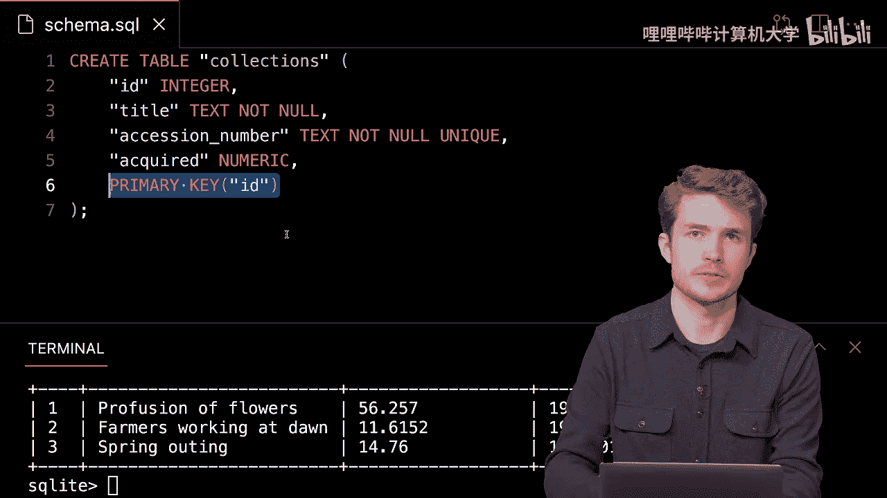
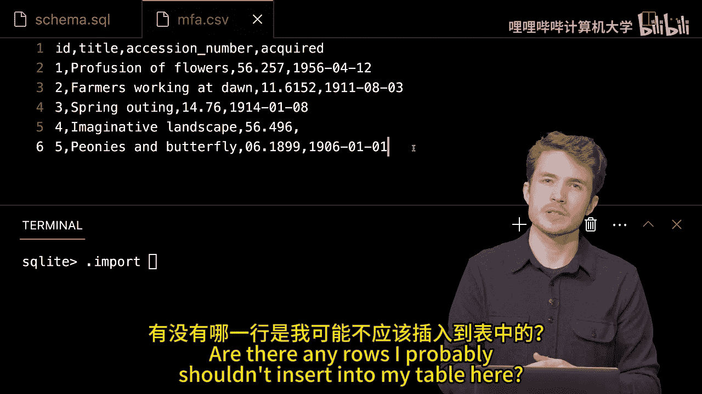
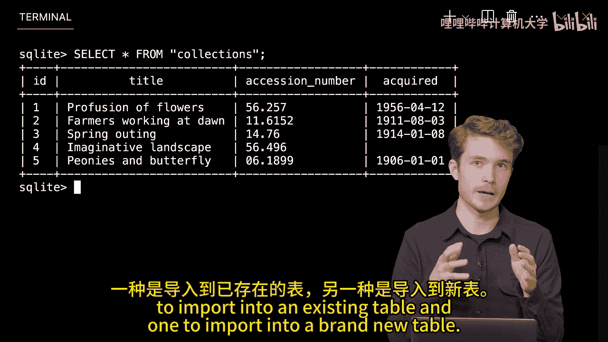
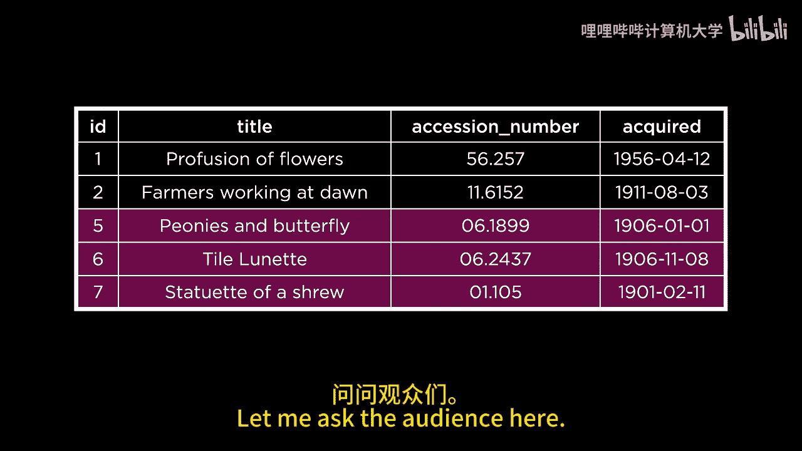
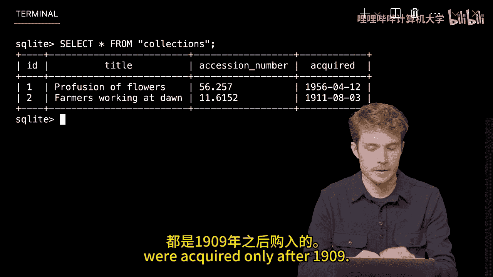
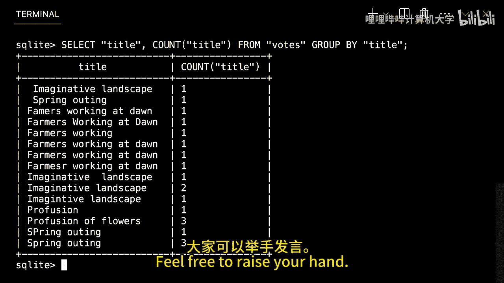
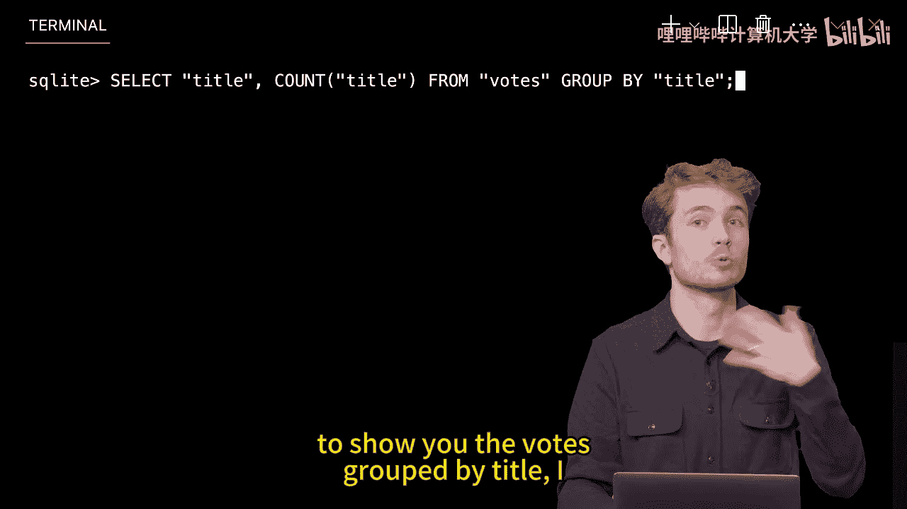
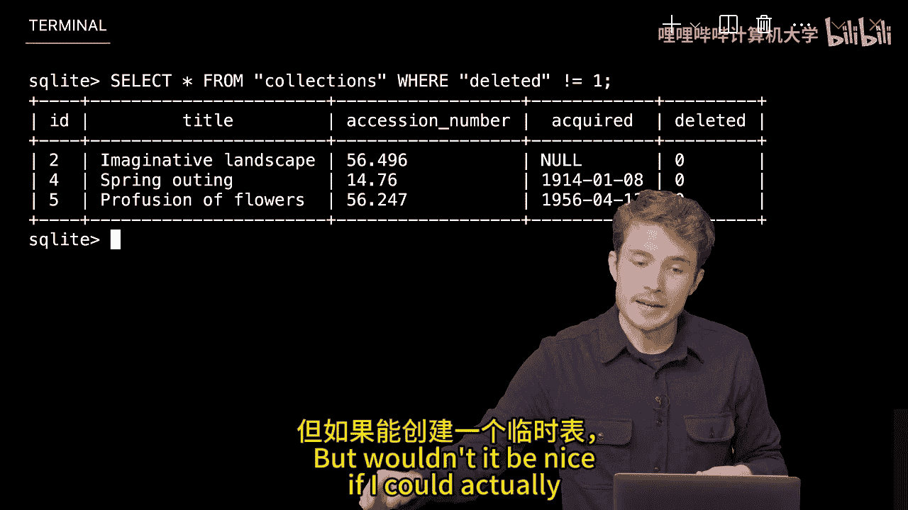

# 哈佛大学CS50 & SQL【速成版】 课程已全部上传，中英双字幕(人工核对翻译），课程附完整课件(视频支持杜比音效，Hi-Res无损音质)。 p05 Lecture 3 - 写 -BV1iKCwBuE2d_p5-

嗯。Well， hello， one and all。 and welcome back to C50's introduction to databases with SQL。

 My name is Carterzenki。 And last we left off。 we learned how to create our very own database schemas。

 that is a way to organize data in our database today。

 we'll learn how to actually add data to our databases to insert to update and delete data。

 We'll do all of this in the context of Boston's very own museum of fine art。 So the MFA for short。

 So the MFA here in Boston is a century， well， maybe about a century old museum that has many artifacts and artwork inside of it both historical and contemporary。

 and it's worth asking。 And how do they keep track of the thousands of items that are in their collections。

 What could they possibly use Well， chances are， they're likely using some kind of database。

 And on that database。 They want to do for actions we learned about back in week0。

 They could perhaps create data to add data。😊，Insert data to the database when they get some new piece of artwork。

 for instance， they might want to query their database to read from it。 They could also update data。

 change the artist， change the artwork in some way。

 and they could also just delete data to remove it all together。 But if we think about these。

 creating reading， updating and deleting。 We'll notice that reading updating and deleting。

 we can't do those。 We don't actually have data in our database。 And so today。

 we'll see how to create data， how to insert data into our very own database。

 now let's think about the MF's collections， their collection of art and artifacts。

 And let me propose they have a database looks a bit like this。

 It's a single table and it has a title column and accession number。

 which is a fancy way of saying a unique Id internal to the museum。 And also a date it was acquired。

 We have， of course， a primary key on this table called Id。 and let's。😊。

Well the museum might want to acquire this piece here This one called profusion of Fers。

 how could they log that this artwork is inside of their database。

 They could maybe just add a new row。 They could say。

 let's put profusion of flowers as the first item in our collections here。

 We'll give it a title and accession number， which again。

 is just the unique I internal to the museum and the date it was acquired。

 and that row then has its own primary key to identify this row uniquely in our database。😊，Now。

 let's say they get another piece of artwork。 They get this one called farmers working at dawn。

 And they want to add this one to their table， too。 Well， they could do the very same thing。

 They could just add a new row。 They could say， let's make its title。

 an accession number and a date it was acquired。 And this brand new row here for that piece of artwork。

And maybe they get another  one，2， same thing。 Maybe they'll get back spring outing。

 and they want to add this to their collection。 They could simply add another row like this。Now。

 it turns out that the database administrator behind the MFA might be running a SQL statement that looks a bit like this。

 insert into。We can use insert into to add a new row to any given table and notice how insert into needs to know a few pieces of information。

 The first is what table to insert into。 What is the name of that table。Second。

 it needs to know what columns are we adding data to inside of this table。

 We'll give it a list of those columns here。 then of course。

 it need to know what new values should go into this new row for each of these columns Like we saw before。

 Is it perfusion of flowers。 Is it spring outing， etc。

 Here we can see that we have this list of values and notice how value 0。

 the first value in this list corresponds to the new value will be inserted to this first column and we can keep having value 1 or column 1 value 2 and column 2。

 each one aligning with that particular column there。

So let's see an example of this actually in code。 understand it a bit more concretely。

 I'll go back to my computer here。 Let's actually create our very own database that involves this schema of having our very own table。

 which can keep artists and artwork and artifacts as well。😊，So I'll type sQL light 3， MF。

db to create a database for the Museum of Fine Arts， abbreviated as MFA。

I'll hit enter here and notice how I can now have access to my very own MFA dot D B inside my SQLite environment。

Well， now I can type dot schema to see the schema of this database。 If I enter here， well。

 nothing's there because there's just made this database there's nothing in it yet。Well。

 it turns out I do actually have a schema file prepared for me already in schema dosQL here I propose we make a table called collections and like our table visually it has。

 let's say four columns， one as an ID， the primary key of this table， one for a title。

 one for the accession number， the unique ID internal to the museum and finally the date it was acquired。

And notice here that title has to be actually added to our database。 It can't be no。

 It can't have an empty value。 Same thing for accession number。 And further。

 accession number has to be unique。 I can't have two items with different accession number。

 Otherwise， I might get them confused in my database or inside my museum archives as well。

So let me then add this schema to my database。 and I can do so with this command right here。

 This is a SQL like command called dot read that we saw a little bit last week as well。

 I could type dot read。 And then the name of this file， I want to read。 So I'll say dot read schema。

 schema。😊，Dot sQL， hit enter。 And now if I type， let's say dot schema。

 I can see that same sQL schema， same database by schema now inside of my terminal。😊，Okay。

 so now as promised， let's try adding some rows to this table because right now。

 if I do select star from collections， semi I call in。

I don't see anything because nothing is inside yet。But I could add something using insert into。

 So let's try that。 I'll say insert into the collections table。 And now I have to ask。

 what columns inside of collections do I to add data to。Well。

 I probably want to add to the first the Id column， that primary key column。

 Then maybe I want to add a title to this row， and also an accession number and also， of course。

 the date this piece was acquired。 So now I have the table I'm inserting into along with the columns I'm adding values for。

 So first styles sake， I'll hit enter here。 And now I could type a list of values to insert into this new row。

 I could say values and then inside parentheses。 the values I want to insert。

 maybe the first primary key that I give to this item is going to be just one。

 start at one and add up as we add new items。For the title， I'll say。

 let's call this one profusion of flowers。 This is the piece we recently acquired into our collection。

 The accession number that we gave it was 56。257， and the date it was acquired was back in 1956，0412。

😊，Now， I have all these values here。 I'll type semicolon， hit enter， and nothing seems to happen。

 But if I type， let's say， select star from collections， semicolon。 What do I see。

 But this new row inside。Let's do it again to get a hang of this。

 I want to now add farmers working at dawn to my collections。 So I'll do the same thing。 I'll say。

 let's insert into the collections table。 And let's add values for the I D column， this title column。

 the accession number。 and also the acquired column like this。 again， for style sake， I'll enter。

 Now I give some list of values to add into this new row。 I'll say values here。

 then this list of values to add for each column。 Well。

 the first column I have to give a value for is I D。 If you remember， our last Id was one。

 So what should this I D be。😊，Maybe two， so I'll cite two here as the next increment of my primary key。

 then I'll give it a title and this title wasers， farmers working at dawn。

 We gave it an accession number to keep track of it in our own internal museum records。

 our own archives here， so I'll say 11。6156。56。152 is the accession number for this particular item。

Then I'll say we acquired it back in 1911 on 0803。Now I'll hit a semicolon here， hit enter。

 and now I should be able to see if I type select star from collections。

 select star from collections， semicolon。 I now have these two items inside of my collection。Now。

 let's do one more here。 But let's focus in particular on this primary key。 Like。

 notice here how we've been actually inserting our very own primary key，1 and then 2， but。

Maybe that's not the best design。 Like if I， let me try this again。

 I'll say insert into let's go for collections。 This is our table name。

 And maybe I'll try again to add to the I D column， the title column。

 the accession number and the acquired。Column here。What could go wrong。

 do you think if I try to specify the primary key myself。

 Let me ask this as an audience question here。 Feel free to raise your hand。

 What might go wrong if I try to make the primary key myself insert a value myself。

Ask you Sava what we could do when we had to you know load a lot of values like maybe like big data or something。

 is there a way to add it through a CSV file or something rather than typing insert into tables。

A good question。 you're onto something here， which is we're inserting one row at a time。

 which could get easily repetitive。 So let me hold that thought for just a minute here and focus on the primary keys before we see some of the more efficient ways to actually add data to our table。

 So I'm with you on this idea of maybe you don't want to duplicate this primary key。

 we could do a little better than that。 So I'll come back to my computer here。

 And if I specify the primary key， I might actually add a value that's already in there。

 So I could thankfully leave it up to SQL light to actually increment this value for me。

 Let me try leaving off Id in this case。 I'll omit the Id altogether。

 which seems at first like a bit of a bad thought。 Like shouldn't every row have its own Id。 Well。

 let's just try and figure what happens。 I'll enter here。 And now I'll say let me give the values。

 Well， now the first column is the title column。 So I'll go ahead and say that this one will be called spring outing。

 We're gonna add this one to our collection here。😊，The accession number in this case is 14。76。

 and we acquired this one all the way back in 1914，0，108， Some I call it。

So I'll hit enter here and notice how there's no ID that I have specified。 but now if I hit enter。

Seems to work。 I'll type select star from collections。 And what do I see。

 But the new primary key of three， So it seems like SQLite actually increments the primary key for me。

 If I add some new row。 It looks。 What is the current highest primary key and adds one to that automatically for me。

 And I've gotten that by specifyifying in my schema， is primary key constraint down on line 6。

 So pretty handy for me here。😊。

I see a few other questions， too。 So let's take those before we move on as well。

Let's go to Andre I just want to ask if I delete the let's say the the record and。

Type again with it number it of the number or the first one great question we'll see this a little bit later on too but if I delete some row let's say I deleted the row with primary key of one well what SQLite will do at least by default is actually take the highest value。

 let's say the highest value is still three in my database it'll add one to that and when I insert that new row it'll have the ID of four in this case。

Okay， so let's explore a bit more some of these constraints on tables。 Like here。

 we're talking about the primary key constraint。 But we also have， as we saw before。

 the not null constraint and the unique con。 So let's try inserting given those constraints here。

Go back to my computer。 And again， notice in my schema。

 I specified that this title column should always be not null。

 It should never have a null value inside of it。 in similar accession number should also be not null。

 It should also be unique。 I should have no to rows。 I have the same accession number。

 And maybe kind of playfully subversively here。 let's try to run against this constraint。

 Let's actually try to add the same accession number and see what happens。

 So I'll come back to my terminal。 let me just reinsert， let's say spring outing。

 Not how if I select star from collections。 It's already in here。

 but I'll try to add it yet again with the same accession number。

 So I'll say insert into collections。 And by now， it what we' become a little more familiar。

 I now want to say the the column is I want to add data2。 So I'll say the title column。

 the accession number。 accession。😊，Acession number column and also the acquired date。 I'll hit enter。

 And now I'll say the values again。 Let's reinsert spring outing。 I'll say spring outing as a title。

 The accession number is 14。76。 and the date was acquired was again，19140108 semi。 Now。

 if I hit enter。What do we see？Runtime error， unique constraint failed。

 So it seems ran against this constraint here that we specified on line 4 here。

 accession number should always be unique。 But by trying to add a new row that had that same accession number。

 we ran into this runtime error and our operation was not completed。 If I say in this case。

 select star from collections。 notice how I guarded myself from adding。

 spring outing more than once with the same accession number。

 So some usefulness here to these kinds of constraints。Let's try violating not null， too。

 I'll try adding a title that is actually null， not existence。

 Try to add a painting without a title itself。 Let's try this。

 I might try insert into the collections table， and I'll add to the title columns。

 the accession number。And also the acquired column。Now， I'll say the values here。

 But remember this null value， Noll meaning nothing。 This value doesn't exist。

 I could insert that into my table， or at least try to。 I'll say null is a title。 And similarly。

 null is the accession number。 And let's say just playfully。

 we got this painting back in 1900 on January 10 like this。Okay， now semi calllon， I'll hit enter。

 and we see the same runtime error constraint failed in this case， the not null constraint。

 So notice again， how in my schema， I specified title should be not null。 But here。

 when I try to insert a null value， I run into that constraint。 and I can't insert that value。

 if I try to select star from collections， I should see in this case。That insert didn't work。

So these constraints are really guardrails against me， against other users。

 to adding values that we really shouldn't add to our table。O。So presumably here， you know。

 we're on to something by adding some rows。 But if the museum acquires more than one item。

 maybe 100 at a time， I don't want to be the programmer who's anything there writing 100 insert into。

 That's like not what I want to do。 There's probably a better way to do this。

 And let me show you one way to do this。 One way is to instead of inserting one row like this。

 to instead insert multiple separated by commas。 So here I might say this is my first row for each of these columns。

This is my second row， again， for each of these columns and so on and so forth。

And it's worth noting this is not just a manner of convenience。 Like if I tried to insert 100 rows。

 this is certainly convenient for me， but it's also most often in most cases。

 going be faster for me to insert 100 rows and one go， then to insert one row 100 times。

 So this is both a convenience thing for programmers and also an efficiency thing to actually optimize your database as well。

 So let's try this syntax now to avoid me sitting there for hours and hours。

 writing many insert intos。 I'll go back to my computer。 And this time。

 let's say we got two paintings at once。 We got two。 So I'll try to add both of them。

 I'll say insert into the collections table。 And again， I want to keep adding to my title column。

 my accession number column and even my acquired column like this。😊，Now。

 I want to add in some values。 So I'll type values here。 And as a matter of style， let me just say。

 I'll make a new line。 I'll enter here。 And now I can type each of my new rows on their very own line。

 So again， I'll type all of the values that I want in my first row。

 I might call this one imaginative landscape。 we got this one back in actually。

 you we don't quite know when we got this one。 If I type 56 do 4，9。

6 is the exceptionion number like here，56 do 4，9，6。

 the MFA actually doesn't know when they got this painting。 So if they don't know。

 let's just insert no， This is intentionally left blank。😊，Okay， this is my first row。

 Now I want to add a second one in one go。 I'll follow up with a comma。

 and now I'll type out my next set of values。This next one we acquired。

 is called peonies and butterterfly。 Now， I'll say the succession number is 0，61，8，1，8，9，9。

 And we got this one was back in 1906 on January 1。 Now， I'll hit semicolon here。 And now。

 if I hit enter。Nothing happens。 But if I type select star from collections， semicoin。

 What do we see， But now two new rows being inserted。 So a handy way to insert more than one value。

 And also， if you have a lot of values， a more efficient way as well。

So let me pause here and ask what questions we have on insert into。

Whether adding one row or adding multiple。Let's go to  Teha。

So imagine you are writing a for or inserting a row。 So by a mistake。

 you have a enter the wrong spelling of the title。 So how we will re a great question， too。

 and often as is the case with me。 I make typos all the time。

 I might add the artwork title and misspell it， for instance， in that case。

 I can't use insert into to correct it。 But I can use a new statement。

 We'll see a little later called update。 And so with update can actually change the spellings of things。

 And we'll see that a little later today， But great question to peek ahead as well。😊。

Okay， so let's keep going here。 Let's think about how we can keep adding values to our data set。

 so far， we've seen insert into with one row and with multiple。

 But one more way take you in mind is you might already have your data。

 perhaps in some other format and one common format looks a bit like this on our screen over here。

This file is called a CV for comma separated values。 Now， why comma separated values。 Well。

 let's just look at here we see some presumably or column names like Id title accession number and acquired。

 But what separates these column names well， looks like comms Id comma title title comma accession number and so on。

 Every row is still its own row。 that makes sense here。

 but now those row values are also separated by commas Not here。

 the first value before the first comma corresponds to the first column。 This Id is one。 Similarlyly。

 the next comma separated value， perfusion of flowers belong to that next column here。

 title as well and so on and so forth。 you could。 if you wanted to kind of draw a sneaky line to see how these columns correspond down our file here。

Now， you might often have data already in this format。

 and it's actually pretty convenient to try to import this data into SQLL into your very own table so you can use SQL on it。

 So let's try doing that here， taking a CSV like this and adding it to our database。😡。

I'll come back to my computer。 and at this point， I want to start over。

 let's say I didn't use insert at all。 I actually got a CSV from the MFA of all the items in our collection。

 So I'll type dot quit to leave this database， and then I'll type RM。

 MFA do DB to remove this file altogether。Now， let me show you MFA do CSV。

 this CSV file I have that looked exactly like what we just saw， I'll type code， MFA。 CSV。

 and now I can indeed see I have an ID column， a title column。

 an accession number and the date these pieces were acquired， all separated by commas。

So let's say I want to quickly import this data into its very own database to run SQL queries on it。

 as it stands， I can't use SQL queries on this table because it's not inside of a SQLitete database。

 but let me add one I'll type SQLite 3 MFA do Db to remake MFA down below。

Let me now introduce this new command that is not a SQL keyword。

 but it's actually a SQL liked command and this command is called dot import dot import lets you take a file like a CSV and automatically insert it row by row into a table of your own making or one that you can let SQite create for you。

Let's actually create the table ourselves and then insert this CSV using dot import。

 so I'll go back to SQLite and let me recreate this schema right now there's no tables inside this database。

 but let me create one I'll instead type dot read schema dot SQL to read in that old schema to SQL file so I can have my own table here I'll type that schema again and now I see I have that table back。

 but if I type select star from collections。Smic colon， nothing is inside。 Well， I could fix this。

 I could try to import this CV into collections to insert all at once from this own。

 from the CSV file we have right here。So to do this， let me type dot import Now。

 before I finish this off， there are a few arguments or options I can give to dot import to make sure it works properly。

The ones for this look as follows。 I should type dot import， and then dash dash CS SV to say。

 I'm importing a CV。 If I don't type dash dash C SV SQL light might assume something about this file that just isn't true。

 It should know that file that numbers are here separated by commas。 numbersumbers or values。

 Ever inside my table are separated by commas。And then dash， dash， skip1。 Well。

 let's take a look if I go back to this file here。Let's see。 I have the first row， the second row。

 the third row， the fourth row。 Are there any rows I probably shouldn't insert into my table here。

Let me ask the audience， if free to raise your hand。

Are there any rows I shouldn't insert into this table。Yes。

 I think we shouldn't include the first room。

Because it doesn't give us any value that we need。 Yeah， you're right。

 So if I look at this header row， as we call it， I see Id title。

 accession number and acquired the names for my columns。 But notice in my schema。

 I already have those column names existing。 So I shouldn't insert the value Id into my Id column。

 I want to just skip that row and only do the next one。 So here by typing dash dash skip 1。

 I'll skip that header row。 So let's try this now。 I'll say dot import dash dash Cv。

 I'm gonna import a Cv。 Now dash dash skip how many rows。 should I skip well。

 just one the header row there。😊，Now I say the file to import， so I'll type MF。csv。

 the CSV file to import into my database。Now I type the name of the table I'm importing into collections in this case。

 and notice how I no longer need to quote collections or quote MFA dot CSV。

 because this is not a sQL statement。 This is a sQL light statement。

 so I can get away with not quoting anything here。Now I'll hit En。And again， nothing seems to happen。

 but it's probably a good sign。 Let me try selecting star from collections。Some me call on enter。

 And now all my data is just magically in there。 It's went from my CSV into my very own table。😊，Okay。

So that's a pretty nice step forward。 Like no longer do we have to use just single line inserts or even bulk inserts as multi line inserts。

 We can now just import an entire table from a CSB。

But I think I've been showing you a bit of inaccuracy here。

 or at least something that's not often going to happen to you， like if I go back to this file here。

 the CSV， what you might notice is that I specified the primary key， I said ID of one， ID of two。

 ID of three。But if we heard before， this might not be the best design because what if I import this CV and there's already an item that has the I of one or the I of two。

 Ially， I could let SQLite create its very own primary keys for each of these rows。

 And more often than not， you'll likely have a database or CSV that looks a bit more like this without the primary key。

 But you'll still want to have a primary key when you import into your database。

 So let's try working with this kind of CSV now and having SQLite generate some of those primary keys for us。

 Come back to my computer。 and let's update our MFA do CSv just remove those primary key column here。

😊，So I will open up again， NFA。 CSV。And let me try to just delete this column altogether。

 I'll remove Id， remove one and 2 and 3 and 4 and 5。 Let me save it。 And now that I D column is gone。

But now there's a problem。 Like， if I go to my schema， I type dot schema。

Notice how there are four columns in this table， ID， title， accession number， and acquired。Well。

 now my CSV only has three columns， so if I try to import this CSV into this table。

 I'm going to run into trouble because I have different numbers of columns between my CSV and my table。

What can I do instead， It turns out that I could actually import this data into a temporary table and then take that data and insert that data in that temporary table into my real one called collections here。

 I can use both dot import and insert into to accomplish that task for me。So let's try this。

 I'll say dot import。 I want to import a CSV now， dash dash CSV， Which one Well。

 MFA dot CSV in this case。Now， though I want to create a brand new table that doesn't yet exist。

 So I'll type the table of the table。 I might just call it temp for now to temporarily import this data into a brand new table and notice how here I'm not using dash。

 dash， skip one， because now I want to take advantage of those header rows。 SQL light。

 If I import into a new table。 Well notice I have a header row and make my columns。

 the very same names that are in my header row title accession number and acquired。

 I don't want to skip them。 I want SQL like to see them and create this table using those header rows。

So now， I'll hit enter。AndNothing seems to happen， but if I type thatt schema。What do I see。

 But a brand new table called Temp that SQL Let has just made automatically and notice how it used that header row。

 I have title， accession number and acquired as my column names。Okay。

 let's now look inside the temp table。 I' say select star from T。

Some I call it And now I see all the data in there。But I don't have primary keys yet。

 So my goal is going to take all this data and insert it into my collections table to give it that primary key I've been wanting here。

 Again， if I type select star from collections。Well， nothing， oh， something is still there。

 Let me actually just delete this for De administration。

 I'll say delete from collections to remove it all together。 We'll get that to in just a minute。

 And now let me try select star from collections。😊，And I should see nothing inside of collections。

So what could I do， I could insert into collections using the data from my temp table。

 So I'll try that。 I'll say insert into collections and choose those columns yet again。

 I'll say the title and the accession number。And now let's go for the acquired column as well。

I'll enter。But instead of typing many new lines of values。

 I actually have a way to dynamically select all the values I want to insert and looks a bit like this。

 I could say insert into some table and some columns of that table。

But I want to insert the results of this select down below。

 So I'll select some columns from some separate table。 And so long as these columns align。

 I'll be able to actually take the results of that select and insert all of them into this new table using insert into。

 So let me finish my statement here。 and we can see the results。 come back to my computer。😊。

And here I'll type a select to get back all the items from my temp table。

 I'll say select in this case， select， let's go for the title column。

 the accession number column and the acquired column from my temp table。Now， if I hit semicolon。

 I should see。Nothing at first。 But if I type select star from collections。

I see all my data now in there selected from my temporary table and now if I type dot schema。

 I still see temp， but what can I do now， I could just delete that table altogether。

 I could say drop table temp as we saw last week， semi call hit enter dot schema again。

And now we're back where we want to be with a single table。

 And now we've import our data from our CSV with primary keys。 If I type collections here。

We see it all on this table。Okay， so we've seen several versions of import。

 one to import into an existing table and one to import into a brand new table。

 Let me ask then what questions we have on how to use do import or how to insert more data into our database。

Let's go Lu。Can we ask the inserting to command to place a column in a specific position。

 good question。 Could we ask insert to place a column in a certain position。

There's a few ways of getting at what I think you're asking here。

 So Let me show you a few of those here。 I'll come back to my computer。

And let me pull up the syntax for insert into again。 I will choose this。

 and I'll show it on the screen over here。 So I'll say insert into some table， given some columns。

 and notice how down below I actually have values to insert into those columns。

 I could to your question rearrange these values。 So I might have this first value here is some value that goes into this column。

 this second column here is a value into that column and that would rearrange the values I insert into those columns。

If you're asking though if I can reorder the columns。

 that is up to create table and create table only。 And in general。

 I encourage you not so much out ordering of your columns because it could be in any order whatsoever。

 but you could just rearrange your selection of columns here to insert the data you want to insert。

Okay， let's take one more question here。 What happens if one of the rows you're trying to insert violates a constraint on the table Yeah so here we're inserting multiple rows and if one actually violates some constraint。

 then we won't actually insert any of those rows and this is because this insert is bundled inside of a transaction which we'll learn more about later on in the course。

Let's take another one。I noticed that when you did select star from collections。

 that one of the acquired dates was just blank， it didn't say no。

 is that because the CSV itself just had an empty value next to the comma？

Yeah， great observations。 So let me try this again so we can see the results of this select。

 I'll come back to my computer here。😊，And let me show you again。

 if I say select star from collections semicolon。 notice how this acquired acquired cell here。

 if I go back to my screen is just blank but we saw before that if I selected star。

 I would have seen null there。 if this value was truly null。 Well。

 it turns out one downside of importing from a CSV is that all of your data is imported initially as text。

 And if I have just a blank cell in my CSV， it won't be converted to null automatically。

 I to do that my cell， perhaps using an update statement that we'll see in just a bit。

 So be wary of this。 if you do want to keep track of null values and so on。

 if you don't actually manually make this value a null， it'll appear as just a blank value。

 not a null， which is different in this respect。Okay。

 so here we've seen how to insert not just one row， but multiple。

 and also how to import data from a CV。 when we come back。

 we'll see how to actually update our data altogether and even delete it too。

 So we'll come back in just a few and talk about how to delete data from our tables。 And we're back。

 So we just saw how to insert some rows into our database and also to import some data。

 But presumably， we also want to able to delete some data from our table as well。

 You can imagine the MFA， the Museum of F arts。 maybe they're selling a piece of artwork。

 or maybe they've lost one or maybe it was stolen。 But either way。

 they want to remove the row from their table。 Well， let's see here。

 We could go back to our schema with a table of artifacts and artwork that is inside of the MFA。 Now。

 if I want to delete a particular piece。 You could visually think of it a bit like this。

 I could first identify that row。 I want to delete。 Let's say it's spring。😊，OutHere。

 we've sold this piece。 Well， I could visually just remove this row。

 So it's no longer there and shift the remaining ones up metaphorically。

 And it turns out that to do this in SQL， we have our very own statement we can use。

 This one reads delete from some table， where a condition is true。 So we see our old friend。

 where back again and where is vitally important this delete from。

 If I say delete from table with nowhere where what do you think is going happen。😊。

Might drop everything from our table， right， But if I instead say where some condition is true。

 I can select the rows I want to delete and only delete those rows。 So let's try this here。

 I'll try to delete some artwork from our collections table。 For example， maybe we sold it。

 and we want to get rid of it。 I'll come back to my computer over here。

And I will open up our SQLite database， I'll say SQLite3mfa。db。

 and now I can type select star from collections and I see a few more items than last time now all inside of our table。

But per the visual， I want to delete spring outing to remove it from this table。 So what could I do。

 I could try， delete from， and then the table I want to delete from in this case， I'll use the。

 let's say， collections name， delete from collections。ButI don't want to do this。

 I don't want to say delete from collections， semicolon end of statement。

 because then I'll delete every row。 What I should instead do is this delete from collections where some condition is true。

 Maybe the title in this case is a title I'm trying to remove。

 So I'll say title equals spring outing just like this。 semicolon enter。Now， nothing seems to happen。

 But if I do select star from collections， some I calling。

We no longer see spring outing and notice here how the ID D column， the ID D of three， is now gone。

 If I were to insert some new row here， I would start over with the highest number。

 which is 7 in this case， going from 7 to8， but three is no longer part of our database。

Let me try this again， notice how this one called imaginative landscape。 The acquired date is null。

 We don't know when we got it。 Well let's say that we eventually sell it。

 It's no longer part of our database。 We could use a condition based on null to remove this particular artwork。

 So I'll say this。 Let me try to delete from collections。Where title equals， not springouting。

 but where the acquired date， sorry， the acquired date。Is no， semi call it。

I could also use is not null。 where acquired is not null。

 but that would delete all the pieces of artwork that actually have an acquired date Here。

 I wanted only those that do not have an acquired date。 So I'll say where acquired is null。Now。

 I'll hit enter。 Now， things seem to happen， but I'll say select star from collections。

Some I call in， and I'll see that that piece of artwork is now gone。

 I only have those that have an acquired date。Okay， so similar to insert。

 we've been able to delete one row at a time， but it would probably be helpful for us to delete multiple rows at a time as well。

 Let's look again at our table here we have our artwork as it currently stands。

 And maybe let's say we want to delete those pieces that we acquired before 1909 here in Boston。

 the MFA actually moved locations in 1909 to a new place still in Boston。

 but a brand new building altogether。 So let's say that perhaps they left some items at their old location。

 they're no longer part of their collections。😊，Va what condition do you think could I select these three rows for I delete from。

What could I put in my condition to delete these three rows， Let me ask the audience here。

What might you propose for delete from here， delete those three particular rows？

Its krev greater than 5。Id equals That's a good observations。 We could look at our table here。

 we see that the ID could be greater than or equal to5。 That would remove these three rows。

 certainly。😊，There's probably another way to do this， too。Any other ideas besides the I D。

What else could we use。Let's go to Ashby。So we could compare the dates and use greater than our less than sign with the acquired date So you're proposing to use the date column too that makes sense to me as well we could see acquired here。

 perhaps we could see is the acquired value less than 1909 that year that we move locations we could also probably use the title the accession number and so on and each has their own tradeoffs remember though for this particular query which is deleting those items that were part of the museum acquired before 1909 probably best to use the acquired date to actually delete those rows what if for instance。

 our Is are actually not like this， but they're kind of interspersed around I couldn't really do a query like if the ID is greater and equal to5 because I could also include those that were maybe acquired 1911956 and so on Probably ideal for me to use this date if it's the date that I ultimately care。

About。So let's try this， I'll go back to my environment and I'll try to delete these three particular rows。

 I'll try delete from collections as we saw before。

 but now here comes my condition I'll say where the acquired column is less than some date that I'll give and here I'll give 1909 January1 it turns out that SQLite has a few ways to represent dates。

 one of which is this format that follows the yY y or the year four digits and then dash and then Mm or the month with two digits。

 and then dash again D D in this case the day in two digits， so 19090101 means January 1 1909。

And I can use these same operators with dates， I could say greater than or less than or equal to this particular date。

 and SQL light will be able to parse this for me to understand what I mean。

 which is earlier than 1909。So let's try this， then I'll hit enter， and nothing seems to happen。

 but if I do select star from collections， I now see I'm down to two paintings。

 two pieces of artwork that were acquired only after 1909。

Okay。So given this part on delete， we're able to delete one row or even multiple rows at a time。

 But there are still instances where we might want to think about。

 should we delete something or can we delete something。

 We'll talk about those in just a minute in terms of constraints。We're back in a few and we're back。

 So we just saw how to delete one row， even multiple rows。

 We haven't yet talked about whether we should delete some data。

 or whether we should delete some data。 and particularly in the context of these constraints where you might have maybe a piece of data。

 you actually shouldn't delete to maintain the integrity of your table Now one example of this is a foreign key constraint。

 which means that you have some table with a primary key that is referenced by some other table。

 And'll get concrete about this just a minute， but it might mean that if you were to delete that primary key that other table would have nothing to reference。

 So let's update our schema here for the MFA， the museum of fine arts。

 And let's say that they have not just a collection now， but also artists involved。

 and there exists a many to many relationship among artists and items in the collection。

 we could say that an artist might make。

More than one piece of art in the collection。 and a piece of art might be created by more than one artist。

Now， concretely in our database， this might look as follows。

 I could have a table for artists and a table for collections。

 and notice how each has their own primary key。 artistist has an Id column called our primary key column。

 Collections too has an I called our primary key column here。

Now in the middle is this table created that symbolizes that represents the relationship among artists and items in the collection。

Here on the first row， we see the artist ID of one created the piece of art with a collection ID of two。

 So who did what here， Well， we can see that the artist with the ID of one is Li。

 Liin created this piece of art， the ID of two， which is imaginative landscape。

 we can kind of relate in this case， artistsists with collections as we saw just a few weeks ago。

But let's say we decide to delete a particular artist， maybe we delete anidentified artist down here。

 Well we could just delete from the artist table， maybe we find a condition to select this row。

 and we delete from artists。 We'll do that here， remove that row。But what have we done wrong。

If we look at our created table in particular。What have we now done wrong。

 What kind of problem might we run into。Let's go a cream the insert drawer with D3 was only deleted from the service table without Sa table。

Yeah， good point。 We only deleted the artist with the ID of three from the artist's table。 Now。

 if I look at the created table and I look for the artist with ID of three well。Do you see them。

 And they don't exist anymore。 So I can't understand this relationship。

 I don't know the artist with the I D of three。 So let's try this now with a new kind of schema。

 Now in our database。 I'll go back to my computer。And let me open up our new version of our database。

 I'll type SQLite 3 in this case， MFA dot DB， same name， but now different schema。

 If I type dot schema， notice a few things here。 I have those same tables we saw visually。

 I have collections， artists and a created table。 And let me focus in particular on this created table。

 If I say dot schema in this case， created， enter。I'll see。

 I have a foreign key constraint on my artist ID column and my collection ID column。

 so if I try to delete an artist that is referenced in my created table。

 I would probably raise a constraint error， a foreign key constraint error。

 so let's just try this and see what happens。Let me try deletete from the artist table。

 deletete from artists。Where， let's say the name of that artist is literally unidentified artist。

 This is the name they have in the Museum of Fine Artss collections， unidentified artist。

 So now I want to delete them from that table。 Well if I hit enter。

 I do get that foreign key constraint error。So does this mean I just can't delete this artist or is there a workaround。

 Let's look at it visually again。 I'll go back to what we had before as our table。

 and let me ask the audience here， what's the solution， Like if I can't delete。

Unidentified artist， because they have an Id referenced by this table。What should I maybe do first。

 What should I do instead。 Yeah， I want to say that first we can delete the。

Id that is being referenced by this ID that we want to delete。 then we can delete it。 In fact。

 if we want to delete it from the artist first we have to delete from the P table or what table which it isencing。

 then we can delete from the artist Yeah， I like I like your thinking here。

 So if we look at the created table you notice that we can't delete unidentified artist because it's referenced in the created table。

 What we should maybe first do is delete this row， delete their affiliation with their work and then delete the artist So we don't run into this foreign key con。

 So let's try this in our sQLite environment。ll come back to my computer and again。

 our plan was to first delete the artist's affiliation with their work from the created table So let me show you first the created table。

 I'll say select select star from created and see how it's exactly like the table we just visualized。

Now， let me try delete this artist affiliation with their work。 I'm not deleting the artist。

 I'm deleting their affiliation with their authorship， their artistship。

 whatever you want to call it for their work。 Now I'll say delete， delete from。

 let's say delete from artists where the artist Id is equal to equals。😡，3。Well， I could do this。

 but there's probably a better way。 I like I know the I D。 And that's fine。 But we could also use。

 we saw a little bit ago， which was subqueries， a way to write a query that returns to me the result。

 And that result gets included in another query altogether。 So let's try that instead。

 Let's say I don't know the artist's I D。 What I could do is make a subque。

 I could say inside of this。 Let me select the I D from oh， the artist's table。😊，Where in this case。

 the name？Equals unidentified artist。 And then let me close out this query， hit a semicolon。

 and I already see a typo in this。 But I'm just going to try it anyway。

 I will go ahead and hit enter。And let's see if I type select star from artists。Enter。

 I still see unidentified artists。 And I think my typo here was as follows as if I look up my query using the up air on my keyboard。

 I see delete from artists where the artist I D equals some value here。

 But do I want delete from artists。I don't。 I actually can't delete from artists。

 What I should do it instead is delete from the created table。 So let's try this。 I'll say。

 delete from created。Ma sure I only have double quotes around created。

 Then I'll say where the artist ID equals， let's say either three。

 but it could also be the result of this subquery。 I'll say 1，2，3，4。

 and then select the I from the artist from the artist table where the name equals unidentified。

Artist。Then I'll close this subqueary， hitting semicolon， hit enter。 And now。

 if I say select star from created semicolon， I should see that this artist's affiliation with their work no longer exists。

 And because it no longer exists。 I can now delete them from the artist table。

 I don't have this foreign key artist I D referencing the primary key of this artist。

 So let's now try that。 I could say select star from artist。

 I see that unidentified artist is still in here。 let's delete them now。I'll say delete from。

 let's say artists where the name equals unidentified artist， closing my quotes， semicolon hit enter。

 And now， if I select star from artists。Some I call in。

 I should see they're no longer in this table to our earlier example。

 This becomes a two step process。 first delete their affiliation， then delete their name。O。

So let's try this yet again。 But now using。Some additional tools that we have at our disposal。

So let's look back at this foreign key constraint that existed in this table。 if you remember。

 it looked a bit like this in my created table， I had this line， foreign key artist ID references。

 the ID column in artists。Well， if that is the case。

 I can't delete the artist with the ID referenced by this foreign key。

But it turns out that I could specify some alternative action that happens when I try to delete the ID that is referenced by this foreign key。

I can specify that using a keyword called on deletete。So after foreign key， reference artist ID。

 I could say afterwards on delete and then specify some action I want to actually happen when I try to delete the primary key referenced by this foreign key。

One thing I could use would be restrict， which is kind of like what we saw before。

 If I try to delete a primary key that is referenced by this foreign key。

 I will not be allowed to do it。 That action is restricted。I could also decide to take no action。

 In this case， I could delete the primary key referenced by this foreign key and nothing would happen。

 I would actually be allowed to do that， which may be unwise in some cases。

 but I could give myself that power。 I could also decide to set null。

 That is if I delete the primary key。 Theres referenced by this foreign key。

 What I'll do is set the foreign key to be null， meaning that value no longer exists。

I could alternative send it to a default value for that column， or perhaps most compellingly。

 I could try to cascade the deletion， where cascade means if I delete the artist， for instance。

 let's also delete their affiliation with their artwork all in one go。

 This converts our two step process into a one step process。 So let's visualize this。😊。

Let's say we have now applied this constraint on delete cascade。 So if I delete the artist。

 I'll also delete their affiliation with their work。 We' have the same two tables， artists。

 collections， and created。Now again， artist ID references this primary key in artists。

Now I'm going to try。 I want to delete unidentified artist here。 Well， I could do that。

 I could just delete their row。 And now， instead of a foreign key constrained error。

 what I get is the following。 I see and created that this row is also gone。

 The row that had the artist Id of three gets removed。

 We've cascaded the deletion onward to the created table。

So let's try this now with a new database schema。 I'll go back to my computer here。

So I'm back in my terminal here and I can type SQLite3 Mfa。

DB to reopen this database and notice how if I type dot schema。

 I've updated this schema to now have on deletelete cascade。

 let me show you over here on the screen here on the created table I now have the very same kind of table schema。

 but now my only difference is I've applied this on-dlete action to my foreign key constraints in particular I'm going to cascade delete from the artists table to the created table。

 so let's try that out in SQLite。I'll come back over here。

 and I will now try just delete from the artist table where the name equals unidentified artist。

 unidentified artist semicolon。 Now I'll hit enter and I don't get a foreign key constraint anymore。

 But if I say select star from created semicolon。 notice how I've also deleted the artist affiliation with their work。

 So that is wherever in the artist Id column。 I saw the Id for the artist I deleted。

 I would too delete that row。 So I have no references to that primary key。

 which is now gone from my table。

So let me ask here。 we've seen how to delete single rows， how to delete multiple rows。

 and now how to delete data among some constraints， like our foreign key constraints。

 What questions do we have on those techniques。Let's go to Han I have a question regarding deleting since the ID numbers have been removed while we were moving the record I was wondering if do we have to clean it up somehow later or will they be populated with the new data as it come below Yeah。

 a great question So the question is what happens to our primary keys when we delete our data So for this one。

 let me show you the visual again that we had before of our tables a nice pre printed on the slide。

 So I'll come back here and I will go back to our idea of these joint tables where we had an artist' table a collections table and a created table and we saw before that we're going to delete this artist called unidentified artist。

 So I'll delete them and to your point well the idea of three no longer exists in this case。

 Now by default， at least in SQL light if I insert a new row I'll do is take the highest。😊，Id value。

 and I will then make that the new primary key for the new row that I insert。

 That is the default situation。 I could if I wanted to get more specific。

 And if I had done in my I integer my I integer column here in my create table。

 if I had also said this keyword called auto increment all one word what would happen instead is I would actually reinsert an Id that is not used。

 So in this case，3 is not used， I could insert that one here。

 So up to you what you want to do in general， sQLite by default will take the highest I add one from there。

 if you specify this constraint called auto increment you will instead take whatever Id is not being used and use that in your insert afterwards。

Okay， so now we've seen how to insert and how to delete data， but of course。

 we make mistakes when we add data or even when we delete data。

 so we'll see in just a minute how to update our values as well。

 to correct typos and even to update associations between artists and artwork。

And we're back so we've so far seen how to insert some data into our tables and how to delete it。

 but sometimes we don't want to fully delete something which want to change its value to correct some typo which corrects some association so let's think to our MFA example where the Museum of Fine Arts has some tables that look like this。

 they have artists in their collection and they also have artwork in their collection they also have a creative table to associate artists with their artwork。

😡，Now， in this case， we know that I have this unidentified artist。

 and we can see that they authored this item in the collections， farmers working at dawn。

But let's say that later on， we find out it wasn't an unidentified artist。 It was instead Li Yin。

 who created farmers working at dawn。How could we update our tables？To make sure it's Li Yin。

 who we have creating farmers working at dawn。So what we could do is like。We know that in creative。

 we have our artist study and the collectional， so we could。

A but somehow we need to cascade the now this unentified。

 so a good point here we could actually probably change the created table to reasociate an artist with some new artwork here。

 So let's visualize this。 I go to my created table and here the artist Id is currently3 but I want it really to be one I want Li to be associated with this piece called farmers working at dawn。

 So I could update the created table to instead of having three here have one。

 now we see Li Yin created farmers working at dawn And to your concern about this unidentified artist here。

 I think it's okay to have an artist in our table who may or may not have an item in collections。

 We'll say that's okay， at least for now。

So if we can update our associations between artists and collections like this。

 let's actually try to do that in our very own database here。 I'll go back to my SQLite environment。

 And now let me try to open it first。 I'll do SQLite 3， NA do Db。

 And now let me type dot schema to show you I have the very same schema from before。

 So I want to update the artist association between Liin and farmers working at dawn。

 So let's say I'll select star from create like this semicolon。

 here I have my artist Is and my collection Is。 I see that we have the uned artist Id of three。

 creating farmers working at Don with the I of one， our collection here。😊。

So now let's try to update the artist who created this particular painting here。

 I have three associated with one， but I want one associated with one。

 where one is the Id for Li Yin and one my collection I is the I for this artwork here。

 So let me try this。 I'll say update created and set。

 let's say artist Id equal to some particular value。 Well， what value should I set it too。

I could try to set it to Li Yin's I， which we know is just one。

 but let me try instead to use a subquery here。 Let me try to say parentheses and then write some query to update this value。

 I'll say select Id from artists like this enter again where the name equals Li Yin。

And then let me close this subquery。Well， if I try to run this query， what might happen。

 I'm updating the created table。 I'm setting the artist I D equal to the I D for Li Yin。

But what I've forgotten is this where to only choose some rows to update， so may not close it yet。

 I'll instead say where in this case， the collection ID。

 the piece of artwork in our collection is equal to well the ID for this painting。

 I'll say select ID from collections， and then I'll say where the title equals farmers working at dawn。

Now， I'll close this subque and hit semicolon。And here we've seen our first example of an update query。

 I'm trying to update the artist ID column in created to be the ID for Li Yin。I only want to do that。

 though， on the row， where the collection Id is equal to the I D for this particular painting。

 We want to change the attribution for。 So now I'll hit enter。 And if I select star from created。

 I should hopefully see in this case。😊，That the artist I D associated with this painting is two and also down below here is one as well。

 So I have Li Yin associated with now two paintings overall。

So let's get a grasp on what this updates syntax really looks like in general。 And for that。

 let's show this slide here。We have this update keyword。

 update statement in SQL to take a table name and update the columns inside of it。

 I say update that the name of the table I want to update。

 Then I say set some column equal to some value。 I could if I wanted to have more than one column here。

 I could say maybe title and even maybe before we're talking about authors。

 authors over here or even acquired date， I could update more than one column in my set portion here。

Then comes this where portion， where some condition is true。

 I want to make sure I don't update all of my rows。

 I only update those where some condition is actually true。

 So this is your syntax for updating some columns。 Let's say if you want to change an artist' attribution。

 Or if you want to change a typo you've made。So let's see this now。

 not just in terms of changing artists and their attributions。 Let's see a use case for update。

 We've made some mistakes in our data。 And let's say the museum decides to host some kind of event where people vote on their favorite piece of artwork。

 They kind of hand writer type it into some online form。 Well。

 we might get back a CV of those responses， some comma separated values one line for each vote from our people who've attended this convention。

Let's go back over here and I'll show you that CSV。

 Let me go to my environment and I'll type code MFA do CSv to open this CSV that I already have。

 And here actually not called MFA CSV。 It's called code votes CSV。

 And now here we can see I have a table of one column that has several votes inside of it。

 which do we have maybe 20 votes to be exact。So the first row is the header row I have in this C SV 1 column called title。

 and each line here is one vote for a museum goer's favorite piece of artwork。

 We see farmers working at dawn。 We see imaginative landscape profusion of flowers。

 And our goal is to count up these votes to see which is the most popular。 Well。

 let's try using dot import again to actually turn this CV into our very own sQLite database。

 Let me go back to my terminal。 And I'll type sQlite 3 votes dot D to create a votes database。

 I'll enter。 And now I can use dot import。 I could say dot import。

 a Cv called votes dot Cv into a table also called votes。 I'll hit enter now。 And now if I select。😊。

Star from votes， semicolon， I'll see all of my votes now in a single table。

So I want to tally these votes。 and we could do that using a technique we learned back in the week on querying and relating。

 What if I wanted to group by my titles and count up those groups， I could do that。

 I could say select， let's say title and also the count of title。

 and they count up the votes for each title。From， in this case， my votes table like this。Now。

 I want to count not just each vote individually， but I want to group them。

 I want to count votes by group where that group is， in this case， the title itself。

 So let me try running this query and hitting enter。Well， I'll see。

 I've started to count some votes like I have a imaginative landscape here， spring outing。

 farmers working at dawn。Spring outing down below here， too。

 but I seem to be missing something like I shouldn't have this many groups。

 I should only have four groups。 Why do I have so many。Well， it seems like there's some typos here。

What typos do you see， Feel free to raise your hand。

So I think that it is a title is when you count。 It is case sensitive。

 So maybe it is counting one by one。 Yeah， good idea。 So maybe it's case sensitive are group by is。

 And you'd be correct。 if you said that Group by is in this case， case sensitive。 So if we see here。

 we see farmers working at Don all capitalized， at least the farmers working and Don capitalized。

 Well， that won't be part of the same group as let's say farmers working at Don all properly capitalized in this case。

 with lowercase working and lowercase Don as it is the NFL collections。😊。

So we could probably fix some capitalization here。 What other things could we fix。

 Let's hear from one more person。Let's go to Lawrence。 we count on each typo。

 There are some typos in here。 absolutelyute。 So if I look at some of these， I see not farmers。

 but famers working at dawn。 I might see instead of imaginative landscape。

 I just see imaginative landscape。 So definitely some typos in here to fix as well。

 So let's start working on using our update tool or update keyword to fix some of this data to clean it up。

 so to speak， so we can count up our votes for these artworks。 come back to my terminal。

 And now let's try updating to at least remove some of this white space here。

 Like you might notice that imaginative landscape has a space before it。

 And so does spring out in here。 That space counts as part of the title。 And I want to remove it。

 So what could I do。😊，I could try using a function in SQLite， one called trim。

 trim takes a string and just removes leading and trailing white space。

 giving back only the characters in the middle。So let me try that。

 I'll say update votes my table here and set the title column equal to what。 well。

 the trimmed version of title trim looks like this。

 trim and then some parentheses to say the input to this function。 I'll give it the title column。

 Now I'll hit semicolon。 and this query will run as follows。

 It will update the votes table and inside the votes table set the title column equal to the trimmed version of whatever values are inside that column。

 trimming here means remove trailing and leading whitespace。 I don't need to apply any condition。

 I don't need to say where dot dot dot， because I want to apply to all rows in my data。

Now I'll hit enter and let me try running this again。

 I'll say up arrow to get my old query now I'll try counting again。

 and I think we're making some progress like I can see that I've removed， removed。

 quote unquote those titles that had leading or trailing white space。

 they're now part of a group because their titles now match those groups。Let's keep going。

 We noticed before we had some capitalization issues， so let's fix those as well。

 I can go back to my terminal and we could introduce this other function。

 one called upper upper converts a string like farmers working at dawn to be all in uppercase。

 kind of shouted out and that's useful for us here because we could kind of force everything to uppercase。

 thereby removing any inconsistencies in capitalization。So let me try that。 I'll say update again。

 the votes table， and this time I'll set title equal to the uppercase version of title。

So upper here is a function in SQL light that takes some values associated with the column and uppercase the entire thing to remove any consistencies in capitalization。

 Again， no condition here because I want to apply this to all rows。

 I'll hit enter and now if I select select star from collections， semicolon oops。

 select star from votes in this case， no longer is collections table。 I select star from votes。

 semicolon I should see all of my titles capitalized。But now I want to group by。 So let's try this。

 I'll go up arrow to get back to my old query that grouped by title。Enter。

And now we're still making some more progress。 I'm reducing my number of groups until I get to four。

 but there's still some typos。 like we see famers working at dawn or farmers working or farm messer working at dawn。

 We want these to be included as part of this group。 Farmers working at dawn。

 So we should fix some of these typos here。 Let me go back to my terminal。 And let's try this out。

 I could in this case， just manually correct these。

 Like you could imagine me doing something like this。

 update votes and set the title equal to all caps。 Farmers working at dawn。😊，Now。

 including a condition where the title presently is is equal to farm Fars working like this。

 semi colon or not famousrs work。 I think it's farmers working just all。In two words。

 that was one title we saw。 I could manually update it a bit like this。

 Let me hit enter and let me do the same query by heading the up air on my keyboard。Find this one。

 enter。 And now we can see that that title， farmers working is now just part of the main group。

 farmers working at dawn。 I could keep going here。 I could try to convert famers working at dawn to farmers working at dawn。

 Let me try it。 I could say select， let's say， not select。 let me update， Let me update。

 in this case， votes and set title equal to farmers working at dawn。Where the title equals。

 in this case， Fas working at dawn。So my call， enter。

 let me hit up arrow to go back to my old query to group by。 and now we're getting somewhere。

 I'm seeing now only two groups for farmers working at dawn， but one more to fix。Now。

 we'd be here for a while if I spend all this time， like one by one fixing these typos。

 So there's probably a better way。There is。 this one's going to be using the like keyword。

 We don't have to say equals so much。 And we can just say like。 Now。

 I could try to match any title that looks like farmers working at dawn and update it to be the correct title。

 So let's try that here。 I could now try update votes and set title equal to farmers working at dawn。

Farmers working at dawn， where the title。Is like。Where title is like， some pattern I could give。 Now。

 for this data set， it turns out that the only artwork that begins with F is farmers working at dawn。

 So to match any title with F A and then anything afterwards， I could use F A percent。

And then close out that pattern。 Notice how I don't have to have consistent capitalization。

 like is case insensitive and notice how to， the percent matches anything that comes after F A。

Now in this data， this is okay， but in a larger data。

 you'd probably want to avoid this kind of query because you could match much more than farmers working at Da。

 you'd match anything that begins with FAA， so be careful with this and think through what pattern should you use to fix up your titles。

Let me just enter here。 and now let me try hitting uparrow again to show you the result。

 And now we're in a pretty good place。 I see all of my titles like farmers working at Da are correctly。

 capitalized， consistently spelled and all in one place。😊，Okay， let's try the others here。

 I also have imaginative landscape， which could be a little bit better designed here。

 a little bit better grouped as well by fixing some of these typos。 Well。

 here I could try to match onto maybe imaginative。 That seems like a long enough word that it could be useful for me here。

 So I'll say something like select， and I'll select。

 I'll do update votes and set the title equal to imaginative landscape。😊。

Now I want to match any rows that have a title like Iaginative Space percent。End quote， semico。

Now I'll match any title that has imaginative as a full word at the very beginning of this phrase。

 this is I would say a better query than FA because FAA could match much more than this painting name here。

 if we have only one painting that begins with imaginative， this could work for us now。

So I'll try this， I'll say enter， and now let me rerun the query。Goodbye。And。We're so close。

 there's still one more imaginative landscape， so for this one。

 I might just need to manually update that piece I could say let screw update。

Votes and set title equal to in this case， imaginative landscape， where， of course。

 the title currently is Iaginative landscape without the A in there。

 Now hit semico to run this query。 I'll show you the results。

And now I think we're really almost there。 There's only one more to do perfusion of flowers。

 Let's fix that one now。 I could say select votes， not select update。 I'm always updating here。

 update votes。 And then we want to set the title column to be equal to perfusion。

 perfusion of flowers like this。Then where the title is like， in this case。

 profusion at the beginning。Notice how I can't use profusion space and then percent afterwards because we have one title that is literally just profusion。

 plain and simple， no spaces afterwards， the spaces at the beginning to match that。

 I should just say profusion at the beginning now I can hit enter and if I do my usual query to show you the group。

 the votes group by title I see I'm finally at my correctly formatted data set farmers working at dawn has six votes a matchative landscape has five and so on down the row。

So here we've seen update being used not just to associate artists with new paintings。

 but also to clean our data to make sure we can actually tally votes up in a way that's consistent and clean in this case。

What questions do we have on update now。Let's go to viix say。 Yeah。

 so what I wanted to ask is if there is a specific function for like lower case。

 So there's there's a function for upper and these the one for like lower case。 Yeah。

 a good corresponding question here。 We used upper， but is there lower。

 It out there is a lower function。 It's spelled L O W E and is an all lower case like upper was。

 So I could use that as well， there is a whole list of what SQLite calls these scalar functions。

 functions that take in some set of values and return to you some modified version of those values。

 So if you do some googling。 look for SQLite scalar functions。

 You can find all those functions in one place in the SQLite documentation。

Let's take one more question here。It's good Ru there so yeah my question is。

 so instead of updating all the titles， is it possible to create a new column with the four categories that we want to have actually。

Yeah， I could see that working too。 So there's a few ways to fix this data。

 You could for imagine adding a new column and maybe you assign values to the rows in that column based on what you see in the title that they've given you。

 So if you can match something like imaginative。 and you'd know that all your paintings associated with imaginative。

 have the same title。 You could group them into the one category。 the two category and so on here。

 you would be modifying those titles。 You just be trying to strategically apply different category。

 You could also work as a solution here， too。 It's a good thinking。😊，Okay。

 so we've seen now how to insert data， how to update data。 and previously how to delete data。

 we can still do， though， or learn how to have other SQL command other SQL statements that can run after we make our very own SQL statements as well。

 We'll come back and talk about these things called triggers。And we're back。

 So we've seen now a whole collection of ways to write data to a database。

 We've seen how to insert data， how to update data， and even delete data。 Well we'll see now， though。

 this idea of a trigger， a way of writing a SQL statement to run in response to some other SQL statement like an insert an update or a delete。

 Let's consider our museum yet again。 And let's say they have a schema a bit like this one now。

 they have items in their collections。 but they also have a transactions table Now wouldn't it be nice if whenever I deleted something from the collections table。

 it would show up in transactions as sold Have been sold from the museum's collections。 Well。

 I could use a trigger to do just that let's see it visually first。

 though I'll say let's try to delete spring outing from our collections table。 Well if I do that。

I could pretty easily do it with delete from right now it's no longer part of my databasease。

 but if I have created a trigger to run and insert whenever I hear or have listened to a delete on my collections table。

 I could then see that same title in my transactions table as sold， all automatically。😡。

Let's think too maybe the museum acquires some piece of artwork。

 maybe they actually add something new to their collection。

 we want that to show up in our transactions as well with the action of boughtt what let's try I could probably add a new row here。

 I could say let's add peonies and butterfly to my collection here。Now。

 if I have the appropriate trigger， I could run and insert into on transactions automatically that would insert this same title with the action of boughtt。

 thereby keeping a log of all of our sold pieces of artwork and all of our boughtt pieces of artwork。

😡，Now， to create what we're calling a trigger here， we can use the following syntax。

 I could say first， create trigger and then some name。

So I tend to give triggers names to identify them among all of my database， schematic。

 like my tables and so on。Here， after I say create trigger， I have to specify。

 should this trigger this statement run after or before some other SQL statement？

Let's keep going with before here。 Maybe it runs before an insert on some table。 That's fine。

 It could also run before an update of a column on some table。

 It could even run before a delete on some table。 And then keep in mind。

 this could be before or after any of these kinds of SQL statements。 In this case， we have insert。

 update and delete。😊，Now after we say this， we should say too is for each row。

 for each row means that if I were to maybe delete multiple rows。

 I should run my SQL statement for each row that I delete if I delete two rows。

 I should run this statement coming soon to times。😡，Okay， so now we've set up our trigger。

 at least kind of the data， the setup for it here， we haven't done yet is specified what statement should run whenever we see a delete on a particular table Well let's try this here I could say begin begin means here comes my statement I want to run whenever I hear a delete on this table。

😡，Now， all write， that query down below， that statement inside， my begin。

 and I'll finish it off with an end to say this is the end of my statement and my entire trigger looks like all of this lines of code here to say。

 listen for a delete and run this statement in here for each row that I delete or update or insert。

So let's try actually implementing in this case the museum's collections where they're trying to sell or buy pieces of artwork and automatically add them to their transaction table whenever they create or delete some piece of data from their collections。

 Go back to my terminal here。😊，Let me pull up a database。 I'll do SQLite 3， MFA dot DB。

 and you'll notice that this is the same schema that we've had before。 We have collections， artists。

 and the created table。What's missing here， though， is our transaction table。

 So let me make that for us here。 I'll say， let me go create table transactions。 And now。

 let me give it an I D column。Of type integer。Now I'll also give it a title column as we saw before。

 called text。 It's in this column Ill store， the title of the piece we either bought or sold。Now。

 let me also include the action column， also of Ty tech to say whether we bought or sold this piece。

Okay， finally， I'll make the ID column， my primary key。And if I say。

So I me call in here and hit enter， I now have created this table。 So if I say dot schema。

 notice how I can now see my transactions table down below。

 and I'm safe to run insert on this table to add some data to it。Well。

 let's try now creating our very first trigger。 We're going to try to create a trigger that whenever an item is deleted from our collections table。

 we actually add it to our transactions table with the action of sold。

 meaning we sold this particular item。😊，So let me say， create trigger。

 as we saw before and give it some name to identify it。 I'll call this one sell。Now。

 I'll say I want to run this trigger before I delete on the collections table。

So before I run the delete query on my collections table， I want to run this statement instead。

I'll say for each row， begin， I want to now give you some statement to run for each row that I delete from collections。

Let's make it this query here。 I'll do 1，2，3， four spaces to indent and make sure this is clearly the query I want to run after I run the delete on collections。

Also say I want to insert into transactions， and I want to insert into the title and action columns。

What value should I insert Well， I should insert the old title and actually in triggers。

 you get access to this keyword called old， This is the title that we've just deleted from our collection。

 so old dot title gives me access to the old row， the row we deleted its title column in particular。

Now let me add in the action， which is just plain and simple， sold。

So this is the query to run before I delete on collections， I will take the title of the row。

 I'm about to delete and insert it into transactions along with the action sold Let me type a semico in here to say this is my entire query hit enter again and now I can end that particular statement I want to run after I hear I delete on collections。

So I'll hit enter now。 and let me type dot schema。 I can actually see this trigger is part of my schema。

 I can see create trigger cell before delete on transactions underneath the transactions table。😊。

Okay， let's try putting this into action here。 Let me try actually deleting something from our collections table。

 I'll say delete from collections where the title equals profusion of flowers。

 I want to sell this particular piece of artwork from our collection。I'll hit semi colon here。

 And now。Nothing seems to happen as usual， but if I select star from collections。From collections。

I see that piece is gone， is no longer in here， and if I select star from transactions。

 select star from transactions。I actually see it's been sold so automatically I added profusion of flowers with the action of sold to my transactions table。

 I did not type insertst myself。 I instead created a trigger to run this statement。

 insert into whenever I deleted on collections。Let's try one more。

 We want to not to be able to sell artwork， but also add it to our collection by buying it。

So I have create a trigger called by， let me type create to create trigger by。

 and now I want to run this statement forthcoming after an insert on collections。

So I want to first insert a new item to collections and when I do， after I do。

 I want to run this query coming next now I want to for each row， begin the statement I want to run。

So as we said before， I want to insert into the transactions table。

 I want to insert into the title and action columns， just like this。Now。

 I want to insert some values。 The values I want to insert。 Well， I want to insert the new title。

 the new row I've just added。 So enter to old， we also have new when I'm when I'm using a trigger on an insert。

 So I'll say new dot title where again， new is the new row or rows。

 I'm inserting and the dot title is their column is column called title。Now， here。

 I'll say the action was bought。 We bought this artwork。 I'll hit semi colon here。

 and now I'll say n to say this is the end of my statement I want to run for every row I insert on collections。

Let me hit enter here。 I've created this trigger。 I can type dot schema to see it in my actual schema。

😊，Now let's try inserting， I'll say insert into collections。

I want to insert into the title and accession number， as well as the acquired columns here。

I want to insert some new artwork。 Maybe I sold perfusion of flowers。

 but now I want to just buy it back。 So I'll say I'll insert perfusion。

Perfusion of flowersers is the title。The accession number was 56。257。 and the date we acquired it。

 Well， that was in 1956，0412。 Let's hit semico here。Now， I'll insert。

 and I'll say select star from collections。I should see perfusion of flowers back in my table。Now。

 though， if I say select star from transactions， select star from transactions。

 I should see I previously sold provisionion of flowers and later bought it back。 So again。

 I didn't run this insert myself。 I instead triggered it by making my very own insert on the collections table。

So this is the power of triggers to able to run statements that I myself didn't create in response to statements that I actually did。

So let me ask here， what questions do we have on these triggers and what they can do for us。

Let's go to Simon I'd like to know。

If。There is only one SQl query that you can write in trigger。Mip queries。 Yes。

 we saw begin and end in our triggers here。 We begin indicates the start of our statement and end indicates the end。

 You actually can have multiple statements inside of the begin and end separated by， of course。

 that usual semicolon that we have。

Okay， so one final idea here that we're getting at。

 we're kind of touching out with this transactions table is this idea of having a soft deletion。

So when I dropped something from my collections table， it actually ended up in my transactions table。

 So it wasn't fully deleted in the sense that I'm keeping a record of it somewhere else。

 There's also one more way among many others to implement this idea of soft deletions。

 It is not quite fully deleting something from my database。

 But instead keeping it around with a log that we've removed it in some way。😊。

Let's look at this table here。 I have collections， but I also have this column called deleted。

 and by default， the value here will be0。 That is by default。

 I'll add some artwork to my collections table and deleted will be zero。

If I want to delete a piece of artwork， though， what could I do。

 instead of deleting it fully from my table or removing the row， I could mark as deleted。

 I could change the deleted column from a 0 to a1。 Let's say I want to delete farmers working at dawn。

 Instead of writing literally delete from collections where title equals。 farmers working at dawn。

 I could say update the deleted column of collections where the title is。

 farmers working at dawn and make it not0 but one。😊，Now， I've marked this item as deleted。

 I could run a query that excludes deleted items， but this row is still around in my table。

So let's try implementinging this idea of a soft deletion inside of our collections table so that we don't lose records of things it actually had in our collection。

I'll come back to my computer here。 and let's work on altering our table for collections here。

 If I type dot schema collections， dot schema collections， you should see。I have the table。

 collections， and also the triggers associated with it。What I don't have yet in collections。

 I go over here and show you， I don't have a deleted column。 I have I D， title。

 accession number and acquired， but I don't have deleted。 So as we learned last week。

 we can use Al table to add a column to our collections table。 And by default， make the value0。

 So let's try that。I'll go back to my environment。 And now I'll run Alt table。 I might say alter。

Alter table and a table I want to alter， which is collections。 Now， I want to add the column deleted。

Deleted two collections。 and I want to make this type integer to store whole numbers。

 whether positive or negative， and the default value will be 0 in this case。Now I'll hit En。

 and if I type dot schema collections， I should see I have my very own deleted column inside of collections。

If I type， for instance， select star from Collects。From collection semicolon。

 I'll see that by default， all of these values are zero in my new deleted column。

So instead of trying to delete， literally delete from collections， I could instead just update it。

 I could say take the updated column and flip it from a0 to a1。 Let me try update collections。

And set delete the deleted column equal to one。Where。

 let's say the title equals farmers working at dawn。 and my query wraps here。

 but it should still work just fine。I'll hit semicolon enter。 Now I didn't use delete from。

 I used update if I select star from collections。 semicolon here。

 I'll see while farmers working at dawn is in this table， but technically。

 at least we marked it as deleted。 So it seems now I don't want to use just select star from collections to see what's inside my collection。

 I want to apply a filter to remove those that have a deleted value that's not equal to0。

 Let's try this。 I'll say select。Star from collections。Where deleted does not equal one。

If I hit semico here， what do I see only those values that are not deleted。

I could go ahead and find them。 I could say maybe select star from collections where deleted actually is one or equals one like this。

 And now I see all those rows that I marked as deleted。😊，Now， this has some advantages。

 One of them is we keep data around。 We don't actually formally delete it。

 We can still recover it later on， but it also has some tricky ethical questions， too。

 like it's okay if we're talking about artwork here， But if you're talking about user data。

 is it right to only soft delete it， if they ask you to delete it and particularly in conversation with new frameworks like GDPR and the right to be forgotten and so on。

 It's up to you as a programmer to make the right decision here。

 When should you find data that's sensitive enough and actually delete it or when it better to just soft delete it and keep it around in case you need it for later。

So we'll end here on this note if I say select star from collections。

 and I want to find those only where deleted is not equal to zero。Like this。

 they're not equal to one。This gives me back all of the items that are not deleted。

 but wouldn't it be nice if I could actually run a query on some brand new temporary table that actually only will ever have those items that are not soft deleted。

 Turns out we can do that with an idea called views。

 and we'll see those in much more depth next week。 We'll see you then。😊。

嗯。

。