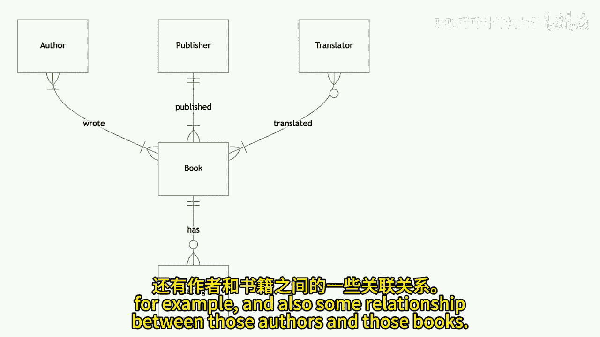
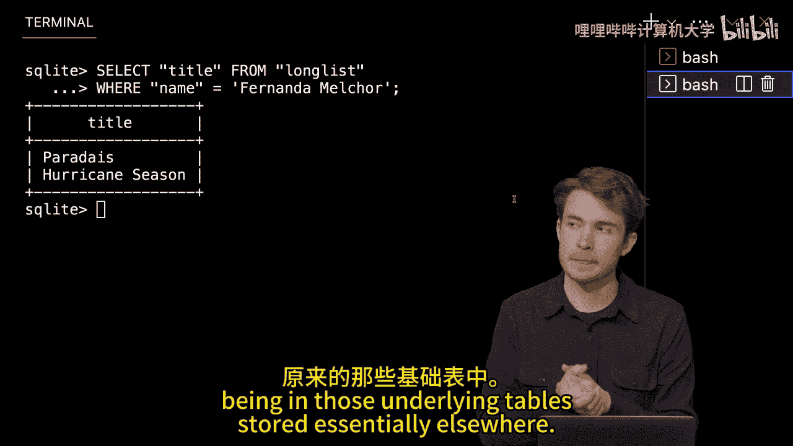
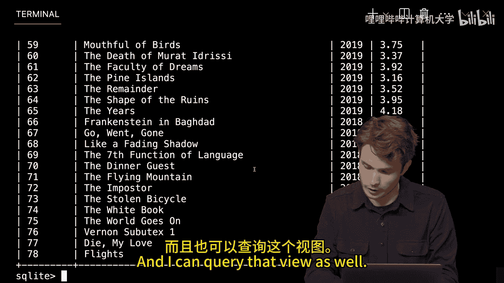
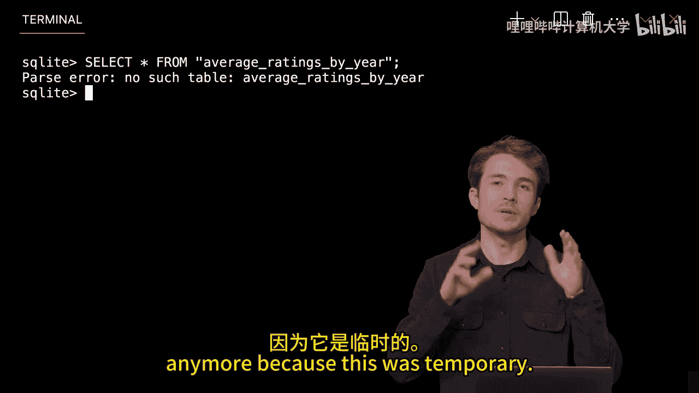
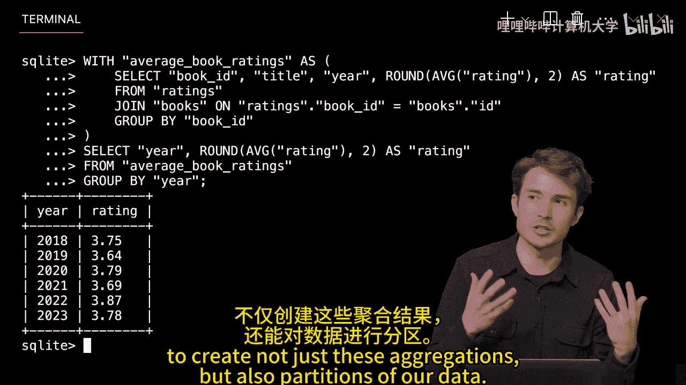
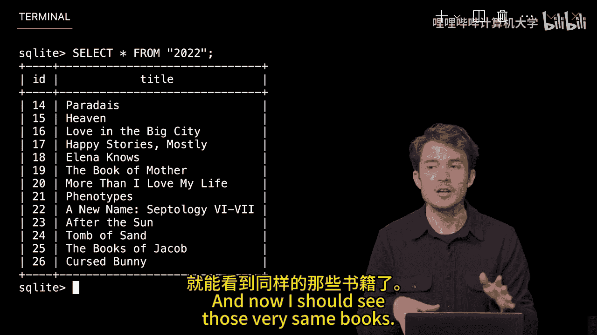
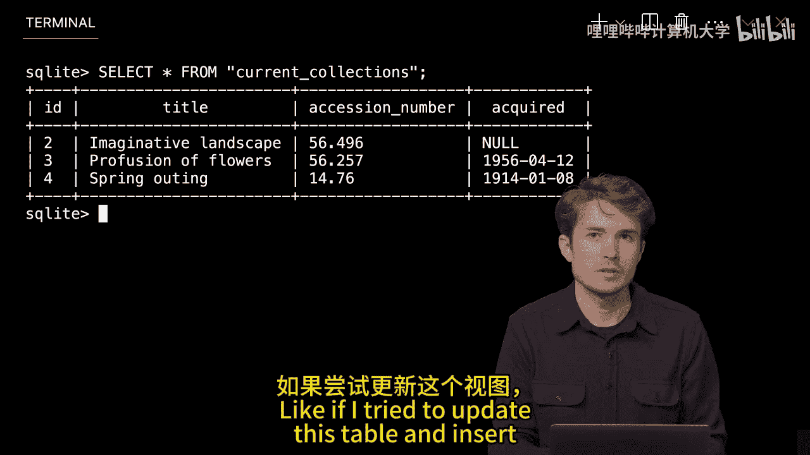
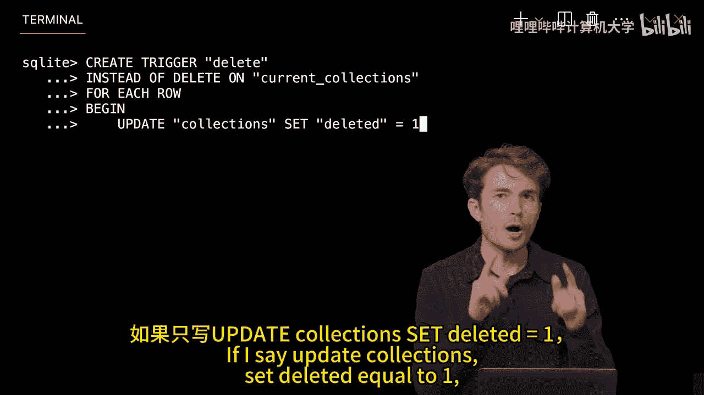
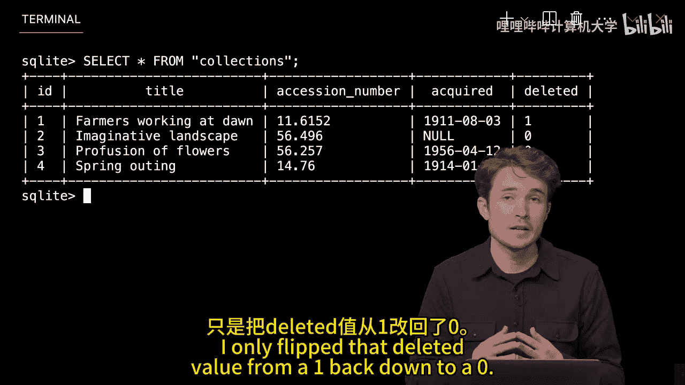

# 哈佛大学CS50 & SQL【速成版】 课程已全部上传，中英双字幕(人工核对翻译），课程附完整课件(视频支持杜比音效，Hi-Res无损音质)。 p06 Lecture 4 - 查看 -BV1iKCwBuE2d_p6-

Well， hello one and all。 and welcome back to CS2 In to databases with SQL。 My name is Cartersanki。

 And up until now， you've been learning how to design databases and how to add data to them like how to insert。

 update and delete some values all together。 Now along the way。

 we've added some complexity that is we went from one table to multiple。

 and we had relationships to among all those tables as well。 Now。

 what we'll introduce today is a way to simplify some of that complexity and give you a way to see your data all the more clearly this tool called a view。

 Now， we'll begin with a familiar data set， this data set of books。

 and we learned about this data set of books back in week0。 If you remember。

 we had a table of 78 books that had all been nominated for the international booker prize。

 It was a single table just of these books。 Now， quickly in week1。

 we introduced more than just this single table。 we actually had multiple tables。😊，Table for books。

 a table for authors， for example， and also some relationship between those authors and those books。

 we said that an author could write not just one book but multiple books and similarly a book could be written by not just one author but multiple as well this is what we call a many too many relationship。

Now we also saw this not just visually， but in our database in terms of tables as well。

 we had this kind of schema where we had a table for authors。

 a table for books and then a table in the middle to talk about the relationship between authors and books。

 which author wrote which book， we can see this in the authored table looking at these IDs here。

 and now to recap if I wanted to find the book that Hanhn here has written。

 let me ask how could I do that， How could I find the book that Han in the author's table has written over here in the bookss table。

😡，And feel free to raise your hand。By looking at the author ID 31 Nice so start by looking at the author ID that's a great idea so here we see that Han's author ID is 31 and we could make this link between the author's table and the author table so I'll highlight this here so we can see it visually Han has the ID 31 and here in the authored table we see the author ID of 31 next to actually some book ID this book I is 74 well what book has that ID 74 turns out it's the white book all the way over here。

Now this is adding some complexity to our queries if I want to find who wrote what book I have to go through the author's table。

 then the author table and then the book table， let's just a lot of steps to go through and we could though try to simplify this to have a better view of this data to see it with just a single column for authors and a single column for titles so let's try to visualize this together。

😡，What I might do first is try to flip around this primary key of authors， this ID column。

 let's put it closer to the author table just visually， metaphorically here。😡。

Now I might see that these IDs line up one to another and we saw in a previous lecture that I could use a join in SQL to put these tables into a single table and what a join does。

 if you remember is take the primary key in one table and the foreign key in another and just find which one's match to put the rows of each table together。

 a bit like touching your fingertips together like this。😡，So I'll then visually move these together。

 join these tables into a single table and notice how if I now just get rid of these IDs metaphorically。

 just visually here， I now have a much more simple table。

 a simple view of this data and if I want to find which book Han has written well I could do that click in a single row here。

 look at the name column and then the title column here。Now。

 what we're doing by creating this new view of our data is actually creating well a view and a view is defined by this here。

 a virtual table that is itself defined by a query。 Now what does this mean。

 What is the virtual table。 What is a query。 Let's go back a few steps and see this in action。

 So we started with in this case three tables， authors， books and authored。

 and presumably there's some query here that gets us from point A， these three tables to point B。

 this single table， that query might involve some select， some joins we talked about earlier。

 but there's some query we can write to get us from point A to point B。

And notice here that the result of this query is itself a table like this has rows and columns。

 and what we can do is see all of those in terms of a table we could later on query。

 So a view is a way of writing some query to see our data in a new way and then saving this view of our data so we can query it later on。

😡，Now， why might you want to build a view， Well you might want it for a few reasons here。

 you could use it to simplify your data， as we just saw here。

 you could use it to aggregate your data to try to sum up some values and store that in a single table。

 you could use it to partition your data or divide into logical pieces and you could even use it to secure your data to perhaps hide some columns。

 you don't want somebody to see there are more reasons too， to use views。

 but focus on these for today， and let's begin by focusing on simplify。😡。

So we saw earlier a way to simplify these multiple tables down in to one。 If I go back here。

 we'll see we got from this set of three tables to a single table that had both author names and author titles。

 So let's see here exactly how much reducing complexity by trying out different queries and then adding in a view to see all the benefits of this new view we have here。

😡，So we'll go back and we'll see in this case our three tables， authors， books and authored。

 and let's say I want to find the books a particular author has written。

 I could write a query to do just that and let's go back to SQLite here to run that query ourselves。

😡，llCome back to my computer here in SQLite and my goal will be to find which author wrote which particular books。

 So if I go to my database here， I can go my terminal and type SQLite3 long list do Db to reopen this database and now I should see if I type dot schema。

 all the tables that are inside of it， I have a table for authors， if I scroll up a little bit。

 a table for books and a table for author that is relationships between authors and books Now let's say I want to write a query to find which books Fernandnda Malco wrote Well I probably first need to find Fernandez's I as we just saw visually in our earlier example。

 So let's find Fernandez's ID。I could say select， let's say ID from the author's table where the name equals Ferandnda Melcor。

 so I'll say select ID from authors， then where the name equals Ferand， Fernandnda， Melcor。

 some callin。😡，So it seems Franandnda's ID is 24， and I could use this ID in the rest of my query。

 but I could probably do better than this I could use what we saw before。

 something called a subquery to take this query I just wrote and put it inside some other one here。😡。

So let's take the next step and find the book IDs that Fernando wrote。

 so let's start looking at the author table for that， which has author IDs and book IDs side by side。

Okay， I'll say select in this case， the book ID from the author table where in this case。

 the author ID is equal to， well I could say 24， but I want to do better。

 I could actually have my very own subquery here to find Fernand's ID dynamically I could put parentheses here。

 then hit one，2，3，4 spaces and say select ID select ID from the author's table where the name equals Fernandnda malcor that same query from before I'll close this out。

 close out my subquery， and then if I hit enter， I should see now the book IDs。

 Fernandnda has written。But there's still one more step here。 What do I now need to do。

 I have book Is that Fernando wrote， but how do you think I could find the titles from those book Is？

You could select the title from the books。

Nice， we need to select title from that book table。 So if remember。

 we have titles inside of our books table， but we still need to link those titles through their Id to the book Is Fernandnda has written。

 So let's do one last step here。 I'll come back to my terminal and I'll write the query in full now。

 So I know I want to end up with titles。 I'll say a select in this case title from the books table。

Now I want to find particular titles where the ID is in that list of books Fernandnda has written。

 so I'll say where the ID is in some subquery， the query we actually just wrote。

 so let me write it again， I'll say one，2， three， four spaces here to indent for style。

 then I'll say select the book ID from the author table。😡，In this case。

 where the author ID is equal to some number in this case， Fernandez's ID。

 but what is Fernandnda's ID， let's find out， I'll make another subquery here to find Fernandez's ID indenting four times just for style here。

 then I'll say select ID from the author's table。And then again， indent。

 where the name equals Fernandnda Melcor。Then I'll close out all my queries to create this single long query to find all the books Fernandnda has written。

And again， the order here is first find Fernandnda's ID。

 then find the book Is associated with that ID， then find the titles associated with those book Is themselves。

 Now I'll hit enter and I should see all those books that Fernandnda has written。Now。

 as we talked about， this is a lot of complexity， a lot of tables to go through。

 and there's probably a better way to do this。 Let me open up a new terminal and try out a different way of going about this。

I'll make a new connection to my database。 I'll make a new terminal， and I'll say SQLite 3。

 long list do Db， hit enter。Now， I should see that I have a brand new connection to my database。

 and I could try to find a better way to do this。 Let me try to do we did visually and like join these tables together。

 Well， I could try select。😊，Name and title from the author's table。

But notice how author's table doesn't have titles in it。 It doesn't have the name of the author。

 but it doesn't have book titles。 So to get titles， I have to join in some new table here。

 I'll enter， and I'll say， join， let's say the author table on author。Dot。

Id equals author dot author Id。 And all I'm doing here is saying， I'll take first the author's table。

 And then why don't I try to combine this table with the author table。

 linking it up by looking at the author's Id column and the author do author I column。 And visually。

 let's take a look what we're doing here in this join。 If I look at this in my slides here。

 I should see， I started with my author's table。 Here I had names of those authors。

 And I had an Id column in that author table。 Now I'm trying to join the author table by telling SQL that these two columns。

 author Id and Id should align。 They should line up like this， So their rows are all together。

But there's still one more step。 I've joined the author table and the author table。

 but what's the next step to find book titles？I still have to join。The books table。

 so let's try that here。I'll come back over and instead of joining just the all third table。

 let me now try to also join。😡，Let me hit enter to also join the books table。

 I'll join books on books do ID。Equals， in this case， authored dot book ID。And to be clear。

 this line here means that what I'm trying to do is now join。This book table。

 which is over here with this author table aligning it so that their IDs match up into a single row。

 as we see here with 74 and 74，1， and1， and so on。I'll come back， and now let me try this。

 come back over here， and I'll just try hitting enter to see what I can see from this query。Okay。

 let me me themm out a little bit， and you'll see I actually do have author names next to book titles all in one table。

 just as we thought we would。So this is useful to me。

 but what if I wanted to have this stored as a way to see my tables。

 I want to be able to query this kind of table I see right here Well for that。

 I could try to introduce a view。😡，Now a view starts with a query， as we just saw。

 I wrote a query to select names and titles from three different tables joining them together。

 but if I want to save the results of that query so I can query them later on。

 I could use this syntax here， create a view。That has a name that I can give to it as this query down below here。

 so create view， given some name as the result of this query gives me a view that is then saved and part of my schema So let's try that here to create a view by which we can see both author and book titles side by side。

 I'll come back to SQL light here。And I am already in this brand new terminal。

 so I could try to remake this view and save it now for later usage。

 I'll say create a view and call it long list， the same name we gave our single table back in week0。

😡，Now I'll say this view is the result of this following query as let's say select name and title from the author's table。

 but not just the author's table， join， let's say， the author table。😡。

Join author on Author do ID equals author third do author ID。And then join again our books table。

 as we saw visually here， join books， join books on books dot。😡，Id equals authored dot book ID。

Now that is the query I used before to see author names and book titles side by side。

 if I create this as a view， things I might call on an enter。Nothing quite happens。

 but now if I type dot schema and hit enter， I should see a view called long list that has two columns。

 name and title， and actually see the query I use to create this view。😡，So let me think now。

 I want to see what's inside this view and to query a view， I can use it exactly as I would。 a table。

 I could say， select star from long list。Se I calllon， hit En。

 and now I should see author names and book titles side by side。

So if I have this kind of table with authors and book titles side by side。

 what then does my query become to find the books written by Fernandnda。

 let me ask our audience here。

What query could I use now on this view to find the books written by Fernand Thank you can query a all of the books using specific name a good idea。

 I can use particular name in this case。 and perhaps just use a simple where。 So let's try that here。

 I'll go back to my terminal。 And if I want to find the books written by Fernand。 Well。

 I could just query for them in this single table that I created called long list or not really table。

 but now a view。 I'll say in this case， select the title from。

It's like title from long list， where to Muhammad's point， I could just say name equals Ferandnda。

 me Ferandnda。Melco， semicolon， I'll hit enter here。

 and I see those same books Fernandnda has written， Paradus and Hurricane season。

So let's see where we started here， we started with this kind of query， long， multiple lines。

 many subqueries involved justifying the answer to which books Fernandnda had written。😡。

Now though that we have a new view， I can simplify this query to just this here。

 select title from long list where the name equals Fernandnda。

 and I can do all of this without using much if any more disk space。

 a view member is a virtual table， not a real one， and I can then have the results organized like this。

 while still being in those underlying tables stored essentially elsewhere。😡。

So let me ask then what questions we have on how views can simplify our data Can we then somehow manipulate the views to maybe order the results or display them just differently？

A great idea， so if I wanted to maybe order these books。

 I could absolutely do that in the same way I would do in a table。

 so let me go back and show you how to do that。Let's say I want to organize these books alphabetically by title。

 so if you remember using a regular old table， we could use order by， I could do the same thing here。

 I could say select both the name and title columns from my long list table。😡。

And now let me try to order by the title column in this case， and I'll hit semicolon。Now。

 if I hit enter， I should see。The book titles organized alphabetically。

Now the view itself does not have these titles automatically alphabetically sorted for me。

 but I could make it do that if I had when I was making this view included order by。

 let's say title at the end of that query， I would then have those titles saved in this view automatically as a to Z。

 so very powerful if you want to not just find particular ways of seeing your data。

 but also organizing it or ordering it too。😡，So with that note。

 we've seen how to simplify one example of having multiple tables down into one。

 we'll come back in just a few and see if we can aggregate data to。

 putting that data into a single table for us to see some statistics and such as well。

 come back in a few。😡，And we're back， so we just saw how to simplify some data。

 how to take multiple tables and see them as one。 What we'll do now is think about how we can aggregate data。

 that is to take many individual data points and summarize them to find an average or a min or a max。

 but see those results inside of a view。😡，So if you remember in our long list database。

 we had a table of ratings and in this case， books had individual ratings from individual people like maybe I gave book ID1。

 a four out of five stars， but David gave it only a three。

 Now we store these individual ratings in our database。

 but ultimately I don't care so much what I rated it or maybe what David rated it。

 I care about the average rating， let's say for each book。But if we care about those averages。

 why then would we store all the individual ratings， Let's think of this as a design question here。

 Can you think of a reason we might want to actually have these individual ratings stored in our database。

 What does that give us at the end of the day。😡，Perhaps reliability to know how many persons rated a book Nice。

 so it's nice to have some more data I could know how let's say I rate a book or how you rate a book that's good here too and I would argue that from having this additional data。

 we could compute more statistics I could find not just the average rating。

 but also the minimum rating or the maximumim rating or the median rating and so on。

 so these individual results allow us to find and compute more statistics like averages。

 mins and maxes as opposed to just storing the average。Now。

 if I wanted to find the average of these results， what could I do what we saw before I could try to group ratings by individual book Is。

 Let's say I want to find the ratings for book I 1 and book I 2 I could group by the book ID column turning these into individual groups and let's say I want to find the average here using a SQL query。

 I could say find me the average of the rating column when I have groups by book I that effectively takes my table like this and says。

 okay I'll combine all the ratings for each individual book I and find for you the average all first kind of compress this data together。

 literally putting one on top other here and then find the average of all those results。 let's say 3。

67 for book 1 and 2。5 for book2， kind of compressing all of our data into a single result In this case the average so let's。

Talk through then how we found the average using a SQL query。 And then we'll turn that into a view。

 We come back over here， by computer。And I'll open up long list dot Db。

 Marty here so I can type dot schema ratings to see the schema for this ratings table。

 and you'll see it does have a book I column and a rating column as well。

 So if I want to find the average rating for each individual book Id。 What could I do。

 I could try to select the book Id column and the rating column like this。

 but I don't want to select just the rating column itself。 That gives me individual values。

 I want to find the average rating instead。I could instead say。

 find me the average rating from this table。Now， let me give this a new name。 I'll say as rating。

 calling the average rating now newly in this case， rating。

 and I'll select this from the ratings table。 and finally， I need to group by something。

 I need to group by book Id。 That means I'll calculate the average rating for each book Id。

 I'll hit semi call here and enter。 and I should see。All of these book IDs。

Top to bottom with their own rating。But here。It doesn't look so pretty。

 What could I do to try to make this not so long， like 3。77，4，01，9，4，3 to 1。

 There's a better way to do this。 And we saw it before。

What could I do to enhance this view of my ratings table I see some suggestions about rounding the ratings。

 but I was also going to suggest adding the book titles， of course。

good point here too so we first want to add first want to probably add the book titles to see what titles are talking about。

 not just in this case， individual book IDs， but also a good point to say let's try rounding these so we don't see 3。

7740194， let's try to round that maybe to two decimal places just to be safe。

So let's first try rounding this， and then we'll try adding in some book titles to your suggestion here。

 I'll come back over。let me just try rounding it first。

 so I will come back to my terminal and I'll say I want to find the average rating for each book ID。

 and I want to select not just the average rating as we did before。

 but the rounded average rating so I can use round and say take the average rating and round it to two decimal places。

 and I'll call this column just rating in the final result。I'll select this from the ratings table。

And now I can group by， in this case， book Id， enter。I should see I have rounded ratings now。

 a little more pretty than before。Now to your point， let's try to add in not just book IDs。

 but also book titles， like what does it mean for a book ID to have some rating。

 I want to see titles here in the end， so let's do that I'll say select book ID and also select title and maybe even select the year that book was nominated for the Booker Pri。

I'll then select the rounded average rating。To two decimal places as rating。

And I want to select this from the ratings table， from ratings。

But what do you notice if I were to select just from ratings。

 what data am I missing and where could I find it。

Hi， you're missing the titles from the books table。 Yeah， I have to have titles。

 and those are stored in the books table。 So what should we do。

 probably just join in the books table matching up that primary key with some foreign keys。

 So I'll come back over here and we'll do that。 I want to select from ratings， of course。

 but I also want to join in in this case。 the books table。 So I'll hit enter。

 And now I'll say join as well， the books table。 Now。

 how can I match up the books table with the rating table。 Well。

 I know that the rating table has a foreign key called book underscore Id and the books table has a primary key called Id。

 So I'll tell SQL， I want to match these two up a bit like this。

I'll say join books on ratings dotbook ID， that foreign key that's inside of ratings equals。

 in this case， books dot ID。Now there's one more step which is to group by book ID still。

 so I'll hit enter and group by book ID， but now I should be able to hit semi colon and enter and I should see。

Not just book Is， but now titles and the years those books were nominated as well。

 So this view is getting better and better。 And I might say we could actually go ahead and just add this to our schema。

 We could create a view that returns to us the results of this query。 So let's try that。

I'll say create a view called maybe average book ratings。

 average book ratings for people to come in and do analysis on if they'd like。

Then I could say I want to create this view as that clearly we wrote before。 so I'll say again。

 select the book ID， the title and the let's say the year column。

 the rounded average rating to two decimal places， and then。I want to select it as rating。

 I'll select this from the ratings table。From ratings， and then I'll join as we do before。

 the book table from ratings and then join books on that primary key and that foreign key。

 So I'll say on ratings。DotBook I， that foreign key in ratings， and set that equal to books do ID。

 that primary key we're going to use to join these tables together。Then I'll say group by book I D。

 and I should have if I hit enter my very own view called average book ratings that I can use to then see the averages for each of these books。

 I'll say select， let's say star from average。Book ratings， semiqulon。

And now I should see all of those results just as we had before。Now， notably。

 because this is in a view， I'm not using much if any additional space in my database。

 I still have underlying this view， individual ratings。

 but because I save this query and there's also created in a view。

 I can actually have access to the rounded average ratings for each of these and I can query that view as well。

😡。

So let me ask then， what questions we have on how we've used views to aggregate some data so far。

Actually， I have a question Can years， but。

Same name， like we before you use long list。 And here we using for average。

 something can use long list for this both of。

Yeah， so if remember before， we had this view called Long list and long list had book titles and authors inside of it。

 And I think you're asking， could we try to join， let's say the long list table with our rating to get book titles and so on。

 We couldn't do that because we don't have the ID column in that long list view。

 We could though perhaps write some queries that involve that long list view as well。Okay。

 let's keep going here and seeing what advantages this view might give us。

 So I'll come back over here。 and one more advantage is that if I were to add in some new rating to my ratings column。

 I could just requery this view to find the updated average。

 So let's say we use some insert into statement here， and I update some books ratings。 Well。

 if I'm a data analyst， and I come back in a little later， and I want to find the updated rating。

 I can do it just again by selecting from selecting star from average book ratings like this average book ratings hit enter。

 And now I see perhaps some updated averages as well， every time I query this view。

 I'll rerun essentially that query from before， and now I'll see the updated averages for each book。

Now sometimes as a data analyst， I might want to create a view but not store it long term as part of my schema like here if I type dot schema。

 I see both our prior view called long list right here， and I also see our average book ratings view。

 but if I am somebody who comes in， and I maybe want to find the average book ratings not by each book but by each year。

 I could do that， but then not store that view long termm。

 maybe I don't want others to see this view or maybe it's just for my own analysis on this given day。

😡，Well， to do that， I could move beyond， just create view。

 and I could also enhance this to be great temporary view where a temporary view exists only for the duration of my connection with database。

 So to be clear， that means if I type SQLite 3， long list dot Db。

 I'm opening a connection to the database。 If I then type dot quit。

 I would then lose that connection。 Qui that connection。 And that view would no longer be there。

 So let's try this， I'll come back to my terminal。 It will create a temporary view that shows us the average ratings for the books by the year they were nominated。

 not by every individual book here。😊，So I could try you doing the same  query from before。

 like select let's say the rating， average rating， select it from the ratings table。

 join books and titles and so on。 But what do I have already to build on top of if I wanted to find a view that has a title。

A rating and even， let's say， the year that book was published。

What do I already have in my schema for that？So we could use the view that we just created Yeah。

 nice idea。 So we could actually use the same view we just created to create ourselves a brand new view。

 So just because something is a view doesn't mean we can't use it to then create another view as well。

 So we'll do exactly that。 We'll come back over here。😊。

And I can type dot schema to see I still have this view called average book ratings。

 and in it I have book Is， their title， the year they were nominated and their average rating。

 But now I want to find， let's say the average rating for each individual year。

 not for each individual book。 So what could I do， I could say select the year column and the rounded average rating in this case。

 from the rating column in average。Average book ratings。

 and I'll wrap this query here let me zoom so you can see it all online。

Now I'll say I want to group by the year column。So here I'm now saying。

 find me the average rating of each book， of each book's average rating。For each individual year。

 I'll hit enter， and we should see if I zoom back in。For 2018， we have 3。75， for 2019， we have 3。64。

 so this means that apparently in 2023， the average rating for books that were long lists for the International Booker Prize was 3。

78， and same for 2022， 3。87， 2021 was 3。69。So I have this new view here。

 I could store this temporarily inside of a view that I could use while I'm doing some analysis on this given day。

So I'll say create a temporary view， and I'll call this one average ratings by year。

 how were the books rated each individual year on average？

And I'll say this is the query that I just did before。

 select in this case the year and the rounded average rating to two decimal places as the rating column from average book ratings。

 that same view from before。 Now I'm creating a view from my view。I'll group by here。Group by year。

And then I'll hit enter， and I should see nothing popping up， but now if I wanted to query this view。

 I could say select star from average ratings by here。And I'll see the results of that view。Now。

 though， here's the cache and why it's temporary。 If I were to type dot quit now。Dot quit。

And try it again。 SQLite 3， long list dot D B， me。Retect that sQelite 3， long list。 Db。

If I now try to select star from average ratings by year， some I calling？

I'll get no such table and really no such view， I don't have a view called average rating by year anymore。

 because this was temporary。

So let me ask， what questions do we have on temporary tables， if any？Temporary views， rather。

Right so thank you， so the first thing that I noticed is that it just you know。

 helps us to do some kind of testing when we use， you know， temporary views， basically you know。

 the views will not be saved in the database， but again it's just you know a good way to you know。

 just to test the query whether it is usable or not。😊。

That's a great use case for them。 And in general， if you are working on a database and you want to organize the data in some way。

 but you don't want to store that organization long term， a temporary review is great for that。

If though you are a developer and you want to ingrain this view as part of your database。

 you might just use Cate View， plain and simple to have it always be in your database for you wherever you connect to it and whenever you connect to it。

😡，Great question。Okay， let's keep going and let's introduce now something called a common table expression or a CTE and a common table expression is simply a view that exists for the duration of a single query。

 so a regular view as we saw before， exists forever in my schema a temporary view exists for a single connection。

 but a CTE exists for a single query and a syntax looks just a bit different with a CTE I can write a single query。

 but at the beginning of that query define the CTE， the common table expression。To do so。

 I would say with and the some name as and then inside these parentheses。

 say the query I want to be this CTteE here。 I could then optionally followed up with more CTtes for this same query or I could omit the comma and then use just select from the name of my CTteE of above。

 this is useful if you want to have some very temporary view that you don't want to store in your schema。

 but you do want to use for this particular query。 So let's see an example now recreating our average ratings by year。

 but now using a CTteE。 So I'll come back to my computer and I'm already in my sQlite terminal。

 what I should do though， is try to drop the prior view I want to remove that view called average book ratings to create room to have now a CTteE with that very same name。

 So I'll say drop。😊，View in the name of the view， I want to drop average book ratings。

 average book ratings， semi colon。 and now I should see that that view is no longer in my schema。

So I want to recreate， though we did before， which was finding the average ratings of books year over year。

So let me try to write this query， but it would be handy if in that query I had access to a view that gave me the average rating for each book。

 so I'll write the query like this， I'll use a CT toE， and I'll say with average book ratings。

 average book ratings as now this query I'll write now inside。😡，And this query should be familiar。

 It's the same query we use to find the average rating for each book。 I'll say here。

 I want to select。I wantant to select the book IDd column。The title column， the year column。

 and the rounded average rating to two decimal places， calling it rating， calling it rating。

 in this case， from my ratings table like this。Now， what do I need to do。

 I also need to this saw before， join in my books table。

 join books on the primary and foreign keys aligning。 So I'll say the book Id。

Column that foreign key in the ratings table should equal books do ID。

 that primary key column in books， then I will group by the book ID to find the average rating for each book and now let me close out this CTE I'll close my parentheses and because I'm only using one CTE。

 I don't need a comma， I can then just write the rest of my query。I'll hit enter for St's sake。

 and now with this CTE called average book ratings， I want to find the average rating year over year。

 grouping not by book but by year， so I'll say select in this case year and then select the rounded average rating still to two decimal places as a new rating column。

Then I'll select this from， in this case， my CTE， so I'll hit enter here as well。

 from average book ratings， that same CTE I defined earlier in my query。Now， finally。

 to find the average rating across individual years， I'll say group by year。So I colon。

 and now hopefully if I hit enter， I should see。The average rating for each year in my database。

Okay so the CTE is useful when you have subqueries， you don't want to repeat。

 or when you want to make a view that only exists for the duration of a query。

 and it's with all of these tools like views， temporary views and CTEs that we can get away with storing statistics about some data in our data。

 and not storing them in the actual database， but only inside this view we might have here。😡。

What we'll do next is see how we can use views to create not just these aggregations but also partitions of our data。

 a way to split our data up into logical pieces for use。

 for our own sake or even for application's sake as well We'll come back in just a few。😊。

And we're back。 so we've seen so far how to use views to simplify and also aggregate our data。

 What we'll see now though is how to use views to partition our data。

 that is to break it into smaller pieces that be useful to us or to some application。😡，Now。

 on the International Booker Prize website， they have a page for each year of longlisted books。

 but in our table， we have all the books together， regardless of their year。 Well。

 maybe it will be useful in the application， even for me personally to have a table。

 one for each year of books that haven't nominated for this prize， but before I create that view。

 I should ask， how do I try to find the books nominated in 2023。If my table looks like this。

 I have a table of books with ID， title and year columns。

 what query could I use to find only those books nominated in 2023 Use the warehouse clause with the year。

😡。

Yeah I could use the wear clause and try to search for a given year。

 like I could try to say where in this case， the year is 2023 or equal to 2023。

 and that would give me back these two rows if only two books were nominated in 2023。

 in reality it's 13。😡，If I wanted to find the next ones from 2022， what could I do。

 I could just change the where clause to say where year equals 2022 and then same thing for 2021。

 I could say where year equals 2021。😡，Now， each of these segments of my data is what we'll call a partition。

 a certain breaking down of my data into smaller pieces， in this case， organized by year。

So let's now create smaller tables， one for each year that might be in our data set here。

 We'll come back to my terminal and let's think about writing this query from before。

 So if I wanted to find the books that were nominated in 2022。

 I could say select the ID column and the title column from my book table。

And then I want to find only those books where the year equals 2022， then semicolon and then enter。

 and I should see only those books that were nominated in 2022。

But now I want to create a view that might actually store the results of this query more long term。

 I could say create view and call this， let's say 2022 as now same query from before。

 select ID and title。😡，From my book table。From my book table， in this case。

 where the year equals 2022 semicolon。Now， if I ever want to find only those books nominated in 2022。

 I could now use my view， I could say select star from 2022， quote and then semi call it， hit enter。

 and now I should see those very same books。😡。

So what could I do now， Maybe I want those books from 2021 as well。

 Let me ask the audience what could you do to create the view for the books in 2021 based on we've just seen now We could just change the year from 2022 to 2021 Yeah just change the year and what we should propose we call this new view if you had to take the reins on naming this view。

 what would you name it that were written in 202 Yeah we we could call it books that were nominated in 2021。

 but I would argue that might be a bit of a long view title。

 So let's short ined a little bit and maybe keeping with our current naming， we'll say 2021 instead。

 So I'll come back over here and let's try this， I'll say create a view create a view and we could。

 by all accounts and purposes， if we could say books nominated books nominated in 2021 and that's totally okay。

But if I were to pass this view on to a new programmer， a new database analyst。

 well I kind of want to shorten it for them， make it more simple for them to read。

 so I could just call this 2021。Of course， this title is kind of ambiguous。

 like if I pass you a view called 2021， are you automatically going to know what's inside that view？

Probably not。 So it's actually a balance between how descriptive you want to be with your names here。

 We'll stick though with 2021 to our earlier example here。Now I'll say create View 2021 as select ID。

자어。From books。 and T Vi end's point， I'll say where the year equals 2021 semicolon， enter。

 And now I could say select star from。Sexstar from 2021， semicoin。

So this is a good way to break apart a large table into logical pieces。

 it's useful for both you as a programmer and also for applications that might only need to access some subset of your data where some condition is true。

😡。

So based on what we've seen so far， what questions do we have on partitioning data with views。

We have created two views for 2021 and 2022 rather than creating two views。

 is it possible to you know simplify it as one and then use it rather like where here is simply change that alone。

Yeah， I mean， it's a trade off here。 So you could imagine trying to do。

Let's say a single view that maybe has just titles and just years in it。

 but then you have to rerite the query later on to find only those books for a certain year here。

 what we're trying to do is just like break up this big table into smaller pieces。

 and you can imagine it being particularly useful if you had not just 78 books。

 but even like thousands or tens of thousands or millions of books could be useful to have a view for each logical segment of those 10。

000 or more books。Let's take one more question here。

 I would like to ask about updating a view itself if I update a single table any element in each table a view can be updated automatically or maybe it needs some involvement。

Okay， a good forward thinking question here。 you can。 you're right。 update a table。

 you can say update the table and set some column to some value。

 What you can't do actually is update a view and that's because a view doesn't have any underlying actually doesn't have any data inside of it exactly it only pulls data from underlying tables。

 So let me show you how I could update this view， or at least try to update this view。

 I'll come back to my computer and let's say we wanted to change a book in the 2021 view。

 I could say select star from 2021 semicolon and maybe it turns out that there's a typo in here。

 So instead of minor detail， it's called something like the minor detail。

 This book on IDd 34 here I could try to update this view。

 I could say update 2021 and set the title equal to the minor detail。The minor detail。

 where the title is title currently is minor detail like this， minor detail。Then I'll hit semicolon。

 and if I do this， I get this error， cannot modify 2021 because it is a view。Now。

 why can't we modify a view Well recall that a view is simply the combination of data from underlying tables。

 I've assembled data from different pieces of my database and put them into a single view but I can't then update that data because that data is located in multiple individual tables around my database what I should instead do is try to update the underlying table。

 which I can do， as you saw before with just update and set to。😡，Okay， so more on how we can update。

 or at least try to update views a little bit later。

 We'll take a break and come back to talk about how we can secure data using views as well。

 And we're back。 So one more use case for views is being able to secure the data that's in your database。

 You might imagine having a table But some columns in that table。

 you don't want to share with somebody else Well a common practice and security is to only give someone the information they need to know with views。

 you could do that very principle you could accomplish that by taking a table and reducing the number of columns somebody else might see。

So let's consider here some rideshare company and rideshare companies keep track of a lot of information about us。

 They keep track of where we're going， where we're coming from。

 who's in the car with us and who drove us there， even sometimes。

 Let's say that a Rshare company has a table called Rs and inside this table is the origin of several rides and the destination。

 along with the rider who took that R。Now， if I were to ask you here。

 let's say I want to give this data to an analyst to figure out which rides are most popular or which ride are highly rated。

 what data should I probably omit if I wanted to share this data with somebody else。

 what should I remove from this table the data you could remove would be the writer。😡。

Yeah， good point。 So if I look at this table and I think of what information is personally identifiable PI。

 personally identifiable information， it seems like this rider column could identify somebody who took a ride from let's say good a galaxy to Ho hive galaxy and we don't want to leak that information if I gave this to some analyst。

 Well， with a view， I could keep this underlying table。

 but I could create a view that only has the origin and the destination that omits the rider column。

 and I could more confidently share this view with an analyst， not the underlying table。😊。

So let me try to implement this view so we can see it in action inside this database here I'll come back to my computer and in this case I have a new database。

 I have one called rideshare do DB， I'll type SQLite3 rideshare do DB to open up this database if I type dot schema to see the schema of the database。

 I should see I have one table called rides where each ride has an ID， an origin。

 a destination and a rider。Now I'll select star from the Rs table， select star from Ris。

 hit semicolon， and I should see the very same data we just saw in our slides where Peach is going from Good E Galaxy to Honeyho Galaxy。

 Mario， going from Castle Courtyard to Cascade Kingdom， and so on。

So now I know I don't want to share this data with somebody else。 What could I do？

Instead of selecting everything， I could try to omit this rider column to the point before。

 so let's try that， I'll select just ID and just origin and just destination from rides。

 I'll deliberately omit that rider column Now I'll hit enter。😡。

And I should see the origin and destination， but I actually don't see the rider column。

 So this is a decent view， but I could probably improve this even more。

 It turns out that in SQL light。 if I want to fill a column with some arbitrary value。

 I can do that a bit like this。 Why don't I try to select Id and select origin and destination but I also want to let somebody know that this data has been anonymized。

 there is rider information in underlying table， but you don't have access to it。

 What I'll do instead is say， let me make this new column that's filled with this value anonymous as a string。

I'll say quote unquote，"Anonyous as this column name called Rder。

And I'll select all of this from the Rs table。Some might call it。Now。

 I have more helpfully indicated that there is a writerer column。

 but you deliberate don't have access to see who those riders are。😡。

So my last step here is probably to turn this into a view。 I have a good query。

 but I want to save it， so I could query it later on。 Well， I could type select or not select。

 I could type create view first。 I'll create a view。 This one just called analysis。

 I'll give this to my data analysis here。 create view analysis。

 and then I'll say as let's go for select Id。😊，Origin and destination， as well as the anonymous。

 the anonymous column。As in this case， the rider， and I'll select all of this from my Rs table。

 semi callin hit enterter。Now， if I type that schema， I see my new view analysis。

 and if I say select star from analysis。From analysis， semicolon， I should see。I've anonymized。

 quote unquote， this data。But they extent this is helpful。I'd argue it's not very secure。

 at least in SQL light， and if you're thinking adversarally here。

What might you be able to do still if I gave you access to this database？😡。

What could you do to deanonymize this data and to see the data I didn't want you to see？

You can just query the writer's table and find what are the writer's values in the writer's column。

Okay， so you're correct。 that we could still see the rides table。

 Maybe I look at the ID column in the analysis view， and I see those Ids。

 I might be able to link those Ids with the Ids in the rides table。

 and nothing stopping me at least in SQL light from saying select star from the rides table。

 So I come back over here。 and I'll try that。 I'll say in this case， select star from rides。

 hit semicolon。 And now I see all that ride information。

 although I hit it in this view called analysis。 and this is a downside of SQL light in SQL light。

 we can't set access controls， meaning I either give you the entire database or nothing at all in other DBMSs。

 though， I could set access controls。 I could give David access only to the analysis view。

 and I can give myself access to both the rides table and the analysis view。

 So keep that in mind when you're working with SQL light。😊，Okay。

 so we've seen here how to secure some data using SQL light and using views in this as well。

 Let's come back in just a minute and see how we could actually use SQL light and views to not just secure our data。

 but also to work on soft delets， which we saw just a bit ago。

And we're back for one final application of views。 We saw just a little。

 a few weeks ago how we could implement soft deletions。

 That is not fully deleting something in our database， but only marking it has deleted。

 And we saw this in the context of Boston's own Museum of Fine Arts。

 keeping track of items inside their collection。 So let's say we had this table called collections full of items in the MFA。

 the Museum of Fine Arts in Boston。😊，Here I have four items currently in our collections， ID1， ID2，3。

 and4。But I also have this deleted column， which is either zero or one。

 depending on whether an item has been deleted or not， so I want to delete。

 let's say farmers working at Da this first piece here。

 instead of deleting it from the table fully I could set this deleted column from a0 to a1 just like this and now it's only soft deleted I still have the data here。

 I still have the title but now instead of being a0， it's marked as a1。😡，Now this is useful。

 but what could I do to only see now those items that have not been deleted Like if I show you this database。

 collections here， the table here， I have titles and the deleted column。

 but if I only want to see those items that are not deleted。😡，What query could I use for that。

We would you insert a statement I could use a select statement。

 and I could use probably a where clause as well。 I could say select star where perhaps deleted equals0 because in this case when deleted is0。

 We know this item is still supposed to be in our table。 So here's that query here。

 Select star from collections where deleted equals0。

 Now we could try to convert this query into a view。

 So we could always only see the items in our current collection。

 not those we have marked as deleted。😊，So I'll come back over here and we'll see we have our collections table。

 but we also have now perhaps a new view of this table called current collections。 Well。

 if I set current collections to be the result of this query。

 I should see when I update deleted to be one for some of these items here。

It should be removed from this current collections table。 So let's try that。

 I could take farmers working at dawn and delete it。

 I could see this correspondence between this row here and this row here。

It's in both our collections table and current collections， but if I set deleted from a0 to1。

 I should see that item removed from current collections。

 thus updating my view and keeping track of my items that are not currently in my collection。

So let's come back here and implement this in terms of our own database，ll come back over here。

 and I will open up mfa。db， that old database from a few weeks ago， I'll say SQLite 3， mF。db。

And now if I type dot schema， I should see the tables inside of this database， collections。

 artists and created we focus in particular on the collections table。

 so if I say select star from collections， I should see that I have the title。

 the accession number and the date this piece was acquired by the MFA。Now， though。

 if I want to add a deleted column， I could do so by using Al table。

 I could say let's alter table collections， alter table collections， and add a column called deleted。

😡，I'll say this column has the type integer， it stores whole numbers， and the default number is0，lon。

Now， if I say select star from collections， select star from collections， semicolon。

 I should see there' is this new deleted column where all the values are0 at first。

So if I want to delete something， I could instead up typing delete from， as we saw before。

 I could just update this deleted value。😡，I could say maybe update。

 update collections and set deleted。Equal to1。Where a certain title is present。

 I'll say this that the title is equal to。Farmers。Title equals farmers working at dawn semicolon。

 So now I've soft deleted this item。 It's still in my table。 At least the title is。

 but now I've marked it as being deleted。 It should not long be in my ultimate view。 I'll enter here。

And I select star from collectionions， I'll see that in this case， I still see farmers working at Da。

But what do I want， I want a view that only removes that only shows me those items that have not been deleted。

 So I'll try this。 I'll say select star from collections and apply a condition to it to our earlier point before。

 So I'll say where in this case deleted equals0 semicolon。 hit enter。

 And now I should see only those items that are not marked as deleted。😡。

But I want to turn this into a view， which I could， I could say， maybe create a view。

Called current collections。 And then I'll make this the following weary as select I D， select title。

 accession number and acquired。 But now I'll actually omit that deleted column。

 I don't want this column to show up in my current collections。

 I only want to be in the underlying table。So I'll select all these columns from the collections table。

 and then I'll say where deleted equals zero to apply this condition and only get those items that are not marked as deleted。

Now I'll hit enter， and I should be able to do this， select star from current collections。Smicolon。

 and now I'll see only those items that have not been deleted。S seems worthwhile。

 I'm now able to view the items that are currently in my collection。

 but a problem remains like if I tried to。Update this table。

And insert something into it。 What might happen。 Let me ask our audience here。

Baseds what we saw before。What would happen if I tried to insert into this table here？This view。

 perhaps I think we cannot update the view itself， as we saw before。

Yeah， we can't update the view itself。 we can't insert new data， we can't even delete data。

 so let me try first to delete data and then we'll see how to insert some data a little bit later。

 I'll come back over to my terminal and what I wanted to delete in the additive landscape。

 I could say delete from delete from current collections。Where the title equals。

 let me make a new line here。Where the title equals imaginative landscape， imaginative landscape。

 semicolon。Now I'll see that same error we got before。 and we tried to update some view。

 I can't modify this because it is a view。 Well， it turns out there is a way to work around this。

 We can't modify the view， but we can modify the underlying table。 So to do this。

 we rank from old friends in this case， those called triggers。

 So if you remember a trigger is a way to specify some SQL statement I want to run when some other SQL statement is run。

We saw before we could use before or after to say， run this SQL statement。

 either before or after some other SQL statement here。

What we didn't see until now is this instead of trigger。

 I can create a trigger that has a name and I can run it instead of some other sQL statement。

 so I could say instead of deleting on this view， let me give you the other the proper query to run in this case So instead of deleting on this view I will for each row run this other statement I'll say begin this is the same I want you to run instead and in this statement we could have something that actually updates not the view。

 but the underlying table and we then end that query here。😊。

So based on what we know about our view and the underlying table called collections。

What queries should we put in here to actually delete something from our table？😡。

Let me ask our audience。Instead of deleting from our view。What should we instead do？To our table。

Yeah， you should update the deleted column in the collections table。 Yeah。

 so instead of deleting from our view， what I really want to do is update that table。

 So let's try a trigger to do just that Well come back to my computer here。

And I'll start on this trigger to our point， I want to create a trigger that runs instead of deleting on this view and what I want to instead happen is an update on the underlying table。

 So I'll say create a trigger， this one called deletete。😡。

And then I'll say instead of delete on current collections。

 that is whenever SQL hears or listens and hears a delete on the current collections view。

 I don't want that to happen， I instead want this other statement to happen。I'll say for each row。

 affected by that delete。 for each row， I asked， delete on current collections。

 Run instead other statement。 I'll say begin。 Here is that statement，1，2，3，4 indents for styles sake。

 And now I'll say I want to update collections。 update collections and set deleted。

It's that deleted equal to one。But I don't want to leave this just as is。

 if I say update collections set lead it equal to one。

What's the problem with that statement if I end it there？So yeah， it will update all the columns。

 whether it is we want it to be deleted or not。 Yeah， with no condition。

 it will update all the columns here。 So I want to apply a condition to make sure it only affects the particular row I'm working with。

 Well， what unique identifyentifies each row。 the I does， let's try using the I here。

 I'll come back and I'll say I want to update collections set delete it equal to one。

 but only when some condition is true。ll indent again four times and say where in this case， the I。

The Id column is equal to。The old Id。 Now， old here is a special keyword。

 that means the row we just deleted or that we would have deleted from current collections。

 I want to update that same row with that same I in the underlying collections table。

So I'll put a on my call in here to end， and then I'll say end this statement。

 this is the entire statement I want to run after I try to delete on my current collections table。

Now I'll hit enter， and I'll see nothing changes， but if I say dot schema。

 I should then see down below here， I have a trigger called deletelete that will instead run an update I try to delete from this view。

😡，So let's try that。 What I can do now is try again to delete from current collections。

 I'll say delete from current collections， current collections where。In this case， the title。

Equals imaginative landscape， let's say we sold this painting， it's no longer part of our collection。

Imaginative landscape， semicolon。 And now it actually seemed to work。 I get no error here。

 So it seems like it went， okay， well， if I select star。From current collections。I actually see that。

 It's gone。But is it really gone if I try select star from collections， not current collections。

 the underlying table for current collections， semico。

What do I see that the ID column has been updated from a0 now to a1？

So a good way of trying to use triggers here to update our views by instead modifying the underlying table。

Now， that be one more issue we encounter here， which is the following。

Let's say I'm at this current state in my tables， I have collections where farmers working at Da is deleted。

 has a one right here， and we thus can't see it inside of current collections。

Well let's say I want to not delete from current collections， but also add to current collections。

 I could try to insert into this view， but I probably actually won't be able to do that because it is a view。

Let's think then。 if I wanted to insert into this view。

What should I really do instead you should add it to the collections table instead of the view I like that idea。

 so I should add this row to the collections table instead of the view。

 but now here's a bit of a trick。Let's say I add farmers working at Da， we reacquired it。

What should I do in that case？What I'm adding。A painting I previously deleted So what we could do is we know that the deleted will we can check if the deleted column is one。

And then based on that， we could like update that particular column or if the if the。

There is no title in the connections people who this。Add印。Yeah。

 I like your thinking there of first trying to check。

 do we have this item already in our table or do we not if we do already have in our table。

 we should just flip this bit from a zero from a1 to a0， if we don't。

 though let's add a brand new row as we heard before。😡。

So let's think then what could we use to conditionally run some code on this collections table Well。

 it turns out that you can use some other aspects of triggers in this case。

 triggers have not just unconditional use cases， but also conditional ones to So let's try this。

 I could try to insert on this view and then run some code down below。

 but to our discussion a little bit earlier， I don't want to unconditionally do this。

 I want to check， is this item in my table or is it not already So for that I could use this keyword called when。

I could say for each row， when some condition is true， run this trigger。

 and you can imagine having two triggers to insert into our view。

 one that runs when the item is already in our table， we could then flip that bit from a 1 to a0。

We could also have a different trigger to actually insert a new item。

 in that case actually inserting a brand new row to our underlying collections table。

So let's work on this now to finish off and polish our collections view。

We'llCome back to our terminal here。 and what we'll try to do is now insert into this table。

 I'll create a new trigger， this case called insert when exists。 I'll say create trigger。

Greatate trigger。 Insert when exists。 So this trigger will run when an item we're trying to insert is already in our collections table。

 I'll say instead of insert on the current collections table， I want this to happen instead。

 I'll say for each row。Now I'll enter again and say when just for style's sake。

 when new dot accession number， new dot accession number is in my table already Well I want to find which accession numbers I already have。

 and if you remember accession number is a unique ID for the museum。 It's not the ID call my table。

 but a unique ID to keep track of items in the museum。

So if I've already given this item in an exception number。

 I should already see it in my table already。So I'll say then enter enter for style's sake。

 select accession number。Select accession。Number。From collections。

So this subque tells me what accession numbers do I already have。

 and this condition tells me is the new row I'm inserting。

 does that have the same accession number or not？Now， I'll close this subquery。

 and I'll continue my trigger。 I'll say begin。 Well。

 in the case that this item already exists in my collections table， I just want to update。

 I want to flip that integer from a one back down to a 0。 So I'll say update collections。

Update collections and set deleted。Delet it equal to zero。

Now I want to do this not on my entire table， but only where the accession number。

Is equal to the new accession number， that is the accession number I'm inserting here as well。

I'll then end like this。 And now I have my entire trigger。

 I'll say instead of inserting into my view， I want to run this instead。

 check if I've already added this item and if I have changed that deleted column from a 1 to a0。

Now hit enter。And let me hit enter again。And， let me check。哒 da。

I needed to have a semicolon after my where。 So let me try to。Run this again。

 I'll do control D to restart。 and I'll say sQl light 3。 let's do MFA dot DB。

 And I'll restart this trigger。 So here I'll say， great trigger。Create trigger。

 insertt when exists we gave the name before。Then I'll say instead of。Insert on current collections。

 What I want to do is run this。 I'll say for each row， I insert， check some condition。

 When the new accession number that is the unique Id the museum has for this item。

Is in my already available extension numbers。 I'll say select in this case。Select。Excession number。

From。From collections。And then I'll close this subqueary。Now， I'll say。

 I want to begin the thing I want to run， begin。Now update in this case。

 my collections table and set the deleted column from a1 back down to a zero， update collections。

And set， deleted。Equals 0。Where in this case， the accession number。

Is equal to the new accession number， only modifying that particular row。

Now I hit semicolon to close this statement， and then I'll say end below， a second semicolon， enter。

 and now if I type dot schema， I should see my new trigger to insert into my collections table when I try to insert into my view。

So let's try this。 I'll say， maybe I want to insert into my collections， my current collections。

 insert into， well， let me try this。 I'll say select star from。Select star from Collects。

And let's say I want to re insertsert in this case， profusion of flowers。

 So I'll say insert into my current collections， actually， reinert into。Current collections。

I want to insert imaginative landscape。So I'll say insert into current collections。

 some set of values。Along with some columns， I'll save the title。Is perfusion of flowers。

 as much of the landscape later on， then accession number。Then the date it was acquired like this。

Now， enter and provide the values。 Allll say the title is imaginative landscape。Like this。

 the official number is 56。496， and the acquired date is going to be no， in this case。

 we don't know when we got it。I'll hit semicolon here and enter。

 So if I select star from collections now， select star from collections。 semicolon。

 I should see that I didn't actually insert a new row。

 I only flipped that deleted value from a1 back down to a 0。

Now there's certainly more to do here， I could write a trigger to actually add a brand new row to this table here。

 I could also try to update this data， change for example。

 the acquired date from null to date we actually do no for now though we've all that up to you and we'll see you next time。

😡，嗯。

