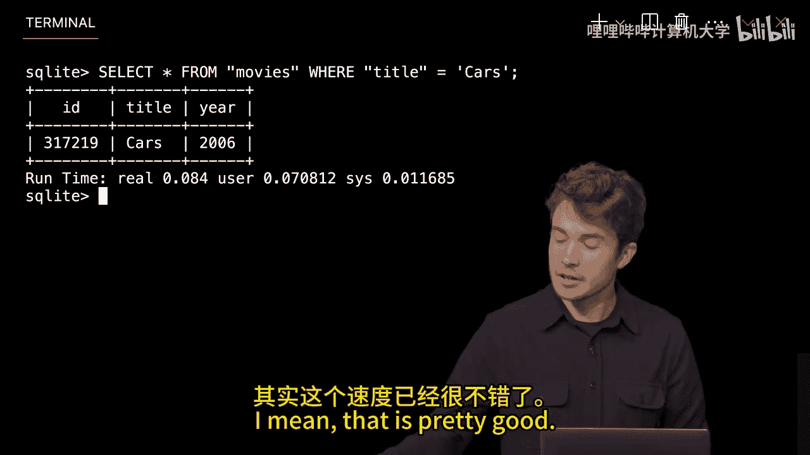
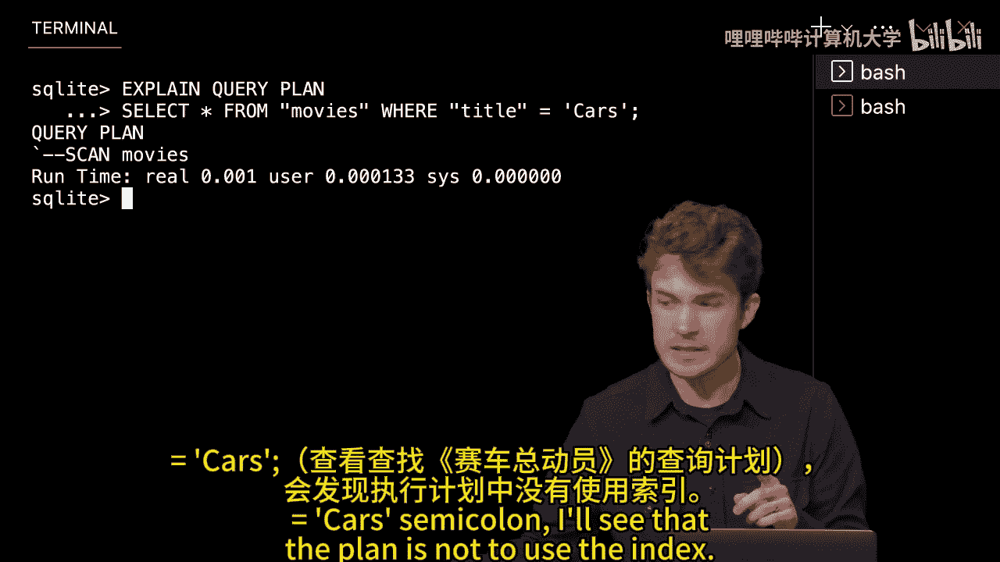
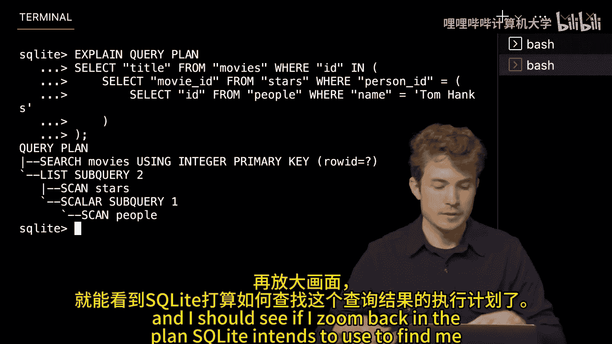
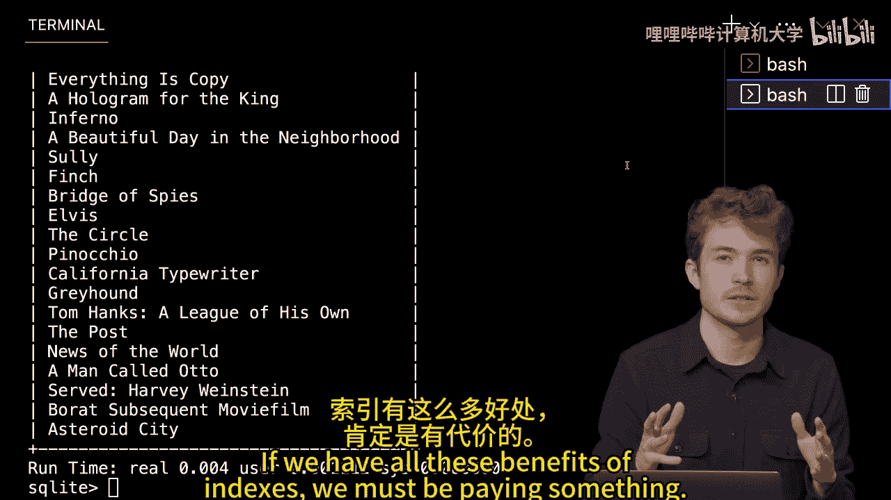
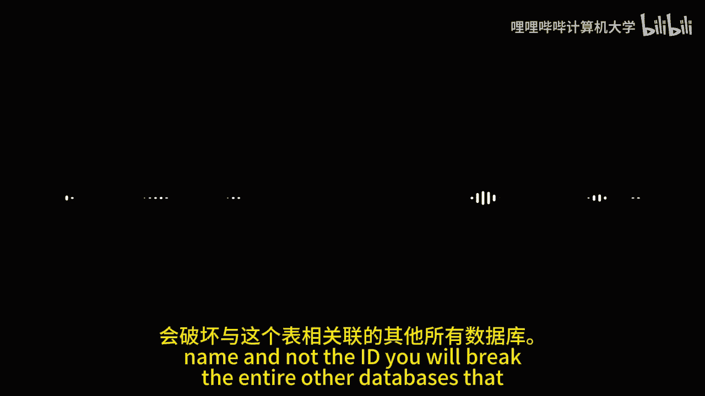
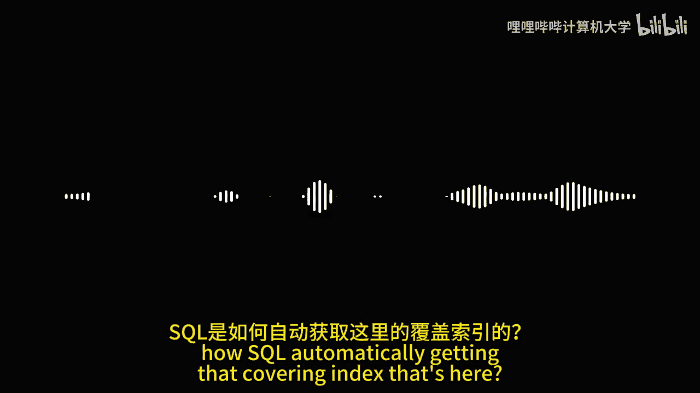
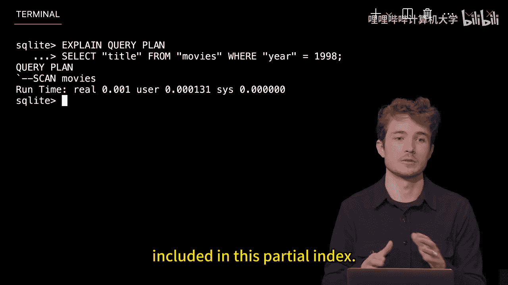
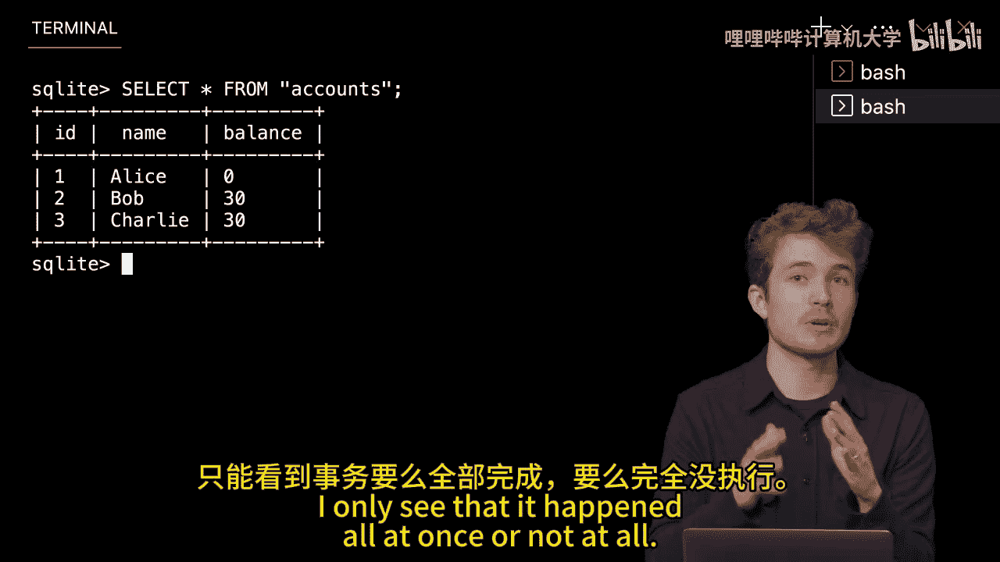
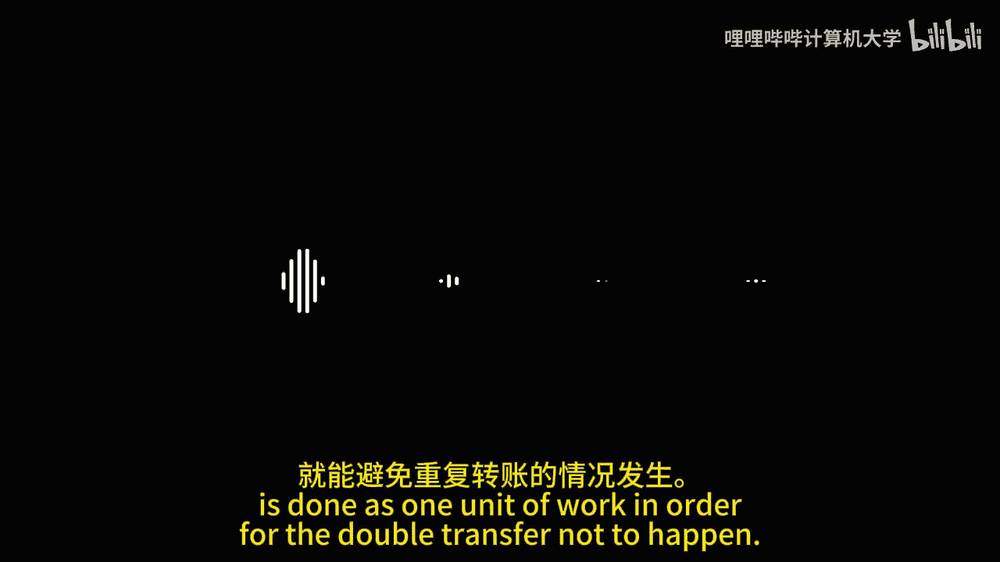

# 哈佛大学CS50 & SQL【速成版】 课程已全部上传，中英双字幕(人工核对翻译），课程附完整课件(视频支持杜比音效，Hi-Res无损音质)。 p07 Lecture 5 - 优化 -BV1iKCwBuE2d_p7-

Well， hello， one and all， and welcome back to CSF's introduction to databases with SQL。

 My name is Carterteranki。 and today we'll focus on optimizing。

 trying to reduce the time our queries take as well as you've seen the storage space。

 our database might use Well also see how to handle concurrency that is many queries all at once。

 Now we'll do all of this in the context of a new database， This one。

 the Internet movies database or IMDB for sure。 if you've been to IMDB do co。

 you may have seen this whole big database of movies。

 we've compiled that into our very own SQL like database for us today。 Now， this database is big。

 It is much bigger than anything we've seen so far。 In fact。

 it has over 200000 movie ratings over 400000 movies and 1。

4 million stars or people who have acted in some movie and the goal of this database is to represent movies。

 the people。😊，In them and the average ratings for each of those movies。Now。

 we have ourselves an entity relationship diagram to describe this database and it looks a bit like this。

 We have people in one table， movies in another and ratings in a separate table down here。

 Notice that people have a name and a birthday along with an I， the primary key for that table。

 Movie to have a title and the year they were released， as well as their own primary key I D here。

 rating down here has the average rating for a given movie。

 as well as the number of votes that went into calculating that average rating here。

 And notice too that the movie and people table has a many to many relationship。

 that is a person can star in more than one movie in the same way， a movie can have multiple stars。

 So if we want to implement this many to many relationship。 we've seen one way to do that。

 Let me actually ask the audience here。 How have we implemented。😊。

Many many relationship historically。 What kind of tables do we need for this， do you think。Alright。

 so not to worry if you don't have an idea of what we're going to use here。

 let's take a peek at what tables we can actually use。 so here， as we've seen historically。

 we might have two tables， one for people and one for movies and notice here in the people table。

 we have names along with a primary key called ID and similarly in our movies table。

 we also have a title column along with movies's own primary key， an ID column over there。😡，Now。

 to implement the relationship between people and movies。

 we have to have some table in the middle of these two。

 one that relates people IDs or person IDs with movie Is。 and if we look at this table。

 I could see that if I see person ID next to some given movie ID well it means that the person with this ID has starred in。

 played a role in this movie here， which see person 158 let's see Tom Hanks was in the movie I with 1。

14，709 or toy story as we see in the movies table。😡，And now knowing this。

 how can we figure out which movies Kristen Bell has starred in？If we know Christian Bellll's ID。

 what should we then do to find the movies Christian Bell has starred in？

You can select the idea of the people， then look at into the stars table。

 then look at into the movie table。

Yeah， I like your thinking。 So there's multiple steps here。

 We have to go through each table to find ultimately the movie that Kristen Bell has starred in。

 The first step might be to ask what is Kristen Bell's Id。 Well， it seems to be 6，8，3，3，8。

 Then to your point， we could look at the Stars table。

 and find out what movie Is correspond to that I here。 So it seems like 2，2，9，4，6。

29 corresponds with Christianten Bell's Id here。 Then finally， we look up in the movie's table。 Well。

 what title corresponds with 2，2，9，4，6，2，9。 It seems to be the movie frozen。

 So visually we have this relationship among these tables here。

So let's now dive into our movies database to actually get a sense of what data is inside of this。

 And for that， I'll go back to my computer so we can open this database up in SQLL。

 I'll come back over here and I'll open up my own environment where I can type SQLite 3。

 movies do Db， movies do DB and now if I zoom in just a bit。

 I can then type dot schema to show you all the tables that exist in this database。 I see up top。

 I do have a movies table that has primary key called IDd a column called title and a column called year。

 I have that same people table with names and birthdays。

 and I also have this stars table that corresponds with person Is and movie Is relating in this case。

 people and movies。Okay， so let's try selecting then from our movies table to see what movies we have。

 Take a peek at our data。 When we saw it a little bit ago。

 we could try to take a peek at our data using a certain SQL keyword。

 I could select star from movies to see all columns from movies。 But if I have， let's say。

400000 rows。 I don't want to print all those to the screen。 So what could I use instead。

ACertain SQL keyword。I'm hearing limit。 So let's try that。 I'll say limit 5。

 I only want the first five results here。 I'll hit enter。

 And here I'll see those first five movies in my movies table。 They each have their own unique I D。

 a primary key。 They have a title and the year that they were published。😊。

But if you've been to IMDB do com， you may have wanted to search for a particular movie。

 Maybe you wanted to find your favorite movie among all the possible movies in their database。

 and we can simulate that kind of query by querying a database here。 When you type in IMDB's browser。

 Let's like the search for a movie called frozenzen， for example， It odds are that behind the scenes。

 a database is actually writing that same query to return to you what movies have that title called frozenrozen。

Now， for me， my favorite movie since I was a kid is one called Car。

 So let me try to search for cars here。 I'll try to find select star from movies where the title equals cars。

 And you could imagine me going to IMDB typing in cars in the search bar and behind the scenes。

 thissQl query gets run to find what movies have the title carss。😊，So let me hit enter here。

 And now I'll see that one movie has that title Cars came out in 2006， and the idea is 3，1，7，2，1，9。

 But this is a lecture on optimizing。 So it's worth asking how much time did it take for this query to run。

Let's find out。 Well， I can use a sQL light command here called timer。

 I'll say dot timer on to make sure that I time my future queries。 I'll hit enter now。 And now。

 if I try selecting again， I'll hit the up arrow twice to get out my old query， I can type enter。😊。

And I'll see not just the results， but the time it took to run that query。Now， notice。

 we have several different measures of time here。 I have the quote unquote， real time。

 which is essentially the stopwa time， meaning from the time I press enter time I saw these results。

 How long did that take。But， of course， if you're familiar with computers。 You know。

 there's more involved than just this query running。

 I also have to wait for the operating system to finish other processes as well。

 And That's where user and system time come in。 Use time is how much time this query particularly took on the CPU system time is how long I think waiting around for other processes to finish before I could run this query for us So focus on real time。

 What was the wall clock time， the stopwatch time， so to speak between the time I has enter and the time I saw these results。

😊，Okay， so here we have a query taking 0。084 seconds。 I mean。

 that is pretty good if I only wait around for less than a10 of a second， like I'm not complaining。

 but if I'm an engineer at IMDB， why might I be concerned about a query that takes 0。

084 seconds particularly if I have lots and lots of users？

What's the problem there？Fusers， the database might be overwhelmed by the queries。

 and you should also consider like。How much time the application takes to form the query to the database too。

 Yeah， so the basic idea here is that when I have a single query that takes maybe less than10 of a second。

 that's fine。 But if I have many， many users running those queries all at once。

 like that time is going to add up。 And so if I'm an engineer or even somebody in finance。

 I want to reduce that time because I'm paying per second that I run this database on some other server。

 So we can optimize these queries， but let's first get a sense of how they're presently running。

 like what is sQLite doing underneath the hood to this movie called cars。 Well for that。

 I'll bring up a certain visual here of our titles column。

 So imagine here that we have a sort of smaller database called movies that just has titles in this case。

 And now I want to search these titles。 But I'm a computer。 I'm not a human。

 meaning I can only look at one item at a time。 I can only look at。😊，1 row and check its title。 Now。

 if I want to find the row or the rows that have cars in them。

 what's the best I could do if my titles are not sorted。What's the best approach I could take here。

 If I can only look at one row at a time， How might I search this column。

You should setting your search then so like your intuition， there is an algorithm。

 a step- bystep process called linear search。 We look at one element at a time or in this case。

 one row at a time that's exactly what we can do for this table I can look at one row at time defined I this title in this column or is it not So here to visualize I could take this title column I can only look at one at a time。

 but if this data is not sorted， I can do no better than looking at every row exactly once。

 So here we start with toy story， we ask is toy story equal to cars。It's not， so we'll keep going。😡。

Here， I'll check cars 3。 Is cars 3 strictly equal to cars。 it has cars in it。

 but it's not cars exactly。 So I'll keep going。 I'll look at frozen and frozen is not cars either。

 So I'll keep going again。 And here I see cars。 So maybe I could stop here。But why couldn't I Well。

 if I need to find not just the one row that has cars， but all the rows that have cars。

 I have to keep going to see is cars elsewhere in this column I it not just here but also in other rows too。

 so I'll keep going I'll look at Wally， ratatouille。

 soul turning red until I get to the end of this column and this process is called a scan of the table。

 We're scanning our column top to bottom looking for the result that we need to find。😡。

But it turns out we can actually optimize this search。

 We can do a bit better than going one by one by one by one。 And for this。

 we need a bit of a metaphor thing about how we can search our table。

 So if you have ever seen a kind of textbook。 You might have seen something a bit like this here。

 This is a handbook of education and research。 And maybe I want to find which pages correspond to how students learn computer science。

 So one thing I could do is open to the start of the book。

 I could go kind of page by page looking for which pages have how students learn computer science。

 I keep going here。 And if I want to find all the pages that have how students learn computer science on them。

 I can do no better than going through every one by one by one until at the end of this textbook。😊。

But chances are， you yourself don't do this。 You do something better。

And there's some built in structure in this book that could help you find what you're looking for。

What might you use to find something in a textbook or some other book， too。

We can use the index of the book。 You can use the index。

 So often a book like a textbook has something at the very back of the book that tells me all the subjects that are inside this book。

 But in alphabetical order。 So I can see here， there is a subject index in the back of the book here that list the subject and alphabetical order A to Z。

 And if I want to find how students learn computer science。

 I could perhaps search for computer science in this index。 I could find ABC up there C。

 And here I see computer science。 Now I know all the pages I need to look at inside this book without going through each of them one by one by one。

 So in the same way that books have an index。 So too can databases and tables have an index as well。

 So let's see a definition here for what an index is。 Well， an index is a structure that we can use。

 It's built into our database to help us speed up the retrieval of rows from that table。😊。

Search my index， find out what rows， my given search term is in。

 and then look those rows up in my table。 Now， if I want to create an index on a table。

 I can use some SQL syntax， I can say create index and give it some name。😡。

But I need to also specify a few other things， like similar to my books index。

 that index has some content。 It's an index by subject or an index by author。

 So I need to have tell us index， what to include。 So I should also say create index。

 Give it a name on some table and some columns in that table。 telling my index。

 what data from my table it should include。So let's create our very own index in the movies table to identify how we can make this query just a bit faster overall。

 So I'll come back to my computer here。😊，And let's now try to create this index。

 I will open up a new tab here， a new tab。 and then I'll log back into my database。

 I'll say SQL light 3 moviesvie。 Db。😊，And now I want to first create some index here。

 so I'll turn my timer back on and now I'll type the syntax we just learned。

 I want to create an index， and if I'm searching my title column in movies。

 I should probably include the title column in this index。

 So I'll say call this the title index here， itll be on the movies table and it will contain the data in the title column of movies a bit like this。

Now， I'll hit enter。And I'll see this index took some time to be created。

 there's some stuckling on underneath the hood， where I'm putting this data in a new structure we're calling the index here。

But now if I rerun this query， if I say select star from movies。

Sex star for movies where the title equals cars。 semi I calling。It's a lot faster here I see 0。

01 seconds， real time compared to 0。084 seconds。 That's a savings of almost eight times。

 like almost eight times faster now that we have this index。

 although it took some time to create the index。 if I run just a few queries。

 I much easily make that time up in terms of the time I'm using on my server to look up these kinds of pieces of information。

Okay， so let's actually take a look at how we can ensure a query is using some index here。

 I'm just kind of taking it on my word like here it was faster。 So it used the index。

 But there is a way for you to know whether an index was used。

 I could use a SQL statement called explain query plan。

 Other DBMS Ss might call this just simply explain， But in SQL light， it's explain query plan。

 And then after explain query plan， I can type the query that I want to learn the plan for。

 That is how does SQL light plan to find me this information。 How does a plan to execute this query。

So now I'll type select star from movies where title equals cars like this。 semi colon。

 I'll hit enter。 And now I don't get the results， but I do get the plan。

 SQL light intends to use to find me this result。 And take a look here。 I see query plan。

 And underneath， I see what SQLite intends to do。 It will search the movies table。

 but it will do so using the index that we call title index。

 and it will do so given some value for title here。

 So we can actually see SQLite does plan to use the index to speed up this query。

 We can confirm that this is exactly what's happening。😊。

But let me try now to remove this index and see what SQL light would have done when we didn't have this index。

 I'll come back over here， and I'll go back to my other connection to my database。

 This one over here。And now I'll remove the index we just created to remove an index。 I can drop it。

 I can say drop index， title index， semicolon。And now that took it just so in our time。

 but now I don't have the index anymore。 I can type dot schema。

 and I'll see that that index is not part of my schema。But now if I try explain query plan。

 select star from movies where title equals cars。Some I call in。

I'll see that the plan is not to use the index， the plan is to scan movies where scan we saw before means to go top to bottom through that title column and find me all the rows that have cars in them so we can see here the optimization we're already making by using this index here。

Okay， so let's take a moment here and pause。 What questions do we have about indexes and how they're used in this case。

Doesn't databases have implicit algorithms to optimize search。Yeah， good question。

 Do databases have implicit algorithms to optimize search They do for some columns。

 So if we saw in our table earlier， we had a primary key column like ID in SQL light and most other DBMSs is。

 if I specify that a column is a primary key， then that database management system will automatically create an index be which I can search for a primary key。

 if though I have a regular old column like title or like year or so on。

 it doesn't go through the process of automatically optimizing that search for me。

 I have to try to do that myself， as we're doing here。😊，Lets take one more。

 Would it be advisable to create a different index for every column in case we need it。

Yeah， I mean， it seems like indexes are so good。 They speed up queries for us。

 Why not create an index on every column we have。 Well， as we'll see in just a moment。

 there are some tradeoffs involving space。 and also the time it later takes us to insert or add new data。

 So good questions。 I'll come back to my laptop where we can continue on。

 So we've seen how indexes can speed up queries。 we we're searching for one column here。

 But they could also speed up queries across multiple tables。

 So let's try a different kind of query here。 What I might do now is try to find all of those movies that Tom Hanks starred in。

 And we did a bit of a example of this little earlier visually。

 But my goal is to find all of those titles that Tom Hanks played a role in。

 If my goal is to end up with titles of movies。 I could try selecting title。😊。

From the movie's column like this。But if I look at that movie's table， all no， I only have titles。

 year and the I D of those movies。 I don't have anything related to Tom Hanks。 Well， Tom Hanks。

 though， is probably showing up in the Stars table where I could correspond。

 Tom Hanks's I D with the movie Is that Tom Hanks played a role in。

So let me try filtering these movies by an I D。 I'll say where the idea of that movie is in some list of movie Is that also correspond with Tom Hanks's person I。

 So I'll make a subquery here to find exactly those films。

 Now I'll say select movie I D from stars where the person Id is equal to Well。

 I don't know Tom Hanks's person I。 I could try to hard code it here。

 but I could do better by having another subquery to find what is Tom Hanks's Id。

 Now I'll indent not just four times， but8 to show this is my next level of a subquery here。

 I'll now select Id from people where the name equals Tom Hanks， Tom Hanks like this。

 And now I can close out my subqueries。 I've found the I of Tom Hanks。

 I've found those movie Is that correspond with the person I of Tom Hanks。

 and then I've found the titles。😊，Correspond to those movie Is。 Now I'll hit a semico in here。

 press enter。 and I should see I get back all of Tom Hanks's movies。

 all of those that he played a role in。 and I'll also see the time that it took the real time for this query was about 0。

197 seconds。 So getting a little bit slower now that we're looking across multiple tables and having multiple subqueries。

 One index could speed this up as well。 I can make a new terminal here。

 and let me open up that connection of my database again。 I'll say SQLite 3 movies do Db。

 And now I should figure out what columns do I need to index to speed up this query。

 one thing I could do is try explain query plan again。

 I want to understand what SQL light plans to do to execute this query So I'll explain query plan。

 and I'll type in the same query from before。 I'll say select the title from movies。😊。

the Id is in those movies that Tom Hanks played a role in。 So's all select in this case。Movie Id。

 movie Id from the stars table， where the person Id equals Tom Hanks's I D。 Now， I'll find that。

 I'll indent eight times to show this is my next level sub query。 I'll select。

Id from people where name equals Tom Hanks， and I'll wrap the line just a little bit。

 Let me zoom out so you can see it all in one go。 and now I'll close out these subqueries just like this。

Hit enterter。And I should see if I zoom back in the plan SQLite intends to use to find me the results of this query。

 Now， let's take a look here。

I'm planning to first scan people， to understand the structure of this。

 I need to first go all the way into this bottom part here。

 I'm going to scan people to find presumably Tom Hanks's ID， then after I do that。

 I'm going to scan stars， presumably to find all the movie IDs that have Tom Hanks's ID。😡。

But then up here， I'm finally going to search movies using integer primary keys。

 some index is's automatically created for me as we saw before， for my primary keys。

 So it seems like the optimization here could be in the people table and the stars table。😊，Now。

 let me ask， if I wanted to create an index on either the people table or the starss table。

 what do you think I should include， which columns should I include in this index。

 given my query here？What columns should I include in this index given this previous query？

We could index the I and the name of the person。 Yeah， good idea。

 index the ID and the name of a person。 So if we look at this query again。

 we'll see that our where clause here is searching by the name in the people table And up here。

 this where clause searching by the person Id column in our stars table。

 So it would stand a reason that I should actually create an index that includes the name column in people and the person ID column in stars。

 perhaps two separate index is one for each here。 So let's go ahead and create those now。

 I'll come back to my computer and here I will try to create this index。

 I'll say first create an index create index called person index and I'll create it on stars and the person IDd column in stars as we just discussed。

Now， if I hit enter。I should let it take some time to build up this index。

 but now I can also create my next one。 I'll say create index。

 and then I'll choose name index on the people on people table and I'll include the name column here。

 So now I'll hit enter that too will take some time to run。

 but now if I try to explain the query plan again， I'll clear my screen， try explain query plan。

And then I'll type in this query again， I'll say select title for movies where the ID is in。

Those movies that Tom Hanks played a role in that have the Per 9 next to it。

Then I'll say which is Tom Hanks's ID， and I'll close out the subquery here。Just like this。And now。

 if I explain the plan yet again。I should see I'm now optimizing this query even further。

 I can see down below here my plan is to search the people table， not to scan it。

 but to search it using what we call a covering index called name index， the one we just created。

 We'll explain covering index in just a little bit Next， though。

 I'm going to search stars using the index we just created called person index， given some person Id。

 And then finally， I'll search movies using an integer primary key index。

 the one that's automatically created for me here。😊，So here we see some new vocabulary。

 not just using index， but using a covering index， what is a covering index， a covering index。

 it turns out is still an index the same kind of idea。

 but it is one in which we have all data we need inside the index itself。

 It's one in which the query data can be found only by searching the index。

 there's no need for me to go from the index to the table I can just look it up in the index。

 it's similar to me searching this textbook and getting to the index and not then needing to actually go back in the books pages I can find everything I'm looking for in the index itself。

And this is good because if I need to not just find the items in my index。

 but then look them up in my table， like that look up in the table takes some time。

 So if I instead have a covering index， one that includes all data I want to find exactly right there in it。

 That's going be faster for me than a regular old index。

 So let's try then turning one more index into a covering index。

 I'll come back over here and we saw before that we had the index on the stars table using just a regular old index using index person index。

 But what are we trying to find from this index。 We're trying to find the movie Id column。

 So I could create an index that includes the movie Id column as well。

 I can have indexes that span multiple column。 So let's try that here。 I'll come back over。

 and I'll create this new index that intends to cover our。😊。

Search here I want to include not just the person ID column。

 but also the movie ID column so I can quickly find that data inside the index itself。

Let me drop our current implementation of the person index like this。

I'll hit semi call in here and now that index is gone， but if I type now create index。

 I'll also call this person index on stars， and I'll say。

 let's include not just the person ID column， let's also include in this case。

 the movie ID column like this。Now， hit semicolon， enter。And I'll take a bit of time to run。

 But once it's done， I can probably try to explain the query plan again and see if we have our covering index。

 I'll go back up top here。 I'll explain query plan。

And I'll choose to recreate this query from before。Just like this。

 I'm going to select the movie ID from stars and then find Tom Hanks's ID。

And then close out these subqueries here。Just like this。And now。Once I explain query plan。

 we've optimized even further。 Now I have two covering indexes。

 I can find all the information I need just by looking in these indexes， not by doing a table lookup。

So let's now run this query and see just how much faster it might be。

'll come back to my laptop here and let's get rid of the explain query plan。

 let's now turn our timer on。 I'll turn timer on like this， and I'll rerun this query。

I'll say we select title for movies where the ID is in the Star table so long as the movie ID aligns with the person ID。

 Then I'll find Tom Hanks's person I here。 I'll close out my subqueries。

And I should be able to find that this query。Is just a little bit。

 I going to understand here a lot faster。 So if I go back to my old query here。

 I'll see this one took 0。197 seconds。 This one with two covering indexes takes 0。004 seconds。

 This is an order of magnitude faster than my prior query because I've used indexes now。是。

Let's see if we have all these benefits of indexes。

 we must be paying something like if I have this book here。

 and I'm trying to find some data inside of it。

What might the trade offs be if I want to create an index。

 Let me think first about this database on my computer。What am I giving up。

 I'm making sure my que is faster。 what am I losing。

 do you think space we required for indexing also。The more index we would have the more space and more memory we would have to consume for that。

Yeah， so it's a general theme that when I try to speed up something in computer science。

 I have to pay some cost， which is often in terms of space。 that when I create an index。

 I'm using more space in my database。 And this similarly applies to an oldfed textbook。

 Like if I have an index in here， I'm literally paying in pages to print so people can find content better。

 This is some extra money I have to spend extra pages I have to print in order to make my queries faster either on this book or in my database。

 So let's understand why indexes take up so much space by looking at the underlying data structure they use to store information。

 Well， it turns out that the part of the reason indexes take up so much space is because they use a certain data structure。

 a way of organizing data called a B tree or a balanced tree structure。

So not to worry if you don't know what a tree structure is。

 here's a visual to keep in mind as you think about using trees in computer science and an indexes in particular A tree might look a bit like this。

 And notice how it's similar to a family tree with grandparents and parents and children and so on。

 You could， if you wanted to kind of do a 180 on this diagram， flip it right side up。

 And now you might see more of a tree structure going from top to bottom。 You could see down here。

 what might call the trunk of the tree， followed by some branches， these over here。

 And then the leaves， these up top kind of the edge of this tree diagram。

 And there's a few vocabulary words you might want to know when you talk about trees。

 One of them is this idea of a node。 So this right here is a single node in our tree。

 A tree is made up of a collection of nodes。 And each of these nodes stores some value。

 Maybe it's a value in the column were trying to。😊，Index， for example。In addition to that value。

 this node also stores pointers， kind of arrows metaphorically to other nodes to tell us where in memory these nodes are。

 and by stringing these nodes together， we can build up this tree like structure。

Now this node here points to three other nodes and some new vocabulary here is that this node has three children going back to that family tree example。

 we see that this node here has three children which are these right here。

 but these nodes themselves also have three children of their own。

 So if I were to go down to the next level of our tree， Well if I'm referring to this node here。

 these node down below are that nodes grandchildren， the children of its children。

Now these nodes here also have another name we saw before， they're often called leaf nodes。

 they're the edge of our tree， and we know a node as a leaf node when there are no other nodes it points to。

So this is the general idea of what an index looks like。

 but let's get a little more concrete and try to build an index from our title column in our movies table here。

So let's assume we have a table of Is and titles here。

 And I want to create an index on this title column to search it more efficiently。

 What we saw before that the best I can do when this data is unsorted is to go top to bottom。 first。

 look at toy story。 then look at cars 3， then look at frozen all the way down to the bottom。

 I can only scan this column。 So to speak。😊，But I know I could probably do a little better if the data is sorted。

 if the data is sorted， I could look roughly in the middle， and if I've gone too far。

 go back a little bit， or if I haven't gone far enough。

 go forward a little bit and do a fewer number of lookups to find that I'm looking for。

So let me sort this title column。 I'll put it like this。What if I。Done wrong。First I had this。

Then I wanted to sort。My title column to make it faster to search。But what did I。

W did I break here by sorting this title column like that？ Yes。

 Carter the fingers that by sorting only the movie's name and not the idea。

 You will break the entire other databases that relates to that one。 So， for example。

 this look for a movie in which I don't know， Johnnyny Depp is working。

 or has work it done and the result may be I dont know， Titanic。 I love that example。

 that really drives it home here。 And in more general terms like I had this primary key called I D。

 And in the prior state， I had toy story with the I D of 1，14，7，0，9。

 a primary key means that toy story should be consistently identified with this number 1，1，4，70，9。

 But your point mateo， if I sort only the title column will now cars has that I D 1，1，4，7，0，9。

 I've broken that relationship， particularly if other tables are rely。

On toy story being identified by 1，1，4，7，0，9。 So I can't do this。 This is bad。

 I need some other way to sort my title column。 So let's bring this back to what it was here。

 And let me focus just on the title column。 Well， I can't sort this title column because it part of my table and the ordering of that table does matter。

 What I could do， though， is create a copy of this column and maybe sort that copy。

 So Ill literally create a copy of this title column elsewhere in memory。

 And let me just remove this title column identifier here。 So I have just the data。

 Just the data in this column somewhere else in memory。 And now I could sort this data like this。😊。

So let's say I now want to find cars。 Well now that my data is sorted。 what could I do。

 I could look first in the middle at Raatouili， for instance， and then realize。

 well cars comes before ratatouili。 maybe I'll go a little higher in my index here。

 I'll search in the middle of this first half。 I'll look at in this case frozen and cars。

 well it still comes before frozen。 So let me look up at the first half of this first half。

 I'll then go up here and I'll have spotted cars。 So a much faster way to search for information now once I have it sorted。

But I don't think we're quite there yet。 Like if I wanted to find the year that cars was released。

I found that it's in my title column。But what am I not able to do at this point？

I've copied the data somewhere else， but now I want to find some other data in my table。

 What can't I do。We need to point to index。 Yeah， I need to be able to find some way to relate this index with the rows in my table。

 So here this is elsewhere in memory。 it's good that I can find that cars is in my title column。

 But if I want to find the other data in this row like the year that cars was released Well I have to have some way of linking this this data here。

 Car to my table So often in an index whyt just copy the data to some new location and sort it will also have some link between these index pieces of data over here and our rows in our table back here。

 So for instance， here is cars and cars appears to be in row4 Similarlyly。

 cars3 look to be in row2 in my table and I could metaphorically visually draw some lines between cars over here in my index and cars in my table。

 I could draw one that looks a bit。😊，This going from cars， my index to actually cars in my table。

I could draw one for cars 3 going from this index place here to row 2 in my title column。

 So that is the way I can link my index with my table data。

 I could do the rest of these two for all of my other pieces of data in my index。😊。

So let's focus on this now， like just to check for understanding， I have this index。

 That index has my sorted title data， and also the row number in which I found that piece of data。

So let's say here， I want to find the movie soul。 I want to find the movie soul。 How could I find。

Soul in my index。Yeah， since this already sorted。 I believe you could use binary research。 Yeah。

 I could use algorithm called binary search， if you're not familiar。

 simply means start in the middle。 if I've gone too far。

 look in either the left half or the right half and repeat that process over and over。

 So here is my index again。 I'll go roughly to the middle and I'll look at ratatouili here。 Well， So。

 I know comes after ratatouili alphabetically。 So what should I do。

 I should now look in this second half here。 I might go to toy story。 once I see toy story。

 I know I've gone a little bit too far like So comes before toy story alphabetically So I'll look in the first half of this second half。

 and what do I see， I see So right there。😊，Okay， so our index seems to be working。

 It allows me to more efficiently find data。 I no longer have to look through every single row。

 I can simply use a more efficient algorithm， like binary search。But now there's one more catch。

 which is if I had many， many， many rows， not just9。

 but literally thousands or hundreds of thousands or millions of rows in this index。

 like that's a lot of data to store in one location in memory or even to load into my computer's Ram。

 so to speak， it's random access memory。 So it can do all is jumping around。 ideally。

 what I would do is break this index up into smaller pieces。

 So I don't have to load all of this at once。 And in reality。

 our index is not a single column like this。 but often individual nodes or each of these，1，2。

3 might be some node scattered about the computer's memory。😊，But what problem have we introduced now。

 if these are around the k's memory， I can't actually jump between them anymore。

 I can't go maybe one space of a toy story and find soul。 This node might be elsewhere in memory。

 And so we'll need some other nodes to actually help us find what we're looking for in this index。

 I might have one more over here。 that tells me what kind of data is in each of these nodes。

 Maybe I have one here that has both frozen and soul Not how here。

 frozen is the furthest down alphabetically in this node up here。 and notice down below here。

 So is the furthest down alphabetically in this node here。 That is if what I'm looking for。

 comes before frozen， I should look at this node。 if what I'm looking for comes after frozen。

 but before soul， I should look in this node， or if what I'm looking for comes before none of these。

 It comes。😊，After so， I should look at this node down here。So let's find an example。

 Let's say I want to find cars now。 Well I'd start in this root node。

 the space of this tree we're building here。 I've turned kind of right side this way。

 Let's say frozen。 I'll go here。 And as cars come before frozen。Well， it does。

 So I'll look in this node now， I'll come up here and I'll find cars in that node。Let's see here。

 maybe I want to find ratatouille， I'll go back to the beginning and I'll look through this root node。

 I'll say， does ratatouili come before frozen。It doesn't。 It comes after frozen。

 So look and check So。 Does how to come before soul。It does。 So look in this node now。

 I'll go find Lucka and not quite there yet， but I will see ratatouili。

 So I know that I've now found ratatouili in my index。 And now for one more。

 let me check for understanding here。 How could I find turning red。😊。

What steps would I follow to find turning red。I might start at that root node。

 but then what questions should I ask？From frozen or so we can see raivs to the right so that we move in the direction of so that once we get there we find the middle elements and we can see raivs to the right of the middle elements so that's how we find it divide the list to two halves and look into the h that the elements is found。

Yeah， I like what you're thinking here。 So you're talking about traversing this tree we've built and turned on its side here。

 And let's visualize that search here。 So first， we'll start at frozen and ask。

 does turning red come before frozen。😊，It doesn't。 It comes after。 So I'll keep looking。

 I'll look at soul。 Does turning red come before soul。 It doesn't。 It comes after soul。

 So I know I need to look at this node down here。 I'll go find toy story， not quite there yet。

 But now I'll see turning red。 I'm able to find what I'm looking for。 and not just that。

 I can find what row number turning red is actually in in my table。 So when you use an index。

 SQL or sQL light is using some algorithm a bit like this。 It creates some tree structure。

 a bit like this here with individual nodes it has your column data。

 It then uses this kind of algorithm to search that index and find whether or not that piece of data is in your index。

 And if it is， it will go ahead and look up that piece of data in your table。😊，So see here。

 although this is turned on its side， the relationship between a kind of tree。

 We had a root node or a trunk node here pointing to some of these leaf nodes。

 the edge of our graph right here。 And you can see some relationship between these nodes here and our tree as well right here with arrows pointing across these individual nodes。

😊，So let me pause here and ask。What questions do we have on this structure and how we've searched it。

Is that related to link lifts。

Or arrays。 good question。 Is this related to linked lists or arrays。 So if you're familiar。

 a linked list is some set of nodes that have been linked together in memory using these arrows like we saw on our diagram here。

 It is the case that sometimes an index will include a linked list。Let's take one more here。

 I want to know coloring index。 What how is the create coloring index and。

What has been， I mean， if we just first saw example index and then we just saw covering index。

 how S automatically get in that covering index， That's。

Yes， think we're asking how is the index created， like what is the process for doing that。

 Well it turns out that just as we saw here in the slides， SQL light or whatever DBMS you're using。

 we'll take a copy of the data that should be in that index and organize it into a tree structure like we saw here。

 It may or may not be similar to the structure we saw little earlier with nodes that have different pieces of row data in them like good question there。

😊，Okay， so we see now the tradeoff that we get with index。

 which is they're very fast to look up some data， but they take up a lot more space。

 There's a lot of redundancy to them here。 There's also one more tradeoff。

 which is if I want to insert something into this structure。 It'll take me more time。

 I have to navigate this structure here。 I have to figure out should it come before this this value or after this value。

 and I'll have to traverse this tree every time versus without an index。

 I could just add something to the end of this list。 But with a B tree with an index。

 I need to traverse all these nodes to figure out where should that piece of data go。

 So these trade off something you should keep in mind as you build indexes and optimize your queries。

😊，Okay，There are ways， though， to actually optimize the space that we use using a tree like this。

 We can use a structure called not an index， but a partial index。

 And if you're concerned about space， a partial index might be good for you。

 A partial index only includes a subset of the data from a given column thus making your index smaller overall。

 you could think of a partial index being useful when you know that your users will only query a subset。

 only a small number of rows from that table。 And for example， in IMDB。

 maybe we know people are more likely to search for a movie that came out this year versus someone that came out in like 15 years ago or so。

 so we could create an index that focuses on those movies that came out this year versus 15 years ago or so。

😊，And we'll do just that。 If I want to create a partial index， I can use this syntax here。

 I could say create an index and give it some name。

 then include some data from this table and this column here or list of columns I can provide。

 But then what I need to do is add a condition where some condition is true。

 These are the rows I want to include in this index。 before we had just create index name on table。

 some list of columns。 Now we can add in this where clauses that says only include those rows where this condition is true。

 So let's try that now， I'll come back to my computer。

 And why don't we try creating a partial index to help speed up the lookup of movies that came out this year。

 I could come back to my terminal。 and I could remove。 let's say this one over here。

 Now I'll try to create this partial index。 I'll say create an index。 called。😊，Re。

To indicate this will help us search for recent movies Now I'll make this movie recent on movies and the title column。

 I want to look up titles ultimately， but now I only want to create an index for those rows where the year equals 2023。

I only want to include those titles in my index that were released in 2023。So I'll hit enter now。

 and I'll see I created this index for myself here。Now， let me try searching for those。

 I'll select title from movies where the year equals 2023 enter。

And I'll see a lot of movies came out in 2023， almost one， I'm taking 1。3 seconds here。

 but now I could prove to you that we are using some index， I could say explain， explain query plan。

And now type select title from movies where the year equals 2023。Hit enter。And now we'll see。

 what are we doing。 We're going to we'll scan movies。

 but we're still going to use the index we just created called Re。

 So it's helping speed ustop just a little bit overall。Now。

 let me try dropping this index and showing you the opposite， I'll come back over here。

And I could try dropping it。 And actually， before I do that。

 let me show you what would happen if I didn't search for movie in 2023。

 I would try explain query plan。And let me try select title from movies。

Where the year equals 1998 like this。 And see now I'm only back to scanning movies。

 So before in my prior query， I was able to use the index because my wear clause included 2023。 Now。

 though， I'm using 1998， which were rows that were not included in this partial index。

Okay， so let me ask now what questions we have on these partial index。

 which we can use to optimize some of the space these indexes take up。W index is not saved in schema。

A good question。 Are our indexes saved in the schema in SQL light。 if I type dot schema。

 I can actually see them in my schema。 So let me go back here and show you if I now type something like。

 let me turn timer off here。😊，Dot schema， you can see down below here that I actually have these indexes as part of my schema。

 I'll see the create index statements I used down below here。

 create an index called name index called person index called Re and all that I use to create these indexes now inside my schema。

 If I drop some index。 It'll be just removed from my schema altogether。😊，Good question。Okay。

 so speaking of dropping indexes， one other way we can more efficiently use space is to take a bit of vacuuming。

 so to speak。 So let's introduce this idea of vacuuming up our database。

 Let me show you a slide here。 And this one involves this idea of trying to clean up unused space in our database。

 Often when we delete something。 either rows or an index。

 we don't actually delete those bits that were being used by those rows or that index。

 We just mark them as being available for whatever we next insert， they can be overwritten。

 so to speak。😊，But if I want to actually reduce the size of my database after I delete something。

 I should use something like vacuum in SQL light or optimize in some other DBMS。

 vacuumuming is a bit like taking unused bits and let's like sucking them up。

 taking them back in so we can give them back to the operating system。

 and the keyword we can use for vacuum is just simply vacuum。 So let's try this。

 I'll come back to my computer over here。 and let me open up a new terminal。

 one that I can use to find the current size of movies do db。 So hit this plus button here。

 And now I could type a command， not a SQL command or SQL light command， but actually a unix command。

 I could type D dash B for the disk usage in bytes。 How many bytes is a particular file。

 I could then say movies do db here。 And if I hit enter I should see movies do Db is something like 158 million bys or 158。

😊，So let's see what happens if I were to delete an index。

 which know takes up some amount of space in our database。 I'll go back to my terminal here。

 and let me try to drop an index that we had recently created。 I'll say drop index。

 person index to remove the person index in this case。 I'll hit enter。

 And now I see that person index is dropped。 If I type dot schema here。

 I no longer see it in my schema down below。So now let me check the disk usage in bytes and see if it's any smaller。

 I'll hit the up arrow to get access to that same command， hit enter。

It seems like it's the same size， as still 158 megabytes。So let me try dropping something more here。

 I'll go back to my terminal here and now I'll try what other do I have， I have have name index。

 so I'll say let's drop index name index like this。

 I'll hit enter and I'll see that that index is now gone Well now I'll also try dropping rec。

 I'll drop index drop index rec and now I believe all of my indexes should be gone if I type dot schema。

 I don't see any more indexes。So now let's check on the disk usage and bytes。

 so I'll go back to my other terminal， hit DUB again， and it's still 158 megabytes。Well。

 what can we do to clean this up， We could run vacuum if you remember here when we delete an index。

 we drop the index， we don't actually shrink our database file。

 we just mark those bits that are part of the index as being available for reuse。

 So let's now vacuum and compress our file to give back those bytes。

 those bits to the operating system I'll come back to my terminal here and type vacuum semicolon hit enter and I'll wait for it to find those bits and bytes。

 wait for it to give them back to delocate them to go back to the operating system and now if I come back and I type DB again hit enter I should see a much smaller file。

 So before we had about 158 million bytes we're down to in this case。

 100 million after dropping our indexes and using vacuum。So let me ask now。

 what questions do we have on vacuuming Can we do vacuuming in a faster way Can you vacuum in a faster way。

 So I think it depends on the size， the vacuum that you're trying to implement here。

 If you have a lot of bits and bytes you're trying to decate， that could take more time。 I mean。

 the process here is the computer has to find those bits and bytes you're no longer using and then give each of those back to the operating system。

 So it could depend on the size and how long they take to find。Let's take another question here。

Initially， he said once we drop a database， we don't lose the。

The data is not deleted。 Its just the space is just reallocated， right， if， if I go， you right。

 So does that mean the queries we run today， are they locked somewhere that。

 let's say you mistakenly did a query。 You can go back and pull that data back。

Is is that possible， kind of like a reversal of a query。 Yeah。

 so you're talking about some forensics here， like， could we mark something as deleted。

 but still find it later？ They're actually are people who are trained in this in forensics to find pieces of data that you thought were deleted。

 but are actually still on your computer， just kind of forgotten， if you will。 In this case。

 in SQL light， it would take a lot of work to go ahead and find all of those bits and bytes we've removed。

 But once we vacuum。 once we actually give them back to the operating system。

 we can no longer find those in the database because they're not just marked as being delocd。

 they actually have been given back and they're no longer part of our database。 Good question there。

Okay， so've seen here how we can optimize our queries by reducing the time that they take。

 although with the cost of some space when we come back。

 we'll see how we can handle not just one query at a time， but many all at once。 See you in a bit。

 and we're back So we've seen so far how to optimize individual queries。

 ensuring they take less time and also to ensure our databases use as little space as possible。

'll focus on now is trying to ensure we can handle not just one query at a time but multiple all at once。

 this is this idea of concurrency concurrency is when I get multiple queries。

 multiple interactions all at roughly the same time and my computer system。

 my database needs to figure out how to handle all of those at once。

 This is particularly important for websites to get a lot of traffic or even for the financial sector。

 people are constantly making trades， placing orders exchanging。Money and so on。

 So let's see one example here of a bank。 Let's say here I have a table of accounts。

 and each account has a name and some balance to it。 Well。

 we decide here that maybe Alice wants to pay Bob $10。

 So what should I do to update the balances here。 Maybe the first thing I should do is make sure that Bob receives that money。

 I could update Bob's account， have a balance not of 20， but of 30 now from 20 to 30。😊。

But here's the thing。 If at this moment， somebody looks at this table。But what they see that's wrong。

What will they see。That they might not。Get the right picture of at this point。

I'm hearing they might not see the correct balance for Alice。 Like Bob has gotten some money。

 He's gotten， he's gone from 20 here to 30。 but now I have not just， let's see $60 in the bank。

 I now have 70。 It looks like。 So somebody looks at this transaction in this moment。

 they'll see some incorrect information。 What I should then do is update Alice's balance。

 subtracting 10， So we're at the right amount of dollars across our bank accounts here。

 So this is an issue。 when I have one ongoing transaction like this。

 and somebody else wants to look at that data， they really shouldn't be able to until this transaction is complete in its entirety。

 So ideally， go back what we had before with Alice at 10 Bob at 20。 Ideally。

 if Alice wants to pay Bob， this should happen to an outside observer all at once。

 Bob should get those $10 and Alice should lose those $10 at the same exact moment。 So nobody。

Look and see that Bob has more money， while Alice doesn't have less money。

Now we can implement this idea of this transaction using a very similarly named idea in databases called a transaction。

 Now， a transaction in the world of databases is a individual unit of work。

 That means a transaction can't be broken down into smaller pieces。

 It happens all at once or not at all， and in fact。

 a transaction has several properties and help implement several properties of a database among these are acid or AD you may have heard of these if you've looked up some of about databases but each one stands for some principle of ensuring a consistent and reliable database。

 In fact， a stands for atity， which means I can't break a transaction down into smaller pieces。

 I can't break a transaction between Alice and Bob into Bob's update and then Alice's update。

 it's just update both accounts at the same time。Consistency means a transaction company that I don't violate some database constraint。

 Let's say I try to pay Bob from Alice's account， but Alice doesn't have the money。

 If that is the case， a transaction will revert undo。

 So I go back to being in this consistent state for my database。

Isolation means if I have more than one person trying to access this database， their queries。

 their transactions won't interfere with each other。 and then finally。

 durability means if I were to unplug this database or to counter our power failure or the server to crash。

 all that data would still be there from the time we committed our transaction or saved the results there。

So transactions do a lot for us， but they have some very simple syntax。

 I can simply use begin transaction and then follow up with some statements I want to include in that transaction。

And once I'm sure I want to save the results of these statements， I can then say commit。

 meaning save these changes thus far。 and it's using this kind of syntax。

 we can ensure that nobody sees incorrect balances。 let's say for this bank account table here。

 So let's try this out and implement a payment between Alice and Bob， but now using a transaction。

 go back to my computer here。 let me show you a new database。 I'll type sQLite3 bank do Db。

 I'll hit enter SQLite3， sorry， bank do Db。 I'll hit enter。

 and now let me type dot schema to see the schema of this database。

 I'll see here a few different columns that I have an I column， my primary key。

 a name column like we saw on our slides that is text and can't be null and then a balance column。

 There's an integer， a whole number of dollars。 that also must have a value。Can't be null。

 And I have a check constraint here saying the balance must be at all times greater than or equal to 0。

 So this is an implementation of a table of bank accounts。

 Let me try querying here to see what our account balances look like。 I'll say。

 select star from accounts。Some I call on。 and now I'll see that very same arrangement we saw in our slides。

 Alice has $10。 Bob has $20， and Charlie has $30。So let me try then processing this transaction between Alice and Bob well at this moment I might try to update Bob's account at the first bat I'll say let's try update and I'll the accounts table set the balance equal to balance plus 10 where the ID equals two。

 remember Bob's account ID is two， so now if I hit enter here。

 Bob should have gotten just 10 more dollars。But there's a problem。

 If I also connect the database to another connection here， SQLite 3， bank dot D B。

Maybe I'm somebody who's checking on the balances of the bank， I say select star from accounts。

What do I see？But an incorrect total balance， we should have $60， but here I see 70。

 So I need to complete this transaction to ensure that I actually have the right amount of balances across the board。

Let me go back here and let me try to run the next part here， I'll change， let me update this。

 I'll say update accounts， and I'll set balance equal to balance minus 10， minus 10。

 where the ID equals in this case1， where Alice's bank account ID is one。Now， if I hit enter。

 I should be able to go back to my other terminal and check on the balances again。

 and now I'll see the right balances altogether together。

 but there is a way to avoid me looking at this table and seeing an incorrect state and the way to do that is called a transaction。

 So let's go back here and I will reset my terminals。I'll now also give back Alice's money。 I'll say。

 let me give back Bob the $10。 Let me back give Alice back $0， I say where I D equals one here。 Now。

 Alice will have $10 more， and I'll go back and I'll update accounts。

I'll set the balance equal to balance minus10 where the ID equals 2。

 So I'm giving Bob back the $10 that they just gave to Alice。 now if I select star from accounts。

We're back to where we began。So ideally， I was be able to complete this transaction between Alice and Bob without somebody seeing the intermediate process of Bob having more money than Alice。

 So let's try this。 I'll say begin transaction semicolon enter。

 and now I can include what I want to have happen in this transaction。 first。

 I want to update Bob's account。 I'll say update accounts and set balance equal to balance plus 10 where the Id in this case equals let's see two because Bob's account Id is2。

Now， enter。And now I'm in the middle of this transaction。 But if I go to my other terminal。

 let's say I'm somebody new。 and I check on the balances of the bank。

 I say select star from accounts。What do I see？I don't see any change from before。

 Alice still has $10， Bob has $20 and Charlie has 30。

 and even though in this terminal I've been able to update the account balance。

 I haven't committed those change， I haven't saved them into the database just yet。

So let me try now removing money from Alice's account。 I'll say， update accounts。

And set balance equal to balance minus 10。Where the Id equals one。

 now'll remove $10 from Alex's account。 hit enter。 And still。

 if I go back to this other perspectiveive here from somebody else checking on the bank balances。

 I see everything is still the same。 But the moment I then go to this transaction and finish it by typing commit。

 meaning save these changes， I'll commit here。I can go back and I'll see all in one moment that it appears Alice has paid Bob $10。

 So this is the atity part of transactions。 I don't see the intermediate steps in the transaction。

 I only see that it happened all at once or not at all。

Okay， so this is one example here of a transaction。

 Let me ask what questions we have so far on the transactions we've made and how they can be used。

I mean， you are searching based on I like I is equal to question mark， but in a real world scenario。

 how they will search， maybe like using the transaction ID or basing the account number good question。

 So here I'm searching by I D。 I'm saying that I want to update the a balance of account with I D 1 or I D 2。

 for instance， And this is similar in spirit to how your bank account likely has some unique number and account number。

 so to speak。 So here in this table， I'm updating balances by referring to the account number。

 you could imagine you using names， but there might be in some world， multiple as， multiple bos。

 So I should uniquely identify each account using its I D in this case。

Okay， so let's come back and think through more kinds of transactions here。

 and let's think through a transaction。 We actually don't want to complete。

 So let's go back to our balance sheet where we have Alice at $0 and Bob at 30 and let's say Alice wants to pay Bob 10 more Well。

 if I go through this transaction， what's going to happen。

 Alice will have negative $10 and Bob will have 40 and that violates our check constraint that we saw in our schema。

 The balance at Alice's account must always be at least $0 So if I were to complete this transaction。

 that would bring our database to an inconsistent date， It violates some constraint that we have。

But what I can do is undo these changes， revert them so that we go back to the original state if we ever violate some constraint like we just did。

There's a technical name for this， which is rolling back。

 So if I ever want to not save the changes in this transaction， I can say roll back。

 go back to the beginning， think about it as if this transaction never even happened at all。

So let's try this。 I'll come back to my computer and what I'll do is try to implement this idea first without a transaction。

 I'll go back to， let's say this first terminal here， and I'll select star from accounts like this。

Notice how Alice has $0 and Bob has 30。 Well， I want to pay Bob $10 more from Alice。

 So I'll update Bob's account。 I'll find here my prior， my prior statement， update account。

 set balance equal to balance plus 10， where the I D equals 2 and recall that Bob's account I D is 2。

 I'll hit enter。 And now if I select star from accounts for looking from somewhere else， Select star。

From accounts。I'll see， Bob has $10 more dollars。But now I need to subtract money from Alice's account。

 so I'll use the same thing， but now I'll say minus10 where the ID equals1。

 Alice's account ID is one。Now， I'll try sometract $10 from Alice。

 but I got a constraint failure here。 My check constraint failed on the balance column。

 Well why to do that， Because I now have。Less than $0 in that balance column。So I need to undo this。

 but I don't have a transaction here。 What could I do instead to undo what I've just done。

So we can roll back。 We could roll back。 but here's the thing。

 A rollback only works while we're inside of a transaction and a transaction begins when we say begin transaction。

 So here I actually didn't say begin transaction。 What I have to do instead is run another update statement。

 I have to update let's see Bob's account to remove the $10 that Alice paid Bob。 So let's try that。

 I'll come back to my computer。 and I will then revert back。 I'll say， let's undo this。

 Let's subtract $10 now from Bob's account where the I is to。 Now we're back to where we began。

 if I check in from some other detection here。 I'll see。

 we're back to let's having a zero and Bob having 30。😊。

But we ideally want to use rollback to undo some changes that we had made in a transaction。

 So for that， let me now use a transaction。 I'll say begin， begin transaction like this。 hit enter。

 Now I want to update Bob balance。 I'll say update accounts， set balance equal to balance plus 10。

 where the I where the I equals2。 Bob's account Id is 2。Now。

 let me subtract $10 from Alice like this，-10。I'll go back here and say where the I D equals one for Alice's account hit enter。

 but now I get that same constraint failure。 Alice has less than $0， which can't be possible。

 So what do we do， instead of having another update， we could just roll back。

 we could undo all of these previous statements here， roll back like this， hit enter。

 And now I should see from another perspective here。My table， exactly as it was before。

 with no intermediate step of Bob having money， but Alice having negative 10。

So let me ask now we've seen commit and roll back。 what questions do we have on transactions now。

OkaySeeing none so far。 So let's keep going transactions are helpful for ensuring that our data is consistent like we just saw and that they're also。

 we have atomic transactions。 we can't break things down into smaller pieces。

 but there is a case that transactions can help guard against some adversarial kind of attack where we're into what we call race condition。

 a race condition is when we have multiple people， multiple processes trying to access some value and also making a decision based on that value。

 if unaddressed， it can lead to a scenario that's inconsistent in our database and actually hackers can exploit race conditions to bring our database to an inconsistent state in a way that benefits them。

So let's say our friends Charlie and Alice here。 They decide to rob our bank。

 They decided to take money from it by exploiting race conditions。

 And here are the logs of what Charlie and Alice actually did。

 We see here that Charlie and Alice executed three concurrent transactions with our bank。

 On the one hand， Charlie opened up his bank account on two different computers。 He logged in。

 and he said， let me transfer $30 to Alice。 He at the same time， clicked transfer on both computers。

 knowing just well， he had only $30 to give to Alice， but he was going to send her 60 In this case。

 He was hoping that we weren't guarding against race conditions that he could send $30 on both accounts to Alice。

 Now， at the same time， Alice is at the ATM。 and they're hoping that at the same time。

 Charlie press transfer。 Alice hits confirm on their transaction to withdraw $60 from the ATM。

And when all of these happen at once， we might run into some inconsistent states in our database。

 Let's say first， we run this transaction here。 Let's focus on this one。

 The first step is to check Charlie's balance。 Does Charlie have $30。 It seems like Charlie does。

 We continue。 We might say， okay， let me add $3 to Alice's account like this。😊。

Then let me subtract $30 from Charlie's account down below here， and finally。

 that's the end of our transaction。 We checked Charlie's balance。

 we added $30 to Alice and subtracted $30 from Charlie。But now at the same time。

 we're also processing the other transfer of $30 to Alice， so here we check in terms of our time。

 top bottom here。We checked Charlie's balance at this point。 It's still $30。 knowing this。

 this process goes ahead and says， let's add $30 to Alice's account。 And now， only later。

 let's subtract $30 like this。 Now， Charlie appears to have no money in his account。

 But at this time above， we've already sent $30 to Alice's account to times。

 And if Alice is waiting at the ATM over here。 and they press confirm on that withdrawal。

 What might happen something like this。 at that moment that Alice has $60 in their account。

 They check and they see it， they could then withdraw that $60。

 And now that money is gone from our bank， even if we realize Charlie shouldn't have been to make that transaction happen。

So what logically is a solution here， It seems these transactions happened all at the same time。

But what would you do to reorder these statements to make it clear that？We can only do。1 at a time。

 What would you do in this case to。Update this table to fix this problem。Our group and the。

Withdrawer in the debit as one transaction。 So the subtraction is done。

 and the addition is done as one unit of work。In order for the double transfer notes happened。

Yes， so ideally， we should treat each of these as a separate transaction。

 literally a transaction in the database sense。 where if I go back to this table。

 if Charlie transfers $30 to Alice at roughly the same time。 I should handle these sequentially。

 I should first do this one。 then I should do this one。

 and only after that should Alice be able to withdraw their 60 or at least try to in this case。

 So we need to make these transactions sequential。 And the word for this is isolating our transactions here。

 they are not isolated。 They're working at the same time。 But in reality。

 I want them to be isolated to happen one after another after another。 So ideally。

 our table looks more like this。 Charlie hits transfer at the exact same time on two laptops。

 but because we're working in transactions， we only process one first。 We start with this one here。

 We check the balance。 we say let's add 30 to to Alice's account and subtract 30 from Charlie's。😊。

Once we're sure that is okay， we'll commit the transaction。 and that is a done deal。 Now， though。

 we'll go down below， we'll say begin transaction。 We'll then say Charlie balances $0 because we're doing this after we did our first transaction。

 Charlie has no more money to give Alice At that point， what we'll do is try to add 30 to Alice。

 but subtract 30 from Charlie， and we'll realize what we made a mistake。

 We should roll back and undo what we just did here。

 So these now are separate transactions happening sequentially。

 and we avoid our error of giving Alice $60 when she shouldn't have that money at all。

And then only after this is done， do we let Alice try to withdraw $60。

 we'll go over here and see Alice tries to have a balance of $60， withdraw 60 and commit it。

 but at this point she wouldn't actually have that money there。So let's see now。

 what questions do we have on the way transactions are sequential in this case。And practically。

 you want to ask that there millions of transactions are going on practically also is it like that that sequentially these transactions are being handled for financial transaction or any other because there are a number of banks in a single country or international transactions are they handled sequentially or some parallel earn mechanism also exist if you may please clarify Yeah。

 good question。 So here visually we see these transactions are actually sequential in the operation here And then your question is。

 are they literally sequential like one after after another In reality。

 they are very much just sequential like this。 creative with the use of locks。

 we'll see in just a minute， but by and large， they are sequential one after the other。

 And it's the job of a database module to ensure that these transactions are executed sequentially in an isolated way。

 Good question。

Okay， so let's see now how if a database is able to make these sequential。

 it must be using something underneath the hood to ensure that these transactions don't interfere。

 and in SQL light and other DB messes。 We use this idea of a lock on database to ensure people can't access data when they really shouldn't be able to。

 So here， let's look an idea of what SQL light has at different kinds of locks on this database。

 We have a few different kinds， unlocked， shared and exclusive among some others here。

 Each one has a different meaning for different processes。

 Let's take a look here at our bank account table。 Let's say two computers want to access this accounts table。

Well， at this time， because nobody is accessing our database， it is unlocked。

 anyone could read from the database so to see what's inside or write to it。

 add some data or update some data。But let's say we have one computer here who wants to read from this database。

 They want to see what data is inside。 Well， that database in SQLite would acquire what's called a shared lock like this。

 They're able to read the database， but also still allow others to read as well。

 A shared lock means I'm only reading。 you too could read as well。

So let's say this computer comes in。 They decide to read from this table。

 They could acquire the same shared lock。 And because we're only reading。

 not updating multiple transactions can read all at once。 We don't have to make these sequential。

But if we have a transaction hoping to write to database to update some value。

 well that's when things get a little weird， I can't let somebody else read my data while I'm updating it。

 So what I need is for this process here if it's writing to acquire an exclusive lock。

 meaning this is the only computer only transaction that can read and write to this database。

 all others must hold off in order to be sequential。So we've seen transactions then are sequential。

 and they use this idea of a lock to ensure other folks can't read when they're becoming sensitive。

 like writing a database。Let me ask now what cushion we have on locks and how they work for us here。

Okay， my question is that suppose one computer or what amount we should allow to do the exclusive lock。

 Maybe if the time if the time is temp is larger， then some other computers will get timeode exception and all the things right。

 because it's not allowed to do exclusively it's a。

 how we' going to decide those what time one instance is going to be put the exclusive lock on the resource。

 So the question is at what point the transaction actually get an exclusive lock and how do we decide how to prioritize different transactions here Well。

 there are a few algorithms you could use one of which is simply taking the transaction that just came first if at this point I receive a request for an exclusive lock。

 I might just wait for others to finish reading and allow that one to proceed I can also use a process called time stamping。

 which is similar to this where I look at the timetamp the time。

My database tried to write to the log and use the one that is earliest in that case。Now。

 it's important to note that an exclusive lock does block others from running their own transactions。

 If I have an exclusive lock， no one else can run their transaction。 That is kind of a necessary。

Necessary downside in this case to ensure that I don't make mistakes in updating my table。

Let's take one more here。What's the granularity on locking I mean you've seen this and you lock the database。

 but that's craziness do you lock a table or you lock a record on a table。

Yeah， it might depend on the DBMS itself。 So at the at the very cosest。

 a lock might just lock the entire database。 I can't actually see anything inside of it。

 and I' be able to demonstrate that for you in a minute here。 let me go back to my computer。

 and let me try to deliberately lock this database。 If I go to my terminal。

 I can begin a transaction that automatically has an exclusive lock in SQL light。

 The statement is begin exclusive， an exclusive transaction。 I'll hit enter like this。

 And now I'm in the middle of this transaction is， has an exclusive lock， nobody else can read。😊。

If I go back to my other terminal here， connect to my database。

 I could try select star from accounts just to read from this table。

 And now I see runtime error database is locked。 the entire database cannot be read from at the very coarsest level of an exclusive lock Now。

 because these locks are so coarse。 I have to lock the entire database。

 SQL light has its own module a way of prioritizing transactions and ensuring that a transaction only has an exclusive lock for the duration absolutely needs to because otherwise you would slow down substantially。

 if I had to wait and wait and wait for somebody to finish with their transaction。😊。

Okay。So this， then is how we can handle not just one query a time， but multiple。 And today。

 we've seen how to optimize our databases from making sure queries are faster to also making sure our databases use as little space as possible。

 We'll see next time how to actually scale up our databases using other D B S like MysqL besides SQL light。

 We'll see you next time。😊。

。