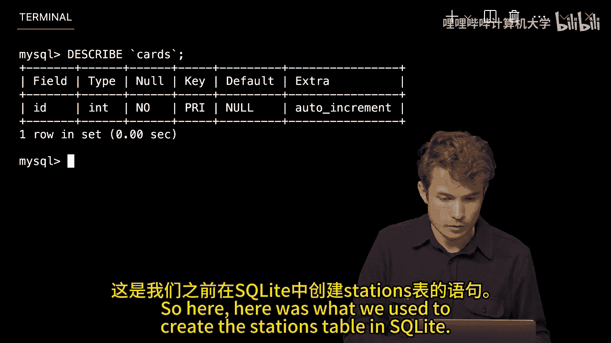
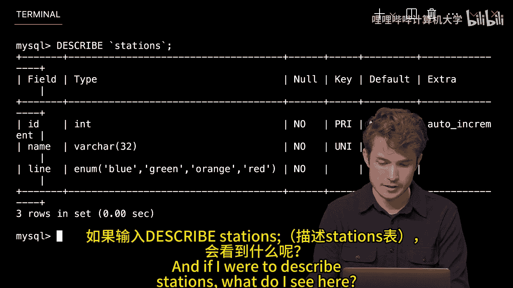
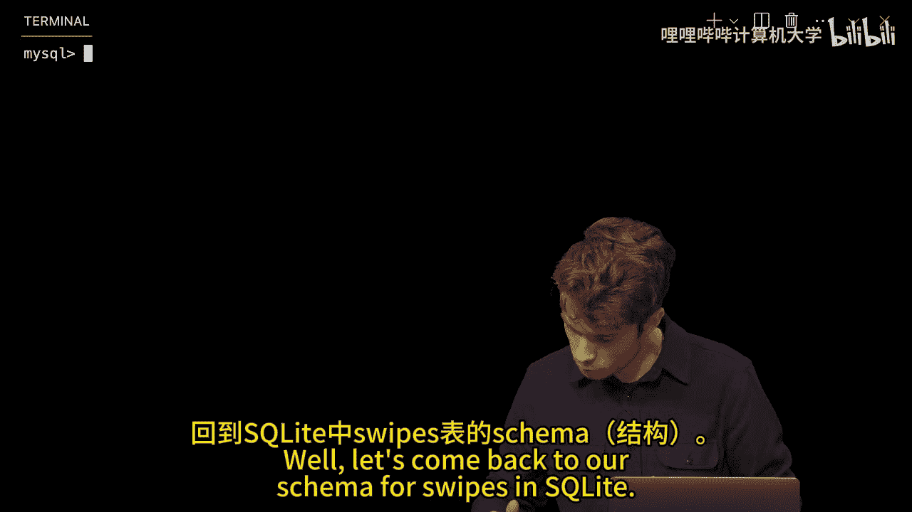
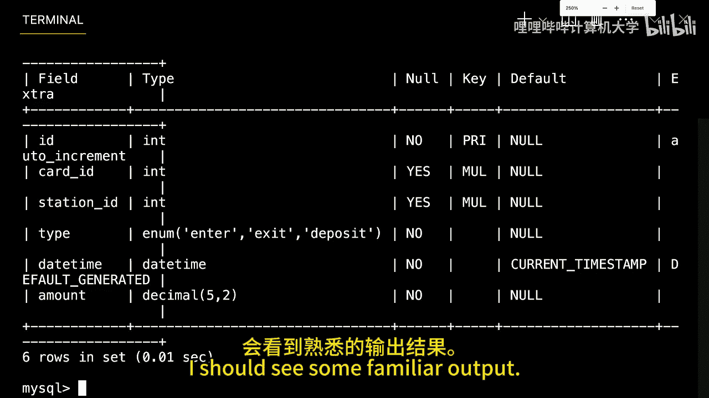
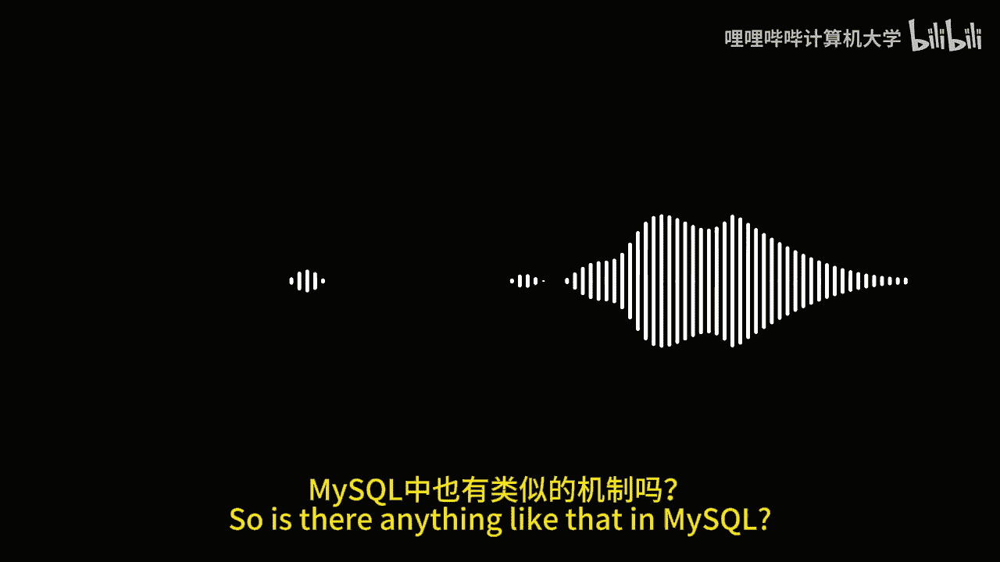
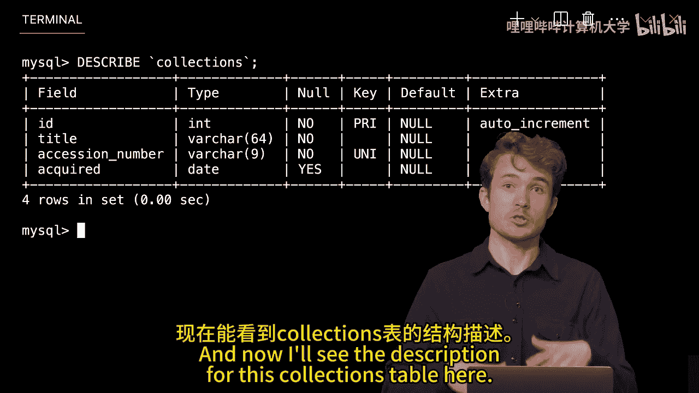
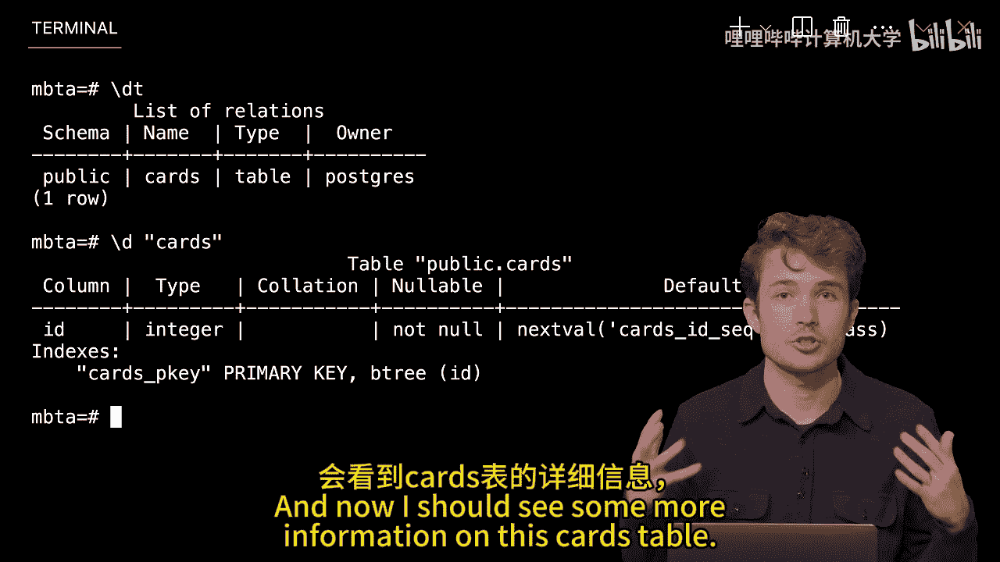
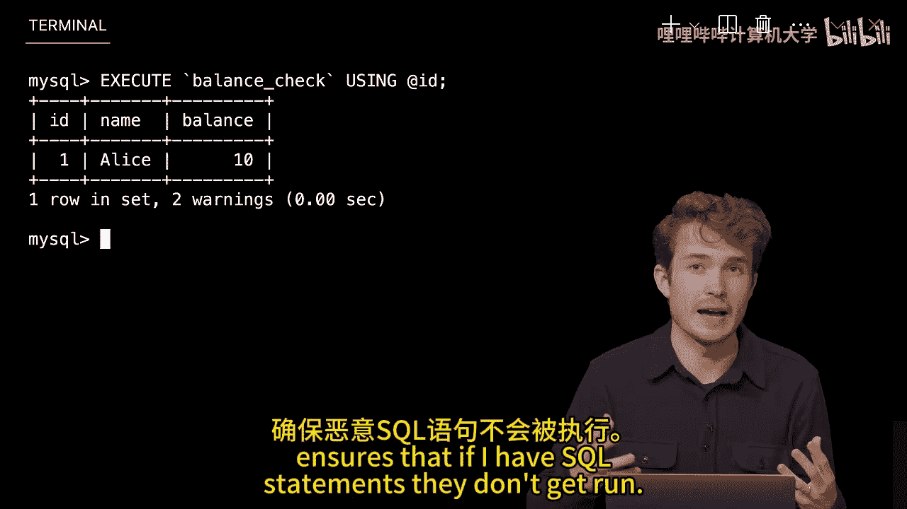
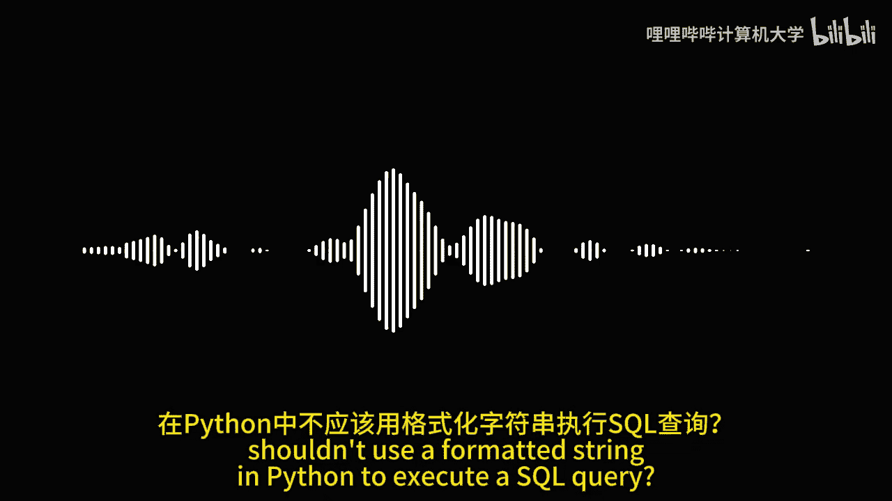

# 哈佛大学CS50 & SQL【速成版】 课程已全部上传，中英双字幕(人工核对翻译），课程附完整课件(视频支持杜比音效，Hi-Res无损音质)。 p08 Lecture 6 - 扩展 -BV1iKCwBuE2d_p8-

Okay， well， hello， one and all。 and welcome back to CS ST's introduction to databases with SQL。

 My name is Carterszenki。 And this week is the culmination of all you've learned over the past several weeks in the course today。

 we'll give the tools， do all that you've done in the past。 But now just at a bigger scale。 Now。

 while we're talking about scale。 It's worth defining what scale is。

 And what it means for some application to have scalability for an application to be scalable or to have scalability。

 It means it can take some number of requests and handle those。

 whether that request is small or large。 And so to kick things off here。 let me ask a question。

 What are some famous tech companies you've seen that have needed to scale over time。

 Let's brainstorm here。 Which ones are you familiar with that needed to scale over time to handle more users。

 more data。😊，What have you seen Any social media sites such as Facebook？ Yeah。

 any social media sites， you could think of things like Facebook， now Me， Instagram and similar。

 And these kinds of sites might have some really large number of users that are always accessing their data。

 But even though they have a constantly large number of users。

 there might even be spikes in the number of requests that they get。 maybe during the World Cup。

 for example， Everyone is on Facebook。 Everyone's on Instagram。 That would be a spike。

 Our application should be able to handle if it is truly scalable。 Let's take one more idea here。

 What other kinds of companies， tech。😊。

Promly I needed to scale。 So I think for banking systems they might start locally。

 but if you consider national and international level banking So you're right。

 a banking system might need to scale as they gain more users or more accounts or they want to process more transactions。

 Now today we'll introduce you to a few new DBMss or database management systems like MySql and Postgresql or just Postgres for short。

 and developers often reach to these when they want to scale some application or some database because whereas SQLL was a embedded database Mysql and Postgress。

 these are database servers that means they often run on their own dedicated hardware that you connect to over the Internet to run your SQL queries。

And now， being a database server， they have a few advantages。 They can store data， not just on disk。

 like on an SSD or a hard drive， but in Ram or random access memory。

 which often allows for faster querying。 They also have a full feature set to take advantage of ways you could scale like replication and sharding that we'll talk about later on today。

Now， before then， we'll actually compare My SQL and Postgres with SQL light paying attention in particular to types。

 But later on， we'll focus on their features for scaling as well。😊，Now。

 we'll do all of this in the context of the MBT A or the Massachusetts Bay Transportation Authority。

 This is the subway system here in Boston。 And if you're ever in town and you want to get around。

 you might use one of these subway lines you could enter under the ground。

Get on a train and go across town on either， let's say。

 the red line on which Harvard and MI T are part， the green line， the orange line or the blue line。

 And if you recall， in our week on designing， we talked about how to represent all of the riders and stations on MBT A here。

Now， one thing we discussed was that the MBTA doesn't keep track of individual people。

 You often don't register your name with them。 You instead get your very own Charlie card that you might swipe when you enter some station。

 often if I'm getting on the Harvard Square stop， I'll take out my Charlie card and enter that station。

 I'll swipe it against some counter， and that will log my fare。

 I could also swipe my card to deposit some funds to pay my fare in the future， and in some stops。

 I might actually swipe to leave the station and pay some extra fare there。Now。

 we decided then to represent， in this case， cards， swipes and stations。 own table for each of them。

 Car just had their own unique I D， and those cards made some swipe， And like we just mentioned。

 this swipe has a certain type。 Did I swipe it to， let's say， enter the station。

 Did I swipe it to exit the station， or swipe my card to deposit some funds into my account。

 And each swipe has as well。 its own date and time it occurred。

 as well as some amount associated with it。 Did I pay some money enter。

 or did I deposit some money to actually add to the funds in my account。And then finally。

 this all happens at individual stations with their own Is。

 their own names like the Harvard Square Stop， or the Kendle MIT stop and their own line。

 like the red， green， blue or orange lines。So our goal will be to first compare MySqL with SQLL。

 seeing how we can translate a schema like this from SQLite to MySqL。 Okay。

 let me come back to my computer here and open up our very first instance of a MySqL server。

 So to connect to this server here。 I can run some command that begins with mySql。

 This is a command line program I can run to connect to the server over the Internet。😊，Now。

 unlike SQLite， My SQL actually has individual user accounts to log into database and here I want to log in as the root user or the admin for this database now to say the user I want to log in as I can type dashash U where you is in lowercase here followed by the name of the user I'm logging in as in this case。

 root and again， root is just some synonym for the admin of some database。

Now I connect to this database over the internet， and I might often include the IP address of the computer。

 the unique identifier of that computer on the internet。For my sake， though。

 I mean this database is on my very own computer here。

 so for the host or I type dash H or H is in lowercase， I can say 127。0。0。1。

 which if you're familiar， is the IP address for my own home computer， also known as local host。

Now I can keep going and I should tell my SQL what the port I'm connecting to is in this case。

 I'll type dash P where p is an upper case and then the port number 330，6 by default。

 and then I want to be prompted for the root password so I'll type dash P where P is lowercase and finally I'll hit enter to connect。

 I'll type in my password and I should see that I'm connected to my MySQL server。Now。

 this is a full database server and as such， it could have multiple databases inside of it。 In fact。

 there are a few here already。 if I type show databases just like this。

 you should see by default on your own MySQL installation on your own server。

 a few default databases like information schema or MySqL or performance schema or cis。

 and these are tables or databases that have some meta information on the server like the user accounts。

 how performance is configured and other details that you might care about if you're a system administrator。

So we've seen here how to log in to a Mysql server and some of these default databases。

 Now let me ask what questions do we have on mysql so far what U root Yeah。

 let me go back to my computer， I can show you what that looked like to can refresh our memories on that。

 So if you recall， let me open up a new terminal here to connect to this server。

 I typed mysql U root or dash U root and what this means is when I want to connect to my server。

 I have to connect to it using some user account unlike SQLite。

 where I could just kind of log in without any users Mysql has users So the dash U says here comes the user I want to log in as and root in this case is a name for the admin just some geek historical term for the admin of some system。

 I could also very well use dash U Carterter if my username was just Carterter。 but here。

Using root to get access to some administrative privileges。Okay， good question。

 and good to clarify that。 So let's keep going。 And right now。

 we have access to our database server with the databases inside of it。

 But our goal is to design the MBTA system and create our very own database Now in my SQL。

 So let me try creating some new database。 I'll say create database like this。

 And now I'll give it some name。 And in my Sql， I don't use double quotes like I did in SQLite。

 I use backts like this。 create database， backt MBT from the title back tick again to close that all out。

 Now I'll hit enter。😊，And I'll see the query was OK， one row affected。 If I now type show databases。

 show databases。I should see that MBTA is now part of this server。

 And if I want to run my future queries on this database， I could use another command。

 another statement here， use， I'll say use MBT A semicolon hit enter。 and I see database changed。

 So now all my future queries will be run on this MBTA database that I just made。So presently。

 our database is empty， and it's up to us to add in some tables。

 So let's think through how we could add tables to our very own database we've just made here。

But one thing we should focus on is this idea of the types for our columns。

 Like I think we know already what tables we have， what names we give them。

 but it remains to be seen。 What kind of columns should we add。 And actually in my SQL。

 we get a lot more control over types。 we no longer have just text and numeric and integer。

 We have a lot more control and a lot more variety， So let's look here at our cards table。

 we want to recreate this now in my SQl。 And this is from SQL light here。

 Re how we had a table called cards that had an Id column with the type affinity of integer。

 And that was our primary key down here。 So our goal is now to think about how do we translate this from SQL light to my SQL。

😊。

So we should think， what kind of types might myql have for integers。 Well。

 it turns out there's more than just one。 There' are actually several here。 We have tiny int。

 small int， medium int int and then big int。 So lots of choices over our integers。

 And these vary just based on their size。 I mean， they all store whole numbers。

 but they do vary based on their size。 So a tiny int is only a single by。 It's about 8 Bs。

 but a big int。 that's 8 Bs or 64 bits。 Now， why do we have so many of these。 Like。

 why can't we just have one。WellLet me ask you all to use your own intuition。I mean。

 what does using more bytes and more bits get me when I'm trying to represent an integer So basically it depends on the need of the DB or。

 you know， the organization， if the data requires much more storage。

 then it means we need to have you know， a bigger data type， but if you know。

 currently if we need smaller sizes that it means we need to use smaller data types。😡，Yes。

 so I like your thinking。 And I think kind of behind that is this idea that if we used more bits。

 we'd be able to count higher。 like just as I have on my hands， like 10 fingers。

 if I had more fingers， I could count higher in linear anation， right Or if I had more digits。

 I could count higher using decimal。 So it's the same thing in binary here。 or I could count higher。

 the more bits that I have。 So if I take a look at this table here。

 each data type has a range of values that it could possibly store。

 if I'm talking about both negative and positive values。

 here's the range for each of these data types。 you could see for a tiny int。

 we can only count up to 127。 And that is it。 we cannot count higher using a single byte。😊。

But if I used a big int， I could count all the way up to 2 to the 63rd power-1。

 That is almost unpronounceably big。 It's something like a quintillion you know。

 number of options that you might have between these two minimum values and the maximum values here。

 So all trade off what you want to represent。But our goal here is to translate a primary key。

 like a primary key doesn't be。 It isn't negative。 So we could perhaps use something called an unsigned integer。

 An unsigned integer has no negative values starts at 0。

 but can then go to a higher positive value because we're now using some of those combinations of ones and zeros that represented。

 negative numbers now for positive numbers， too。 So here， an int can go up to almost 4。

2 billion values between 0 and 4。2 billion。 So an int is already pretty darn big。😊。

So with these in mind， tiny in， small int， medium in， int and bigant。

 let's go back to our sQL like great table statement。 And let me actually ask you all like。

 what would you substitute in place here， We no longer have integer for our primary key。

 But which of these do you think seems the best substitute for our primary key。On cards， tiny， small。

 medium int or big int。 So in case we know that it's not going to be really huge。

 We can just use an int。But if it's going to be very large like a timest。 we could use a big int。

 Yeah， I like your thinking。 So if it's， if it's big， but not too big， maybe an int would be good。

 if we know for sure， though， it's gonna be huge。 Well， a big int is probably best。

 And let me offer some intuition here。 So if there are fewer than 4 billion people on this earth。

 which I believe is a true fact。 And were're using one of these I Ds represent one card。 Well。

 if everyone on earth visited Boston and got their own Charlie card。

 we wouldn't run out of values using an int here。 So it seems like that's a pretty safe bet。

 unless unless we knew that everyone in Boston was going have like 10 Charlie cards or 20 or more。

 then we could use a big int。 But in this case， an int seems pretty safe。 So let's update this。

 Let's go from SQL light， now to my SQ up。 So here I had the I D column with type offinity。😊。

Integer and my first step in converting should probably be to get rid of these double quotes。

 I no longer need to use double quotes。 I should use backts as a matter of style in my SQl。

 But now I should update this type from integer， perhaps to a plain old int， as we discussed before。

 some intuition for that is we'll probably never have more than 4 billion Charlie cards in our table。

NowThere's one more thing to add to， which is this auto increment。

 So SQLite for free gave us a primary key that if I inserted some value and didn't provide a value for the primary key。

 SQLite would generate that for me。 but in my SQL， I have to actually say auto increment。

 If I add some new row， make sure you take the highest primary key right now。

 increase it by one and assign it to that new value。

 So you often see primary keys being defined with the name Id and the type int and the auto increment property of that column there。

😊，So let me ask now， what questions do we have on these integers and types so far？

For for ID we have using integer type why we know that ID cannot be negative it will always start from one north and go onward so we should lose here unsigned nice so here we didn't include it partly for slides sake。

 but you could if you wanted to make sure that the ID is unsigned so unsigned means going from zero all the way up to some larger number whereas not unsigned or just assigned in jerk goes from negative to some positive value absolutely right。

Okay， let's keep going then and let's think through our next table here。

 So our next table is not just the cards table。 it's also the stations table。 actually。

 before we do that， let's actually try to add in our card table to our server。

 So I'll go to my SQL here and now let me try to create this table to store it inside of our server before we move on to stations。

 So I'll say create table cards。And then I'll follow some very similar syntax from what you've seen before。

 create table cards。 Now let me add an ID column。Int and auto increment like this。

 And now I'll make the primary key。ID like this。 Now I'll close out my createate table with the semi colonlon。

 hit enter， and I should see the query is okay。Now， if I use the MBTA database， as I did before。

 I typed use MBTA， I could show tables like this semicolon。

 hit enter and now I'll see I have a cards table inside the MBTA database。 So kind of like。

 for example， typing dot schema or dot tables in this instance in my in SQL light to see what tables I had。

Now， though， let me try this， let me try describe cards。

 describescribe as a bit more like dot schema to show me the schema of this table。

I'll describe cards and I'll see a few different columns here。 Let me come over to this board here。

 and we'll see that this table cards has one column， one field called ID D。

 The type of this column is an integer。 As we said it was before， in our great table statement。

Now this null here， this is whether this column can accept a null value。 yes or no。

 yes means it can accept a null value。 It can hold null。 no means it should never hold a null value。

 so this ID should always should never include a null value。Now the key。

 the key column tells us what role this column plays in terms of the keys of this table Pri here。

 PRI stands for。Primary key。 This is the primary key of our table。

 Deult means the initial value given to any value。 If we inserted some value。

 If we inserted some row with no value， we'd get back this default value here。 null。

 and the extra is what we included auto increment that should increase by one every time we add some new row。

 So using describe and show tables， can you actually see what you're creating along the way。😊。

So now let's keep going。 Let's actually focus on creating our stations table。 And for that。

 we'll pull up our SQL lights syntax we use to create that table。 So here。😊。

Here was what we used to create the stations table in SQLite。

 We gave each station an Id that was an integer， the primary key of this table。

 We then gave them each a name and a line like the name could be the Harvard Square station or the Kendall IT station And the line could be red。

 green， blue， whatever line this is a part of。 And， of course。

 the primary key is our Id column as we just said。 Now here。

 we've seen how to handle this integer type。 but we haven't yet seen how to handle text。

 Like could we do better than this in my IQl compared to SQLite。😊。

Turns out that we can。 We have a variety of options for representing strings。

 basically this collection of text here and two of the more popular ones are going to be char and var char。

 So char is a fixed width string。 A string that only have and will ever have the same number of characters。

 You could think of， for example， in the US。 We abbreviate state names using two letters like M A from Massachusetts or V A for Virginia。

 You might do the same thing with countries as well。😊，Now。

 that would be useful for a char because this char will always hold only to characters。

But often you're not sure how long the string is。 You're going to add to your column。 Like。

 let's say you're trying to store names of people。 Well， my name is Carter。

 but yours could be longer or shorter。 So a var cha works well for that scenario where a var cha can accept a variable length string up to some number of characters。

 And when you use these， my askQ I will ask you to provide how much space this type should take up using M here。

 So I could say char parentheses2 to get back a fixed width string of two characters for var cha。

 I could say var cha in put in the middle here， like let's say 16 or 32 or 64。

 And that would be the maximum size of the string that I could represent using var cha。

So good here for strengths that are going to be a bit shorter in length。

What if though you want to store the text of a book or something a bit longer than that。 Well。

 you could use another type。 This one called text。 and this is different than SQL lights text in SQL lights text。

 I could store short strings， long strings， etc in my SQL， text is good for longer chunks of text。

 paragraphs， pages of books and so on。 And you actually have some options for the length or the size of this text you could use tiny text。

 medium text or long text。 Each just uses some variable amount of space on your computer to store in this case。

 characters that are going to be longer than any particular string。

 like a name and more like some page in a book。😊，Now， besides text， we do have our old friend。

 blob and blob still stores binary exactly as you give it。And more interestingly， though。

 we also have enum and set。 and these are brand new。 These are not in SQL light。

 but they're very useful for us。 If you remember back in our week on designing。

 we introduced constraintss， maybe a constraint is that this column should only have a certain certain values。

 like let's say for calculating t-shirt sizes。 I should only have X S for extra small S for small M for medium。

 there's some fixed range of values， this column could hold。 Well。

 I could use enum for that where enum， lets me enumerate the possible options I could put into this column。

 like XS S M， if I'm doing t-shirt sizes or something else altogether。😊，Now， set complements Eum。

 Eum means I can only have one of these options。 If I had X， S， X， S，M， and so on for T shirt sizes。

 I can only choose one。But a set would me to choose more than one to store in that same cell。

 You could think of， for example， movie genres。 A movie isn't just horror or fiction。

 or it isn't just comedy。 It could be all of those together。

 And so set would allow you to choose not just one option from your list。

 but multiple and put it inside。Of that single cell there。

So let's go back to our SQL light create table statement。 And let's update this for myql。 Well。

 the first thing you do is what changed these double quotes to back ticks。 So I'll do that here。

And now let's update this Id we saw before we could use regular old int and auto increment like this。

But now we have some more choice， like for this name field that should store the name of a station。

 let me actually ask you all， what do you think is the best type to use。

 we're showing the name of some station。 it would be a var cha simply because you don't know how long the station name actually is。

 Yeah， a good point。 So we're always creating new stations and maybe some station name is pretty long or maybe it stored。

 we can't really tell。 right， So a var cha is good。

 if we have some variable amount of characters inside the text we're trying to store and notice how a station name isn't paragraphs of text。

 It's just， you know， maybe a few words。 So that's good for a var cha。 And in general here。

 I could say， well， let's try to use a var cha and so we could use up to 32 characters。

 including spaces。 I think thatll cover us pretty well for names of stations。😊，Now。

 let's talk about the line。 Now， in Boston， there are a few lines。 There's the blue line。

 the green line， the red line， even the silver line。

But what type should we use for storing lines then that these stations are a part of in this case。

 I could believe that there can be two options where it will be a small integer number and point to another table sorting the colors Another one will be limited chart taking into account that perhaps the longest color name will be like aquamarine or something like that and just to that size will be another option as well Yeah。

 I like your thinking through multiple options here and indeed there's usually more than one option for any given type of a table here。

 So for this one， I mean， you could actually have line be a foreign key and reference some other table to your point of those colors so line might then be an integer we could also make line。

 another var chart。 maybe this one's a little shorter。

 like it's always gonna be just blue green red or so on。And so pretty short string。

 but still variable length， nonetheless， so we could say var cha， maybe nine， for instance。

 to represent a color here， one other option though exists， one that kind of constrains us。

But that might still be a good fit。Maybe it would be good to use a set Do you set。 Yeah。

 you could use set as well， so you could say that a station might be on the blue line and the green line as exists in the real world。

 You could certainly use set for that for our purposes。

 I might just go ahead and simplify things and just say enum。

 a station will only be on one line at a time for simplicity。

 But if you wanted a station on more than one line， you could use set as well。

 And in this enum or in this set， we could include the possible lines that currently exist in the MBTA。

So great reasoning through some different data types here。

 Let's now build this into our MysqL server here。 I'll come back and I will create this table。

 So we saw before， I could simply use great table。 I could say create table。

 and then I could say give it a name called stations。 and inside。

 I'll make sure to include let me indent four bases here，1，2，3，4。😊，Give it an ID。

 which has the type integer and auto increment。Then afterwards。

 we also want to include the name of our station， which could be of var cha up to size 32。

 It could include up to 32 characters。 And this should also be not null and unique。

 Those same kind of column constraints。 that they're still here in my SQL。

Now I could also include the line column and for simplicity。

 I could just assume every station is part of only one line， so I'll say enum here。

 and I'll choose blue and green and orange and red。

 these are four lines for the subway that exist here in Boston。

And I'll make sure this has to be have a value。 It can't be null， but that not null constraint here。

 Then I'll say my primary key is the I D column。 and I will go ahead and close this out。

 hit semi colon and enter。And I'll see query O。 So now if I show tables。Enter。

 I'll see both cards and stations。 And if I were to describe， describe stations。 What do I see here。

 Let's take a look。 I'll come back over here， and I'll see， I have three columns， I D， name and line。

 And each of these has the very own type， as I see in this column of my describes output。

 I see here that the type of Id is an integer。 The type of name is a var cha 32。

 and the type of line is an enum， blue， green， orange or red are the possible values for that column。

 Now， none of these columns can have a null value inside of them。 But here's the interesting part。

 I see I D has a key PR I primary。 That means I D is my primary key。😊。

But I also see uni， where uni stands for unique。 Now we saw before this name column。

 I applied a unique constraint， meaning there could only be a given station with a unique name。

 I can't duplicate station names。 and then of course， over here。

 we also saw the extra column auto increment that I applied to the ID column here。So let me ask。

 we've seen now some new types for text， some new types for Enum and set and so on。

 what questions do we have on these new types and how we've used them？

I was wondering if it would be perhaps possible to include a table as the argument to Enum Oh a good question I actually am not sure I could imagine the possibility of using a nested select for that but I mean let's reason through this here if I had a table that was growing what I want to use those table results in my great table statement I would argue probably not because then things are going to change over time so probably worth just enumerating one at a time explicitly what might go into that enum but I encourage you to try that out to and see what happens。

Let's take one more Is it the problem for the database if I for example。

 I have no idea how long could be the name of the station and if I write a var for example 100 or 300 Yeah so maybe you're think of a scenario where you don't know how long it's going to be so you'd be kind of extra safe you say like varchar 300 for instance。

 just accommodate anything you could put in there。

That is okay。 But the tradeoff is you're then using up to 300 B every time you store a smaller string。

 Like if I use var cha 300， and I only ever use， let's say， like 10 characters on my longest string。

 on wasting some space。 So it's worthwhile to think through beforehand。

 What should I actually use here。 And something to keep in mind is you can't always expand of v cha using my Sql's al table statement。

 So we'll see that in just a bit how to use al table。 but you could always expand if you need to。

Okay， good questions here。 Let's keep going then。 And our next table is going to be the table represents swipes。

 We have cards and stations。 but now we have to represent swipe at those stations。 Well。

 let's come back to our schema for swipes in SQL light。 Here。

 I had this table called swipes that had some columns up top and some primary foreign keys down below with the important part for us now is going to be these three columns type date time and amount。

 And remember that on the MBTA。 I can take my Charlie card。

 I can make a swipe when I enter exit or deposit some money at a station。

 That's that type column here。 It could be either enter exit or deposit。 Now。

 date time is the time and date。 I swipe that card to enter exit or deposit some。😊。

And amount is the amount in dollars associated with that transaction。 Now。

 the faire nowadays is like $2。40 back in the 50s。 It was maybe like a dime or so。

 It changes over time。 So it's worth keeping track of in our table here。

So let's think through some options that MySQL gives us among them are options for dates and times。

 so whereas in SQL light we had numeric for dates and times in MySQL。

 we actually have explicit date and time types For instance， we have all these here date。

 which is just a date like the year， the month， the day， time which is the actual time like hours。

 minutes and seconds， we then have date time， which combines those timet。

 which is similar but used with a bit more precision often for logging events on your own software and then year which is just 2023 or 2020。

 for instance in a single column。😊，Now， you can get more particular about how precise you want to be with these times for time。

 date time and timestamp， I can specify how many decimal digits。

 I want to keep track of after decimal point do I want to keep track of tens of seconds。

 hundreds or thousands， I can specify that using this parentheses FSP in this case， I could say1，2，3。

4， up to I believe6 to figure out how precisely do I want to keep track of time where more digits means more precision。

So I could use these for dates and times if I could get us through part of our table migration here。

But I should also think about how to represent real numbers。Numbers with a decimal point in them。

Now you might think back to SQL light and remember the real data， a type of innerity。

 and we have some similar options here， we have float and double precision where the only difference is float stores a number in size4 bytes。

 whereas double precision stores that number in8 bytes。And you might be thinking， well。

 if they both store a decimal number， a real number， why would I choose one over the other。

 or why would I use more space when float does the same thing for me in fewer bytes。 Well。

 it turns out that in computer science， we run into this problem of floating point inre where there are an infinite number of real numbers。

 Like if I ask you to find me， all of the decimal numbers between one and two。

 you would be here for literally an eternity， And if we have so many numbers to represent。

 but so few bits， it goes to say that we can only represent some of them， and not all of them。

 So at the end of the day， floating point numbers， decimals。

 real numbers will be imprecisely represented。Now， a double precision could get us more。

 could more of the way there。 We could use more bits to more precisely represent some number。

 which you might use if you're a scientist， someone who wants to keep track of things very precisely。

 if you don't care as much， though， you could use a float and just use a little bit less space。Now。

 thankfully， this tradeoff isn't quite so salient in my SQL because you also get access to fixed precision types where fixed precision means I can specify I want to always have two places after decimal precisely represented and one type for this will be the decimal type where I can use a decimal and then say I want to store a certain number of digits with some number coming after decimal point Now。

 for example， I could say decimal 5 comma 2 and I could store any number between negative 999。

99 up to 999。99 so long as there are only two places after the decimal here。

Now I could increase this， I could say I want to go beyond this range。 I want to have more digits。

 I could increase this first parameter here from5， let's say to 6， and now I have a wider range。

 I have 9999 all the way down to negative 9999 in both cases。

0992 decimal digits after this decimal point。😡，Now I keep going。

 I could say seven and get an even bigger range， but if I want to present something precisely after the testimal point。

 what could I do？I could change this one，2 from 2， let's say， to 3， or even to 4。 I could keep going。

 but notice how my range shrinks。 What I get in return is just more digit after that decimal point precisely represent it。

 don't have to worry about floating point imprecision so long as I'm using decimal and telling my SQL how many did I want and how many come after the decimal point。

Okay， so let's try this here。 I want to migrate this table from SQLite to My SQL。

 The first thing to do change these quotes from double quotes to backts。

 I could then update my primary key and so on。 let's focus now on this type。

 This type column should only have some set of values like enter， exit or deposit。

 And when you see that， you could think I should probably use an enum to only store some。

 some data types that are some values that are inside of this list。 So I'll make this now an enum。

But the question then becomes， what should I use for date time。

What type have we seen so far that could be useful for storing the date and time I swiped my Charlie card。

 Yes， I believe we can use the date date I could use date time。 So kind of self fixedplanatory here。

 They mean， the column is called date time and coincidentally。

 my SL also has a type called date time that stores both a date year year year MD。

 and then the hour along with that， I could say date time here to get both day and time。Now。

 the next one amount。Now， it's worth noting I want to be precise with this amount。 Like。

 if I'm going to sum up many， many amounts， many fares， I want it to be accurate。

 So I don't want to deal with， let's say float or double precision。

 I want to specify how precise I should be。Let me ask what data type might be good for storing the amount of some given fare。

I believe we can use the decimal data。 Yeah， you could absolutely use decimal data type here。

 So decimal is part of my Sql's fixed precision kinds of types。

 So we could use that here to precisely represent the amount column here。

 I could change this from numeric and SQL light to decimal now， where decimal。

 I could say takes five possible digits like five total and two now could come after the decimal point so I could have amounts or fares that go up to hundreds of dollars。

 which often isn't going to happen but I could be safe here if I need to be。😊。

Okay， let's go ahead and combine this and put this inside of our My SQL server here。

 I'll come back to my computer here。 And my goal is to run this great table statement to create this table on our server。

 I'll say create a table called swipes like this。 and I'll include a few columns。

 we didn't show on the sides just for simplicity。 I'll first include the I D column with type int。

 And I also want to make sure this auto increments as I add to it。😊。

I'll then go on and I will also include a card ID column that has a type int。

 and then I'll include a station ID column， which also has type int。

 So now I can see which card I is swiped at which station。Now， when they swipe here at the MBTA。

 a swipe can mean a few different things and can have a different type。

 one type we might care about is the enter type when I swipe to enter some station。

I could also swipe to exit some station or to deposit， to deposit some funds into my account and。

A type should never be null， it has the not null constraint here。

Now a swipe happens at some particular date and time。

 so I'll include the date time column and say that this is of type date time。

 I want to make sure this column always has some value。

 so it's not null and the default when I insert some new row will be the special value here。

 current timetamp， the current date and time。Now， I'll go on and I'll include the amount of some swipe。

 I'll enter space。 and then I'll say amount here。 This is the amount associated with that swipe。

 Was I charged money， Was I adding money。Here， I'll say， I want this to be a decimal type。

 because you said， we want this to be precise。 and decimal is a fixed precision type。 Also' say。

 I want five decimal digits with two after the decimal point。Now this similar should be not null。

 and I'll include our same check constraint， all check that amount with back ticks here does not equal zero。

And if that's the case， I'll be able to insert some new swipe。

Now I'll assign my table constraints like primary keys and foreign keys， I'll say my primary key。

 my primary key is the ID column like this。And then。If I enter again， my foreign key， my foreign key。

 in this case， card Id should reference。 it references cards table and the ID column in cards。

 a bit like this。 So that card ID column references the ID column in the cards table。

Now I'll include my last foreign key， the foreign key station ID。

Station ID references the stations table and the ID column in stations。

 And now it's quickly reviewed to make sure I typed everything in correctly here。

 So we have the ID column， the card ID column station ID type of enum datetime amount。

 I think will be good here So if I hit enter and then use parentheses semicolon I should see query。

 okay zero rows affected。 Now if I type in this case show tables enter I see。

 I have a new swipes table， and if I type describe， describe swipes like this。

 I should see some familiar output。 if I go back to my screen over here， we can take a look。

 we have again， our fields Id card ID and so on， types int enum datetime decimal some can have null values。

 some should not we have a primary key here。

But now the interesting thing is this M UL。 Well， if I look at card Id and station I。

What do we call those two columns？What kind of constraints did I apply to card I and station I So we use the foreign key constraints So you're exactly right。

 we apply the foreign key constraint to the card I and station I columns。

 So this M here is referring to the fact that these are foreign keys。

 and M stands for something like multiple or multi it means I could have in this case。

 multiple of the same value because it is a foreign key in this table。 Now the default here。

 we now see current timet。 when I insert some value into this table and I insert some row。

 sorry into this table and don't apply a value for the date time column I'll instead make that default value。

 the current date and the current time。 and here we see some extras like auto increment that we saw before。

 and now default generated， meaning this is a。Genrated column that will automatically create some value for me when I insert some new row。

Okay， so let me ask what questions do we have then on these new types dates and times and more Yes。

 I wanted to know the preidency in which the。The attributes， the specific constraints。

 the attributes are added。 So is it in the formats of the describe table you know in the describe table。

 there's a setting formats in which the data is is that the priority in which you do it let's say anja before let's say a unique constraints before and not know what's the precedent and secondly。

 is there any type affinity in my SQ Yeah， both good questions I'll answer the first one first So the first one is what's the precedes I believe of these constraints we're applying if I look at this output of described swipes here I see that I applied some constraints among them are the foreign key constraint。

 the primary key const some I made sure that I couldn't have some no value in here In effect。

 they all combine to work for me here So when I made that great table statement。

Apped multiple constraints like not nu and unique。 And I could put those in any order。

 My askq all is design so I can do it in any order and get the same result forwards or backwards。

 When I read this table， I might just read it right or left to right here and kind of get a feel for which constraints are being applied in no particular order in this case。

 Okay， yeah， the second question has to do with type。Affinity， and you know， with SQL light。

 we had something like a type affinity， where a particular value is appropriate for a particular rule。

 So is there anything like that in my SQ， Yes， there is。 So in SQL light， You're right。

 we had type affinities where we defined a table and said that this column should store values of this type We're doing the very same thing in my SQL when we say I D of type int or the the name of a station of type vchar 16。

 for instance， one difference， though， I that SQL light will allow you to add in some value that doesn't actually have the type of that given column。

 So if I had a SQL light column of type text or of type， let's say。

Let's say type numeric， and I added some text， it would try to convert， but if it couldn't。

 it would actually just store text。 My SQL is more strict than that。

 It will make sure you have the proper type when you insert some new rows， at least by default。Okay。

Great questions here。 Let's keep going and show some more features of MyqL。

 So one of them is the ability to alter tables in a more fundamental way。

 let me zoom back in here in SQL light， we had some options to alter tables。

 but at the end of the day， they just weren't all that powerful with MysQL， though。

 we're actually able to alter tables a little bit more a little bit more fundamentally。

 So let's say that the MBT adds in a new line， a new subway line。 And actually the silver line。

 if you can see it here is currently a bus line but it was planned to be a subway line。😊。

So if I wanted to add in a subway line called the silver line。

 I can't currently do that because my type for the lines is an enum。 It only has red， green。

 blue and orange， not silver。 so I should actually edit this great table to now be able to include the silver line as a possible value among that enum。

 So I'll come back over here and I'll introduce you to my Sql's Al table syntax。

 So in mysqL we have still Al table similar to SQL light， they're all based on the SQL standard。

 but now we have modify where modify can take some column definition and change it on the fly。

So I'll go to my SQl here and let me just let me describe again the stations table。 I'll enter now。

 and we'll see that the line is an enum， and it has a few options。 Blue， green， orange and red。

 But now I want to add silver here。 So what could I do。 I could do this。 I could use alter table。

 And I could say I want to alter table。 I want to alter the stations table。And I want to modify。

 I want to modify the line column to be this。 I want it to be an enum with these options， blue。Blue。

 green。Orange， red， and silver。Like this。Now I have more options in my enum。

 I could also include not null to hit enter， and I should see， oops。

Think think I might have forgotten。A quote somewhere。 I believe I did。 Let me fix this。

 I will finish the quote， hit semicolon。 and let me show you how I noticed that。

 If I go back to my screen here， see in my SQl， it's kind of helpful。

 If I finish a line and I haven't closed this quote here like I did in red。

 it will alert me on this next line with this single quote here saying hey。

 you didn't close that thing that you probably thought you were going to。 So let me restart。

I'll come back over here and I will try this again。 I will alter table stations。

 and then I will modify the line column， as we said before。

 to be an enum with a few different values， blue， green。Orange， red， closing both quotes now。

 and then silver， again， closing both quotes。 And let me double check。Believe we're all set。

 I'll then say not null， semi colon， enter， and I'll see the query is O。 Now， if I do describe。

 describe。Stations like this semicolon and zoom out just a bit。

 I see I've added to my possible values for this enum。 I have blue， green， orange， red and silver。

 So this is one example of using al table to adjust a column definition to an earlier question。

 you could also use this to expand the size of R charges or to change your table altogether。

 You can do so a little more powerfully than you can with sQL light。

 just because my skill decided to focus on this particular feature。😊。

So let me ask now what questions we have on altering tables in Mysql This is regarding regarding to Mysql and Postgres can we use those applications instead of mean that user interface Yeah。

 a good question。 So I think you're asking what would be the difference or how could I use like mysql and Postgress compared with Vs code in in fact。

 they're kind of different use cases。 So Vs code as you might know is an ID integrated development environment allows you to write code in a file to run that code and to edit it and see it all in one place whereas Mysql and Postgresql those allow you to write SQL statements on a command line talking to some underlying server So a bit different。

 you could， for example， use VS code and connect to a Mysql or Postgresql server to run your SQL queries you're creating in VS code。

But a good question there for workflows。Okay， so what we'll do is take a quick break here and we'll come back and talk about stored procedures。

 Some functions we can define to run over and over and over again。 We'll see you in a few。Okay。

 and we're back。 Now we'll next talk about stored procedures。

 which are a way to automate the running of SQL statements over and over and over again。

 This is as useful as your scaling， because if you have some process you often call。

 you can put it inside of a stored procedure and run it all the more simply。

 So to demonstrate stored procedures。 What we'll do is go back to our example of the Museum of Fine art。

 one of Boston's oldest museums also called the MFA。 And if you remember in the MFA。

 we had a certain number of tables， where one of these tables was a collections table。

 It is the items， the MFA has in their collection， the items they put on display。 for instance。

 here we had a few pieces， farmers working at dawn， a imaginative landscape and so on。

 each had their own Id and they also had a deleted column implement what we call a soft。😊。

Delete where to delete something， we wouldn't remove the row。

 We would instead just mark this deleted column from a0 to a one。

 sort of hiding it or marking it as having been deleted to keep data around。

 without removing it all together。Now， to find all of the items that weren't marked as deleted。

 we could use this query， select star from collections where deleted equals 0， at least in sQL light。

Now we then created a view。 We said， maybe I want to just always be able to view those items that have not been marked as deleted。

 one table called current collections or one virtual table， a view called current collections。

If I were to update farmers working at Da to be marked as deleted， what would happen。

 this deleted column would become a one， and I would not see it in current collections。

 so our goal then is to reimplement something like this。

 but now not using a view in this case using a stored procedure we could simply call to find all the items that have not been marked as deleted。

So to create a stored procedure， we have some syntax we can use。 that syntax looks a bit like this。

 We could say create procedure and give it some name。

 Well this procedure we could call maybe current collections being able to view what is inside our collection and not marked as deleted。

 we could then similar to a trigger， say begin after which we stay the SQL statements。

 we want to run as part of this procedure。 So begin we then type the sQL statements。

 we want to run and finally say n， this is the end of our procedure and then later on。

 we could use a statement called call to call this procedure over and over again。😊。

So let's work on creating our very first stored procedure to find all the items in our collection that have not been deleted。

 Well I'll go back to my my SQL server and I'll show you a new database I've made here I can type show databases semicolon and now I should see I have not just the default MyQL databases。

 I also have the MFA database So if I type use use MFA semicolon I should see database changed now all my future queries will run on this MFA database。

So I could type show tables to see all the tables inside of this database， hit Enter。

 and I'll see I have artists， collections and created。

 I could even if I wanted to describe the collections table， describe collections， semicolon。

 and now I'll see the description for this collections table here， I have an ID title。

 exceptionion number column in an acquired column too。

But what am I missing， I want to able to implement soft deletes。

 If you were to look at this describe output。 What am I missing。If I want to implement soft deletes。

You're missing the deleted column。 Yeah， the deleted column is not yet in this table。

 I know because I use describe here。 So I don't have deleted yet， but I can add it using Al table。

 So I'll come back to my computer and let me use Al table to add in this particular column。

 I could say alter table collections。

Like this。 And then I could use add column。 Mo was good for modify a column that already existed。

 Add column is good for adding a brand new column。 I'll call this one deleted and its type will actually be a tiny int。

 a tiny int。 why well it's only ever gonna be one or0。

 I should use as few bits as possible and tiny int gives that to me。

 Now I'll say the default value is0 for not deleted。 and I'll hit enter。

 and now if I describe collections again， describe collections。

 I should see that I'm back to having a deleted column of type tiny int with a default value of0。😊。

Okay， so now we saw I could select everything from collections。

 It's not deleted by saying something like select star from collections where deleted equals 0。

 I could implement the same thing here， but now using a stored procedure。

 something I could call a again and again and again to speed up this process just a little bit。

So I'll say I want to create this procedure， current collections。

But there's something a little interesting about the mice SQl syntax here。 If you remember。

 if I go back to some slides here， in the middle of begin and end。

 we're going to put our very own sQL statements to run as part of this procedure。 Well。

 to end a sQL statement。 we have to have a semicolon， but my Sql might actually prematurely end。

 This statement if I type quick procedure name begin some statement than a semicolon， it'll say。

 okay， you're done， but I'm actually not， I might want to add more statement I might want to conclude with this end down here。

 So a workaround is to temporarily declare a different delimiter。

 instead of ending my queries with semicolon here。 I'll end them with， let's say， slash slash。

 and we'll see that in just a moment here。 I'll come back to my computer。😊。

And for the sake of writing this procedure， I'll change my delimiter。

 That is what icon represents the end of my query to slash slash like this。 Then I'll hit enter。

Now I can start creating my procedure， I'll say create procedure。

 and I'll call this one current collections with a open and closed parentheses after this。

 this is common for names here。Then I'll say begin this procedure and in this procedure。

 I want to select the title accession。Acession number and Ac。Columns。

 I want to do it from the collections table where deleted equals 0。

 And now I can safely include a semicolon， because my delimiter for this entire query is a slash slash。

 This is the end of this particular query inside my procedure。

 it's also the end of my procedure in general。 and now to declare the end of this procedure。

 the end of this overarching statement， I could say slash slash instead of semicolon。Now。

 if I hit enter， I'll see query OK， and now I should change back to in this case， semicolon。

 so I can get back to what I'm used to using to end my queries。I'll hit enter。

 And now let's see what we can do。 I could say call current collection。

 I think we called it collection singular。 and I'll say this semicolon there。 Now。

 I should see all of the items that are marked as not deleted。 So using call。

 can I then call this procedure I've made and stored。 Let's try deleting something。

 I'll try maybe deleting farmers working at dawn。 I could say update in this case。 collections。

And set deleted， set deleted equal to one where the title equals farmers working at dawn。

 Farmers working at dawn。 semicolon。 I'll enter again。 I'll see one row has changed。

 if I call current collection again like this。 semicolon。 enter。

 I'll see that that particular artwork is now gone is not returned to me by the query that was part of my procedure。

So this then is one example of a stored procedure。 One way is saving a query and calling it again and again。

 if I might use it very often。 what questions do we have so far on stored procedures and how I can use them I have a question that just like in other languages。

 do we have the provisioning that we can pass the parameters and arguments in the function in the procedure as well in my SQl And secondly。

 can we call other procedures also in one like in other languages we have one function call from others a great question about the power of stored procedures。

 So the first question could I add parameters or arguments to this procedure and could I change what I do based on that input。

 The answer is absolutely yes you can in my SQl， and I'll show you that in just a minute here。

 The next one which is can I call other procedures inside my procedure， yes to that as well。

 Any statement you might write， you could probably put in a procedure too。😊，Okay。

 let's take one more。 Yes， I have a question。 There is any way that I can ask any note or comment to the table。

 Could you add any note or comment to your table a good intuition。

 like it's good to include notes to yourself or to include notes to others to my knowledge。

 you would best do that in something like a schema dot SQL file if you have a text editor。

 You could make a dot SQL file and store your schema inside of that。

 at which point you could leave comments to other developers to make them know what you are thinking as you are building this。

 There might be a way to leave comments in my SQL， but I don't personally know what that is。

 You could do some research to look that up to。

Okay， great question。 Let's keep going then。 into our question about procedures and trying to make sure they could have inputs。

 Let's see that as well。 Well we saw， too， that I might want to mark some particular item as sold。

 as soon as I mark it as being deleted。 So for that， I'll need a new table here。

 If I type show tables semicolon。😊，I'll see artists collections and created。

 but back in our week on the MFA， we also had a table to keep track of transactions when we might buy and sell some piece of artwork。

 so let's recreate that table here I'll create a table called transactions。

 create table transactions like this， and then I'll give it an ID column with the type int and auto increment。

Then I'll give it a title to mark is being sold or bought。

 let's say the title is a var cha of size up to 64， and it can't be known。Then I'll say the action。

 which can be either bought or sold， that we buy or sell this piece of artwork with this particular title。

So I'll say this is an enum with the possibility of bot or sold， then I'll say this is not null。

 and I'll then say the primary key， the primary key of this table is ID。

 and I'll close out this great table statement here， hitting enter。

Now I can see I have a transactions table to log the buying and selling of pieces of artwork。Well。

 it stands to reason that when I update my my collections table and I set some item to be deleted from a0 to a1。

 not deleted column。 I want to add it to the transactions table and also mark it as sold。

 So normally， that is two steps。 update the table and also adding it to transactions。

 with a procedure， though， I could give that entire sequence one name。 So let's try that here。

 I'll say I want to make a my delimiter slash slash。 I'm going to create some procedure here。

 I'm going to end it with slash slash。 So I'll say create procedure。😊。

And I'll call this one cell like this。 But now， instead of open parentheses and closed parentheses。

 I actually want to give some input to this function。

And let me actually ask you all here Like what kind of input should I give this cell function so I can identify the painting I want to sell like the primary key and refer to the name of the painting perfectly。

 Yeah， I like your thinking we could think about what identifies this artwork。

 maybe it's the I or the title In this case， I like your intuition for the I。

 which is unique will never change So let's actually use the Id here of an item in the collections table to market as sold。

 So I'll come back to my computer and I'll say that cell actually takes an input。

 and I can say in here to note a value as an input。

 I'll say the input is something called sold sold I。

 the item we're selling and the type of this is an in like this。

 So now I have a procedure that takes in some value， an integer called sold Id。😊。

Now I'll say let's begin this procedure， let's begin down below。

 and the first thing I should do is update， update collections like this and set deleted equal to one under what condition。

Or perhaps under the condition where the Id is equal to our input， which is called sold I。

 So I'm using the input of sold Id to find in collections。 which artwork I'm marking now as deleted。

 But the next step， I'll say some I calling here to end that step is to then insert into the transactions table。

 I've marked it as being deleted。 but now I need to insert into transactions。

 I'll say then I want to insert into。Insert into transactions in the title。

In the title and action columns。Some values here or what values。

 the first value is actually the title of this artwork。And I only have the ID right now。

 but I could use the ID to get back the title。 I could say write a subquery that is select in this case。

 title from collections where the ID equals sold， sold I like this。

 that is a subquery that gives me back the title of this artwork。Now， also log sold here like this。

 And then I think that's the end for that particular query there。 I'll hit。

 Let me just double check this insert into transactions。 title action value。

 select title from collections where I D equals sold I sold。 Okay， I think we're good。

 I'll hit enter on that。 And then I think I can safely end my procedure。 I'll say end here。

 slash slash enter again。 I see everything was okay。 So now if I change my delimiter。

 change my delimiter back to a semi colonlon。 I can call。 sell on the particular Id。 Like。

 let's say I now want to sell the particular item， I could say maybe select star from collections to see what I have。

😊，And now I want to sell imaginative landscape， which has the ID of two。 Well， I could try call。

 sell and now pass in that value to， call sell2， and if I now hit enter。

I should see some rows were affected。 This procedure worked。 Let me check。

 I'll say select star from collections， semicolon， and I'll see that that piece now has been updated。

 It value was 0， but now it's one for the deleted column。 Now。

 if I say select star from transactions。 semicolon。

 I'll then see imaginative landscape being sold here as well。😊，So good check here。

 And let me actually just check on this。 So I think this was the I D was 2。

And that actually makes sense here。 So the I D， we're thinking about it and it' is different here。

 So this is the idea of the transaction， which is different than the I of the painting， which is to。

 just to clarify that。

Okay， so what other questions then do we have on stored procedures？

 We've seen some without inputs Now some with inputs。 what else are you wondering。

 I it possible to pass in multiple inputs to a stored procedure。 Yeah， could it have multiple inputs。

 It absolutely could separated by some commas inside of those parentheses。

 you could imagine in sold Id int comma， some other input as well。

 and a procedure can also output some value。 you could say I want to store the result in some variable。

 I could keep track of in the server to， let's keep going then。

 and kind of end stored procedures on this note here， which is I seem to。

 if I go back to what I had discussed before， I was able to update some item in my collections table。

 and then add it to the transactions table to。 So if I say select star from collections。

 there is some。😊。

Injure here。 Like if I try to sell something that has already been sold。

 I might run the procedure and mark something as being sold twice。 Now。

 I'll actually leave this up to you as your own exercise but I want to give you a few tools to think about for writing your own procedures among them are some constructs you might be familiar with if you've programmed before。

 So here you might notice a stored procedure can actually be compatible with some familiar programming syntax。

 like conditions， for example， if elses if and else。 and also loops。

 like people to do something more than once or to repeat something over and over and over again。

 So you can use these to really build up your own stored procedures to combine statements and automate processes that you're going to do very frequently on your database at large scale。

So we've seen here some options for stored procedures。

 What we'll do is come back and talk next about Postgres， See you in a few。And we're back。

 So we've seen so far myQL， which is a new DBMS that I'll to do just a bit more than SQLite at a larger scale。

 It's worth also taking a brief detour into Postgress just to get a taste for what it looks like and get an understanding for how it can represent some of these same tables and in different environment。

 So we'll talk here about Postgress， and our goal will be do the same thing we did with mysql converting our tables from SQL light over to Postgres taking advantage of some new types and some new affordances it might offer they particular to Postgres itself。

 So here then is our table we used for cards in SQL light just to remind you again we had an I column of type integer。

 and that was our primary key。 Well we saw in myql。 we had a variety of integers。

 And here we actually have the same thing in Postgress。

 but it just looks a little bit slightly different。 So here。😊。

I have a table of integers in Postgress， the s and s values over here going from negative to positive。

 so unlike mySQl， which had tiny int， medium int and so on in Postgres。

 we only have small int int and big int， just a little bit fewer options because the developer thought。

 you might not need a tiny int or medium int， just give you three particular options。😊，Now。

 although there are fewer integer options， we also get something a little bit different I can also use a serial type。

 small serial， serial or big serial Now a serial is still an integer。 a whole number。

 but it actually does what we try to do in my Sql for me。

 which was try to include an auto increment attribute。

 a serial automatically increment for me making it good for primary keys。

 So here if I go back to my cars table， and I had this I column of type integer。

 I could update that to now be a serial where a serial means some whole integer number that will increase as I add more and more data to my table。

😊，Now what else do you notice here， Well what seems like these double quotes are back in Postgres。

 so in MySQL you had back ticks in SQL light， you had double quotes， well， in Postgres。

 you have double quotes for your identifiers here。So this then is how we've changed our cards table。

 and now let's actually do this inside of Postgres。

 I'll log in and create my very own database and my own table so I'll come back to my computer here。

And now let me do this。 I will log in Postgres using this command right here。 I'm going to open PSQL。

 which is essentially the command line interface like my SQL， but now just for Postgres。

 I'll hit enter here， and I'll log in as the default Postgress user。

 This is the admin for Postgress Now， I'll type in my password。😊。

And I'll see a prompt looks a little bit different， but the same kind of spirit here。

If I want to list all databases， I don't type show databases， I just type backslash L for list。

 and I'll enter here， and now I'll see a collection of default databases that come with the Postgres installation similar to my SQL。

 these are databases that contain configuration information。

 metadata on this installation of Postgres。But now I want to create my own database， one called MBTA。

 so I'll say create database same as before and call it MBTA now using double quotes if I hit enter now。

 I should see create database it's confirming this statement and if I type back slash L。

 I'll now see MBTA is included in my list of databases。

So if I want to connect to a database in My SQL， I used use in Postgres， I'll use backslash C。

 so I'll say backlash C and then MBTA， hit enterter， and now I'm connected to the database。

 MBTA as this user whose name is Postgres。And now， if I want to see what tables I already have。

 I could type V slash Dt hit enter， and I'll see no relations， no tables。

 but just another way of figuring out this is an empty database。

So we've seen so far how to log in to Postgres and some basic navigational statements we can use to work our way around this database。

 But it turns out there is some stuff that's familiar here。 Like， if I want to create a new table。

 I can do it the very same way。 I did it before， I could use create table。 I could say create table。

 let's say， cards。And then let me include， in this case， an ID column of type serial。

 which means an integer that auto increments for me。Then I'll apply the primary key constraint。

 familiar old friend here。Then I'll close out cards like this hit En。

 and I should see it confirms I created this table if I now type slash Dt to list my tables。

 I'll see I have a table called cards and if I want to look at this table in particular to understand its schema。

 I could type s D and in the name of that table cards like this hit enter。

 and now I should see some more information on this cards table， it has a column called ID。

 a type called integer and some more information like we saw in my SQL。

 but now just in a different format。

So not to worry， if these commands come a little bit or maybe arcane to you at first glance。

 you'll get used to it with some practice if you choose to learn either mySQL or Postgres here。

So let me pause before we go any further and just ask， what questions so far do we have on Postgre。

 if any， What's the sort of thing that indicates an error a good question so similar to SQL light or My SQL。

 you'll know you have an error when you hit enter and it doesn't say either a query okay or repeat to you that command you just used。

 It might give you a particular error like maybe you forgot a comma。

 maybe you forgot a quote somewhere， it should kind of give you an idea of what you didn't do correctly with the syntax。

 the best way to see it is to try it and figure out what it tells you as you go。

Okay， let's keep going then and we'll see see a few differences between Postgres and MysqL 2。

 So we have our cards table， but our other goal is to create a stations table。

 let me pull up what we did for this one。 me find stations here。

So this was our stations table with Postgres or sorry， with SQL light。 We had an Id。

 a name and a line column， integer， text and text for those types。 Now we've seen in Postgres。

 I could change this integer for my primary key to be a serial。

 That's a little more apt for this use case here。 And it turns out that in Postgress。

 I also have var chas， I could use inside of this stations table。

 I could make name of var cha here up to size 32 characters。 And for simplicity。

 though we use an enum earlier， I'll now use a var cha for line as well。 just to keep things simple。

 So here we've updated our stations table using what Postgres might offer us。😊，The real differences。

 though， come not in our stations table， but actually inside of our other table。

 This one called swipes。 So this here was our swipes table or some section of it。

 We had Ids up top and primary key and foreign key constraints down below。 Now， remember。

 we had type of text date time of numeric and amount of numeric as well。

 or Postgres offers some other types we could use to update these as well。 Among them are enum。

 our old friend again。 but we use enum a little bit differently。 So instead of。😊。

Including enum inside of our column definition。 we actually create our very own type。

 Postgress supports something like this。 createate a type and give it some name And then I could say what that type actually is。

 So here I've created some type。 and called it swipe type。

 and then said this type can have the following values， enter， exit or deposit。

 And I can then use this name， swipe type as my very own type in future， create table statement。

 So something that Postgres has that my SQl might not in this form。😊。

Let's consider then dates and times。 So dates and times， largely similar。 I have time stampamp， date。

 time and interval， a particular type representing the distance between times。

 How long did something take， But we still have our old friends date and time for dates and times respectively。

 and also timestamp to combine these two into one。And then we also have precision with these。

 I could say， I want to represent to the hundreds place。

 the thousands place or so on for each of timestamp， time and interval。Continuing on。

 we could also work with real numbers， which are largely the same amenities between myql and Postgres with a few differences。

 One is that at least in Postgres， we call decimal numeric。

 So numeric in this case can specify some precision that is the number of digits and the scale。

 that is the number that come after the decimal point and new word to Postgres。

 is a type particularly for money， which depending on your settings in your database。

 will put to you either a certain number of decimal points and include perhaps a dollar sign or a euro sign or a pound sign。

 whatever it is you're using and whatever it is you've configured in your database。😊。

So let's update now。 let's go ahead and improve this statement in swipes from SQL light to Postgres here I had type。

 Well， that could now be our very own swipe type。 Notice here I defined up above as an Eum。

 Now I'm going to use it down below in my swipes table。

 This type column has the type swipe type and it cannot be null。

Then I'll keep going and I'll make date time just timestamp。

 Timetamp is the newer version in Postgres of what MyQL had called date time and what SQL light called numeric。

 And then instead of， let's say current timestamp， Postgres just uses this function called now the current timestamp。

 it will get for you as you add some new row。And then finally， amount we could use money。

 We could use numeric。 We'll stick in this case to just numeric。

 like we did for my SqL and say numeric up to five digits， two of which come after the decimal point。

😊，So a whirlwind tour of some differences in types between My SQL and Postgres。

 What questions do we have on these。Not seeing too many here。 Let me keep going， come back to。

My computer here， So it's worth showing that we're able to create a table。

 we can then show it and describe it like this。 But then the question read。

 how do you get out of Postgres Well for that you can use Let me clear my screen simply slash Q whereasas in my Sql。

 you could use quit in Postgress it slash Q。 So I'll hit enter on this and we'll say goodbye the Postgres for now。

 But after the break will come back and keep working with mysql and focus on actually what featuresers we can use to scale up our applications？

 What does mysql and Postgres offer to serve more users more frequently Back in a few。😊。

And we're back， so we've gotten the taste so far of both MySQL and Postgres。

 but now it's time to think through the features each offers up to scale up our application。

 So let's envision a sample application here， one that starts off pretty small。

 We have users trying to read from this database about 100 times per minute。😡。

But they're also writing to database is adding new data about 50 times per minute。

 and maybe this application over time， it grows a little bit。 maybe instead of 100 reads。

 it goes up to 1000 and multiplies by 10 and same thing for our rights。

 they also multiply on average by about 10。 and this application it gets even more popular。

 increases by 10fold again， now we have 10000 reads per minute，5000 rights per minute。

 and then finally， it keeps growing another 10 fold。

 and now we're at 100000 reads per minute and 50000 rights per minute。

 What might be the problem If I had a single server like this。

 Why might my application start to slow down。So yeah。

 I would like to say that whenever the requests are increasing with that the time to which the server would reply with will also increase and the list words seem to grow on and on so yeah Yeah I like your thinking there so you can think of the time that each query take because we saw in an optimizing lecture we could time our queries and if I have many。

 many， many those queries running all at one time I mean that could add up substantially so it's worth thinking about whether one computer can really handle all of these reads and all of these rights So if you find yourself writing some application and it behaves a little it slower than you want it to particularly at scale you have a few options and I want to ask you just to use your own intuition here like if you encounter this problem of your application slowing down what might you try to do to solve that problem。

😊，You could try you could try to optimize your queries。 Yeah， try to optimize your queries。

 make sure they take a little less time than did before。

 or you could even try to throw more hardware at the problem。

 Like maybe you have optimizeize your queries to the max from you think you can。

 and it's just still not fast enough。 Well， one approach might be what's called vertical scaling。

 trying to make this single server all the more quicker reply to your queries。

 So vertical scaling is about increasing your application's capacity by increasing the capacity of a single server。

 the computing power of that server。 So whereas this was a regular old server。

 you could imagine trying to vertically scale this server just make it more powerful optimizeize your queries and have them run on this server faster than they did before。

But there's also another approach you could take。Here， we focused on one server。

But what else could you logically do to just have more resources at your disposal can Yeah。

 I like your thinking。 So maybe we buy a fancier server like this。

 But if we ever run out of this server capacity or the only logical thing is to buy more servers。

 like let's have not just one， but three， for instance， and this is an example of horizontal scaling。

 So horizontal scaling is increasing your application capacity not by increasing a single servers。

 computing power， but by spreading it out， buying more servers to handle that load across more。

 in this case， individual people who can do work on those queries。

 So horizontal scaling might look a bit more like this。

 we have not just one server but now three overall。So this process of having not just one server。

 but multiple， it's a process called replication。 So replication is keeping copies of your database。

 not just on one server， but on multiple and this seems like a good idea。

 like wouldn't it be great to have a copy of your data， not just in one place， but in multiple。

 maybe you yourself have made a backup of your own data on your computer。

 This is not a dissimilar idea。But it turns out there are some challenges with this。

 Like it's very complicated to have servers communicate with themselves to keep track of who has the most recent updates。

 Who should I follow， who should lead and so on。 And so for that reason。

 there are a few models of replication that you should at least know about。

 among them are single leader replication multilea replication and leader list replication。

 So single leader means that there is a single database server out there that takes in the incoming rights to an application。

 the updates to some data。 And that single server passes them on to some copy to take care of making sure it's redundant that this data is stored not just in one place but multiple places。

 too。Multi leader means there's not just one server listening for updates， there are multiple。

 and suffice to say it gets a lot more complicated when there are more than one leader trying to listen for updates and process them。

😡，And finally， there are some other ones like leader lists and some more that actually do away with leaders altogether and do something totally different。

 But today we'll focus on single leader， one of the most basic replication strategies you could try。

 and one that is built into my QL。 So let's focus on this one here。

 You could imagine in this case that you have a computer。

 and you're trying to connect to some social network。 Well， here are two databases。

 One is a leader and one is a follower。 and just to check for understanding here。

 let's say I want to upload a profile photo。 I'm updating some data to which server would I send that data。

 if I want to change something on the server。😊，Who's listening for that request the leader because from the leader get from but I will send the leader because it would have the latest data for other servers and other users。

 Yeah， exactly right。 So if I want to change some piece of data。 I know by definition。

 the leader has the most recent copy of that data and is also the designated server to process updates to my database changes to its data like insertions or updates or deletions。

 So if I'm uploading some profile photo， I send this photo of me right here to my leader and that leader will then take that profile photo and store it on the database。

But before long， the leader will also talk to communicate with the follower。

 make sure that the follower has a copy of this data elsewhere。

 so it will forward on this update to the follower who will then process it in turn。

And now that both the leader and the follower have this data， well。

 who could I ask to see the latest profile photo for Cartersenki？

Which server might have that both the server still have the data。

 So I could ask either server for information on this profile photo。

 I could ask either the leader or the follower because each is storing a copy of this photo or rather a copy of its location on the server itself。

Now let's say here I asked the follower for this profile photo so I can see it on my own browser here。

 I'll ask the follower and get back that image inside of my own browser。

 but I could have asked either one to distribute that load across both of these servers。😡，Now。

 this follower is what's known as a read replica。 a read replica is a server from which we would only ever read data if I ever wanted to update some photo or insert some new rows。

 I would never ask the follower， I would always ask the leader who's in charge。

 so to speak of handling these updates and these rights to that database。

 So the next step is to think about not just the types of leaders that we have。

 but also how they communicate。

And in general， there are two options for communication， both synchronous and asynchronous。

 So synchronous means that the leader will wait for the follower to get the data and process it before doing anything else。

 It synchronizes with that follower。😊，Asynchronous， though。

 means a leader sends that data to the follower and doesn't wait for the follower to finish processing。

 It just keeps going and going， hoping the follower is keeping up。

 So let's focus first on a few of these， in particular on synchronous。Now， in this diagram。

 I have a client and a server。 My client is my computer。 The server is some database。

 And on this X axis here， left to right， I have time。😊，Well。

 if I want to make a request to this server， I might denote that with a line like this。

 My client sends some request to my server， maybe it asks for data or tries to update some photo。

Then that takes some time to get the request from my client to this server down here。

And the response itself also takes some time。 Maybe the server responds， hey， everything's okay。

 I got your photo， here's your data， et cetera。 It'll take some time for that to get back to me。

 So between here and here， that's how long it took for me to receive some data from this server。

Now let's focus on synchronous replication here， where the leader and the follower are always in sync。

 So this might look a bit like this。 if I add in the follower and I have a leader and a follower。

 I might send that profile photo to the leader a bit like this。

The leader then sends it to the follower down below and waits。

It waits until the follower has confirmed they have received that photo。

 they have added to the database， and now they send back a request saying， look， I got it。

 everything is okay。And now， only at this point， once the leader has received the okay from the follower。

 does it then communicate with me。 It then says everything's okay。 we got your photo。

So this is great because it's redundant。 Like， I know for sure that my photo is on both the leader and the follower。

😊，But there is a downside。 And looking at this diagram here。What do you think that downside might be。

 Maybe it's too slow。 Yeah， exactly， it could be just too slow。

 Like if I have to wait for the follower to get the okay back to the leader。 and then back to me。

 that's just more time for me to wait。 And maybe my application shouldn't wait around that long。

 you might use this， though。 if you're working in finance or health where you have to be doubly sure you have data stored exactly as you want it to be。

 But if you're like a social media site like a Facebook or a Twitter， I mean。

 maybe you don't care if you lose a tweet every once in a while， it's okay。

 So maybe synchronous isn't the best， most ideal scenario for that as well。

So let's think through now asynchronous。 So we'll go back to asynchronous here and think through our diagram again。

 Well， in asynchronous， the leader doesn't wait around for the follower to get the data。

So to visualize， my client could send this to the leader。Maybe a photo update， for example。

 Then simultaneously， the leader tells me I got your photo。

 everything's okay and then send the photo to the follower。

 The follower might later on tell the leader that everything's okay。 But the leader already told me。

 look， all good。 We got your photo。 So there's nothing more to do after this。😊，Now。

 this admittedly is faster。 like this amount of time is much shorter， but again。

 there is some downside here。Why might I not want to use asynchronous replication。

 at least in some cases。I would guess that it's an issue is data being corrupted by。 So you're right。

 there could be some data corruption here where let's say the leader sends some data to the follower。

 and they confirm for me that that data has been received across all instances of these servers。

 Well， I mean， later on， maybe the follower encounters some problem and they don't actually follow through。

 at that point， I have had a bad contract with my leader， It told me that everything was okay。

 but actually， it wasn't。 So there are all kinds of tradeoffs here。

 whether in terms of the time that things take or redundancy。

 but it's up to you to decide which one might work best for your own use case。

 synchronous replication or asynchronous。

Now， in addition to application， there is some other strategy for scaling you should be at least familiar with。

 and this is a process known as sharding。Now， sharding is great for really large dataset sets on the order of many。

 many， many gigabytes or terabytes of data that you just can't fit on a single server or a single computer。

 sharding involves taking some data set like that， and essentially splitting it up in some logical way across multiple servers like this。

 maybe for simplicity， you have some database of names。

 And you decide that all of those names that begin with， let's say a to I end up on this server here。

 this first one。😊，But then all those names J through R。

 will they get stored on this server here and S through the Z。

 they get stored on this third server here。 So our data has been split or sharded across multiple instances of some database server。

 and this is helpful because if I had a really large database。

 it now is smaller on every individual database server。You could also organize your data by。

 let's say， primary key。 Maybe you have 3000 rows or 3000 records。 And the first one through 1000。

 those go on this first server， The second001 to 2000 inclusive。

 Those go on this second server and 2001 to 3000， also inclusive。 Those go on that third server。

Now there's a lot of thought that goes behind the best way to shard your data。

 The goal is really to avoid what we call a hotspot wherein one database server becomes more frequently accessed or requested than others。

 let's say for some reason， the data in 1001 to 2000 gets accessed quite a lot。

 Well now we're actually trying to run into a problem here wherein one server gets overload。

 the same problem we're trying to guard against using sharding。

 So it's important than to think about what's the best， most logical way to distribute your data。

 So you don't have one server being accessed much more than another。There's another problem here。

 too， which is if I'm not using replication， I'm only using sharding。

 well let's say that one server goes down。What do we have now。

 Maybe we're missing all the names that went in the middle of our partition。

 or maybe we're missing all of those rows。 let's see 1001 to 2000， for instance。

 And that would be what we call a single point of failure。 If one system goes down。

 our entire system is now not usable。 So something to keep in mind。

 as you work on sharding is also you could combine it with some strategies from replication to keep copies of your data across servers too。

So these are some features built into MySqL and Postgres for scaling。

 but they also give us user accounts， and we can perhaps enhance our security by taking advantage of some of those user accounts。

 So let's talk now about this idea of access control。

 trying to have users and only grant some of them certain permissions。 So here we saw before。

 I was logging into MySqL using the root user。 The root user is the admin。

 but I could just as easily create a new user， perhaps one called Carterter for myself。😊。

So I will open up my SQL again， and in this case， I will create a new user， one named Carter。

So to do so， I can use this command here， the statement here， create a user。Whose name is Carter。

In single quotes。Now， I can say they are identified by the password。

And this password is literally password， PS S WO RD。 It is one of。

 unfortunately the most popular passwords do not use this password， so I will hit enter here。

 and now I have created some new user named Carter， and I can log in using that Carter username。

So I'll create myself a new terminal here and I will try to log in to my SQL again。

I will run this statement here， I'll say my SQL， which is the command line interface for the My SQL server。

And I will say， I want to connect using this user Carter before we used root。

 but now I'll use Carter。 The host， the place this server is located is 1，2，7 dot 0 do 0 dot 1。

 My own computer here is the I P for this very computer。

I can then say dash P capital P for the port number 3306 by default。

 and finally dash P means prompt me for my password， I'll type it in here。So I'll hit enter。

 and now I get prompted for the password。 I'll type that in here。

And now I wait I type into my password。 So let me try this again。

 I'll go back up and I will type in my password， which was password， hit enter。

 And now I'm logged in as Carter。😊，So by default， if I try something like this， show databases。

 enter。I'll only see a few， like I'm pretty sure I had MBT A and MFA in here and a few others。

 but I just can't see them。 So when I create this new user by default， it has very few privileges。

 very few ways of accessing this database。But I could decide to grant some privileges。

 And just to show you， let me be root again for a second。 here， I'm the admin。

 I can do most anything I want and notice how in here I have a new database。

 I can type show databases enter。 and I'll see， I have a new database called Rideshare。

 which is similar from a prior week on viewing and security。So if I say use ride sharere。

Se I call and enter， I could say select star from ride share， semi call。Now， whoops， sorry。

 the table wasn't right here， it's suck star from Rs。Then I'll enter here。

 And now I'll see all of the rides in the rides table， which is part of the ride share database。

 And if I look at this table in our week on viewing， we talked about eliminating some P I I。

 personally identifiable information。😊，What was that PII here？Seems it was the rider column。

 like the names of those riders， we know where each rider is going。

 but ideally we should make a new view， one that allows us to see not the riders。

 but only their origins and destinations removing this PII of individuals names。So by default。

 Carter can't see this data， but neither can Carter see the view I made called analysis if I go back to my computer here。

 I could type select star from analysis， hit semi call and enter。

 and now I'll see the view I had made the virtual table that remove that PII。

But here I'm logged in as root。 If Carter wants to see this。 I go over here， show databases。

 I can't even see the ride share database。 So the root user needs to grant access to Carter to see this particular view。

 Now， for that， I can use some syntax looks a bit like this here。 I can use both grant and revoke。

 Gr means to give some privilege， like select or update or delete on some table to a particular user。

Revooke means to remove that permission。 If I gave you select before。

 I' now revoke it down below like this。 And there are many privileges you can use。

 You could use all like everything。 All Carter to do literally everything he could do。

 There's create to create tables and views and so on。 There's insert to add data。

 Select to read and all the way down this list。 Look at documentation to figure out what you can use here。

😊，So I want to give Carter it seems like a select privilege on the view I created for analysis in this database。

 so I come back over here and I'll try that。I will log in as root here and I will try to grant the let's see。

 grant the select permission privilege on the ride sharere database in a particular。

 the analysis table inside of it， and I'll grant that to Carter like this， semiqulon and En。

Now I'll see the query is okay。If I log back in as Carter down here and now type show databases enter。

 I should see I can now see the ride sharere database。 So I'll type use ride sharere。

Semicolon database changed。 I could say show tables。 and what do I see， But that virtual table。

 that view called analysis。 So now as Carter， I can select I can select star from analysis。

 semicolon and see that same data， but I can't see the ride data。

 if I say select star from rides that table it's currently hidden to me， I get back。

 you don't have permission。So this is the benefit of MySQL's users and privileges to make sure I could have multiple users accessing this database and then some to access confidential data。

So let me ask now what questions we have on access control in My SQL and Postgres if we have to like ask access for everything。

 do we grant is there any like particular syn for that or should we type on all the like select right and everything Yeah。

 a great question here Like if you want to give somebody multiple privileges。

 what could you do one approach is you could say grant and then say the privilege and then have a comma afterwards。

 I could grant select comma insert comma， etc ceter， including the tables that this user can insert。

 update， delete on， etc ceter。 you could also use all like if I say grant all on star dot star to Carter。

 that means grant all missions on everything to this user named Carterter So you could absolutely do either of those approaches but best to be more finegraed particularly in a production environment。

Okay， great questions here。 Let's keep going。So this then was how to use access controls。

 but it's also worth thinking about ways we can prevent other kinds of attacks and harden the security of our database。

 like here I have users and passwords which works well。

 but if I were to expose my application to the outside world。

 I should also be concerned about a few other attacks here。

Now， one of these attacks is a SQL injection attack。

 SQL injection means I have some query and somebody else adds in some malicious code to finish that query for me。

 So for example， maybe I have a query like this， select ID from the user's table where the username equals someone's username and the password equals somebody's password。

 And if I find a user matching this username and password。 If I get back an ID。

 I'll log that user in。😊，Now， in a regular website， if someone was actually be hitting nicely。

 they could type in their username like this， and they could type in their password a bit like this。

 This is kind of what I did before。 I logged in as Carterter and gave the password of password。

 And when you are entering your own username and your own password on some website。

 something similar to this is likely happening， there might be some SQL query that takes your username and takes your password and inserts them into a SQL query to figure out are you who you say you are。

But let's think a bit more maliciously about this。 like here。

 if I give you permission to add anything to this dot dot dot here。Anything at all。

What could you do to try to hack this database to log in as Carter。

Keep in mind that this is selecting an ID from users where some condition is true。

What might you be able to add this dot， dot dot to log in as me。 Yes。

 you could use some kind of statements like。Union or ways that were delete something， et cetera。

 Yeah， I could really put most anything I want in here。

 But the SQL injection attack comes about when I deliberately put some SQL statement that I think will give me access to some data。

 I shouldn't have access to。 So you could imagine， maybe I type in my password， But then I type。

 you know， a single quote followed by or one equals one。Now， what would that do， Well。

 notice that one equals one， that condition will always be true。 And so this condition。

 where our username equals Carter and password equals password。 Well， in that case。

 I have access to Carter's account because I modify the condition just always be true whether or not the password is correct。

Let's see one more example here。 Maybe I'm logging into my bank account。

 and I want to check my balance。 We could maybe assume that the bank has some table of balances or has some table of accounts。

 I have balances。 And I could type in my account number like this。1，2，3，4。

 all the way up to number 9 here。 And that will give me access to my account balance。

But now let's take a look at this query here。 select balance from accounts where I D equals the account number。

What kinds of SQL statements could you include in this ID value here to get access to everyone's account balances？

So we basically have a where which does some ID if we just commented that got out then。

It would be sort of a problem， or if we just did a similar example to the last time like putta or one is equal to one。

That could also trigger it。So they have more different options。 Yeah， I like your thinking here。

 There's definitely more than one option。 I like your thinking of maybe we include some comment that kind of messes up this query。

 Maybe it removes the condition。 So I just get select balance from account。

 That could be one strategy。 I could maybe include an or that maybe makes sure that this where is just always true。

 Give me back all balances from this account。 I could also use as well， a union like this。

 I could say make sure I add my own account Id。 But then union。

 some other query like this union select Id from account。

 Now I have all the account Is from this table。 And I could then query them one at a time for their balance。

 So let's try this out in my SQ to see some of the dangers of these injection attacks。

 Go back to my computer here。😊。

And I'll show you how I already have a database set up for this。 If I type show databases。Hit enter。

 I see bank is one database here。 Well， I want to use that database。

 I'll say use bank and then hit enter semi colonlon。

And now I can say show tables where I see an accounts table， and I'll select star from accounts。

 enter some I call here， to see some familiar users and some familiar balances。

So let's actually complete this injection attack we just saw on the slides。

 maybe this bank has some feature where I can choose some I。

 I can enter in my own account ID to see my balance。So on the website。

 they complete this query for me。 I give them， let's say the ID D 1。 I am Alice in this case。

 they might finish this。 They might say select star from accounts where the ID equals one。

 and they might automatically run this SQL query。 I'll hit enter and now I'll see the balance for this account。

Well， now， what else could I do， I could try to deliberately mess up this query to run my own SQL injection attack。

 I could select， let's say star from accounts。 And then let me try where the I D equals one。

 I give them one。 but I also give them some SQL statements。 They unwittingly execute。 I say union。

 and then select star from accounts bit like this。 Now hit enter。 And if I complete this query。

 I see not just my own。 I see everyone's balances and their names to。

 So this is one demo of how SQL injection attacks can show and leak data that is intended to be leaked。

 and sadly， these are fairly common today。 among people who just aren't familiar with how to prevent them。

So let me ask now what questions we have on these attacks before we get to how to guard against them Can we regular expression could you use regular expressions。

 So if you're familiar， a regular expression is some pattern of characters that can match some text and find values within some text。

 I personally haven't seen regular questions being used for injection attacks。

But， that doesn't mean they can't be。 so always do your research on what you can and can't use for an injection attack。

 But a good question here。Okay， so we've seen now SQL injection attacks。 But how do we prevent them。

 Well， one strategy is using what we call a prepared statement。

 A prepared statement is kind of what it sounds like。

 a prepared statement is a preprepared statement is a statement that we will later on insert some values in2。

 we might treat it like a fill in the blank。 Like here is my select and I'll let you fill in what you want me to select but I'll make sure to clean your input before actually adding it in。

 So let's think through a few of these here。 Here I have prepare name from statement。

 This is a SQL statement I can use to prepare some statement to take some user input to make sure that when I add in that user input。

 nothing malicious will happen。😊，And in particular。

 I can make sure the statement it looks something a little bit like this。

 select balance from accounts where ID equals question mark。

This question mark is just a question mark。But syntactically。

 it stands for the ability of this statement to clean whatever I put inside of it to make sure it doesn't inadvertently run SQL code。

 I don't want it to run。So let's try making our very own prepared statement to guard against these kinds of insertions here。

 I'll go back to my computer， and let's try this one out。

 I could go back to my S QL and let me prepare some statement。I could say。

 let's prepare a statement called balance check like we had before。And now。

 if I try to prepare this statement from the following， select star from accounts。

Where the ID equals question mark， end quote semicolon。So in single quotes， I have the query。

 I'm trying to prepare to take user input， and I'm giving it some name like balance check。

 So I'll hit enter now and I'll see the query is okay， statement prepared。Now。

 if I want to run this statement to check on somebody's balance， I can go through a few steps。

I could first set my own variable。 Like， let's say I get some user input from the user。

 They type in one underneath the hood in SQL。 I could say set this variable called I D equal to one。

 This at symbol is a convention for variables in my S QL。 Now I'll hit enter。

 So the user input is stored separately in some variable。

Not inside of My SQL query like we saw before。Now I can execute。 I can say execute in this case。

 the balance check statement。Using that same variable at ID so that question mark I had before。

 I will then take whatever the user typed in and clean it and then substitute in that value into this。

 so I'll say using ID and now I get back Alice's balance。And just to be clear here。

 let me try to make this deliberately malicious。 I want to see everyone's accounts。Well。

 we saw before that I completed this query by typing in。 let's see， set add I D equal to one。

But then union select star from accounts。 This was what I added to that query to show me everyone's account balances。

 And I'll try to do the same here。 I'll say this is what I'm trying to substitute into this prepared statement。

 I'll hit enter。😊，Now， execute again， Ill say execute balance check using at I D， which has an I D。

 but also some malicious SQL statements。 Now， if I hit enter， what do I see。Only Alice's balance。

 So it seems that the prepared statement cleans up my input， ensures that if I have SQL statements。

 they don't get run。

So we've seen now SQL injection attacks and how to guard against them。What questions do we have。

 So for these previous example you shown us， does the prepared statement only take into account the first the first acceptable condition or how does it work？

 Yeah， good questions。 So here， let me show you again， the I that I had put inside of here。

 So if I say select at I D like that。 I see， this is the value of Id。

 One union select star from accounts。 And what happens is pair statement does a process called escaping。

 It finds all of the SQL keywords， all of the values that could be malicious and escapes them。

 So they don't actually get executed。 So it seems like in this case。 What actually happened was。

Ty in the query again， balance check was select star from account where I D equals one。

 It seems like it just did the equals one part to give me back。 in this case。

 the account balance while cleaning up the rest of it overall。

Okay， let's take one more question here。So is this the same reason why we shouldn't use format stringth query Yeah。

 so familiar with Python format strings， it's a similar kind of pitfall which is you can add in any possible value for this variable you're substituting into and that can lead to some unintended consequences so similarly should we create prepared statements that can actually clean and escape the data that we might not to insert into our queries or our statements over there too。

Good question。Okay， so we've seen here SQL injection attacks and also how to guard against them。

 And actually， by now， you're pretty well equipped to go off into the world of databases。

 And even though this is our last week。 I hope you think back on how far you have come。

 So you began by querying a single table， a table of books in this case。

 you then graduated into tables that were related of books and authors and publishers and so on。

 and querying those as well。 Afterwards， you saw how to design your own databases。

 learning about types and create table statements to build something up from scratch。😊。

Finally， you saw how to write how to add data to those databases you had designed。

 and then you kept going。 You saw how to view databases， how to see them in a more simplified light。

 how to optimize those queries And finally， today， how to scale up all of this who can serve more and more users。

 So I hope after all these weeks that you are proud of how much you've grown。

 we are certainly proud of you all too。 now， go off and continue， your're learning。

 We'll see you later。😊。

。