# 学习CS6120高级编译器课程-p02-P02-Lesson-2---Representing-Programs---CS6120---Advanced-Compilers--BV1dr3Ez4EEP_p2-

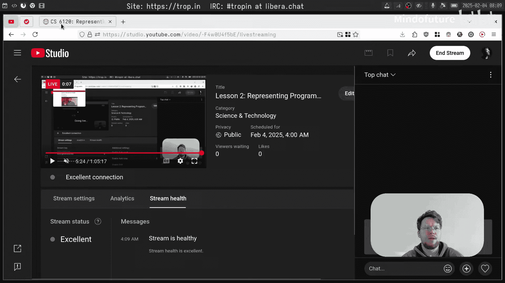

A smaller cup of。What we did last time and what you plan to do。Today。We started our course。

On advanced compilers。And we went through the first。So was the first lesson， which was very interary。

 and just raised a couple questions， and we picked a paper。That you die to dive。

Into maybe tomorrow and。Potentially， lead discussion on it。Maybe on some other stream。Anyway。嗯。

If you're curious。What is happening here， we are going through the advanced compilers Co course by Corll University。

If you can find here on this link。It's。Probably created by Adline Samsung。And today。

 we are goingank through the second lesson。We will watch the videos。And that to say to you。

Try to go through the tasks， and。Complete them。Every day prepared a bit。And。Made。

Then not available for me。 it's a Javascriptor and time。And we can use。A type script compiler。嗯， so别。

Definitely can at least start doing something today， but I hope we will do most of the things。

get a little behind this schedule。But， probably。Probably I still。still post a report on what we did。

In discussions， but maybe not you will see。嗯。The report is。Apart。Of the tasks。嗯嗯嗯。没有。

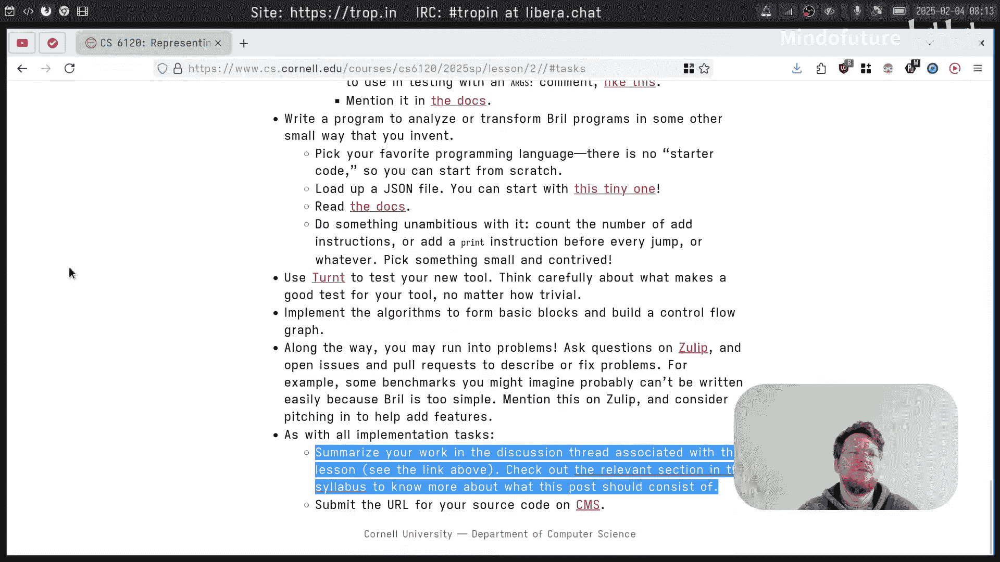

でったラいと悪か。In Pomodoras。Not because it's。Some kind of special technique。

 But because I want to keep the brakes consistent so I can talk， I can。Drink or walk a bit。

 and refresh my mind。Before going further。

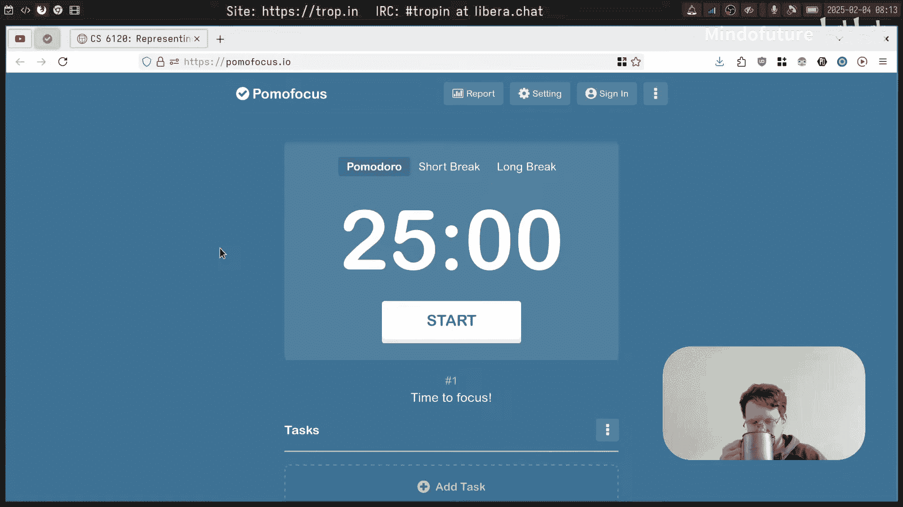

You can write your messages。In the I our chat。

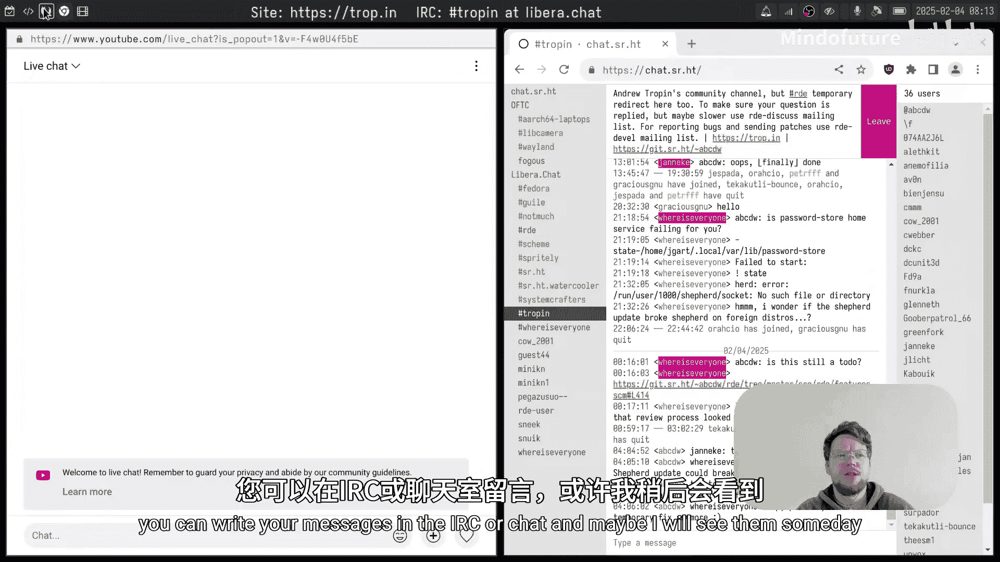

他没别用。Seeize them someday and we'll answer them during the breaks。可以。I guess， let's start。

Hi and welcome to lesson 2 of 60120。 Today， I want to talk about how we represent programs for a compiler。

 What exactly do I mean by representing programs， Basically， I mean what the programming。

 what we consider to be the programming language when we are manipulating programs as part of the compilation process。

 So what we read in and transform and eventually translate into another language as part of as part of a compiler。

😊，Of course， the most obvious way it represent programs is as text that is as concrete synt。

 The actual things that you type into a text editor when you're writing a program。

 So it looks like this for a jascript language， for example， it has lots of really nice properties。

 I'd like you to think for a second now about what makes this。

 What are the strengths and weaknesses of representing programs as concrete text。😊。

Pause the video for a second， not for too long to think about what's good about this representation and what's bad about this representation for representing in a compiler。

Let's go back at it。And the obvious plus that it's kind of human irriable。嗯。

The obvious downside that we need to parse the staff to programmatically operate on it。Also。嗯。

Humanritable doesn't mean that it's intuitive or consistent。And。

It's more a matter of particular syntax。But some synthesises。Better than others in some。

In some properties。看你的吃。If。I want to talk。えとじ由輪か。Do yout exhaust Po Madas。Right。

Maybe shaving some sorts。From time to time， is okay。Obviously。

 this is a really easy representation to write。 This of the whole point。

 But it's terrible representation for actually transforming。

 You don't really understand any of this is not the right level of abstraction for understanding the semantics of programs。

 which you really need to do in order transforming。

 which is what we're gonna to do in all 6120 So the next obvious step next obvious kind of program representation that you might imagine is abstract syntax。

 instead of the concrete syntax of this program easy to imagine a data structure that represents represents the same syntax。

 the same program。 But an abstract way。 And that's an or an abstract syntaxt that you're doubtless aware of from any previous that you from any previous working with program language' if youve ever written an interpreter。

 you' probably use as。 just to give you an idea what that looks like the is that you have theses just a data structure that looks like a tree where you have nodes in the tree that represents different parts of the program。

 So for example， might have this top level notion of a program that contains in this case like a block of statements and that has its own children for the four statements in this program that we just saw like for example。

 there is statement a let statement a four statement and this expression for the console that log。

 So these are all nodes in the tree。 you notice that at this level。

 we haven't expanded out what goes into let statement I will now fast forward and show you the rest of this tree。

🎼So I got a little bit tired of drawing the entire tree。

 But I think you can see what I'm getting on here in this program in this representation of the program。

 the tree is the tree represents every concept that you can have in the language as a node in this tree like data structure。

 This by itself is already a vast improvement of the concrete syntax。

 And's a lot of easier are a reason about what the program actually does。

 And it's not a bad representation for compilers。 I'd like you to deposit pause again， however。

 And think a little bit about the pros and cons of this representation。

 What makes this good for a compiler and what makes this challenging for a compiler。Great ideas。Okay。

 he was too fast。嗯。But let。Let's think about。This one a bit。Probably it's not enough information。

To do some kind of optimization so far。For now， it's like a very bare one and doesn't have any semantics。

いやた。And talking about process， its probably like quite simple。 A representation of the problem。

And at least。要不지。can manipulate it somehow， for example， expand macro。

Or move notess around or do something。Like this。Personally speaking， I'd say this representation。

 As representation is perfect for writing an interpreter。

 It's really easy to see how to take a tree and use a recursive function to process the levels in the tree and call yourself and to run the program that is like to process a block。

 for example， you just recursively need to interpret all the statements in the block will updating some reflection of the program's environment。

 It's perfect for doing that kind of thing。 In fact， it's really convenient for a lot of compilers。

 It's plenty of compilers do all of the work an As representation of the program。

 It's not a terrible idea。 In fact， I've compiles myself to do exactly this kind thing that never transition out of an As that reflects the structure of the original program。

 this class， I want to show you a different approach a different representation of programs that looks quite a bit different than the As approach that is going be more convenient writing a lot of interesting compile optimization。

 And that's to represent programs as lists of instructions。

 The main thing that this shift and representation is going to do is to make the representation more regular。

 That is the one big downside that I see of the Ast approach is that all the different types of nodes in this tree have different behavior。

 And if you want to write an analysis that can compile analysis that can process any program。

 you have to constantly be reasoning about the different in semantics of all these different types of nodes。

 For example， this example has a let expression that has children that are the value to。

the expression to divide write on the right inside to assign to put into that variable。

So the thing about this is that you is that the children mean very different things from each other。

 And they mean very different things still， from， for example。

 this dot expression that I put over here where the left hand side is the thing that is the name of the variable that we're accessing and the right hand side is the name of the field that we're going to be looking things up in。

This goes on for the four statement and the assignment statements that we see throughout the rest of this program。

 All these kinds， all these different kinds of expressions。

 different kinds of syntax nodes have very different meaning of like what their children are relative to the node。

 So this is great for representing programs as humans write them。

 sort of like inter level abstraction between the concrete impactax and something that a program can actually run。

 However， I think we can do better that is we can make things more regular and more predictable。

 specifically for the purpose of transforming in a compiler。😊。

So that's the next representation I want to consider。

 And' the one that we'll be using throughout the rest of 61，20。

 which is representing programs as list of instructions。

 The idea in this technique is that you transform the program。

Into a something that looks like an assembly language。

's idealized assembly language in the sense it doesn't like a fixed number of registries。

 It doesn't have like weird things like condition flags。

 It doesn't have all the other horrible addressing modes that X6 has， for instance。

 but it looks like an assembly language in the sense that all it really consists of is a list of instructions。

 And those instructions have a very regular form。 that is there's just like a name of an operation。

 and there's a bunch of arguments to that operation。

 and they can sort move values around from one variable to another。

 This is the kind of representation for what'sworth that underlies LDM And the style of representation they'll be using in a programming language that I created just for 6120 that we'll be learning more about soon。

 This is an example of the same program that we've seen in the previous slide represented as instructions in that simple language that we use in 6120。

 The idea is that in this version of the program represents things' not a bunch of different kinds of syntax nodes。

 There's actually only a few。 you can declare functions like this。

 You can declare labels which work just like assembly language labels。

 And then you can run instructions。 So these instructions have an extremely simple and regular form。

 that is they have a destination here result。 They have a type of that destination。

And then they have an op code saying like what to do。 And then they have a list of opera。 So this。

 for example， the Id operation is just the identity operation。 So this is very simple thing。

 It reads the value V1 does absolutely nothing to it and puts the result into the variable called result。

 And it says that that thing has type in。 This is a tremendously inconvenient way to write programs if you are human。

 you would never want to like write down programs and essentially assembly language structure。

 Even if you get rid of the limits on the numbers of registers you can use， For example。

 This is a terrible terrible way to write programs。 However， it's a really。

 really convenient way to process programs as part of a compiler。I want to emphasize however。

 that like that it is technically true that this instruction。

Kind of representation of programs can also have concrete syntax and abstract syntax。

 It's just that the abstract syntax for instruction based representations are super。

 super simple and extremely regular。So we were to draw out the abstract syntax tree for this program using an instruction based representation。

 It would just sort of like like this。 there'll be sort of a top level function node that takes the name of the function we're declaring。

 And then all of the children are just a very， very flat representation of all of the things in the body。

 That is like， there's just a big list of instructions and labels。

 So the first thing in this program is a constant instruction。 So the constant instruction。

Has a few children。 It has the variable we're assigning into。 It has its type。

 and it has the value that we're going to put in there of that type。 So that's 8。

 The second thing is an I D instruction。It too， has a child that's the value we're assigning into。

 That's value here。 It has the type of that thing， just like Kst。

 And then it has a list of arguments here。 only one argument。 And that's v 0。 Eventually。

 there are also labels in here。 So there's going to be a label。

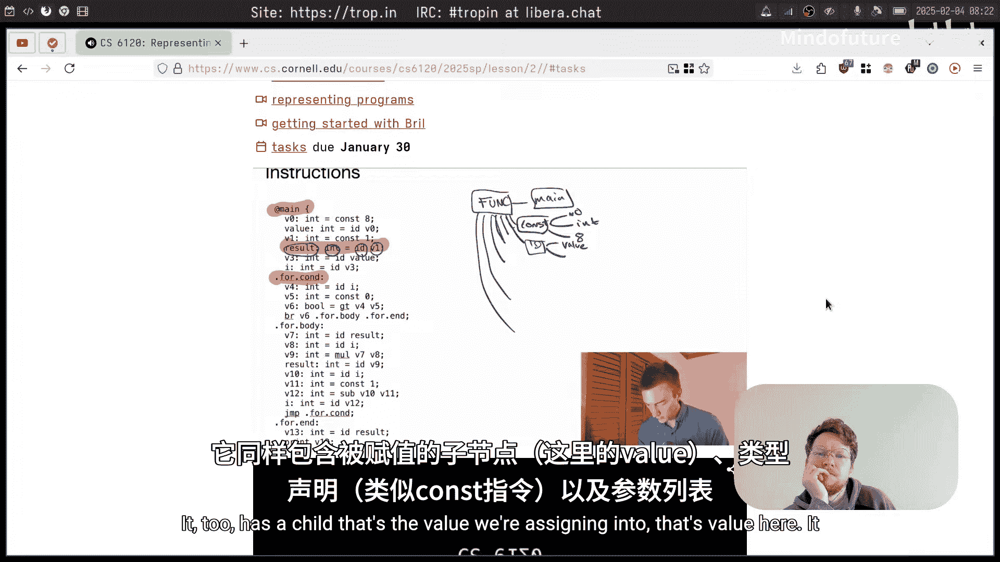

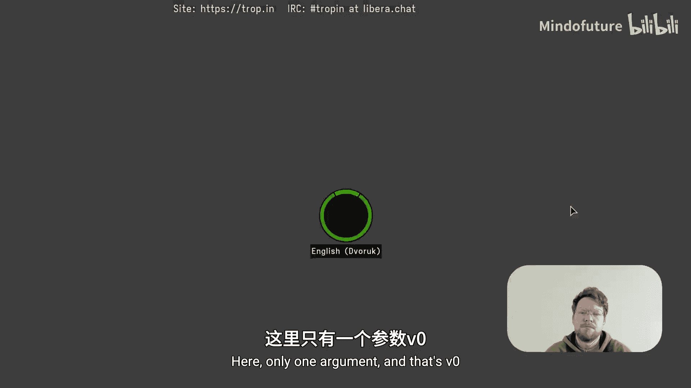

Whose name is for con， for example， and on and arm。

 So the thing about this abstract context tree is it's very short and squat。

 It is technically abstract context of a very different looking program。

 But the key is that that this language is so much simpler and so much more regular that it's going to be really convenient for doing compiler analyses。

Now would be a great time to pause and reflect on the advantages and disadvantages of this representation。

 that is like。🎼What do you like about representing things as like instruction based languages and what do you dislike about them。

So， basically。嗯，呵呵。Let think。First of all。It's a bit hard。The reason about such such problems。

Because you don't have。An notion of our usual things， like functions。嗯。We have functions。But。

You know， not in the sense of this language when we have just anesthetic expressions and the function returns only one value and。

You know， you can pass functions as arguments to other functions and all that stuff。嗯。你这种态。

A notion of area cardss。All as objects of so language。Of course， it's hard to write。Such programs。

 but you won't be writing them anyway， it will be a job for a compiler。

To provide sexual representation。It's a bit easier to transform。Such things。你是。Much more regular。

Heレ滚了。Then。The syntax 3 representation。We can find you know some patterns in the final result。

 like in this representation and do those optimizations。

 which we almost can do in abstract syntax 3 because like almost everything is very different。

Of course， we can do some optimizations on。Ex syn 3， but it will be rich。

Much less repeat patterns in it。 And there will be much more patterns here。And， of course， we need。

A slightly more。嗯。Machine appable representation， even of this language。

 because this one is checked basede， and we still need to parse it to a。 It would be called to。

Started in data structure。In some data structures that we can。Like really easily modifiedified。

Look about them。So based on that instruction based representation of programs。

 I want to talk about some of the ways that we extract better structure out of these programs for doing analyses。

 So rather than just creating things as one big flat list of instructions。

 there are obviously different ways to look at the program。

 They'll be useful in different scenarios for understanding different properties。

 The first when I want to talk to you about is a control flow。

 So the basic idea in a CFG is that every vertex is an instruction that is like something you might execute in the program。

 not a label。And edges between the instructions represent the transfer of control。 So in this very。

 very tiny program written in this instruction based language， there are only two instructions。

 There's one， constant instruction and is one print instruction， super simple program， so。

By my definition definition of a CFG， there better be two nodes。

 There is a constant node that represents the first instruction。

 and there is a print node that represents the second and the entire program for this one。Okay， yeah。

 it's a。It's probably。About。Coins of。P presentation that。They have。

We definitely have some instructions like jump， where you can arbitraryarily jump between the labels。

 and it's really hard。To operate on a sink where you can。嗯。Have arbitrary tras inside。

 inside the list of instructions and what we basically do is control flow graph。As far as the I， I。

 I I， I understand is whisper split。Our list of programs into the simplest。listist of appearance。

Which are。Which don't have any jumps， so they always executed like in sequence。

 and only after the last instruction， we jump to a different place。41。嗯。So this way。

 we will have our。A huge list of instructions is arbitrary jobs。三倍。Inside this list。

 it is split into a few。Small lists where all the instructions are。Exeed。Sequentialally。And。

The presentation probably simplifies the about。This。

 this program and also allows to do some some cool tricks。Like transformable， those。Separate lists。

One function called name can be represented as just a graph with an edge from this one to that one。

 That is that control， the program encounter of the virtual machine that executes this program will start with a constant instruction。

 And when that's done， it will transfer control across the edge here to the print instruction。

🎼Let's do a more complicated example。 Not much more complicated。

 But here's a program that has a jump in it。 The jump works exactly as you familiar with an assembly。

 That is that this jump will transfer control to this label right here and then start executing after that。

 Please draw now the control flow graph for this function。Great work。He's so quick。Okay。

 everyone be drawing。I don't burn。🤧He。my C that I do。

 It has four instructions that is didn't draw anywhere in here the label for somewhere。

 I just do the four instructions that are normal instructions that is not labels。

 clearly we have just we have a constant that immediately after that executes a jump instruction。

 And the thing about that is that we know that the thing that will execute right after the jump instruction is the print instruction。

 So as an edge representing that transfer of control。

 And we have one very lonely instruction hanging out all by its lo sum with no edges is guaranteed never to be executed。

 And you can see that by the structure of the control flow graph。

 So it's actually worth noting now that this very simple alternate representation of programs that is rather than just a big list of instructions。

 But as a control flow graph has already LED us to a really obvious conclusion that is that there is some code in here that is totally useless and could be deleted。

 If we want to write our very first compiler pass on these programs。

 We could just construct a control graph and look for the lonely nodes that are guarantee never to be executed and delete them。

 And that would be a form of dead code elimination。If anything， I saw that。In control flow， you like。

Comine。A few instructions。I I don't have。Intermediate tras inside it。Inter one not。

But it turns out that like every instruction represents a separate note。In a control flow flow graph。

Which is also okay。But not exactly what I expected and what I was talking about the few。Mes before。

The important thing to emphasize， though， is by shifting the representation of the program。

 we were able to look at the semantics of the program differently。

 and different properties became obvious。 Here's another program。

 It shows off a different aspect of the language we haven't seen before。

 which is that there are branch instructions。 The semantics of the branch instruction。

 I that you read a variable， and then you decide on based on whether that variable。

 which is a booleium is to or false， whether to go here to that label or to this label please pause the video and draw the CFG for this program now。

We have one， not。Another not。Under， under it。And they sword not。 And after that， two more。Like。

Assignment and print。And also， it's。It's。Everything。It will be one to。3 notes， and。

Two options to the left and to the right。For print or to this label。

 please pause the video and draw the CFG for this program now。🎼Here。

 I started drawing my CG and already have run into an interesting issue。

 which is that when we draw branch instructions， it's important to。

 This is the first time we've seen two children of a given node that is an out degree of greater than one for a node。

 for branch instructions， there is a difference between the two different destinations you can go。

 If you want to faithfully represent the semantics of the program。

 you have to distinguish between these two。 So it might even be helpful to， for example。

 label the true branch and the false branch。There's no need to label all the rest of the branches because all the rest of the edges rather。

 because there's only one edge coming out of every given node。

It indicates just sort of going to the next instruction。

 There's also one edge missing from this diagram so far。

 I haven't drawn the UCftG edge that goes from this instruction after it executes。

 as in any other assembly language， it will proceed onto to the next instruction。

 ignoring any labels on V。 So I need an edge from after executing this instruction to executing this one。

 And then finally， we are done。And I forgot about this one。Because they， of course， thought about。

Branch in construction， as if statement。And didn't like， not just that say。A sequential。

And there is no like a jump after， after this inspection， which goes out of the。Scope of print。

In direction。 So yeah。And my拜度。It's usually super useful to label the entry and exit to the CG That is where execution begins and ends in this CFg and this language in general。

 The first instruction in the program is the first one to execute。 So this is the entry instruction。

 we can label that in the Cg and exit the instruction is the one at the very end of the function right before it returns。

 There's no specific return statement here because this function doesn't return anything。

 But the last one terms execution of the function is the statement so we can label that The next evolution of these representations that I want to show you。

 re the fact thatg representation I've been showing you so far feels a little bit redundant。

 That is in particular， these chains of instructions that look like this are super super common in normal programs that iss really often you'll draw theg with a whole bunch of blocks that are connected just one after the other with a chain of edges And that's because that's how we normally write programs it often takes more than one instruction to run interesting control transfer is control that like we need to do a few instructions And then we need to jump to another series of a few instructions and so on。

 So it feels kind of wasteful representing things as individual instructions。

 when we can sort think of them as one big block of instructions。

 And concept of coursing control graph to use basic blocks。

 The definition of the basic block is that it is。T of instructions that all execute together。

 That is， if execution starts at the beginning of basic block。

 is going to finish executing at the end of the basic block。

 So it's one of those structures in the instruction based control flow graph。

 where you just sort of jump inevitably from one instruction to the next。

 or just gather those together and call those a control flow graph。

To put it a little bit more crisply， a basic block is a sequence of instructions where jumps and branches。

We'll just gather those together and call those a control flow。To put it a little bit more crisply。

 a basic block is a sequence of instructions where jumps in branches that is transfers of control outside of just going to the next instruction can only happen at the beginning and the end of a basic block。

 That is， you can't have a jump or a branch instruction anywhere in the middle of a basic block。

 It can only happen at the end。 And any jump anywhere in the program。

 Any branch can only ever transfer control to the top of a different basic block。

So just scroll back up to our longer example of an insertion。

It's really easy to visually see the basic blocks in this example。This is a basic block。

 because all the instructions come one after the other。

 That is that there are no jumps anywhere in this range。 However。

 we can't extend that basic block one step farther past this label。

 because control will eventually transfer to that label called forcond。

 because there is a jump that goes here。That ends， that must end the basic block。So that's a block。

This is a block。And we have to stop it there because there is a branch instruction。

 and you're not allowed to keep growing a basic block beyond a branch instruction。

Here is a basic block。 And， of course， that has to end because there's a jump。And then finally。

 there's a basic block down here。 So it's really visually easy to see them in these programs because they're separated by the labels。

 And as long as you are jumping to that label， that label to given as long as you're jumping to a given label。

 that label must be the beginning of the basic block。Return to our definition。

The nice thing about basic blocks from a compile analysis perspective is that you can assume that if any instruction a basic block executes。

 then all the instructions must execute。 And this comes up a lot when you're doing analyses。

 You don't really need to think about individual instructions。

 You can think about entire chunks of them and know that they all sort of execute together。

 So here's the same program we just drew a control flow graph a second ago at the instruction level。

 I would now like you to draw a control flow graph at the basic block level。

 draw a CG and label the entry。😊，It will be three blocks，1。With three instructionss。And after。

It will be the second one。And the third one。And lake。The same amount of  errorss as we had default。

To the left block to the right block and from the right to the left。Said notes。

 just as you did before。 but this time， do it for entire basic blocks。Here's my C， O G。

 Did you get the same one， Great。 One additional piece of term terminal J1 layer on top here is that this set of instructions that end the formation of basic blocks has a special name。

 So， for example， this branch instruction means that you can't continue making a larger basic block past this point。

 If you imagine trying to grow your basic blocks as big as possible。

 these things are called terminators， entertainingly。😊。

So in this little language that we've been experimenting with。

 the only termmininators that exist are the branch instruction and the jump instruction。

So when you represent basic blocks in memory， you can think of them as just list of instructions。

 where the last one is the only one that can be a termminator。

 All the rest of the instructions have to be non termminator instructions。 And， of course。

 there are basic blocks in this program that don't have termminators。

 And that's because they fall through the next instruction。

So we've now seen 2 fundamental0 different applications of these20 children。 We going。

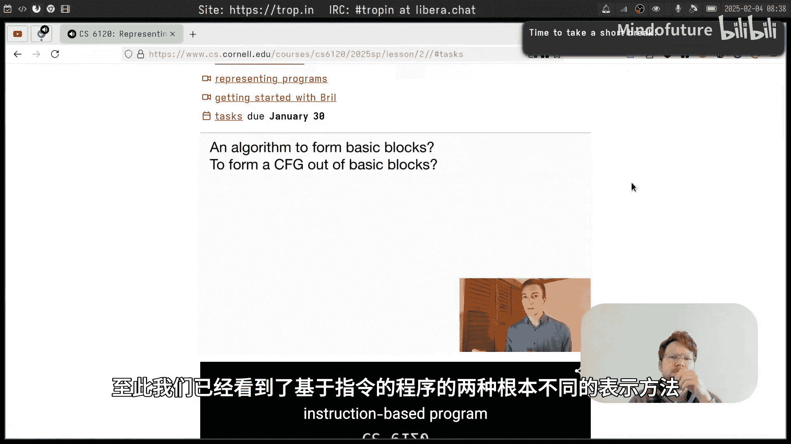

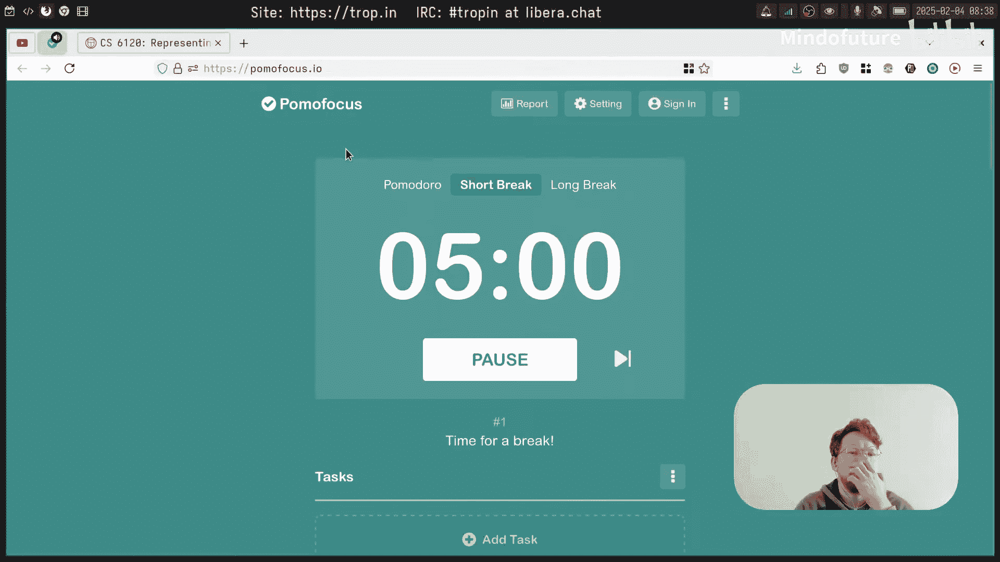

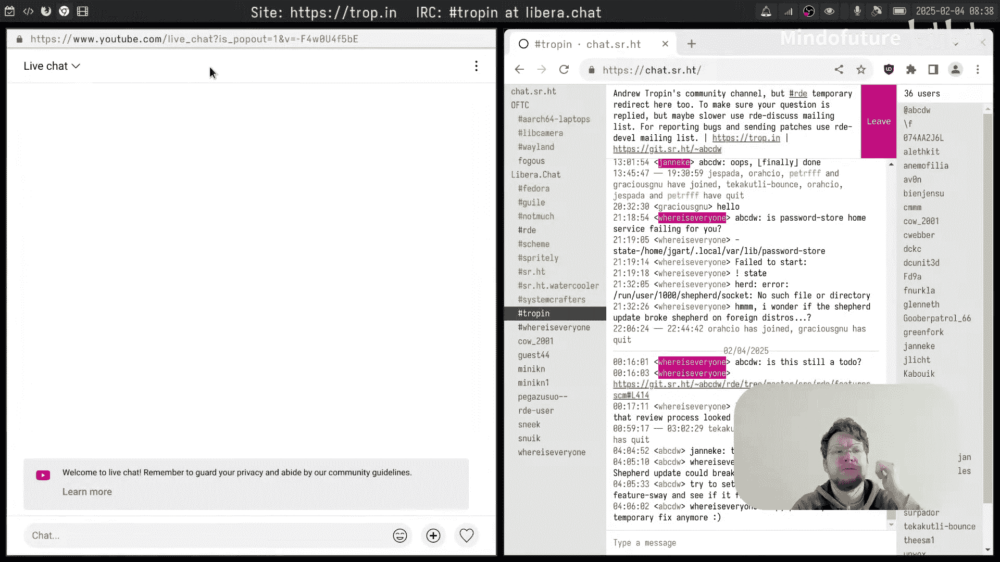

不。Time to focus。

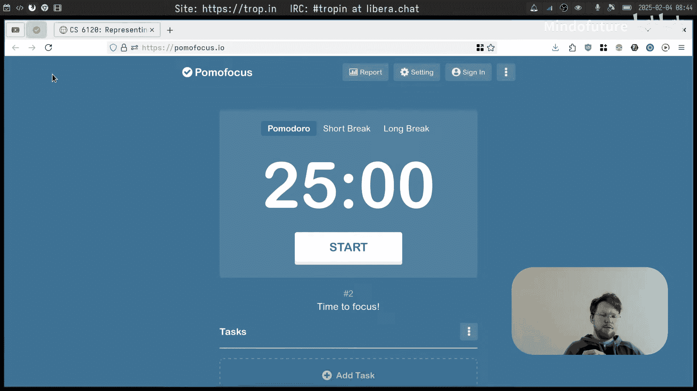

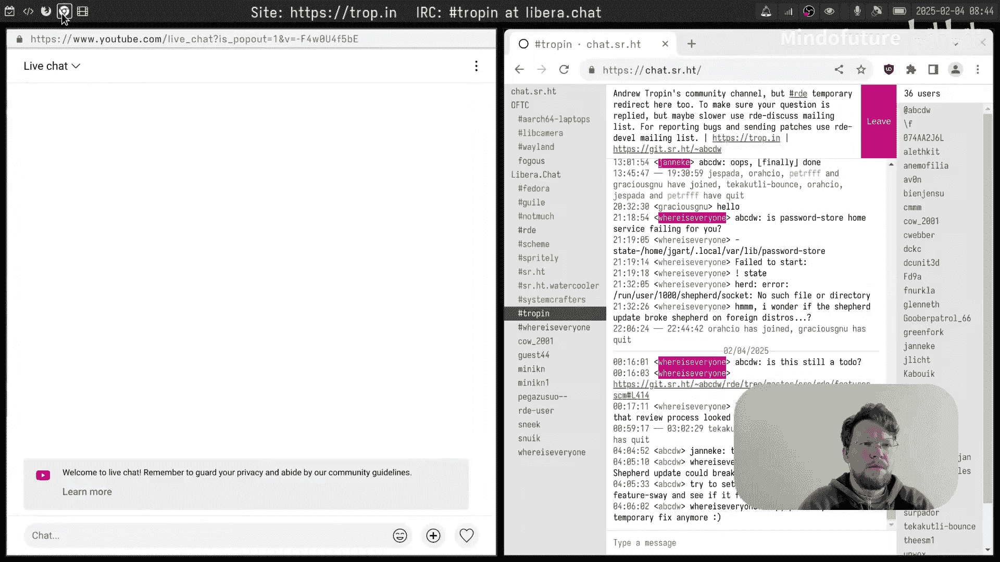

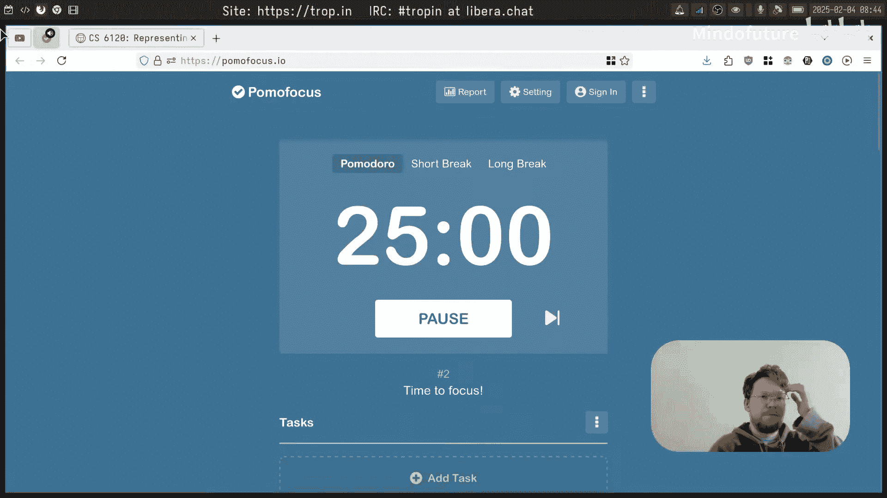

Whether think of them as just linear lists of instructions and labels。

 or you can think of them as control flow graphs， possibly at the granularity of basic blocks。

 We really need an algorithm to go from the linear list of instructions。

 which is how you might like store these programs on disk， for example。

 to extract a graph based representation， to extract a CFG for doing interesting analyses。

The first step is just to form the basic blocks。 So we're not going to make a control flow graph yet。

 We'll do that in the next step。 We're just going to try to take a linear list of instructions and chunk it up into blocks that'll then analyze to make a CG。

 So get out some paper， And we're going to together write the pseudocode for forming basic blocks。

 I like to write my pseudocode and kind like pythonish format。 But you can do it however you like。

 But the way it' is gonna to work is that you're going start with a。😊，Input list of instructions。

 and you're going to produce an output list called blocks。

So this thing is a just the flat list of instruction slash labels that you've seen so far。 So。

 for example， this might contain like v0 colon int equals const2。 That's one instruction。

 and it might also contain like this great label statement。And so on。 that blocks。

 that's going to be a list of list。Of instructions。

So think now about how you would structure the search by walking over the list of instructions hilariously on thepelled buttonton。

Call this ins。 How would you loop over the list of instructions and create lists of instructions to put into this list of list of instructions that's going to be all。

Basic blocks in the program pause。🎼It video now and give it a shot。

 You don't need to completely work this out， but give it give it a try and then we'll come back together and see if we got the same answer。

This is a small trick here。We can try to make blocks that include tables in themselves。

Because sometimes labels can exist， but nobody jumps to them and。In this way。

 it's still a valid sequential block of instructions。For this one。

 I would take all the jump instructions first and see what the labels I used。嗯。And this way。

 I can form。The idea of block starts。In case you don't want to optimize the case where you have unused labels。

We can just take all these labels that we have， and it will be the beginning of blockss。And。

 of course， the first one is also the beginning of the block， even without label。呃。读。

To simplify it further， we can just put。An arbitrary。

Label at the beginning of the list of instructions and makes Ill get it even more。genetic。

Without edge cases。And after that， we just go through the list， we pick a label。

 we define it as the beginning of the block， and we keep adding。

Instructions to this block until we reach a rampant instruction。And after they found。

A jump instruction。 We can。Say that now we need to create a new block。

 and the next next thing after the ramp instruction will be the beginning of the block。

And if we keep id constructions until we reach A label or a jump construction， if we see a label。

 we create a new block and keep id construction。Like start engine construction to a new block。

 if you see。The jump instruction， we understand that it is the end of the block。

 and we create a new block and start adding instructions to the new block。🎼But give it give it a try。

 and then we'll come back together and see if we got the same answer。🎼，So here's what I would do。

 because I like to write my pseudo code in like thick Python。

 I would start out with a loop that says that like4 I in ins。

So the way this going work out is I'm to walk over every single instruction in sequence and hope that I can glue together blocks on the fly as a kind of supporting。

Actually， we don't need to add a label。At the beginning of the list。

 because we can already say that the first block starts at。Poin of time before we start a loop。

 And when we start it agent through the instructions。

 you already agent all instructions to adjust the block。Data structure。

 I'm going to need a list for the current block that I'm currently forming。

 so the block starts out empty， and then we're going to fill this up and then empty it out and then fill it back up again and then empty it out every time adding it onto to the list of blocks。

Inside the loop， the main thing that I need to do is check whether the instruction。

Is something that should end the basic block。 So if's just a normal instruction。

 We'll put it on the block。 And if otherwise， we will end the basic block。

 So that the things that matter here is if I is a。A label that means we have to end the basic block because a jump might be incoming to the next instruction。

 or it's a termator that is。Brench or jump。If so， then we need to end this basic block。

There's the difference between label and Terminator that we don't add a label to the block。

 but we add a termerminator to the block。And what they would do。If I meet a label。

I push the current block to the list of blocks， and。Like， I reset the block to。Empty list。

And proceed further。嗯。And if I see ge。系い。Here， the further stuff will be just adding instruction to the blog。

Yeah。And。The next。Step will be taken if the current instruction is terminate and termminator。

 and if so， the。嗯。Push the block to the list of blocks。 And like I said。

 the list of instructions in the block again and the rate。 So yous just a code for that， again。

 in Pythononic style， I will say that we will empty out。The block。 But before we do that。

We'll put onto the end of our output list of blocks。

 the current thing that we have built up in the as our current basic block。Of course。

 this algorithm isn't not that great yet because it doesn't actually put anything to any of the。

Is it drunk。衣服。Our instruction。Is a jump。Or brain separation。

We need to add this instruction to the block， first。Before saving this block。Blocks。

 it's just going to pin a bunch of empty blocks to the output。

 What we also need to do is actually put these instructions into the blocks。

The way I'm going to do that is that whenever we see an instruction。

 as long as that thing is not a label， we'll put it into the current basic lock before terminating in。

 so。I to say， in Python style。Blocked at the pen。 so that way it works， is that everything。

 including terminators， is going to go at the end of the currently being formed block。 and that also。

 if it was a termminator， or if we saw a label， then we'll end that block there and start a new onef freshsh。

 So that's the algorithm for basic blocks。 I hope you got the same thing as I did。

 The next thing that we're gonna do is。嗯。This way。Our own blocks。We won't contain。Labels。Howeverever。

They。Should be somehow connected。The labels should be somehow connected to the block so we can later understand。

You know how to deal with graph。Wet look to another。So some here， we need to store this information。

 Either we need to add label as。The first instruction of the block。

 or we need to attach some information to each block。什好。

Use that list of blocks to form a control flow graph。To do this， we will'll just give you a hint。

 We're going to need an additional data structure that we didn't do when we're form basic blocks。

 which is to map from labels to basic blocks。 that we're going to know which which labels mark the beginning of which basic blocks。

 So going back to one of these example programs， we sort of want to associate。

This label with this block that follows it。 you can sort of think of it almost as like the name。

 The identifier of that block is here so that we know that anywhere in the program where we jump to the label here。

 we know that we in the control flow graph need to think of an edge going to the here block。

 So you can imagine that we've done that in the basic block formation process。

 That's really easy to do。But if we have a program。Which contains jumpens direction。

 few usual instructionss， jumpens directions， few usual instructionss。 jumpens direction。

 It will be few unnamed blocks。And they won't be able。The associate。No name for this book。For。

 for every label， we have only one block。It's probably two。Because。Actually， we can。

In this repeat presentation， we can do the following sync。

 we can put two labels on two consequent lines。And this means that both labels will be referring to the same block。

But that's not a problem。Because。Our data structure maps from label to the block， not the way around。

But for many blocks， it won't be any label。la you okay i think。He wants to。

Asocate on the labels use blocks， but it doesn't matter if。Every block has a label associated rate。

All we need to do is come up with a another like label to block data structure。

 This can just be a dictionary。 and the way that it will。Look。Is it will map label names。

 which are just strings。To these， like lists of instructions。

I'm sure you can see how to modify the basic black process to also keep track of the labels that are associated with each block。

 And next in the next up， we will use those to form the control flow。So in the C formation step。

 we're going to start with those inputs。 we just compute in the basic block formation step。

 and we're going compute exactly one output， a variable that we can just call CG。

 which we're going to make a dictionary。 And this is going to be a representation of the graph just using an edge list format。

 So this CFG dictionary is going to map labels， which remember just strings identify as basic blocks to a list of all labels of the successor blocks。

 a string exactly when。 start with those input。😊，So we just computed in the basic block formation step and the we're gonna compute exactly one output a variable we can just call CG。

Which we're going to make a dictionary。 And this is going to be a representation of the graph just using an edge list format so。

CF2 dictionary is going to map labels， which。Bad just strings identified the basic blocks to a list of all the labels of the successor blocks。

But what about the name blocks。The bs。 that don't have。Any your labels。

Successors are to terminology for just the the nodes on the other end of the out edges from the current block。

 So if this is us， if this is some block of processing， then the things that have edges into this。

 all of these blocks are called。Predecessors and all of these blocks that have out edges from the current block。

 Those are called successors。 So this CFG thing， again。

 is going to map blocks to a list of all the successors of that block。

 and that will serve as a representation of the CFG。

 So imagine you have already formed the basic blocks。

 And now it's time to write the pseudo code for forming the CFG。

 So please pause the video and give it your best shot again。

 You don't need to completely finish this。 but give it a try and see。😊。

You come up with an appropriate level of detail and we'll come back together and compare our answers。

Here's my rough sketch of the algorithm。It's going start just like I did with the basic block formation thing。

 which is that we're going to start with a for loop that loops over all the stuff。 In this case。

 we will look at。All of the blocks in this list of blocks that we computed in the previous step。

 the way that I'm strategy going to use on every block is to look at its last instruction。

 That look at the thing that might be a termminator or might be just nothing if we're going follow through。

 fall through。 So we'll get that last instruction。 Call it last， This is just an instruction。

 And in Python terms， the last thing in a list， that's block negative 1。 Okay， I'll use that so。

And going divided into three cases， the instruction。Might be a。Actually， let's do jump first。

 So if it's a jump instruction， and jump instructions only have one destination that is。

 there's only one successor of this block。 So the thing we'll need to do is。

Just add an edge to the graph that goes from the current block we processing。2。

The destination of that jut。It's very cool。But how you add the edge from block。

If the blog don't have。Your name。Don't have any label。Right。

I'm glossing over a little bit here because I'm not managing the distinction between blocks and the labels they're associated with。

 But I hope you can forgive me that we can just sort of merge those two things together in a real implementationation。

The next case that we will need to worry about and other than jumps is that it is。

A branch instruction and branch instructions， of course， are just like jumps。

 except they have two different destinations。 So we're gonna need to add two edges to our graph。

I use last thought true and last thought false here to mean the two different destination labels of the instruction。

 That's just sort of like made up syntax for how you might traverse the actual AsD for these programs。

 But I hope you are assured that it's not going to be that hard regardless of whatever data structure you choose to represent instructions。

 There's one final case。That's an elset if。 This is the else case。

 we're gonna to have to deal with cases where the block doesn't have ameterter that it doesn't end a branch。

 So it's going to fall through to the next block。 We're gonna need to add an edge to the graph for that as well。

 I'll just say， add edge。To block plus one。 that's， again， a total abuse of not。

 just notation just to say the next block in the list in real Python， of course。

 you need to sort of keep track of where you are in the list and look at the next thing and also add a qualifier on here to say if it exists。

That is， if this is the last block。 and we， and the next thing is just the closing curly race with the entire function。

 then we are done。 And this is the exit node， and we't an edge to the graph。

So that's the algorithm for forming a control graph。

 And this sort of shift in representation is the first of many that we'll do in this class to look at programs differently so that different properties become obvious when we're doing analyses。

It's fine， as the question is still open。But okay， I think it it doesn't matter too much。

At least at the moment。In this video， we're going to get our hands story with manipulating programs written in the programming language that we saw at a very high level used in the previous video。

 the one with all the instructions。 that one we were sort of using as a fuzzy example of a notional programming language this time we're gonna make it concrete with real code So the code that was showing you previously maybe looked unfamiliar because it's programming language that I invented just for 6120 The programming language is called Briille for the big red intermediate language And its we're going to use for the first few months of sort to get familiar with manipulating programs without going full scale interacting with real world programming languages like C or using real compile infrastructures like LvM。

 This sort of provides a nice way that is indicative of how real world compilers work and presenting quite a bit of their complexity sweeping under the carpet。

 a bunch of the rough edges that make it hard to get started。

 The idea behind Briille is that it's a very simple and extremely regular intermediate language it's based on instructions that you can extend as much as you want to make it as interesting as you want So it's not just a fixed language you can add whatever extensions you want on top of it。

 So we'll start by playing around with the very core of the language。

 but there are existing extensions that make it more interesting and you can of course add your own canonical home for everything related to Brile。

 which is the big red intermediate language is here at this URL that you can find。

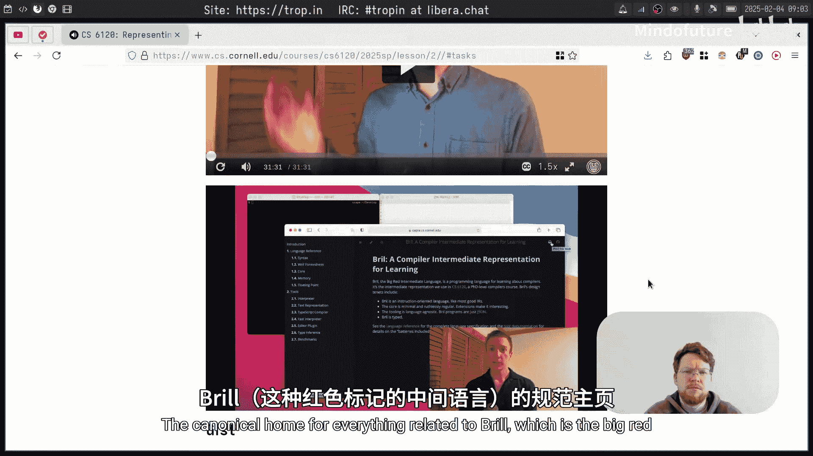

Some replaces from the 6120 website。 You'll also want to check out the。

Gitthub repository that contains a kind of mono repository with a bunch of infrastructure in the documentation related to braille。

 So a mono repository means that there's a bunch of different tools in here。

 and they're all interrelated， even though they're kind of separate tools。

 But we're going to start out with just sort of getting a feel for what this language is like。

 Let's get started by looking at a very simple example of a braille program。

One of the most important things about Braille is that the canonical representation is as a Jason document。

 Jason is just a serialization format。 It's not all that interesting。

 But the point is that every single language out there has a builtin library， for the most part。

 for parsing and emitting Jason files。 So there is no canonical language that you need to use to process braille programs。

 You don't need to write a pars。 Remember this class is definitively not about parsers。

 You just need to use a built in Jason library in order to start processing braille documents。

 You don't to use any existing infrastructure。😊。

So the way that that a real program works is that it starts out the top level in a real program is just a dictionary that says here are the functions that it contains。

 And then here is a dictionary that contains a definition of a single function。

 You'll see that there's sort of a key value structure going on here。

 We have the name of the function。 It has no arguments， but there is a list of instructions。

 So the instructions contain the body of the function。

 and each instruction in the body is just a JN dictionary。😊。

So this one has exactly four instructions。 There's a constant instruction indicated by its up being constant。

 There is a second one， and then there is an ad instruction， and then finally a print instruction。

 These correspond to the。

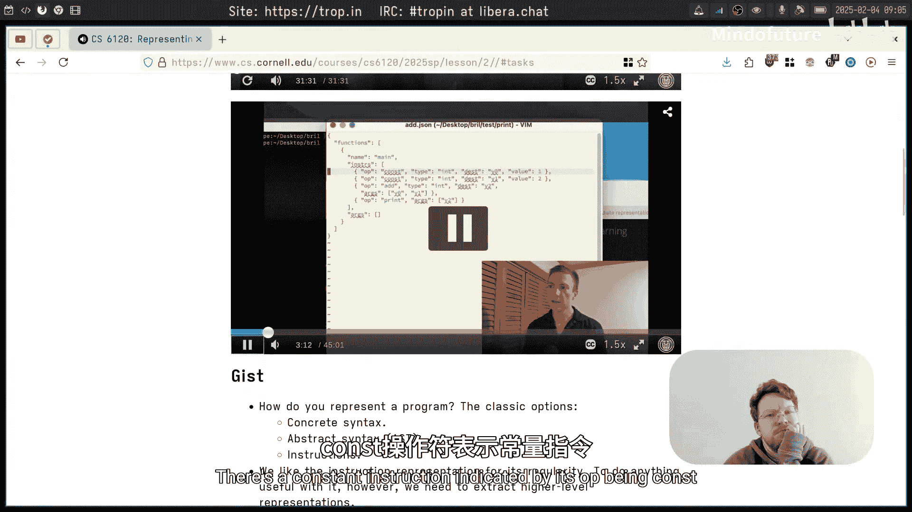

Much much more readable and more human writeable text format that we saw in the document in the previous video。

 I'll show you that one。 that text equivalent now。Here's the text called into that same program。

 And I really want to emphasize that even though this is way more convenient for reading and writing。

 it is not the canonical representation of the braille program。

 The text format is just an alternative representation that is fit for human foibles。

 The actual representation， the canonical one is for computers。 And that's the J representation。

 But you can see that there's a one to1 correspondence going on here。

 The a symbol means that we'relaring a function。 And then there are four instructions in the body of thoses two constants that instruction and finally the print instruction。

 It's very convenient to be able to read programs in this format。

 But then to do anything interesting with them， we will translate them into the J representation and then do stuff from there。

 load them up in whatever tool you like， Trans it and then admit it back as Jason。

 I provided it for you already。 a parser and emitter for this text format。

 which means that you never have to touch a parser in the entirety of 6120 in order to use braille into write interesting compilers。

 You just have to process the Json representation。 Next are' going gonna get the Brail tool set up and start processing some programs。

😊。

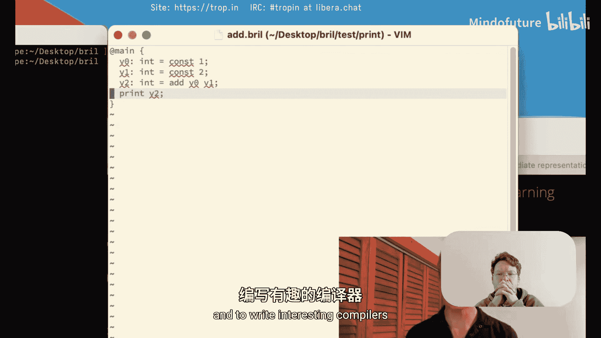

The first thing to do is to clone the repository。Then the next thing we're gonna gonna to do is install a couple of the tools。

 There's in the documentation。 you can see there's a bunch of interesting tools that come with Braille。

 but a couple of them are more important than the others。 in particular。

 the things we're gonna to use the most are the implementation of the text representation that is the parsor and emitter that go back and forth between Jasonson in the human readable form and the interpreter。

 That is the thing that can actually execute the programs and tell you what they do。 super important。

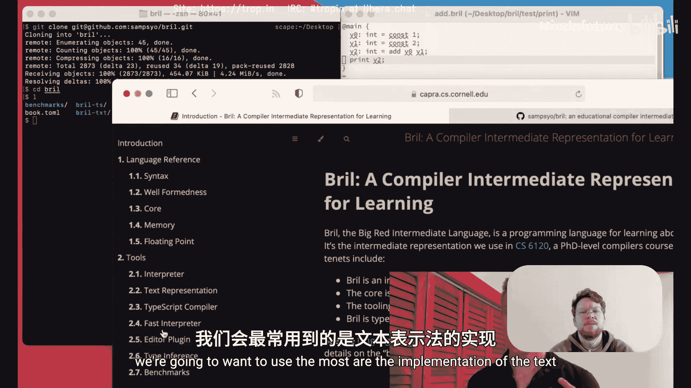

There is， there are a documentation about how to set up each of the tools in here。

 But there's also for those two most important tools， you can also see set insertions in the read。

 They are， it's not hard at all。 The first thing is in the Braille T S directory。

 that includes the interpreter， Also a language definition in。

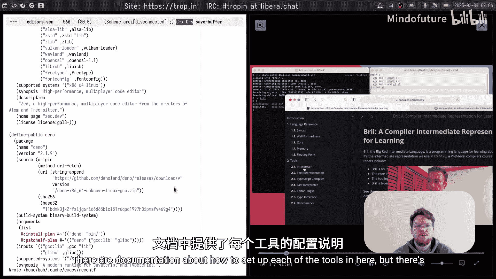

I've already packaged dinner run time。To be able to use。B of this。蹦蹦。They were educated the ptor。

Po believe language。And we have this。都不理 you。Friile。And we。Compil it is then。

Youll already try to compile it today。And that created the binary here。近呢。Then there's a blue。嗯。ok。

It just wrapse it into。Inント scriptプ。And if I set the pass variable。No。😔，I can use。Test to believe。

Tcr， if you want to use Sscript to manipulate Brail programs， and then it also contains a very。

 very limited compiler from Typescript into Braille， which makes it easier to write longer programs。

 But the thing youre do in here is you'll need the yarn package manager。 You can also use MPM。

 If you know how to do that。 In case youd type yarn to install all the dependencies。

 yourn build to compile the Tscript code。And then you can type yourwing link。

 This adds to your path the program called Briille I for the Braille interpreter。

 This is something you can pipe braille programs into in their adjacent representation in order to run them。

 For example， there is a program in the。

Where is bur。Interpreter。

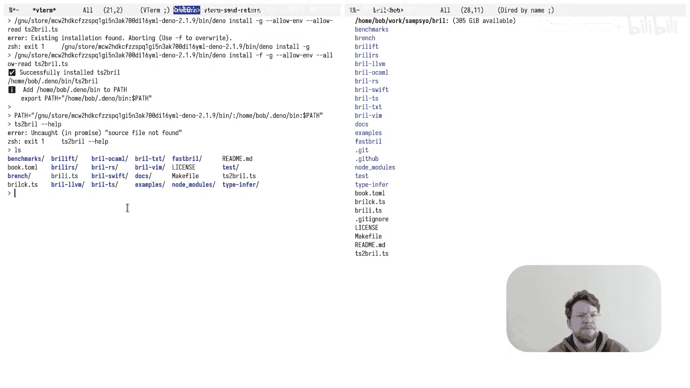

Then， for a short break。

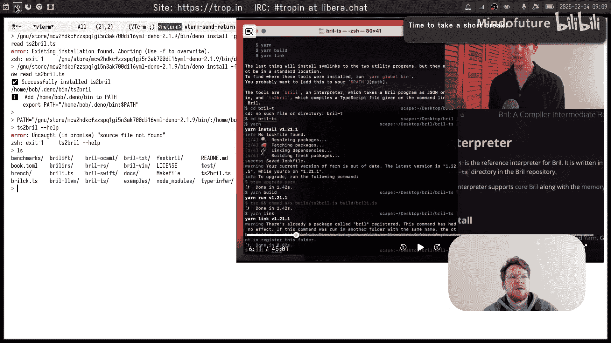

Okay。

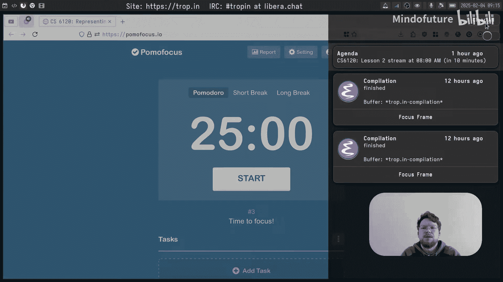

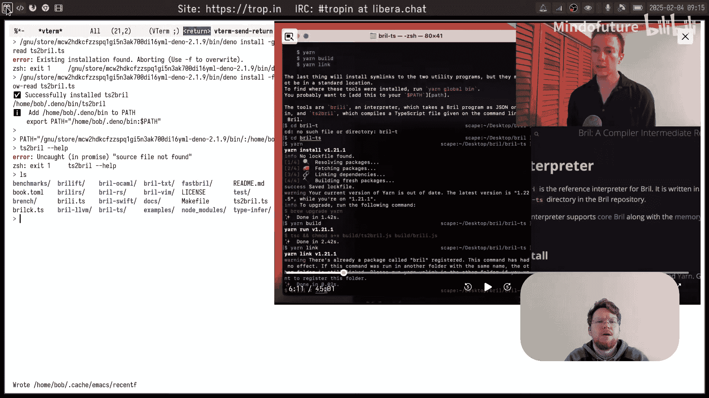

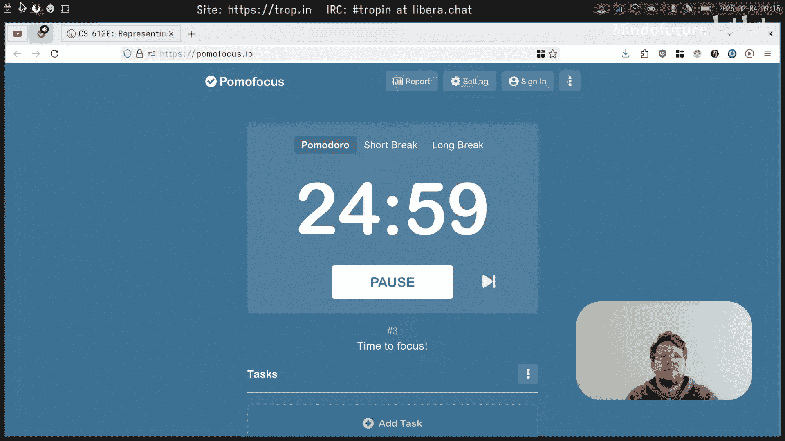

You test directory。Here's the ad program we just saw before。

 If you pipe that into the Braille interpreter， it will run the program。

 And when it hits a print statement， it prints out the result。 notice I used a less than。

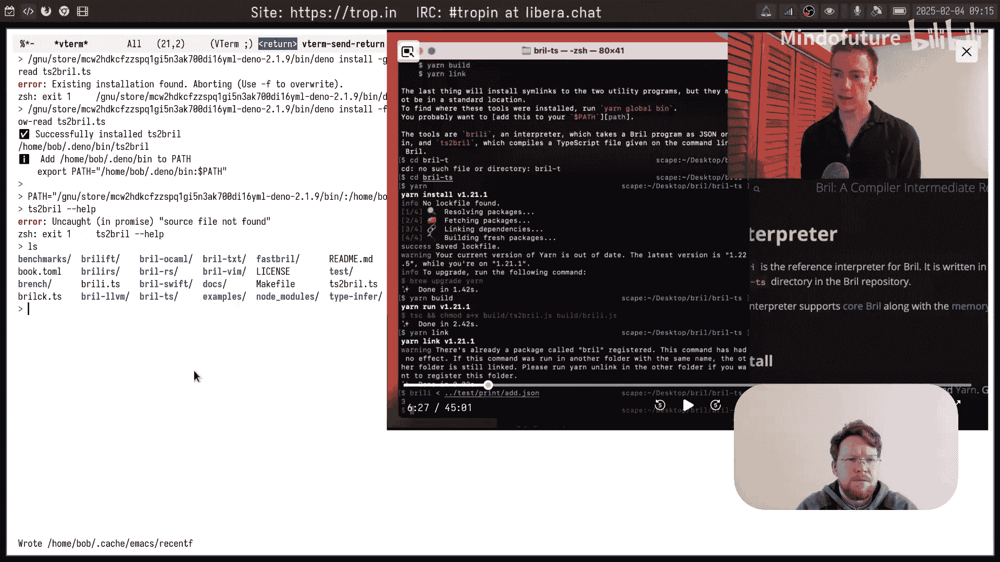

Okay， you're looking for。Brile interpreter。But， there is no interpreter。Very little is。 Okay， I see。

嗯。Very latest。Okay。And now。So basically， as I understand。

 then is transcriptscript type script assembly run type。So it can， it can run。Tpescript directly。

 and this comment dressed。C。Eruppper。For。For this。Very this file。We just。Rance dinnerino。

With specifiedified file。And。Like exception cold。Comment line arguments。

That's basically it that means that you can。Do the same trick as he did。

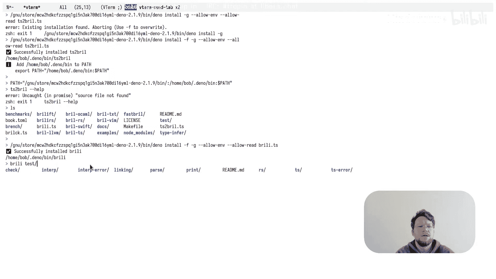

B。

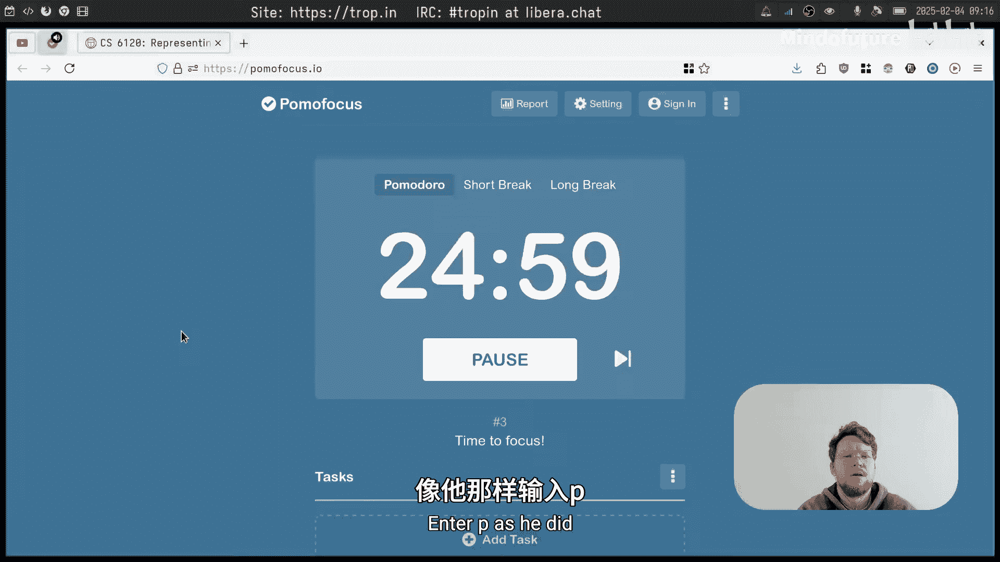

Because he did。Test print。最son。嗯，O。Okay， my bed。It expects the problem to be on S Dan。

 So it was waiting for。For the input。don I want to do right。Give package definitions for this course。

So was the only thing you need this。exly。The ges， and the rest can be。Abtained。

Compareed to your environment。嗯，意列。Sorry。Okay。Properly here do something。Okay。

 it can work with one game just on the presentation。我's see。ントプリンをかも。给。It seems it's interpreter。

It in a carel。Onless interpretator。 it maybe。S that translates。From Brazil to。

Jason and vice vererson。I'm just curious。

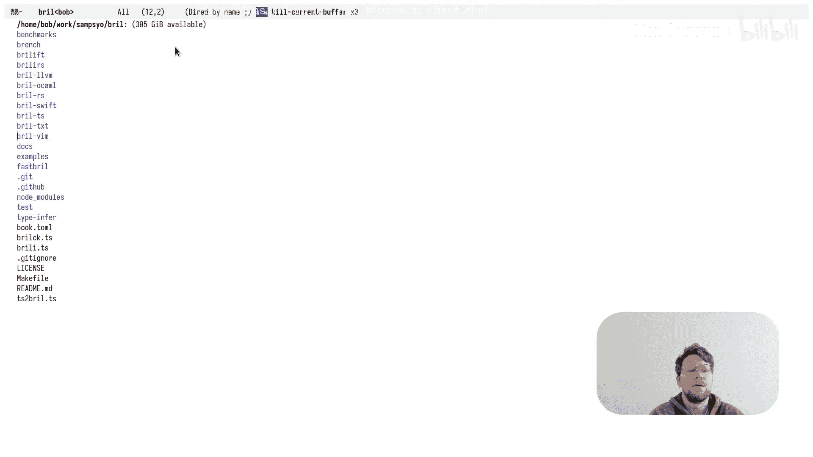

Okayッケ。In that previous command， that is to indicate a re from the file and pityping that into the interpret。

 Next， one want to set up the。Tools for。The text format。 So there's a。

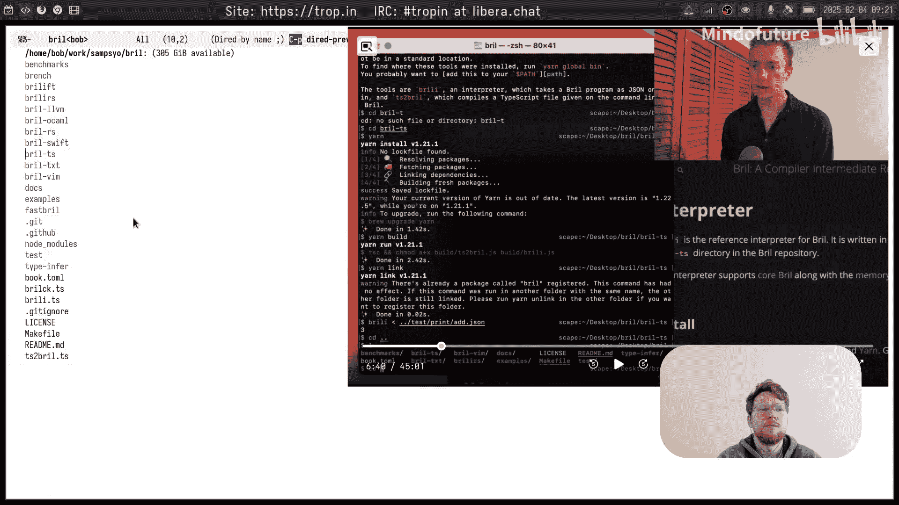

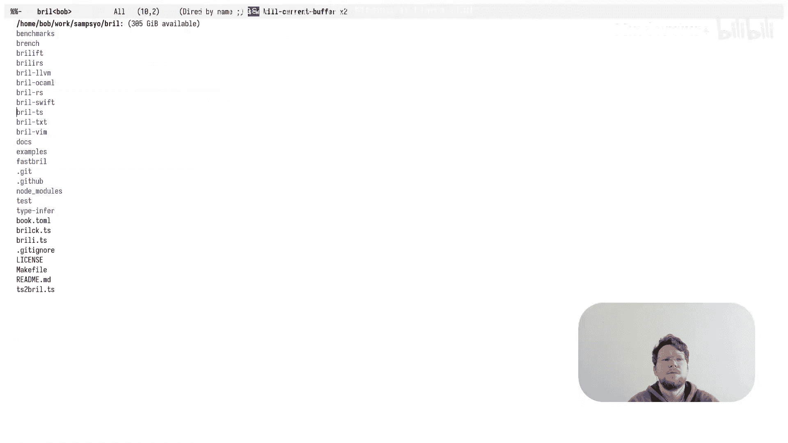

director called Briille text here。 this thing is written in Python。

 So we are already seen two different programming programming languages interacting with Braille programs。

 And again， this is part of the philosophy that you should be able to use any programming language in any set of tools you like in order to load up and manipulate and interpret Brail programs。

 these ones are in Pyon。 The previous ones are in Tscript。 for this。

 you'll need a tool package manager tool for Pthon called called F。

 which you can in kind of the obvious way。 Then you' have a tool called F， which you can use then。😊。

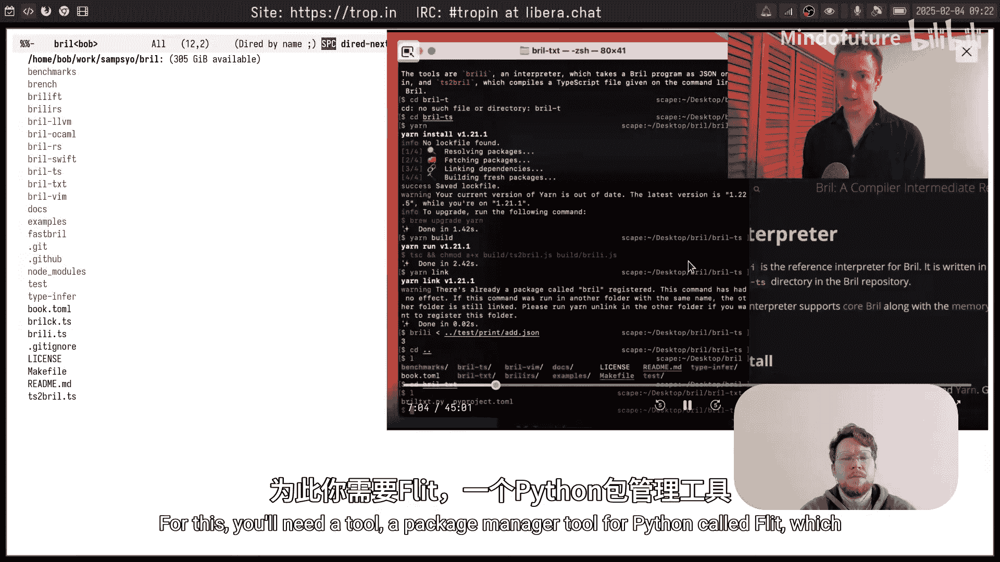

Say fl install。 And then there's many different options for install command。

 the ones that I recommend are asmbling so that you can make changes to the text format if you want to pull updated changes in the Gi repository and they'll reflected automatically And then user just to install it without super user permissions。

 Then you will have aside from the braille interpreter。

 you have two different tools called Braille to text that takes Jason documentation Jason representation of Braille programs and dumps Mad and readable text And the Braille to Jason。

 which is a parser that emits the Jason representation。

 I'll show you how to use those two things now。 We can do braille to text on the program we were just using before。

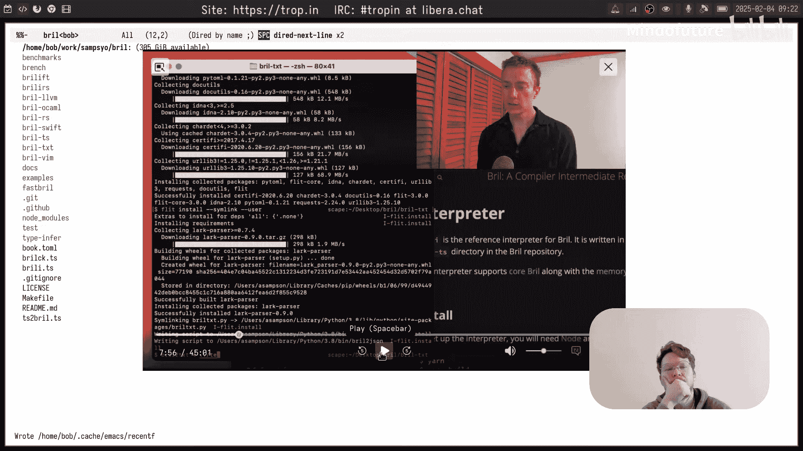

The amount of。Bage managers。F different languages I see is like horrible。嗯。

When never heard about fleet。And don't see how it's stillproducible so far。K。

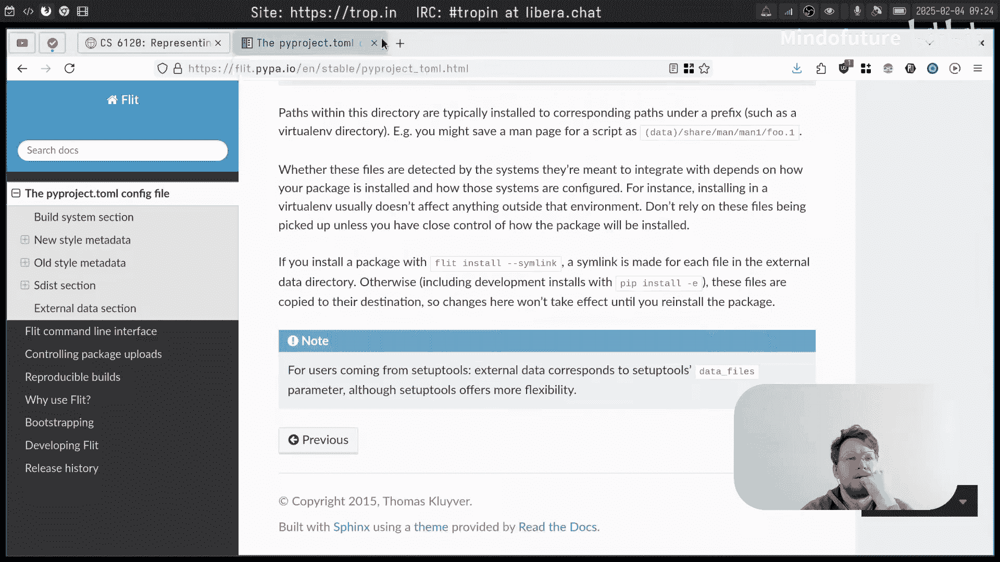

And doesn't matter。めっくりしたの。😔，Its it under test。

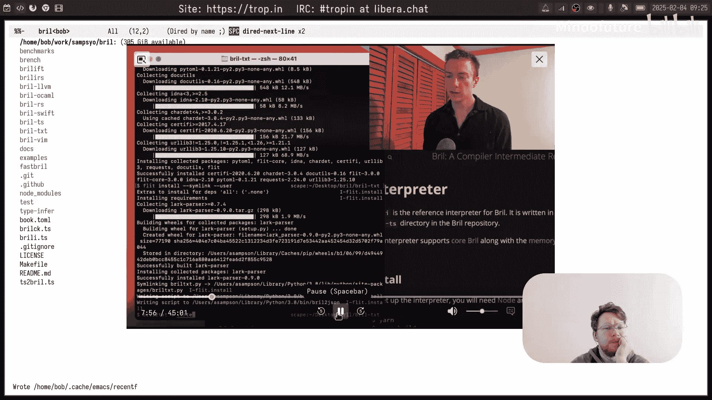

Add Jason， that takes the Jason presentation and dumps it out in the text format we just saw。

The Braille to Jason thing does exactly the opposite。 So， in fact。

 we could take this thing that is currently a human read representation and pipe this into Braille to Jason。

 And that should print out the Jason representation。

 The nice thing about this then is that you can take this Jason representation and pipe it into the Braille interpreter。

 if you want to actually run it。 So using these command lines shells。

 you can build up more more pipelines。 For example。

 if you write an optimization or transformation on these things。

 You can just put this in between the thing that emits Jason And the thing that runs the programs in the pipeline like my great transformation if you wrote that thing And was a command that was available。

 You could transform program before feeding them into the interpreter。

 Your task for lesson2 is to load Brail programs and write some code that does something them。

 It doesn't have to be that。 fact， it should be somewhat is just to get familiar with the Braille ecosystem and to understand what it's like to process these programs。

 And the rest of this the video。 We're going to do some of that together。

 I'm going to get started at least drawing the control flow for Braille programs that is forming basic box just like we did in the previous video。

 are welcome to follow。 In fact， I encourage you， don't follow the code。

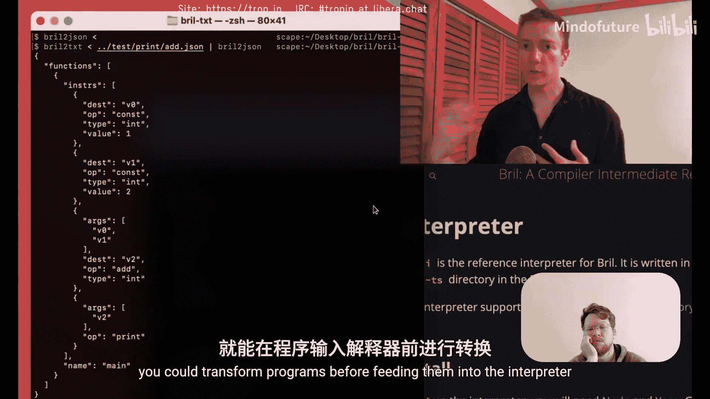

ok。Let's take a look。And just make five。Seems good。And now。We need the channel s。热的底裤。

Created surname itと and。嗯。T will be。😔，Yeah。I can't type。Sorry。😔，It will be。Don't need this stuff。

Like can。等吧。Okayay哦。No， even needs the stuff。And this one。S it basically hit。

To be sure that we're using the latest stuff。对。本当ぞステリック。I'm just making sure that they use。

Like very latest the of K Iess， not the one published。In L report。H。Hello， everyone， hello。

I'm very quiet。 Are you saying something out loud or muing whispering。Bless you。

 The sneeze was loud by the way。Thank you。How the scores course any good， Yep， it's good so far。Re咧。

Like a problem with it。Like a minor problem。It has a lot of different tools。

Like jascript and time Python package manager。And all that sinks。And I tried to make them available。

嗯。And theyve already succeed to。Buildilt a few type script applications and the run time from the。

It really binary。And basically， right now， I am setting up as an environment for girls。 so I can。嗯。

Do some basic stuff， is it。えっと。Actually give some exercises。It takes。Surprisingly， a lot of time。

Okay。While we are waiting built， we can。Keep watching。Exly how I do it。

 You can again use any language you want。 I'm going to do this in Python just because it makes it really easy to write like pseudocode like processing algorithms。

 But you can use any tool you like。 And if you do this CF exercise， I think you'll learn a lot。

 And if you think of one additional thing that you can do on top of this and turn that in for your task for this week。

 then you'll be up and running with the braille ecosystem。😊，Anyway， to get started。

I'm just going to start completely from scratch and make a CG characteror in Python。

Let's do the normal boilerplate。I'm just going to have a function called Mysfci， I guess for now。

And I know I'm going to need Python's J library or to load programs。

I'm also gonna read them from the standard input。 So I'll need cis。 Okay， we're almost there。

 We've almost loaded at Braille program。 All Im to do now is just。Jason uploads this thats it in。

And now we have a program。 just to make sure I'm doing everything right。 I'm going to print that out。

 So we need an interesting program。 There's a whole bunch of them in the test director that come with the Braille repository。

 So， for example， under test and the interpreter test has lots of things like there's a jump test。

 for example，cycl like that one。 This is a great program。 It contains one jump。

 in case it should make for a like semi interesting control to use this。 Of course。

 we can't pass this directly to our program because it's in the adjacent J format。

 So we we'll need to do is run that Brail to J program and pipe in。😊。

This jump program that we were using。 And now we'll pipe that into the myCG program。

 And then un surprisinglypri， just prints out the Python representation of that。 Jason， great cool。

 Okay， we're pretty much good。 so these programs cant have multiple functions for this service that doesn't really matter。

 So I'm just gonna loop over the functions。😊，So make it basically， want to repeat the。Same stuff。

Trank to come up with a good model name。し。Makega directororium。And different。ま都。ベち？Like this。

And they need to。They use models， they one I guess。Yes model。故呃。我同多。你 one。He export models。

I need this parel。Right， listen to a shame。Vium to calciumM。Which takes sport。Give his。That's first。

ど。Smallly。This input from file。one small。Small think。And we finished。You'll take a break。 I want。し个定。

This。プリント？最算。Even want this file。And what。We have。As the br language。Allow that into our skin file。

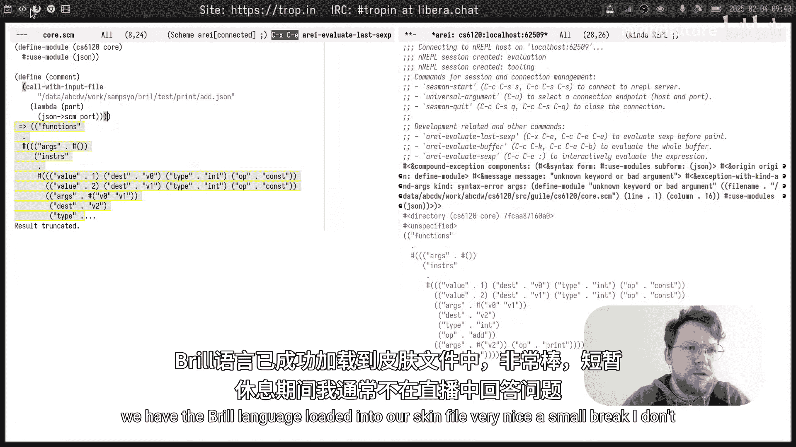

Very nice。

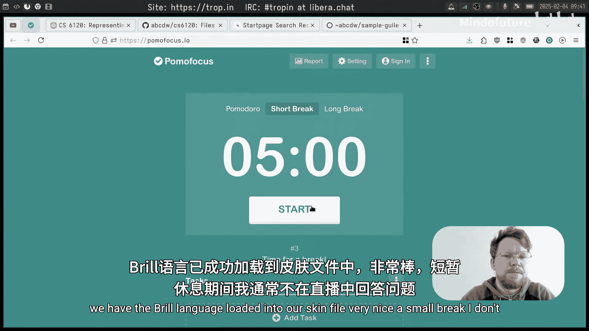

A small break。I don't answer questions， usually during the stream but。During the。25 minutes。Of work。

Because they don't want。To switch my attention。And I answer questions during， during the breaks。

So if you have any questions。It's a good time to ask them。I you。

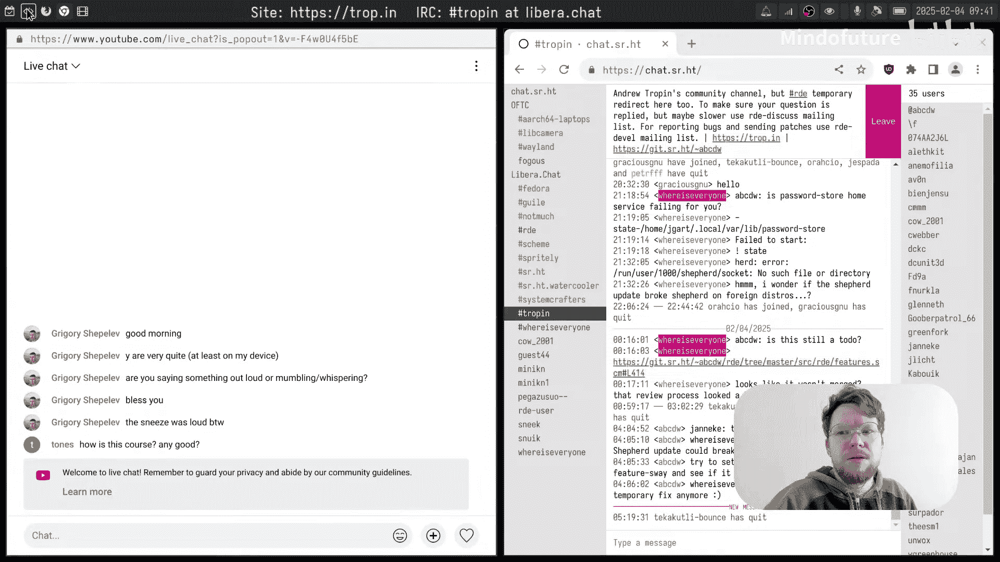

Left you for a couple minutes。But， I guess。I will still。Be able to answer。The questions you have。

Oops。I will keep myphone out of my mouth for a while。嗯。To eat a carrot and not distribute too much。

不在节。I got during them。The time in bathroom。Is the following is to package all the。Tools needed。

For real into。Gicks environment。So it can be instantated with Gs shell or access to this Gs API。

To build， you know， all the fancy stuff。

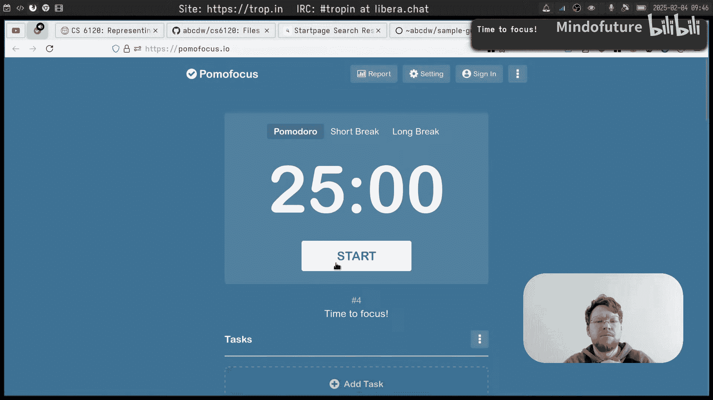

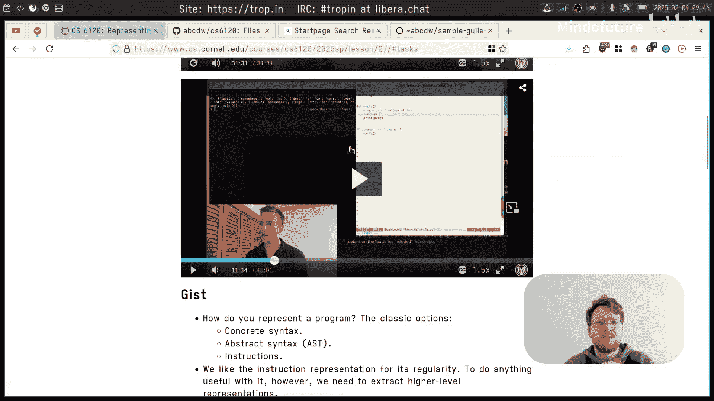

It's in the program。And then do something with them。

 I guess the first thing I'm going need to do is form the block blocks， form the basic blocks。

 I mean， make a new function called form blocks。 And I guess all it really needs is the。

Insts from that。It's called that the body of the function。

I'm not gonna have to do something that like loops over the instructions in the body。

 But just to make sure they'm doing this， right。That's not right。Cool。

 so those are the instructions in the body。 Now we're going to。

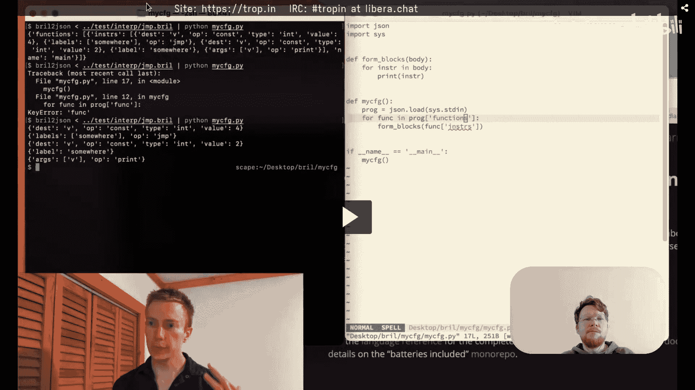

It will be index and vector element。No， it's just pered。And now， we need。To get so。嗯，对何浦。😔，Stlink。

At least him。K， our a list is material problem。And the key will be functions。てるんか。Strerink a。

Like this。And with vector for each different。It's very funny that we have。

A fraction that returns the vector， but we don't have。Vectctor to present。What。

What is the thing that appears from time to time。唉，有什么都。Reason。So，53。B， always back slash。O。

What I have here。啊。Mmhmm。Different。Print。No嗯。Function。Book。Instructions， yes， no。No， probably not。

Fction。Dires。嗯。F。That so it。Fun。い 진짜た。I like this。And it will be。In directions。Very cool。And now。

Different print。Ststructions。かてる。Vectctor for each。てイエックス。こまっ。走路。😔，Makelashlash in。嗰啲。

D directionions。恐怖吗？It lookss good。 It looks good。Actually。

 do our algorithm for forming the basic blocks。 So as I recall from our algorithm。

 we had this thing called block which here I'll name a curve block。 is's going to start out empty。

 And we're to loop over all of the blocks。 And I guess I will use Python generators to yield the current block as I build it up。

 But I guess the point is that I need to。Terminate the block if I encounter a label or terminator instruction。

And otherwise， I need to add things to the current。I think I think we got that right。 Okay。

 so anyway， but I will， I think I， I guess the top of we thing need to do is distinguish between normal instructions。

 like actual instructions and labels that appear in this list。

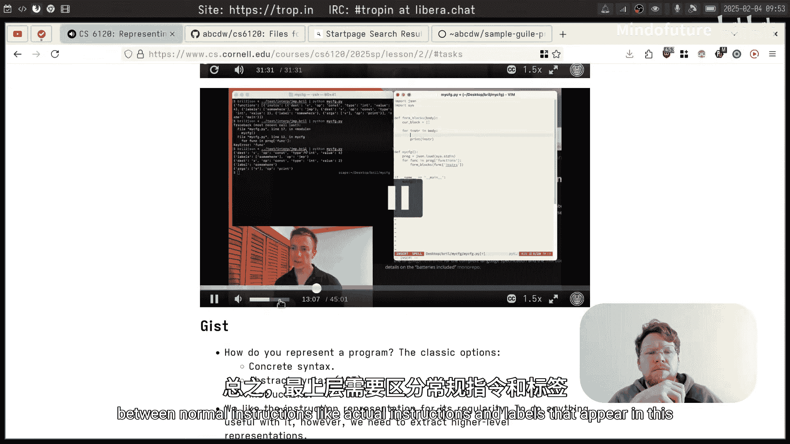

That is like， we have some maps that have a label thing in them。

 And then all instructions will have this， like up。Field in the dictionary。

So I can distinguish between actual instructions and labels by doing this。

I'm going do something here。

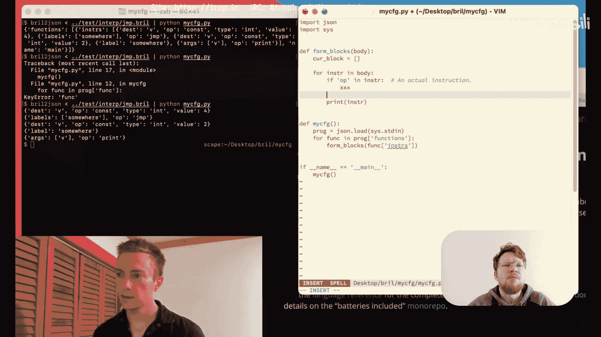

Okay。

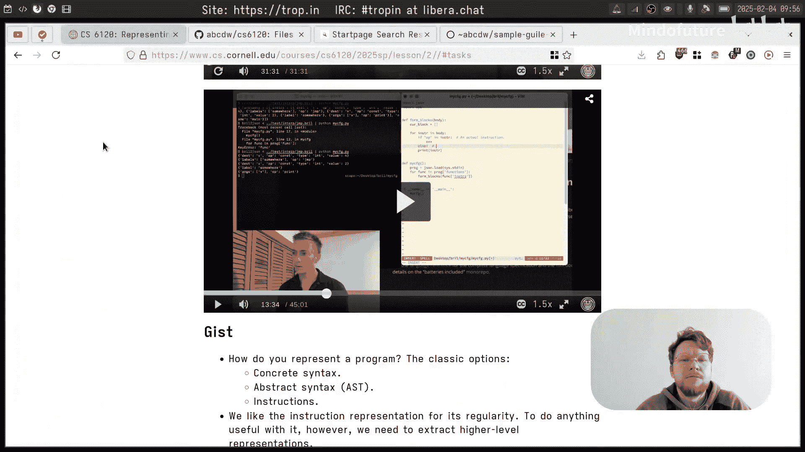

So this， this might be a label。 Anyway， I have to do one thing in in the case that it's a an actual instruction and another thing case it's label。

 So the way that it works， I think from our pseudo is that it's an actual instruction。

 that regardless of what it is， regardless of whether it' a termmininator or not。

 we will want to take our current block and append the instruction。

 So this is gonna to become a list of instructions。 including the terminator for this block。

 one that we now need to check for a terminator。

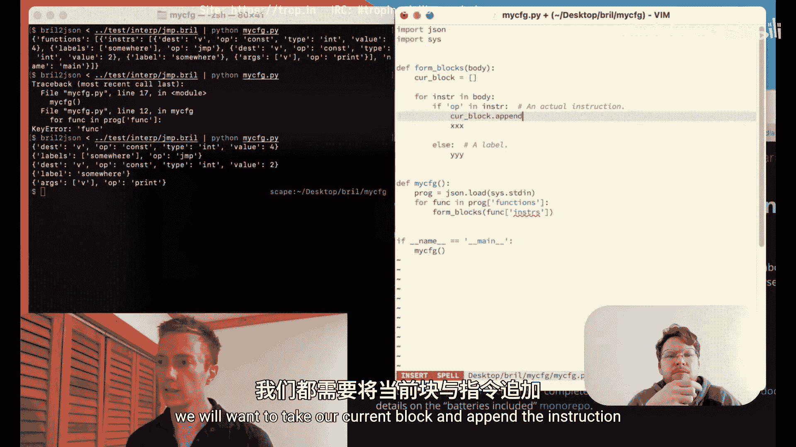

And we're going to do that is say。I need somehow to make ability to g one work。😔，So， now I will。

Go through the replay and we'll see if there is typescript version of be to gson。

Or I need to deal this pythton。You actually have this binary available for me。Unfortunately。

 I don't see。えぱセル？For to Jayson。Which is not。Haryton in。Brighton。But let's double check。

Newject in the order。Vus deco。He's located。Okay。It isn't made。Any think clear。Bil the S。

We have a list of。Of stuff。But it's probably grill test， probably just。へ率。Stuff from Json。呜呼呼。

That's so sad。嗯。What is C key。K it is an interpreter。 It is a singleet。Checks Samsung。

And this one converts typescript to grill。Probably accept type。I don't want to use。5。What is school。

Oh， it's one more。バたな。Package and product manager。Do you have it Ps such。We don't。

Bleaing fast and toast stuff。Veryicical， of course。Oops。Is this sink。He uses some grammar definition。

Probably from this library。Okay。ぱと forぱ done。Okay， the good news is the la is packaged。

I dont really soon。Is it built in library。Work partial。Probably it should be built in labor。 Okay。

 lets， let's try the following three。Gickigs shelf。Ohあ。8下。Okay， and now。By登。Video。T X T。G。Cool。

At least it didn't throw any exceptions。Dt。Plus。Okay， how to run a particular function。From럼 Python。

Yes。Probably minus C。マイナシベリ。杜椎酸。😔，你不。Re some。And now， we need test。嗯。过。Can people。😔，Function。

Thank you。Great producer with the same result。嗯，嘿へ。Oh。Okay。Because。

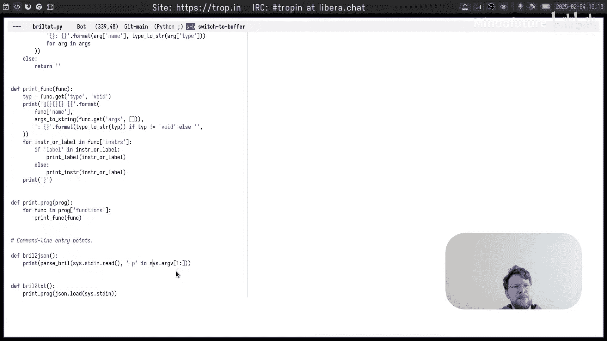

Okay， now we will come back to it after， after the break。

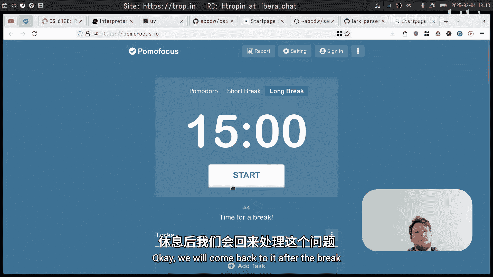

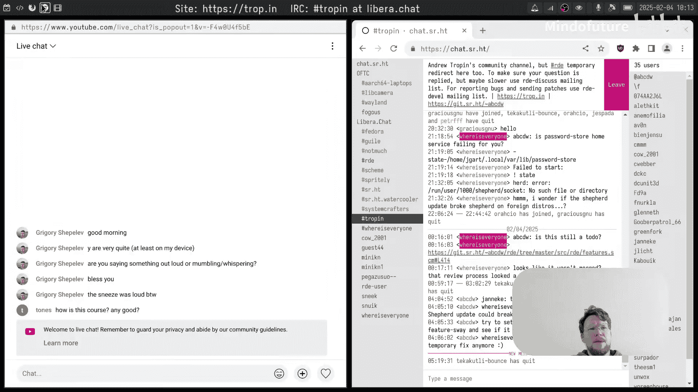

We have a 15 minutes break， so I can make。I use snacks for myself。

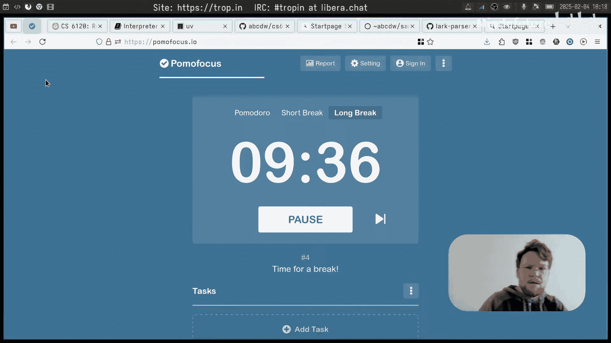

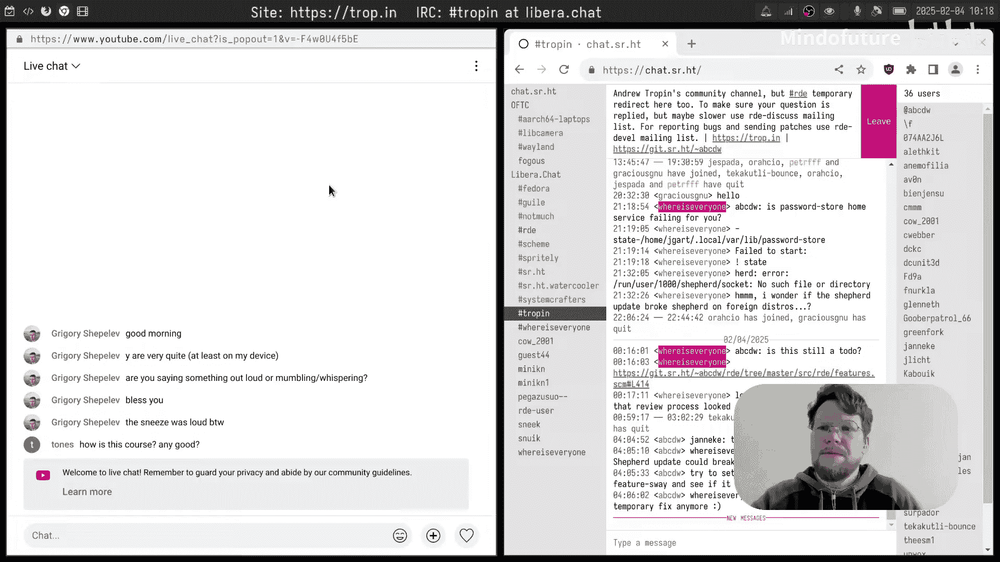

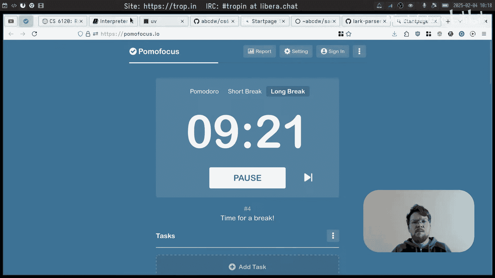

嗯。It's really hard not to get back to work。Before the break。Finish。But。

I was very successful with waiting and until。Thenent of the break before actually starting。

To work again。We stopped at the moment where we have our environment for Python already。

And now we just need to run a function from a particular。File。嗯。Doory produce。Some results we need。

So， let's go back to work。Oops。嗯。The model is not name anyhow。Psper ceases the。What does it mean。嗯嗯。

O， it means that minus P present in as。In C， C arguments。So， somehow。

Changes the behavior of this function。W to experience this problem。 What is happening。百灯。我自己。😔，Okay。

What is going on。Because this is really strange。I am like， very puzzled。What。Does they hear。Okay。

Now it somewhat working。😔，What was happen before I have no clue。Okay。Oops。オッケ。This。B。TP。嗯。

I somehow managed to make it work。给个 help。禁闭。Do。😔，Ex。We have a working tool for。

Transforming material to Jerusalemson。And it's a very ugly way is。リストら。But later。

Maybe today or tomorrow or some other day， I will package it。Inside the report so we can。Have。

A rip in the environment， which you'll call。The appropriate comment。But for now， let's。

Skip a tentacle back here。Now we have team P G P G soon。嗯。Good looks。It's interesting， is that。

Jumping the app。Have a list of labels， as argument。Pation coins。But okay， let's get back to the。这是比较。

YeahIf the instructions op code in and then mean to figure out what the termators is。

 I realized in the previous video that I made things sound a little bit too simple。

 I said that that the only two termminators should be jump and branch。

 but to answer questions like this， you should listen to me。

 you should go to the actual documentation for braille。 So to the documentation here。

 The documentation has a section called the language reference。

 And the first one is not going to be very helpful for this discussion。

 but its gonna to be super helpful understanding structure of brail programs and tells you what program is what type is what a function contains all that stuff like what fields exists on which objects。

 But what I really want to know is like what the actual available operations are。

 And the way that the braille documentation is organized is that there is。😊。

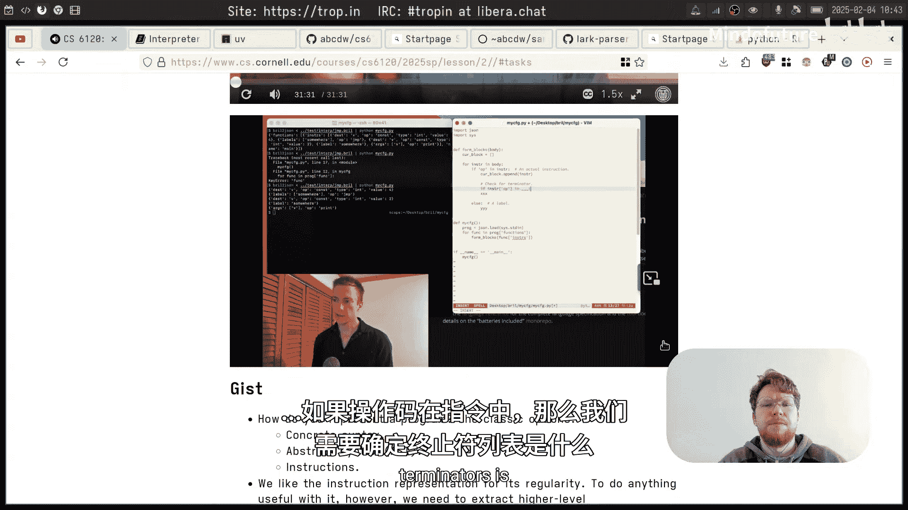

Theres a base set of operations and types that make up the core of the braille language。

 And then there are some extensions。 So the core just contains integers and billions and things like adding and multiplying and these kind of very。

 very basic operations。 You can see there's also a extension for dealing with allocating and freeing and accessing memory And one for floating point。

 but we't need those for now。 We just need to look at the operations that are available in the language。

 that's what we're processing for now。 And of course。

 the the termminators we're going have to worry about are going to be control operators。

 So conveniently there is a section in here called the control that lists all the control operators。

 And these are the four that exist in in the entire braille language。

 There are jump and branch as we saw before。 There is also call for function in。

 you can call functions in， which is a very very useful thing do。 You can also return from functions。

 Here is a perhaps surprising thing。😊，Generally speaking in instruction based Is。

 when you call functions， that is not considered a termminator for a basic block。

 even though it does involve in some way jumping out of the current basic block and executing some other instructions next。

 The reason is that the call will eventually return to that point in your basic block。

 So kind of invariantably want to maintain about basic blocks is that that the blocks execute in some way Atically。

 that is like if one instruction executes。 then they all execute。

 And that is still true when you can have call instructions kind mixed in in the middle。

 because you will be calling the function but eventually you'll come back to that basic block and you'll finish the rest of the basic block。

 So generally speaking call is not a termminator。 However， the one that I left out was。

 that is if you return from a function that immediately stops the basic block that means to stops the execution of the function。

 So it should also break out the basic blocks。 So I guess the way I'm to do it is I'm going to have a list of the top called Terinators。

 which is going to be a couple of all the opt codes that I want to consider to be determining instructions so that has not call but jump and branch and return。

And I will do something if the op code for an instruction is in that list of termmins。

 that couple of termminters。 So I'll do something with that。In particular， I need to。

 as name applies terminate the block。 But otherwise， I think that we don't， we need to terminate the。

 And I guess I need to start a new one。 So what we'll do that is I'm gonna to Pthon generators here。

 So I'll say like yield the current block that is let the the client see that we have formed to a complete basic block。

 And then I will set curve block to be a new empty fresh list for us to build them。 Okay。

 so I think's all good for instructions that is like for terminators will add them to the block first and then we'll yield that completed block that has now as an instruction at the end。

So when we hit a label， we will want to end the current basic block。

 So I think that the easiest way to do this is just to say yield curve block just as we did before。

 And for this version， is gonna be super useful to be able to associate blocks with the labels that they start with。

 So I think that the way I want to do this is that when we finish a basic block。

 instead of just saying curve block is the empty list。 like starting new fresh one。

 I think I want to say that the next block starts with the label that we just hit。

 That is like we just sort of finish a block。 we hit a label。

 I would like to to include the label at the start of the next basic block。 And， of course。

 labels aren't like actually part of the code that runs。Those basic blocks。

 But it's gonna be useful to have those labels sitting around so that we can still jump between blocks。

 So the way I can to do this is to put the instruction in the basic block。

In the next basic block we start。 last thing we need to do， which I almost regret about。

 which is is that we need to emit one last basic block。

 that is that we're still forming a basic block。 and we get to the end of a function And there's not a control operator there。

 That is there's no return。 There's kind of an implicit return there that we need to consider the end of a last basic block。

 So last thing we need to do is yield curve block。And this at least is a good start。

 We can debug this in a second。 But I will first just say。

That will print out the every block in the program。

 So this should be pretty simple for the program we just saw。 Hopefully。

 this does something interesting。嗯。G我 thrive。To split。All that stuff into blocks。Function。😔。

Everything he is valid。Will it。What you want define。Termin nas。Do you be list of G。Brich。Yeah。Great。

Forum box。It will be。Extractions to blocks。Let here。Just do this。And。😔，For each。Function in。都。あけ？아게。

Yeah的。😔，How inconvenient data structures in。In scheme。Can somebody。Implement the data structures。

And interface for them， please。Heick。は一たらと。Okay。ウニット。That I to understand how I want。

Accomative value will all look like。Unfortunately， we don't have out of the box。Imutable。

Data structures for。Dictionaries or something like that。What they can do。Instead of。

Tring to come up with。A good data structure。 We can just have。A few small values。

 which we are working on。The problem is that right now， we have one year。1 accumulator value。W。

 we need to store。A few different things。Which means that every time we need to serialize it into our accommodator and dealize。

 and we don't have a convenient way to access。The internal of it， and to you structure it。

That is why。Actually， we can use much。you up。Which。Which probably is okay。哎スた。And这里。ああき。Sium。

What do you have here。You have。Go in the block。Coen。唔好。Blockox。What else。Do you have examples。嗯嗯。

He need talking parentheses。And lets。Let's。Construct a list of。Gッs。Exist。No woman my drink。

Involun readable book。Okay。This one works。This is somewhat。A bit more convenient。

Convenience at what we had， but the。The fact that we recreate least every time。

He's not really satisfy。It will be a bit。答复。And performance。But don't记。Very small programs。

So you want't see you any noticeable。Delay in this。Okay。So， what do they do。衣服。嗯，明白。X or。Jmen。

、見に行ってる通るね。Gs symbol locks。G。Block。Which is almost al right。But before that， I would。I3， it it。嗯。

Yeah。嗯。给 actually。Almost what do you want。But we can build this in your block。Likes this。へへ。那不。

I aバイ入と。Right。开点。So working。Ha about。🤧我。Books。Okay。We need only the second。will you。Howかて。对的，这是。🤧。

Oh that's。What's instead of x。We just take only。He。哦。How about this one。哦。This is， is。Very。😔。

Very strange。嗯，O。It was a around good。Going block blocks。你又不渴。😔，别。If面不。Con block。He book。Ha0。

Me you block。も。Some次。Yeah。对嗯。probably。Msed up。He messed up。Hence the arguments order four。Now。

 its con drink。公司。And of course， it's。The around quarter。Because the coins。At least。Work this way。

It is kind of stupid。He broke。エクタルエフエクタルス。This is so freaking， inconvenient。

To work with scheme data structures。So horribleibly， But I just want to add。An element to the vector。

And they have no clue how to do it。How to add an element。嗯这 is。Compプリ。No。😔，W is to make is stupid。

我等呢。This is so bad。So， in。In那学生。Where the false comes from eye， it comes from label。Okay。

 how the label looks。嗯。Mmhm。Okay。We finally， have our blocks。嗯。Our coin separation， print operation。

Heittor evaluation。公すに行ってるよ。From。过。Fing un edittable。喂所喂。Or remember。Vivo。One second。Let's。Yes。

Did not we have。Aparations。Label duration。Seems okay。Thank you， Ray。We have another small break。And。

We have 20，25 minutes。How the video lift。Even if we watch it。bitit faster。

I'm not sure if we can finish in time。Because I's still not finished。For milk blocks。The same。

The not。I would like to write。I say。Blocks are hundred。Okay， let's get back。とブ extractor。

What else I would like to do。I to make。大変？In my bank。From a label to book。But holy molly。

 how hard it is。To work with scheme data structure。It's terrible。Terrible， completely terrible。

I want just an associationation between a string and。A list of blocks。Literal or just numbers。

And I would like to use what the basic。Asciation data structure available in Lisp。Goldgilist。

All association this。hich looks like， you know。And basicの。least。嗯。And it should be like this。

Can one label be related to a few blocks。Probably no。So okay， in this case。

When you have a one to one。I think。From label to one block。It's like really easy。

 actually really easy。嗯，嗯。Okay， we can add a label。And。系 bank。Now， we have。😔。

To more things to maintain。我利宝。If尾不。Attic。Sam。So。X。微部。Otherwise。It'll be false。Okay。Poote。Now。

 instead of。This think we will do。this sink。好。嗯。And what else。Okay， and we want。

Need this stuff anymore。Bs。both。And。😔，Has the additional label。Youll be folks。Okay， now our blocks。

Have labels since the beginning。With it appropriate。And nothing if。If it's not。不 good。

Actually looks not that bad。 Not that bad。For this particular use case。Figured out。0。

Straight forward week。To construct our final。My pink。So， now， you can see。We have a third block。

 which have。嗯。Just association operation。Or assignment。When we said。Variable v to value 4。

And after it jump。Unconditionally， to。So available， and。In some way。We have operation。Print。

And the operation return。Which is hard codeed， for now。To simplify our implementation。

 not to deal with like。And finish the book。Actually， get rid。 Let's get rid of the sink。Instead of。

This stuff。 Let's skip。Instructions。嗯。Let's。Indi。F the。Yeah。If no。Give us much for the result。Be。

Whatever。What happens。O， label is important。If no， the block。Blocks， otherwise。You see how high is。嗯。

데리블리 할게。No need no need。Do we get the same result。Yes。But now， we don't have a yet。Okay。

 we split everything into blocks。Looks like maybe it's， it's super helpful。

 I think to you look at the actual code。In嗯。To decide whether we have this right。

That is to read the the human re text representation。

 So does it look like there should be three blocks。

 That is the first one that contains the constant and then the jump。

 the second one that just contains the constant。 And then finally。

 the last one that we are going to include the label and then。And then the print statement yes。

 So so think this is right。 I at least this one。 I think we have something that's working。 So great。

 we have our very first version of our basic block formation algorithm。

 That's not as not a extract yet。 we do have our basic blocks。

 Now would be a great time to take from here and shot at doing the rest of the algorithm that is like taking this list of blocks and actually implementing the pseudo code that we developed together for forming entire control flow graph。

 That is a bit something that represents the graph from blocks to blocks。 That is the successor。

 That like which basic blocks are the destinations of jump from other basic blocks。

 So feel free to pause the video and do that now give it your best。 if you can get into。

 I'm sure you run into some weird hourarly challenges and then come back and I will I'll show you how I arrived in my solution。

😊。

Mmhmm。Mmhmm。What he wants us to do。Hes to go through power blocks。And。Make a graph。Which takes。

Its the last decoration of the block， and if its a jump or。Bch separationation。

 It adds a couple eggs。Actually， we can build those edges easily。But our edges。就。

You will not destroy that with blocks。So we need to number our books。Or at least name them somehow。

 But because they are not named。For those use cases， For those cases， maybe we don't have labels。

Of course， we need to provide a different name to them。Okay， that means we need to work。

It works this thing。We can name it by the first instruction。嗯，Number。For example。And。😔。

Instead of label。We will use this sink。And you'll have my bank。よ。😔，here。😔，No咪全。Oh。哦哦。Okay。我可以进。😔，哎。

北京不ス不可进。😔，Okay。And for this case。If a label attacks。8。😔，V读。😔，Of公。How it works。 key value。He list。Ki。

😔，嗯。The blog会。为了为梦。😔，へ。labor步。没 think。Very good， now。What322 values。嗯。This is the first one。

 and the second one。Will will visit my bank。N。我。对。我什 myての。Do you be first。Okay， okay。

Let's just convert to the list。度。哦。What is。😔，Happening here。It's alright。嗯。This one is clear。

New blockss， block， block Gr label make them。My then connect the block， I。微奔。么点。If they both。你不你不开机。

😔，ユボロク blockケージ。不部。Okay。Store。Yeah might think。For every step。This is。😔，This is quite empty。有。V是微。

Ifle。U is given trunk It should be a sample page。It was a previous book。Okay。

It looks kind of right there。But it should be populated at some point of time。When。我想 label。哦。ほら。

Allright。If。微报。😔，光播机。どやだれ。

B for break。

I really want to finish it。Before leaving。It looks right to me。Okay。啊。Itat。第く。Okay。Okay， it。

It takes few items。This is right。It's。Okay， if you have a label。As a current operation。

 lets add asation。For the next block。To label。😔，Like this。ok。Now we have association。We can。

Speech them like this。From label to block A G。So now。We can easily be build address。And。

He this association。The fish。That is， we can really build the control flow graph。Oh。

Let's take a break。O。Let's now build a graph out of this sink。Instruction to blocks。No，我以为你。

The tennis for blocks。こか。Okay。below。They'll take books themselves。诶。Yeah。Label。No我给你。都 go through。

So一直不。The exhaust decor check if。If a jump。And at at the edge， in this case。For this video。

 need fold。And list of blocks。いック？フィニットクストラック。Instructions。嗯等于几。it's basically it。And。ストシスとのッ。ボロック。

とこだ。

嗯。

So in developing my， the first thing that I think we need is addition to having this list of blocks。

 we're going to need a named map of blocks。等你等你。广咗冇 graph。こンテラを。っとそ状態にて。こから？Something。Okay。那怎么样？

But this is。No mention。Yeah。Works right。This looks right。It can be here。B。飞置。This one。Yes。気持。Lox。Oh。

 was good。I'm almost sure that something wrong with the。Order of arguments。Fult cons。List。😔，人はして。

你在怎么对你。😔，And procedure element。Okay。系事。The order。Of argument， but difference。Different arguments。

And know what。欢迎你亮。😔，有 x。Is a mess。D。嗯。Okay。てます。They。😔，No。😔，云你。Case。Im true。If case can。

Can of work with strings。Maybe an expression which goes。3号。Li sense。おせ？Stupid。😔，关的。And。

The funny thing that I can't use much。😔，To the structure instruction。Becauses， because。唔系。

Is not that。got this at list。So you know。Do。そ。And。The label。It's okay。We both。Pient。Later。Okay。

They take accumulator。すけど。唔乜去噶，你冇。Cs。What you want to do is labels。We want to find。ok。

I just Port cons I D。He you。なイペン。😔，X。うんなイス。嗯。嗯。等会。Was itnderしか。My been 꼭 그。姑姑夫姑姑。LetsCheck。😔。

That's a who we need。Really。Eeration jump to somewhere。回波嗯。ok以。嗯。One more think。

If you have full label。We also need。To add。Okay， later view then。Pleaseice。Andful。

So much accumulator will。你 do只 way。H。The previous one was。Okay， we have our graph built。

And that seems right。You can jump to the second note。From the first one。And from。The second one。

I mean， to the short not。And that's right。But， we can't reach。This is not never。

Which looks reasonable to me。Probably， we don't even need。ヘレビよろし。😔，Yeah。

 we built it in the right order。我跟他讲。So my first staticctic。

 and this is not the only way to do it is to write a separate function that you might call the like block map。

Function， and this is going to take a list of blocks。 sequence of blocks。

 It's can iterate over them and create names for every block。

 And it's going to do that with the label that might exist at the top of the block。

 And if you don't have a label at the top of the block， it's going to invent a name for you。

 So this way， we will have a kind of regular representation that like gives us a string way to refer to blocks when performing're form the CFG。

 So here's how this is going work for me。 I guess like the the the。

I'm gonna have like this out dictionary that's going to map， again。

 names to entire blocks and then going to iterate over the blocks。And add them to this dictionary。

 So eventually， I'm going to turn this out。So。I guess there are two cases I need to do。

 I need to do something like out name equals block。 But first。

 I need to figure out what the name is for a given block。 And there are two cases here。

 Either we have a label or we don't， so。Here's how to tell。 That is like the block 0。

 That's the first instruction。 We can see if that has a label key。 If so。

 then the name is just gonna to be block 0 label。And it occurs to me that we don't need to keep around the label anymore because it's kind of redundant in this representation that is we just need the instructions that format not the body of the block。

 So we can just say that the block is now a block 1 to。Previously in the previous video。

 he didn't save。Label as a part of the block。And Bquiness。咩出。Saving label makes sense， because。

This way， you can。Easily understand， like， if。Some labels attached to the block Z only。

The tricky part here is that if we have a multiple labels for one block。By one go by one。

But that's probably not the case in this language， A in。In sc or just。In the use cases， so we can。

Probably ignore such cases。The end， this is Pthonons and D4 make a new list that is like the old one。

 except it skip the first element。 Okay， so otherwise， then we don't have the label at the beginning。

 We're not going to do anything to block。 All the instructions are important。 However， we do need a。

Name， so we'll just make one up here。 So like we could say， just like B one or whatever。

 you could just like sort of randomly create a number to go down here。

One random idea that I have is that we could just get a number from the length of the out map so far。

 So the first one will be 0。 And then like eventually， we。

 we will like every time we'll something this this is a guaranteed be guaranteed to be unique because we're constantly adding to the outer right。

 Okay， so I think this works。Let's find out together。 Very supens。Let's just。

Do create this thing called name to block。 and that's gonna to be block map applied to forming blocks here。

 And we' just gonna print out this name to block map。Okay， fingers crossed。

So it's a little hard to read， but it looks like we have a block called B 0。

1 called B1 and one called somewhere。 it sounds about right。 Okay。

 so I think we have names for all our blocks。The next thing I mean need to do is actually compute the successors for these blocks。

 We now have this name to block thing。 I think this gonna have to work by iterating over all of the blocks。

 So the blocks are in the values of the name to block map。

 So to say for a block in name to block values。I thought better bit。

 I'm gonna make a function called。Get CG。 And this thing is going to， I guess。

 I'll a texting for myself。 given a name to block map。

So this is gonna produce a dictionary that maps names of blocks to lists of names of blocks that are successors of the one on the left hand side。

 Oh that makes sense。 Any guess， I'm going do my loop here。And then call it down here。Eventually。

 I'm going to print out that CFG already read。Okay， so we' got to do for each block。

Is find out what the successors are。 That is the thing that I'm producing is again。

 this like out a dictionary。 And then we're gonna eventually do like out。

 I guess I actually wanted the name here。 So then we have the name also of the the block we're processing。

 And we need to do， we need somehow to produce a list of successor successors of this block。

 Most block will only have one successor those with the branches at the end we'll have two successors。

 But this what we need to do。 And eventually， we need to return。Out。

But we need to compute those successors。Everything that matters about computing the successor is we can think of by looking at the last instruction。

 That is last instruction might be a jump。 or in which case， we know exactly what the successor is。

 or maybe it's a noncontl operation， in which case we know that the successor is the next block in the sequence。

 So I guess I'm just gonna do that now。 Im gonna to take this last item That's block negative one in Python synax。

 We're gonna do something with this。 So I guess there's a few different cases。 We can say like if。

We're gonna to do something if it is a jump。In fact， I think that we can let。

 let's actually take a look at this at the code。 So in the Jason representation。

Jumps and branches use a key called labels that indicate the kind of the labels that they are pointing to。

 So both the jump instruction and the branch instruction just give us the names of the blocks that are the successor of this box。

 So I think that this one， these two cases， we can probably handle the same way。

 That is like jump and branch the successors。Are just。This isn't to be the last instruction。

 The last instructionss labels。So I think that's all we need to do。 And if that's the case。

 then those are the successors to this。I hope I have that right。Other case。

case we have to worry about is the is the other terminator。 So if。That last operation is return。

 Then there are no labels that are argument to the return function。 In fact。

 we can confirm that by looking at the documentation。 The return function， it's just a re。

 It doesn't have any arguments or anything。 If it's a rat， then the successors are nothing。

 That as this is an exit block。 It doesn't have any edges coming from it。

But we're still not done because there's a chance that this is a non terminator instruction。

 That is that we have to worry about the case where the block falls through to the next block and that we don't have this convenience of just being able to get the label of the block for the。

From the instruction that's the termminator。 And we have a little bit of a problem。

 because now we needed to ask the question， what is the next block from this block。 And so far。

 we've just been maintaining a dictionary。 So it's not really a well posed question to ask what is the next block after this one。

 So I'm going take advantage of a little bit of a Python magic to make this easier， which is that。

Python has a collection class。Called order di thats guaranteed to maintain this order。

 which means that when we're building up this block map。

 we're not just going to be making an unstructured map。

 we're going to be making one that maintains the order that we inserted in。

 So we can ask the well question， what is the next block Now。

 if you're doing this in some language it doesn't have this like order diic thing。

 it might actually be clean not to。 you can just emit an association list that is like just key a pairs of keys and values instead of using a dictionary。

So that means that in this gets C FG function， I now have the ability to。

 and this is not very elegant。 I have to admit to use Python's enumerate utility to look up the index of the current block we're looking in。

 So now it's possible to ask。For forgott this mistaken argument。Is possible to ask。

 like name to block dot items。Let's call it keys。 Actually， So if we get a list of all the keys。

 I would be the current one。 We can get I plus1。 So the successor。

To this block would just be I plus  one。 So I know this is gonna be problem if I'm at the last block already。

 but I'm just gonna give it a shot for now。 and it is almost certainly going to crash。 In fact。

 maybe I would like to watch it crash when we have to deal with the last block。 Yes。

 it's going to do this。It's going to crash when it's the last thing。 And， of course。

 that is out of range。 So we can fix this。 And again， this is really not terribly elegant。

 but we can just say。There are no successors。 It's just like having return。

 if you're at the very end。Otherwise， do what we were going to do anyway。Did this work。No。

Maybe if you want to， you can divide my code by， maybe you've already figured out the bug。

 but I now need to figure out what I'm doing here。Of course， this should be offly one。Great。

 so I think we kind of have a CF here。 that is like we named these blocks before。

 I guess it would be nice to print out。😊，In fact， I'll print slightly us your way。

It's easier to read。 So we know we have these three blocks。

 They got these two inventedventive names B 0 and B1。 and then somewhere。

 The successor of B 0 is somewhere because it jumps there。

 The successor of B 1 is somewhere because it falls through。

 and the successor of somewhere is nothing because it's the end of the function。

 W I think we got a CG。 The next step is just for fun。

 I'm gonna draw these these CFGs as actual graphs using the graphfiz tool。 If you never use graph is。

 it's pretty cool。😊，It is just a way to like a textual representation。

 get it turned into like visual graphic iss not pretty， but it's super。

 super nice for getting a quick visualization out of compiler tools。

 So I'm going do that just using the CFG that is like the successor map function that I had just emit。

 That not that hard。 Fortunately， the dot format that graph is uses is really， really simple。

 You just have to say like diegraph。 And then you give a name。

 And it's gonna be like opening curly braces。on formatting。 I' got to do that twice。

 And got to say like。😊，Gotta give this graph a name。

 And we just sort of show you what that looks like。 I don't want to print。This stuff anymore。So。

 yeah， so we got the digraph means。 we're gonna print all the edges。嗯。

So we're going to make one vertex per。C if you node a per block。 So it will do。

Or just do some innotation and print them and add the name of the block。I guess that's all we need。

 So We don't even need this stuff。 We'll just put the name of the block。 Okay， great cool。

 Now we will add the edges。 The way that this will work is I'll just loop over the name to block map。

 So it we'll get the name and the successors， the name of the current block and some successors。

 name to block。And we will。 the indexax of doing this is just that you have one name of a previously play vertax match another name。

 And you can just put in， I guess we need。To look over the successors。That should do it。 And finally。

 we just needed a closing curly brace。 And I think we should be all good。

 This gives that's not right at all。Of course， I to move over CG not mean to block。

Hopefully this works。 Okay， so we got declarations of the three vertices。

 And I think we also got just two edges， be0 somewhere and be one to somewhere。

 And I think that's it。 So I think that this is a valid graph is graph。

 So we can just piped that thing into dot T PV F O。😊，CfGWPDF， I think this works。

And we can view this wonderful controlflow graph。 Of course。

 the fact that this CFG extractor and graph works on exactly one example should not be satisfying at all。

 In fact should be somewhat suspicious that there are probably issues going on with the rest of the language that as we've just done one tiny little example that doesn't even have more than one instruction per basic block most of the time。

 there are definitely bugs in this。 I can tell you that。

 sort skip over a few cases that will certainly come up when you run on more realistic programs。

 So the next thing I want to show you is a convenient way to do testing。

's not required that you use this at all in 620。 but is what the rest of the Brail infrastructure uses And I'm going show you this tool for testing that you might find generally useful when writing small tools is a larger compilr that tool is calledtt is testing tool。

 the tiny unified runner and tester that we made a couple years ago that is super， super simple。

 All it does is run a command like say this command right here on several different files And then check that the output matches a precomputed output on disk。

 So it doesn't do any it doesn't work like unit tests that you't have like write expected write checks for what you expect your function to do。

 instead just do this super simple thing which is to make sure that you match some precomp output。

 This is really nice way to get most of the benefits of testing that is like you can make。

Changes and then run your program on a whole bunch of inputs to make sure nothing broke while you're doing refactoring。

 for example， without a lot of the overhead of testing of traditional unit testing that you don't to write these complicated specifications。

 And I just， in my experience， is a super super useful way to go about gaining confidence that your implementation for like these little compiler tasks actually works。

 So I'm recommend that you explore this。 It can be useful just to get familiar with it。

 even if you don't use it。 I I'm going apply it to the extractor now。 turn to install Python。

 You don't to do anything fancy to install it。 You can just do P installed I already have installed。

 Do I apparently not。Okay， now I got it。 great。 But in case it is the tool that is used in all of the test infrastructure for Braille。

 So that test director that you saw before has a bunch of inputs。 So， for example。

 the interpreter directory has a bunch of the tests for the interpreter。 It has this。 It has。

 let's see。 It's got a divide program。😊，And if you look at that， this just a normal braille program。

 And then checked into the repository is an example is the output of that that is like what the interpreter should print。

 And the key to working with Trent is that there is a config file called Trentel。

 which is just indicates like what command we're supposed to run in this。

 And there's other things you for you can the configuration file。

 But this is the of it you just like write down this command to that I'm gonna I'm going convert the input file。

 That's thisle in this case to Jason。 and then run the interpreter on it。

 And that's what's going to be captured in the out file super super simple。

 And if we we can check that this is the case。 just go over to the interpret director。

 And if I just sayt diville。 this will run those command and say okay。

 you do match exactly what's on the disk。 a different thing that you'll find super of the flags is the verbo and print flags which just say I'm going to execute this command and just show you the output instead of comparing it to the expected output。

 This is a nice not have to remember that you have to put the bus stands in the special place And the pipe in the special place in order run the command every time。

 This is just a way to have a reproducible way to run the same command on a whole bunch of different files。

 for example， there's another。They like hear that。Well， that's surprising。 But other than that。

 you can， you can see that this makes it easy to run the same command of multiple files just to observe the output while you're debugging。

In any case， we're going to ignore that bug in the interpreter right now。

 I actually don't what's going on。 I think it's an old version of the interpreter。

 It's trying to run。 And we're going to flip back over to our CF example and set up some testing infrastructure for it。

 So it's super simple。 All you got to do is like have a test director。

 You don't even need a director if you don't want to。 But in any case you can put in a。

You can put it， put a file called。Turt doel and starts typing your configuration。 Again。

 there's a bunch configuration you can learn about in the reme forrent。

 But the big thing need to do is just say command and then type some command here。

 And then I'm going just scroll up and look at the command that I was running before。

 I don't want to actually feed it through dot exactly。

 I just want to I just want to run the I just want to run our extractor to print print the graph is graph specification。

 And instead of hard coding a specific file name here。

 I will now just say brackets file name that gets expanded to the file name of the current test。

 I will also need to change the path toscript I'm running because now matter test directory these commands run in the directory where the file names are。

 So where the test files are。 So this will just jump braille for example if we do that。

 And we' need a relative path to the script we're actually trying to run。

 So the next thing we need is a file that actually run on。

 I'll just start by copying over an existing test。So from the test of the interpreter tests。

 we had this great test we were using before。 I'll copy it here。

 We can run turent on this immediately and we'll tell us that something is wrong because we don't have an expected output yet。

 one of the flags tot is di， which will tell you what's the difference between what is on disk and what we' actually outputting。

 So this di is indicating that there was nothing on disk and and everything is being added。

 So in order to mark this as the correct output， It looks like the output to me。

 the last flag tot that you want to use all the time is turn save save something to disk called out out。

 can look that It is exactly the output we expected。 And then finally， now。

 if we dot jump out Braille， This says okay that is you match the correct output。

 And just to check that we're actually testing something meaningful。

 if I edit my CFG file and say like print something totally different。 And I say out Braille。

 I should now get a difference indicating exactly what changed。

 So as we improve the output or make changes， it can be super。

 we'll look at the di to make sure that are expected changes。

 And if so we can do save to update the expected output for future runs。

So I suppose to make things a little bit more interesting， I will add a second test。

 and I'll do that just by copying a jumped up real。 I guess I'll say， just call this another test。

One thing that I would love to test is when。We have more than one instruction up here。

 Or one other thing I think would be great is to say that we have an explicit return at the end。

 And let's see what happens just to see the output。 we can say run another dot real。

 And unsprisingly， we have already found a bug。 Maybe you can see what the bug is。

 I'll give you a few seconds to pond。😊，You got it exactly right。

 The bug here is that there is no block 0 for one of the blocks。

 The particular block in question is the one that appears after the re here。

 That is when we were forming basic blocks， we weren't careful enough to check whether there would be any instructions at all between a terminator and the end of the function or the beginning of the next basic blocks。

 So it's actually going to be a problem as well if we have a jump right before another label。

 So we can fix that in our script real quick。Just by saying we only are ever going to yield full blocks。

 rather blocks with at least one instruction in。 So we could just say if cur block， then yield that。

And just do the same thing。Down here。 and hopefully， that fixes our problem。Hey， it works。 cool。

 So this looks like the right graph。 We still have the same CFG， despite those things that I added。

 So I'm going to go ahead and save this as the expected output。

 Now we can run all the tests for the script by just saying turn star do brille。

 And it will run both of them and everything's going。

 I encourage you to once you have a CG extractor or anything else working on Braille working。

 add a few more tests and keep expanding your tests as you identify bugs。

 just add a new test and exercise of that bug commit the output to your repository and build up a larger and larger set of tests。

 For example， in the main braille directory at the root of the repository。

 There's a whole bunch of tests。 you can just make tests to run the entire suite。

 And you can see that we just been building these up over time。

 as we made small tweaks and found bugs。 It's really easy to just add one more tests and pretty soon you have dozens and dozens of tests。

 And you can be reasonably sure that you didn't break your code when you make small changes because you can easily check a very large number of inputs to make sure that they're still doing the right thing。

 Good luck。 and I hope you enjoy usingt and please ask any questions you have at all about the braille infrastructure if're confused about any of the documentation。

 please post questions on  Z。😊，We did everything except the writing think benchmark。This one。

I consider we。Covered。Is this desk。再说。So it's。res a matter of a couple lines。The rest is done。

 as only think I I would like to do。Is to package all the tools。

So they can be available via gigs shell。For future lessons。But。Pro pretty difficult to some as a day。

ok。I think that's it today。Thank you， Ru Hu and。Hopeping。

By by。