# 学习CS6120高级编译器课程-p03-P03-Lesson-2-Homework---CS6120---Advanced-Compilers--BV1dr3Ez4EEP_p3-

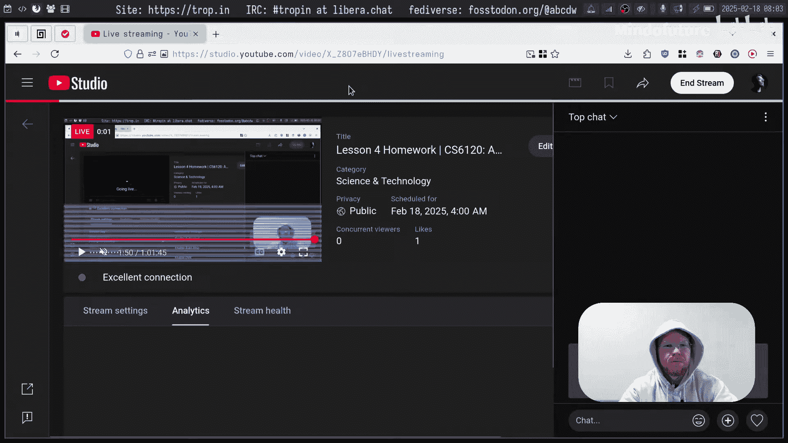

Hello， hello。I write the message。And。英거ル댄。For people new to hear， I am going through the C S 61。

20 course。Watch videos。Sometimes， squ them。And sometimes。Even do exercises。 And today。

Today's plan is to actually do。A few exercises。 and most importantly。

 to set up infrastructure for a running。Our qua on。

Set or subset of tests which already present in the repository for the scores。

What to link for intermediate language。嗯。Okay， it's a message I wanted to write。嗯。哦。

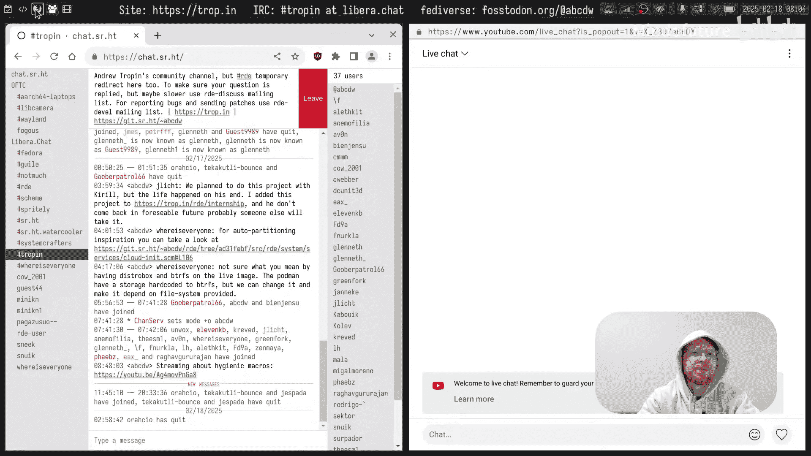

Probably你 thread it here。Cool对接。Minutes。Kture。The。各位是真。Spak。how how you spell immediate like。

Don't expect it prompt。や愛？Like this。Imediate。O。Thank you。 I will try to remember it。

 but Ive already used a synonym。I worked for 25 minutes。Right。To 15 minutes break by。

It was questions don't expect prompt。Promptly reply。嗯。Trice。至于领。ok，诶 seems。

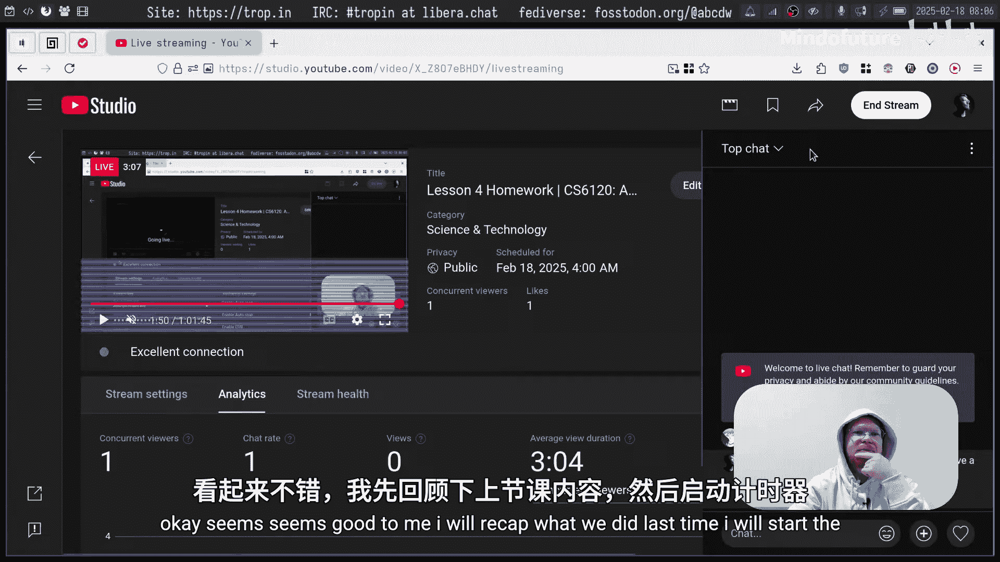

つぐっと。I will reup what we did last time I will start the timer。

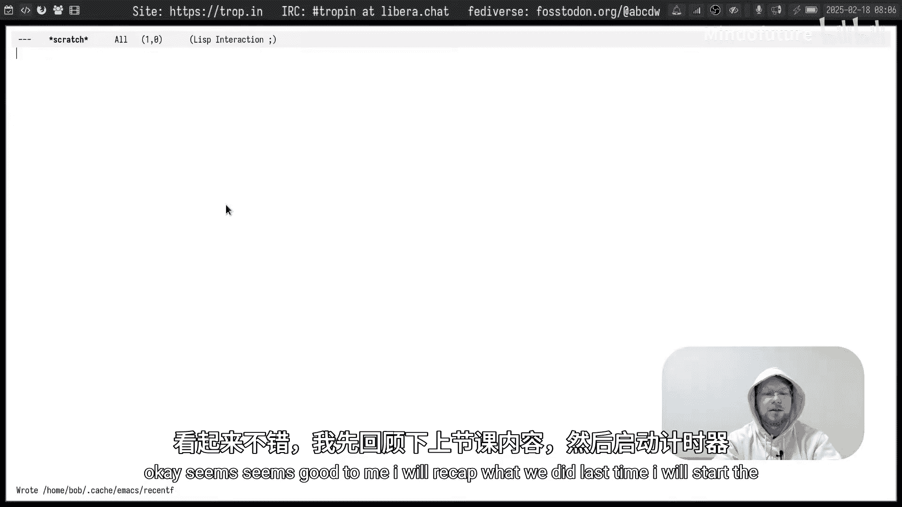

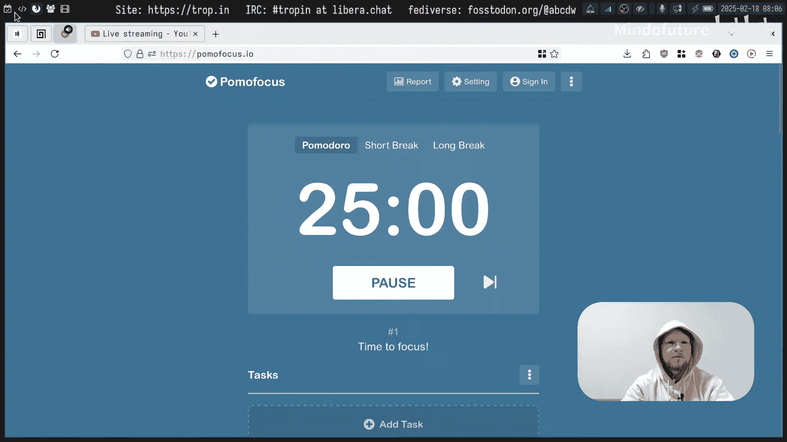

And I will wake up what we did previously。We have。Make file instead， make file。嗯。We have。A。

Which we can use to。Interactiveively called in scheme。And this allows us to。

To do tricks like this one。I can reference real checkout。And particular5 and said， this check out。

But it was intermediate language we use for the course。And， but it'll check out as a repetitory。

Let's start the report。Yeah， last time we did。Update the definition of the package。 so rip starts。

Just a few seconds。 And they starts in。Fraction of seconds。嗯。

Instead of minutes as it was with gigs for channels。Yeah function。So we connected to Apple。Now。

 we can。看不懂。Why why so。嗯。ok。一样。It works so we implemented the packages for gigs and for channels。嗯。

It's a bit involved package definition， but basically it takes the source code of the channels and builds it with。

嗯。该有 build system。So now we have in our one guideload pass both gig source code and channels source code。

 So we can use functions from R D from non gigs from。Geks and whatever。Else we want。

 And we have burre。A repory as geeks。Or that we can area difference。In our code。 Now， what we need。

 we need。To build this thing。And to see what is inside。Inside this repitory。We have test。

And it actually contains a lot of stuff。And the most。Intering one。It's probably this Jordan G。

Domal file。Because it tells us。ハウトラです。Vez。The either。YouCan use T itself。

 or you can reimple the same functionality， however。I don't。Want to implement the functionality。

 It's not that far。Like two per at of5 and to run scripts。But why bothering if you already have2。So。

 let's， let's。Try to find it。Case。Or somebody also went through this course。嗯。ok。Let's see。周龙子。系呀。

This is what you're looking for。Tny unified runner and tester。Install。Relip。I don't want to use。Beep。

Can你。Can we package this store。It has by project， tomorrowmo。The funny thing that。

Ecosystem and package managers of。Pyon， as well as Javascript， I would say changes so frequently。

So you can see that in the previous years of this course。

The recommended way was to use fleet before that， it probably was Pip。And now， it's。I bet you， U V。

If you take a look at them。A repetative is video itself。You see it uses。Bests。We install Jo G。

I don't actually want to use Jo。 Let， let's try to package。I mean， I don't want to use people。

 not guarantee。Let's try to package as this sing。Somehow。I didn't package Python but。不发应。

Let's go to packages and。We have bra here。 now， let's。Let's， let's define。Let's actually。

Instead of Euro。Let's do。Gitage。So。Let's change the。Youural。😔，Do you have any releases。意思。

the latest we need。Yes。An is the latest。the latest， and the greatest。嗯。저런지。叫机。过敏。Stリ。Maybe。没钥匙。

Like this。It will be。就机。这个比较是。But without。Gs。Let's。Let's change it。Does this one。And。

Which deal system you want here。By project。Actually， it would be cool to ask someone。From。

 from the chat。From the ex。Because I know a few people packaging a lot of python。For gig。

But not today。 today， we will just take。And jump。The gi a 리。And well try to find a build system。

Like project。比如。Sテem。嗯。Show me examples， please。Okay。Seching pass。I guess， we just。Oh。

 I even spelled it correctly。And let's go to this thing， and。Find build system。By project。

I don't know if it's the latest build system and the one that I have to use。But， I try。

Step by step and see how it goes。Inputs， native inputs。Suppart， supported systems。

It doesn't care too much。Simple snapshot。I don't really care too much about this thing。

the description。Licence。It's for a black spot。Okay。looks good so far。Nicholas。

 in case youre watching this stream。Weve talking with you about。Iギs。Extensions。

And the think I would like to really have。Something which allows me。To do。Bil this store。

To do this one。嗯。Much easier， like without writing call this boiler plate。

 but by just evaluating turning tea with a special comment。Expected。Oh， actual has said。

It could be past the same question， again。Update the package definition。And it failed。It failed。

Let's find out why。No model named Philip Gu。Geks。Search flipped。Bon blade。挂了。Do we need。

Bothos fleet and F core。But will be enough to have patentythton fleet。

And I'm curious where I need to put it。 Let's， let's find some examples。嗯。Flet。

It's usually in native inputs because it's probably only compile time dependency。Right。Ft core。ok。

 okay。nativeative inputs。Lte Titon flip。挂了。And for this， we need。度。チアルビニットとインパルト。P过。Yeah。

 another functionality will be the interface。Interface for looking up packages。

 gigs packages inside Emax。 So I have connection to reel and this reel have Gs source code。

 and I want to find Gs packages inside this Gs source code and channels。

So I don't hold like search for my。The channels set for my user。But， I look up。

Through the package is available in my guideboard password。Project。It would be he。I mean。

 it's not that hard to implement， but。You know， you just need to implement it。

Or somebody need to implement it。嗯。百度表。And let's about this one。AndLet's wow。This one。And now let's。

😔，The write to build again。B。E。Best system， not found。The你。唉。Starting face check， using。If。

Do you have any tests。In cha。没快哦。いくです。呃。Yes， I guess。

 But do we care about the tests for the guarantee。你都唔清楚。😔，Like we packaging it for ourselves。

 nobody will lose。Backage ever。A。This。I guess。で。Hse。Should work。对。Oh。

 and another function I would like to have。Is duan。Already。

 we pieces of cotton because I need to jump first to the end of this。Yeah。Expression to related。

 But I would like to just quote an a completion interface where already related expressions are and just big。

嗯， the need多。And the same interface would run。The same interface could run。good。

it it than just like last related expression or whitelu related expression or some saved。Expression。

Will be really like convenient to experimentra multiple times。Okay， good。 We packaged it。

 We have a binary。 now we can try to run some tests with it。How we will do it。

We have a make file inside make file。 We have a guy。And。Actually。This should be。你接。Anover。

I like this。And a guyyle will be。Just。D and。I don't remember， by the way。

 what the difference between。Parenhesis and cur。Praracces。Plicケ。Can I write it like this。

 Because I would like to add some other stuff to D F。Let's try to start variable。

And it's still still works。Still works very nice。Saカネクトイト。No。嗯。And here。You can just。Cold f。Exes。

And we need to add a couple packages。One of them。语音比较很近。I hope it's already available。exists this。

And let's open the drum or already the charm。S you open it。And let's take make it。Okay。嗯。For你。And。

Like this。My right， yes。嗯。We got n。 and now we have。交准机。No model name， click。Cool。

 it's somehow built， but。Does't work。 It's because we didn't run tests。嗯。Not the big deal。 big deal。

Will will fix it。Probably， I need to put it in propagated inputs。Gigs short pythton。By test， click。

Pyon， click， walk， Python click。Comment line library for item。Let's see where， where people put it。

Okay， some messages from Ho， but they are unrelated to the stream， and they actually existly。

Wepen the chat。I won't。Do in this one。And friend。摆灯。Useic。摆等。It's in propagated inputs， which is。

Expected。So we expect py click to be。To be available in the environment and it defined in Python X by Z。

不是说把。Gated inputs， at least。Let， let's first import。The no packages， Python。X y Z。

Let's see all this thing。Ill jump back here。Bden。Right， and let's re this thing。And let's。

Let's get back our environment。I still a bit bothered that every time they get check out retrieves。

Eat a few times， but。O。Now， guarantee kind of works。Kind， let's see the documentation。For教机。嗯。

The the。there。对。Comment land interface， save。Deev wereable s as。Well，Let's see。1ジ minus minus。

Other a writing called through deep print yours。Let's do min。us B minus-3 and。嗯，哼。嗯。Of course。

Doesn't do anything because you don't have a configuration file。But what you can do。We can jump。

 jump back to。This file。E。Right so lot。Let's， let's get our check out。好了一点。Okay， I want to go there。

As a sink and open the charm。Go to this check out C this。And here， said the test。周子。嗯。嗯。嗯。

Maybe need to specify。What， what this guaranteed do contains。哎。It also need。

Need some stuff here available in the environment like drill brason and other things。And不。

Which else need to package。这机。叫机过。😔，没有了。😔，Where believe。Okay， okay。Now。

 it's complaining about Bil Jason and Breilla。Beach view packageage。Next。저런机。To do package。Package。

 Bil and beil。Luckily， we already have dinner。And Bri， and really doesn't have。Any dependencies。

 So I just need to wrap。Fileles。And trans and peace then cool。No questions or comments offer her。

 Let's see what her he says。And。Okay， it's a hard question。It's a hard question。

 I need to think about it。And it's unrelated。 It will take me out of context。 Maybe a will reply。

To it later。Let's， let's start our break。

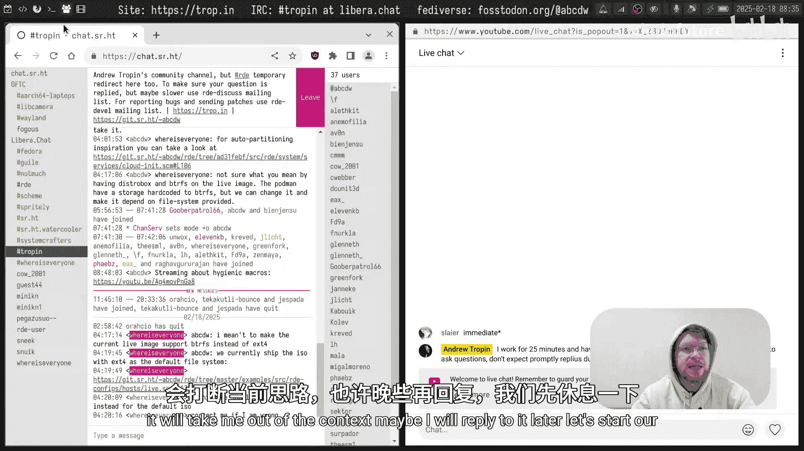

And。I will bring something。Something cool。 and you'll continue packaging the stuff necessary for。

For our homework。

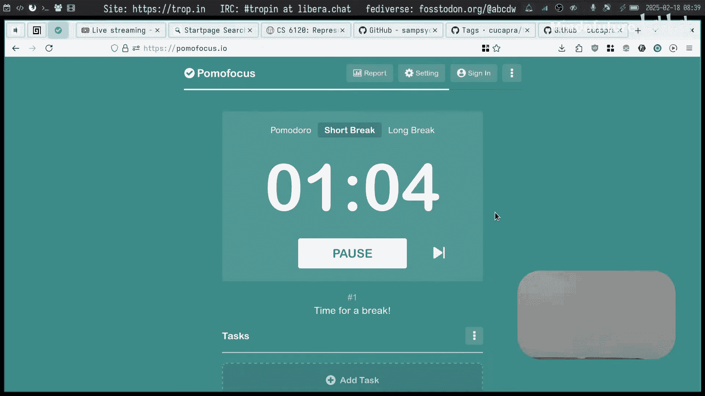

嗯。

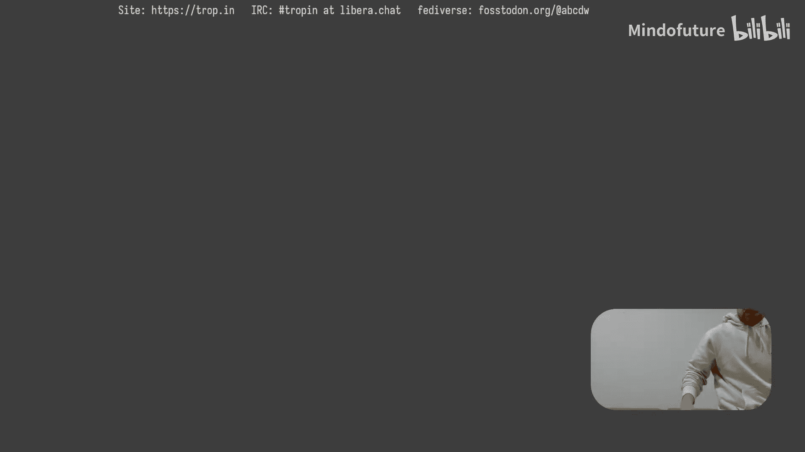

Interesting time。

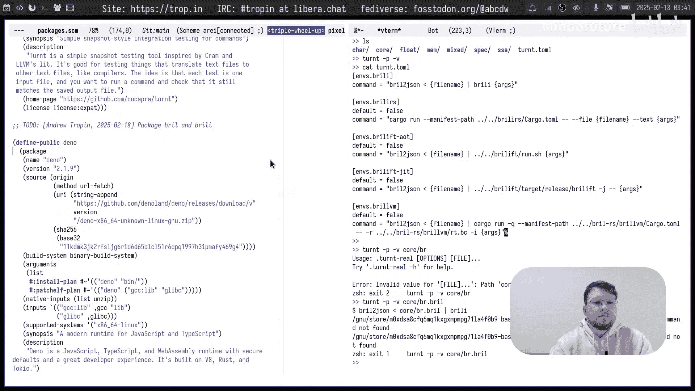

Okay， let's。So， let's go。Then package video。

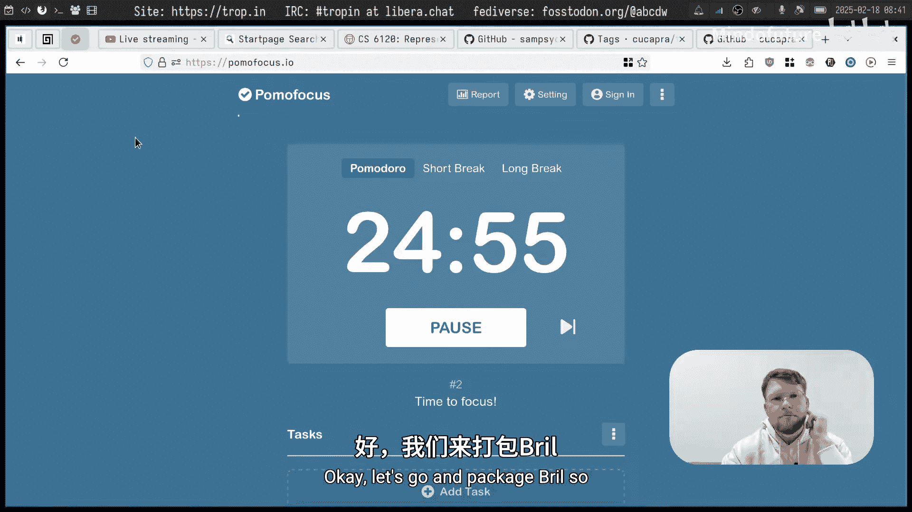

So you can add it to the environment， so our guarantee。Works as expected。 Why we do all that stuff。

 Because we don't want to test our programs ourselves。

 like manually by looking into the input and output。 we want to run like automated tests and。

It's already a set of tests prepared。嗯。So。It would be like， smart to use it。

If somebody interested in what I eat。It's just basically plain yogurt， like。White， usual yogurt。

老 fat。With oats and cherry， frozen cherry， which is not frozen anymore because we put them in a warm water。

That's， that's basically it。 That's my breakfast。Okay， let's。Let's take this。 S。 Let's put it here。

俾要。St existing。Let's put it。Here。嗯嗯。Let's see if it has any releases。No release is published。You。

I think。Show me the implementation。He the exactly what table。Because it accepts。エパスといえばエネルー。And。

Bears of。Environment， variable and value。But what I actually want is。Then or something。Let's， let's。

哦。In the wrong place。Make file。Let's add dinner。So the in environment。Make an again。Mmhmm。

By example of the day， if you want to。Yeah。Achieve something like this。

We just don't we generated ourselves。What if。If you put。Not the pass to the binary。But。This comment。

Should work。Isn't it。What's a she。It will be the review build system。And it will be。有的。Oops。

Delive you。Let's find some。うんも。The bested example。I am looking for two things from g syntax。And。

At the same time。Samsung like this。We have output。Be不。Search input files。Dart嗯。Alright。

I want to Arab program。Search input file。Be的呢。変子ヒルビに。To set some。They don't know。 That available。

Yeah。ge go tomorrow。ギすみをとき押す。😔，Con。We can jump to a program， because。It's。

A compile time model is not required in our package definition will be required only in the build script。

We can require it， of course。But， we don't need。Pass。気持。Take this example。嗯。啊。Like this。

 And I would like to see what will be in the。Build the result。Don't have this。你 don't你。Also stuff。

デレビビ。这秒。Co。No your呃。おとです。Sttop。Be。嗯嗯。Inputs。Please then。Mhmm。Operation， not permitted。

Which generation。うへえへ。On for Sp。 Oh， sorry， I see switched， switched the language。 I brain lick。

It tried to change the。File in the store。Which is not the want。Okay。

What else we have in gigs built to choose because。Our program is not exactly what we want。Let是。Oops。

嗯 see what they have here。Switch similar links， score。I temporary output。Inst file。Could be lit。Y。

Define constant。What is Arab script。スクリップ。Mmhmm。Lets do。Let's do the following。We have。Proogram file。

T NB。Which。嗯。I feel some pain。でらのくと。Understand what。What functions I have to use here。

Like the most straightforward way， we'll be just open a file and write a you strings into it。

Maybebe need do it。Like this， yes。All his。I would put5。5 procedure。5 will be。아우따르겠다。Right。Procedure。

The procedure requires。Acept one argument。我。嗯。Forment。Or。What to put here。It must be。

 It must be a special function to doing the same stuff。But they don't。Don't know its name。不记。

We do it on axis， Let's try to em it。Be。嗯。Nice。Okay。Make executable。Do you have such， such tool。嗯。

Make。Wriable。なてでけ。Thinkre cute about。St。About。Okay。We will make it executable ourselves。板棒。

D your name。什么。Okay。It's also524。Is executable。I guess。Yep， executable bit。W51。蛮什么。😔，Digits。

 as the first digits Select the set user。え。Said G。Execut to manエ。4。Okay， it's executable for。Oer。

 I guess。And editable for all other people。A， instead of being S H we should use。Something else。拜走。

我等吧。Don't care。We just need to get the result right now。嗯。Let's go here。No， let's。Let's go here。And。

 let's add。Ha some。か。I hear you the link。Give me a few minutes。Exect。잘랑。And。Here should be。

One more thing。And let's。A search input file。It should be。Should be veryious。

But it should be not in build inputs。し。The fire。Nothing8 inputs。I this example。W it looks so。你肥。

Not build inputs。 I need source。ok。啊。トらい？Gts， let's keep built inputs。And just。得ラ。Bely。我's see what。

What it says。Oh， it worked。They actually worked。5。No， we need。To do the same for a few more files。

 And I guess we are ready。

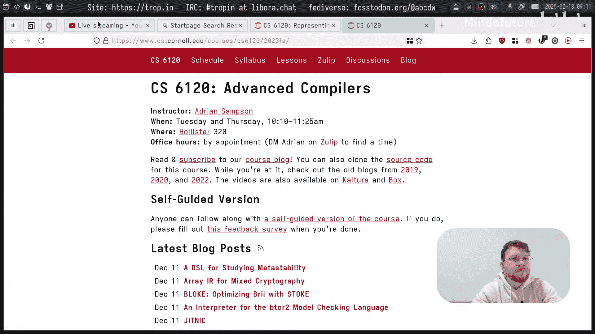

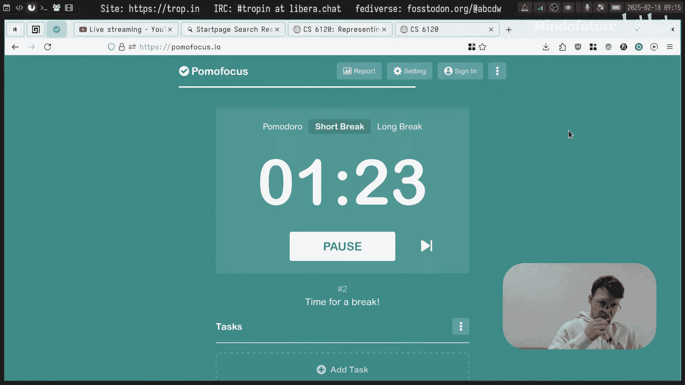

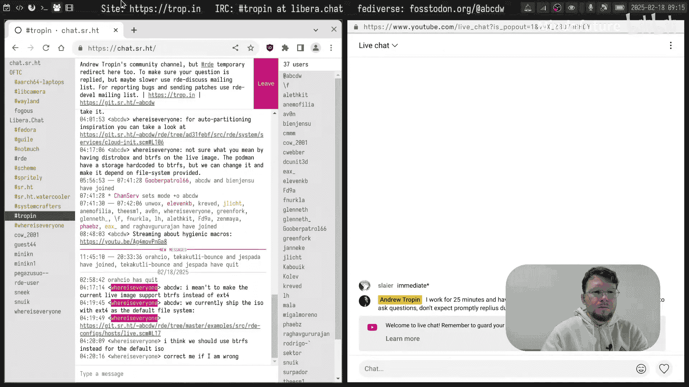

哦。

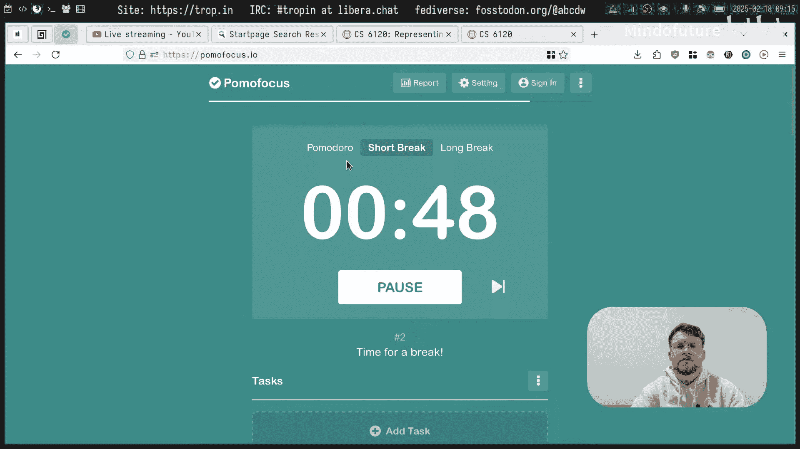

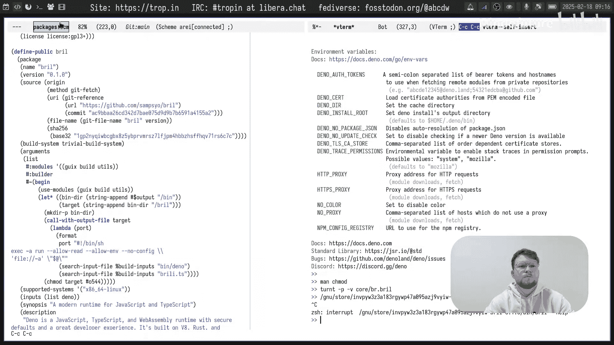

Okay， let's continue packaging our bur stuff。

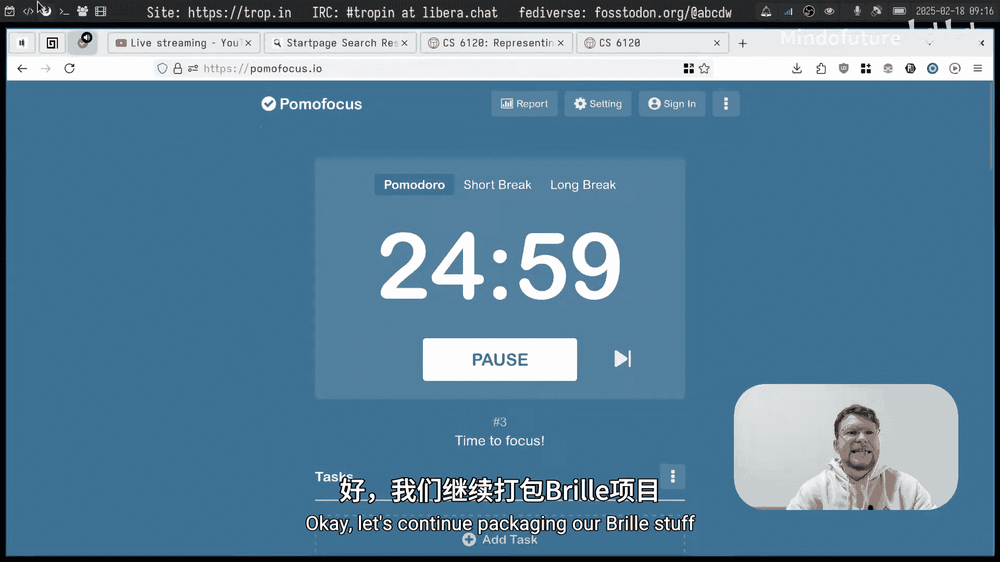

嗯。We almost did it。Just a couple thingss that lift。First of all， let's call it beillia。Second of all。

 let's generalize this function。嗯。H。This file。Oh wrap rap。Type script file， and it will accept。

The aggregate。Name and。Soce。Let's call the chest sourcing。Target for now。B near the file。ぱ。File。😔。

File。Okay， and。Here。😔，Tart。And here。Will be source。No。😔，We have this function， and we can just call。

A up this file。On。唔俾理你。This。From to。唔俾啲量。Like this。 What else you need。We need the drill to on。

 I guess。M to one。I hope real toson is also type scripting。Right， right。Please。😔。

Type script to video。咩食家。Yeah。I probably know。Bilte，ベil。Unfortunately， no， but I guess we are ready。

一的。Packaged it in core。In our core， file。I thought it would be easy。I it's not。嗯，那这的意见。

And believe you。15面15米。😔，Where is B toson。没有。と。I definitely remember that。 We already。오れジ実三シントイ。

But you。😔，Okay。Yes， we did。Which is this。Now， we need to wrap a few more。And it will be Python now。

诶爸斑爸斑。八笨。嗯。Let's， let's see how。How our joint。B it it looks like。Because it's all。오지。Okay。就人得요。

Impertuant as mode。I'll check out。没得用。Okay， let's， let's just build B T X T。This， this by project。

Li시。Alright。We only need fleet core。So it should be the same。

It should be absolutely the same as student。Okay， it will be brilliant。这有 be别1。

Let's finish this package definition。And now we need a br to and bur to T T。呃，不 bump bump boom。

C this嘅歌。And that's a bill to try on。S Bager wrote a be to son in rest。That's okay。 It's fine。

But we won't use it。Yeah。We will define one more package。 Let let's finish this， this one。

It don't need。this thing。Its this one。Bely。미리우인들 브리에터。Then。😔，Base。😔，Vo。P。诶一灯。In type scriptプ。Okay。

 we have belia。Let's try to build it。To sure it works very。And now， let's copy you past it。腿用度。

Bll do derick and Brazil steam。テクティ。オケーベオチクテ。What do you want。

 What you want do you want to inherit it。From Berlin。And we don't need source squ。

My project bill system。We don't need arguments， and。In our native inputs， we need。白灯。熄 the灯。过了。不。都最衰。

And。Repon to believe。都。拜灯音。的tion哦。你算。Okay， and now butll takes that。好。And recognized keyword。What。

What the heck。Which keyword you don't recognize， man。Keyword or。Comment。嗯，O。Okay， no the problem is。

Q。😔，Mans。We had arguments inherited from the previous package。No name。Ts。mhm。バイたした通。不了。インterラト。

Bist view。Geks search Baptist。嗯， o o o诶。不定用。Bye。😔，おち。😔，Can I specify the source directory for。

By project build system。Name inputs， tests， phases。Output search passes。System girl models。Mify。

Prases。拜灯。😔，嗯。Sometimes。I want to have like a local fine tune， tune。Fine jump。A a limb。

 so I can just ask here。Hows the fact to do this thing。Just replace with a quote。But right now。

 I need to do it myself。Mmhm。Gameified faces。Standard phases delete， it replace， it replace。はぱ。

Have done。天期技术。And where you want to change B T X T。ベオティクシティ。Come on。嗯，来的再 bug。し？Now。

 it should be better， I guess。Okay。Much better。Check。House。嗯，对。Okay。け？Gave your clothes。嗯。Work par。

終わる。Pyon over par。I guess it should be in。我记得。変。Orある。Part。Or just inputs。我 see。Actually。

 if it still wraps everything into binaries。Like with set by and pass， we don't need propagated。

In say yes。Gigs， Pythton pass。多么咧。W。So。In our previous packagegage for Jordan。

I guess Python click can be dressed in inputs。What they everything And now。

 go to make file and add guarantee。Berly in Be6sty。And now。Make in。我希 what的。What is this。

 What did this。我。And a heck。Expect a reasonable continuation。Okay， okay。 I know what。The problem is。

 probably。Okay。ho。嗯。Have already thought that something serious。But。No。You we have。Bre。

 br to6地 br toson。Bil to dress。Let's go to。三小不。And now， but you。异议。嗯。Okay， okay。Andryson。Co， now。

Withs。Call the real toson。Cool， and now let's be it。Nice。This is so cool。We did everything。

That we need to run our tests。Just in one and a half hour when it could be just a few minutes。

What the wonderful overall。交了吗。哔哔哩。ベ理由。Take their gigs packages。Make file。Oops。嗯。うh。Mmhmm。Make file。

At。And that'll get。And。これです。全じ。Pages。I'm not sure if I were right correspond， right。嗯。And。

Oh's it move。dinnerino from here， because we don't。Actually， need的。Nice。

Now let's try to run some tests。저治。Test。This。Could it be。1 T minus minus0。嗯。ほほほほほ。Mmhmhm。啊。可爱。

We have almost everything working。😔，We just very a nice， We is read nice。Wait， I you Russian。Yes。

 I am。How did you know， is it my heavy accent or because I just randomly speak in Russian sometimes。

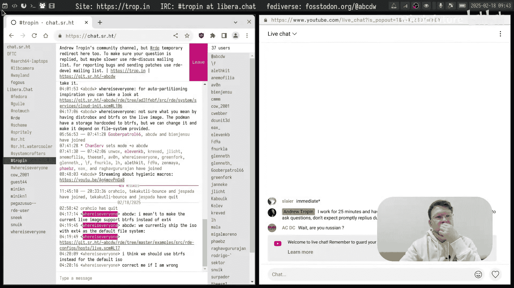

Okay， it's a short break， but I don't know。 Maybe I would like to do。

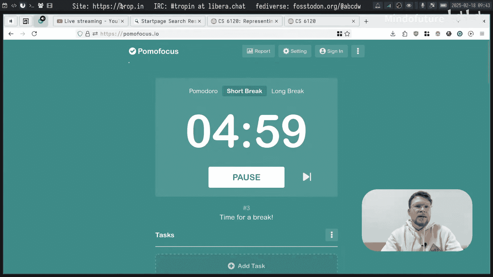

I stretching because I'm a bit tired， and my back hurts。

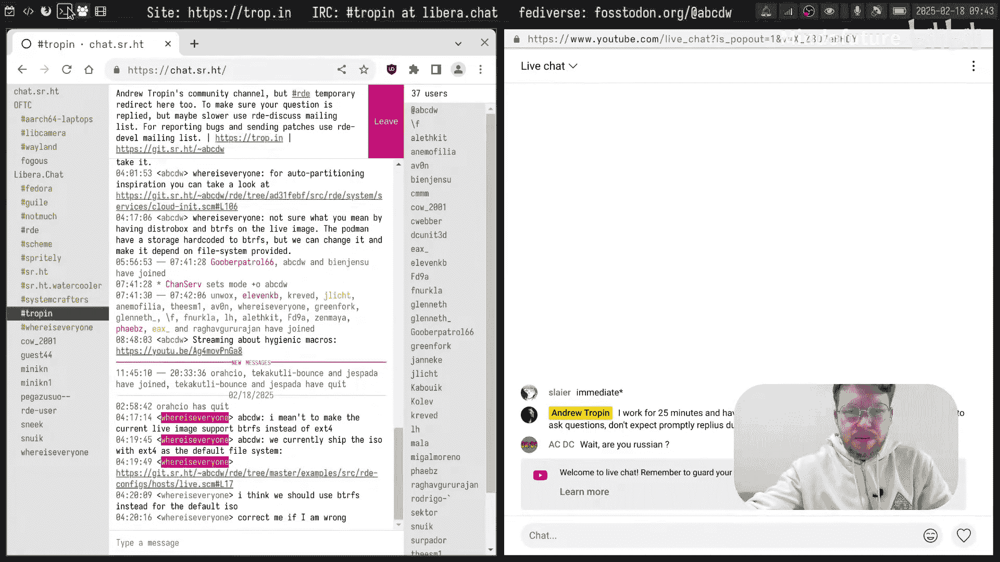

By the way， I made a funny joke because at least I think it's funny when my master must done。

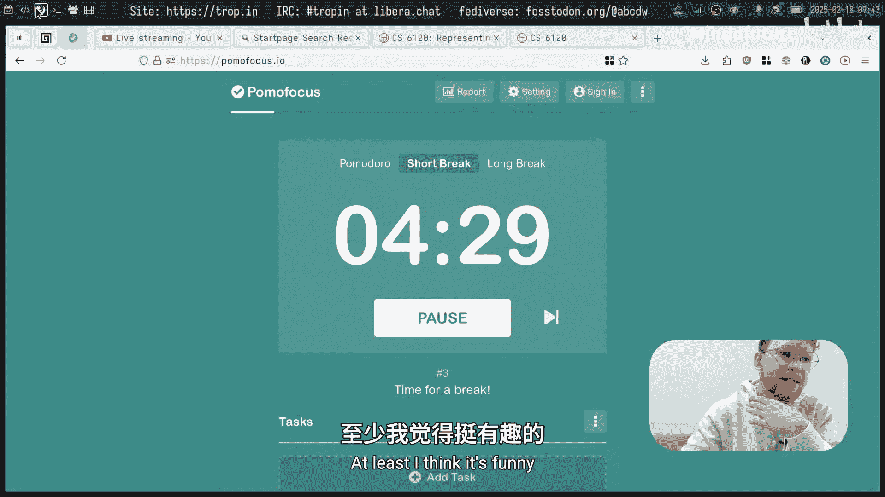

Today morning。If you're curious about。Oh， it's my。Aund account。

And I will get banned in the chat for posting killing， K guess。

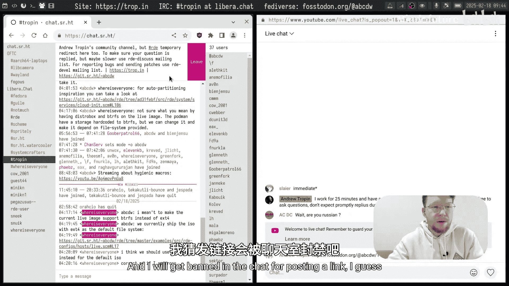

A you。For the work。Top jet。 leaf chat。

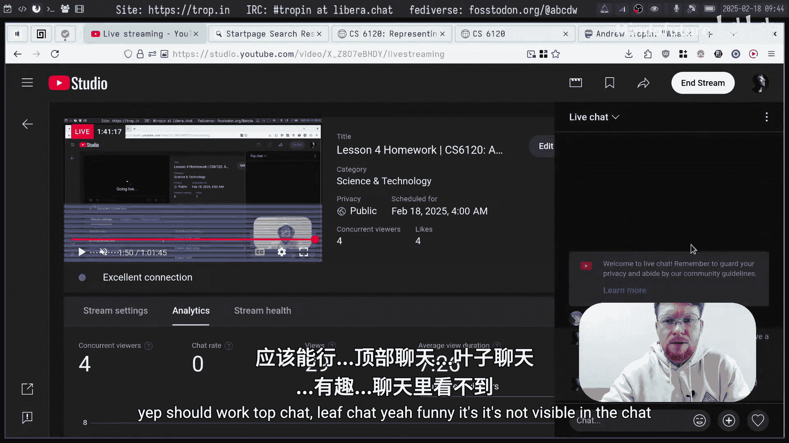

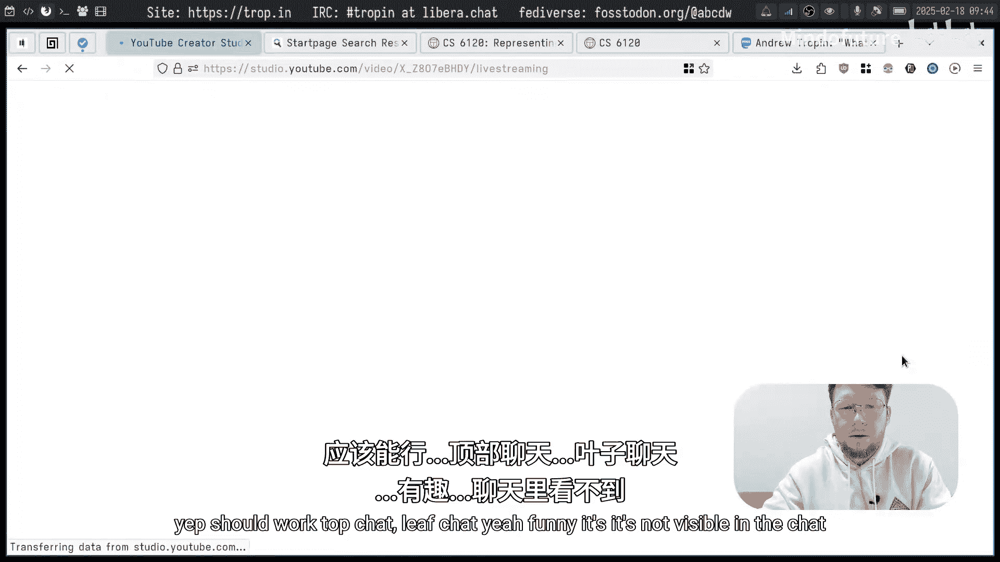

你快一点。It's， it's not visible。In the chat。

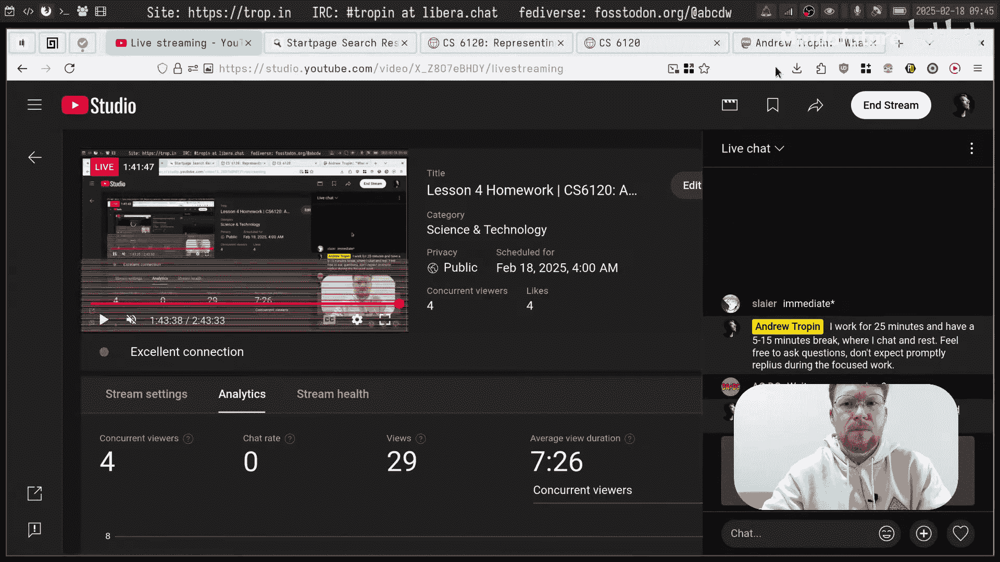

I think that this joke is very much on topic of your question。Okay。O。

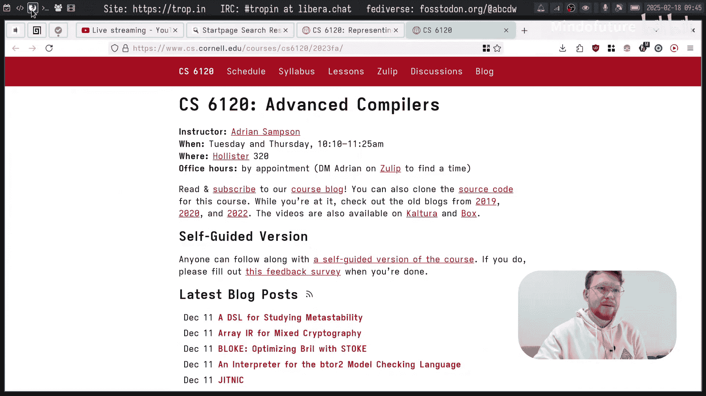

What is going on。We are doing a break。 I will。Take a short walk around。Around the flat。

 and you'll come back。And。But probably' start to quit after that。

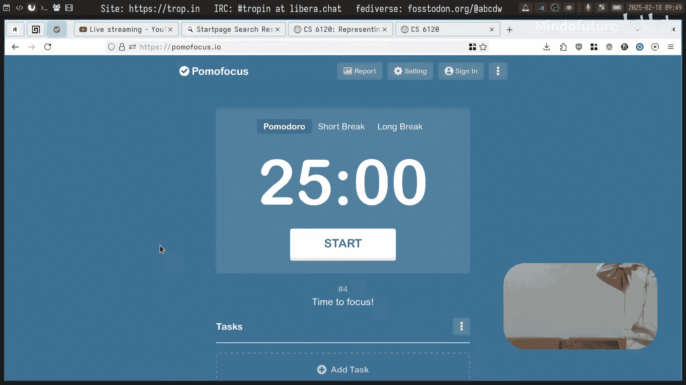

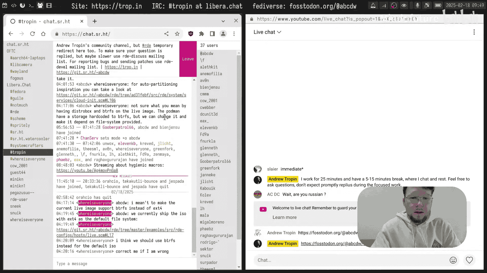

The break went so quickly。

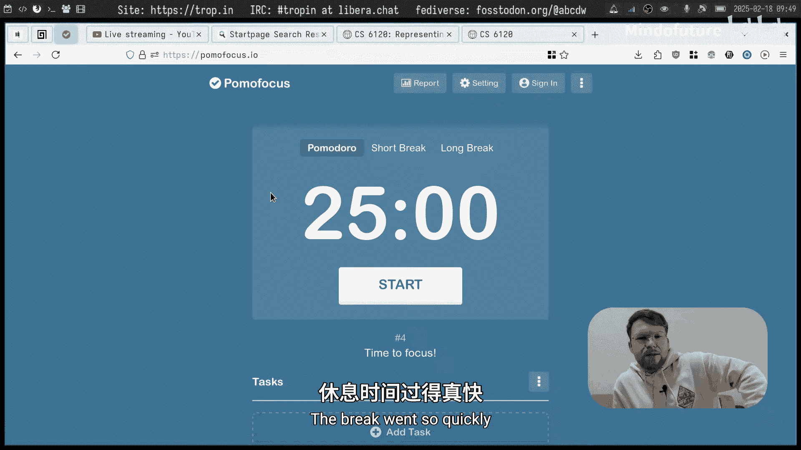

嗯，呵呵。

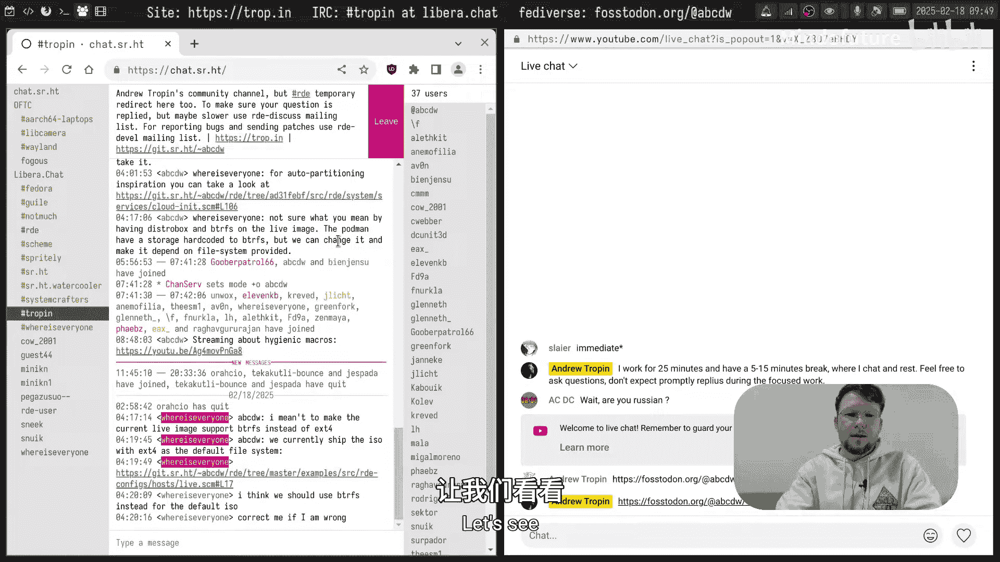

给。Okay， okay， let's see。

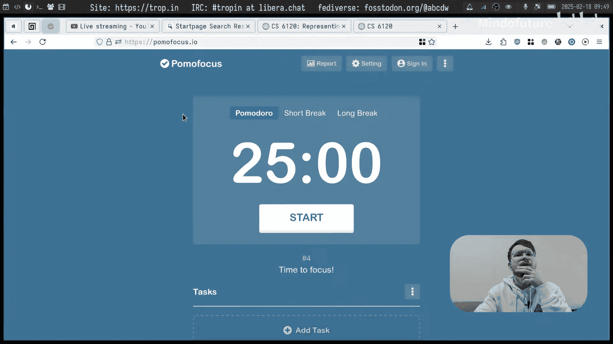

HeReing the programs。What is happening here。Block post。Your goal is to get familiar with Brile。

 We did it。P Iranian， it was really rigidted。And宝。バ bo bang。

rite program to analyze or transfer burial programs in some small way。We already did it。

 Use guarantee to test your new tool。Mm。What of traditional unit testing that is you don't have to write these complicated specifications this I've just find。

 in my experience， is a super super useful way to go about gaining confidence that your implementation for board2 do I test infrastructure for the interpreter directory as a bunch of tests for the interpreter。

 It has this。It has， let's see。 it's got a divide program。And if you look at that。

 it's just a normal brale program and then checked into the repository is an example is the output of that tut do Tamel。

 which is just indicates like what command we're supposed to run in this。

 And there's like other things that you can read about in the read me for turent that you can put in the configuration file。

 But this is the sole of it。 you just kind of like write down this command to say that like I'm going run I'm going convert the input file that's this one div dot Briille in this case to Jason super just go over to the interpret directory。

 And if I just say Tt div dot Briille。 this will， I'm going to execute this command and just show you after every time on a whole bunch。

Here that。Well， that's surprising。 but other than that。

 you can you can see that this makes it easy to run the same command on multiple files just to observe the output while you're debugging。

In any case， we're going to ignore that bug in the interpreter right now。

 I actually don't know what's going on。 I think it's just an old version of the interpreter。

 It's trying to run。 And we're going to flip back over to our CFG example and set up some testing infrastructure for it。

I just wna run the690 like this where the test files are asked to the the interpret and the flat as the。

Save this save something to disk called Ju dot out。 We can look that testing something meaningful。

 different。 get a different changes。At a second，And let's see went。You got it exactly right。

 That isn at all。Or。Going to you。搞官。Hey， it works。 cool。 So this。And what are' we looking for is。For。

Examples on how to run multiple tests with certain。 And actually， this is。

What I've almost already tried， I did it in a slightly different way。嗯。And now I did it this way。 Pa。

 let's。Let's remove B and V。Look the door on this this。Okay， okay。Gol。こうわれないです。

We have everything working。Some好。Somehow。Now， what I want to do。I want to do。I want to find。

A list of tests。Which。Will allow me to do a following trick。 I want to inject。

An intermediate optimization。In度。Into the pipeline。And。Make sure that the result is the same。

The results in program。Will will be interpreted the same way and produce the same result。

That's what I want to do。Let's go and see this。This。嗰啲。嗯，哼哼。Oh。

I think this is typically didn went through yet。Let let's read。 Let's read the description of this。

Test for core drill。 Test for the floating and point extension。Chair extension。Mix。

Multipple extension。Okay， okay。连金。バ。What is in。嗯，读啊。We have benchmarks。

The benchmarks what we are looking for。Bal benchmarks。I don't like how the surface feels。ポ。Okay。

 the benchmarks。What cool about this directory that it is the same stuff。As是 we。Over already。

So in tests。But。The programs are much longer。And much more complicated。So， you can。

Be a relatively reassure that our optimization don't break like real world programs in Brazil。

His was implementation but。你这洗机。Gmetrictic some。And当せ stuff。Qu a flow longm。嗯。Okay。

 we need core benchmarks。I think it should be mentioned in lesson3。Be the believe。응 그래서 대렉토리。Brain。明。

Example。Test。Test Dc。讲吧。Mmhm。That elimination。Instead of this comment， you will inject our comment。

That we will do that code elimination。Isn't。This be beautiful。Okay， let's do it。 let's do it。

And they think it will be enough。Let's read it。When working on your implementations。

 try them on simple。And there and。Pri and as examples in G， he test director。

To see if they actually work。Somehow。Interging to quas， Try out。You pass somethingsung like this。

All number。

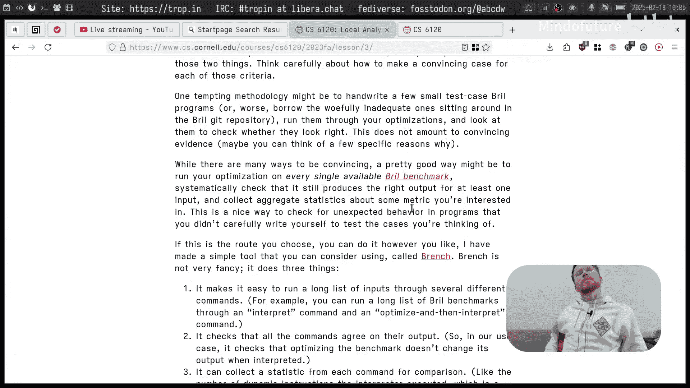

I think we need to rename today's stream。It should be lesson to homework。Not less and4。ILis。都好玩。

ItCom3 me。嗯。The drink。😔，B you drink。转机。Bilely and burial。D xt。都。ウスキック。8 concurrent u。My friends。

What are you doing with your life。

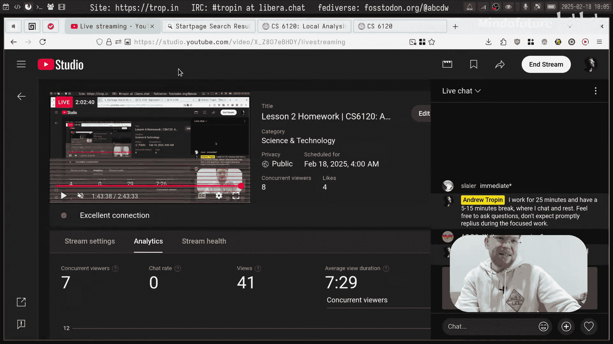

You're watching a guy struggling。With some list code。And packaging。Python and jascript stuff。

To be fair， it was almost a pleasure to package all that stuff。Because it didn't like。

Made any surprises。I call the dependencies。 We are already available。

only hockey think that I did the spectrum then of this binary bit build system， but it was also easy。

So， I am very surprised that。嗯。All the those。For believe a soul。Easy to package。M嗯m。😊，Mmhmm。Okay。

 let's。Let's do what。 Now let's do what。Let's create a simple function。Which takes a program。

 and the returnsance absolutely the same program。But and after。After that。We will get。More friends。

Functions。Con scoring and turn。I guess we don't need the ce wheel anymore。But let's keep it。嗯。

Let's create。Ging P SCM。 And let's move。The necessary quote to it。嗯。Maybe we even rename it to draft。

Sim。Okay， now we create the function。系点知置。Tran方。Which。Which edit from Estodine and。Post to SG out。

How hope you do it。嗯。Let's do it name。 kinda name。We define available。Input。一曲牛逼。itお。It is dream。

Stream。Get the link。I use some model。Get the of。Current input。What。Okay。En。嗯。In display。

This is input。Okay。Get didn golf。Hello。Hoops。嗯嗯。The question is。The question is， how to。Sent。

And the file date。What if。The wrong type argument and position 1， expect string。嗯。I broke it。

 somehow。Let's， let's3。Don the。Donど sortかて。No， not， not not。嗯。No way do send。You off to yesterday。P。

Mii buffer。Following link quad。你那边。😔，Finish。と。Yesterday。Mo。Over。If。V议。Use control 3。It breaks。Okay。

Okay。Now， whats your doing。We very connectable the sync。And tri。Our evaluation threat。Youll be。

The low。Youll be frozen again。Let's take a quick look。Compilation。8块。Session is the dean。Mmmmmmmmmm。

Let's update。How to edit it okay。Moreover， if he use。G。Is sent。Instead of。Stリ。

Probably should be a separate ticket。Since。New as。Yes。Should send。Se多。Not the greatest。Forulation。

 I would say。那他们认识。What is the correct word for， for it origin。Not the greatest origin， I guess， but。

I hope I will be able to understand what was written here。 Now， we have identity transformation。

Which should work。The following way， we have our each term。And in our vi。Be have gu。

Which we would like。哦。Yes， I see Gu。And。A等于几几。In find public。Nice oops。Really good。It works。

 It works。 Very nice。No。I can take。And this thing。And put it into。嗯Vo。D。Let test the examples。只知是二。

90机。我不不。嗯。Okay。Let's close it， and。Let's go back to each other。And say， examples。D。自止是衣。光播不6。Not O。

Differentiffent， what is the difference。Gol。Cool， do you provide it。Oh。Iデじ。Transformation。

 and it's not。 It doesn't。 It didn't remove the lines from here。Mmhm。嗯。What I。say。No。Let's create。嗯好。

That got elimination。Transformation， white calls TDC E。 What does mean。呃， deliver。康杰之之时。

They revealed that qua illlimination。Which will basically call identity。Transformation。And。

 let's update。叫拌机。Drieth delimination。And let's get around it。Nice。And let's do one more thing， lets。

Let's take a make file。And， let's create this。直止试。Which will。V。然。Thank you。Very。你 will do。

First of all， we need D F N， al right。After that， we need to do。就了。あ지。Examples this。自Dし。这し。

The videoide。And also。に。He， I will just write it down。Beve Eric。Alright。等到。At con。Will it work。

Make this自己。公啊诶。Wonderful。Wonderful。No。😔，I you。阔py。就机。TC that。デレトリ。And。都录。嗯嘿呵。Like this。

And now let's update it to use a configuration file。Joy makesmanco。Again。Yes so。咩个事。😔，햇설시 전기지嗯。

デジしだっとも。Right。😔，And now， make。Options。File。Did they forget。Something。嗯，给。I misspeeled。

And maypell the file name。 The error message is not。Hop cool。No comment is specifiedified。G只是E。Do do。

Let's I check it one more time。Yes， it points to the right place。

Why no common specified comment to specified。 I I can see it。Mmhmhmm。😊，哦哦哦哦。还行。My bet， I guess。

it' 벌어 볼래。Use only a relative name to the directory， where the file is located。So。

 this one won't work。Work。😔，えし。隠してま。こ？嗯。嗯。Or， it doesn't。Play well with a file names。Okay。Very。

 very poor。This is apo。This is。Hepo。Nice。Now they can arrange tests。嗯。Make file。Quarter。え？

And the end and the join。Check。Did这个哦。That could。N生的。So we are almost doing the driven。

With external test。So， we will be able to。Like work when the optimization passes。

And they run those tests every time。It should be， redified。Oops。Okay， okay。That's good。

 I think we can push it。And we have。

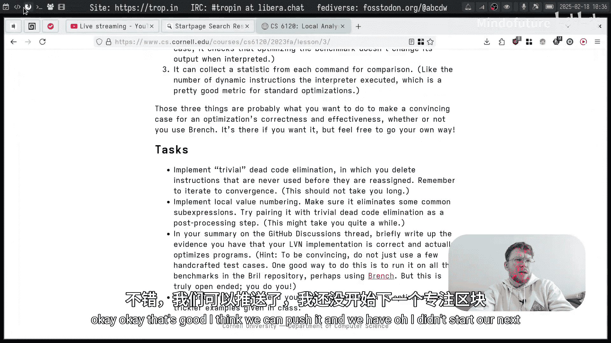

Oh， I didn't start our。

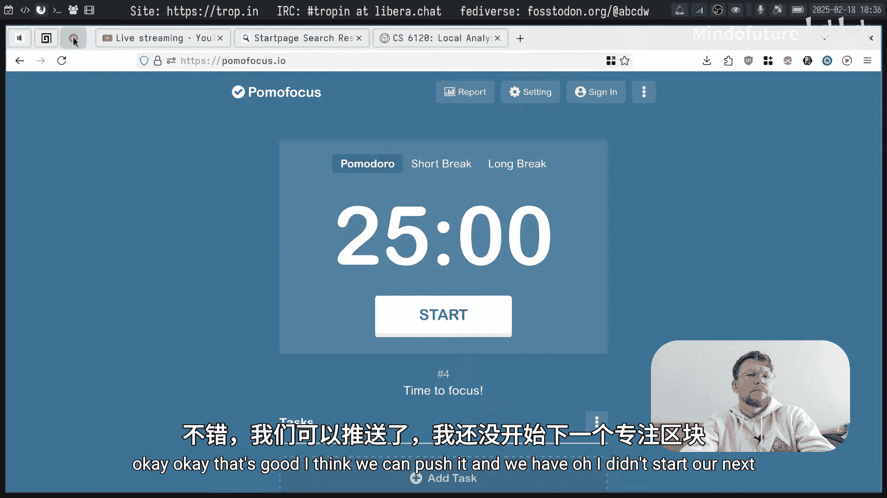

Next focus block， but not the big deal。Not a big deal。

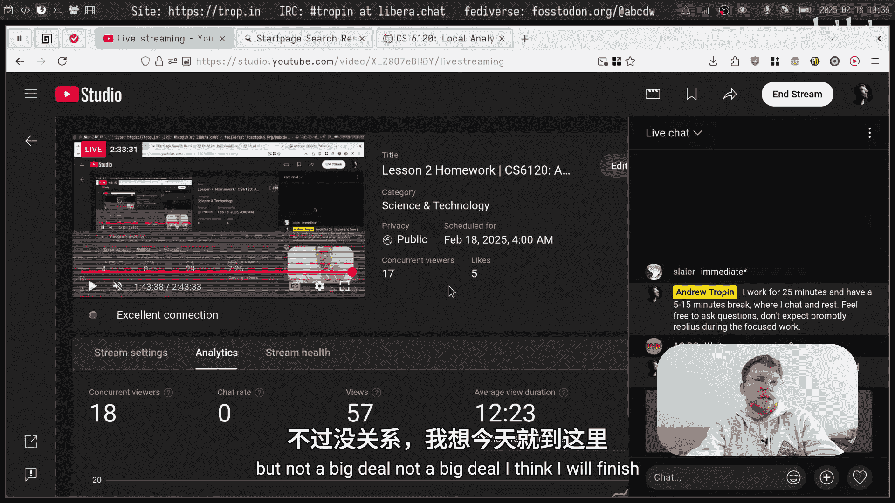

I think I will finish。The stream。Just right here， because we already did。A lot of things。

 And alreadyter bit。And would like to have a longer break without pressure of people waiting for me。

And I guess we can continue just tomorrow morning， the same time。嗯。

And actually write and implement some optimization passes。So for today。

 we packaged guarantee we packaged， but。Berial interpreter， burreial text， the tools。

 which we use for transforming。Brill to dress one and dress one to Brile text representation。

And we set up our test infrastructure that we will be using for test driven development。Tomorrow。

Beaches。

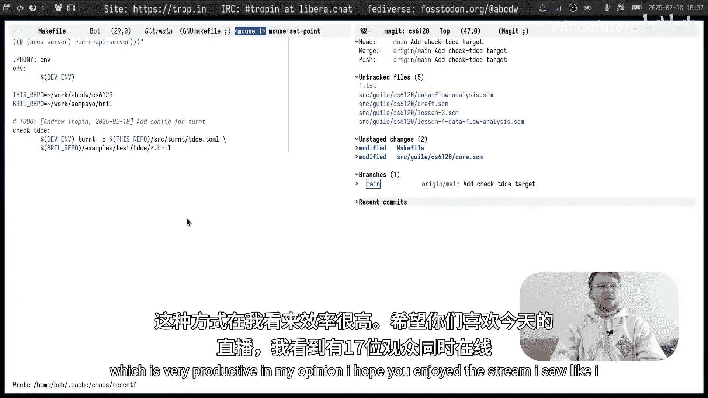

Very productive， in my opinion。I hope you enjoyed the stream。I saw like。

 I see 17 concurrent view where you guys come from。But Im very glad that you come。

 and I hope you really find something useful in this stream， and I will see you in a bit。

Probably tomorrow。行。

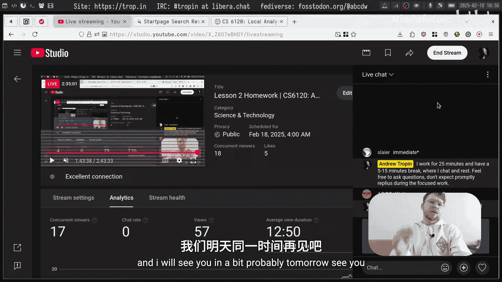